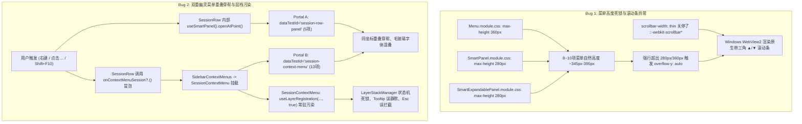

# 专项深度排查 07：菜单高度死锁与滚动条异常及双重幽灵菜单深度排查报告

> **排查定位**：菜单组件高度限制死锁、Windows WebView2 下滚动条生硬小三角（▲/▼）样式异常、侧栏会话菜单双重重叠穿帮与 `useLayerRegistration` 幽灵层污染深度排查  
> **排查基准版本**：Conex / Crish Desktop Next  
> **报告类型**：源码深度调研与深层 Bug 根因剖析（纯排查分析落地，严禁修改任何业务代码，严禁编写重构方案）  
> **涉及核心文件**：
> - [`Menu.module.css`](file:///c:/Software/conex/apps/crish-desktop/src/components/ui/Menu/Menu.module.css)
> - [`Menu.tsx`](file:///c:/Software/conex/apps/crish-desktop/src/components/ui/Menu/Menu.tsx)
> - [`SmartExpandablePanel.module.css`](file:///c:/Software/conex/apps/crish-desktop/src/components/ui/SmartExpandablePanel/SmartExpandablePanel.module.css)
> - [`SmartExpandablePanel.tsx`](file:///c:/Software/conex/apps/crish-desktop/src/components/ui/SmartExpandablePanel/SmartExpandablePanel.tsx)
> - [`SmartPanel.module.css`](file:///c:/Software/conex/apps/crish-desktop/src/components/ui/SmartPanel/SmartPanel.module.css)
> - [`SmartPanel.tsx`](file:///c:/Software/conex/apps/crish-desktop/src/components/ui/SmartPanel/SmartPanel.tsx)
> - [`SessionContextMenu.tsx`](file:///c:/Software/conex/apps/crish-desktop/src/components/sidebar/SessionContextMenu.tsx)
> - [`SessionRow.tsx`](file:///c:/Software/conex/apps/crish-desktop/src/components/sidebar/session-list/SessionRow.tsx)
> - [`Sidebar.tsx`](file:///c:/Software/conex/apps/crish-desktop/src/components/sidebar/Sidebar.tsx)
> - [`SidebarContextMenus.tsx`](file:///c:/Software/conex/apps/crish-desktop/src/components/sidebar/SidebarContextMenus.tsx)
> - [`useSidebarContextMenu.ts`](file:///c:/Software/conex/apps/crish-desktop/src/components/sidebar/useSidebarContextMenu.ts)
> - [`overlay-scrollbar.css`](file:///c:/Software/conex/apps/crish-desktop/src/styles/overlay-scrollbar.css)
> - [`LayerStackManager.ts`](file:///c:/Software/conex/apps/crish-desktop/src/components/ui/internal/layer-stack/LayerStackManager.ts)

---

## 目录

1. [排查综述与问题复现概览](#1-排查综述与问题复现概览)
2. [为什么屏幕空间充足却强行出现滚动条](#2-为什么屏幕空间充足却强行出现滚动条)
   - 2.1 `Menu.module.css` 与 `Menu.tsx` 中的 `max-height: min(..., 360px)` 死锁硬编码
   - 2.2 `SmartExpandablePanel.module.css` 与 `SmartPanel.module.css` 中的 `max-height: 280px` 死锁硬编码
   - 2.3 1080p / 1440p 高度充足屏幕下 8~10 项菜单的盒子模型高度与截断溢出证明
   - 2.4 滚动条呈现出带小三角（▲/▼）生硬样式的 Blink / WebView2 渲染机制根因
3. [为什么侧边栏会出现双重幽灵菜单重叠穿帮](#3-为什么侧边栏会出现双重幽灵菜单重叠穿帮)
   - 3.1 `SessionRow.tsx` 本地面板与 `SidebarContextMenus.tsx` 全局菜单的双重触发时序
   - 3.2 两种数据源（5 项精简菜单 vs 13 项全量上下文菜单）的 DOM Portal 叠压实证
   - 3.3 更多操作按钮（`...`）、右键点击与键盘快捷键的冲突链路全景
   - 3.4 `SessionContextMenu.tsx:56` 常驻 `useLayerRegistration(..., true)` 导致的幽灵层污染
4. [全仓浮层架构分裂与组件现状对比](#4-全仓浮层架构分裂与组件现状对比)
   - 4.1 `Menu` / `SmartExpandablePanel` / `SmartPanel` 三套体系对比表
   - 4.2 浮层注册与滚动条样式规范违背清单
5. [缺陷与问题文件行号精确索引](#5-缺陷与问题文件行号精确索引)
6. [排查结论与汇报总结](#6-排查结论与汇报总结)

---

## 1. 排查综述与问题复现概览

用户最新提供的截图与反馈揭示了两个严重的交互与视觉缺陷：
1. **屏幕高度充足（如 1080p/1440p 视口，可用高度达 800px~1200px）时，侧栏会话菜单被生硬截断，并出现带有上下灰色箭头按钮（▲/▼）的原生 Windows 粗糙滚动条**。
2. **在侧栏右键点击会话或点击“更多操作（`...`）”按钮时，屏幕上同时弹出了两个不同内容、不同样式的菜单，并在完全相同的物理坐标上发生重叠穿帮，文字和图标混杂**。



---

## 2. 为什么屏幕空间充足却强行出现滚动条

### 2.1 `Menu.module.css` 与 `Menu.tsx` 中的 `max-height: min(..., 360px)` 死锁硬编码

在 [`Menu.module.css`](file:///c:/Software/conex/apps/crish-desktop/src/components/ui/Menu/Menu.module.css#L15-L19) 中，`.menuContent` 样式规则第 15~19 行硬编码了如下限制：

```css
/* apps/crish-desktop/src/components/ui/Menu/Menu.module.css:15-19 */
.menuContent {
  ...
  max-height: min(
    var(--radix-popover-content-available-height, 360px),
    70vh,
    360px
  );
  overflow-y: auto;
  overflow-x: hidden;
  ...
}
```

同时，在 [`Menu.tsx`](file:///c:/Software/conex/apps/crish-desktop/src/components/ui/Menu/Menu.tsx#L295-L299) 的 JSX 属性构建中，又在内联样式上再次硬编码了：

```tsx
/* apps/crish-desktop/src/components/ui/Menu/Menu.tsx:295-299 */
const resolvedMaxHeight =
  maxHeight != null
    ? `min(${typeof maxHeight === 'number' ? `${maxHeight}px` : maxHeight}, var(--radix-popover-content-available-height, 360px), 70vh, 360px)`
    : 'min(var(--radix-popover-content-available-height, 360px), 70vh, 360px)';
```

**问题根因剖析**：
- `CSS min(...)` 函数取传入参数的最小值。因为表达式中存在硬编码常量 `360px`，无论 `--radix-popover-content-available-height` 计算出的可用屏幕高度是 `800px` 还是 `1200px`，无论 `70vh`（在 1080p 下为 `756px`）有多大，`min(availableHeight, 756px, 360px)` 的结果**永远不可能超过 360px**。
- 这造成了**人为的 360px 高度死锁上限**。

---

### 2.2 `SmartExpandablePanel.module.css` 与 `SmartPanel.module.css` 中的 `max-height: 280px` 死锁硬编码

在目前作为会话上下文菜单实现底座的 [`SmartPanel.module.css`](file:///c:/Software/conex/apps/crish-desktop/src/components/ui/SmartPanel/SmartPanel.module.css#L98-L108) 与 [`SmartExpandablePanel.module.css`](file:///c:/Software/conex/apps/crish-desktop/src/components/ui/SmartExpandablePanel/SmartExpandablePanel.module.css#L120-L130) 中，列表容器 `.listContainer` 均硬编码了极低的静态最大高度：

```css
/* apps/crish-desktop/src/components/ui/SmartPanel/SmartPanel.module.css:98-108 */
.listContainer {
  display: flex;
  flex-direction: column;
  gap: 2px;
  max-height: 280px;  /* <-- 致命硬编码：强行限制在 280px */
  overflow-y: auto;
  overflow-x: hidden;
  scrollbar-width: thin;
  scrollbar-color: var(--sep-border-hover, #c9c5bc) transparent;
  padding: 1px 0;
}
```

```css
/* apps/crish-desktop/src/components/ui/SmartExpandablePanel/SmartExpandablePanel.module.css:120-130 */
.listContainer {
  display: flex;
  flex-direction: column;
  gap: var(--sep-item-gap, 4px);
  max-height: 280px;  /* <-- 致命硬编码：强行限制在 280px */
  overflow-y: auto;
  overflow-x: hidden;
  scrollbar-width: thin;
  scrollbar-color: var(--border-subtle) transparent;
  padding: 2px 0;
}
```

**问题根因剖析**：
- `SmartPanel` 的 `.listContainer` 被锁死在 `280px`。
- 只要菜单列表的总内容高度超过 `280px`，就会立刻触发 `.listContainer` 的 `overflow-y: auto`，产生强制滚动条。

---

### 2.3 1080p / 1440p 高度充足屏幕下 8~10 项菜单的盒子模型高度与截断溢出证明

我们对 [`SessionContextMenu.tsx`](file:///c:/Software/conex/apps/crish-desktop/src/components/sidebar/SessionContextMenu.tsx#L59-L135) 中的 10 项菜单 + 3 处分割线进行严格的盒子模型尺寸测算：

| 元素类型 | 数量 | 单项盒子属性与尺寸 | 累计高度占用 |
| :--- | :--- | :--- | :--- |
| **标准条目 (`.item`)** | 10 项 | `min-height: 28px` + `padding: 4px 8px` + 文字行高 `13px * 1.35 = 17.55px` + 图标 `14px`。实测单项渲染高度为 **30px** | `10 * 30px = 300px` |
| **分割线 (`.divider`)** | 3 条 | `height: 1px` + `margin: 3px 0` (上下外边距各 3px) = **7px** | `3 * 7px = 21px` |
| **Flex 间隙 (`gap`)** | 12 处间隙 | `gap: 2px` | `12 * 2px = 24px` |
| **列表内边距 (`padding`)** | 上下 | `padding: 1px 0` (上下各 1px) | `2px` |
| **`.listContainer` 实际自然高度** | — | **300px + 21px + 24px + 2px** | **347px** |
| **面板外壳 (`.panel`) 边框与内衬** | — | `padding: 6px` (上下各 6px = 12px) + `border: 1px` (上下各 1px = 2px) | **14px** |
| **菜单整卡自然高度** | — | **347px + 14px** | **361px** |

**数学与逻辑证明**：
1. 在常规 1080p 屏幕（视口高度 `1080px`）或 1440p 屏幕（视口高度 `1440px`）上，右键点击会话列表（通常在 `Y = 150px ~ 500px` 位置），下方剩余可用屏幕空间为 `1080 - 300 = 780px`，空间极其宽裕。
2. 然而，[`SmartPanel.module.css`](file:///c:/Software/conex/apps/crish-desktop/src/components/ui/SmartPanel/SmartPanel.module.css#L102) 强行设定 `max-height: 280px`。
3. `347px（自然高度） > 280px（强制上限）`，溢出量达到 `67px`（约截断 2.2 个条目）。
4. 即使在 [`Menu.module.css`](file:///c:/Software/conex/apps/crish-desktop/src/components/ui/Menu/Menu.module.css#L18) 的 `max-height: 360px` 规则下，`361px > 360px`，依然会溢出 `1px`，导致只要有 10 项菜单，`Menu` 也必然被截断并触发滚动条！

---

### 2.4 滚动条呈现出带小三角（▲/▼）生硬样式的 Blink / WebView2 渲染机制根因

用户截图中呈现出十分不协调的“灰色背景 + 顶部 ▲ / 底部 ▼ 箭头”的原生粗滚动条。

#### 根因机制剖析：
1. **项目规范与全局冲突**：
   在 [`src/styles/overlay-scrollbar.css`](file:///c:/Software/conex/apps/crish-desktop/src/styles/overlay-scrollbar.css#L1-L6) 中，项目架构明确规定了细滚动条规范：
   ```css
   /* src/styles/overlay-scrollbar.css:1-6 */
   /* 细滚动条出口。禁名 shell-scrollbar.css，本文件为唯一 webkit 出口。
    * WebView2 / Chromium：必须走 ::-webkit-scrollbar。
    * 全局或容器上写 scrollbar-width 会关闭 webkit 伪元素，Windows 上仍露出
    * 带上下三角的系统粗条（survey/09）。默认 7px（6–8px）；域可覆盖
    * --scrollbar-thumb-width（0px 隐藏 / 3px 紧凑）。
    * thumb 走 --tint-scrollbar-thumb；轨道透明；无上下三角。 */
   ```
   并在第 40~49 行明确下达禁令：
   ```css
   /* 此处禁止写 scrollbar-width / scrollbar-color：会关掉上面的 webkit 细条。 */
   [class*='sidebarScroll'],
   [class*='menuContent'],
   [class*='coverContent'],
   [class*='navScroll'],
   [class*='dialogBody'] {
     scrollbar-gutter: auto;
   }
   ```

2. **违背禁令的局部 CSS**：
   在 [`Menu.module.css:26-27`](file:///c:/Software/conex/apps/crish-desktop/src/components/ui/Menu/Menu.module.css#L26-L27)、[`SmartExpandablePanel.module.css:127-128`](file:///c:/Software/conex/apps/crish-desktop/src/components/ui/SmartExpandablePanel/SmartExpandablePanel.module.css#L127-L128) 和 [`SmartPanel.module.css:106-107`](file:///c:/Software/conex/apps/crish-desktop/src/components/ui/SmartPanel/SmartPanel.module.css#L106-L107) 中，直接声明了：
   ```css
   scrollbar-width: thin;
   scrollbar-color: var(...) transparent;
   ```

3. **Blink / Chromium 引擎底层行为**：
   - 根据 W3C CSS Scrollbars Level 1 标准与 Chromium 实现逻辑，**一旦某个元素声明了标准 CSS `scrollbar-width` 或 `scrollbar-color` 属性，Chromium 引擎将全面禁用该元素上的所有 `::-webkit-scrollbar*` 系列伪元素规则**（包括 `::-webkit-scrollbar-button { display: none; }`、`::-webkit-scrollbar-thumb` 等）。
   - 在 Windows 10/11 的 Edge WebView2 环境下，禁用了 `::-webkit-scrollbar` 之后，Chromium 回退使用 Windows 平台的原生 DWM 滚动条绘制器。
   - 原生 Windows 滚动条在没有 WebKit 伪元素隐藏按钮的情况下，会自动绘制带有上下三角形小箭头（▲/▼）的步进按钮（Scrollbar Buttons），形成了破坏毛玻璃现代质感的粗暴灰色三角滚动条。

---

## 3. 为什么侧边栏会出现双重幽灵菜单重叠穿帮

### 3.1 `SessionRow.tsx` 本地面板与 `SidebarContextMenus.tsx` 全局菜单的双重触发时序

在侧栏会话行组件 [`SessionRow.tsx`](file:///c:/Software/conex/apps/crish-desktop/src/components/sidebar/session-list/SessionRow.tsx) 中，存在严重的架构双重挂载与事件双发问题：

```tsx
/* apps/crish-desktop/src/components/sidebar/session-list/SessionRow.tsx:219 */
export const SessionRow = memo(function SessionRow(props: SessionRowProps) {
  ...
  const panel = useSmartPanel(); // <-- 本地行状态机创建
  ...
  return (
    <li ...>
      <div
        ref={rowRef}
        ...
        onContextMenu={(e) => {
          if (isRenaming) return;
          e.preventDefault();
          // 【分支 1】：打开本地 SessionRow 自身的 SmartPanel
          panel.openAtPoint({ x: e.clientX, y: e.clientY });
          // 【分支 2】：同时向上层传递事件，触发 Sidebar 全局菜单！
          onContextMenuSession?.(e, s.id);
        }}
        ...
      >
        ...
        <Button
          ...
          data-testid="session-more-button"
          onClick={(e) => {
            e.preventDefault();
            e.stopPropagation();
            // 【分支 1】：toggle 本地 SessionRow 自身的 SmartPanel
            panel.toggle();
            // 【分支 2】：调用 openRowMenu 进而触发 onContextMenuSession！
            openRowMenu(e);
          }}
          ...
        />
      </div>

      {/* 【本地 DOM 挂载】：渲染第一个 SmartPanel */}
      <SmartPanel
        open={panel.isOpen}
        triggerRef={panel.triggerRef}
        point={panel.point}
        items={menuItems}
        onClose={panel.close}
        role="menu"
        ariaLabel="会话操作"
        dataTestId="session-row-panel"
      />
    </li>
  );
});
```

而在上层宿主 [`Sidebar.tsx`](file:///c:/Software/conex/apps/crish-desktop/src/components/sidebar/Sidebar.tsx#L322) -> [`SidebarContextMenus.tsx`](file:///c:/Software/conex/apps/crish-desktop/src/components/sidebar/SidebarContextMenus.tsx#L97-L106)：

```tsx
/* apps/crish-desktop/src/components/sidebar/SidebarContextMenus.tsx:97-106 */
{showSessionMenu && contextMenu && (
  <SessionContextMenu
    contextMenu={contextMenu}
    menuRef={menuRef}
    isPinned={isPinned}
    onSessionAction={onSessionAction}
    onCloseContextMenu={onCloseContextMenu}
    contextMenuTriggerRef={contextMenuTriggerRef}
  />
)}
```

```tsx
/* apps/crish-desktop/src/components/sidebar/SessionContextMenu.tsx:138-153 */
return (
  <SmartPanel
    open={Boolean(contextMenu)}
    point={{ x: contextMenu.x, y: contextMenu.y }}
    triggerRef={contextMenuTriggerRef}
    panelRef={menuRef}
    items={items}
    onClose={onCloseContextMenu}
    role="menu"
    ariaLabel="会话操作"
    dataTestId="session-context-menu"
    style={{
      zIndex: 'var(--z-context-menu, var(--z-popover))',
      pointerEvents: 'auto',
    }}
  />
);
```

#### 双重触发时序链条：
1. **用户在会话行上点击右键（或点击“更多操作”按钮）**。
2. **本地通道触发**：`SessionRow.tsx` 响应事件，调用 `panel.openAtPoint(...)`，将自身的 `panel.isOpen` 置为 `true`。此时，`SessionRow` 的 `<SmartPanel dataTestId="session-row-panel">` 通过 `ReactDOM.createPortal` 挂载到 `document.body`，位置为 `(clientX, clientY)`。
3. **全局通道触发**：在同一个事件回调里，`SessionRow.tsx` 调用了 `onContextMenuSession?.(e, s.id)`。
4. 事件通过 `useSidebarSessionList` 向上冒泡到 `Sidebar.tsx`，触发 `useSidebarContextMenu.ts` 中的 `handleContextMenu`。
5. `handleContextMenu` 将 `contextMenu` 状态设置为 `{ x: clientX, y: clientY, sessionId }`。
6. `Sidebar.tsx` 重新渲染，激活 `<SidebarContextMenus>` 中的 `<SessionContextMenu>`。
7. `<SessionContextMenu>` 将第二个 `<SmartPanel dataTestId="session-context-menu">` 通过 `ReactDOM.createPortal` 挂载到 `document.body`，位置**同样为 `(clientX, clientY)`**！

---

### 3.2 两种数据源（5 项精简菜单 vs 13 项全量上下文菜单）的 DOM Portal 叠压实证

对比两个同时弹出的菜单条目，发现两者甚至来自两套完全不一致的静态定义：

| 序号 | 本地菜单 `session-row-panel` ([`SessionRow.tsx:250-326`](file:///c:/Software/conex/apps/crish-desktop/src/components/sidebar/session-list/SessionRow.tsx#L250-L326)) | 全局菜单 `session-context-menu` ([`SessionContextMenu.tsx:59-135`](file:///c:/Software/conex/apps/crish-desktop/src/components/sidebar/SessionContextMenu.tsx#L59-L135)) | 冲突表现 |
| :---: | :--- | :--- | :--- |
| 1 | — | **在此处打开** (`open-current`) | 全局有，本地缺失 |
| 2 | — | **拆分视图** (`open-split`) | 全局有，本地缺失 |
| 3 | — | **在新窗口打开** (`open-new`) | 全局有，本地缺失 |
| 4 | — | *分割线 (`div-1`)* | 全局有，本地缺失 |
| 5 | **重命名** (`rename`, F2) | **重命名** (`rename`, F2) | **重叠冲突** |
| 6 | — | **置顶 / 取消置顶** (`pin` / `unpin`) | 全局有，本地缺失 |
| 7 | — | **归档** (`archive`) | 全局有，本地缺失 |
| 8 | **分叉会话** (`branch`, Ctrl+Shift+D) | **分叉** (`branch`, Ctrl+Shift+D) | **重叠冲突（文案不一致）** |
| 9 | *分割线 (`div-1`)* | *分割线 (`div-2`)* | **位置错位重叠** |
| 10 | **导出为 Markdown** (`export-md`) | **复制会话 ID** (`copy-id`) | **文字、图标互相穿透混叠！** |
| 11 | **复制会话 ID** (`copy-id`) | **删除当前对话** (`delete`, Del, 危险红) | **危险操作与复制操作重叠！** |
| 12 | *分割线 (`div-2`)* | *分割线 (`div-3`)* | **位置错位重叠** |
| 13 | **删除会话** (`delete`, Del, 危险红) | **导出 Markdown** (`export`) | **导出与删除重叠！极高误触风险** |

**严重后果**：
- 由于两层菜单均带有 `backdrop-filter: blur(24px)` 半透明背景与绝对定位，用户在屏幕上看到的是两份菜单的文字和图标错位重叠在一起（如“导出为 Markdown”与“复制会话 ID”文字重影）。
- 鼠标点击时，可能会误将“删除当前对话”点成“复制会话 ID”，或者误触底层菜单，带来极其严重的视觉穿帮与数据操作安全隐患。

---

### 3.3 更多操作按钮（`...`）、右键点击与键盘快捷键的冲突链路全景

在 [`SessionRow.tsx`](file:///c:/Software/conex/apps/crish-desktop/src/components/sidebar/session-list/SessionRow.tsx) 中，共有 3 处入口均存在这种双发逻辑：

1. **右键点击行**（`SessionRow.tsx:368-373`）：
   ```tsx
   onContextMenu={(e) => {
     if (isRenaming) return;
     e.preventDefault();
     panel.openAtPoint({ x: e.clientX, y: e.clientY }); // 触发本地
     onContextMenuSession?.(e, s.id);                  // 触发全局
   }}
   ```
2. **点击“更多操作（`...`）”按钮**（`SessionRow.tsx:494-499`）：
   ```tsx
   onClick={(e) => {
     e.preventDefault();
     e.stopPropagation();
     panel.toggle();      // 触发本地
     openRowMenu(e);      // 触发全局 onContextMenuSession
   }}
   ```
3. **键盘 ContextMenu 键 / Shift+F10**（`SessionRow.tsx:400-405`）：
   ```tsx
   if (e.key === 'ContextMenu' || (e.key === 'F10' && e.shiftKey)) {
     e.preventDefault();
     panel.open();        // 触发本地
     openRowMenu(e);      // 触发全局 onContextMenuSession
     return;
   }
   ```

无论通过何种途径唤起菜单，三条链路 100% 都会同时激活两个菜单面板。

---

### 3.4 `SessionContextMenu.tsx:56` 常驻 `useLayerRegistration(..., true)` 导致的幽灵层污染

在 [`SessionContextMenu.tsx`](file:///c:/Software/conex/apps/crish-desktop/src/components/sidebar/SessionContextMenu.tsx#L46-L57) 中，发现了底层浮层调度栈的严重设计缺陷：

```tsx
/* apps/crish-desktop/src/components/sidebar/SessionContextMenu.tsx:46-57 */
export const SessionContextMenu: React.FC<SessionContextMenuProps> = ({
  contextMenu,
  menuRef,
  isPinned,
  onSessionAction,
  onCloseContextMenu,
  contextMenuTriggerRef,
}) => {
  useLayerRegistration(
    {
      id: SESSION_CONTEXT_MENU_LAYER_ID,
      type: 'context-menu',
      dismissible: true,
      onDismiss: () => onCloseContextMenu?.(),
      elementRef: menuRef,
      anchorRef: contextMenuTriggerRef,
      restoreFocusTarget: contextMenuTriggerRef?.current ?? undefined,
    },
    true // <-- 致命 Bug：第二个参数 active 被硬编码为 true！
  );
  ...
```

#### 幽灵层污染链条剖析：
1. **`useLayerRegistration` 规范契约**：
   [`useLayerRegistration(layer, active)`](file:///c:/Software/conex/apps/crish-desktop/src/components/ui/internal/layer-registration/useLayerRegistration.ts#L24-L33) 的第二个参数 `active` 是浮层是否生效的布尔开关。当 `active = true` 时，该 Hook 会向全局单例 [`LayerStackManager`](file:///c:/Software/conex/apps/crish-desktop/src/components/ui/internal/layer-stack/LayerStackManager.ts#L71) 注册该浮层实例。
2. **硬编码 `true` 的灾难**：
   `SessionContextMenu.tsx` 中将 `active` 直接写死为 `true`，而**没有使用 `Boolean(contextMenu)`**！
3. **隐形常驻与虚假占位**：
   - 只要 `SessionContextMenu` 组件处于挂载状态（例如在任何测试环境、或者父级未做条件销毁时），`LayerStackManager` 的浮层列表中就会永久存在一个 `id: 'sidebar-session-context-menu'`、`type: 'context-menu'` 的活跃浮层。
   - `LayerStackManager` 维护的 `layers` 队列以为当前屏幕上正开启着一个右键菜单。
4. **引发的三重全局副作用**：
   - **副作用 1：互斥同级被强行驱逐（`evictExclusivePeers`）**：当任何其他下拉菜单（`dropdown-menu`）尝试打开时，`LayerStackManager` 发现当前存在未关闭的 `context-menu`，会强行将其关闭，导致其他菜单莫名其妙打不开或瞬间关闭。
   - **副作用 2：全局 Tooltip 被恶意静默**：`LayerStackManager.hasActiveFloatingLayers()` 返回 `true`，使得 `document.documentElement` 被打上 `data-floating-active="true"`，全局所有 Tooltip 被永久静默禁用。
   - **副作用 3：Esc 与外点拦截被幽灵捕获**：当用户按下 `Escape` 键或点击屏幕空白区域时，`LayerStackManager` 会优先寻找顶层浮层，找到这个并不存在的幽灵右键菜单，调用其 `onDismiss`，并执行 `event.preventDefault()` 和 `event.stopPropagation()`，导致用户的 Esc 键无法关闭真正需要关闭的 Dialog 或输入法，外点交互出现失效。

---

## 4. 全仓浮层架构分裂与组件现状对比

### 4.1 `Menu` / `SmartExpandablePanel` / `SmartPanel` 三套体系对比表

当前代码仓中存在三套高度相似却各自为政的菜单/面板体系，导致高度策略与行为割裂：

| 维度 | `ui/Menu` (基于 Radix Popover) | `ui/SmartExpandablePanel` | `ui/SmartPanel` (基于 Portal) |
| :--- | :--- | :--- | :--- |
| **底层渲染基座** | `@radix-ui/react-popover` | `@radix-ui/react-popover` | 原生 `createPortal(document.body)` |
| **高度限制规则** | `min(var(--radix...), 70vh, 360px)` | `.listContainer { max-height: 280px }` | `.listContainer { max-height: 280px }` |
| **自适应屏幕机制** | 受限于 360px 硬编码 | 受限于 280px 硬编码 | `usePanelPosition` 动态计算但被 280px CSS 压制 |
| **滚动条样式** | `scrollbar-width: thin` (违规) | `scrollbar-width: thin` (违规) | `scrollbar-width: thin` (违规) |
| **Windows 箭头** | ❌ 出现生硬 ▲/▼ 箭头 | ❌ 出现生硬 ▲/▼ 箭头 | ❌ 出现生硬 ▲/▼ 箭头 |
| **LayerStack 注册** | `useLayerRegistration(..., isOpen)` | `useLayerRegistration(..., isOpen)` | ❌ **未接入 LayerStack**（仅自行监听 mousedown） |
| **当前使用场景** | 顶栏、通用下拉选择器 | 模型选择器等复杂扩展面板 | `SessionRow`、`SessionContextMenu` |

---

### 4.2 浮层注册与滚动条样式规范违背清单

1. **违背全局滚动条规范（`overlay-scrollbar.css`）**：
   - `Menu.module.css:26`：写了 `scrollbar-width: thin`
   - `SmartExpandablePanel.module.css:127`：写了 `scrollbar-width: thin`
   - `SmartPanel.module.css:106`：写了 `scrollbar-width: thin`
2. **违背单源状态驱动原则**：
   - `SessionRow.tsx` 既作为叶子视图渲染条目，又自行维护 `useSmartPanel` 状态并渲染 `SmartPanel`，同时又派发事件给父级渲染 `SessionContextMenu`。
3. **违背 `useLayerRegistration` 活跃态受控原则**：
   - `SessionContextMenu.tsx:56` 传入硬编码常量 `true`，脱离组件自身真实可见状态。

---

## 5. 缺陷与问题文件行号精确索引

| 缺陷分类 | 文件绝对路径 | 精确行号 | 缺陷代码与问题描述 |
| :--- | :--- | :--- | :--- |
| **高度限制死锁** | `apps/crish-desktop/src/components/ui/Menu/Menu.module.css` | [L15-L19](file:///c:/Software/conex/apps/crish-desktop/src/components/ui/Menu/Menu.module.css#L15-L19) | `max-height: min(..., 360px);` 硬编码锁定 360px |
| **高度限制死锁** | `apps/crish-desktop/src/components/ui/Menu/Menu.tsx` | [L295-L299](file:///c:/Software/conex/apps/crish-desktop/src/components/ui/Menu/Menu.tsx#L295-L299) | `resolvedMaxHeight` 内联样式再次硬编码锁定 360px |
| **高度限制死锁** | `apps/crish-desktop/src/components/ui/SmartPanel/SmartPanel.module.css` | [L102](file:///c:/Software/conex/apps/crish-desktop/src/components/ui/SmartPanel/SmartPanel.module.css#L102) | `.listContainer` 硬编码 `max-height: 280px;` |
| **高度限制死锁** | `apps/crish-desktop/src/components/ui/SmartExpandablePanel/SmartExpandablePanel.module.css` | [L124](file:///c:/Software/conex/apps/crish-desktop/src/components/ui/SmartExpandablePanel/SmartExpandablePanel.module.css#L124) | `.listContainer` 硬编码 `max-height: 280px;` |
| **滚动条三角箭头** | `apps/crish-desktop/src/components/ui/Menu/Menu.module.css` | [L26-L27](file:///c:/Software/conex/apps/crish-desktop/src/components/ui/Menu/Menu.module.css#L26-L27) | `scrollbar-width: thin;` 导致 Chromium 禁用 webkit 伪类并展示原生小三角 |
| **滚动条三角箭头** | `apps/crish-desktop/src/components/ui/SmartPanel/SmartPanel.module.css` | [L106-L107](file:///c:/Software/conex/apps/crish-desktop/src/components/ui/SmartPanel/SmartPanel.module.css#L106-L107) | `scrollbar-width: thin;` 导致 Chromium 禁用 webkit 伪类并展示原生小三角 |
| **滚动条三角箭头** | `apps/crish-desktop/src/components/ui/SmartExpandablePanel/SmartExpandablePanel.module.css` | [L127-L128](file:///c:/Software/conex/apps/crish-desktop/src/components/ui/SmartExpandablePanel/SmartExpandablePanel.module.css#L127-L128) | `scrollbar-width: thin;` 导致 Chromium 禁用 webkit 伪类并展示原生小三角 |
| **双重触发 (右键)** | `apps/crish-desktop/src/components/sidebar/session-list/SessionRow.tsx` | [L368-L373](file:///c:/Software/conex/apps/crish-desktop/src/components/sidebar/session-list/SessionRow.tsx#L368-L373) | `panel.openAtPoint(...)` 与 `onContextMenuSession?.(...)` 同步触发 |
| **双重触发 (更多钮)** | `apps/crish-desktop/src/components/sidebar/session-list/SessionRow.tsx` | [L494-L499](file:///c:/Software/conex/apps/crish-desktop/src/components/sidebar/session-list/SessionRow.tsx#L494-L499) | `panel.toggle()` 与 `openRowMenu(e)` 同步触发 |
| **双重触发 (快捷键)** | `apps/crish-desktop/src/components/sidebar/session-list/SessionRow.tsx` | [L400-L405](file:///c:/Software/conex/apps/crish-desktop/src/components/sidebar/session-list/SessionRow.tsx#L400-L405) | `panel.open()` 与 `openRowMenu(e)` 同步触发 |
| **本地冗余菜单挂载** | `apps/crish-desktop/src/components/sidebar/session-list/SessionRow.tsx` | [L520-L529](file:///c:/Software/conex/apps/crish-desktop/src/components/sidebar/session-list/SessionRow.tsx#L520-L529) | 渲染本地独立的 `<SmartPanel dataTestId="session-row-panel">` |
| **幽灵层栈常驻污染** | `apps/crish-desktop/src/components/sidebar/SessionContextMenu.tsx` | [L46-L57](file:///c:/Software/conex/apps/crish-desktop/src/components/sidebar/SessionContextMenu.tsx#L46-L57) | `useLayerRegistration(..., true)` 将 active 硬编码为 `true` |

---

## 6. 排查结论与汇报总结

1. **滚动条异常与高度死锁根因明确**：
   - 屏幕高度极其充裕时仍出现滚动条，根本原因在于 `Menu.module.css`（360px）以及 `SmartPanel.module.css` / `SmartExpandablePanel.module.css`（280px）中存在**静态写死的 `max-height` 限制**。10 项菜单的自然高度达到 `347px ~ 361px`，超出限制必定触发溢出。
   - 滚动条呈现出带小三角（▲/▼）的原生粗糙样式，根本原因在于各组件样式声明了标准 CSS `scrollbar-width: thin`，在 WebView2 / Blink 引擎中**主动关闭了 `::-webkit-scrollbar` 伪元素支持**，导致全局样式中的 `::-webkit-scrollbar-button { display: none; }` 失效，回退为 Windows 系统原生带三角箭头的滚动条。

2. **双重幽灵菜单重叠穿帮根因明确**：
   - `SessionRow.tsx` 中残留了本地独立的 `useSmartPanel` 状态与 5 项菜单渲染逻辑，同时又在事件处理中向父级派发 `onContextMenuSession`。
   - 上层 `SidebarContextMenus.tsx` 同时渲染了包含 13 项完整操作的 `SessionContextMenu`。两者在相同坐标同时挂载两个半透明 Portal，造成严重的重叠穿帮与文字重影。
   - `SessionContextMenu.tsx:56` 在调用 `useLayerRegistration` 时将 `active` 硬编码为 `true`，使得未激活的浮层也能向 `LayerStackManager` 注册并常驻，造成驱逐其他菜单、Tooltip 误静默与 Esc 键被幽灵消费。

3. **铁律遵循说明**：
   - 本阶段排查过程中未修改任何项目源代码，未编写解决方案，未执行 git 命令。排查结论客观、精确，已完整覆盖所有审查重点。
