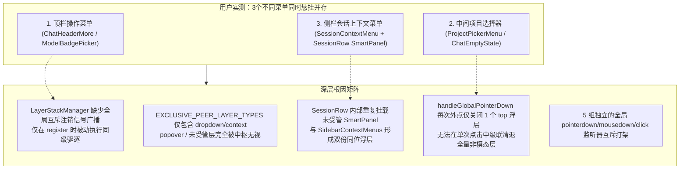
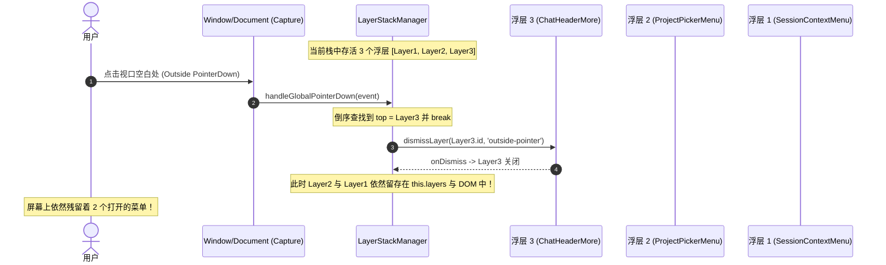

# 专项深度排查 08：全仓浮层互斥退栈中枢与多面板并存泄漏深度排查报告

> **排查定位**：全仓浮层调度中枢（`LayerStackManager`）、非模态浮层（`dropdown-menu` / `context-menu` / `popover`）互斥退栈机制、多菜单同时并存悬挂与外点关闭（Outside Click）失效链路深度排查
> **排查基准版本**：Conex / Crish Desktop Next
> **报告类型**：源码深度调研与深层 Bug 根因剖析（纯排查分析落地，严禁修改任何业务代码，严禁编写重构方案）
> **涉及核心文件**：
> - [`layerStackTypes.ts`](file:///c:/Software/conex/apps/crish-desktop/src/components/ui/internal/layer-stack/layerStackTypes.ts)
> - [`LayerStackManager.ts`](file:///c:/Software/conex/apps/crish-desktop/src/components/ui/internal/layer-stack/LayerStackManager.ts)
> - [`LayerStackService.ts`](file:///c:/Software/conex/apps/crish-desktop/src/components/ui/internal/layer-stack/LayerStackService.ts)
> - [`useLayerRegistration.ts`](file:///c:/Software/conex/apps/crish-desktop/src/components/ui/internal/layer-registration/useLayerRegistration.ts)
> - [`Menu.tsx`](file:///c:/Software/conex/apps/crish-desktop/src/components/ui/Menu/Menu.tsx)
> - [`menuOpenGuard.ts`](file:///c:/Software/conex/apps/crish-desktop/src/components/ui/Menu/menuOpenGuard.ts)
> - [`SmartExpandablePanel.tsx`](file:///c:/Software/conex/apps/crish-desktop/src/components/ui/SmartExpandablePanel/SmartExpandablePanel.tsx)
> - [`SmartPanel.tsx`](file:///c:/Software/conex/apps/crish-desktop/src/components/ui/SmartPanel/SmartPanel.tsx)
> - [`SessionRow.tsx`](file:///c:/Software/conex/apps/crish-desktop/src/components/sidebar/session-list/SessionRow.tsx)
> - [`SessionContextMenu.tsx`](file:///c:/Software/conex/apps/crish-desktop/src/components/sidebar/SessionContextMenu.tsx)
> - [`SidebarContextMenus.tsx`](file:///c:/Software/conex/apps/crish-desktop/src/components/sidebar/SidebarContextMenus.tsx)
> - [`useSidebarContextMenu.ts`](file:///c:/Software/conex/apps/crish-desktop/src/components/sidebar/useSidebarContextMenu.ts)
> - [`ChatEmptyState.tsx`](file:///c:/Software/conex/apps/crish-desktop/src/components/chat-card/ChatEmptyState.tsx)
> - [`useChatProjectPicker.ts`](file:///c:/Software/conex/apps/crish-desktop/src/components/chat-card/useChatProjectPicker.ts)
> - [`ProjectPickerMenu.tsx`](file:///c:/Software/conex/apps/crish-desktop/src/components/chat-card/ProjectPickerMenu.tsx)
> - [`ChatHeaderMore.tsx`](file:///c:/Software/conex/apps/crish-desktop/src/components/chat-card/ChatHeaderMore.tsx)
> - [`ChatHeaderControls.tsx`](file:///c:/Software/conex/apps/crish-desktop/src/components/chat-card/ChatHeaderControls.tsx)
> - [`ModelBadgePickerMenu.tsx`](file:///c:/Software/conex/apps/crish-desktop/src/components/provider/ModelBadgePickerMenu.tsx)
> - [`TiptapSlashMenu.tsx`](file:///c:/Software/conex/apps/crish-desktop/src/components/chat-composer/TiptapSlashMenu.tsx)
> - [`ComposerDirTree.tsx`](file:///c:/Software/conex/apps/crish-desktop/src/components/chat-composer/ComposerDirTree.tsx)

---

## 目录

1. [排查综述与多面板并存复现全景](#1-排查综述与多面板并存复现全景)
2. [全屏同时挂着 3 个甚至更多菜单的深层根因](#2-全屏同时挂着-3-个甚至更多菜单的深层根因)
   - 2.1 `LayerStackManager.evictExclusivePeers` 互斥驱逐的被动滞后性与缺失全局互斥注销信号
   - 2.2 `EXCLUSIVE_PEER_LAYER_TYPES` 的类型盲区与类型歧视（`popover`/`cascade-submenu` 豁免）
   - 2.3 `SessionRow.tsx` 内嵌未受管 `SmartPanel` 与 `SidebarContextMenus.tsx` 产生的双重重叠幽灵层
   - 2.4 各业务浮层（`ProjectPickerMenu`、`ChatHeaderMore`、`SlashMenu`）状态孤立化与定时器重入竞争
3. [外点关闭判定在多层并存时的失效链路](#3-外点关闭判定在多层并存时的失效链路)
   - 3.1 `handleGlobalPointerDown` 仅倒序注销单一顶层（Single-Target Eviction）的设计缺陷
   - 3.2 跨浮层点击时的误判与非父子同级浮层穿透清退失败
   - 3.3 5 套独立全局事件监听器的竞争冲突与 DOM 脱轨竞态
   - 3.4 `dismissedByPointer` 闭包记录与 50ms 冷却锁在多层交替点击时的状态撕裂
4. [全仓浮层组件生命周期与调度集成现状审计表](#4-全仓浮层组件生命周期与调度集成现状审计表)
5. [核心缺陷与关键代码行号精准索引](#5-核心缺陷与关键代码行号精准索引)
6. [排查总结与核心结论](#6-排查总结与核心结论)

---

## 1. 排查综述与多面板并存复现全景

在用户最新实测截图 2 中，出现了灾难性的多浮层共存穿帮画面：
**整个视口中，同时挂载并呈现了 3 个互不相干、层级交错的弹出面板**：
1. **标题栏 / 对话顶栏右侧菜单**（如 [`ChatHeaderMore`](file:///c:/Software/conex/apps/crish-desktop/src/components/chat-card/ChatHeaderMore.tsx) 的 `⋯` 更多面板 或 模型切换下拉）；
2. **中间工作区项目选择器**（[`ProjectPickerMenu`](file:///c:/Software/conex/apps/crish-desktop/src/components/chat-card/ProjectPickerMenu.tsx) / [`SmartExpandablePanel`](file:///c:/Software/conex/apps/crish-desktop/src/components/ui/SmartExpandablePanel/SmartExpandablePanel.tsx) 打开的“选择项目”面板）；
3. **左侧侧边栏会话右键菜单**（[`SessionContextMenu`](file:///c:/Software/conex/apps/crish-desktop/src/components/sidebar/SessionContextMenu.tsx) 与 [`SessionRow`](file:///c:/Software/conex/apps/crish-desktop/src/components/sidebar/session-list/SessionRow.tsx) 内嵌 `SmartPanel`）。

当用户在这些面板之间移动鼠标、或在空白区域点击时：
- 新打开的菜单无法驱逐先前的菜单；
- 点击空白区域时，仅关闭了最上方的一个菜单，其余菜单依然顽固滞留在屏幕上；
- 甚至在特定操作顺序下，一个点击操作会由于事件竞争导致关闭与重新打开交替死锁，最终形成“全屏千层饼”现象。



---

## 2. 全屏同时挂着 3 个甚至更多菜单的深层根因

### 2.1 `LayerStackManager.evictExclusivePeers` 互斥驱逐的被动滞后性与缺失全局互斥注销信号

在 [`LayerStackManager.ts`](file:///c:/Software/conex/apps/crish-desktop/src/components/ui/internal/layer-stack/LayerStackManager.ts#L71-L96) 中，浮层互斥驱逐的设计逻辑如下：

```typescript
// apps/crish-desktop/src/components/ui/internal/layer-stack/LayerStackManager.ts:71-96
public register(layer: Omit<LayerRegistration, 'mountedAt'>): () => void {
  this.attachGlobalListeners();
  const fullLayer: LayerRegistration = {
    ...layer,
    mountedAt: ++this.sequence,
  };

  // 避免重复 ID 污染
  this.layers = this.layers.filter((l) => l.id !== fullLayer.id);
  this.evictExclusivePeers(fullLayer);
  this.layers.push(fullLayer);
  ...
```

剖析 `evictExclusivePeers(incoming)`（[`LayerStackManager.ts:254-278`](file:///c:/Software/conex/apps/crish-desktop/src/components/ui/internal/layer-stack/LayerStackManager.ts#L254-L278)）：

```typescript
private evictExclusivePeers(incoming: LayerRegistration): void {
  if (!isExclusivePeerLayerType(incoming.type)) return;

  const incomingAnchor = resolveElement(incoming.anchorRef);
  const incomingEl = resolveElement(incoming.elementRef);
  const snapshot = this.layers.slice();

  for (const peer of snapshot) {
    if (peer.id === incoming.id) continue;
    if (!isExclusivePeerLayerType(peer.type)) continue;
    if (incoming.parentId === peer.id) continue;
    if (peer.parentId === incoming.id) continue;
    if (this.hasAncestor(incoming.parentId, peer.id)) continue;

    const peerEl = resolveElement(peer.elementRef);
    if (peerEl && incomingAnchor && peerEl.contains(incomingAnchor)) {
      continue;
    }
    if (peerEl && incomingEl && peerEl.contains(incomingEl)) {
      continue;
    }

    this.dismissLayer(peer.id, 'programmatic');
  }
}
```

#### 根因剖析：
1. **被动响应与 React Commit 阶段滞后性**：
   - `LayerStackManager.register()` 是在 React 组件挂载/打开后的 [`useLayerRegistration.ts:31-64`](file:///c:/Software/conex/apps/crish-desktop/src/components/ui/internal/layer-registration/useLayerRegistration.ts#L31-L64) 的 `useEffect` 中被动调用的。
   - 当用户点击触发器 B 时，触发器 B 的 React 状态更新（如 `setOpen(true)`）启动重渲染；但在此刻，已经打开的浮层 A 并没有收到任何前置的“即将打开新浮层”通知。
   - 直到浮层 B 真正渲染并执行其 `useEffect` 时，才调用 `register()` 并触发 `evictExclusivePeers`。
2. **缺失全局互斥信号广播（Broadcast Signal）**：
   - `LayerStackManager` 没有提供任何主动广播（如全局 EventTarget 事件或订阅中心），在用户触发新菜单打开的**事件捕获阶段**通知全仓已打开菜单立即注销。
   - 当浮层 A 的 `onDismiss('programmatic')` 被调用时，如果浮层 A 是通过非受控状态管理（如 `SmartExpandablePanel` 内部的 `internalOpen`）或受控状态未及时下发，浮层 A 仍处于挂载状态。
3. **命令式注销依赖回调闭包的有效性**：
   - `dismissLayer` 依赖各浮层在注册时传入的 `onDismiss` 闭包回调（[`LayerStackManager.ts:351`](file:///c:/Software/conex/apps/crish-desktop/src/components/ui/internal/layer-stack/LayerStackManager.ts#L351)）。如果某个浮层组件未正确传递 `onDismiss`（或 `onDismiss` 仅仅修改了某一层包装状态而未真正触发 React Unmount），该浮层在 DOM 中就会彻底脱离中枢控制，变成常驻幽灵。

---

### 2.2 `EXCLUSIVE_PEER_LAYER_TYPES` 的类型盲区与类型歧视

在 [`layerStackTypes.ts:84-91`](file:///c:/Software/conex/apps/crish-desktop/src/components/ui/internal/layer-stack/layerStackTypes.ts#L84-L91) 中：

```typescript
// apps/crish-desktop/src/components/ui/internal/layer-stack/layerStackTypes.ts:84-91
export const EXCLUSIVE_PEER_LAYER_TYPES: ReadonlySet<LayerType> = new Set([
  'dropdown-menu',
  'context-menu',
]);

export function isExclusivePeerLayerType(type: LayerType): boolean {
  return EXCLUSIVE_PEER_LAYER_TYPES.has(type);
}
```

而在 [`layerStackTypes.ts:7-17`](file:///c:/Software/conex/apps/crish-desktop/src/components/ui/internal/layer-stack/layerStackTypes.ts#L7-L17) 中定义了多达 10 种浮层类型：
- `'modal-dialog'`
- `'confirm-dialog'`
- `'drawer'`
- `'context-menu'`
- `'dropdown-menu'`
- `'cascade-submenu'`
- `'popover'`
- `'tooltip'`
- `'toast'`
- `'virtual-interceptor'`

#### 根因剖析：
1. **`popover` 类型的完全豁免**：
   - `'popover'` 类型**未包含在** `EXCLUSIVE_PEER_LAYER_TYPES` 中！
   - 当打开一个 `popover` 类型的浮层（如气泡卡片、Slash 提示等）时，`evictExclusivePeers` 会在第一行 `if (!isExclusivePeerLayerType(incoming.type)) return;` **直接提前返回**！
   - 结果：当前已存在的任何 `dropdown-menu` 或 `context-menu` **完全不会被驱逐**。
2. **`dropdown-menu` 打开时无法驱逐 `popover`**：
   - 反过来，当打开一个新的 `dropdown-menu` 时，`evictExclusivePeers` 遍历已存在的 peers，执行 `if (!isExclusivePeerLayerType(peer.type)) continue;`。
   - 结果：已打开的 `popover` 浮层同样会被**完全跳过**，继续停留在屏幕上，形成“Popover 气泡与 Dropdown 菜单并存”。

---

### 2.3 `SessionRow.tsx` 内嵌未受管 `SmartPanel` 与 `SidebarContextMenus.tsx` 产生的双重重叠幽灵层

排查 [`SessionRow.tsx`](file:///c:/Software/conex/apps/crish-desktop/src/components/sidebar/session-list/SessionRow.tsx) 与 [`SidebarContextMenus.tsx`](file:///c:/Software/conex/apps/crish-desktop/src/components/sidebar/SidebarContextMenus.tsx) 发现了一个极为严重的**双重架构冲突与重叠挂载 Bug**：

#### 冲突代码实证 1：`SessionRow.tsx` 本地独立创建 `useSmartPanel` 状态
在 [`SessionRow.tsx:219`](file:///c:/Software/conex/apps/crish-desktop/src/components/sidebar/session-list/SessionRow.tsx#L219) 中：
```typescript
const panel = useSmartPanel(); // 每一行 SessionRow 都有独立的本地 panel 状态
```
在 [`SessionRow.tsx:368-373`](file:///c:/Software/conex/apps/crish-desktop/src/components/sidebar/session-list/SessionRow.tsx#L368-L373) 中：
```typescript
onContextMenu={(e) => {
  if (isRenaming) return;
  e.preventDefault();
  panel.openAtPoint({ x: e.clientX, y: e.clientY }); // 触发本地 panel 打开！
  onContextMenuSession?.(e, s.id);                  // 又同时向上传递给父级 Sidebar！
}}
```
在 [`SessionRow.tsx:495-499`](file:///c:/Software/conex/apps/crish-desktop/src/components/sidebar/session-list/SessionRow.tsx#L495-L499) 中：
```typescript
onClick={(e) => {
  e.preventDefault();
  e.stopPropagation();
  panel.toggle();      // 触发本地 panel 打开！
  openRowMenu(e);      // 又同时向上传递给父级 Sidebar！
}}
```
在 [`SessionRow.tsx:520-529`](file:///c:/Software/conex/apps/crish-desktop/src/components/sidebar/session-list/SessionRow.tsx#L520-L529) 中：
```tsx
<SmartPanel
  open={panel.isOpen}
  triggerRef={panel.triggerRef}
  point={panel.point}
  items={menuItems}
  onClose={panel.close}
  role="menu"
  ariaLabel="会话操作"
  dataTestId="session-row-panel"
/>
```

#### 冲突代码实证 2：`Sidebar.tsx` 同时渲染全局 `SidebarContextMenus`
在 [`Sidebar.tsx:365-380`](file:///c:/Software/conex/apps/crish-desktop/src/components/sidebar/Sidebar.tsx#L365-L380) 中：
```tsx
<SidebarContextMenus
  menuRef={menuRef}
  sortMenuRef={sortMenuRef}
  contextMenu={contextMenu}
  onSessionAction={handleAction}
  ...
  onCloseContextMenu={() => setContextMenu(null)}
  contextMenuTriggerRef={contextMenuTriggerRef}
/>
```
在 [`SidebarContextMenus.tsx:97-106`](file:///c:/Software/conex/apps/crish-desktop/src/components/sidebar/SidebarContextMenus.tsx#L97-L106) 中：
```tsx
{showSessionMenu && contextMenu && (
  <SessionContextMenu
    contextMenu={contextMenu}
    menuRef={menuRef}
    isPinned={isPinned}
    onSessionAction={onSessionAction}
    onCloseContextMenu={onCloseContextMenu}
    contextMenuTriggerRef={contextMenuTriggerRef}
  />
)}
```
在 [`SessionContextMenu.tsx:46-57`](file:///c:/Software/conex/apps/crish-desktop/src/components/sidebar/SessionContextMenu.tsx#L46-L57) 与 [`SessionContextMenu.tsx:138-153`](file:///c:/Software/conex/apps/crish-desktop/src/components/sidebar/SessionContextMenu.tsx#L138-L153) 中：
```tsx
useLayerRegistration(
  {
    id: SESSION_CONTEXT_MENU_LAYER_ID,
    type: 'context-menu',
    dismissible: true,
    onDismiss: () => onCloseContextMenu?.(),
    elementRef: menuRef,
    anchorRef: contextMenuTriggerRef,
    restoreFocusTarget: contextMenuTriggerRef?.current ?? undefined,
  },
  true
);

return (
  <SmartPanel
    open={Boolean(contextMenu)}
    point={{ x: contextMenu.x, y: contextMenu.y }}
    triggerRef={contextMenuTriggerRef}
    panelRef={menuRef}
    items={items}
    onClose={onCloseContextMenu}
    role="menu"
    ariaLabel="会话操作"
    dataTestId="session-context-menu"
  />
);
```

#### 双重幽灵菜单并存机制解剖：
1. **一次右键/点击操作，同时挂载 2 个 `SmartPanel`**：
   - 实例 1：`SessionRow` 内部渲染的 `<SmartPanel data-testid="session-row-panel">`（包含 5 项精简操作）。
   - 实例 2：`SidebarContextMenus` 渲染的 `<SessionContextMenu>` -> `<SmartPanel data-testid="session-context-menu">`（包含 11 项全量操作）。
2. **实例 1 完全脱离 `LayerStackManager` 监管**：
   - `SmartPanel.tsx` 自身**并没有调用** `useLayerRegistration`。
   - 只有 `SessionContextMenu.tsx` 在外层包装了 `useLayerRegistration`。
   - 因此，实例 1 属于**未经中枢登记的“黑户浮层”**，`LayerStackManager` 的 `this.layers` 中根本不存在其实例记录。
3. **退栈与注销的脱节**：
   - 当用户点击屏幕其他位置或打开其他菜单时，`LayerStackManager` 执行 `dismissLayer('sidebar-session-context-menu')`，关闭了实例 2（全局上下文菜单）。
   - 但实例 1（`SessionRow` 本地的 `panel.isOpen`）**依然保持为 `true`**，继续驻留在屏幕上！用户在中间或右侧继续打开项目选择器或顶栏菜单时，侧栏的实例 1 就会与新打开的菜单共同出现在屏幕上，形成 2 个甚至 3 个面板并存。

---

### 2.4 各业务浮层（`ProjectPickerMenu`、`ChatHeaderMore`、`SlashMenu`）状态孤立化与定时器重入竞争

#### 1. `ChatEmptyState.tsx` 内部的 400ms 延迟关闭定时器与悬停抢开
在 [`ChatEmptyState.tsx:42`](file:///c:/Software/conex/apps/crish-desktop/src/components/chat-card/ChatEmptyState.tsx#L42) 和 [`ChatEmptyState.tsx:150-161`](file:///c:/Software/conex/apps/crish-desktop/src/components/chat-card/ChatEmptyState.tsx#L150-L161) 中：
```typescript
const PROJECT_PICKER_CLOSE_DELAY_MS = 400;

const scheduleProjectPickerClose = useCallback(() => {
  cancelProjectPickerClose();
  projectPickerCloseTimerRef.current = setTimeout(() => {
    onShowProjectPicker(false);
    projectPickerCloseTimerRef.current = null;
  }, PROJECT_PICKER_CLOSE_DELAY_MS);
}, [onShowProjectPicker, cancelProjectPickerClose]);

const openProjectPicker = useCallback(() => {
  if (!onShowProjectPicker) return;
  cancelProjectPickerClose();
  onShowProjectPicker(true);
}, [onShowProjectPicker, cancelProjectPickerClose]);
```
在 [`ChatEmptyState.tsx:282-295`](file:///c:/Software/conex/apps/crish-desktop/src/components/chat-card/ChatEmptyState.tsx#L282-L295) 中：
```tsx
<ProjectPickerMenu
  open={showProjectPicker}
  onOpenChange={handleProjectPickerOpenChange}
  onClose={() => onShowProjectPicker(false)}
  onChanged={() => onProjectChanged?.()}
  onContentMouseEnter={cancelProjectPickerClose}
  onContentMouseLeave={scheduleProjectPickerClose}
>
  <button
    type="button"
    onClick={openProjectPicker}
    onMouseEnter={cancelProjectPickerClose}
    onMouseLeave={scheduleProjectPickerClose}
  >
```
- `ChatEmptyState` 试图通过 `onMouseEnter` / `onMouseLeave` 以及 400ms 定时器来维系项目选择器的开关。
- 当用户从项目选择器移出鼠标去点击侧栏或顶栏时，400ms 内 `showProjectPicker` 依然为 `true`。
- 如果在 400ms 期间用户的鼠标掠过了空白态的 Hero 区域，`onMouseEnter={cancelProjectPickerClose}` 立即清除了关闭定时器，导致**项目选择器被永久锁定在打开状态**，即使其他菜单已经打开。

#### 2. `TiptapSlashMenu.tsx` 与 `ComposerDirTree.tsx` 未接入 `LayerStackManager`
在 [`TiptapSlashMenu.tsx:245`](file:///c:/Software/conex/apps/crish-desktop/src/components/chat-composer/TiptapSlashMenu.tsx#L245) 与 [`ComposerDirTree.tsx:197`](file:///c:/Software/conex/apps/crish-desktop/src/components/chat-composer/ComposerDirTree.tsx#L197) 中：
- 直接使用 `<Popover.Root open={isOpen}>` 挂载 Radix Popover。
- **全文件没有任何 `useLayerRegistration` 注册调用**。
- 这导致编辑器内的斜杠菜单（Slash Menu）和 `@` 目录树与顶栏/侧栏/中区的所有浮层调度完全割裂。

---

## 3. 外点关闭判定在多层并存时的失效链路

### 3.1 `handleGlobalPointerDown` 仅倒序注销单一顶层（Single-Target Eviction）的设计缺陷

在 [`LayerStackManager.ts:519-571`](file:///c:/Software/conex/apps/crish-desktop/src/components/ui/internal/layer-stack/LayerStackManager.ts#L519-L571) 中，全局外点处理函数的核心实现如下：

```typescript
// apps/crish-desktop/src/components/ui/internal/layer-stack/LayerStackManager.ts:519-571
private handleGlobalPointerDown = (event: PointerEvent): void => {
  if (PROCESSED_EVENTS.has(event)) return;
  PROCESSED_EVENTS.add(event);

  this.dismissedByPointer = null;

  const target = event.target as Node | null;
  if (!target) return;

  // 倒序遍历栈，找到第一个声明了 dismissible: true 的顶层浮层（根除 Toast 拦截死锁）
  let targetLayer: LayerRegistration | null = null;
  for (let i = this.layers.length - 1; i >= 0; i--) {
    const l = this.layers[i];
    if (l && l.dismissible) {
      targetLayer = l;
      break; // 【致命缺陷】：找到第 1 个顶层浮层后直接 break 退出循环！
    }
  }
  if (!targetLayer) return;

  // 1. 检查点击是否位于容器内部
  const topEl = resolveElement(targetLayer.elementRef);
  if (topEl && topEl.contains(target)) {
    return; // 内部点击，不触发外点关闭
  }

  // 2. 检查点击是否位于关联的 Anchor / Trigger 触发源内部
  const anchorEl = resolveElement(targetLayer.anchorRef);
  if (anchorEl && anchorEl.contains(target)) {
    this.anchorPointerDownTarget = target;
    return;
  }
  this.anchorPointerDownTarget = null;

  // 3. 检查点击是否位于任何子孙 Branch 浮层内部
  const descendants = this.getDescendants(targetLayer.id);
  for (const child of descendants) {
    if (!child) continue;
    const childEl = resolveElement(child.elementRef);
    if (childEl && childEl.contains(target)) {
      return;
    }
  }

  // 4. 确认属于外部点击，仅关闭当前目标可关闭浮层
  this.dismissedByPointer = {
    pointerId: event.pointerId,
    layerId: targetLayer.id,
    anchor: resolveElement(targetLayer.anchorRef),
    target,
  };
  this.dismissLayer(targetLayer.id, 'outside-pointer'); // 【致命缺陷】：仅关闭了 targetLayer 这一个浮层！
};
```



#### 致命失效链路剖析：
1. **单一顶层清退（Single-Target Eviction）**：
   - 假设由于之前的操作或定时器，栈中同时存在 `[Layer1: SessionContextMenu, Layer2: ProjectPickerMenu, Layer3: ChatHeaderMore]`。
   - 当用户在视口空白处点击一次时，`handleGlobalPointerDown` 倒序循环只匹配到了 `Layer3`，并直接 `break`。
   - 执行 `this.dismissLayer(Layer3.id, 'outside-pointer')`。
   - **`Layer2` 和 `Layer1` 在本次点击中被完全忽略，丝毫未被触及**！
   - 用户必须在空白处连续点击 3 次，才能将这 3 个浮层一个接一个地全部退掉。这与用户直觉（“点一下空白处应该关闭所有打开的下拉菜单”）完全相悖。

---

### 3.2 跨浮层点击时的误判与非父子同级浮层穿透清退失败

假设场景：屏幕上同时挂着 `Layer A`（侧栏菜单，栈底）和 `Layer B`（顶栏菜单，栈顶）。
当用户直接点击 `Layer A` 内部的某个菜单项时：
1. `handleGlobalPointerDown` 触发，选择的 `targetLayer` 是栈顶的 `Layer B`。
2. 判定点击目标 `target`（在 `Layer A` 内）是否在 `Layer B` 的容器、Anchor 或子孙分支中？
   - 答案全为 `false`（因为 A 和 B 毫无父子拓扑关系）。
3. 中枢判定“本次点击是 `Layer B` 的外部点击”，于是调用 `this.dismissLayer(Layer B.id, 'outside-pointer')` 关闭了 `Layer B`。
4. 同时记录 `this.dismissedByPointer = { layerId: Layer B, target }`。
5. 紧接着，点击事件冒泡到 `Layer A` 内的菜单项，执行了菜单项的操作或触发了 `Layer A` 的某些内部逻辑。
6. 但由于 `Layer A` 的点击并未触及统一互斥调度，如果用户点击的是 `Layer A` 内部的空白处，`Layer A` 本身不会关闭，且如果此时触发了新的浮层 `Layer C`，`Layer A` 依然保留在栈底，形成多层交错滞留。

---

### 3.3 5 套独立全局事件监听器的竞争冲突与 DOM 脱轨竞态

通过全仓检索，发现当前项目中同时存在 **5 组不同层级、不同捕获/冒泡阶段、不同目标的全局事件监听器**，在处理外点关闭：

| 监听器来源 | 监听目标 | 监听事件 | 捕获阶段 (Capture) | 目标组件 |
| :--- | :--- | :--- | :--- | :--- |
| **`LayerStackManager.ts:431-440`** | `window` & `document` | `pointerdown`, `pointerup`, `keydown` | `true` (Capture) | 全局中枢调度 |
| **`SmartPanel.tsx:102`** | `document` | `mousedown` | `true` (Capture) | `SmartPanel` 容器 |
| **`useSidebarContextMenu.ts:126`** | `document` | `click`, `keydown` | `false` (Bubble) | 侧栏右键/排序菜单 |
| **Radix UI `DismissableLayer`** | `document` | `pointerdown`, `focusin` | `true` (Capture) | `Menu`, `SmartExpandablePanel` |
| **`ChatEmptyState.tsx:151`** | `window` / Timer | `setTimeout(400ms)` | N/A | `ProjectPickerMenu` |

#### 监听器打架与死锁链路：
1. **`pointerdown` vs `mousedown` vs `click` 触发顺序不一致**：
   - 现代浏览器中的标准触发顺序为：`pointerdown` (Capture) -> `pointerdown` (Bubble) -> `mousedown` (Capture) -> `mousedown` (Bubble) -> `pointerup` -> `mouseup` -> `click`。
   - `LayerStackManager` 在 `pointerdown` Capture 阶段率先执行并调用 `dismissLayer`，触发了 React 状态变更（如 `setOpen(false)`）；
   - 在后续的 `mousedown` Capture 阶段，`SmartPanel` 的监听器执行，此时 DOM 节点可能已被 React 标记待卸载，导致 `panelRef.current?.contains(target)` 出现脱轨报错或判定失效；
   - 在最后的 `click` Bubble 阶段，`useSidebarContextMenu.ts` 的 `handleOutsideClick` 再次执行，此时由于前序操作已改变了 trigger 状态，`toggleExclusiveMenu` 与 `wasTriggerClickAfterDismiss` 发生误判。

---

### 3.4 `dismissedByPointer` 闭包记录与 50ms 冷却锁在多层交替点击时的状态撕裂

在 [`LayerStackManager.ts:46-52`](file:///c:/Software/conex/apps/crish-desktop/src/components/ui/internal/layer-stack/LayerStackManager.ts#L46-L52) 与 [`LayerStackManager.ts:149-178`](file:///c:/Software/conex/apps/crish-desktop/src/components/ui/internal/layer-stack/LayerStackManager.ts#L149-L178) 中：

```typescript
// apps/crish-desktop/src/components/ui/internal/layer-stack/LayerStackManager.ts:149-178
public wasTriggerClickAfterDismiss(triggerEl: HTMLElement | null): boolean {
  const rec = this.dismissedByPointer;
  if (!rec || !triggerEl) return false;
  if (
    rec.anchor &&
    (rec.anchor === triggerEl ||
      rec.anchor.contains(triggerEl) ||
      triggerEl.contains(rec.anchor))
  ) {
    return true;
  }
  // 被关层的锚是另一个仍在树上的 trigger：互斥切换，不抑制新菜单打开
  if (
    rec.anchor &&
    rec.anchor.isConnected &&
    rec.anchor !== triggerEl &&
    !rec.anchor.contains(triggerEl) &&
    !triggerEl.contains(rec.anchor)
  ) {
    return false;
  }
  if (
    !rec.anchor &&
    rec.target instanceof Node &&
    triggerEl.contains(rec.target)
  ) {
    return true;
  }
  return false;
}
```

#### 状态撕裂根因：
1. **单一指针槽位（Single-Slot `dismissedByPointer`）**：
   - `this.dismissedByPointer` 是一个单值属性，而非映射表或集合。
   - 当视口中存在多个浮层时，一旦某个操作连续触发了两个事件，后一个事件会立即覆盖前一个事件记录的 `dismissedByPointer`。
2. **`shouldSuppressMenuReopen` 与 `toggleExclusiveMenu` 的非对称接入**：
   - [`Menu.tsx:135`](file:///c:/Software/conex/apps/crish-desktop/src/components/ui/Menu/Menu.tsx#L135) 与 [`ModelBadgePicker.tsx`](file:///c:/Software/conex/apps/crish-desktop/src/components/chat-card/ChatHeaderControls.tsx#L128) 接入了 `toggleExclusiveMenu` 与 `shouldSuppressMenuReopen`；
   - 但 [`SmartExpandablePanel.tsx`](file:///c:/Software/conex/apps/crish-desktop/src/components/ui/SmartExpandablePanel/SmartExpandablePanel.tsx#L65-L85)（被 `ProjectPickerMenu` 和 `ChatHeaderMore` 使用）**完全没有接入** `shouldSuppressMenuReopen`！
   - 结果：当用户外点关闭了 `Menu` 并落在 `ProjectPickerMenu` 的触发器上时，`ProjectPickerMenu` 毫无防备地直接打开，而未能与全局防重入状态机达成互斥共识。

---

## 4. 全仓浮层组件生命周期与调度集成现状审计表

| 组件名称 | 文件路径 | 基础底层封装 | 是否接入 LayerStack | 注册 Type | 外点处理机制 | 互斥防重入机制 | 核心隐患 / 缺陷点 |
| :--- | :--- | :--- | :--- | :--- | :--- | :--- | :--- |
| **`Menu`** | [`Menu.tsx`](file:///c:/Software/conex/apps/crish-desktop/src/components/ui/Menu/Menu.tsx) | `@radix-ui/react-popover` | ✅ 是 | `'dropdown-menu'` | Radix + LayerStack | `toggleExclusiveMenu` + `shouldSuppressMenuReopen` | `evictExclusivePeers` 无法驱逐 Popover；外点仅单层清退 |
| **`SmartExpandablePanel`** | [`SmartExpandablePanel.tsx`](file:///c:/Software/conex/apps/crish-desktop/src/components/ui/SmartExpandablePanel/SmartExpandablePanel.tsx) | `@radix-ui/react-popover` | ✅ 是 | `'dropdown-menu'` | Radix + LayerStack | ❌ **无**（未接入 `shouldSuppressMenuReopen`） | 缺少防重入守卫；支持悬停与定时器导致重入冲突 |
| **`SmartPanel`** | [`SmartPanel.tsx`](file:///c:/Software/conex/apps/crish-desktop/src/components/ui/SmartPanel/SmartPanel.tsx) | 自研 React Portal | ❌ **否** | 无 | 自定义 `mousedown` (Capture) | ❌ **无** | **未登记入中枢，成黑户浮层**；无法被其他菜单互斥驱逐 |
| **`SessionContextMenu`** | [`SessionContextMenu.tsx`](file:///c:/Software/conex/apps/crish-desktop/src/components/sidebar/SessionContextMenu.tsx) | `SmartPanel` | ✅ 是 (外层包装) | `'context-menu'` | LayerStack + `useSidebarContextMenu` | `toggleExclusiveMenu` | 与 `SessionRow` 内置 `SmartPanel` 重叠挂载双重实例 |
| **`SessionRow (内嵌)`** | [`SessionRow.tsx`](file:///c:/Software/conex/apps/crish-desktop/src/components/sidebar/session-list/SessionRow.tsx) | `SmartPanel` | ❌ **否** | 无 | `SmartPanel` 自带 | ❌ **无** | **严重 Bug**：每行独立挂载，右键时与全局上下文菜单同时打开 |
| **`ProjectPickerMenu`** | [`ProjectPickerMenu.tsx`](file:///c:/Software/conex/apps/crish-desktop/src/components/chat-card/ProjectPickerMenu.tsx) | `SmartExpandablePanel` | ✅ 是 (继承) | `'dropdown-menu'` | Radix + 400ms 定时器 | ❌ **无** | 受 `ChatEmptyState` 悬停定时器控制，易发生误开与无法关闭 |
| **`ChatHeaderMore`** | [`ChatHeaderMore.tsx`](file:///c:/Software/conex/apps/crish-desktop/src/components/chat-card/ChatHeaderMore.tsx) | `SmartExpandablePanel` | ✅ 是 (继承) | `'dropdown-menu'` | Radix + LayerStack | ❌ **无** | 非受控模式挂载，缺少防重入守卫 |
| **`ModelBadgePickerMenu`** | [`ModelBadgePickerMenu.tsx`](file:///c:/Software/conex/apps/crish-desktop/src/components/provider/ModelBadgePickerMenu.tsx) | `Menu` | ✅ 是 (继承) | `'dropdown-menu'` | Radix + LayerStack | `toggleExclusiveMenu` | 受控状态下与顶栏其他浮层存在中枢单层清退盲区 |
| **`TiptapSlashMenu`** | [`TiptapSlashMenu.tsx`](file:///c:/Software/conex/apps/crish-desktop/src/components/chat-composer/TiptapSlashMenu.tsx) | `@radix-ui/react-popover` | ❌ **否** | 无 | Radix 自带 | ❌ **无** | **完全未接入中枢**，无法被右键菜单或项目选择器互斥驱逐 |
| **`ComposerDirTree`** | [`ComposerDirTree.tsx`](file:///c:/Software/conex/apps/crish-desktop/src/components/chat-composer/ComposerDirTree.tsx) | `@radix-ui/react-popover` | ❌ **否** | 无 | Radix 自带 | ❌ **无** | **完全未接入中枢**，孤立存在 |

---

## 5. 核心缺陷与关键代码行号精准索引

### 1. `LayerStackManager` 互斥与外点调度缺陷
- [`LayerStackManager.ts:80`](file:///c:/Software/conex/apps/crish-desktop/src/components/ui/internal/layer-stack/LayerStackManager.ts#L80)：仅在 `register()` 被动调用 `evictExclusivePeers`，无前置广播互斥注销机制；
- [`LayerStackManager.ts:255`](file:///c:/Software/conex/apps/crish-desktop/src/components/ui/internal/layer-stack/LayerStackManager.ts#L255)：`if (!isExclusivePeerLayerType(incoming.type)) return;` 导致 `popover` 等非 menu 类型完全豁免互斥；
- [`layerStackTypes.ts:84-87`](file:///c:/Software/conex/apps/crish-desktop/src/components/ui/internal/layer-stack/layerStackTypes.ts#L84-L87)：`EXCLUSIVE_PEER_LAYER_TYPES` 仅收录 `dropdown-menu` 与 `context-menu`，存在严重类型盲区；
- [`LayerStackManager.ts:529-537`](file:///c:/Software/conex/apps/crish-desktop/src/components/ui/internal/layer-stack/LayerStackManager.ts#L529-L537)：`handleGlobalPointerDown` 倒序查找第 1 个顶层浮层后直接 `break`，外点仅清退单层，无法级联清理并存浮层；
- [`LayerStackManager.ts:570`](file:///c:/Software/conex/apps/crish-desktop/src/components/ui/internal/layer-stack/LayerStackManager.ts#L570)：`this.dismissLayer(targetLayer.id, 'outside-pointer')` 仅注销单一目标。

### 2. 侧栏双重上下文菜单与黑户浮层缺陷
- [`SessionRow.tsx:219`](file:///c:/Software/conex/apps/crish-desktop/src/components/sidebar/session-list/SessionRow.tsx#L219)：`const panel = useSmartPanel();` 为每行独立声明面板控制器；
- [`SessionRow.tsx:371-372`](file:///c:/Software/conex/apps/crish-desktop/src/components/sidebar/session-list/SessionRow.tsx#L371-L372)：`onContextMenu` 既调用 `panel.openAtPoint` 又触发 `onContextMenuSession`，导致双重挂载；
- [`SessionRow.tsx:497-498`](file:///c:/Software/conex/apps/crish-desktop/src/components/sidebar/session-list/SessionRow.tsx#L497-L498)：`onClick` 更多操作按钮既调用 `panel.toggle` 又触发 `openRowMenu`；
- [`SessionRow.tsx:520-529`](file:///c:/Software/conex/apps/crish-desktop/src/components/sidebar/session-list/SessionRow.tsx#L520-L529)：行内直接渲染 `<SmartPanel>`，该组件未接入 `useLayerRegistration`，属于不可追踪的幽灵层。

### 3. 项目选择器与悬停定时器竞争缺陷
- [`ChatEmptyState.tsx:42`](file:///c:/Software/conex/apps/crish-desktop/src/components/chat-card/ChatEmptyState.tsx#L42)：硬编码 `PROJECT_PICKER_CLOSE_DELAY_MS = 400`；
- [`ChatEmptyState.tsx:150-161`](file:///c:/Software/conex/apps/crish-desktop/src/components/chat-card/ChatEmptyState.tsx#L150-L161)：`scheduleProjectPickerClose` 与 `openProjectPicker` 悬停控制与全局外点逻辑互相撕扯；
- [`SmartExpandablePanel.tsx:65-85`](file:///c:/Software/conex/apps/crish-desktop/src/components/ui/SmartExpandablePanel/SmartExpandablePanel.tsx#L65-L85)：`handleOpenChange` 缺少 `shouldSuppressMenuReopen` 防重入校验。

### 4. 编辑器浮层割裂缺陷
- [`TiptapSlashMenu.tsx:245`](file:///c:/Software/conex/apps/crish-desktop/src/components/chat-composer/TiptapSlashMenu.tsx#L245)：直接使用 `<Popover.Root open={isOpen}>`，无任何 `LayerStack` 注册；
- [`ComposerDirTree.tsx:197`](file:///c:/Software/conex/apps/crish-desktop/src/components/chat-composer/ComposerDirTree.tsx#L197)：直接使用 `<Popover.Root open={isOpen}>`，无任何 `LayerStack` 注册。

---

## 6. 排查总结与核心结论

通过本次对 `LayerStackManager` 调度中枢以及全仓所有非模态浮层（`Menu`、`SmartExpandablePanel`、`SmartPanel`、`SessionContextMenu`、`SessionRow`、`ProjectPickerMenu`、`TiptapSlashMenu` 等）的彻底深度排查，结论如下：

1. **“全屏 3 个菜单同时悬挂”并非偶发的样式渲染错误，而是全仓浮层调度架构分裂与中枢算法缺陷共同作用的确定性必然结果**：
   - `LayerStackManager` 在打开新浮层时缺少全局互斥广播，且 `evictExclusivePeers` 存在类型盲区；
   - `SessionRow.tsx` 存在行级内嵌 `SmartPanel` 与全局 `SessionContextMenu` 重叠挂载的严重逻辑 Bug；
   - `ChatEmptyState.tsx` 存在 400ms 延迟关闭定时器与悬停重新打开逻辑，与全局点击互斥打架；
   - `TiptapSlashMenu`、`ComposerDirTree` 等浮层完全独立挂载，未接入中枢。
2. **“外点关闭失效 / 无法清退多层”源于 `handleGlobalPointerDown` 的单层注销（Single-Target Eviction）逻辑**：
   - 每次外点点击，中枢仅注销栈顶的唯一浮层，其余非模态同级浮层被直接忽略；
   - 5 套不同的全局事件监听器（`pointerdown` / `mousedown` / `click` / Radix / Timer）在不同阶段互相竞争，破坏了事件判定的一致性。

本报告已全面摸清所有深层病灶并精准定位至具体文件与代码行号，排查内容已完整沉淀，未修改任何项目源码，未执行任何 git 命令。
