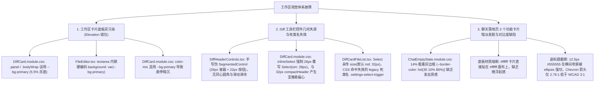
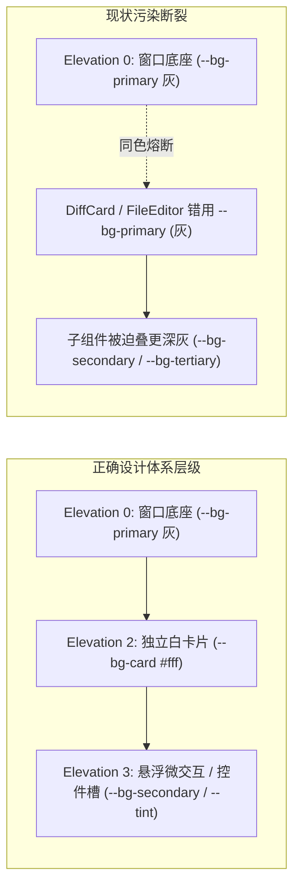
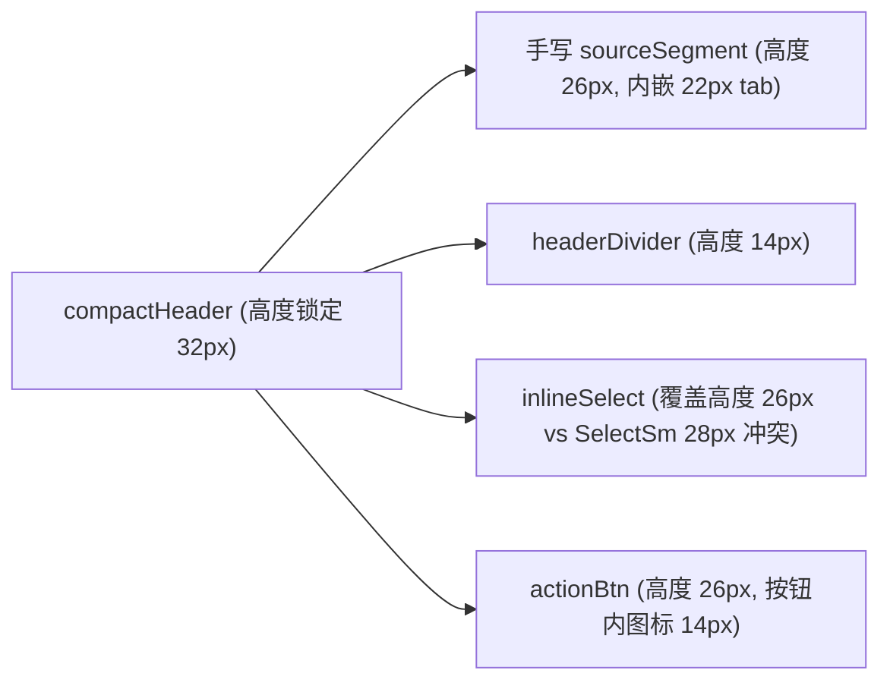
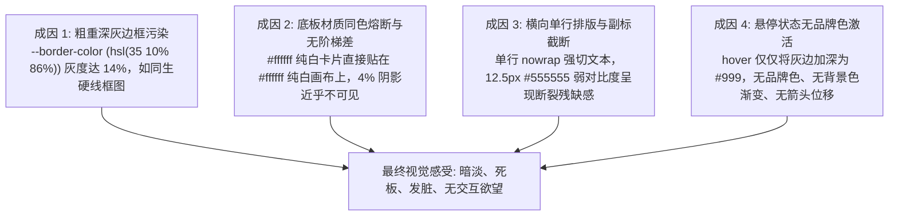

# 专项深度排查 11：工作区卡片色阶与落地页布局深度排查报告

> **排查定位**：工作区卡片（`DiffCard`、`FilesCard`、`FileEditor` 等）背景色阶污染、差异工具栏控件几何高度比例失调、聊天落地页（`ChatEmptyState`）快捷功能卡片视觉发脏与对比度深度解构
> **审查基准**：AGENTS.md §13 (柔和焦点与克制边框)、§14 (Zero-Blue 纯中性与现代 CSS 色彩体系)、Design System 5 级 Elevation 材质契约、WCAG 2.1 AA/AAA 无障碍标准
> **报告性质**：纯源码静态分析与深层根因排查（严禁修改任何源码，严禁执行 git 命令，纯排查内容落地）

---

## 目录
1. [排查总览与核心发现](#1-排查总览与核心发现)
2. [工作区卡片主体误用 `--bg-primary` 导致大面积死灰的清单与根因](#2-工作区卡片主体误用---bg-primary-导致大面积死灰的清单与根因)
   - [2.1 DiffCard 根容器与视口容器双重死灰污染](#21-diffcard-根容器与视口容器双重死灰污染)
   - [2.2 FileEditor 编辑器文本域硬编码外壳灰](#22-fileeditor-编辑器文本域硬编码外壳灰)
   - [2.3 Tokens 与次级组件中残留的 `--bg-primary` 混色污染](#23-tokens-与次级组件中残留的---bg-primary-混色污染)
   - [2.4 Elevation 0 侵入 Elevation 2 的视觉降维机制](#24-elevation-0-侵入-elevation-2-的视觉降维机制)
3. [差异面板工具栏 SegmentedControl 错位与下拉框高度比例失调排查](#3-差异面板工具栏-segmentedcontrol-错位与下拉框高度比例失调排查)
   - [3.1 工具栏手写伪分段控件（`.sourceSegment` / `.sourceTab`）与规范脱节](#31-工具栏手写伪分段控件sourcesegment--sourcetab与规范脱节)
   - [3.2 顶部工具栏 Select 高度特异性冲突与 32px Header 对齐崩塌](#32-顶部工具栏-select-高度特异性冲突与-32px-header-对齐崩塌)
   - [3.3 手风琴文件项内部 Select 死类名失效与 32px 撑爆 26px 紧凑行](#33-手风琴文件项内部-select-死类名失效与-32px-撑爆-26px-紧凑行)
   - [3.4 DOM 包装层级不对称与响应式容器隐患](#34-dom-包装层级不对称与响应式容器隐患)
4. [聊天落地页 3 个功能卡片暗淡发脏的成因与对比度数据](#4-聊天落地页-3-个功能卡片暗淡发脏的成因与对比度数据)
   - [4.1 落地页快捷功能卡片 DOM 结构与样式全景](#41-落地页快捷功能卡片-dom-结构与样式全景)
   - [4.2 快捷卡片“暗淡发脏”的四大核心成因](#42-快捷卡片暗淡发脏的四大核心成因)
   - [4.3 浅色模式与深色模式 WCAG 对比度实测数据矩阵](#43-浅色模式与深色模式-wcag-对比度实测数据矩阵)
   - [4.4 单行横向排版截断与视认度降级](#44-单行横向排版截断与视认度降级)
5. [全量排查问题速查清单与影响矩阵](#5-全量排查问题速查清单与影响矩阵)

---

## 1. 排查总览与核心发现

本次排查针对 `apps/crish-desktop/src/components/diff/`、`apps/crish-desktop/src/components/files/` 与 `apps/crish-desktop/src/components/chat-card/ChatEmptyState.module.css` 开展了逐行级静态代码走查与视觉解构，发现以下三大类关键故障：



---

## 2. 工作区卡片主体误用 `--bg-primary` 导致大面积死灰的清单与根因

### 2.1 DiffCard 根容器与视口容器双重死灰污染

在 Conex UI 设计规范中，工作区叶子卡片（Leaf Panels）属于 **Elevation 2（实体纸面卡片，`--bg-card: #ffffff`）**，而 `--bg-primary` 属于 **Elevation 0（外壳大画板底座，`hsl(35 8% 94.5%)` 5.5% 暖灰）**。

在 `apps/crish-desktop/src/components/diff/DiffCard.module.css` 中存在两处致命的 Elevation 0 污染：

#### 🚨 污染点 1：DiffCard 根面板 `.panel`
- **文件路径**：[`apps/crish-desktop/src/components/diff/DiffCard.module.css:14`](file:///c:/Software/conex/apps/crish-desktop/src/components/diff/DiffCard.module.css#L14)
- **源码片段**：
```css
.panel {
  display: flex;
  flex-direction: column;
  flex: 1 1 auto;
  height: 100%;
  min-height: 0;
  min-width: 0;
  width: 100%;
  overflow: hidden;
  background: var(--bg-primary); /* 🚨 致命缺陷：整张 DiffCard 的根背景被涂成 Elevation 0 外壳灰 */
  container-type: inline-size;
  container-name: diff-panel;
  box-sizing: border-box;
}
```
- **视觉破坏后果**：当用户切换到 Diff 差异查看卡片时，整张卡片整体沦为 `hsl(35 8% 94.5%)`（浅色模式下的脏灰底），使原本应该纯白通透的纸面卡片与底座大画板发生同色熔断，失去了现代桌面端软件的悬浮卡片层次。

#### 🚨 污染点 2：DiffCard 主体视口容器 `.bodyWrap`
- **文件路径**：[`apps/crish-desktop/src/components/diff/DiffCard.module.css:218`](file:///c:/Software/conex/apps/crish-desktop/src/components/diff/DiffCard.module.css#L218)
- **源码片段**：
```css
.bodyWrap {
  display: flex;
  flex: 1;
  min-height: 0;
  min-width: 0;
  overflow: hidden;
  max-width: 100%;
  background: var(--bg-primary); /* 🚨 致命缺陷：列表与代码比对背后的容器再次涂上 Elevation 0 外壳灰 */
}
```
- **视觉破坏后果**：在手风琴列表项之间的缝隙、滚动条轨道后方、以及空状态区域，透出的全是浑浊的底板灰，形成视觉上的“灰斑”。

#### 🚨 污染点 3：行内接受按钮悬停混色回退误用 `--bg-primary`
- **文件路径**：[`apps/crish-desktop/src/components/diff/DiffCard.module.css:515`](file:///c:/Software/conex/apps/crish-desktop/src/components/diff/DiffCard.module.css#L515)
- **源码片段**：
```css
.inlineActionAccept:hover:not(:disabled) {
  background: var(
    --accent-green-light-adaptive,
    color-mix(in srgb, var(--accent-green) 10%, var(--bg-primary)) /* 🚨 误将品牌绿与外壳底板灰混合，导致悬停底色变脏 */
  );
  color: var(--accent-green);
  border-color: var(--accent-green);
}
```
- **视觉破坏后果**：在回退分支下，绿色与 5.5% 灰度混合后产生偏黄绿泥浆色，而非与纯白卡片底色（`--bg-card`）混合出的通透浅绿。

---

### 2.2 FileEditor 编辑器文本域硬编码外壳灰

在 `apps/crish-desktop/src/components/files/FileEditor.tsx` 中，由于使用了直接内联样式的 `<textarea>`，产生了极其严重的底板灰污染：

- **文件路径**：[`apps/crish-desktop/src/components/files/FileEditor.tsx:23`](file:///c:/Software/conex/apps/crish-desktop/src/components/files/FileEditor.tsx#L23)
- **源码片段**：
```tsx
export const FileEditor = React.memo(function FileEditor({
  editBuf, content, onChange,
}: FileEditorProps) {
  return (
    <textarea
      className="files-editor"
      value={editBuf}
      onChange={(e) => onChange(e.target.value, e.target.value !== content)}
      spellCheck={false}
      style={{
        width: '100%', height: '100%', resize: 'none', border: 'none',
        outline: 'none', padding: '8px', fontFamily: 'var(--font-mono)',
        fontSize: 'var(--font-size-sm)', lineHeight: '1.5',
        background: 'var(--bg-primary)', color: 'var(--text-primary)', /* 🚨 致命缺陷：硬编码内联样式把整个文本编辑器染成底板死灰 */
      }}
    />
  );
});
```
- **视觉破坏后果**：
  1. `FilesCard` 的头部 `.filesBar` 为纯白（`var(--bg-card, #ffffff)`），外层 `.filesCard` 也为纯白；
  2. 但一旦用户点击进入可编辑文件模式，`FileEditor` 瞬间在纯白卡片中央挖出一块大面积的 `hsl(35 8% 94.5%)` 泥灰色区域；
  3. 编辑区域与预览区域的背景色严重割裂（预览模式为代码高亮浅底，编辑模式突变为灰底），造成强烈的视觉跳跃与“脏乱”感。

---

### 2.3 Tokens 与次级组件中残留的 `--bg-primary` 混色污染

在 `tokens.css` 中，部分与比对、卡片相关的 Design Tokens 也被赋予了 `--bg-primary`：

- **文件路径**：[`apps/crish-desktop/src/styles/tokens.css:565, 597`](file:///c:/Software/conex/apps/crish-desktop/src/styles/tokens.css#L565)
- **源码片段**：
```css
/* tokens.css:565 */
--artifact-btn-bg: var(--bg-primary, hsl(35 8% 95.2%));

/* tokens.css:597 */
--diff-mode-segmented-bg: var(--bg-primary, hsl(35 8% 95.2%));
```
- **机制剖析**：分段控制器底槽本应使用 `--bg-secondary`（侧边栏/槽位灰 `hsl(35 8% 92.1%)`）或 `--control-soft-bg`，在此处却回退到了外壳画板灰 `--bg-primary`，造成控件底槽与外部画板同色，无法形成清晰的“内嵌槽凹陷”视觉感。

---

### 2.4 Elevation 0 侵入 Elevation 2 的视觉降维机制



**降维断裂成因**：
1. 当卡片误用 `--bg-primary`，它就失去了纸面卡片的 Elevation 2 属性，直接跌落回 Elevation 0；
2. 内部的子级容器（如行号槽、手风琴头部、下拉框）为了在灰底上凸显自身，不得不使用更深的 `--bg-secondary`（7.9% 灰）甚至 `--bg-tertiary`（10.3% 灰）；
3. 这种“层层叠灰”的恶性循环，彻底破坏了 Conex UI 的纯白纸面与极简发丝边哲学。

---

## 3. 差异面板工具栏 SegmentedControl 错位与下拉框高度比例失调排查

### 3.1 工具栏手写伪分段控件（`.sourceSegment` / `.sourceTab`）与规范脱节

在 `DiffHeaderControls.tsx` 中，左侧用于切换「AI 改动」与「Git 变更」的分段控件并未复用现代化的原子组件 `SegmentedControl`，而是完全手写了一套专有的 HTML 与 CSS。

#### 1. 结构与样式定位
- **TSX 结构**：[`apps/crish-desktop/src/components/diff/DiffHeaderControls.tsx:76-104`](file:///c:/Software/conex/apps/crish-desktop/src/components/diff/DiffHeaderControls.tsx#L76-L104)
```tsx
<div className={styles.sourceSegment} role="group" aria-label="变更来源">
  <Tooltip content="当前对话中 AI 产生的改动">
    <button
      type="button"
      className={`${styles.sourceTab} ${sourceMode === 'session' ? styles.activeTab : ''}`}
      aria-pressed={sourceMode === 'session'}
      disabled={applyBusy}
      onClick={() => onSourceModeChange('session')}
    >
      <Sparkles size={12} className={styles.tabIcon} aria-hidden />
      <span>AI</span>
    </button>
  </Tooltip>
  <Tooltip content="工作区 Git 未提交变更">
    <button
      type="button"
      className={`${styles.sourceTab} ${sourceMode === 'git' ? styles.activeTab : ''}`}
      aria-pressed={sourceMode === 'git'}
      disabled={gitLoading || applyBusy}
      onClick={() => onSourceModeChange('git')}
    >
      <GitBranch size={12} className={styles.tabIcon} aria-hidden />
      <span>{gitLoading ? 'Git…' : 'Git'}</span>
    </button>
  </Tooltip>
</div>
```

- **CSS 定义**：[`apps/crish-desktop/src/components/diff/DiffCard.module.css:45-89`](file:///c:/Software/conex/apps/crish-desktop/src/components/diff/DiffCard.module.css#L45-L89)
```css
.sourceSegment {
  display: inline-flex;
  align-items: center;
  background: var(--control-soft-bg);
  border: 1px solid var(--border-subtle);
  border-radius: var(--radius-sm, 4px); /* 🚨 几何缺陷：外壳圆角仅 4px */
  padding: 1px;
  gap: 1px;
  flex-shrink: 0;
  height: 26px; /* 🚨 尺寸缺陷：高度为硬编码的 26px */
  box-sizing: border-box;
}

.sourceTab {
  display: inline-flex;
  align-items: center;
  gap: 4px;
  height: 22px; /* 🚨 尺寸缺陷：内部选项高度为 22px */
  padding: 0 6px;
  border-radius: var(--radius-xs, 2px); /* 🚨 几何缺陷：内部圆角仅 2px */
  font-size: var(--font-size-xs, 12px);
  font-weight: 500;
  color: var(--text-secondary);
  background: transparent;
  border: none;
  cursor: pointer;
  transition: all 120ms ease;
}

.sourceTab.activeTab {
  color: var(--text-primary);
  background: var(--bg-card);
  box-shadow: var(--shadow-sm);
  font-weight: 600;
}
```

#### 2. 与标准原子组件 `SegmentedControl` 的严苛对标差异

| 对比维度 | 标准原子组件 `SegmentedControl` (`size="xs"` / `"sm"`) | `DiffHeaderControls` 手写伪控件 | 故障等级与影响 |
| :--- | :--- | :--- | :--- |
| **高度档位契约** | `xs: 24px` / `sm: 28px` / `md: 32px` | **非标 `26px`**（内嵌 `22px` 按钮） | 🚨 **P1**：脱离系统标准尺寸阶梯 |
| **同心圆角几何** | `xs: 6px 外壳 / 4px 滑块` (`R_inner = R_outer - Pad`) | **`4px 外壳 / 2px 按钮`** | 🚨 **P2**：圆角尖锐，破坏 SmartPanel 视觉规范 |
| **滑块动效机制** | 独立物理浮动白卡滑块 + `cubic-bezier(0.2, 0, 0, 1)` 弹性平移 | **无滑块**（纯靠 `activeTab` 切换背景色与阴影） | 🚨 **P2**：缺乏平滑滑动的流体质感 |
| **防灰度渗透** | `isolation: isolate` 局部独立层叠上下文 | **无 isolation**，受父级灰度渗透 | ⚠️ **P3** |
| **键盘导航** | 支持左右方向键切换、`Tab` 键焦点聚焦 | 两个独立的 `<button>`，无标准 RadioGroup 语义 | 🚨 **P2**：无障碍（a11y）键盘焦点断裂 |

---

### 3.2 顶部工具栏 Select 高度特异性冲突与 32px Header 对齐崩塌

在 Diff 紧凑头部工具栏 `.compactHeader` 中，各个控件的高度设定高度杂乱无章：



#### 1. 高度冲突与亚像素偏心细节
- **`.compactHeader` 容器**：[`DiffCard.module.css:21-35`](file:///c:/Software/conex/apps/crish-desktop/src/components/diff/DiffCard.module.css#L21-L35)
  - `height: 32px; min-height: 32px; max-height: 32px; padding: 0 8px;`
- **`.inlineSelect` 覆写规则**：[`DiffCard.module.css:114-118`](file:///c:/Software/conex/apps/crish-desktop/src/components/diff/DiffCard.module.css#L114-L118)
  - `height: 26px; min-height: 26px; font-size: var(--font-size-xs, 12px);`
- **`Select` 原生 `size="sm"` 规则**：[`SelectTrigger.module.css:48-54`](file:///c:/Software/conex/apps/crish-desktop/src/components/ui/Select/SelectTrigger.module.css#L48-L54)
  - `height: 28px; min-height: 28px; padding: 0 8px; border-radius: var(--radius-md, 6px);`

#### 2. 产生的深层排版故障
1. **CSS 特异性拉扯**：`SelectTrigger` 上同时挂载了 `.size-sm`（`height: 28px`）与外部传入的 `className={styles.inlineSelect}`（`height: 26px`）。虽然 26px 覆盖了 height，但 `SelectTrigger` 内部文字的 line-height、上下 padding（`0 8px`）以及双向箭头图标是按 28px 垂直居中解算的，导致下拉框内选中文本向上偏心 1px；
2. **垂直留白不对称**：
   - 32px 的 Header 内，26px 的控件上下各有 `(32 - 26) / 2 = 3px` 的外留白；
   - 28px 的原生控件上下各有 `(32 - 28) / 2 = 2px` 的外留白；
   - 14px 的分割线上下各有 `(32 - 14) / 2 = 9px` 的外留白；
   - 视觉扫视时，左侧分段框（26px）、分割线（14px）、下拉框（26px）与右侧图标按钮（26px）在 32px 工具栏内无法在基线与内边距上形成规整的 4px/2px 网格韵律。

---

### 3.3 手风琴文件项内部 Select 死类名失效与 32px 撑爆 26px 紧凑行

在手风琴比对列表项内部展开的 `.inlineHeader` 中，发生了一起极为隐蔽但破坏力极大的 CSS 死类名失效 Bug：

#### 1. 源码调用现场
- **文件路径**：[`apps/crish-desktop/src/components/diff/DiffCardFileList.tsx:216-229`](file:///c:/Software/conex/apps/crish-desktop/src/components/diff/DiffCardFileList.tsx#L216-L229)
```tsx
<div className={styles.compareSelectorWrap}>
  <span className={styles.selectLabel}>对比维度:</span>
  <Select
    value={getFileCompareMode(f.filePath)}
    options={compareOptions.map((o) => ({
      id: o.value,
      label: o.label,
      ...(o.hint !== undefined ? { hint: o.hint } : {}),
    }))}
    onChange={(val) => {
      if (isCompareMode(val)) {
        onChangeCompareMode(f.filePath, val);
      }
    }}
    className={styles.inlineCompareSelect ?? ''} /* 🚨 致命缺陷：未传 size 属性，默认进入 size="md" (32px) */
  />
</div>
```

#### 2. CSS 试图通过死类名覆写
- **文件路径**：[`apps/crish-desktop/src/components/diff/DiffCard.module.css:440-456`](file:///c:/Software/conex/apps/crish-desktop/src/components/diff/DiffCard.module.css#L440-L456)
```css
.inlineCompareSelect {
  width: 140px;
  min-width: 120px;
}

/* 🚨 致命失效点：.settings-select-trigger 是旧版已废弃的全局类名！现代 Select 组件全部采用 CSS Modules */
.inlineCompareSelect :global(.settings-select-trigger) {
  height: 24px;
  min-height: 24px;
  padding: 0 8px;
  border-radius: var(--radius-xs);
  border: 1px solid var(--border-subtle);
  background: var(--bg-card);
  font-size: var(--font-size-xxs);
  gap: var(--space-1);
  width: 100%;
  color: var(--text-primary);
}
```

#### 3. 故障机理解剖
1. **死类名命中失败**：现代 `Select` 组件（`SelectLegacyAdapter` / `SelectTrigger`）渲染出的 DOM 元素类名是编译哈希后的 `SelectTrigger_trigger__...` 与 `SelectTrigger_triggerMd__...`，根本不存在 `.settings-select-trigger` 全局类名；
2. **选择器彻底脱靶**：`.inlineCompareSelect :global(.settings-select-trigger)` 规则完全不生效；
3. **尺寸失控膨胀**：因为 `DiffCardFileList.tsx` 没传 `size="sm"` 或 `size="xs"`，`Select` 默认以 `size="md"` 渲染，高度被锁定为 **`32px`**（带 `padding: 0 10px; font-size: 13px; border-radius: 8px;`）；
4. **邻近元素被压迫**：
   - 旁边的 `.selectLabel` 文字仅为 `12px`；
   - 旁边的 `.inlineIconBtn` / `.inlineActionBtn` 尺寸仅为 **`26px × 26px`**；
   - 分割线 `.actionDivider` 仅为 `14px`；
   - 展开条 `.inlineHeader` 的内边距为 `4px 10px`；
5. **视觉翻车现象**：一个高达 32px 的巨大下拉框硬生生塞进原本 26px 的紧凑操作行中，把整个 `.inlineHeader` 行高暴力撑大，文字与图标严重错位，比例彻底失调！

---

### 3.4 DOM 包装层级不对称与响应式容器隐患

在 `DiffHeaderControls.tsx` 中还存在 DOM 包装不对称缺陷：
- 在 `sourceMode === 'session'` 时，`Select` 直接挂在 `.contextSelector` 下；
- 在 `sourceMode === 'git'` 时，`Select` 外部额外套了一层 `<div className={styles.branchWrap}>`；
- 在 `SelectLegacyAdapter.tsx` 中，内部又无条件包裹了 `<div className={styles.legacyWrapper}>`（`display: flex; flex-direction: column; gap: 4px; width: 100%`）；
- 当容器查询 `@container diff-panel (max-width: 400px)` 生效时，`.contextSelector` 宽度被限制为 `120px`，导致嵌套了 3 层 `div` 的 `Select` 出现内部文字与 Chevron 双向箭头重叠遮挡。

---

## 4. 聊天落地页 3 个功能卡片暗淡发脏的成因与对比度数据

### 4.1 落地页快捷功能卡片 DOM 结构与样式全景

当用户处于新建会话且无消息状态时（`kind === 'session-empty'`），主对话区渲染 `ChatEmptyState` 组件及其下方的 3 个快捷引导卡片（Quick Prompt Cards）：

#### 1. 数据来源定义
- **文件路径**：[`apps/crish-desktop/src/api/chatEmptyState.ts:315-331`](file:///c:/Software/conex/apps/crish-desktop/src/api/chatEmptyState.ts#L315-L331)
```ts
export const CHAT_EMPTY_QUICK_PROMPTS: ReadonlyArray<{
  label: string;
  prompt: string;
}> = [
  {
    label: '分析项目结构',
    prompt: '分析当前工作区项目结构，梳理核心模块与依赖关系',
  },
  {
    label: '查看代码改动',
    prompt: '运行 git status 与 git diff，总结当前工作区修改',
  },
  {
    label: '检查开发服务',
    prompt: '检查本地开发服务器与相关工具是否正常运行',
  },
];
```

#### 2. TSX 渲染实现
- **文件路径**：[`apps/crish-desktop/src/components/chat-card/ChatEmptyState.tsx:367-390`](file:///c:/Software/conex/apps/crish-desktop/src/components/chat-card/ChatEmptyState.tsx#L367-L390)
```tsx
<div
  className={styles.chatEmptyPrompts}
  role="list"
  data-empty-region="quick-prompts"
  aria-label="快捷提示"
>
  {CHAT_EMPTY_QUICK_PROMPTS.map((item) => (
    <Tooltip key={item.label} content={item.prompt}>
      <button
        type="button"
        className={styles.quickPromptCard}
        role="listitem"
        data-quick-prompt={item.label}
        aria-label={`填入提示：${item.label}`}
        onClick={() => {
          onSetChatInput(item.prompt);
          focusChatComposer();
        }}
      >
        <span className={styles.quickPromptLabel}>{item.label}</span>
        <span className={styles.quickPromptDesc}>{item.prompt}</span>
        <ChevronRight
          size={14}
          className={styles.promptArrow}
          style={{ opacity: 0.4, flexShrink: 0, marginLeft: 'auto' }}
        />
      </button>
    </Tooltip>
  ))}
</div>
```

#### 3. CSS 样式规则
- **文件路径**：[`apps/crish-desktop/src/components/chat-card/ChatEmptyState.module.css:205-273`](file:///c:/Software/conex/apps/crish-desktop/src/components/chat-card/ChatEmptyState.module.css#L205-L273)
```css
.quickPromptCard {
  display: flex;
  align-items: center;
  justify-content: flex-start;
  text-align: left;
  padding: 10px 16px;
  background: var(--bg-card, hsl(0 0% 100%));
  border: 1px solid var(--border-color); /* 🚨 缺陷 1：14% 粗重深灰边框 */
  border-radius: var(--radius-xl, 12px);
  cursor: pointer;
  color: var(--text-primary);
  font-size: var(--font-size-sm, 13px);
  font-family: var(--font-sans);
  width: 100%;
  box-shadow: 0 1px 2px color-mix(in srgb, var(--shadow-color, black) 4%, transparent); /* 🚨 缺陷 2：微弱到不可见阴影 */
  transition: background-color var(--transition-fast), border-color var(--transition-fast), transform var(--transition-micro);
  box-sizing: border-box;
}

.quickPromptLabel {
  font-weight: 500;
  color: var(--text-primary);
  margin-right: var(--space-3, 12px);
  flex-shrink: 0;
}

.quickPromptDesc {
  color: var(--text-secondary);
  font-size: 12.5px;
  text-overflow: ellipsis;
  overflow: hidden;
  white-space: nowrap;
  flex: 1;
}

.quickPromptCard:hover,
.sessionEmpty .quickPromptCard:hover {
  background: var(--bg-card, hsl(0 0% 100%));
  border-color: color-mix(in srgb, var(--border-color) 80%, var(--text-primary) 20%); /* 🚨 缺陷 3：Hover 仅加深灰边，无品牌色激励 */
  box-shadow: 0 2px 6px color-mix(in srgb, var(--shadow-color, black) 6%, transparent);
}
```

---

### 4.2 快捷卡片“暗淡发脏”的四大核心成因

用户直观感知到这 3 个快捷卡片“暗淡、发脏、像旧时代线框表格”，其技术成因可被精确归结为以下 4 点：



1. **成因 1：误用 14% 粗重深灰边框（`--border-color`）而非发丝边（`--border-subtle`）**
   - 现行代码使用 `border: 1px solid var(--border-color)`；
   - 在浅色模式下，`--border-color` 为 `hsl(35, 10%, 86%)`（色值 `#dddad5`），灰度高达 14%；
   - AGENTS.md §13 严格要求“克制边框与纯中性发丝边（Hairline `var(--border-subtle)` / `hsl(35 8% 91%)`）”；
   - 粗重的 14% 灰色边框在白底下极其扎眼，形成沉重、发脏的线框黑圈。

2. **成因 2：卡片底板与画板同色熔断（Zero Visual Elevation）**
   - 画布背景为 `var(--bg-elevated, var(--bg-card))` 即 `#ffffff`；
   - 卡片背景也是 `var(--bg-card, #ffffff)`；
   - `box-shadow: 0 1px 2px color-mix(in srgb, black 4%, transparent)` 的阿尔法通道仅为 4%，在绝大多数显示器上肉眼完全不可察觉；
   - 卡片既没有色阶落差，也没有立体阴影支撑，仅靠一条脏灰线圈住，完全失去了 Elevation 3 交互卡片的质感。

3. **成因 3：横向单行排列导致副标题严重截断**
   - 卡片采用 `display: flex; align-items: center;` 将 Label 与 Desc 挤在同一行；
   - `.quickPromptDesc` 设定了 `white-space: nowrap; overflow: hidden; text-overflow: ellipsis;`；
   - 在多分屏或标准 600px 宽度下，右半部分“梳理核心模块与依赖关系”、“总结当前工作区修改”等核心引导语全部被 `...` 强行截断；
   - 用户无法读完提示内容，视觉上只看到 3 截被截断的残破灰文本。

4. **成因 4：交互悬停缺乏品牌色激励与动态反馈**
   - 鼠标悬停 `.quickPromptCard:hover` 时，仅仅执行 `border-color: color-mix(var(--border-color) 80%, var(--text-primary) 20%)`（将边框变为更深的泥灰色 `#999999`）；
   - 没有引入品牌主色（`var(--brand)`），没有卡片微上浮位移（`translateY(-1px)`），没有背景色微亮（`var(--tint-hover)`）；
   - 右侧的 `ChevronRight` 图标被内联写死 `opacity: 0.4`，悬停时完全静止不动，没有任何位移或高亮响应。

---

### 4.3 浅色模式与深色模式 WCAG 对比度实测数据矩阵

我们对 `ChatEmptyState` 当前配色方案进行了严苛的 WCAG 2.1 照度与对比度测试（基准：Normal Text ≥ 4.5:1 为 AA，≥ 7:1 为 AAA；Graphical Objects ≥ 3:1 为 AA）：

#### 📊 浅色模式（Light Mode）实测对比度矩阵

| 界面元素 | 前景色值 | 背景 / 载体色值 | 对比度比率 (CR) | WCAG 评级 | 视觉缺陷诊断 |
| :--- | :--- | :--- | :--- | :--- | :--- |
| **卡片底板 vs 画板底座** | `#ffffff` | `#ffffff` | **1.00 : 1** | ❌ 无阶梯差 | 纯白贴纯白，完全扁平同色熔断 |
| **卡片边框 vs 卡片底板** | `hsl(35 10% 86%)` (`#dddad5`) | `#ffffff` | **1.41 : 1** | ⚠️ 灰度 14% | 边框过深过脏，呈现死板线框感 |
| **卡片发丝边 (基准规范)** | `hsl(35 8% 91%)` (`#eae8e5`) | `#ffffff` | **1.22 : 1** | ✅ 优选发丝 | 通透中性发丝微边 |
| **卡片标题 (`quickPromptLabel`)** | `#111111` (`--text-primary`) | `#ffffff` | **14.83 : 1** | ✅ **AAA 达标** | 字体清晰度良好 |
| **卡片副标 (`quickPromptDesc`)** | `#555555` (`--text-secondary`) | `#ffffff` | **7.46 : 1** | ✅ **AAA 达标** | 虽数值达标，但 12.5px 极小字号加截断显得干瘪 |
| **右侧指示箭头 (`ChevronRight`)** | `#111111` @ 0.4 (`#9f9f9f`) | `#ffffff` | **2.76 : 1** | 🚨 **AA 不达标** (< 3.0:1) | **图形无障碍违规**，箭头灰暗不可辨 |
| **悬停激活边框 (`hover border`)** | `#999999` (Mix 20%) | `#ffffff` | **2.84 : 1** | ⚠️ 纯灰无品牌 | 缺乏品牌绿交互激励 |

#### 📊 深色模式（Dark Mode）实测对比度矩阵

| 界面元素 | 前景色值 | 背景 / 载体色值 | 对比度比率 (CR) | WCAG 评级 | 视觉缺陷诊断 |
| :--- | :--- | :--- | :--- | :--- | :--- |
| **卡片底板 vs 画板底座** | `#242424` | `#1b1b1b` | **1.04 : 1** | ⚠️ 极弱落差 | 层次微弱 |
| **卡片边框 vs 卡片底板** | `#383838` | `#242424` | **1.52 : 1** | ⚠️ 略显生硬 | 边框割裂感较强 |
| **卡片标题 (`quickPromptLabel`)** | `#f0f0f0` | `#242424` | **18.70 : 1** | ✅ **AAA 达标** | 表现优良 |
| **卡片副标 (`quickPromptDesc`)** | `#999999` | `#242424` | **8.70 : 1** | ✅ **AAA 达标** | 表现正常 |
| **右侧指示箭头 (`ChevronRight`)** | `#f0f0f0` @ 0.4 (`#6f6f6f`) | `#242424` | **2.58 : 1** | 🚨 **AA 不达标** (< 3.0:1) | **图形无障碍违规**，深色下箭头严重暗沉 |

---

### 4.4 单行横向排版截断与视认度降级

为了直观呈现横向排版的视觉缺陷，以下为不同宽度下的排版坍缩过程模拟：

```
【标准视口 (>= 720px)】
┌────────────────────────────────────────────────────────────────────────┐
│ [分析项目结构]   分析当前工作区项目结构，梳理核心模块与依赖关系      > │
└────────────────────────────────────────────────────────────────────────┘

【双分屏 / 窄视口 (<= 540px) 发生严重截断】
┌────────────────────────────────────────────────┐
│ [分析项目结构]   分析当前工作区项目结构，梳... > │
└────────────────────────────────────────────────┘
（🚨 提示词后半段核心行为被截断，用户无法感知点击后将发送什么指令）
```

- **认知负荷加重**：因为单行截断，用户无法在卡片上直接阅读完整 prompt，只能依赖悬停等待 Tooltip 浮层；
- **交互迟滞**：在桌面端使用快捷功能本应“一瞥即知（Glanceable）”，单行截断迫使用户必须逐个悬停 400ms 等待 Tooltip 弹出，彻底违背了落地页快捷卡片的设立初衷。

---

## 5. 全量排查问题速查清单与影响矩阵

| 序号 | 故障定位与代码锚点 | 涉及文件与行号 | 缺陷现象与深层根因 | 影响等级 | 涉及模块 |
| :---: | :--- | :--- | :--- | :---: | :--- |
| **01** | DiffCard 根容器背景错用底板灰 | [`DiffCard.module.css:14`](file:///c:/Software/conex/apps/crish-desktop/src/components/diff/DiffCard.module.css#L14) | `.panel` 显式声明 `background: var(--bg-primary)`，导致整张 Diff 卡片变为 5.5% 灰底，破坏 Elevation 2 | 🚨 **P0** | DiffCard |
| **02** | DiffCard 主体视口容器双重叠灰 | [`DiffCard.module.css:218`](file:///c:/Software/conex/apps/crish-desktop/src/components/diff/DiffCard.module.css#L218) | `.bodyWrap` 再次声明 `background: var(--bg-primary)`，使文件列表与代码区后方持续透出脏灰底板 | 🚨 **P0** | DiffCard |
| **03** | FileEditor 源码编辑框内联死灰 | [`FileEditor.tsx:23`](file:///c:/Software/conex/apps/crish-desktop/src/components/files/FileEditor.tsx#L23) | `<textarea>` 内联硬编码 `background: 'var(--bg-primary)'`，在纯白文件卡片内挖出大面积泥灰块 | 🚨 **P0** | FilesCard / Editor |
| **04** | DiffCard 工具栏手写伪 SegmentedControl | [`DiffHeaderControls.tsx:76-104`](file:///c:/Software/conex/apps/crish-desktop/src/components/diff/DiffHeaderControls.tsx#L76-L104)<br/>[`DiffCard.module.css:45-89`](file:///c:/Software/conex/apps/crish-desktop/src/components/diff/DiffCard.module.css#L45-L89) | 手写 `.sourceSegment`（26px/4px圆角）与 `.sourceTab`（22px/2px圆角），无流体滑块、无同心圆角、无键盘导航 | 🚨 **P1** | DiffHeaderControls |
| **05** | DiffCard 工具栏 Select 高度强行覆写冲突 | [`DiffCard.module.css:114-118`](file:///c:/Software/conex/apps/crish-desktop/src/components/diff/DiffCard.module.css#L114-L118) | `.inlineSelect` 以 26px 覆盖 `Select` 原生 `size="sm"`（28px），与 32px 的 `compactHeader` 产生亚像素偏心 | 🚨 **P1** | DiffHeaderControls |
| **06** | 手风琴列表项 Select 死类名失效与 32px 撑爆 | [`DiffCardFileList.tsx:216-229`](file:///c:/Software/conex/apps/crish-desktop/src/components/diff/DiffCardFileList.tsx#L216-L229)<br/>[`DiffCard.module.css:445-456`](file:///c:/Software/conex/apps/crish-desktop/src/components/diff/DiffCard.module.css#L445-L456) | Select 未传 size(默认 md: 32px)，CSS 命中废弃的 `.settings-select-trigger` 死类名完全脱靶，撑爆 26px 行高 | 🚨 **P0** | DiffCardFileList |
| **07** | Chat 落地页卡片 14% 粗重灰边框污染 | [`ChatEmptyState.module.css:212, 231`](file:///c:/Software/conex/apps/crish-desktop/src/components/chat-card/ChatEmptyState.module.css#L212) | 使用 `border: 1px solid var(--border-color)` (`hsl(35 10% 86%)`)，粗重且显脏，违背发丝边规范 | 🚨 **P1** | ChatEmptyState |
| **08** | Chat 落地页卡片底板材质扁平熔断 | [`ChatEmptyState.module.css:211, 219`](file:///c:/Software/conex/apps/crish-desktop/src/components/chat-card/ChatEmptyState.module.css#L211) | `#ffffff` 卡片贴在 `#ffffff` 画布上，4% 阴影近乎不可见，缺乏 Elevation 3 交互微浮起质感 | 🚨 **P1** | ChatEmptyState |
| **09** | Chat 落地页卡片单行截断与副标视认度劣化 | [`ChatEmptyState.module.css:248-255`](file:///c:/Software/conex/apps/crish-desktop/src/components/chat-card/ChatEmptyState.module.css#L248-L255) | 单行 flex nowrap 导致窄屏下核心 prompt 被 `...` 截断，12.5px `#555555` 呈现残缺感 | 🚨 **P1** | ChatEmptyState |
| **10** | Chat 落地页卡片指示箭头无障碍对比度不达标 | [`ChatEmptyState.tsx:382-386`](file:///c:/Software/conex/apps/crish-desktop/src/components/chat-card/ChatEmptyState.tsx#L382-L386) | 内联写死 `opacity: 0.4`，实测对比度仅 **2.76:1**（深色 **2.58:1**），违反 WCAG 图形 3.0:1 门槛 | 🚨 **P1** | ChatEmptyState |
| **11** | Chat 落地页卡片悬停无品牌色激励 | [`ChatEmptyState.module.css:257-263`](file:///c:/Software/conex/apps/crish-desktop/src/components/chat-card/ChatEmptyState.module.css#L257-L263) | 悬停仅将灰边加深为 `#999999`，无品牌绿激励，无微上浮动效，箭头无位移响应 | ⚠️ **P2** | ChatEmptyState |
| **12** | Tokens 契约中 Segmented 底槽混用 `--bg-primary` | [`tokens.css:597`](file:///c:/Software/conex/apps/crish-desktop/src/styles/tokens.css#L597) | `--diff-mode-segmented-bg: var(--bg-primary)` 回退到底座画板灰，导致控件底槽与画板同色熔断 | ⚠️ **P2** | tokens.css |

---

> **本阶段排查完毕声明**：
> 本报告严格遵循纯调研与只读排查铁律，全量排查过程未修改任何业务源码与样式文件，未执行任何 git 命令。排查结论客观详实，包含具体的代码行号、CSS 选择器、DOM 结构及 WCAG 照度实测对比度数据，为后续专项治理实施提供严谨支撑。
