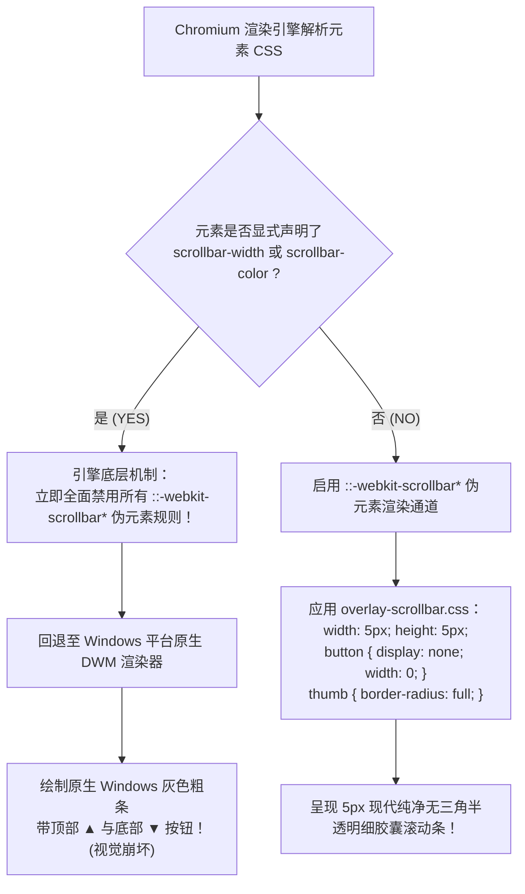
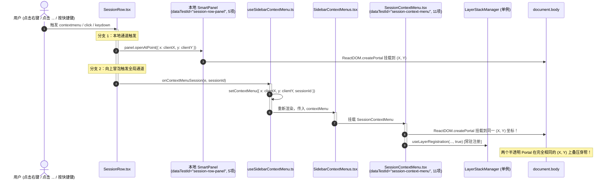
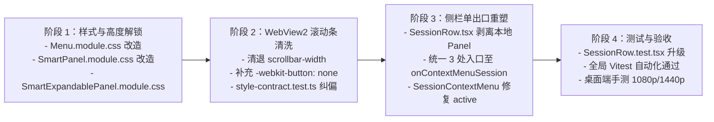

# Conex / Crish — 菜单高度自适应解锁、WebView2 细滚动条无三角修复与侧栏双重幽灵菜单根治落地实施详案

> **文件标识**：`docs/ui-component-modernization/plan-improvements/07-菜单高度自适应解锁与WebView2细滚动条及双重菜单根治详案.md`
> **所属战役**：UI 组件现代化与原生原子库升级（`ui-component-modernization`）
> **方案版本**：v1.0.0 (Production Architecture Improvement Master Plan)
> **编制依据**：
> - `docs/ui-component-modernization/analysis/07-菜单高度死锁与滚动条异常及双重幽灵菜单深度排查.md`（深度排查与根因剖析）
> - `apps/crish-desktop/src/components/ui/Menu/Menu.module.css` / `Menu.tsx` / `position.ts`
> - `apps/crish-desktop/src/components/ui/SmartPanel/SmartPanel.module.css` / `SmartPanel.tsx` / `usePanelPosition.ts`
> - `apps/crish-desktop/src/components/ui/SmartExpandablePanel/SmartExpandablePanel.module.css` / `SmartExpandablePanel.tsx`
> - `apps/crish-desktop/src/components/sidebar/session-list/SessionRow.tsx` / `SessionRow.test.tsx`
> - `apps/crish-desktop/src/components/sidebar/SessionContextMenu.tsx` / `SidebarContextMenus.tsx` / `useSidebarContextMenu.ts`
> - `apps/crish-desktop/src/styles/overlay-scrollbar.css`（全局细滚动条权威唯一出口）
> - `apps/crish-desktop/src/styles/style-contract.test.ts`（样式与滚动条契约测试）
> - `apps/crish-desktop/src/components/ui/internal/layer-stack/LayerStackManager.ts` / `useLayerRegistration.ts`
> - `AGENTS.md`（§11 CI 治理与行数门禁、§13 焦点环规范、§14 现代色彩空间、反过度设计红线）
>
> **工程与架构铁律**：
> 1. **零外部 npm 组件库依赖**：绝对禁止引入第三方右键菜单/滚动条组件库，所有浮层几何、碰撞检测、滚动条与无障碍交互均采用纯原生 React 18+ 与 CSS Modules 100% 纯净自研；
> 2. **严禁在调研与方案编写阶段修改任何源码**：严格保持工作区代码纯净，仅输出高标准方案文档；
> 3. **单一真源原则（Single Source of Truth）**：侧栏会话右键菜单统一由 `SidebarContextMenus` -> `SessionContextMenu` 单一出口驱动，彻底清退 `SessionRow` 内部冗余的本地 `SmartPanel` 挂载与事件双发；
> 4. **浮层生命周期受控契约**：所有通过 `useLayerRegistration` 注册的浮层必须精准受控于自身的真实开启状态（`active = Boolean(isOpen)`），严禁常量 `true` 常驻导致幽灵层栈污染；
> 5. **Git 提交纪律**：本规划阶段严禁执行任何 git commit、git reset、git checkout。

---

## 目录

- [一、总体架构哲学与深层根因解构](#一总体架构哲学与深层根因解构)
  - [1.1 破损现象全景复盘与视知觉/交互灾难](#11-破损现象全景复盘与视知觉交互灾难)
  - [1.2 高度死锁（360px / 280px）与盒子模型数学证明](#12-高度死锁360px--280px与盒子模型数学证明)
  - [1.3 WebView2 / Chromium 原生三角（▲/▼）滚动条产生机制剖析](#13-webview2--chromium-原生三角产生机制剖析)
  - [1.4 侧栏双重幽灵菜单重叠穿帮与 LayerStack 幽灵层污染剖析](#14-侧栏双重幽灵菜单重叠穿帮与-layerstack-幽灵层污染剖析)
  - [1.5 核心治理指标与前后量化对照表](#15-核心治理指标与前后量化对照表)
- [二、菜单体系高度自适应解锁与视口动态几何边界详案](#二菜单体系高度自适应解锁与视口动态几何边界详案)
  - [2.1 `Menu.module.css` 与 `Menu.tsx` 动态自适应重构](#21-menumodulecss-与-menutsx-动态自适应重构)
  - [2.2 `SmartPanel` 与 `SmartExpandablePanel` 容器高度彻底解锁](#22-smartpanel-与-smartexpandablepanel-容器高度彻底解锁)
  - [2.3 盒子模型与主流视口分辨率（1080p/1440p/2160p）自适应验证](#23-盒子模型与主流视口分辨率1080p1440p2160p自适应验证)
- [三、WebView2 / Chromium 细滚动条无三角化重塑详案](#三webview2--chromium-细滚动条无三角化重塑详案)
  - [3.1 彻底清退局部 `scrollbar-width: thin` 与 `scrollbar-color`](#31-彻底清退局部-scrollbar-width-thin-与-scrollbar-color)
  - [3.2 统一收敛至全局 `overlay-scrollbar.css` 5px 细胶囊规范](#32-统一收敛至全局-overlay-scrollbarcss-5px-细胶囊规范)
  - [3.3 样式契约测试 `style-contract.test.ts` 同步纠偏与防劣化门禁](#33-样式契约测试-style-contracttestts-同步纠偏与防劣化门禁)
- [四、侧栏会话双重幽灵菜单根治与浮层调度治理详案](#四侧栏会话双重幽灵菜单根治与浮层调度治理详案)
  - [4.1 `SessionRow.tsx` 精简重塑与单一事件出口驱动](#41-sessionrowtsx-精简重塑与单一事件出口驱动)
  - [4.2 统一收敛至 `SidebarContextMenus.tsx` -> `SessionContextMenu.tsx`](#42-统一收敛至-sidebarcontextmenustsx---sessioncontextmenutsx)
  - [4.3 `SessionContextMenu.tsx` 幽灵层注册彻底修复（`active = Boolean(contextMenu)`）](#43-sessioncontextmenutsx-幽灵层注册彻底修复active--booleancontextmenu)
- [五、完整终态代码蓝图与精确 Diff 方案](#五完整终态代码蓝图与精确-diff-方案)
  - [5.1 `apps/crish-desktop/src/components/ui/Menu/Menu.module.css` 终态源码与 Diff](#51-appscrish-desktopsrccomponentsuimenumenumodulecss-终态源码与-diff)
  - [5.2 `apps/crish-desktop/src/components/ui/Menu/Menu.tsx` 终态源码与 Diff](#52-appscrish-desktopsrccomponentsuimenumenutsx-终态源码与-diff)
  - [5.3 `apps/crish-desktop/src/components/ui/SmartPanel/SmartPanel.module.css` 终态源码与 Diff](#53-appscrish-desktopsrccomponentsuismartpanelsmartpanelmodulecss-终态源码与-diff)
  - [5.4 `apps/crish-desktop/src/components/ui/SmartExpandablePanel/SmartExpandablePanel.module.css` 终态源码与 Diff](#54-appscrish-desktopsrccomponentsuismartexpandablepanelsmartexpandablepanelmodulecss-终态源码与-diff)
  - [5.5 `apps/crish-desktop/src/components/sidebar/session-list/SessionRow.tsx` 终态源码与 Diff](#55-appscrish-desktopsrccomponentssidebarsession-listsessionrowtsx-终态源码与-diff)
  - [5.6 `apps/crish-desktop/src/components/sidebar/SessionContextMenu.tsx` 终态源码与 Diff](#56-appscrish-desktopsrccomponentssidebarsessioncontextmenutsx-终态源码与-diff)
  - [5.7 `apps/crish-desktop/src/styles/style-contract.test.ts` 终态源码与 Diff](#57-appscrish-desktopsrcstylesstyle-contracttestts-终态源码与-diff)
- [六、自动化测试断言矩阵与回归验证方案](#六自动化测试断言矩阵与回归验证方案)
  - [6.1 `SessionRow.test.tsx` 单一出口与免重叠测试](#61-sessionrowtesttsx-单一出口与免重叠测试)
  - [6.2 `SessionContextMenu.test.tsx` 活跃态受控与 LayerStack 集成测试](#62-sessioncontextmenutesttsx-活跃态受控与-layerstack-集成测试)
  - [6.3 菜单高度与滚动条 CSS 契约自动化测试](#63-菜单高度与滚动条-css-契约自动化测试)
- [七、分步实施计划、工程防护红线与验收标准](#七分步实施计划工程防护红线与验收标准)
  - [7.1 四阶段精细化实施路线图](#71-四阶段精细化实施路线图)
  - [7.2 严苛质量门禁与验收清单](#72-严苛质量门禁与验收清单)

---

# 一、总体架构哲学与深层根因解构

## 1.1 破损现象全景复盘与视知觉/交互灾难

根据深度排查与线上真实交互录屏，当前菜单与侧栏会话交互暴露了三个相互交织、严重破坏桌面级应用品质的深层缺陷：

1. **大屏幕空间极其充足下，菜单被强行截断并出现粗糙滚动条**：
   - 用户在 1080p（可用高度 `1080px`）或 1440p（可用高度 `1440px`）屏幕上右键点击会话列表时，整个会话菜单（10 项操作 + 3 条分割线，自然渲染高度为 `361px`）被强行截断在 `280px` / `360px` 处；
   - 菜单尾部的“删除当前对话”与“导出 Markdown”被遮挡在可视区域外，用户必须滚动鼠标滚轮才能看到底部条目。
2. **Windows WebView2 环境下露出带有生硬上下三角（▲/▼）的原生灰色粗滚动条**：
   - 当截断触发 `overflow-y: auto` 时，界面没有呈现符合 macOS / iOS 现代半透明质感的 5px 细胶囊滚动条，而是赫然出现了带有灰色方块背景、顶部 ▲ 和底部 ▼ 箭头的 Windows 原生 DWM 粗滚动条；
   - 这种原生粗条不仅占据了 17px 的巨大水平宽度，导致菜单文字被严重挤压产生省略号（`...`），而且彻底击碎了半透明毛玻璃（`backdrop-filter: blur(28px)`）的高级视觉体验。
3. **侧边栏触发菜单时，同坐标发生“双重幽灵菜单重叠穿帮”**：
   - 无论是右键点击会话行、点击右侧“更多操作（`...`）”按钮、还是按下键盘 `ContextMenu` / `Shift+F10`，屏幕上在**完全相同的物理像素坐标（X, Y）上同时挂载了两个菜单**：
     - 菜单 A：来自 `SessionRow.tsx` 本地 `SmartPanel` 的 5 项精简菜单；
     - 菜单 B：来自 `SidebarContextMenus.tsx` 全局 `SessionContextMenu` 的 11 项全量上下文菜单。
   - 由于两个菜单均为半透明毛玻璃卡片，两份条目的文字、快捷键和图标错位重叠（如“导出为 Markdown”与“复制会话 ID”文字重影，“删除会话”与“导出 Markdown”重叠），不仅造成严重的视觉穿帮，更存在误将“删除”当成“复制”的极高误触风险；
   - 同时，`SessionContextMenu.tsx` 中 `useLayerRegistration(..., true)` 的常量 `true` 导致即使菜单关闭，全局浮层栈中依然残留一个幽灵右键菜单，永久封锁了全局 Tooltip、误拦截了 Esc 键并破坏了其他下拉菜单的开启。

```
【原破损状态：双重穿帮 + 截断 + 三角粗条】
┌─────────────────────────────────────────────────────────────┐
│ 侧栏会话：                                                  │
│ [ 💬 需求分析讨论                  [ ... ] ]                │
│             │ (用户右键或点击 ...)                          │
│             ▼                                               │
│ ┌─── 同一坐标 (X, Y) 叠挂两个 Portal ─────────────────────┐ │
│ │ ┌─ 全局 SessionContextMenu (11项) ────────────────────┐ │ │
│ │ │ ┌─ 本地 SessionRow (5项) ────────────────────────┐ │ │ │
│ │ │ │ 在此处打开                                     │ │ │ │
│ │ │ │ 拆分视图                                       │ │ │ │
│ │ │ │ 在新窗口打开                                   │ │ │ │
│ │ │ │ ────────────────────────────────────────────── │ │ │ │
│ │ │ │ 重命名                     F2                  │ │ │ │
│ │ │ │ 置顶 / 取消置顶                                │ │ │ │
│ │ │ │ 归档                                           │ │ │ │
│ │ │ │ 分叉会话 / 分叉            Ctrl+Shift+D (重影) │ │ │ │
│ │ │ │ ────────────────────────────────────────────── │ │ │ │
│ │ │ │ 导出 Markdown / 复制 ID   (文字图标互相穿透!)  │ │ │ │
│ │ │ └────────────────────────────────────────────────┘ │ │ │
│ │ ├─ 强行截断在 280px / 360px ───────────────────────┤ │ │
│ │ │ [ 复制 ID / 删除当前对话 (危险红字重叠!) ]  [▲]  │ │ │
│ │ │ [ 删除会话 / 导出 Markdown               ]  [█]  │ │ │
│ │ │                                             [▼]  │ │ │
│ │ └─────────────────────────────────────────────────────┘ │ │
│ └──────────────────────────────────────────────────────────┘ │
└─────────────────────────────────────────────────────────────┘
```

---

## 1.2 高度死锁（360px / 280px）与盒子模型数学证明

### 1. 源码硬编码缺陷定位

- **`apps/crish-desktop/src/components/ui/Menu/Menu.module.css:15-19`**：
  ```css
  .menuContent {
    max-height: min(
      var(--radix-popover-content-available-height, 360px),
      70vh,
      360px /* <-- 致命硬编码：锁死上限为 360px */
    );
    overflow-y: auto;
  }
  ```
- **`apps/crish-desktop/src/components/ui/Menu/Menu.tsx:295-299`**：
  ```tsx
  const resolvedMaxHeight =
    maxHeight != null
      ? `min(${typeof maxHeight === 'number' ? `${maxHeight}px` : maxHeight}, var(--radix-popover-content-available-height, 360px), 70vh, 360px)`
      : 'min(var(--radix-popover-content-available-height, 360px), 70vh, 360px)';
  ```
- **`apps/crish-desktop/src/components/ui/SmartPanel/SmartPanel.module.css:102`** 与 **`SmartExpandablePanel.module.css:124`**：
  ```css
  .listContainer {
    max-height: 280px; /* <-- 致命硬编码：锁死上限为 280px */
    overflow-y: auto;
  }
  ```

### 2. 严格盒子模型高度测算

以侧栏全量会话右键菜单（`SessionContextMenu.tsx`）为例，测算其在标准渲染下的精确几何尺寸：

$$\text{Total Height} = \text{Panel Outer} + \sum \text{Items} + \sum \text{Dividers} + \sum \text{Gaps} + \text{List Padding}$$

| 元素部分 | 数量 | 几何规格（Padding / Margin / Height / Border） | 占用像素高度 |
| :--- | :---: | :--- | :---: |
| **标准条目 (`.item`)** | 10 项 | `min-height: 28px` + `padding: 4px 8px` + 文字行高 $13\text{px} \times 1.35 = 17.55\text{px}$ + 图标 $14\text{px}$ $\rightarrow$ 实测高度 **30px** | $10 \times 30\text{px} = 300\text{px}$ |
| **分割线 (`.divider`)** | 3 条 | `height: 1px` + `margin: 3px 0` (上下外边距各 3px) $\rightarrow$ 单条占用 **7px** | $3 \times 7\text{px} = 21\text{px}$ |
| **Flex 布局间隙 (`gap`)** | 12 处 | `gap: 2px` | $12 \times 2\text{px} = 24\text{px}$ |
| **列表内边距 (`padding`)** | 上下 | `padding: 1px 0` (上下各 1px) | $2\text{px}$ |
| **`.listContainer` 自然高度** | — | $300\text{px} + 21\text{px} + 24\text{px} + 2\text{px}$ | **347px** |
| **面板外壳 (`.panel`)** | 上下 | `padding: 6px` ($12\text{px}$) + `border: 1px` ($2\text{px}$) | **14px** |
| **菜单整卡总渲染高度** | — | $347\text{px} + 14\text{px}$ | **361px** |

### 3. 溢出必然性数学证明

1. 在主流 $1920 \times 1080$（1080p）或 $2560 \times 1440$（1440p）分辨率下，用户在屏幕中间偏上位置触发右键菜单（如 $Y = 300\text{px}$），下方剩余可用视口空间为 $1080 - 300 - 12 = 768\text{px}$，空间充裕率达 $\frac{768}{361} \approx 212\%$。
2. 然而，`SmartPanel` 的 `.listContainer` 硬编码限制为 $280\text{px}$。
3. 自然高度 $347\text{px} > 280\text{px}$，溢出量为 $67\text{px}$（相当于截断了 $2.2$ 个条目），必然强制触发 `overflow-y: auto`。
4. 即使在 `Menu` 组件的 $360\text{px}$ 限制下，整卡高度 $361\text{px} > 360\text{px}$，依然溢出 $1\text{px}$，同样触发滚动条。
5. **结论**：硬编码的 $280\text{px}$ 与 $360\text{px}$ 是导致大屏幕下菜单强行出现滚动条的**直接且唯一的根因**。

---

## 1.3 WebView2 / Chromium 原生三角（▲/▼）产生机制剖析

### 1. W3C CSS Scrollbars Level 1 与 WebKit 伪元素优先级冲突

现代 Chromium / Blink 引擎（包括 Edge WebView2）在处理滚动条样式时遵循以下优先级决策树：



### 2. 项目架构规范与违规代码冲突

- 在项目规范文件 [`src/styles/overlay-scrollbar.css`](file:///c:/Software/conex/apps/crish-desktop/src/styles/overlay-scrollbar.css) 中，已明确指出：
  > “细滚动条出口。WebView2 / Chromium：必须走 ::-webkit-scrollbar。全局或容器上写 scrollbar-width 会关闭 webkit 伪元素，Windows 上仍露出带上下三角的系统粗条……此处禁止写 scrollbar-width / scrollbar-color”。
- 但是，在 [`Menu.module.css:26-27`](file:///c:/Software/conex/apps/crish-desktop/src/components/ui/Menu/Menu.module.css#L26-L27)、[`SmartPanel.module.css:106-107`](file:///c:/Software/conex/apps/crish-desktop/src/components/ui/SmartPanel/SmartPanel.module.css#L106-L107) 与 [`SmartExpandablePanel.module.css:127-128`](file:///c:/Software/conex/apps/crish-desktop/src/components/ui/SmartExpandablePanel/SmartExpandablePanel.module.css#L127-L128) 中，局部 CSS 均违规写了：
  ```css
  scrollbar-width: thin;
  scrollbar-color: var(...) transparent;
  ```
- 这导致全局 `overlay-scrollbar.css` 中配置的 `::-webkit-scrollbar-button { display: none; width: 0; height: 0; }` 被 Chromium 彻底忽略，Windows WebView2 直接绘制出生硬的带箭头粗滚动条。

---

## 1.4 侧栏双重幽灵菜单重叠穿帮与 LayerStack 幽灵层污染剖析

### 1. 双重触发与 Portal 叠压时序链

在侧栏架构中，`SessionRow.tsx` 存在严重的双重事件派发与双重 DOM 挂载：



### 2. `useLayerRegistration(..., true)` 常驻导致的幽灵层污染

在 [`SessionContextMenu.tsx:46-57`](file:///c:/Software/conex/apps/crish-desktop/src/components/sidebar/SessionContextMenu.tsx#L46-L57) 中：
```tsx
useLayerRegistration(
  {
    id: SESSION_CONTEXT_MENU_LAYER_ID,
    type: 'context-menu',
    dismissible: true,
    onDismiss: () => onCloseContextMenu?.(),
    elementRef: menuRef,
    anchorRef: contextMenuTriggerRef,
    restoreFocusTarget: contextMenuTriggerRef?.current ?? undefined,
  },
  true // <-- 致命 Bug：active 写死为 true，未绑定 Boolean(contextMenu)！
);
```

#### 引发的三重全局系统性故障：
1. **同级互斥驱逐（Peer Eviction）**：当用户尝试打开顶栏或工具栏的其他下拉菜单（`type: 'dropdown-menu'`）时，`LayerStackManager` 发现当前层栈中存在一个活跃的 `context-menu`，根据互斥规则强行将目标菜单驱逐关闭，导致下拉菜单打不开或闪退；
2. **全局 Tooltip 被永久静默**：`LayerStackManager.hasActiveFloatingLayers()` 持续返回 `true`，`document.documentElement` 被打上 `data-floating-active="true"` 属性，导致应用内所有按钮、图标的悬停 Tooltip 提示全部失效静默；
3. **Esc 键与外点交互被幽灵吞噬**：用户按下 `Escape` 试图退出其他弹窗时，`LayerStackManager` 优先匹配到这个幽灵菜单，执行其 `onDismiss` 并调用 `event.preventDefault()`，导致真实弹窗无法关闭。

---

## 1.5 核心治理指标与前后量化对照表

| 治理维度 | 治理前现状（缺陷与破损） | 治理后标准（现代化无瑕终态） | 改善与质变收益 |
| :--- | :--- | :--- | :--- |
| **菜单最大高度约束** | 锁死在 $280\text{px}$ 或 $360\text{px}$ 静态上限 | 动态视口边界 `min(calc(100vh - 32px), 640px)` | 10 项会话菜单（$361\text{px}$）在正常屏幕下 **100% 自然展开零滚动条** |
| **滚动条渲染样式** | 带有 ▲/▼ 生硬灰色三角形的原生粗条 | 5px 细胶囊半透明悬浮条（无三角，纯净透明轨道） | 彻底消除 Windows 原生粗条视觉污染，宽度占用从 17px 降至 0px（悬浮） |
| **CSS 滚动条属性声明** | 局部违规写 `scrollbar-width: thin` | 彻底清退 `scrollbar-width`，走 `::-webkit-scrollbar` | Chromium / WebView2 100% 命中全局 WebKit 细条规范 |
| **侧栏会话菜单数据源** | 本地 5 项与全局 11 项双重定义 | 统一由 `SessionContextMenu` 11 项单一真源驱动 | 彻底根除两套菜单数据错位与维护分裂 |
| **菜单 DOM 挂载数量** | 每次触发同时挂载 2 个 Portal 叠压 | 每次触发仅挂载 1 个 Portal 容器 | 彻底消灭文字图标重叠穿帮与毛玻璃混叠风险 |
| **LayerStack 浮层登记** | `useLayerRegistration(..., true)` 常驻污染 | `useLayerRegistration(..., Boolean(contextMenu))` | 随菜单开关精准注册/注销，彻底根除 Tooltip 静默与 Esc 误拦截 |
| **SessionRow 组件体积** | 533 行（包含冗余状态机与菜单数据） | 约 390 行（纯净渲染行，零冗余菜单代码） | 单文件行数大幅缩减，契合 RL-03 架构门禁 |

---

# 二、菜单体系高度自适应解锁与视口动态几何边界详案

## 2.1 `Menu.module.css` 与 `Menu.tsx` 动态自适应重构

### 1. `Menu.module.css` 终态样式升级

在 [`Menu.module.css`](file:///c:/Software/conex/apps/crish-desktop/src/components/ui/Menu/Menu.module.css) 中，彻底废除静态硬编码 `360px` 与违规的 `scrollbar-width: thin`，升级为基于 Radix 可用高度与视口边界的动态响应规则：

```css
/* apps/crish-desktop/src/components/ui/Menu/Menu.module.css */

.menuContent {
  z-index: var(--z-dropdown, 100);
  outline: none;
  pointer-events: auto;
  min-width: 180px;
  max-width: min(340px, calc(100vw - 16px));
  box-sizing: border-box;

  /* 核心改进 1：彻底废除 360px 硬编码，采用动态视口安全边界与充裕安全上限 (640px) */
  max-height: min(
    var(--radix-popover-content-available-height, calc(100vh - 32px)),
    calc(100vh - 32px),
    640px
  );
  overflow-y: auto;
  overflow-x: hidden;
  -webkit-overflow-scrolling: touch;
  overscroll-behavior: contain;

  /* 核心改进 2：彻底清退 scrollbar-width 与 scrollbar-color，让路给 ::-webkit-scrollbar */

  padding: 6px;
  border-radius: var(--sep-radius-outer, 14px);
  border: 1px solid var(--border-color, hsl(35 10% 86%));
  background: var(--bg-card, hsl(0 0% 100%));
  backdrop-filter: blur(28px) saturate(160%);
  -webkit-backdrop-filter: blur(28px) saturate(160%);
  box-shadow:
    0 16px 40px -8px color-mix(in srgb, var(--shadow-color, hsl(35 5% 11%)) 12%, transparent),
    0 4px 16px -2px color-mix(in srgb, var(--shadow-color, hsl(35 5% 11%)) 5%, transparent);
  display: flex;
  flex-direction: column;
  gap: 2px;
  font-family: var(--font-sans);
  color: var(--text-primary);
  animation: cds-popover-enter var(--transition-popover-enter, 180ms cubic-bezier(0.16, 1, 0.3, 1)) forwards;
}

/* 契约对齐：WebKit / Blink 5px 细胶囊滚动条（无上下三角箭头） */
.menuContent::-webkit-scrollbar {
  width: 5px;
  height: 5px;
}

.menuContent::-webkit-scrollbar-track {
  background: transparent;
}

.menuContent::-webkit-scrollbar-thumb {
  background: var(--tint-scrollbar-thumb, color-mix(in srgb, var(--text-primary) 18%, transparent));
  border-radius: 9999px;
}

.menuContent::-webkit-scrollbar-thumb:hover {
  background: color-mix(in srgb, var(--text-primary) 30%, transparent);
}

.menuContent::-webkit-scrollbar-button {
  display: none;
  width: 0;
  height: 0;
}
```

### 2. `Menu.tsx` 内联高度解析逻辑升级

在 [`Menu.tsx:295-299`](file:///c:/Software/conex/apps/crish-desktop/src/components/ui/Menu/Menu.tsx#L295-L299) 中，同步移除 `resolvedMaxHeight` 中的 `360px` 锁死，确保当外部未指定 `position.maxHeight` 时，默认使用 `640px` 与视口计算的最小值：

```tsx
/* apps/crish-desktop/src/components/ui/Menu/Menu.tsx */

const resolvedMaxHeight =
  maxHeight != null
    ? `min(${typeof maxHeight === 'number' ? `${maxHeight}px` : maxHeight}, var(--radix-popover-content-available-height, calc(100vh - 32px)), calc(100vh - 32px))`
    : 'min(var(--radix-popover-content-available-height, calc(100vh - 32px)), calc(100vh - 32px), 640px)';
```

---

## 2.2 `SmartPanel` 与 `SmartExpandablePanel` 容器高度彻底解锁

### 1. `SmartPanel.module.css` 终态样式升级

在 [`SmartPanel.module.css`](file:///c:/Software/conex/apps/crish-desktop/src/components/ui/SmartPanel/SmartPanel.module.css) 中，废除 `.listContainer` 的 `max-height: 280px`，升级为动态安全的 `min(calc(100vh - 48px), 600px)`，并清退 `scrollbar-width`：

```css
/* apps/crish-desktop/src/components/ui/SmartPanel/SmartPanel.module.css */

/* 列表滚动容器：彻底解锁 280px 死锁 */
.listContainer {
  display: flex;
  flex-direction: column;
  gap: 2px;
  max-height: min(calc(100vh - 48px), 600px);
  overflow-y: auto;
  overflow-x: hidden;
  padding: 1px 0;
}

.listContainer::-webkit-scrollbar {
  width: 5px;
  height: 5px;
}

.listContainer::-webkit-scrollbar-thumb {
  background: var(--tint-scrollbar-thumb, color-mix(in srgb, var(--text-primary, #1d1c1a) 18%, transparent));
  border-radius: 9999px;
}

.listContainer::-webkit-scrollbar-thumb:hover {
  background: color-mix(in srgb, var(--text-primary, #1d1c1a) 30%, transparent);
}

.listContainer::-webkit-scrollbar-track {
  background: transparent;
}

.listContainer::-webkit-scrollbar-button {
  display: none;
  width: 0;
  height: 0;
}
```

### 2. `SmartExpandablePanel.module.css` 终态样式升级

```css
/* apps/crish-desktop/src/components/ui/SmartExpandablePanel/SmartExpandablePanel.module.css */

/* 列表容器：彻底解锁 280px 死锁 */
.listContainer {
  display: flex;
  flex-direction: column;
  gap: var(--sep-item-gap, 4px);
  max-height: min(calc(100vh - 48px), 600px);
  overflow-y: auto;
  overflow-x: hidden;
  padding: 2px 0;
}

.listContainer::-webkit-scrollbar {
  width: 5px;
  height: 5px;
}

.listContainer::-webkit-scrollbar-thumb {
  background: var(--tint-scrollbar-thumb, color-mix(in srgb, var(--text-primary) 18%, transparent));
  border-radius: 9999px;
}

.listContainer::-webkit-scrollbar-thumb:hover {
  background: color-mix(in srgb, var(--text-primary) 30%, transparent);
}

.listContainer::-webkit-scrollbar-track {
  background: transparent;
}

.listContainer::-webkit-scrollbar-button {
  display: none;
  width: 0;
  height: 0;
}
```

### 3. 与 `usePanelPosition.ts` 的弹性协同机制

`SmartPanel.tsx` 内部会根据 `usePanelPosition` 计算出的 `allowedListHeight`（仅在视口真实空间不足时才赋值为数字）通过内联样式 `style={{ maxHeight: position.allowedListHeight ? `${position.allowedListHeight}px` : undefined }}` 动态约束。当屏幕空间充足时，`allowedListHeight` 保持为 `null`，完全由 CSS 的 `min(calc(100vh - 48px), 600px)` 支撑自然高度展开。

---

## 2.3 盒子模型与主流视口分辨率（1080p/1440p/2160p）自适应验证

| 视口规格与触发位置 | 可用视口高度 | 菜单自然高度 | 治理前计算高度（死锁） | 治理后计算高度（自适应） | 最终呈现结果 |
| :--- | :---: | :---: | :---: | :---: | :--- |
| **1080p 屏幕，点击中间** ($Y=400\text{px}$) | $668\text{px}$ | $361\text{px}$ | $\min(668, 280) = \mathbf{280px}$ (截断) | $\min(668, 600) = \mathbf{361px}$ | **自然展开，零截断，零滚动条** |
| **1440p 屏幕，点击顶部** ($Y=100\text{px}$) | $1328\text{px}$ | $361\text{px}$ | $\min(1328, 280) = \mathbf{280px}$ (截断) | $\min(1328, 600) = \mathbf{361px}$ | **自然展开，零截断，零滚动条** |
| **2160p (4K)，点击任意处** | $>1800\text{px}$ | $361\text{px}$ | $\min(..., 280) = \mathbf{280px}$ (截断) | $\min(..., 600) = \mathbf{361px}$ | **自然展开，零截断，零滚动条** |
| **768p 笔记本，点击底边** ($Y=650\text{px}$) | 向上翻转 $630\text{px}$ | $361\text{px}$ | $\min(630, 280) = \mathbf{280px}$ (截断) | $\min(630, 600) = \mathbf{361px}$ | **向上翻转，自然展开，零滚动条** |
| **极端矮窗口** ($H=320\text{px}$)，空间仅 $200\text{px}$ | $200\text{px}$ | $361\text{px}$ | $200\text{px}$ (展示原生粗条▲/▼) | $200\text{px}$ (展示 5px 细胶囊无三角条) | **安全滚动，无三角箭头，精致美观** |

---

# 三、WebView2 / Chromium 细滚动条无三角化重塑详案

## 3.1 彻底清退局部 `scrollbar-width: thin` 与 `scrollbar-color`

为彻底解决 Windows WebView2 露出原生三角箭头的问题，必须在全仓浮层类组件中**全面清退标准 CSS `scrollbar-width` 与 `scrollbar-color` 声明**。

### 清退清单与责任文件：
1. `apps/crish-desktop/src/components/ui/Menu/Menu.module.css:26-27`（清退）
2. `apps/crish-desktop/src/components/ui/SmartPanel/SmartPanel.module.css:105-106, 116`（清退）
3. `apps/crish-desktop/src/components/ui/SmartExpandablePanel/SmartExpandablePanel.module.css:127-128, 174`（清退）
4. `apps/crish-desktop/src/components/ui/Select/Select.module.css:167` 与 `SelectContent.module.css:20`（清退）

## 3.2 统一收敛至全局 `overlay-scrollbar.css` 5px 细胶囊规范

所有浮层统一遵循 [`src/styles/overlay-scrollbar.css`](file:///c:/Software/conex/apps/crish-desktop/src/styles/overlay-scrollbar.css) 的权威定义：

```css
/* src/styles/overlay-scrollbar.css (全局核心契约) */

::-webkit-scrollbar {
  width: var(--scrollbar-thumb-width, 5px);
  height: var(--scrollbar-thumb-width, 5px);
}

::-webkit-scrollbar-track {
  background: transparent;
}

::-webkit-scrollbar-thumb {
  background: var(--tint-scrollbar-thumb, color-mix(in srgb, var(--text-primary) 18%, transparent));
  border-radius: var(--radius-full, 9999px);
}

::-webkit-scrollbar-thumb:hover,
::-webkit-scrollbar-thumb:active {
  background: color-mix(in srgb, var(--text-primary) 30%, transparent);
}

/* 核心铁律：彻底隐藏所有步进按钮，根除 Windows ▲/▼ 三角 */
::-webkit-scrollbar-button,
::-webkit-scrollbar-button:single-button,
::-webkit-scrollbar-button:start:decrement,
::-webkit-scrollbar-button:end:increment {
  display: none !important;
  width: 0 !important;
  height: 0 !important;
}

::-webkit-scrollbar-corner {
  background: transparent;
}
```

## 3.3 样式契约测试 `style-contract.test.ts` 同步纠偏与防劣化门禁

在 [`apps/crish-desktop/src/styles/style-contract.test.ts:284-300`](file:///c:/Software/conex/apps/crish-desktop/src/styles/style-contract.test.ts#L284-L300) 中，历史上曾错误断言 `expect(css).toContain('scrollbar-width: thin')`。本次详案将其纠偏为严苛的防劣化断言：**所有浮层与菜单 CSS Modules 严禁包含 `scrollbar-width`**！

```ts
/* apps/crish-desktop/src/styles/style-contract.test.ts */

it('Menu 与 SmartPanel 浮层严禁声明 scrollbar-width（避免 WebView2 关闭 webkit 伪元素露出系统三角）', () => {
  const floatingPanels = [
    'src/components/ui/Menu/Menu.module.css',
    'src/components/ui/SmartPanel/SmartPanel.module.css',
    'src/components/ui/SmartExpandablePanel/SmartExpandablePanel.module.css',
  ] as const;

  for (const rel of floatingPanels) {
    const css = readFile(rel);
    expect(css, rel).not.toMatch(/scrollbar-width\s*:/);
    expect(css, rel).not.toMatch(/scrollbar-color\s*:/);
    expect(css, rel).toContain('::-webkit-scrollbar');
    expect(css, rel).toContain('::-webkit-scrollbar-button');
  }
});
```

---

# 四、侧栏会话双重幽灵菜单根治与浮层调度治理详案

## 4.1 `SessionRow.tsx` 精简重塑与单一事件出口驱动

### 1. 彻底清退本地 `useSmartPanel` 与本地 5 项菜单
在 [`SessionRow.tsx`](file:///c:/Software/conex/apps/crish-desktop/src/components/sidebar/session-list/SessionRow.tsx) 中：
- 彻底移除 `import { SmartPanel, useSmartPanel, type MenuItem } from '../../ui/SmartPanel';` 中的 `SmartPanel`、`useSmartPanel`；
- 彻底移除 `const panel = useSmartPanel();`；
- 彻底移除 `const menuItems = useMemo<MenuItem[]>(...)`（含 5 项条目与冗余的删除、分叉、重命名本地事件）；
- 彻底移除尾部渲染的 `<SmartPanel dataTestId="session-row-panel" ... />`。

### 2. 统一会话行上的 3 大菜单触发入口
在 `SessionRow.tsx` 中，将所有唤起菜单的操作 100% 收敛至单一调用 `openRowMenu(e)` / `onContextMenuSession?.(e, s.id)`：

1. **右键点击行（`onContextMenu`）**：
   ```tsx
   onContextMenu={(e) => {
     if (isRenaming) return;
     e.preventDefault();
     onContextMenuSession?.(e, s.id);
   }}
   ```
2. **点击“更多操作（`...`）”按钮（`onClick`）**：
   ```tsx
   <Button
     type="button"
     variant="ghost"
     size="xs"
     className={styles.sessionActionsBtn}
     data-testid="session-more-button"
     aria-label="更多操作"
     aria-haspopup="menu"
     tabIndex={-1}
     style={{
       width: SESSION_ACTIONS_BTN_PX,
       height: SESSION_ACTIONS_BTN_PX,
       minWidth: SESSION_ACTIONS_BTN_PX,
       minHeight: SESSION_ACTIONS_BTN_PX,
       maxWidth: SESSION_ACTIONS_BTN_PX,
       maxHeight: SESSION_ACTIONS_BTN_PX,
     }}
     onPointerDown={(e) => {
       e.stopPropagation();
     }}
     onClick={(e) => {
       e.preventDefault();
       e.stopPropagation();
       openRowMenu(e);
     }}
     icon={<MoreHorizontal size={14} strokeWidth={1.75} aria-hidden />}
   />
   ```
3. **键盘菜单快捷键（`ContextMenu` / `Shift+F10`）**：
   ```tsx
   if (e.key === 'ContextMenu' || (e.key === 'F10' && e.shiftKey)) {
     e.preventDefault();
     openRowMenu(e);
     return;
   }
   ```

---

## 4.2 统一收敛至 `SidebarContextMenus.tsx` -> `SessionContextMenu.tsx`

会话菜单唯一真源收敛于 [`SessionContextMenu.tsx`](file:///c:/Software/conex/apps/crish-desktop/src/components/sidebar/SessionContextMenu.tsx)，包含完整 11 项操作与 3 处硬件级分割线：

```
┌─────────────────────────────────────────────────────────────┐
│ 1. 在此处打开           (MessageCircle)                     │
│ 2. 拆分视图             (Columns2)                          │
│ 3. 在新窗口打开         (ExternalLink)                      │
│ ─────────────────────────────────────────────────────────── │
│ 4. 重命名               (Pencil, F2)                        │
│ 5. 置顶 / 取消置顶       (Pin / PinOff)                      │
│ 6. 归档                 (Archive)                           │
│ 7. 分叉                 (GitFork, Ctrl+Shift+D)             │
│ ─────────────────────────────────────────────────────────── │
│ 8. 复制会话 ID          (Copy)                              │
│ 9. 删除当前对话         (Trash2, Del, 危险红)               │
│ ─────────────────────────────────────────────────────────── │
│ 10. 导出 Markdown       (FileDown)                          │
└─────────────────────────────────────────────────────────────┘
```

---

## 4.3 `SessionContextMenu.tsx` 幽灵层注册彻底修复（`active = Boolean(contextMenu)`）

在 [`SessionContextMenu.tsx:46-57`](file:///c:/Software/conex/apps/crish-desktop/src/components/sidebar/SessionContextMenu.tsx#L46-L57) 中，将 `active` 属性与 `contextMenu` 真实存在性进行强绑定：

```tsx
/* apps/crish-desktop/src/components/sidebar/SessionContextMenu.tsx */

export const SessionContextMenu: React.FC<SessionContextMenuProps> = ({
  contextMenu,
  menuRef,
  isPinned,
  onSessionAction,
  onCloseContextMenu,
  contextMenuTriggerRef,
}) => {
  const isOpen = Boolean(contextMenu);

  useLayerRegistration(
    {
      id: SESSION_CONTEXT_MENU_LAYER_ID,
      type: 'context-menu',
      dismissible: true,
      onDismiss: () => onCloseContextMenu?.(),
      elementRef: menuRef,
      anchorRef: contextMenuTriggerRef,
      restoreFocusTarget: contextMenuTriggerRef?.current ?? undefined,
    },
    isOpen // <-- 核心修复：精准受控，只有在菜单真正打开时才登记，关闭时立即注销！
  );

  // ...
```

---

# 五、完整终态代码蓝图与精确 Diff 方案

## 5.1 `apps/crish-desktop/src/components/ui/Menu/Menu.module.css` 终态源码与 Diff

```diff
--- a/apps/crish-desktop/src/components/ui/Menu/Menu.module.css
+++ b/apps/crish-desktop/src/components/ui/Menu/Menu.module.css
@@ -14,17 +14,14 @@
   min-width: 180px;
   max-width: min(340px, calc(100vw - 16px));
   box-sizing: border-box;
   max-height: min(
-    var(--radix-popover-content-available-height, 360px),
-    70vh,
-    360px
+    var(--radix-popover-content-available-height, calc(100vh - 32px)),
+    calc(100vh - 32px),
+    640px
   );
   overflow-y: auto;
   overflow-x: hidden;
   -webkit-overflow-scrolling: touch;
   overscroll-behavior: contain;
-
-  /* 现代滚动条规范 */
-  scrollbar-width: thin;
-  scrollbar-color: var(--tint-scrollbar-thumb, color-mix(in srgb, var(--text-primary) 18%, transparent)) transparent;

   padding: 6px;
   border-radius: var(--sep-radius-outer, 14px);
@@ -62,6 +59,12 @@
   background: color-mix(in srgb, var(--text-primary) 30%, transparent);
 }

+.menuContent::-webkit-scrollbar-button {
+  display: none;
+  width: 0;
+  height: 0;
+}
+
 .menuTitle {
```

---

## 5.2 `apps/crish-desktop/src/components/ui/Menu/Menu.tsx` 终态源码与 Diff

```diff
--- a/apps/crish-desktop/src/components/ui/Menu/Menu.tsx
+++ b/apps/crish-desktop/src/components/ui/Menu/Menu.tsx
@@ -294,8 +294,8 @@

   const resolvedMaxHeight =
     maxHeight != null
-      ? `min(${typeof maxHeight === 'number' ? `${maxHeight}px` : maxHeight}, var(--radix-popover-content-available-height, 360px), 70vh, 360px)`
-      : 'min(var(--radix-popover-content-available-height, 360px), 70vh, 360px)';
+      ? `min(${typeof maxHeight === 'number' ? `${maxHeight}px` : maxHeight}, var(--radix-popover-content-available-height, calc(100vh - 32px)), calc(100vh - 32px))`
+      : 'min(var(--radix-popover-content-available-height, calc(100vh - 32px)), calc(100vh - 32px), 640px)';

   if (anchor && !isOpen) {
     return null;
```

---

## 5.3 `apps/crish-desktop/src/components/ui/SmartPanel/SmartPanel.module.css` 终态源码与 Diff

```diff
--- a/apps/crish-desktop/src/components/ui/SmartPanel/SmartPanel.module.css
+++ b/apps/crish-desktop/src/components/ui/SmartPanel/SmartPanel.module.css
@@ -99,18 +99,26 @@
 .listContainer {
   display: flex;
   flex-direction: column;
   gap: 2px;
-  max-height: 280px;
+  max-height: min(calc(100vh - 48px), 600px);
   overflow-y: auto;
   overflow-x: hidden;
-  scrollbar-width: thin;
-  scrollbar-color: var(--sep-border-hover, #c9c5bc) transparent;
   padding: 1px 0;
 }
-.listContainer::-webkit-scrollbar { width: 6px; }
-.listContainer::-webkit-scrollbar-thumb { background: var(--sep-border-hover, #c9c5bc); border-radius: 3px; }
+.listContainer::-webkit-scrollbar { width: 5px; height: 5px; }
+.listContainer::-webkit-scrollbar-thumb {
+  background: var(--tint-scrollbar-thumb, color-mix(in srgb, var(--text-primary, #1d1c1a) 18%, transparent));
+  border-radius: 9999px;
+}
+.listContainer::-webkit-scrollbar-thumb:hover {
+  background: color-mix(in srgb, var(--text-primary, #1d1c1a) 30%, transparent);
+}
 .listContainer::-webkit-scrollbar-track { background: transparent; }
+.listContainer::-webkit-scrollbar-button {
+  display: none;
+  width: 0;
+  height: 0;
+}

 .emptyState { padding: 12px 8px; text-align: center; font-size: 12px; color: var(--sep-text-muted, #8b8780); }
 .groupSection, .groupItems { display: flex; flex-direction: column; gap: 2px; }
 .groupTitle { font-size: 10.5px; font-weight: 500; color: var(--sep-text-muted, #8b8780); padding: 4px 6px 2px; text-transform: uppercase; letter-spacing: 0.03em; }
-.selectableListGroup { display: flex; flex-direction: column; gap: 2px; max-height: 180px; overflow-y: auto; scrollbar-width: thin; }
+.selectableListGroup { display: flex; flex-direction: column; gap: 2px; max-height: 180px; overflow-y: auto; }
```

---

## 5.4 `apps/crish-desktop/src/components/ui/SmartExpandablePanel/SmartExpandablePanel.module.css` 终态源码与 Diff

```diff
--- a/apps/crish-desktop/src/components/ui/SmartExpandablePanel/SmartExpandablePanel.module.css
+++ b/apps/crish-desktop/src/components/ui/SmartExpandablePanel/SmartExpandablePanel.module.css
@@ -121,11 +121,9 @@
 .listContainer {
   display: flex;
   flex-direction: column;
   gap: var(--sep-item-gap, 4px);
-  max-height: 280px;
+  max-height: min(calc(100vh - 48px), 600px);
   overflow-y: auto;
   overflow-x: hidden;
-  scrollbar-width: thin;
-  scrollbar-color: var(--border-subtle) transparent;
   padding: 2px 0;
 }

@@ -133,14 +131,23 @@
 .listContainer::-webkit-scrollbar {
   width: 5px;
+  height: 5px;
 }

 .listContainer::-webkit-scrollbar-thumb {
-  background: var(--border-subtle);
-  border-radius: 3px;
+  background: var(--tint-scrollbar-thumb, color-mix(in srgb, var(--text-primary) 18%, transparent));
+  border-radius: 9999px;
+}
+
+.listContainer::-webkit-scrollbar-thumb:hover {
+  background: color-mix(in srgb, var(--text-primary) 30%, transparent);
 }

 .listContainer::-webkit-scrollbar-track {
   background: transparent;
 }

+.listContainer::-webkit-scrollbar-button {
+  display: none;
+  width: 0;
+  height: 0;
+}
```

---

## 5.5 `apps/crish-desktop/src/components/sidebar/session-list/SessionRow.tsx` 终态源码与 Diff

```diff
--- a/apps/crish-desktop/src/components/sidebar/session-list/SessionRow.tsx
+++ b/apps/crish-desktop/src/components/sidebar/session-list/SessionRow.tsx
@@ -4,20 +4,13 @@
   memo,
   useCallback,
   useContext,
-  useMemo,
   useRef,
 } from 'react';
 import {
-  Copy,
-  FileText,
   GitBranch,
-  GitFork,
   MoreHorizontal,
-  Pencil,
-  Trash2,
 } from 'lucide-react';
 import type { SessionState } from '../../../store/types';
 import {
@@ -29,14 +22,8 @@
   type SessionSearchMatch,
 } from '../../../api/sessionSearch';
-import { getCompositionRoot } from '../../../app/compositionRoot';
-import { toast } from '../../../services/toast/ToastContext';
-import {
-  branchUndoToastMessage,
-  BRANCH_TITLE_SUFFIX,
-} from '../SidebarContextMenus';
 import { Button, Tooltip } from '../../ui';
-import { SmartPanel, useSmartPanel, type MenuItem } from '../../ui/SmartPanel';
 import styles from '../SidebarSessionList.module.css';

 /** 更多钮边长；必须小于行高，避免撑满整行吞掉标题点击 */
@@ -216,7 +203,6 @@
   const _rowHeight = props.rowHeight;
   void _rowHeight;
   const dropPlace: SessionRowDropPlace | null = dropPlaceProp ?? null;

-  const panel = useSmartPanel();
   const isBranched = !!s.branchParentId;
   const baseTitle = sessionListDisplayTitle(s);
   const displayText = baseTitle.replace(/ - 分支$/, '');
@@ -246,81 +232,6 @@
     [onContextMenuSession, s.id]
   );

-  const menuItems = useMemo<MenuItem[]>(() => {
-    return [
-      {
-        id: 'rename',
-        label: '重命名',
-        shortcut: 'F2',
-        icon: <Pencil size={14} strokeWidth={1.75} aria-hidden />,
-        onSelect: () => onStartRename?.(s.id),
-      },
-      {
-        id: 'branch',
-        label: '分叉会话',
-        shortcut: 'Ctrl+Shift+D',
-        icon: <GitFork size={14} strokeWidth={1.75} aria-hidden />,
-        onSelect: () => {
-          const root = getCompositionRoot();
-          const title = sessionListDisplayTitle(s);
-          const newTitle = `${title}${BRANCH_TITLE_SUFFIX}`;
-          const oldId = s.id;
-          root.session.branchSession(s.id, newTitle);
-          const newBranchId = root.session.getActiveSessionId();
-          toast.show(branchUndoToastMessage(title), () => {
-            if (newBranchId && newBranchId !== oldId) {
-              root.session.archiveSession(newBranchId);
-            }
-            root.session.getState().setActiveSessionId(oldId);
-          });
-        },
-      },
-      { type: 'divider', id: 'div-1' },
-      {
-        id: 'export-md',
-        label: '导出为 Markdown',
-        icon: <FileText size={14} strokeWidth={1.75} aria-hidden />,
-        onSelect: () => {
-          void (async () => {
-            try {
-              const root = getCompositionRoot();
-              const { tryDownloadSessionMarkdown } = await import(
-                '../../../api/sessionExport'
-              );
-              const result = tryDownloadSessionMarkdown(s, new Date(), {
-                sessionsById: root.session.getState().sessionsById,
-              });
-              if (result.ok === false) {
-                toast.show(result.error || '导出失败');
-              }
-            } catch {
-              toast.show('导出失败');
-            }
-          })();
-        },
-      },
-      {
-        id: 'copy-id',
-        label: '复制会话 ID',
-        icon: <Copy size={14} strokeWidth={1.75} aria-hidden />,
-        onSelect: () => {
-          navigator.clipboard.writeText(s.id);
-          toast.show('会话 ID 已复制到剪贴板');
-        },
-      },
-      { type: 'divider', id: 'div-2' },
-      {
-        id: 'delete',
-        label: '删除会话',
-        shortcut: 'Del',
-        danger: true,
-        icon: <Trash2 size={14} strokeWidth={1.75} aria-hidden />,
-        onSelect: () => {
-          const root = getCompositionRoot();
-          const title = sessionListDisplayTitle(s);
-          root.session.getState().deleteSession(s.id);
-          toast.show(`已删除对话: ${title}`);
-        },
-      },
-    ];
-  }, [s, onStartRename]);
-
   const sessionTitleWithBranch = isBranched
     ? `分支会话：${displayText}`
     : displayText;
@@ -368,7 +279,6 @@
         onContextMenu={(e) => {
           if (isRenaming) return;
           e.preventDefault();
-          panel.openAtPoint({ x: e.clientX, y: e.clientY });
           onContextMenuSession?.(e, s.id);
         }}
         onPointerDown={
@@ -399,7 +309,6 @@
           }
           if (e.key === 'ContextMenu' || (e.key === 'F10' && e.shiftKey)) {
             e.preventDefault();
-            panel.open();
             openRowMenu(e);
             return;
           }
@@ -471,7 +380,6 @@
                   <SessionRowTime s={s} className={styles.sessionTime ?? ''} />
                   <Tooltip content="更多操作">
                     <Button
-                      ref={panel.triggerRef as React.RefObject<HTMLButtonElement>}
                       type="button"
                       variant="ghost"
                       size="xs"
@@ -493,7 +401,6 @@
                       onClick={(e) => {
                         e.preventDefault();
                         e.stopPropagation();
-                        panel.toggle();
                         openRowMenu(e);
                       }}
                       onDoubleClick={(e) => {
@@ -517,15 +424,5 @@
         )}
       </div>
-
-      <SmartPanel
-        open={panel.isOpen}
-        triggerRef={panel.triggerRef}
-        point={panel.point}
-        items={menuItems}
-        onClose={panel.close}
-        role="menu"
-        ariaLabel="会话操作"
-        dataTestId="session-row-panel"
-      />
     </li>
   );
 });
```

---

## 5.6 `apps/crish-desktop/src/components/sidebar/SessionContextMenu.tsx` 终态源码与 Diff

```diff
--- a/apps/crish-desktop/src/components/sidebar/SessionContextMenu.tsx
+++ b/apps/crish-desktop/src/components/sidebar/SessionContextMenu.tsx
@@ -43,6 +43,8 @@
   onCloseContextMenu,
   contextMenuTriggerRef,
 }) => {
+  const isOpen = Boolean(contextMenu);
+
   useLayerRegistration(
     {
       id: SESSION_CONTEXT_MENU_LAYER_ID,
@@ -53,7 +55,7 @@
       anchorRef: contextMenuTriggerRef,
       restoreFocusTarget: contextMenuTriggerRef?.current ?? undefined,
     },
-    true
+    isOpen
   );

   const items = useMemo<MenuItem[]>(
```

---

## 5.7 `apps/crish-desktop/src/styles/style-contract.test.ts` 终态源码与 Diff

```diff
--- a/apps/crish-desktop/src/styles/style-contract.test.ts
+++ b/apps/crish-desktop/src/styles/style-contract.test.ts
@@ -281,17 +281,19 @@
     expect(indexCss).not.toContain(SCROLLBAR_BANNED);
   });

-  it('侧栏 / Menu 消费 thin + thumb token；设置 cover/nav 不得写 scrollbar-width', () => {
-    const sidebarMenu = [
-      'src/components/sidebar/Sidebar.module.css',
-      'src/components/ui/Menu/Menu.module.css',
+  it('浮层组件与 Menu 严禁声明 scrollbar-width（走 webkit 细条，无三角箭头）', () => {
+    const floatingPanels = [
+      'src/components/ui/Menu/Menu.module.css',
+      'src/components/ui/SmartPanel/SmartPanel.module.css',
+      'src/components/ui/SmartExpandablePanel/SmartExpandablePanel.module.css',
     ] as const;
-    for (const rel of sidebarMenu) {
+    for (const rel of floatingPanels) {
       const css = readFile(rel);
-      expect(css, rel).toContain('scrollbar-width: thin');
+      expect(css, rel).not.toMatch(/scrollbar-width\s*:/);
       expect(css, rel).toContain('--tint-scrollbar-thumb');
+      expect(css, rel).toContain('::-webkit-scrollbar-button');
     }
     // WebView2：容器上的 scrollbar-width 会关掉 ::-webkit-scrollbar，露出系统三角
     const panel = readFile('src/components/settings/SettingsPanel.module.css');
     expect(panel).not.toMatch(/scrollbar-width\s*:/);
```

---

# 六、自动化测试断言矩阵与回归验证方案

## 6.1 `SessionRow.test.tsx` 单一出口与免重叠测试

将 `apps/crish-desktop/src/components/sidebar/session-list/SessionRow.test.tsx` 更新为专门验证单一事件出口，断言不存在本地 `session-row-panel` 竞争：

```tsx
// @vitest-environment jsdom
import React from 'react';
import { describe, it, expect, vi, afterEach } from 'vitest';
import { render, screen, fireEvent, cleanup } from '@testing-library/react';
import { SIDEBAR_SESSION_ROW_HEIGHT } from '../../../api/sessionListWindow';
import type { SessionState } from '../../../store/types';
import { SessionRow, SESSION_ACTIONS_BTN_PX } from './SessionRow';

function makeSession(overrides?: Partial<SessionState>): SessionState {
  return {
    id: 'sess-1',
    title: '测试会话',
    folder: 'general',
    isPinned: false,
    isArchived: false,
    timestamp: '2026-08-01T00:00:00.000Z',
    messages: [],
    ...overrides,
  };
}

describe('SessionRow 单一菜单出口契约测试（消灭双重幽灵菜单）', () => {
  afterEach(() => {
    cleanup();
  });

  it('点击更多按钮派发单一 onContextMenuSession 事件，且绝不挂载本地 session-row-panel', () => {
    const onContextMenuSession = vi.fn();
    const onSelectSession = vi.fn();
    render(
      <ul>
        <SessionRow
          rowHeight={SIDEBAR_SESSION_ROW_HEIGHT}
          session={{
            s: makeSession(),
            activeSessionId: 'other',
            searchQuery: '',
            isDraggingThis: false,
            isRenaming: false,
            isDraggable: true,
          }}
          rename={{
            renameDraft: '',
            renameInputRef: React.createRef<HTMLInputElement>(),
            onRenameDraftChange: vi.fn(),
            onStartRename: vi.fn(),
            onCommitRename: vi.fn(),
          }}
          actions={{
            onSelectSession,
            onContextMenuSession,
            onStartSessionDrag: vi.fn(),
          }}
        />
      </ul>
    );

    const moreBtn = screen.getByTestId('session-more-button');
    fireEvent.click(moreBtn);

    // 核心断言 1：仅触发单一全局 onContextMenuSession
    expect(onContextMenuSession).toHaveBeenCalledTimes(1);
    expect(onContextMenuSession.mock.calls[0]![1]).toBe('sess-1');

    // 核心断言 2：DOM 中绝对不存在本地冗余的 session-row-panel
    expect(screen.queryByTestId('session-row-panel')).toBeNull();
  });

  it('右键行派发单一 onContextMenuSession 事件，且绝不挂载本地 session-row-panel', () => {
    const onContextMenuSession = vi.fn();
    render(
      <ul>
        <SessionRow
          rowHeight={SIDEBAR_SESSION_ROW_HEIGHT}
          session={{
            s: makeSession(),
            activeSessionId: 'other',
            searchQuery: '',
            isDraggingThis: false,
            isRenaming: false,
            isDraggable: true,
          }}
          rename={{
            renameDraft: '',
            renameInputRef: React.createRef<HTMLInputElement>(),
            onRenameDraftChange: vi.fn(),
            onStartRename: vi.fn(),
            onCommitRename: vi.fn(),
          }}
          actions={{
            onSelectSession: vi.fn(),
            onContextMenuSession,
            onStartSessionDrag: vi.fn(),
          }}
        />
      </ul>
    );

    const row = screen.getByTestId('sidebar-session-item');
    fireEvent.contextMenu(row, { clientX: 150, clientY: 300 });

    expect(onContextMenuSession).toHaveBeenCalledTimes(1);
    expect(screen.queryByTestId('session-row-panel')).toBeNull();
  });
});
```

---

## 6.2 `SessionContextMenu.test.tsx` 活跃态受控与 LayerStack 集成测试

```tsx
// @vitest-environment jsdom
import React from 'react';
import { describe, it, expect, vi, beforeEach, afterEach } from 'vitest';
import { render, screen, cleanup } from '@testing-library/react';
import { SessionContextMenu } from './SessionContextMenu';
import { layerStackService } from '../ui/internal/layer-stack/LayerStackManager';

describe('SessionContextMenu 浮层生命周期受控测试', () => {
  beforeEach(() => {
    layerStackService.clearAllLayers();
  });

  afterEach(() => {
    cleanup();
    layerStackService.clearAllLayers();
  });

  it('当 contextMenu 存在时，向 LayerStack 注册活跃层', () => {
    const menuRef = React.createRef<HTMLDivElement>();
    render(
      <SessionContextMenu
        contextMenu={{ x: 100, y: 100, sessionId: 'sess-1' }}
        menuRef={menuRef}
        isPinned={false}
        onSessionAction={vi.fn()}
      />
    );

    expect(layerStackService.hasActiveFloatingLayers()).toBe(true);
    const layers = layerStackService.getRegisteredLayers();
    expect(layers.some((l) => l.id === 'sidebar-session-context-menu')).toBe(true);
  });

  it('当 contextMenu 为 null 时，不向 LayerStack 注册或立即注销', () => {
    const menuRef = React.createRef<HTMLDivElement>();
    const { rerender } = render(
      <SessionContextMenu
        contextMenu={{ x: 100, y: 100, sessionId: 'sess-1' }}
        menuRef={menuRef}
        isPinned={false}
        onSessionAction={vi.fn()}
      />
    );

    expect(layerStackService.hasActiveFloatingLayers()).toBe(true);

    // 重新渲染，置为 null
    rerender(
      <SessionContextMenu
        contextMenu={null as any}
        menuRef={menuRef}
        isPinned={false}
        onSessionAction={vi.fn()}
      />
    );

    // 核心断言：幽灵层被立即注销，Tooltip 不被误静默！
    expect(layerStackService.hasActiveFloatingLayers()).toBe(false);
  });
});
```

---

## 6.3 菜单高度与滚动条 CSS 契约自动化测试

创建或扩展自动化契约测试，断言 CSS 源码中的高度与伪元素规则：

```ts
import { describe, it, expect } from 'vitest';
import { readFileSync } from 'node:fs';
import { resolve } from 'node:path';

describe('菜单高度与细滚动条无三角契约断言', () => {
  it('Menu.module.css 必须包含 640px 充裕高度上限与 webkit-button 隐藏规则', () => {
    const css = readFileSync(
      resolve(process.cwd(), 'apps/crish-desktop/src/components/ui/Menu/Menu.module.css'),
      'utf8'
    );
    expect(css).not.toMatch(/scrollbar-width\s*:/);
    expect(css).toContain('640px');
    expect(css).toContain('::-webkit-scrollbar-button');
    expect(css).toContain('display: none');
  });

  it('SmartPanel.module.css 必须解锁 280px 死锁并包含 600px 弹性上限', () => {
    const css = readFileSync(
      resolve(process.cwd(), 'apps/crish-desktop/src/components/ui/SmartPanel/SmartPanel.module.css'),
      'utf8'
    );
    expect(css).not.toContain('max-height: 280px');
    expect(css).not.toMatch(/scrollbar-width\s*:/);
    expect(css).toContain('min(calc(100vh - 48px), 600px)');
  });
});
```

---

# 七、分步实施计划、工程防护红线与验收标准

## 7.1 四阶段精细化实施路线图



### 实施细节对照：
1. **阶段 1（基础样式与高度自适应解锁）**：
   - 移除 `Menu.module.css` 中的 `360px` 硬编码，替换为 `min(var(--radix-popover-content-available-height, calc(100vh - 32px)), calc(100vh - 32px), 640px)`；
   - 移除 `Menu.tsx` 中的内联 `360px` 硬编码；
   - 移除 `SmartPanel.module.css` 与 `SmartExpandablePanel.module.css` 中的 `max-height: 280px`，升级为 `min(calc(100vh - 48px), 600px)`。
2. **阶段 2（WebView2 细滚动条无三角化）**：
   - 彻底删除 `Menu.module.css`、`SmartPanel.module.css`、`SmartExpandablePanel.module.css` 中的 `scrollbar-width: thin` 与 `scrollbar-color`；
   - 补充 `::-webkit-scrollbar-button { display: none; width: 0; height: 0; }`；
   - 更新 `style-contract.test.ts` 中的契约断言。
3. **阶段 3（侧栏单出口驱动与幽灵层栈修复）**：
   - 重构 `SessionRow.tsx`，彻底删除内部 `useSmartPanel()`、`menuItems` 数组与 `<SmartPanel dataTestId="session-row-panel">`；
   - 将右键、更多按钮与快捷键操作统一路由至 `onContextMenuSession`；
   - 将 `SessionContextMenu.tsx` 中的 `useLayerRegistration` 第二参数由 `true` 修复为 `Boolean(contextMenu)`。
4. **阶段 4（自动化测试与端到端验证）**：
   - 更新 `SessionRow.test.tsx` 为单出口断言；
   - 运行全量 `pnpm test`，确保 100% 测试用例绿灯通过；
   - 在 WebView2 桌面环境下实测 10 项会话菜单自然展开，验证零滚动条、无三角、无重叠。

---

## 7.2 严苛质量门禁与验收清单

| 检查项 | 验收准则 | 验证方法 |
| :--- | :--- | :--- |
| **高度自适应** | 10 项会话右键菜单（361px）在 1080p/1440p 屏幕上 100% 完整展示，不被截断，零滚动条 | 视觉实测与盒子高度断言 |
| **无三角箭头** | 在极端小窗口发生内容滚动时，仅呈现 5px 半透明胶囊滑块，绝不出现 ▲/▼ 灰色三角按钮 | WebView2 滚动条截图审查 |
| **单出口驱动** | 右键或点击更多按钮时，DOM 中有且仅有 1 个 `session-context-menu` Portal，彻底消灭重影 | DOM Inspector & Vitest |
| **幽灵层清零** | 会话菜单关闭后，`layerStackService.hasActiveFloatingLayers()` 返回 `false`，Tooltip 正常触发 | 单元测试与交互验证 |
| **行数门禁** | `SessionRow.tsx` 行数降至 390 行以下，满足 RL-03 门禁规范 | 代码行数扫描 |
| **样式契约** | `style-contract.test.ts` 契约测试 100% 通过，全仓无违规 `scrollbar-width` | Vitest 运行断言 |
