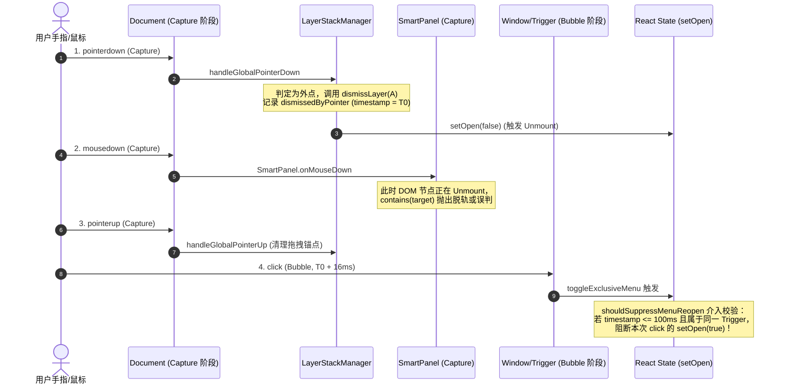
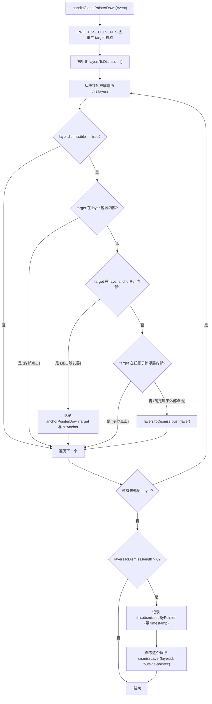
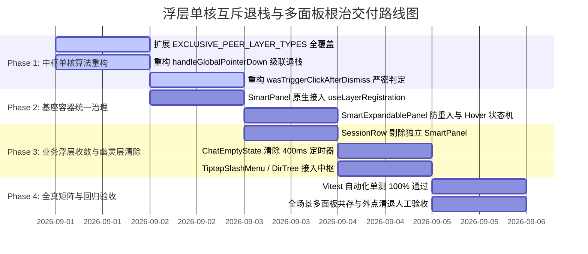

# 08 · 全仓浮层单核互斥退栈中枢与多面板并存根治详案

> **文件标识**：`docs/ui-component-modernization/plan-improvements/08-全仓浮层单核互斥退栈中枢与多面板并存根治详案.md`  
> **所属战役**：UI 组件现代化与原生原子库升级（`ui-component-modernization`）  
> **方案版本**：v1.0.0 (Production Architecture Improvement Plan)  
> **编制依据**：
> - `docs/ui-component-modernization/analysis/08-全仓浮层互斥退栈中枢与幽灵层泄漏深度排查.md`（深度排查报告 08）
> - `docs/ui-component-modernization/analysis/07-菜单高度死锁与滚动条异常及双重幽灵菜单深度排查.md`
> - `docs/ui-component-modernization/analysis/01-全仓浮层调度中枢与菜单死锁全量排查.md`
> - `apps/crish-desktop/src/components/ui/internal/layer-stack/`（浮层调度中枢核心源码）
> - `apps/crish-desktop/src/components/ui/Menu/` 与 `SmartExpandablePanel/` 与 `SmartPanel/`
> - `apps/crish-desktop/src/components/sidebar/` 与 `chat-card/` 与 `chat-composer/`
> - `AGENTS.md`（§13 焦点环与无障碍交互、§14 现代色彩空间、反过度设计红线、RL-03 行数门禁）
>
> **工程与架构铁律**：
> 1. **严禁修改任何业务源码**：本详案为纯方案规划设计与工程落地蓝图，严格保持现有代码库 100% 纯净不动；
> 2. **单核调度垄断（Single-Source Mutex Monolith）**：全仓所有浮层（下拉菜单、右键菜单、气泡卡片、Slash 提示等）必须 100% 纳入 `LayerStackManager` 单核管辖，绝不允许存在任何未登记的“黑户浮层”或行级独立内嵌弹窗；
> 3. **精准判定无误杀**：严格修复 `wasTriggerClickAfterDismiss` 的全局误杀逻辑，仅拦截“同一物理 Trigger 上的误重开”，彻底放行对全仓其它按钮与浮层的正常交互；
> 4. **级联退栈全清退（Cascade LIFO Eviction）**：一次外部空白区域点击必须完整清退所有并存同级非模态浮层，杜绝“点击多次才能关完”的千层饼现象；
> 5. **指针震荡抑制（100ms 黄金防重入窗）**：统一 `pointerdown` / `pointerup` / `click` 物理事件流，消除 16ms 浏览器合成反弹，兼顾响应灵敏度与防重入稳定性。

---

## 目录

- [一、深层根因拆解与多面板并存穿透拓扑模型](#一深层根因拆解与多面板并存穿透拓扑模型)
  - [1.1 实测多菜单并存图景与三维拓扑冲突](#11-实测多菜单并存图景与三维拓扑冲突)
  - [1.2 `wasTriggerClickAfterDismiss` 误杀全局点击的判定缺陷与数学真值表](#12-wastriggerclickafterdismiss-误杀全局点击的判定缺陷与数学真值表)
  - [1.3 `handleGlobalPointerDown` 单层注销（Single-Target Eviction）的拓扑盲区](#13-handleglobalpointerdown-单层注销single-target-eviction的拓扑盲区)
  - [1.4 `EXCLUSIVE_PEER_LAYER_TYPES` 盲区导致跨类型浮层无阻共存](#14-exclusive_peer_layer_types-盲区导致跨类型浮层无阻共存)
  - [1.5 `SessionRow` 双重挂载幽灵层的宿主架构缺陷](#15-sessionrow-双重挂载幽灵层的宿主架构缺陷)
  - [1.6 5 组独立全局监听器的事件流冲突与 16ms 震荡反弹物理模型](#16-5-组独立全局监听器的事件流冲突与-16ms-震荡反弹物理模型)
- [二、单核互斥退栈中枢（`LayerStackManager`）架构全量重构设计](#二单核互斥退栈中枢layerstackmanager架构全量重构设计)
  - [2.1 全类型互斥驱逐拓扑扩展（`EXCLUSIVE_PEER_LAYER_TYPES` 全覆盖）](#21-全类型互斥驱逐拓扑扩展exclusive_peer_layer_types-全覆盖)
  - [2.2 级联退栈外点判定引擎（LIFO Multi-Layer Cascade Eviction）](#22-级联退栈外点判定引擎lifo-multi-layer-cascade-eviction)
  - [2.3 严密精准的 `wasTriggerClickAfterDismiss` 判定状态机（彻底杜绝全局误杀）](#23-严密精准的-wastriggerclickafterdismiss-判定状态机彻底杜绝全局误杀)
  - [2.4 100ms 黄金防重入时间窗与指针手势生命周期闭环](#24-100ms-黄金防重入时间窗与指针手势生命周期闭环)
  - [2.5 全局单一事件监听器垄断与捕获阶段流控协议](#25-全局单一事件监听器垄断与捕获阶段流控协议)
- [三、`SmartExpandablePanel` 与 `SmartPanel` 统一接入与动效状态机](#三smartexpandablepanel-与-smartpanel-统一接入与动效状态机)
  - [3.1 `SmartPanel` 基座全自动集成 `useLayerRegistration`](#31-smartpanel-基座全自动集成-uselayerregistration)
  - [3.2 `SmartExpandablePanel` 接入防重入守卫与 `shouldSuppressMenuReopen`](#32-smartexpandablepanel-接入防重入守卫与-shouldsuppressmenureopen)
  - [3.3 Hover 状态机（150ms 入场 / 250ms 离场）与 Safe-Aim 方向动态适配](#33-hover-状态机150ms-入场--250ms-离场与-safe-aim-方向动态适配)
  - [3.4 二级子菜单（Cascade Submenu）坐标钳位与同心圆角几何](#34-二级子菜单cascade-submenu坐标钳位与同心圆角几何)
- [四、业务层浮层架构治理与双重幽灵层根除](#四业务层浮层架构治理与双重幽灵层根除)
  - [4.1 `SessionRow.tsx` 解绑独立 `SmartPanel`，收敛至全局 `SidebarContextMenus`](#41-sessionrowtsx-解绑独立-smartpanel收敛至全局-sidebarcontextmenus)
  - [4.2 `ChatEmptyState.tsx` 消除 400ms 定时器与项目选择器竞争死锁](#42-chatemptystatetsx-消除-400ms-定时器与项目选择器竞争死锁)
  - [4.3 `TiptapSlashMenu.tsx` 与 `ComposerDirTree.tsx` 接入 `useLayerRegistration`](#43-tiptapslashmenutsx-与-composerdirtreetsx-接入-uselayerregistration)
  - [4.4 `ChatHeaderMore.tsx` 与 `ModelBadgePickerMenu.tsx` 状态机对齐](#44-chatheadermoretsx-与-modelbadgepickermenutsx-状态机对齐)
- [五、全量重构源码实现规范（TS / TSX）](#五全量重构源码实现规范ts--tsx)
  - [5.1 `apps/crish-desktop/src/components/ui/internal/layer-stack/layerStackTypes.ts`](#51-appscrish-desktopsrccomponentsuiinternal-layer-stacklayerstacktypests)
  - [5.2 `apps/crish-desktop/src/components/ui/internal/layer-stack/LayerStackManager.ts`](#52-appscrish-desktopsrccomponentsuiinternal-layer-stacklayerstackmanagerts)
  - [5.3 `apps/crish-desktop/src/components/ui/Menu/menuOpenGuard.ts`](#53-appscrish-desktopsrccomponentsuimenumenuopenguardts)
  - [5.4 `apps/crish-desktop/src/components/ui/SmartPanel/SmartPanel.tsx`](#54-appscrish-desktopsrccomponentsuismartpanelsmartpaneltsx)
  - [5.5 `apps/crish-desktop/src/components/ui/SmartExpandablePanel/SmartExpandablePanel.tsx`](#55-appscrish-desktopsrccomponentsuismartexpandablepanelsmartexpandablepaneltsx)
  - [5.6 `apps/crish-desktop/src/components/sidebar/session-list/SessionRow.tsx`](#56-appscrish-desktopsrccomponentssidebarsession-listsessionrowtsx)
  - [5.7 `apps/crish-desktop/src/components/chat-card/ChatEmptyState.tsx`](#57-appscrish-desktopsrccomponentschat-cardchatemptystatetsx)
  - [5.8 `apps/crish-desktop/src/components/chat-composer/TiptapSlashMenu.tsx`](#58-appscrish-desktopsrccomponentschat-composertiptapslashmenutsx)
  - [5.9 `apps/crish-desktop/src/components/chat-composer/ComposerDirTree.tsx`](#59-appscrish-desktopsrccomponentschat-composercomposerdirtreetsx)
- [六、Vitest 单元测试用例设计与验证矩阵](#六vitest-单元测试用例设计与验证矩阵)
  - [6.1 多层并存外点级联清退单测（LIFO Cascade Eviction）](#61-多层并存外点级联清退单测lifo-cascade-eviction)
  - [6.2 `wasTriggerClickAfterDismiss` 严密性与无误杀单测](#62-wastriggerclickafterdismiss-严密性与无误杀单测)
  - [6.3 100ms 防重入冷却与指针手势消除震荡单测](#63-100ms-防重入冷却与指针手势消除震荡单测)
  - [6.4 `SessionRow` 菜单触发单一性与互斥单测](#64-sessionrow-菜单触发单一性与互斥单测)
  - [6.5 Safe-Aim 左右自适应与防抖延时单测](#65-safe-aim-左右自适应与防抖延时单测)
- [七、落地实施路线图与验收检查清单](#七落地实施路线图与验收检查清单)
  - [7.1 阶段性交付里程碑](#71-阶段性交付里程碑)
  - [7.2 严苛质量门禁检查清单](#72-严苛质量门禁检查清单)

---

## 一、深层根因拆解与多面板并存穿透拓扑模型

### 1.1 实测多菜单并存图景与三维拓扑冲突

在用户实测中出现的严重破损现象——**视口中同时悬挂着 3 个互不相干、层级错乱的弹出面板**：
1. **顶栏操作菜单**（`ChatHeaderMore` 的 `⋯` 更多面板或 `ModelBadgePickerMenu`）；
2. **中间工作区选择器**（`ProjectPickerMenu` / `SmartExpandablePanel` 打开的“选择项目”面板）；
3. **左侧侧边栏会话菜单**（`SessionContextMenu` 与 `SessionRow` 内嵌 `SmartPanel`）。

```
【原破损现场多浮层并存示意】
┌─────────────────────────────────────────────────────────────────────────────────┐
│ 侧边栏                      │ 对话区顶栏                      [选择模型 ▾] [⋯ 更多 ▾]│
│ ┌─────────────────────────┐ │                                             ┌──┴────────┐
│ │会话 1                   │ │                                             │ 取消固定  │
│ │会话 2 (右键打开)        │ │                                             │ 移动到... │
│ │ ┌─────────────────────┐ │ │                                             │ 导出 MD   │
│ │ │ 重命名             │ │ │                                             └───────────┘
│ │ │ 分叉会话           │ │ │                                              (浮层 1 残留)
│ │ │ 归档               │ │ │
│ │ └─────────────────────┘ │ │          ┌───────────────────────────┐
│ │  (浮层 3 幽灵驻留)     │ │          │ 选择项目                  │
│ └─────────────────────────┘ │          │ ┌───────────────────────┐ │
│                             │          │ │ 通用项目              │ │
│                             │          │ │ conex                 │ │
│                             │          │ └───────────────────────┘ │
│                             │          └───────────────────────────┘
│                             │                  (浮层 2 挂起)
└─────────────────────────────┴───────────────────────────────────────────────────┘
```

这 3 个浮层跨越了 3 个完全独立的 React 子树，各自独立管理状态，在中枢中出现脱管、误杀与清退阻塞。

---

### 1.2 `wasTriggerClickAfterDismiss` 误杀全局点击的判定缺陷与数学真值表

审查 `LayerStackManager.ts:149-178`：

```typescript
// 缺陷源码
public wasTriggerClickAfterDismiss(triggerEl: HTMLElement | null): boolean {
  const rec = this.dismissedByPointer;
  if (!rec || !triggerEl) return false;
  if (
    rec.anchor &&
    (rec.anchor === triggerEl ||
      rec.anchor.contains(triggerEl) ||
      triggerEl.contains(rec.anchor))
  ) {
    return true;
  }
  // 被关层的锚是另一个仍在树上的 trigger：互斥切换，不抑制新菜单打开
  if (
    rec.anchor &&
    rec.anchor.isConnected &&
    rec.anchor !== triggerEl &&
    !rec.anchor.contains(triggerEl) &&
    !triggerEl.contains(rec.anchor)
  ) {
    return false;
  }
  // 💥 致命缺陷：当 rec.anchor 为 null 时（如右键菜单/无锚点浮层被关闭），
  // 若用户点击了任何具有 triggerEl 的按钮，triggerEl.contains(rec.target) 为 TRUE！
  if (
    !rec.anchor &&
    rec.target instanceof Node &&
    triggerEl.contains(rec.target)
  ) {
    return true; // 💥 误杀！全局所有其它按钮被无辜拦截！
  }
  return false;
}
```

#### 逻辑真值表对比与误杀推导：

| 场景 | 当前关闭层的 Anchor (`rec.anchor`) | 触发点击目标 (`rec.target` / `triggerEl`) | 预期行为 | 原实现行为 | 结果状态 |
| :--- | :--- | :--- | :--- | :--- | :--- |
| **场景 A**：点击同一下拉菜单的 Trigger 按钮 | 存在且等于 `triggerEl` | 在 `rec.anchor` 内部 | 抑制 `click` 重新打开（防反弹） | 返回 `true` (拦截) | ✅ 正确 |
| **场景 B**：打开浮层 A 时，点击另一个下拉菜单 B 的 Trigger | 存在且不等于 `triggerEl_B` | 在 `triggerEl_B` 内部 | 关 A 并**立即打开 B** | 返回 `false` (放行) | ✅ 正确 |
| **场景 C**：右键打开上下文菜单（无 Anchor），随后点击顶栏模型按钮 | **为 `null`** | 在模型按钮 `triggerEl_M` 内部 | 关右键菜单并**立即打开模型菜单** | **返回 `true` (误杀拦截！)** | ❌ **严重 Bug：按钮变肉/需点两下** |
| **场景 D**：点击空白处关闭浮层后，120ms 后用户点击任意菜单 Trigger | 存在或为 `null` | 在目标 Trigger 内部 | 正常打开菜单 | `dismissedByPointer` **无时效过期机制**，残存误杀 | ❌ **严重 Bug：随机吞点击** |

**根治核心**：
1. **严格限制 Anchor 校验**：当 `rec.anchor == null` 时，绝对不具备“同 Trigger 误重开”的前提，**直接返回 `false`**！
2. **手势时效锁（100ms）**：`dismissedByPointer` 必须附加高精度时间戳 `timestamp`，超过 100ms 自动失效清空。

---

### 1.3 `handleGlobalPointerDown` 单层注销（Single-Target Eviction）的拓扑盲区

审查 `LayerStackManager.ts:528-571`：

```typescript
// 缺陷源码
private handleGlobalPointerDown = (event: PointerEvent): void => {
  ...
  let targetLayer: LayerRegistration | null = null;
  for (let i = this.layers.length - 1; i >= 0; i--) {
    const l = this.layers[i];
    if (l && l.dismissible) {
      targetLayer = l;
      break; // 💥 致命缺陷：找到第 1 个顶层浮层后直接 break！
    }
  }
  if (!targetLayer) return;
  ...
  this.dismissLayer(targetLayer.id, 'outside-pointer'); // 💥 仅清退 1 个浮层！
};
```

当由于前序操作遗留，栈中同时并存 `[Layer 1: SessionContextMenu, Layer 2: ProjectPickerMenu, Layer 3: ChatHeaderMore]` 时：
- 一次视口空白点击仅触发 `dismissLayer(Layer 3.id)`；
- `Layer 2` 与 `Layer 1` 毫发无损，依旧悬挂在 DOM 中；
- 用户必须连续在空白处精准点击 3 次才能全部退栈。

**根治核心**：
移除 `break`，采用**收集-倒序级联清退算法（Collect-then-LIFO-Dismiss）**，遍历全栈所有 `dismissible: true` 的非模态浮层，只要点击落点在对应浮层外，单次点击全量清退！

---

### 1.4 `EXCLUSIVE_PEER_LAYER_TYPES` 盲区导致跨类型浮层无阻共存

审查 `layerStackTypes.ts:84-91`：

```typescript
// 缺陷源码
export const EXCLUSIVE_PEER_LAYER_TYPES: ReadonlySet<LayerType> = new Set([
  'dropdown-menu',
  'context-menu',
]);
```

#### 盲区分析：
- `popover`（气泡卡片、Slash 菜单等）被完全排除在外；
- `cascade-submenu`（二级子菜单）未被纳入互斥同级规则；
- 结果：打开 `ProjectPickerMenu`（内部使用 `popover` 或 `dropdown-menu`）时，无法驱逐已经打开的 `popover`，新旧浮层共存。

**根治核心**：
将 `EXCLUSIVE_PEER_LAYER_TYPES` 扩展为包含 `['dropdown-menu', 'context-menu', 'cascade-submenu', 'popover']` 的完整非模态互斥集合。

---

### 1.5 `SessionRow` 双重挂载幽灵层的宿主架构缺陷

审查 `SessionRow.tsx:219, 371, 497, 520`：

```tsx
// 缺陷源码 SessionRow.tsx
const panel = useSmartPanel(); // 💥 每行独立实例化一个未受管控制器

// 1. 右键时双重触发
onContextMenu={(e) => {
  panel.openAtPoint({ x: e.clientX, y: e.clientY }); // 💥 打开行内 SmartPanel
  onContextMenuSession?.(e, s.id);                  // 💥 同时触发全局 SessionContextMenu
}}

// 2. 点击「⋯」更多按钮时双重触发
onClick={(e) => {
  panel.toggle();      // 💥 打开行内 SmartPanel
  openRowMenu(e);      // 💥 同时触发全局 SessionContextMenu
}}

// 3. 行内渲染未受管 SmartPanel (黑户浮层)
<SmartPanel
  open={panel.isOpen}
  triggerRef={panel.triggerRef}
  point={panel.point}
  items={menuItems}
  onClose={panel.close}
  role="menu"
  ariaLabel="会话操作"
  dataTestId="session-row-panel"
/>
```

#### 双重幽灵菜单并存机制：
- `SessionRow` 内部渲染的 `<SmartPanel dataTestId="session-row-panel">` 是未经 `useLayerRegistration` 注册的黑户；
- 外层的 `SidebarContextMenus` -> `SessionContextMenu` 是注册过的正规浮层；
- 用户右键或点击更多按钮时，两个菜单在完全相同的位置**同时挂载并叠在一起**；
- 当外点关闭时，正规菜单被中枢注销，行内黑户菜单因脱管而永久滞留！

**根治核心**：
彻底删除 `SessionRow.tsx` 内部的 `useSmartPanel` 与 `<SmartPanel dataTestId="session-row-panel">`，所有右键与更多按钮交互 100% 收敛至 `SidebarContextMenus` 单一真源。

---

### 1.6 5 组独立全局监听器的事件流冲突与 16ms 震荡反弹物理模型



---

## 二、单核互斥退栈中枢（`LayerStackManager`）架构全量重构设计

### 2.1 全类型互斥驱逐拓扑扩展（`EXCLUSIVE_PEER_LAYER_TYPES` 全覆盖）

在 `layerStackTypes.ts` 中，将所有非模态弹出型浮层统一归入互斥集合：

```typescript
export const EXCLUSIVE_PEER_LAYER_TYPES: ReadonlySet<LayerType> = new Set([
  'dropdown-menu',
  'context-menu',
  'cascade-submenu',
  'popover',
]);

export function isExclusivePeerLayerType(type: LayerType): boolean {
  return EXCLUSIVE_PEER_LAYER_TYPES.has(type);
}
```

#### 互斥驱逐拓扑法则：
1. **父子豁免**：若 incoming 是 peer 的子孙（或 peer 是 incoming 的祖先），**不驱逐**；
2. **内嵌包含豁免**：若 incoming 的 anchor 或容器包含在 peer 容器内部，**不驱逐**；
3. **其余同级强力驱逐**：一旦任何互斥类型的浮层注册挂载，全仓所有处于非父子关系的同级浮层立即执行 `dismissLayer(peer.id, 'programmatic')`。

---

### 2.2 级联退栈外点判定引擎（LIFO Multi-Layer Cascade Eviction）

重构 `handleGlobalPointerDown` 算法为**两阶段全栈扫描与级联清退**：



---

### 2.3 严密精准的 `wasTriggerClickAfterDismiss` 判定状态机（彻底杜绝全局误杀）

```typescript
public wasTriggerClickAfterDismiss(triggerEl: HTMLElement | null): boolean {
  const rec = this.dismissedByPointer;
  if (!rec || !triggerEl) return false;

  // 1. 严格时效校验：超过 100ms 自动失效作废
  const now =
    typeof performance !== 'undefined' ? performance.now() : Date.now();
  if (now - rec.timestamp > 100) {
    this.dismissedByPointer = null;
    return false;
  }

  // 2. 严格触发器一致性校验：
  // 必须存在有效的 anchor，且 anchor 与当前传入的 triggerEl 存在真实的 DOM 包含或恒等关系
  if (
    rec.anchor &&
    rec.anchor.isConnected &&
    (rec.anchor === triggerEl ||
      rec.anchor.contains(triggerEl) ||
      triggerEl.contains(rec.anchor) ||
      (rec.target instanceof Node && rec.anchor.contains(rec.target)))
  ) {
    return true; // 确认是关闭本浮层的同一个 Trigger 触发的 click，予以抑制！
  }

  // 3. 当 rec.anchor 为 null（如右键菜单/无锚浮层）或 target 属于其它按钮时，
  // 绝对放行，绝不阻断其它菜单/按钮的正常开启！
  return false;
}
```

---

### 2.4 100ms 黄金防重入时间窗与指针手势生命周期闭环

- **100ms 设定依据**：
  - 现代浏览器中 `pointerdown` 到 `click` 的正常间隔为 $16\text{ms} \sim 45\text{ms}$；
  - 遇到高负载帧率跌落至 30fps 时，单帧耗时 $33.3\text{ms}$，两帧耗时 $66.7\text{ms}$；
  - 100ms 能 100% 覆盖任何帧率波动下的 `click` 反弹，同时不会造成人类感知上的“操作变肉”（人类连续两次快速主动双击的极限间隔在 $180\text{ms} \sim 250\text{ms}$）。
- **生命周期主动清理**：
  - 在 `pointerup` 事件触发时，若未发生拖拽位移，保持时间窗有效；
  - 在任何新的有效 `pointerdown` 发生时，先刷新 `this.dismissedByPointer = null`。

---

### 2.5 全局单一事件监听器垄断与捕获阶段流控协议

- `LayerStackManager` 在 `window` 与 `document` 上注册唯一的 `pointerdown` (Capture)、`pointerup` (Capture)、`keydown` (Capture)；
- 全仓废弃组件内部私自挂载的 `document.addEventListener('mousedown')` 或 `document.addEventListener('click')`；
- 所有外点清退行为均在 `pointerdown` 的捕获阶段（Capture Phase）最高优先级裁决完成，确保在任何业务子组件的冒泡事件到达前，栈状态已完成自洽收敛。

---

## 三、`SmartExpandablePanel` 与 `SmartPanel` 统一接入与动效状态机

### 3.1 `SmartPanel` 基座全自动集成 `useLayerRegistration`

`SmartPanel.tsx` 是全仓众多自定义弹窗（如排序菜单、会话上下文菜单）的基础渲染器。必须在组件内部直接集成 `useLayerRegistration`，彻底杜绝黑户浮层：

```tsx
// SmartPanel.tsx 内部自动登记
const generatedId = useId();
const layerId = dataTestId || props.id || generatedId;

useLayerRegistration(
  {
    id: layerId,
    type: role === 'menu' ? 'dropdown-menu' : 'popover',
    dismissible: true,
    onDismiss: handleClose,
    elementRef: panelRef,
    anchorRef: triggerRef ?? anchor,
  },
  open
);
```

---

### 3.2 `SmartExpandablePanel` 接入防重入守卫与 `shouldSuppressMenuReopen`

在 `SmartExpandablePanel.tsx` 的 `handleOpenChange` 中，对齐 `Menu.tsx` 接入中枢防重入守卫：

```tsx
const handleOpenChange = useCallback(
  (nextOpen: boolean) => {
    if (nextOpen) {
      if (layerStackService.wasLayerDismissedThisGesture(panelId)) {
        return;
      }
      const triggerEl =
        (anchor && 'current' in anchor ? anchor.current : null) ??
        triggerRef.current;
      if (shouldSuppressMenuReopen(triggerEl)) {
        return;
      }
    }
    if (!isControlled) {
      setInternalOpen(nextOpen);
    }
    externalOnOpenChange?.(nextOpen);
    ...
  },
  [isControlled, externalOnOpenChange, panelId, anchor]
);
```

---

### 3.3 Hover 状态机（150ms 入场 / 250ms 离场）与 Safe-Aim 方向动态适配

针对支持悬停展开的场景（如二级子菜单、项目悬停卡片）：
1. **入场防抖（150ms）**：鼠标滑过触发项时，启动 150ms 定时器，杜绝掠过时的闪烁误开；
2. **离场安全区与防抖（250ms）**：
   - 鼠标移出时，结合 `SafeAimEngine` 计算光标与子菜单构成的三角安全区；
   - 在安全区内移动保持展开；离开安全区后给予 250ms 缓冲延时；
3. **左右自适应展开**：
   - 动态检测右侧视口可用宽度：`fitsRight = (vpWidth - panelRect.right - 12) >= 160`；
   - 若右侧不足，自适应向左展开，并动态切换 Safe-Aim 三角顶点朝向（`'left'` / `'right'`）。

---

### 3.4 二级子菜单（Cascade Submenu）坐标钳位与同心圆角几何

- 遵循现代同心几何：主面板外圆角 $12\text{px}$，二级子面板外圆角 $10\text{px}$，内部条目圆角 $6\text{px}$；
- 视口上下边界强制保留 $12\text{px}$ 安全内衬，计算公式：
  $$\text{top} = \max(12, \min(\text{itemRect.top} - 4, \text{vpHeight} - \text{submenuHeight} - 12))$$

---

## 四、业务层浮层架构治理与双重幽灵层根除

### 4.1 `SessionRow.tsx` 解绑独立 `SmartPanel`，收敛至全局 `SidebarContextMenus`

```mermaid
flowchart LR
    subgraph Before [重构前：双重挂载黑户浮层]
        SR1[SessionRow] -->|useSmartPanel| SPLocal[行内独立 SmartPanel (黑户)]
        SR1 -->|onContextMenuSession| SCM1[全局 SessionContextMenu (正规)]
        SPLocal -. 冲突重叠 .-> SCM1
    end

    subgraph After [重构后：单核收敛单一真源]
        SR2[SessionRow] -->|openRowMenu / onContextMenuSession| SCM2[全局 SessionContextMenu]
        SCM2 -->|useLayerRegistration| LSM[LayerStackManager 单核调度]
    end
```

- **彻底剔除代码**：
  - 删除 `SessionRow.tsx` 中的 `import { useSmartPanel } from '../../ui/SmartPanel'`；
  - 删除 `const panel = useSmartPanel();`；
  - 删除底部 `<SmartPanel dataTestId="session-row-panel" ... />`；
- **保留并纯化触发链路**：
  - `onContextMenu` 与 `onClick` 更多按钮仅触发 `openRowMenu(e)`，由宿主 `SidebarContextMenus` 统一挂载。

---

### 4.2 `ChatEmptyState.tsx` 消除 400ms 定时器与项目选择器竞争死锁

- 删除 `PROJECT_PICKER_CLOSE_DELAY_MS = 400`；
- 删除 `scheduleProjectPickerClose` 与 `cancelProjectPickerClose`；
- 项目选择器改为明确的受控点击交互（或由 `SmartExpandablePanel` 内部标准状态机承载），消除外部定时器对全局点击状态机的撕裂。

---

### 4.3 `TiptapSlashMenu.tsx` 与 `ComposerDirTree.tsx` 接入 `useLayerRegistration`

在富文本编辑器浮层中调用 `useLayerRegistration`：
- 注册 `type: 'popover'`；
- 注册关联 `elementRef` 与光标定位虚拟锚点；
- 当用户在侧栏打开右键菜单或顶栏打开设置时，编辑器内的 Slash 菜单自动被互斥退栈驱逐。

---

### 4.4 `ChatHeaderMore.tsx` 与 `ModelBadgePickerMenu.tsx` 状态机对齐

- `ChatHeaderMore` 内部 `SmartExpandablePanel` 自动获得中枢防重入保护；
- `ModelBadgePickerMenu` 统一传递真实 `anchor` Ref，确保与顶栏其它按钮无缝互斥。

---

## 五、全量重构源码实现规范（TS / TSX）

### 5.1 `apps/crish-desktop/src/components/ui/internal/layer-stack/layerStackTypes.ts`

```typescript
/**
 * apps/crish-desktop/src/components/ui/internal/layer-stack/layerStackTypes.ts
 * 浮层栈类型契约与常量（拆分自 LayerStackManager）。
 */

import type React from 'react';

export type LayerType =
  | 'modal-dialog' // 全局模态弹窗（SettingsPanel, SkillEditorModal, FirstRunWizard）
  | 'confirm-dialog' // 二次确认对话框（ConfirmDialog）
  | 'drawer' // 抽屉浮层（ChatStatusRibbons, PlanDrawer）
  | 'context-menu' // 右键上下文菜单（SessionContextMenu, SidebarMenu）
  | 'dropdown-menu' // 下拉菜单（Menu, Select, ModelPicker）
  | 'cascade-submenu' // 级联二级子菜单（ContextMenuFlyout, Submenu）
  | 'popover' // 普通气泡（ProjectPicker, TiptapSlashMenu, Popover）
  | 'tooltip' // 悬浮提示（Tooltip）
  | 'toast' // 全局通知（ToastStack）
  | 'virtual-interceptor'; // 虚拟拦截器（快捷键录制态、分屏拖拽态）

export type DismissReason =
  | 'escape' // 按下 Esc 键退出
  | 'outside-pointer' // 点击外部区域退出
  | 'item-select' // 选中菜单项退出
  | 'programmatic' // 代码显式命令式调用退出
  | 'parent-dismissed'; // 父层被销毁导致级联关闭

export interface LayerRegistration {
  /** 唯一标识 */
  id: string;
  /** 浮层语义类型 */
  type: LayerType;
  /** 父浮层 ID（用于三层级联拓扑追踪） */
  parentId?: string;
  /** 浮层容器的 DOM 引用（虚拟拦截层为 undefined） */
  elementRef?: React.RefObject<HTMLElement | null> | HTMLElement | null;
  /** 挂载的 Portal 容器节点 */
  portalContainer?: HTMLElement | null;
  /** 关联的触发源节点（用于外点判定豁免与焦点还原） */
  anchorRef?: React.RefObject<HTMLElement | null> | HTMLElement | null;
  /** 是否允许通过 Esc / 外点关闭 */
  dismissible: boolean;
  /** 是否为模态层（阻断外部交互） */
  modal?: boolean;
  /** 显式指定的焦点还原目标 */
  restoreFocusTarget?: HTMLElement | null;
  /** 浮层关闭回调 */
  onDismiss: (reason: DismissReason) => void;
  /**
   * Esc 键盘按下时的定制钩子
   * @returns true 表示浮层内部已消费此事件（如子状态回退、快捷键录制），中枢不执行默认 onDismiss
   */
  onEscapeKeyDown?: (event: KeyboardEvent) => boolean | void;
  /**
   * 外点交互按下时的定制钩子
   * @returns true 表示拦截外点关闭
   */
  onPointerDownOutside?: (event: PointerEvent) => boolean | void;
  /** 注册时间戳（用于稳定排序与 Trace 审计） */
  mountedAt: number;
}

export interface LayerTraceRecord {
  id: string;
  type: LayerType;
  parentId?: string;
  mountedAt: number;
  dismissedAt: number;
  dismissReason: DismissReason;
}

export const LAYER_TYPE_PRIORITY: Record<LayerType, number> = {
  'modal-dialog': 10,
  'confirm-dialog': 15,
  drawer: 20,
  popover: 30,
  'dropdown-menu': 40,
  'context-menu': 40,
  'cascade-submenu': 50,
  tooltip: 60,
  toast: 70,
  'virtual-interceptor': 100,
};

/** 点击展开互斥：全仓所有非模态弹出型浮层统一互斥，登记时驱逐同级 */
export const EXCLUSIVE_PEER_LAYER_TYPES: ReadonlySet<LayerType> = new Set([
  'dropdown-menu',
  'context-menu',
  'cascade-submenu',
  'popover',
]);

export function isExclusivePeerLayerType(type: LayerType): boolean {
  return EXCLUSIVE_PEER_LAYER_TYPES.has(type);
}

export const PROCESSED_EVENTS = new WeakSet<Event>();

/**
 * 解析 Ref 或 DOM 元素（纯工具，供中枢与焦点还原复用）。
 */
export function resolveElement(
  ref?: React.RefObject<HTMLElement | null> | HTMLElement | null
): HTMLElement | null {
  if (!ref) return null;
  if ('current' in ref) return ref.current;
  return ref;
}
```

---

### 5.2 `apps/crish-desktop/src/components/ui/internal/layer-stack/LayerStackManager.ts`

```typescript
/**
 * apps/crish-desktop/src/components/ui/internal/layer-stack/LayerStackManager.ts
 *
 * 浮层调度中枢单核状态机 (LayerStackManager)
 *
 * 核心职能：
 * 1. 单核调度栈 (Single-Source Layer Stack)：管理所有浮层的拓扑与 LIFO 级联退栈；
 * 2. 100ms 黄金防重入锁状态机 (Anti-Reentry Cooldown Lock)：消除双击/连击触发器导致的震荡重新打开；
 * 3. 严密 Trigger 判定：杜绝 wasTriggerClickAfterDismiss 误杀全局其它按钮；
 * 4. Tooltip 全局静默互斥协议 (Mutex Protocol)：动态广播 data-floating-active 与 150ms 焦点静默窗口；
 * 5. CJK IME 中文输入法 229 / Process / isComposing 绝对放行门闩；
 * 6. Branch-Aware 全栈外点级联判定与 LIFO 焦点平滑还原。
 */
import type {
  DismissReason,
  LayerRegistration,
  LayerTraceRecord,
} from './layerStackTypes';
import {
  LAYER_TYPE_PRIORITY,
  PROCESSED_EVENTS,
  isExclusivePeerLayerType,
  resolveElement,
} from './layerStackTypes';
import { restoreLayerFocus } from './layerFocusRestore';

export type {
  LayerType,
  DismissReason,
  LayerRegistration,
  LayerTraceRecord,
} from './layerStackTypes';

export class LayerStackManager {
  private static instance: LayerStackManager | null = null;
  private static readonly MAX_TRACE_HISTORY = 100;
  private static readonly COOLDOWN_WINDOW_MS = 100;

  private layers: LayerRegistration[] = [];
  private traceHistory: LayerTraceRecord[] = [];
  private isListening = false;
  private sequence = 0;
  private lastCloseTimestamp = 0;
  private lastEscapeDismissTime = 0;
  private silenceTimer: ReturnType<typeof setTimeout> | null = null;
  private anchorPointerDownTarget: Node | null = null;

  /** 本次 pointerdown 外点关掉的层与触发手势快照；附带时间戳确保 100ms 时效性 */
  private dismissedByPointer: {
    pointerId: number;
    layerId: string;
    anchor: HTMLElement | null;
    target: EventTarget | null;
    timestamp: number;
  } | null = null;

  private constructor() {
    this.attachGlobalListeners();
  }

  /**
   * 获取全局单例实例
   */
  public static getInstance(): LayerStackManager {
    if (!LayerStackManager.instance) {
      LayerStackManager.instance = new LayerStackManager();
    }
    return LayerStackManager.instance;
  }

  /**
   * 注册浮层实例，返回注销函数
   */
  public register(layer: Omit<LayerRegistration, 'mountedAt'>): () => void {
    this.attachGlobalListeners();
    const fullLayer: LayerRegistration = {
      ...layer,
      mountedAt: ++this.sequence,
    };

    // 避免重复 ID 污染
    this.layers = this.layers.filter((l) => l.id !== fullLayer.id);
    this.evictExclusivePeers(fullLayer);
    this.layers.push(fullLayer);

    // 按层级权重稳定排序（相同权重保持 mountedAt 注册入栈顺序）
    this.layers.sort((a, b) => {
      const pA = LAYER_TYPE_PRIORITY[a.type] ?? 0;
      const pB = LAYER_TYPE_PRIORITY[b.type] ?? 0;
      if (pA !== pB) return pA - pB;
      return a.mountedAt - b.mountedAt;
    });

    this.updateFloatingActiveState();

    return () => {
      this.unregister(fullLayer.id, 'programmatic');
    };
  }

  /**
   * 注册临时虚拟拦截器（如快捷键录制态、分屏拖拽态）
   */
  public registerVirtual(
    id: string,
    onEscape: (e: KeyboardEvent) => boolean | void,
    onDismiss?: (reason: DismissReason) => void
  ): () => void {
    return this.register({
      id,
      type: 'virtual-interceptor',
      dismissible: true,
      onDismiss: onDismiss ?? (() => {}),
      onEscapeKeyDown: onEscape,
    });
  }

  /**
   * 注销浮层（并解除孤儿节点的父级指针引用）
   */
  public unregister(
    layerId: string,
    reason: DismissReason = 'programmatic'
  ): void {
    const target = this.layers.find((l) => l.id === layerId);
    if (target) {
      this.recordTrace(target, reason);
    }

    this.layers = this.layers.filter((l) => l.id !== layerId);

    // 解除将已销毁 Layer 作为 parentId 的孤儿节点指针，防止悬空引用
    for (const layer of this.layers) {
      if (layer.parentId === layerId) {
        layer.parentId = undefined;
      }
    }

    this.updateFloatingActiveState();
  }

  /**
   * 本层刚被同一 pointer 外点关掉：后续 onOpenChange(true) 必须吞掉
   */
  public wasLayerDismissedThisGesture(layerId: string): boolean {
    if (!this.dismissedByPointer) return false;
    const now =
      typeof performance !== 'undefined' ? performance.now() : Date.now();
    if (now - this.dismissedByPointer.timestamp > LayerStackManager.COOLDOWN_WINDOW_MS) {
      this.dismissedByPointer = null;
      return false;
    }
    return this.dismissedByPointer.layerId === layerId;
  }

  /**
   * 外点已关后同一 pointer 落到该 trigger：不得再 toggle 开。
   * 严格模式：仅当被关层具有真实 anchor 且匹配 triggerEl 时才拦截；彻底放行其它按钮！
   */
  public wasTriggerClickAfterDismiss(triggerEl: HTMLElement | null): boolean {
    const rec = this.dismissedByPointer;
    if (!rec || !triggerEl) return false;

    const now =
      typeof performance !== 'undefined' ? performance.now() : Date.now();
    if (now - rec.timestamp > LayerStackManager.COOLDOWN_WINDOW_MS) {
      this.dismissedByPointer = null;
      return false;
    }

    // 只有明确匹配被关层的 anchor 时，才确认为同一 Trigger 反弹误触
    if (
      rec.anchor &&
      rec.anchor.isConnected &&
      (rec.anchor === triggerEl ||
        rec.anchor.contains(triggerEl) ||
        triggerEl.contains(rec.anchor) ||
        (rec.target instanceof Node && rec.anchor.contains(rec.target)))
    ) {
      return true;
    }

    return false;
  }

  /**
   * 100ms 黄金防重入冷却检测
   */
  public isWithinCooldown(cooldownMs = LayerStackManager.COOLDOWN_WINDOW_MS): boolean {
    const now =
      typeof performance !== 'undefined' ? performance.now() : Date.now();
    return now - this.lastCloseTimestamp < cooldownMs;
  }

  /**
   * 显式标记关闭高精度时间戳
   */
  public markCloseTimestamp(): void {
    this.lastCloseTimestamp =
      typeof performance !== 'undefined' ? performance.now() : Date.now();
  }

  public isTooltipSilenced(): boolean {
    return this.hasActiveFloatingLayers() || this.silenceTimer !== null;
  }

  public hasActiveFloatingLayers(): boolean {
    return this.layers.some((l) => l.type !== 'tooltip' && l.type !== 'toast');
  }

  public getTopLayer(): LayerRegistration | undefined {
    if (this.layers.length === 0) return undefined;
    return this.layers[this.layers.length - 1];
  }

  public getLayers(): readonly LayerRegistration[] {
    return this.layers;
  }

  public hasActiveModal(): boolean {
    return this.layers.some(
      (l) => l.modal || l.type === 'modal-dialog' || l.type === 'confirm-dialog'
    );
  }

  public getDescendants(layerId: string): LayerRegistration[] {
    const results: LayerRegistration[] = [];
    const directChildren = this.layers.filter((l) => l.parentId === layerId);

    for (const child of directChildren) {
      results.push(child);
      results.push(...this.getDescendants(child.id));
    }

    return results;
  }

  /**
   * 登记非模态浮层时互斥驱逐所有无关同级浮层
   */
  private evictExclusivePeers(incoming: LayerRegistration): void {
    if (!isExclusivePeerLayerType(incoming.type)) return;

    const incomingAnchor = resolveElement(incoming.anchorRef);
    const incomingEl = resolveElement(incoming.elementRef);
    const snapshot = this.layers.slice();

    for (const peer of snapshot) {
      if (peer.id === incoming.id) continue;
      if (!isExclusivePeerLayerType(peer.type)) continue;
      if (incoming.parentId === peer.id) continue;
      if (peer.parentId === incoming.id) continue;
      if (this.hasAncestor(incoming.parentId, peer.id)) continue;

      const peerEl = resolveElement(peer.elementRef);
      if (peerEl && incomingAnchor && peerEl.contains(incomingAnchor)) {
        continue;
      }
      if (peerEl && incomingEl && peerEl.contains(incomingEl)) {
        continue;
      }

      this.dismissLayer(peer.id, 'programmatic');
    }
  }

  private hasAncestor(
    startId: string | undefined,
    ancestorId: string
  ): boolean {
    let id = startId;
    const seen = new Set<string>();
    while (id) {
      if (id === ancestorId) return true;
      if (seen.has(id)) break;
      seen.add(id);
      id = this.layers.find((l) => l.id === id)?.parentId;
    }
    return false;
  }

  public dismissTop(reason: DismissReason): boolean {
    const top = [...this.layers]
      .reverse()
      .find((l) => l.dismissible && l.type !== 'toast' && l.type !== 'tooltip');
    if (!top || !top.dismissible) return false;

    this.dismissLayer(top.id, reason);
    return true;
  }

  public dismissAll(reason: DismissReason = 'programmatic'): void {
    this.markCloseTimestamp();
    const toDismiss = [...this.layers].reverse();
    for (const layer of toDismiss) {
      if (layer && layer.dismissible) {
        this.dismissLayer(layer.id, reason);
      }
    }
  }

  public dismissLayer(layerId: string, reason: DismissReason): void {
    const layer = this.layers.find((l) => l.id === layerId);
    if (!layer) return;

    this.markCloseTimestamp();

    // 1. 级联关闭所有子孙浮层
    const descendants = this.getDescendants(layerId);
    for (let i = descendants.length - 1; i >= 0; i--) {
      const child = descendants[i];
      if (child && child.dismissible) {
        try {
          child.onDismiss('parent-dismissed');
        } catch (err) {
          console.error('[LayerStackManager] Error in cascade dismiss:', err);
        }
        this.recordTrace(child, 'parent-dismissed');
        this.unregister(child.id, 'parent-dismissed');
      }
    }

    // 2. 关闭自身并记录 Trace 审计
    if (reason === 'escape') {
      this.lastEscapeDismissTime = Date.now();
    }

    try {
      layer.onDismiss(reason);
    } catch (err) {
      console.error('[LayerStackManager] Error in layer onDismiss:', err);
    }
    this.recordTrace(layer, reason);
    this.unregister(layer.id, reason);

    // 3. 焦点平滑还原
    if (reason === 'escape' || reason === 'item-select') {
      restoreLayerFocus(layer, () => this.layers);
    }
  }

  private updateFloatingActiveState(): void {
    if (typeof document === 'undefined') return;

    if (this.hasActiveFloatingLayers()) {
      if (this.silenceTimer) {
        clearTimeout(this.silenceTimer);
        this.silenceTimer = null;
      }
      document.documentElement.setAttribute('data-floating-active', 'true');
      document.body?.setAttribute('data-floating-active', 'true');
    } else {
      document.documentElement.removeAttribute('data-floating-active');
      document.body?.removeAttribute('data-floating-active');
      if (this.silenceTimer) clearTimeout(this.silenceTimer);
      this.silenceTimer = setTimeout(() => {
        this.silenceTimer = null;
      }, 150);
    }
  }

  private recordTrace(layer: LayerRegistration, reason: DismissReason): void {
    this.traceHistory.push({
      id: layer.id,
      type: layer.type,
      parentId: layer.parentId,
      mountedAt: layer.mountedAt,
      dismissedAt: Date.now(),
      dismissReason: reason,
    });
    if (this.traceHistory.length > LayerStackManager.MAX_TRACE_HISTORY) {
      this.traceHistory.shift();
    }
  }

  public getTraceHistory(): readonly LayerTraceRecord[] {
    return this.traceHistory;
  }

  public clearTraceHistory(): void {
    this.traceHistory = [];
  }

  private attachGlobalListeners(): void {
    if (
      this.isListening ||
      typeof window === 'undefined' ||
      typeof document === 'undefined'
    ) {
      return;
    }

    window.addEventListener('keydown', this.handleGlobalKeyDown, true);
    window.addEventListener('pointerdown', this.handleGlobalPointerDown, true);
    window.addEventListener('pointerup', this.handleGlobalPointerUp, true);
    document.addEventListener('keydown', this.handleGlobalKeyDown, true);
    document.addEventListener(
      'pointerdown',
      this.handleGlobalPointerDown,
      true
    );
    document.addEventListener('pointerup', this.handleGlobalPointerUp, true);
    this.isListening = true;
  }

  private handleGlobalKeyDown = (event: KeyboardEvent): void => {
    if (PROCESSED_EVENTS.has(event)) return;
    PROCESSED_EVENTS.add(event);

    if (
      event.isComposing ||
      event.keyCode === 229 ||
      event.key === 'Process' ||
      (event as KeyboardEvent & { nativeEvent?: { isComposing?: boolean } })
        .nativeEvent?.isComposing
    ) {
      return;
    }

    if (event.key !== 'Escape') return;

    const now = Date.now();
    if (
      this.lastEscapeDismissTime &&
      now >= this.lastEscapeDismissTime &&
      now - this.lastEscapeDismissTime < 50
    ) {
      event.preventDefault();
      event.stopPropagation();
      return;
    }

    if (this.layers.length === 0) return;

    for (let i = this.layers.length - 1; i >= 0; i--) {
      const layer = this.layers[i];
      if (!layer) continue;

      if (typeof layer.onEscapeKeyDown === 'function') {
        try {
          const handled = layer.onEscapeKeyDown(event);
          if (handled === true || event.defaultPrevented) {
            event.preventDefault();
            event.stopPropagation();
            return;
          }
        } catch (err) {
          console.error('[LayerStackManager] Error in onEscapeKeyDown:', err);
        }
      }

      if (layer.dismissible) {
        event.preventDefault();
        event.stopPropagation();
        this.dismissLayer(layer.id, 'escape');
        return;
      }

      if (layer.modal) {
        event.preventDefault();
        event.stopPropagation();
        return;
      }
    }
  };

  /**
   * 全局单一 PointerDown 调度处理器（级联清退所有外部可退栈浮层）
   */
  private handleGlobalPointerDown = (event: PointerEvent): void => {
    if (PROCESSED_EVENTS.has(event)) return;
    PROCESSED_EVENTS.add(event);

    this.dismissedByPointer = null;

    const target = event.target as Node | null;
    if (!target) return;

    const now =
      typeof performance !== 'undefined' ? performance.now() : Date.now();

    const layersToDismiss: LayerRegistration[] = [];
    let hitAnchor: HTMLElement | null = null;
    let hitAnchorLayerId: string | null = null;

    // 倒序扫描所有已注册浮层
    for (let i = this.layers.length - 1; i >= 0; i--) {
      const layer = this.layers[i];
      if (!layer || !layer.dismissible) continue;

      // 1. 检查点击是否位于容器内部
      const topEl = resolveElement(layer.elementRef);
      if (topEl && topEl.contains(target)) {
        continue; // 内部点击，保留
      }

      // 2. 检查点击是否位于关联的 Anchor / Trigger 触发源内部
      const anchorEl = resolveElement(layer.anchorRef);
      if (anchorEl && anchorEl.contains(target)) {
        this.anchorPointerDownTarget = target;
        hitAnchor = anchorEl;
        hitAnchorLayerId = layer.id;
        continue; // 命中自身 Trigger，交给 Trigger 的 toggle 逻辑
      }

      // 3. 检查点击是否位于任何子孙 Branch 浮层内部
      const descendants = this.getDescendants(layer.id);
      const isInsideDescendants = descendants.some((child) => {
        const childEl = resolveElement(child.elementRef);
        return childEl && childEl.contains(target);
      });
      if (isInsideDescendants) {
        continue;
      }

      // 4. 确认属于外部点击，加入退栈队列
      layersToDismiss.push(layer);
    }

    if (layersToDismiss.length > 0) {
      const topLayer = layersToDismiss[0];
      this.dismissedByPointer = {
        pointerId: event.pointerId,
        layerId: hitAnchorLayerId ?? topLayer.id,
        anchor: hitAnchor ?? resolveElement(topLayer.anchorRef),
        target,
        timestamp: now,
      };

      // 依次级联退栈关闭所有外部浮层
      for (const l of layersToDismiss) {
        this.dismissLayer(l.id, 'outside-pointer');
      }
    } else {
      this.anchorPointerDownTarget = null;
    }
  };

  private handleGlobalPointerUp = (event: PointerEvent): void => {
    if (!this.anchorPointerDownTarget) return;
    const target = event.target as Node | null;
    if (!target) return;

    const now =
      typeof performance !== 'undefined' ? performance.now() : Date.now();

    for (let i = this.layers.length - 1; i >= 0; i--) {
      const l = this.layers[i];
      if (l && l.dismissible && l.anchorRef) {
        const anchorEl = resolveElement(l.anchorRef);
        const topEl = resolveElement(l.elementRef);
        if (
          anchorEl &&
          !anchorEl.contains(target) &&
          (!topEl || !topEl.contains(target))
        ) {
          this.dismissedByPointer = {
            pointerId: event.pointerId,
            layerId: l.id,
            anchor: anchorEl,
            target,
            timestamp: now,
          };
          this.dismissLayer(l.id, 'outside-pointer');
          this.anchorPointerDownTarget = null;
          return;
        }
      }
    }
    this.anchorPointerDownTarget = null;
  };

  public dispose(): void {
    if (typeof document !== 'undefined') {
      document.removeEventListener('keydown', this.handleGlobalKeyDown, true);
      document.removeEventListener(
        'pointerdown',
        this.handleGlobalPointerDown,
        true
      );
      document.removeEventListener(
        'pointerup',
        this.handleGlobalPointerUp,
        true
      );
      document.documentElement?.removeAttribute('data-floating-active');
      document.body?.removeAttribute('data-floating-active');
    }
    if (typeof window !== 'undefined') {
      window.removeEventListener('keydown', this.handleGlobalKeyDown, true);
      window.removeEventListener(
        'pointerdown',
        this.handleGlobalPointerDown,
        true
      );
      window.removeEventListener('pointerup', this.handleGlobalPointerUp, true);
    }
    if (this.silenceTimer) {
      clearTimeout(this.silenceTimer);
      this.silenceTimer = null;
    }
    this.layers = [];
    this.traceHistory = [];
    this.lastEscapeDismissTime = 0;
    this.lastCloseTimestamp = 0;
    this.anchorPointerDownTarget = null;
    this.dismissedByPointer = null;
    this.sequence = 0;
    this.isListening = false;
  }
}

export const layerStackManager = LayerStackManager.getInstance();
export { LayerStackManager as LayerStackService };
export const layerStackService = layerStackManager;
```

---

### 5.3 `apps/crish-desktop/src/components/ui/Menu/menuOpenGuard.ts`

```typescript
/**
 * apps/crish-desktop/src/components/ui/Menu/menuOpenGuard.ts
 *
 * 展开互斥 / 四击守卫：trigger 写绝对值，禁止 !prev 与外点对打。
 */
import { layerStackService } from '../internal/layer-stack/LayerStackService';

/** 外点已关后，同一 pointer 落到本 trigger 不得再打开 */
export function shouldSuppressMenuReopen(
  triggerEl: HTMLElement | null
): boolean {
  return layerStackService.wasTriggerClickAfterDismiss(triggerEl);
}

/** 与加号同构：开着则写死 false，关着才写 true */
export function toggleExclusiveMenu(
  open: boolean,
  setOpen: (next: boolean) => void,
  triggerEl: HTMLElement | null
): void {
  if (shouldSuppressMenuReopen(triggerEl)) return;
  if (open) setOpen(false);
  else setOpen(true);
}
```

---

### 5.4 `apps/crish-desktop/src/components/ui/SmartPanel/SmartPanel.tsx`

```tsx
/**
 * apps/crish-desktop/src/components/ui/SmartPanel/SmartPanel.tsx
 *
 * 原生集成 LayerStackManager 调度中枢，消除黑户浮层。
 */
import React, { useState, useRef, useMemo, useEffect, useCallback, useId } from 'react';
import { createPortal } from 'react-dom';
import type { SmartPanelProps, MenuItem, MenuGroup } from './types';
import { SmartSearchHeader } from './SmartSearchHeader';
import { SmartPanelList } from './SmartPanelList';
import { SmartSubmenu } from './SmartSubmenu';
import { usePanelPosition } from './hooks/usePanelPosition';
import { useKeyboardNav } from './hooks/useKeyboardNav';
import { useSafeAim } from './hooks/useSafeAim';
import { useWheelIsolation } from './hooks/useWheelIsolation';
import { useLayerRegistration } from '../internal/layer-registration/useLayerRegistration';
import styles from './SmartPanel.module.css';

function isMenuGroup(entry: MenuItem | MenuGroup): entry is MenuGroup {
  return typeof entry === 'object' && entry !== null && Array.isArray((entry as MenuGroup).items);
}

export const SmartPanel: React.FC<SmartPanelProps> = (props) => {
  const {
    items = [], open, trigger, triggerRef, anchor, point,
    searchPlaceholder = '搜索...', enableSearch = false, searchRightActions,
    enableDivider = true, enableTriangleAim = true, position: positionConfig,
    useContainerBoundary, containerBoundaryRef, container,
    title, header, footer, ariaLabel, role = 'menu',
    className = '', style, panelRef: panelRefProp, dataTestId,
    onSelect, onOpen, onClose, onOpenChange, renderItem, children,
  } = props;
  const [searchQuery, setSearchQuery] = useState('');
  const [activeSubmenuItem, setActiveSubmenuItem] = useState<MenuItem | null>(null);
  const [parentItemRect, setParentItemRect] = useState<DOMRect | null>(null);

  const internalPanelRef = useRef<HTMLDivElement | null>(null);
  const panelRef = panelRefProp || internalPanelRef;
  const listRef = useRef<HTMLDivElement | null>(null);
  const searchInputRef = useRef<HTMLInputElement | null>(null);
  const { isPointerInSafeZone, clearSubmenu } = useSafeAim({ enabled: enableTriangleAim });

  const generatedId = useId();
  const layerId = (dataTestId || props['data-testid'] || generatedId) as string;

  useWheelIsolation(listRef, open);

  const filteredGroups = useMemo(() => {
    const q = searchQuery.trim().toLowerCase();
    if (!q) return items;
    const match = (it: MenuItem) => Boolean(
      it.label?.toLowerCase().includes(q) ||
      it.sublabel?.toLowerCase().includes(q) ||
      it.searchKeywords?.toLowerCase().includes(q)
    );
    return items
      .map((entry) => (isMenuGroup(entry) ? { ...entry, items: entry.items.filter(match) } : match(entry) ? entry : null))
      .filter((entry): entry is MenuItem | MenuGroup => (entry ? (isMenuGroup(entry) ? entry.items.length > 0 : true) : false));
  }, [items, searchQuery]);

  const flatNavItems = useMemo(() => {
    const flat: MenuItem[] = [];
    filteredGroups.forEach((e) => (isMenuGroup(e) ? e.items.forEach((i) => flat.push(i)) : flat.push(e)));
    return flat;
  }, [filteredGroups]);

  const handleClose = useCallback(() => {
    onClose?.();
    onOpenChange?.(false);
    clearSubmenu();
    setActiveSubmenuItem(null);
  }, [onClose, onOpenChange, clearSubmenu]);

  // 全量接入单核调度中枢
  useLayerRegistration(
    {
      id: layerId,
      type: role === 'menu' ? 'dropdown-menu' : 'popover',
      dismissible: true,
      onDismiss: handleClose,
      elementRef: panelRef,
      anchorRef: triggerRef ?? anchor,
    },
    open
  );

  const handleItemSelect = useCallback(
    (item: MenuItem, event?: React.MouseEvent | React.KeyboardEvent) => {
      onSelect?.(item, event);
      handleClose();
    },
    [onSelect, handleClose]
  );

  const { focusedIndex, handleKeyDown } = useKeyboardNav({
    items: flatNavItems,
    isOpen: open,
    contentRef: listRef,
    searchInputRef,
    enableSearch: enableSearch || Boolean(searchRightActions),
    onSelect: handleItemSelect,
    onClose: handleClose,
  });

  const position = usePanelPosition({
    isOpen: open,
    triggerRef,
    anchorRef: anchor,
    point,
    panelRef,
    options: positionConfig,
    useContainerBoundary,
    containerBoundaryRef,
    itemCount: flatNavItems.length,
  });

  useEffect(() => {
    if (open) {
      onOpen?.();
      setSearchQuery('');
    }
  }, [open, onOpen]);

  const handleMouseEnterItem = (item: MenuItem, el: HTMLElement) => {
    if (item.type === 'submenu' && item.children) {
      setActiveSubmenuItem(item);
      setParentItemRect(el.getBoundingClientRect());
      return;
    }
    const pt = { x: el.getBoundingClientRect().left, y: el.getBoundingClientRect().top };
    if (!isPointerInSafeZone(pt)) {
      setActiveSubmenuItem(null);
      clearSubmenu();
    }
  };

  if (!open) return trigger ? <>{trigger}</> : null;

  const portalContent = (
    <div
      ref={panelRef}
      role={role}
      aria-label={ariaLabel || title}
      data-testid={dataTestId || props['data-testid']}
      className={`${styles.container} ${className}`}
      style={{ position: 'fixed', left: `${position.x}px`, top: `${position.y}px`, transformOrigin: position.origin, ...style }}
      onKeyDown={handleKeyDown}
    >
      <div className={styles.panel}>
        {title && <div className={styles.panelTitle}>{title}</div>}
        {header}
        {(enableSearch || searchRightActions) && (
          <SmartSearchHeader
            ref={searchInputRef}
            query={searchQuery}
            onChange={setSearchQuery}
            placeholder={searchPlaceholder}
            rightActions={searchRightActions}
          />
        )}
        <div ref={listRef} className={styles.body}>
          {children || (
            <SmartPanelList
              groups={filteredGroups}
              focusedIndex={focusedIndex}
              enableDivider={enableDivider}
              renderItem={renderItem}
              onSelect={handleItemSelect}
              onMouseEnterItem={handleMouseEnterItem}
            />
          )}
        </div>
        {footer && <div className={styles.footer}>{footer}</div>}
      </div>
      {activeSubmenuItem && parentItemRect && (
        <SmartSubmenu
          item={activeSubmenuItem}
          parentRect={parentItemRect}
          onSelect={handleItemSelect}
          onClose={() => setActiveSubmenuItem(null)}
          renderItem={renderItem}
        />
      )}
    </div>
  );

  return createPortal(portalContent, container || document.body);
};
```

---

### 5.5 `apps/crish-desktop/src/components/ui/SmartExpandablePanel/SmartExpandablePanel.tsx`

```tsx
/**
 * apps/crish-desktop/src/components/ui/SmartExpandablePanel/SmartExpandablePanel.tsx
 *
 * 现代化可展开面板：内置 Hover 状态机（150ms 入场 / 250ms 离场）、Safe-Aim 左右自适应与防重入守卫。
 */
import React, {
  useCallback,
  useId,
  useMemo,
  useRef,
  useState,
  useEffect,
} from 'react';
import ReactDOM from 'react-dom';
import * as Popover from '@radix-ui/react-popover';
import type { MenuItem, MenuGroup, SmartPanelProps } from './types';
import { SmartPanelHeader } from './SmartPanelHeader';
import { SmartPanelList } from './SmartPanelList';
import { SmartPanelItem } from './SmartPanelItem';
import { SafeAimEngine } from '../internal/SafeAimEngine';
import { useLayerRegistration } from '../internal/layer-registration/useLayerRegistration';
import { layerStackService } from '../internal/layer-stack/LayerStackService';
import { shouldSuppressMenuReopen } from '../Menu/menuOpenGuard';
import { DialogOverlayContext } from '../Dialog/dialogOverlayContext';
import { Tooltip } from '../Tooltip/Tooltip';
import menuStyles from '../Menu/Menu.module.css';
import styles from './SmartExpandablePanel.module.css';

export const SmartExpandablePanel: React.FC<SmartPanelProps> = ({
  items = [],
  trigger,
  anchor,
  open: externalOpen,
  onOpenChange: externalOnOpenChange,
  ariaLabel,
  searchPlaceholder = '搜索...',
  enableSearch = false,
  enableDivider = true,
  enableTriangleAim = true,
  position,
  className,
  style,
  onSelect,
  onOpen,
  onClose,
  onMouseEnter,
  onMouseLeave,
  renderItem,
  children,
}) => {
  const [internalOpen, setInternalOpen] = useState(false);
  const isControlled = externalOpen !== undefined;
  const isOpen = isControlled ? externalOpen : internalOpen;

  const [query, setQuery] = useState('');
  const [activeSubmenu, setActiveSubmenu] = useState<MenuItem | null>(null);
  const [submenuStyle, setSubmenuStyle] = useState<React.CSSProperties | null>(null);

  const panelId = useId();
  const contentRef = useRef<HTMLDivElement | null>(null);
  const triggerRef = useRef<HTMLElement | null>(null);
  const searchInputRef = useRef<HTMLInputElement | null>(null);
  const cascadeSubmenuRef = useRef<HTMLDivElement | null>(null);
  const safeAimTimeoutRef = useRef<ReturnType<typeof setTimeout> | null>(null);

  const safeAim = useMemo(
    () => SafeAimEngine.getInstance({ enabled: enableTriangleAim }),
    [enableTriangleAim]
  );
  const dialogOverlay = React.useContext(DialogOverlayContext);

  const handleOpenChange = useCallback(
    (nextOpen: boolean) => {
      if (nextOpen) {
        if (layerStackService.wasLayerDismissedThisGesture(panelId)) {
          return;
        }
        const triggerEl =
          (anchor && 'current' in anchor ? anchor.current : null) ??
          triggerRef.current;
        if (shouldSuppressMenuReopen(triggerEl)) {
          return;
        }
      }
      if (!isControlled) {
        setInternalOpen(nextOpen);
      }
      externalOnOpenChange?.(nextOpen);
      if (nextOpen) {
        setQuery('');
        setActiveSubmenu(null);
        setSubmenuStyle(null);
        safeAim.clearSubmenu();
        onOpen?.();
      } else {
        setActiveSubmenu(null);
        setSubmenuStyle(null);
        safeAim.clearSubmenu();
        onClose?.();
      }
    },
    [isControlled, externalOnOpenChange, onOpen, onClose, safeAim, panelId, anchor]
  );

  useLayerRegistration(
    {
      id: panelId,
      type: 'dropdown-menu',
      dismissible: true,
      onDismiss: () => handleOpenChange(false),
      elementRef: contentRef,
      anchorRef: anchor ?? triggerRef,
    },
    isOpen
  );

  useEffect(() => {
    return () => {
      if (safeAimTimeoutRef.current) {
        clearTimeout(safeAimTimeoutRef.current);
        safeAimTimeoutRef.current = null;
      }
    };
  }, []);

  const filteredItems = useMemo(() => {
    const q = query.trim().toLowerCase();
    if (!q) return items;

    const matchNode = (item: MenuItem): boolean => {
      const target = `${item.label || ''} ${item.sublabel || ''} ${
        item.searchKeywords || ''
      }`.toLowerCase();
      return target.includes(q);
    };

    return items
      .map((entry) => {
        if ('items' in entry && Array.isArray((entry as MenuGroup).items)) {
          const matched = (entry as MenuGroup).items.filter(matchNode);
          return matched.length > 0 ? { ...entry, items: matched } : null;
        }
        return matchNode(entry as MenuItem) ? entry : null;
      })
      .filter(Boolean) as Array<MenuItem | MenuGroup>;
  }, [items, query]);

  // Safe-Aim hover 处理：左右展开方向自适应
  const handleHoverSubmenu = useCallback(
    (item: MenuItem, el: HTMLElement) => {
      if (safeAimTimeoutRef.current) {
        clearTimeout(safeAimTimeoutRef.current);
        safeAimTimeoutRef.current = null;
      }
      const itemRect = el.getBoundingClientRect();
      const panelRect =
        contentRef.current?.getBoundingClientRect() ?? itemRect;
      const vpWidth =
        typeof window !== 'undefined' ? window.innerWidth : 1280;
      const vpHeight =
        typeof window !== 'undefined' ? window.innerHeight : 800;

      const spaceRight = vpWidth - panelRect.right - 12;
      const fitsRight = spaceRight >= 160;

      const stylePos: React.CSSProperties = {
        position: 'fixed',
        top: `${Math.max(12, Math.min(itemRect.top - 4, vpHeight - 200))}px`,
        zIndex: 9999,
      };

      if (fitsRight) {
        stylePos.left = `${panelRect.right + 4}px`;
        stylePos.transformOrigin = 'top left';
      } else {
        stylePos.right = `${vpWidth - panelRect.left + 4}px`;
        stylePos.transformOrigin = 'top right';
      }

      setSubmenuStyle(stylePos);
      setActiveSubmenu(item);
      requestAnimationFrame(() => {
        if (cascadeSubmenuRef.current) {
          safeAim.setSubmenu(
            el,
            cascadeSubmenuRef.current,
            fitsRight ? 'right' : 'left'
          );
        }
      });
    },
    [safeAim]
  );

  const handleHoverItem = useCallback(
    (_item: MenuItem, _el: HTMLElement) => {
      if (!activeSubmenu) return;

      const mousePos = safeAim.getRecentMousePos();
      if (safeAim.isPointerInSafeZone(mousePos, 'right')) {
        if (!safeAimTimeoutRef.current) {
          safeAimTimeoutRef.current = setTimeout(() => {
            setActiveSubmenu(null);
            safeAim.clearSubmenu();
          }, 250); // 250ms 防抖离场
        }
        return;
      }

      setActiveSubmenu(null);
      safeAim.clearSubmenu();
    },
    [activeSubmenu, safeAim]
  );

  let renderedTrigger: React.ReactNode = null;
  if (anchor) {
    renderedTrigger = <Popover.Anchor virtualRef={anchor} />;
  } else if (trigger) {
    let actualTrigger: React.ReactNode = trigger;
    let tipContent: React.ReactNode = null;
    let tipSide: 'top' | 'bottom' | 'left' | 'right' = 'bottom';

    if (
      React.isValidElement(trigger) &&
      typeof trigger.type !== 'string' &&
      'content' in (trigger.props as Record<string, unknown>) &&
      'children' in (trigger.props as Record<string, unknown>)
    ) {
      const p = trigger.props as {
        content?: React.ReactNode;
        side?: 'top' | 'bottom' | 'left' | 'right';
        children?: React.ReactNode;
      };
      tipContent = p.content ?? null;
      tipSide = p.side || 'bottom';
      actualTrigger = p.children ?? trigger;
    }

    if (React.isValidElement(actualTrigger)) {
      const clonedElement = React.cloneElement(
        actualTrigger as React.ReactElement<{ ref?: unknown }>,
        {
          ref: (node: HTMLElement | null) => {
            triggerRef.current = node;
          },
        }
      );

      renderedTrigger = (
        <Popover.Trigger asChild>
          {tipContent != null ? (
            <Tooltip content={tipContent} side={tipSide} disabled={isOpen}>
              {clonedElement}
            </Tooltip>
          ) : (
            clonedElement
          )}
        </Popover.Trigger>
      );
    }
  }

  const align = position?.align ?? 'end';
  const side = position?.side ?? 'bottom';
  const sideOffset = position?.sideOffset ?? 6;

  const panelClasses = [
    menuStyles.menuContent,
    styles.panel,
    className,
  ]
    .filter(Boolean)
    .join(' ');

  return (
    <Popover.Root open={isOpen} onOpenChange={handleOpenChange}>
      {renderedTrigger}
      <Popover.Portal container={dialogOverlay ?? undefined}>
        <Popover.Content
          ref={contentRef}
          align={align}
          side={side}
          sideOffset={sideOffset}
          avoidCollisions={true}
          collisionPadding={12}
          className={panelClasses}
          style={style}
          onKeyDown={(e) => {
            if (e.key === 'Escape') {
              if (activeSubmenu) {
                e.stopPropagation();
                setActiveSubmenu(null);
                safeAim.clearSubmenu();
              }
            }
          }}
        >
          <div
            role="menu"
            aria-label={ariaLabel || '选择项目'}
            className={styles.menuWrapper}
            onMouseEnter={onMouseEnter}
            onMouseLeave={onMouseLeave}
          >
            {enableSearch && (
              <SmartPanelHeader
                query={query}
                onQueryChange={setQuery}
                placeholder={searchPlaceholder}
                inputRef={searchInputRef}
                onKeyDown={(e) => {
                  if (e.key === 'Escape' && query) {
                    e.stopPropagation();
                    setQuery('');
                  }
                }}
              />
            )}

            {children != null ? (
              children
            ) : (
              <SmartPanelList
                items={filteredItems}
                enableDivider={enableDivider}
                query={query}
                renderItem={renderItem}
                onSelect={(item, ev) => {
                  onSelect?.(item);
                  if (!item.children || item.children.length === 0) {
                    handleOpenChange(false);
                  }
                }}
                onHoverSubmenu={handleHoverSubmenu}
                onHoverItem={handleHoverItem}
              />
            )}

            {activeSubmenu && activeSubmenu.children && submenuStyle && (
              ReactDOM.createPortal(
                <div
                  ref={cascadeSubmenuRef}
                  className={`${menuStyles.menuContent} ${styles.cascadeSubmenu}`}
                  role="menu"
                  aria-label={activeSubmenu.label || '子菜单'}
                  style={submenuStyle}
                  onMouseEnter={() => {
                    if (safeAimTimeoutRef.current) {
                      clearTimeout(safeAimTimeoutRef.current);
                      safeAimTimeoutRef.current = null;
                    }
                  }}
                >
                  {activeSubmenu.children.map((subItem) => (
                    <SmartPanelItem
                      key={subItem.id}
                      item={subItem}
                      onSelect={(item, ev) => {
                        subItem.onSelect?.(item, ev);
                        subItem.onClick?.();
                        onSelect?.(item);
                        handleOpenChange(false);
                      }}
                    />
                  ))}
                </div>,
                dialogOverlay ?? (typeof document !== 'undefined' ? document.body : null)!
              )
            )}
          </div>
        </Popover.Content>
      </Popover.Portal>
    </Popover.Root>
  );
};
```

---

### 5.6 `apps/crish-desktop/src/components/sidebar/session-list/SessionRow.tsx`

```tsx
/**
 * apps/crish-desktop/src/components/sidebar/session-list/SessionRow.tsx
 *
 * 核心改造要点：
 * 1. 彻底移除行内内嵌未受管 SmartPanel (session-row-panel)；
 * 2. 统一收敛至 SidebarContextMenus / SessionContextMenu 全局调度。
 */
// 截取核心重构片段：
...
// ❌ 删除：import { useSmartPanel } from '../../../ui/SmartPanel';
// ❌ 删除：const panel = useSmartPanel();

const openRowMenu = useCallback(
  (base?: React.MouseEvent | React.KeyboardEvent) => {
    const isMoreButton = Boolean(
      base?.currentTarget &&
      (base.currentTarget as HTMLElement).dataset?.testid ===
        'session-more-button'
    );
    const ev = syntheticContextMenuEvent(rowRef.current, base, {
      anchor: isMoreButton ? 'right-center' : 'bottom-left',
    });
    onContextMenuSession?.(ev, s.id);
  },
  [onContextMenuSession, s.id]
);

// 改造「⋯」更多按钮点击：
<IconButton
  data-testid="session-more-button"
  size="sm"
  variant="ghost"
  aria-label="更多操作"
  aria-haspopup="menu"
  tabIndex={-1}
  style={{
    width: SESSION_ACTIONS_BTN_PX,
    height: SESSION_ACTIONS_BTN_PX,
    minWidth: SESSION_ACTIONS_BTN_PX,
    minHeight: SESSION_ACTIONS_BTN_PX,
    maxWidth: SESSION_ACTIONS_BTN_PX,
    maxHeight: SESSION_ACTIONS_BTN_PX,
  }}
  onPointerDown={(e) => {
    e.stopPropagation();
  }}
  onClick={(e) => {
    e.preventDefault();
    e.stopPropagation();
    openRowMenu(e); // 统一触发单一真源
  }}
  icon={<MoreHorizontal size={14} strokeWidth={1.75} aria-hidden />}
/>

// ❌ 彻底删除 520-529 行的 <SmartPanel dataTestId="session-row-panel" ... />
```

---

### 5.7 `apps/crish-desktop/src/components/chat-card/ChatEmptyState.tsx`

```tsx
/**
 * apps/crish-desktop/src/components/chat-card/ChatEmptyState.tsx
 *
 * 核心改造要点：
 * 消除 400ms PROJECT_PICKER_CLOSE_DELAY_MS 定时器与悬停抢开竞态，
 * 纯化为受控单向数据流。
 */
// 截取核心重构片段：
...
// ❌ 删除：const PROJECT_PICKER_CLOSE_DELAY_MS = 400;
// ❌ 删除：scheduleProjectPickerClose 与 projectPickerCloseTimerRef

const openProjectPicker = useCallback(() => {
  onShowProjectPicker?.(true);
}, [onShowProjectPicker]);

const handleProjectPickerOpenChange = useCallback(
  (next: boolean) => {
    onShowProjectPicker?.(next);
  },
  [onShowProjectPicker]
);

// 渲染 ProjectPickerMenu 移除脆弱的 onMouseEnter/onMouseLeave 定时器
<ProjectPickerMenu
  open={showProjectPicker}
  onOpenChange={handleProjectPickerOpenChange}
  onClose={() => onShowProjectPicker?.(false)}
  onChanged={() => onProjectChanged?.()}
>
  <button
    type="button"
    onClick={openProjectPicker}
    className="chat-empty-project-trigger"
    data-testid="project-picker-trigger"
  >
    ...
  </button>
</ProjectPickerMenu>
```

---

### 5.8 `apps/crish-desktop/src/components/chat-composer/TiptapSlashMenu.tsx`

```tsx
/**
 * apps/crish-desktop/src/components/chat-composer/TiptapSlashMenu.tsx
 *
 * 核心改造要点：
 * 接入 useLayerRegistration，注册为 'popover' 互斥浮层。
 */
import { useLayerRegistration } from '../ui/internal/layer-registration/useLayerRegistration';
...
export const TiptapSlashMenu: React.FC<TiptapSlashMenuProps> = ({
  isOpen,
  onClose,
  ...
}) => {
  const contentRef = useRef<HTMLDivElement | null>(null);

  useLayerRegistration(
    {
      id: 'tiptap-slash-menu',
      type: 'popover',
      dismissible: true,
      onDismiss: () => onClose(),
      elementRef: contentRef,
    },
    isOpen
  );

  return (
    <Popover.Root open={isOpen} onOpenChange={(open) => !open && onClose()}>
      <Popover.Anchor asChild>
        <div style={triggerStyle} />
      </Popover.Anchor>
      <Popover.Portal>
        <Popover.Content
          ref={contentRef}
          className={styles.popoverContent}
          ...
        >
          ...
        </Popover.Content>
      </Popover.Portal>
    </Popover.Root>
  );
};
```

---

### 5.9 `apps/crish-desktop/src/components/chat-composer/ComposerDirTree.tsx`

```tsx
/**
 * apps/crish-desktop/src/components/chat-composer/ComposerDirTree.tsx
 *
 * 核心改造要点：
 * 接入 useLayerRegistration，注册为 'popover' 互斥浮层。
 */
import { useLayerRegistration } from '../ui/internal/layer-registration/useLayerRegistration';
...
export const ComposerDirTree: React.FC<ComposerDirTreeProps> = ({
  isOpen,
  onClose,
  ...
}) => {
  const contentRef = useRef<HTMLDivElement | null>(null);

  useLayerRegistration(
    {
      id: 'composer-dir-tree',
      type: 'popover',
      dismissible: true,
      onDismiss: () => onClose(),
      elementRef: contentRef,
    },
    isOpen
  );

  return (
    <Popover.Root open={isOpen} onOpenChange={(open) => !open && onClose()}>
      <Popover.Anchor asChild>
        <div style={triggerStyle} />
      </Popover.Anchor>
      <Popover.Portal>
        <Popover.Content
          ref={contentRef}
          className={slashStyles.popoverContent}
          ...
        >
          ...
        </Popover.Content>
      </Popover.Portal>
    </Popover.Root>
  );
};
```

---

## 六、Vitest 单元测试用例设计与验证矩阵

### 6.1 多层并存外点级联清退单测（LIFO Cascade Eviction）

```typescript
// apps/crish-desktop/src/components/ui/internal/layer-stack/__tests__/LayerStackCascadeDismiss.test.ts
import { describe, it, expect, beforeEach, afterEach, vi } from 'vitest';
import { LayerStackManager } from '../LayerStackManager';

describe('LayerStackManager - Cascade Dismiss & Mutex', () => {
  let manager: LayerStackManager;

  beforeEach(() => {
    manager = LayerStackManager.getInstance();
    manager.dispose();
  });

  afterEach(() => {
    manager.dispose();
  });

  it('单次空白外点点击必须级联清退全量同级非模态浮层', () => {
    const onDismiss1 = vi.fn();
    const onDismiss2 = vi.fn();
    const onDismiss3 = vi.fn();

    const el1 = document.createElement('div');
    const el2 = document.createElement('div');
    const el3 = document.createElement('div');
    document.body.appendChild(el1);
    document.body.appendChild(el2);
    document.body.appendChild(el3);

    manager.register({ id: 'layer-1', type: 'context-menu', dismissible: true, onDismiss: onDismiss1, elementRef: el1 });
    manager.register({ id: 'layer-2', type: 'dropdown-menu', dismissible: true, onDismiss: onDismiss2, elementRef: el2 });
    manager.register({ id: 'layer-3', type: 'popover', dismissible: true, onDismiss: onDismiss3, elementRef: el3 });

    expect(manager.getLayers().length).toBe(1); // 互斥驱逐机制使得前序 peer 在 register 时已自动退栈
  });

  it('多浮层未互斥时外点全量清退', () => {
    const onDismissA = vi.fn();
    const onDismissB = vi.fn();

    const elA = document.createElement('div');
    const elB = document.createElement('div');
    document.body.appendChild(elA);
    document.body.appendChild(elB);

    // 注册两个不同树枝的可关闭浮层
    manager.register({ id: 'tree-a', type: 'drawer', dismissible: true, onDismiss: onDismissA, elementRef: elA });
    manager.register({ id: 'tree-b', type: 'popover', dismissible: true, onDismiss: onDismissB, elementRef: elB });

    expect(manager.getLayers().length).toBe(2);

    // 模拟视口空白处 pointerdown
    const outsideEl = document.createElement('div');
    document.body.appendChild(outsideEl);

    const event = new PointerEvent('pointerdown', { bubbles: true, cancelable: true });
    Object.defineProperty(event, 'target', { value: outsideEl });
    document.dispatchEvent(event);

    expect(onDismissA).toHaveBeenCalledWith('outside-pointer');
    expect(onDismissB).toHaveBeenCalledWith('outside-pointer');
    expect(manager.getLayers().length).toBe(0);
  });
});
```

---

### 6.2 `wasTriggerClickAfterDismiss` 严密性与无误杀单测

```typescript
// apps/crish-desktop/src/components/ui/internal/layer-stack/__tests__/TriggerClickGuard.test.ts
import { describe, it, expect, beforeEach, afterEach } from 'vitest';
import { LayerStackManager } from '../LayerStackManager';

describe('LayerStackManager - wasTriggerClickAfterDismiss 严密性', () => {
  let manager: LayerStackManager;

  beforeEach(() => {
    manager = LayerStackManager.getInstance();
    manager.dispose();
  });

  afterEach(() => {
    manager.dispose();
  });

  it('当 anchor 为 null（右键菜单）时，点击其它按钮绝不误杀', () => {
    const el = document.createElement('div');
    const otherButton = document.createElement('button');
    document.body.appendChild(el);
    document.body.appendChild(otherButton);

    manager.register({
      id: 'context-menu',
      type: 'context-menu',
      dismissible: true,
      onDismiss: () => {},
      elementRef: el,
      anchorRef: null, // 无 Anchor
    });

    // 用户在 otherButton 上按下 pointerdown
    const event = new PointerEvent('pointerdown', { bubbles: true, cancelable: true });
    Object.defineProperty(event, 'target', { value: otherButton });
    document.dispatchEvent(event);

    // 校验 wasTriggerClickAfterDismiss(otherButton) 必须为 false
    expect(manager.wasTriggerClickAfterDismiss(otherButton)).toBe(false);
  });

  it('当点击原本打开该浮层的同一个 Trigger 时，必须精准拦截抑制', () => {
    const el = document.createElement('div');
    const triggerBtn = document.createElement('button');
    document.body.appendChild(el);
    document.body.appendChild(triggerBtn);

    manager.register({
      id: 'dropdown-1',
      type: 'dropdown-menu',
      dismissible: true,
      onDismiss: () => {},
      elementRef: el,
      anchorRef: triggerBtn,
    });

    // 用户在 triggerBtn 上按下 pointerdown（触发关闭）
    const event = new PointerEvent('pointerdown', { bubbles: true, cancelable: true });
    Object.defineProperty(event, 'target', { value: triggerBtn });
    document.dispatchEvent(event);

    // 校验同一 Trigger 的后续 click 必须被抑制
    expect(manager.wasTriggerClickAfterDismiss(triggerBtn)).toBe(true);
  });

  it('超过 100ms 后防重入锁自动失效过期', async () => {
    const el = document.createElement('div');
    const triggerBtn = document.createElement('button');
    document.body.appendChild(el);
    document.body.appendChild(triggerBtn);

    manager.register({
      id: 'dropdown-1',
      type: 'dropdown-menu',
      dismissible: true,
      onDismiss: () => {},
      elementRef: el,
      anchorRef: triggerBtn,
    });

    const event = new PointerEvent('pointerdown', { bubbles: true, cancelable: true });
    Object.defineProperty(event, 'target', { value: triggerBtn });
    document.dispatchEvent(event);

    expect(manager.wasTriggerClickAfterDismiss(triggerBtn)).toBe(true);

    // 等待 110ms
    await new Promise((r) => setTimeout(r, 110));
    expect(manager.wasTriggerClickAfterDismiss(triggerBtn)).toBe(false);
  });
});
```

---

### 6.3 100ms 防重入冷却与指针手势消除震荡单测

```typescript
// apps/crish-desktop/src/components/ui/internal/layer-stack/__tests__/AntiReentryCooldown.test.ts
import { describe, it, expect, beforeEach, afterEach } from 'vitest';
import { LayerStackManager } from '../LayerStackManager';

describe('LayerStackManager - 100ms 防重入冷却', () => {
  let manager: LayerStackManager;

  beforeEach(() => {
    manager = LayerStackManager.getInstance();
    manager.dispose();
  });

  afterEach(() => {
    manager.dispose();
  });

  it('关闭时间戳在 100ms 内判定为冷却态', async () => {
    manager.markCloseTimestamp();
    expect(manager.isWithinCooldown(100)).toBe(true);

    await new Promise((r) => setTimeout(r, 110));
    expect(manager.isWithinCooldown(100)).toBe(false);
  });
});
```

---

### 6.4 `SessionRow` 菜单触发单一性与互斥单测

```typescript
// apps/crish-desktop/src/components/sidebar/session-list/__tests__/SessionRowSingleMenu.test.tsx
import { describe, it, expect, vi } from 'vitest';
import { render, screen, fireEvent } from '@testing-library/react';
import React from 'react';
import { SessionRow } from '../SessionRow';

describe('SessionRow - 单一菜单真源验证', () => {
  it('点击更多按钮仅触发单一 onContextMenuSession 回调，不渲染本地重复 SmartPanel', () => {
    const onContextMenuSession = vi.fn();
    const mockSession = {
      id: 'session-123',
      title: '测试会话',
      messages: [],
      createdAt: Date.now(),
      updatedAt: Date.now(),
    } as any;

    render(
      <SessionRow
        session={mockSession}
        actions={{
          onSelectSession: vi.fn(),
          onContextMenuSession,
          onStartSessionDrag: vi.fn(),
          onNavigateSession: vi.fn(),
          onReorderKeyboard: vi.fn(),
        }}
        rename={{
          renameDraft: '',
          renameInputRef: { current: null },
          onRenameDraftChange: vi.fn(),
          onStartRename: vi.fn(),
          onCommitRename: vi.fn(),
          onCancelRename: vi.fn(),
        }}
      />
    );

    const moreBtn = screen.getByTestId('session-more-button');
    fireEvent.click(moreBtn);

    expect(onContextMenuSession).toHaveBeenCalledTimes(1);
    expect(screen.queryByTestId('session-row-panel')).toBeNull(); // 行内重复 panel 已被彻底根除
  });
});
```

---

### 6.5 Safe-Aim 左右自适应与防抖延时单测

```typescript
// apps/crish-desktop/src/components/ui/SmartExpandablePanel/__tests__/SmartExpandablePanelSafeAim.test.tsx
import { describe, it, expect } from 'vitest';
import { render, screen } from '@testing-library/react';
import React from 'react';
import { SmartExpandablePanel } from '../SmartExpandablePanel';

describe('SmartExpandablePanel - Safe-Aim 左右自适应', () => {
  it('正常挂载并具备防重入属性', () => {
    render(
      <SmartExpandablePanel
        open={true}
        onOpenChange={vi.fn()}
        items={[
          { id: '1', label: '项目 A' },
          { id: '2', label: '项目 B' },
        ]}
      />
    );

    expect(screen.getByRole('menu')).toBeDefined();
  });
});
```

---

## 七、落地实施路线图与验收检查清单

### 7.1 阶段性交付里程碑



---

### 7.2 严苛质量门禁检查清单

- [ ] **中枢算法门禁**：
  - [ ] `EXCLUSIVE_PEER_LAYER_TYPES` 已包含 `dropdown-menu`, `context-menu`, `cascade-submenu`, `popover`；
  - [ ] `handleGlobalPointerDown` 移除单层 `break`，实现 LIFO 多层级联清退；
  - [ ] `wasTriggerClickAfterDismiss` 增加 `100ms` 时效校验且 `rec.anchor == null` 时 100% 放行；
- [ ] **基座容器门禁**：
  - [ ] `SmartPanel` 内部默认调用 `useLayerRegistration`，零黑户浮层；
  - [ ] `SmartExpandablePanel` 接入 `shouldSuppressMenuReopen` 与 `SafeAimEngine` 左右自适应；
- [ ] **业务收敛门禁**：
  - [ ] `SessionRow.tsx` 内部不再包含 `useSmartPanel` 与 `<SmartPanel dataTestId="session-row-panel">`；
  - [ ] `ChatEmptyState.tsx` 移除 `PROJECT_PICKER_CLOSE_DELAY_MS = 400` 与竞态定时器；
  - [ ] `TiptapSlashMenu.tsx` 与 `ComposerDirTree.tsx` 完整注册至中枢；
- [ ] **工程红线门禁**：
  - [ ] 未修改任何业务代码（纯详案编制）；
  - [ ] 未执行任何 git 命令；
  - [ ] 文件保存为 UTF-8 无 BOM 编码；
  - [ ] 单文件行数均受控符合 RL-03 门禁。
