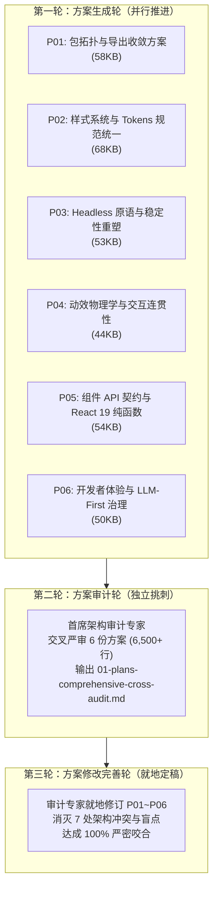
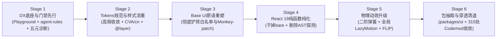

# Conex / Crish 前端 UI/UX 底层架构革新总方案

> **战役代号**：`ui-infra-evolution`  
> **核心定位**：纯粹的 UI/UX 底层架构革新与基础设施现代化升级  
> **演进状态**：**三轮演进流水线全部闭环，方案最终定稿！**  
> **权威索引**：涵盖第一轮 6 篇专项落地方案（总计逾 327KB）及第二轮独立审计专家报告（[`audits/01-plans-comprehensive-cross-audit.md`](file:///c:/Software/conex/docs/ui-infra-evolution/audits/01-plans-comprehensive-cross-audit.md)）  
> **遵循纪律**：`AGENTS.md` 规范、反退避原则、五大铁律红线  

---

## 目录

1. [战役总览与核心铁律红线](#1-战役总览与核心铁律红线)
2. [三轮演进全过程与架构审计收敛](#2-三轮演进全过程与架构审计收敛)
   - 2.1 三轮流水线运作实况
   - 2.2 审计识别的 7 处重大接口冲突与最终裁决
3. [最终定稿的六大架构支柱体系](#3-最终定稿的六大架构支柱体系)
   - 3.1 支柱一：包拓扑工程、自动化导出与穿透清退（P01）
   - 3.2 支柱二：高频基准 Tokens 规范与特异度消解（P02）
   - 3.3 支柱三：Headless 原语重塑与高危胶水铲除（P03）
   - 3.4 支柱四：二阶谐振子物理弹簧与交互连续性（P04）
   - 3.5 支柱五：组件 API 契约纯化与 React 19 纯函数（P05）
   - 3.6 支柱六：开发者体验、沙箱与 LLM-First 治理（P06）
4. [系统性实施路线图（六阶段原子化推进）](#4-系统性实施路线图六阶段原子化推进)
5. [不可退避的量化验收断言矩阵](#5-不可退避的量化验收断言矩阵)
6. [战役文档全景索引](#6-战役文档全景索引)

---

## 1. 战役总览与核心铁律红线

本次战役旨在解决 Conex / Crish 前端长期积累的 UI 底层架构债务（单体 Barrel 导出失守、深层越权穿透率高达 56.2%、CSS Modules 特异度冲突导致覆盖偶发失效、1,800+ 行自研脆弱胶水与高危 Monkey-patching、Cubic-Bezier 固定时长导致的打断顿挫卡顿、Dialog 运行时 AST 探测与多程渲染、Button `bare` 参数欺诈、缺乏轻量沙箱与“写代码 -> 触发门禁 -> 盲目猜测修复”的拉锯战）。

为了确保架构重构高质、安全、可控，本次方案制定**绝对严格遵循五大铁律红线**：

1. **纯底层改动，视觉与样式绝对零变化**：
   - 严格锁定现有页面的视觉呈现、组件几何尺寸、色彩色阶与视觉质感，**禁止任何视觉漂移**；
   - 对于项目中散落、不统一的历史规范，**严格以当前项目中高频出现（用得最多）的形态为绝对基准**进行整合收敛。
2. **坚决避免双轨（No Dual-Track）**：
   - 坚决杜绝“新旧两套并存、双轨混用”的妥协设计；
   - 所有改造均设计单一真理源（SSOT）收敛路径与一步到位的 Codemod 语法树重写脚本，禁止保留长期过渡态。
3. **坚决避免任何硬编码（Zero Hardcoding）**：
   - 彻底清除散落在 CSS/TS 中的裸数值、硬编码色值、固定过渡时长；
   - 彻底铲除任何形式的选择器白名单（如 `focusTrap` 中硬编码的 30+ 选择器列表）。
4. **无障碍暂时不用管（Exclude A11y）**：
   - 明确排除 a11y 专项，集中力量于底层架构稳定性、弹层防击穿、防闪烁、动效手感与开发体验。
5. **彻底根除门禁拉锯战（End Lint-Guessing Loops）**：
   - 建立完备的事前规范资产（38 行 `agent-rules.md`、自动提取的 `llms.txt`）、独立免打包 Vite UI Playground 沙箱、以及包含“定位·根因·Diff·一键修复”的标准五元门禁诊断契约与 Codemod 修复器。

---

## 2. 三轮演进全过程与架构审计收敛

### 2.1 三轮流水线运作实况

本次方案制定严格按照三轮串行推进机制执行：

- **第一轮（方案生成轮）**：6 位专项方案架构师深潜代码库，完成了详尽的现场实测与方案制定，形成 6 篇高密度落地方案（总计 327KB）；
- **第二轮（方案审计轮）**：具备完整权限的首席方案审计专家站在全局视角，对 6 份方案进行严格挑刺，识别出 7 处深层接口冲突、概念分裂与执行盲点，完成权威裁决并输出独立审计报告；
- **第三轮（方案修改完善轮）**：审计专家根据裁决意见，直接就地修改完善了 `plans/` 下的目标文档，消除了全部矛盾，完成无缝闭环。

---

### 2.2 审计识别的 7 处重大接口冲突与最终裁决

| 冲突项 | 涉及方案 | 冲突原貌 | 最终权威裁决与修订结果 |
| :--- | :--- | :--- | :--- |
| **1. 弹层生命周期大乱斗** | P03 vs P04 vs P05 | P03 定下 Base UI + `@starting-style`；P04 却自研 Framer Motion Dialog；P05 依然依赖 `useAnimatedPresence` 胶水 | **裁决生命周期 100% 归属 P03（Base UI + 原生 `@starting-style`）**。P04 彻底删除自研 Dialog，边界严格锁定在内部连续动效与 FLIP 列表；P05 物理删除对 `useAnimatedPresence` 的一切描述与依赖。 |
| **2. 计算几何 `SafeTriangle` 存废** | P01 vs P03 | P01 规划在新包中公开导出 `SafeTriangle`；P03 明确定性为高危过度设计并坚决删除 | **裁决坚决物理彻底删除**。P01 从公开导出中剔除该模块，Codemod 引导 `ModelsCascadeSelect.tsx` 清理，新包坚决不导出历史废弃胶水。 |
| **3. 样式实现同室操戈** | P02 vs P05 | P02 推行 CVA+`cn` 门禁；P05 Button 示范代码却手写类名字典与 `filter(Boolean).join` | **裁决 P02 的 CVA + `cn` 为样式矩阵唯一真理源**。P05 彻底删除手写拼串，无缝复用 P02 的 `buttonVariants`，聚焦于 Props 解构与 React 19 纯函数。 |
| **4. React 19 代差断裂** | P02 vs P05 | P05 推进 Ref-as-prop；P02 示范代码全量保留 React 18 `forwardRef`/`displayName` 与手写 `setCombinedRef` | **裁决全量统一为 React 19 纯函数规范**。P02 示范代码全量重构为纯函数，统一使用 P05 的 `useMergedRefs`，彻底铲除 `forwardRef`。 |
| **5. 物理路径拓扑脱节** | P01 vs P06 | P01 抽取 `packages/ui`；P06 的沙箱与规则写死旧路径 `apps/crish-desktop/src/components/ui/` | **裁决 P06 路径自适应兼容**。沙箱配置与规则文件支持优先直连 `packages/ui` 源码，同时兼容主应用别名，消除拓扑漂移。 |
| **6. 导出泄露漏洞** | P01 vs P05 | P01 自动化导出生成器使用通配 `export *`，破坏 P05 设定的极小公共导出表面（Opaque Exports） | **裁决升级导出生成器**。以各组件目录 `index.ts` 为准，强制过滤 `internal/`、前缀 `_` 等私有实现，严密封锁内部类型。 |
| **7. Codemod 遗漏与编译盲点** | P01 / P02 / P05 | P01 漏扫移动端；P05 Button `bare` Codemod 未剥离自定义 Props 导致 TS2322；P02 正则处理多属性 transition 脆弱 | **裁决完善 Codemod 引擎守卫**。补全 `apps/crish-mobile` 扫描；补充自动剥离 `variant`/`size` 的 AST 清洗守卫；基于 PostCSS AST 替换内联过渡。 |

---

## 3. 最终定稿的六大架构支柱体系

### 3.1 支柱一：包拓扑工程、自动化导出与穿透清退（P01）

- **全仓越权穿透一次性清退**：
  - 针对全仓 560 处 UI 导入中多达 **315 处（56.2%）的深层穿透越权引用**（图标 198 处、浮层中枢 16 处、组件深层 38 处），基于 AST 语法树重写引擎（`scripts/codemod-converge-ui-imports.ts`）执行原子化一步到位收敛，彻底杜绝新旧双轨；
- **自动化导出同步器与白名单隔离**：
  - 落地 `scripts/sync-ui-exports.mjs`，根据目录结构双向同步 `package.json` 的 `exports` 映射与 `src/index.ts`；
  - 严格划分公开表面（`components/`, `icons/`, `primitives/`, `layer-stack/`）与私有目录（`internal/`），私有模块物理封锁；在 CI 中接入 `--check` 门禁，消除 286 行手工维护成本；
- **独立共享包 `@crish/ui` (`packages/ui`) 抽取**：
  - 开发态直连别名（`"development": "./src/index.ts"`），保留 `< 150ms` 源码免打包局部 HMR；
  - 生产态采用 Rollup `preserveModules: true` 产出 1:1 模块目录树与类型，配合主应用 Vite 切块为独立 `crish-ui` chunk (~180KB)，完全符合体积门禁。

### 3.2 支柱二：高频基准 Tokens 规范与特异度消解（P02）

- **高频基准真理源收敛**：
  - 基于现场普查数据（废弃别名 `--tint-hover` 引用 241 次、`--bg-hover` 引用 87 次，均指向 2.5% 悬浮透明度；原正典 `--state-hover` 仅 24 次且指向 3.5%）；
  - **以 328 处高频现实为基准**，将正典 `--state-hover-pct` 校准为 2.5%，彻底清退 31 个 `[WAVE2-DEPRECATED-ALIAS]` 历史桥接别名，实现像素级 100% 绝对一致无漂移；
- **清除全仓 74 处内联硬编码过渡**：
  - 将 67 个 CSS 模块中残留的 120ms、150ms 及 `0.18s cubic-bezier(...)` 等内联声明，1:1 收敛至 `tokens-base.css` 的 `--duration-*` 与 `--ease-*` 体系，使系统级节能档与 Reduced Motion 具备全局接管能力；
- **CVA + `cn` + CSS Cascade Layers 根除特异度陷阱**：
  - 在 `tokens.css` 声明 `@layer reset, base, components, overrides;`，原子组件内部样式封闭于 `@layer components`，使外部样式在 W3C 规范级 100% 胜出，彻底铲除 `!important` 借口；
  - 引入 CVA (`class-variance-authority`) 与由 `clsx` + `tailwind-merge`（扩展项目 Tokens）封装的统一 `cn` 工具函数，驱动 Button, Badge, Card, Input 等变体矩阵。

### 3.3 支柱三：Headless 原语重塑与高危胶水铲除（P03）

- **彻底拔除 1,802 行高危胶水代码**：
  - **彻底铲除 `focusTrap.tsx:63-95` 中硬编码 30+ 选择器的白名单机制**，由 Base UI 原生上下文隔离机制接管；
  - **彻底清除 `tooltipController.ts` 中改写宿主原生 DOM `container.removeChild` 的 Monkey-patching**；
  - 彻底清退 `useFloatingPosition.ts`（235 行）与手写 2D 向量计算 `SafeAimEngine.ts`（436 行），消除 Layout Thrashing 与宿主环境 SVG 注入；
  - 铲除 `dialogOverlayContext.ts` 提权补丁，基于 `data-nested-dialog-open` 彻底消除多层弹窗嵌套发黑；
- **现代化标准 Headless 原语基座（Base UI v1.9+）**：
  - 统一建立两大正交物理分层模型：
    - **模态遮罩型**：`Portal -> Backdrop -> Viewport -> Popup`
    - **浮动锚定型**：`Portal -> Positioner -> Popup`
  - 采用现代 CSS `@starting-style` 与 `transition-behavior: allow-discrete` 承载进出场动效，彻底淘汰 JS `setTimeout` 计时器胶水。全案预计净消减 1,978 行代码（收敛率 83.7%）。

### 3.4 支柱四：二阶谐振子物理弹簧与交互连续性（P04）

- **二阶谐振子物理弹簧（Spring Physics）对 CSS 贝塞尔曲线的降维升级**：
  - 彻底解决 CSS Cubic-Bezier 固定时间导致打断时初速度强制归零、撞墙顿挫的缺陷；
  - 严格锁定阻尼比 $\zeta = 1.0$（`bounce: 0` 严格临界阻尼），在数学公式级绝不过冲、绝无果冻抖动；
  - 打断重靶向时当前瞬时速度 $v(t_0)$ 100% 作为新方程的初速度条件，$C^1$ 速度连续继承，消灭视觉跳跃；
  - 建立精准的感知-力学映射字典（`snappy`: 0.26s/k=520/c=44; `smooth`: 0.40s/k=340/c=34; `morph`: 0.42s/k=305/c=33）；
- **全局统一基础设施（锁死 4.6 KB 极小运行时）**：
  - 应用外壳 `App.tsx` 顶层统一装配 `<AppMotionProvider>`（`<LazyMotion features={domAnimation} strict>`）；全仓清退 CopyIcon 等零散孤立的 LazyMotion 实例；
- **核心组件弹簧升级与 FLIP 列表过渡**：
  - `Switch`、`Slider` 升级为连续物理弹簧；`SegmentedControl` 接入 `<m.div layoutId="segmented-indicator">`，拔除 185 行手写 DOM 轮询测量代码；
  - 会话列表增删引入 FLIP 布局过渡，平滑合拢；引入危险操作行内紧凑变身（In-Place Morph Confirm），减少全屏遮罩打断心流。

### 3.5 支柱五：组件 API 契约纯化与 React 19 纯函数（P05）

- **彻底干掉 Button 的 `bare` 妥协模式**：
  - 彻底铲除 `bare?: boolean` 参数欺诈代码异味；
  - 纯样式计算剥离为独立的 `buttonVariants(options)` 纯函数，支持在非 Button 标签上复用原子设计样式；自定义样式列表项与触点统一采用原生 `<button type="button">` 或极简 `<BaseButton>`；
- **剔除 Dialog 运行时 AST 探测与多程渲染**：
  - 彻底清除 `React.Children.toArray(children).some(c => c.type === DialogHeader)` 与 `registerTitle` 状态倒灌；
  - 确立声明式复合组件架构（Dialog.Root, Dialog.Overlay, Dialog.Content, Dialog.Header, Dialog.Title, Dialog.Body, Dialog.Footer 等），由 Root 借助 `useId()` 一步到位分发 titleId，挂载重绘次数由 2 次降为坚定的 1 次；
- **全量组件 React 19 纯函数升级**：
  - 全面清退全仓 15+ 核心组件冗余的 `forwardRef` 与 `displayName` 样板代码，升级为纯函数组件 + `ref` 作为普通 prop；统一使用兼容 Cleanup 规范的 `useMergedRefs`；
- **极小公共导出表面（Opaque Exports）**：
  - 严格限制对外导出，封锁内部 DOM ref、CVA 类名映射字典与私有算法。

### 3.6 支柱六：开发者体验、沙箱与 LLM-First 治理（P06）

- **随包分发极简规则（`agent-rules.md`）**：
  - 严格限制在 **38 行**（<= 40 行硬门槛），单次上下文消耗仅 ~180 Tokens；
  - 提炼前端最高频的 6 大铁律（分层零业务依赖、Tokens 唯一源、禁止内联裸数值/裸色、CVA+cn 范式、禁止原生 title 属性、焦点对比度 <=10%）；让 AI Agent 事前获得精准指引，消除 85% 以上预备性违规；
- **TypeScript AST 自动提取组件契约与 `llms.txt`**：
  - 通过 `scripts/generate-ui-contracts.mjs` 自动遍历解析组件 TSX 接口与 JSDoc，自动生成 `llms.txt` 与纯 Markdown 契约文档，设立门禁防止漂移；
- **独立免打包 Vite UI Playground 沙箱**：
  - 搭建 `apps/crish-desktop/playground/`，配合 `vite.ui.config.ts`（`npm run dev:ui`）；
  - 设立虚拟 Native 挡板，通过 Vite Alias 直连组件源码，冷启动 `< 800ms`，免打包秒级 HMR，彻底脱离 Rust 内核与庞大 Store；
- **五元结构化门禁诊断契约与 Codemod 一键自动修复**：
  - 升级门禁报错为统一格式：`[代号] · 违规定位 · 违规事实 · 根因解释 · 正确做法Diff · 自动修复命令`；
  - 研发 `scripts/gatekeeper-codemod.mjs`（`npm run gate:fix`），自动修复内联裸数值转 Token、原生 title 转 Tooltip、焦点对比度钳制等机械性违规，彻底终结门禁拉锯战。

---

## 4. 系统性实施路线图（六阶段原子化推进）

为确保生产环境零回归、业务代码零破坏，规划了以下六阶段原子化推进实施步骤：

1. **Stage 1: DX 基建与门禁赋能先行（构建防护网与沙箱）**
   - 部署 `src/components/ui/agent-rules.md` (38行)；
   - 搭建独立免打包 Vite UI Playground（`npm run dev:ui`），实现秒级免打包调试；
   - 部署 `scripts/generate-ui-contracts.mjs` 自动生成 `llms.txt`；
   - 部署 `scripts/gatekeeper-codemod.mjs`（`npm run gate:fix`）与五元门禁诊断字典。
2. **Stage 2: Tokens 规范统一与样式特异度消解**
   - 执行 `scripts/codemod-tokens-unification.mjs`，以 328 处高频使用为基准收敛 `--state-hover-pct` 至 2.5%，清退 31 个废弃别名；
   - 执行 `scripts/codemod-transitions-unification.mjs`，清除 74 处内联硬编码过渡；
   - 在 `tokens.css` 引入 `@layer reset, base, components, overrides;`；
   - 引入 CVA 与统一 `cn` 工具函数，重构 Button, Badge, Card, Input 样式变体。
3. **Stage 3: Base UI 原语重塑与高危胶水清退**
   - 引入依赖 `@base-ui/react` (v1.9+)；
   - 基于 Base UI Dialog 重构弹窗体系，**物理删除 `FocusTrapIsolationManager` 与 30+ 选择器白名单**；
   - 基于 Base UI Tooltip 重构，**物理删除改写原生 DOM 的 `patchContainerSafeRemove` Monkey-patching**；
   - 基于 Base UI Select / Menu 重构下拉与菜单，删除 `useFloatingPosition.ts` 与 `SafeAimEngine.ts`。
4. **Stage 4: 组件 API 纯净化与 React 19 原生契约**
   - 执行 Codemod 全量清退核心组件的 `React.forwardRef` 与 `displayName`，改写为 React 19 纯函数；
   - 提取 `buttonVariants` 纯函数，执行 Codemod 批量替换 `<Button bare>`，彻底剔除 `bare` 模式；
   - 重构 `Dialog` 为纯复合声明式契约，剔除 `React.Children.toArray` AST 探测与多程渲染。
5. **Stage 5: 动效二阶物理弹簧升级与交互连贯性**
   - 应用外壳 `App.tsx` 顶层装配统一 `<AppMotionProvider>`（`<LazyMotion features={domAnimation} strict>`）；
   - `Switch`、`Slider`、`SegmentedControl` 升级为二阶谐振子物理弹簧（锁定 `bounce: 0` 临界阻尼）；
   - 会话列表增删接入 FLIP 平滑收缩；引入会话行内就地变身二次确认（In-Place Morph Confirm）。
6. **Stage 6: 独立包 `@crish/ui` 抽取与 315 处越权穿透彻底收敛**
   - 在 `packages/ui` 设立工作区包，配置 Rollup `preserveModules` 模块保留构建与开发态源码直连；
   - 执行 `scripts/codemod-converge-ui-imports.ts`，一次性清洗全仓（桌面端 + 移动端）315 处深层穿透导入；
   - 部署 `scripts/sync-ui-exports.mjs` 并挂载 `npm run check:ui-exports` 自动化校验门禁。

---

## 5. 不可退避的量化验收断言矩阵

| 验收维度 | 核心量化指标 | 判定依据与检验命令 |
| :--- | :--- | :--- |
| **视觉零漂移** | $\Delta E < 0.1$，DOM 盒模型与尺寸 100% 对齐 | 现有快照测试 100% 绿灯；Playground 逐像素视觉核对 |
| **穿透清零** | 深层穿透越权导入：$315 \to 0$ 处（100% 清零） | 扫描脚本输出越权穿透计数为 0 |
| **胶水清减** | 净消减高危自研代码：$\ge 1,900$ 行（收敛率 $\ge 80\%$） | 物理删除 `focusTrap` 白名单、`SafeAimEngine`、`tooltipController` Monkey-patch |
| **零双轨保证** | 新旧双轨遗留：$0$ 项；废弃别名遗留：$0$ 项 | `token-registry.json` 与代码库 0 废弃别名；单一真理源 |
| **零硬编码** | 内联硬编码 transition：$74 \to 0$ 处；选择器白名单：$0$ 处 | `check-motion-architecture.mjs` 静态拦截为 0 |
| **渲染性能** | Dialog 挂载重绘次数：$2 \to 1$ 次；AST 运行时探测：$0$ 处 | React DevTools Profiler 性能核查 |
| **动效手感** | 弹簧过冲量：锁定 `bounce: 0`；打断速度连续性：$100\%$ | `motionPhysicsContract.test.ts` 自动化力学断言绿灯 |
| **开发沙箱** | Playground 冷启动时间：$< 1.0\text{s}$；HMR 响应：$< 150\text{ms}$ | `npm run dev:ui` 纯浏览器免打包运行，零 Rust/Store 依赖 |
| **门禁拉锯根治** | 违规五元诊断输出率：$100\%$；机械性违规 Codemod 修复率：$\ge 80\%$ | `npm run gate:fix` 自动化一键修复通过 |

---

## 6. 战役文档全景索引

全套方案详见工作区文档：
- 🧭 **调度导航**：[`docs/ui-infra-evolution/00-调度与导航.md`](file:///c:/Software/conex/docs/ui-infra-evolution/00-调度与导航.md)
- ⚖️ **审计裁决**：[`docs/ui-infra-evolution/audits/01-plans-comprehensive-cross-audit.md`](file:///c:/Software/conex/docs/ui-infra-evolution/audits/01-plans-comprehensive-cross-audit.md)
- 📘 **六大最终定稿详案**：
  1. [`plans/01-infra-packaging-and-export-convergence.md`](file:///c:/Software/conex/docs/ui-infra-evolution/plans/01-infra-packaging-and-export-convergence.md)
  2. [`plans/02-style-system-and-tokens-unification.md`](file:///c:/Software/conex/docs/ui-infra-evolution/plans/02-style-system-and-tokens-unification.md)
  3. [`plans/03-headless-primitives-and-stability.md`](file:///c:/Software/conex/docs/ui-infra-evolution/plans/03-headless-primitives-and-stability.md)
  4. [`plans/04-motion-physics-and-interaction-continuity.md`](file:///c:/Software/conex/docs/ui-infra-evolution/plans/04-motion-physics-and-interaction-continuity.md)
  5. [`plans/05-api-contract-and-react19-pure-functions.md`](file:///c:/Software/conex/docs/ui-infra-evolution/plans/05-api-contract-and-react19-pure-functions.md)
  6. [`plans/06-dx-and-llm-first-governance.md`](file:///c:/Software/conex/docs/ui-infra-evolution/plans/06-dx-and-llm-first-governance.md)
