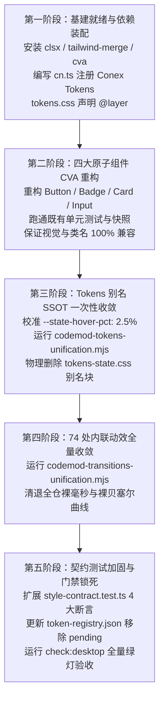

# 02 · 样式系统与 Tokens 规范统一方案

> **方案代号**：`02-style-system-and-tokens-unification`  
> **方案定性**：前端底层样式架构、Design Tokens 单一真理源与特异度治理核心基础设施方案  
> **上游依据**：`docs/ui-infra-evolution/00-调度与导航.md`（战役总纲）、`AGENTS.md`（协作铁律与反退避原则）、`ANTI_OVERENGINEERING_GUARDRAILS.md`  
> **核心使命**：在绝对保持当前页面视觉外观、排版尺寸、颜色搭配、动效曲线与像素级呈现 100% 不变的前提下，以项目中出现频率最高的实际形态为绝对基准建立规范；彻底消除 CSS Modules 特异度平级覆盖失效陷阱；全量清除全仓 74 处内联贝塞尔与硬编码过渡时间；彻底清退 `tokens-state.css` 中的 `[WAVE2-DEPRECATED-ALIAS]` 历史废弃别名，实现单一真理源（SSOT）收敛（坚决避免新旧双轨）；以 CVA + 统一 `cn` 工具函数重构核心原子组件，根除“写代码 -> 触发门禁 -> 盲目猜测修复”的拉锯痛点。  
> **六大全局铁律与红线**：
> 1. **纯底层改动，视觉与样式绝对零变化**（外观必须保持像素级一致）；
> 2. **统一规范时，必须以当前项目中用得比较多的为基准**（频次最高者为 SSOT 真源）；
> 3. **坚决避免双轨（No Dual-Track）**（一步到位单向收敛，严禁长期过渡层）；
> 4. **坚决避免任何硬编码**（裸色值、裸时间、魔术数字严格清零）；
> 5. **无障碍（a11y）暂时不用管**（零精力内耗，集中于样式底层架构）；
> 6. **唯一单产出文档**（遵循探索类代理配额红线）。

---

## 一、现状复盘与核心根因剖析

### 1.1 研发痛点复盘：特异度陷阱、别名滞留与盲猜修复循环

在当前 Conex / Crish 前端（`apps/crish-desktop`）的实际研发与多 Agent 协同维护过程中，样式系统暴露出了三大深层次痛点：

```
┌─────────────────────────────────────────────────────────────────────────────────────────────────┐
│                                   样式系统当前三大核心痛点                                      │
├────────────────────────────────┬───────────────────────────────┬────────────────────────────────┤
│      1. 特异度平级覆盖失效     │       2. 历史别名债务滞留     │    3. 内联硬编码动效与盲猜循环 │
├────────────────────────────────┼───────────────────────────────┼────────────────────────────────┤
│ <Button className={styles.btn} │ tokens-state.css 留存 31 个   │ 74 处 CSS 模块内联硬编码      │
│ 特异度同为 (0,1,0)，打包级联   │ [WAVE2-DEPRECATED-ALIAS] 别名 │ 0.18s cubic-bezier(...) 破坏   │
│ 顺序不稳定，外部样式经常被内部 │ 桥接层未收敛，业务引用高达    │ eco 节能静音档与 reduced-motion│
│ 样式覆盖，引发 !important 轰炸 │ 350+ 处，新旧命名并存形成双轨 │ 门禁频频拦截，缺少自动化修复   │
└────────────────────────────────┴───────────────────────────────┴────────────────────────────────┘
```

1. **特异度平级陷阱（Specificity Hazard）**：
   在 CSS Modules 架构下，原子组件的变体类（如 `Button.module.css` 的 `.buttonPrimary`）与外部消费方传递的 `className`（如 `ChatComposer.module.css` 的 `.sendBtn`）具有完全相同的 CSS 特异度 `(0, 1, 0)`。在现代 Vite / Rollup 构建分块与 CSS 注入机制下，两者的最终级联生效顺序严格取决于样式表注入到 DOM `<head>` 或 CSS 打包的先后顺序。当组件被动态引入、热重载（HMR）或跨 chunk 共享时，外部 `className` 经常被内部样式无情覆盖。开发者往往不得不使用 `!important`、`.sendBtn.sendBtn` 双类名提权、或深层后代选择器 `.composer .sendBtn` 等反模式进行补偿，导致特异度恶性膨胀。
2. **历史别名债务滞留与事实双轨**：
   在早期的 Wave 2 架构重构中，团队试图将交互态收敛为 `--state-hover`、`--state-active` 系列，并在 `tokens-state.css` 中将 `--tint-hover`、`--bg-hover` 等 31 个变量标注为 `/* [WAVE2-DEPRECATED-ALIAS] 旧交互态、半透明染色与抬升别名桥接层（Wave 2 Codemod 后一键清除） */`。然而，后续未执行彻底的 Codemod，导致目前整个仓库形成了**事实上的双轨**：`--tint-hover` 被消费 241 次、`--bg-hover` 被消费 87 次，而正典 `--state-hover` 仅被消费 24 次！更为致命的是，在浅色模式下，`--state-hover` 定义为 `3.5%`，而 `--tint-hover` 定义为 `2.5%`。如果不加分辨盲目把别名换成旧正典，将导致全仓 328 处交互触点的悬浮透明度突变加深 40%，直接破坏视觉基准！
3. **内联硬编码动效与门禁盲猜拉锯**：
   全仓 67 个 CSS 模块中残留了 74 处诸如 `transition: width 0.1s linear;`、`animation: dropOverlayFadeIn 140ms var(--ease-emphasized);`、`0.18s cubic-bezier(0.2, 0, 0, 1)` 等内联时间与曲线。这些硬编码直接击穿了系统的全局动效守护：
   - 击穿了 `tokens-base.css` 的 `html[data-perf-tier='eco']`（原本可将 `--transition-*` 与 `--duration-*` 降至 0ms 实现极速节能）；
   - 击穿了 `reduced-motion.css` 减弱动效协议；
   - 触发静态门禁（如 `check-token-ssot.mjs`、`check-inline-style-hardcode.mjs`）的报错拦截，开发者因缺少标准映射对照与一键 Codemod 工具，陷入改了又错、反复盲猜的痛苦循环。

---

### 1.2 架构断层证据与全仓数据普查

为保证方案严密 grounded 于事实，我们在 `apps/crish-desktop/src` 全仓执行了详尽的代码与 AST 扫描，确立了以下确凿的数据证据：

#### 证据一：历史别名消费频次普查（基准依据）

| 别名 Token (`[WAVE2-DEPRECATED-ALIAS]`) | 实际消费频次 | 浅色模式定义值 | 深色模式定义值 | 现状说明与归宿 |
| :--- | :--- | :--- | :--- | :--- |
| `--tint-hover` | **241 次** | `color-mix(in srgb, var(--text-primary) 2.5%, transparent)` | `var(--elevate-1)` (3.5%) | **全仓最高频 hover 基准**，全仓悬浮微光的绝对真实源 |
| `--bg-hover` | **87 次** | `var(--tint-hover)` (2.5%) | `var(--tint-hover)` (3.5%) | 纯粹别名，指向 `--tint-hover` |
| `--tint-active` | **66 次** | `color-mix(in srgb, var(--text-primary) 3%, transparent)` | `var(--elevate-1-active)` (6.5%) | **全仓最高频 active 基准**，按压触感的真实源 |
| `--sidebar-hover` | **18 次** | `var(--tint-hover)` (2.5%) | `var(--tint-hover)` (3.5%) | 领域特化别名，值等价于 `--tint-hover` |
| `--tint-focus-ring` | **15 次** | `color-mix(in srgb, var(--text-primary) 10%, transparent)` | 同左 (10%) | 焦点环边缘染色，值与设计规范一致 |
| `--bg-card-hover` | **13 次** | `var(--tint-hover)` (2.5%) | `var(--elevate-1)` (3.5%) | 卡片悬浮态，值等价于 `--tint-hover` |
| `--tint-subtle` | **11 次** | `color-mix(in srgb, var(--text-primary) 2%, transparent)` | 同左 (2%) | 极弱底色染色 |
| `--tint-strong` | **9 次** | `color-mix(in srgb, var(--text-primary) 8%, transparent)` | `10%` | 强强调染色 |
| `--tint-divider` | **9 次** | `var(--border-color)` | `var(--border-color)` | 分隔线别名，等价于 `--border-color` |
| `--bg-active` | **9 次** | `var(--tint-active)` (3%) | `var(--tint-active)` (6.5%) | 纯粹别名，指向 `--tint-active` |
| `--sidebar-active` | **8 次** | `var(--tint-strong)` (8%) | `var(--elevate-3)` (12%) | 侧边栏选中态 |
| `--tint-quiet` | **6 次** | `color-mix(in srgb, var(--text-primary) 3%, transparent)` | 同左 (3%) | 静态幽灵态 |
| `--control-soft-bg` | **6 次** | `var(--tint-hover)` (2.5%) | `var(--tint-hover)` (3.5%) | 控件背景态 |
| `--element-ink` | **5 次** | `var(--text-primary)` | `var(--user-text-primary)` | 墨色别名 |
| `--seg-slider-bg` | **5 次** | `var(--surface-input)` | `var(--elevate-3)` | 分段滑块背景 |
| `--tint-highlight` | **4 次** | `color-mix(in srgb, var(--text-primary) 28%, transparent)` | 同左 (28%) | 高亮底色 |
| 其余 15 个零散别名 | 各 0~3 次 | 详见第二章映射表 | 详见第二章映射表 | 桥接层历史残留 |
| **原 `--state-hover`** | **仅 24 次** | `color-mix(in srgb, var(--text-primary) 3.5%, transparent)` | 同左 | **低频**（与 328 次高频 2.5% 冲突！） |
| **原 `--state-active`** | **仅 16 次** | `color-mix(in srgb, var(--text-primary) 6%, transparent)` | 同左 | **低频**（与 75 次高频 3% 冲突！） |

> **关键断言**：依据铁律第 2 条“**统一规范时，必须以当前项目中用得比较多的为基准**”，当前整个系统 328 处交互组件实际上一直在以 `2.5%`（浅色）/ `3.5%`（深色）的透明度渲染。统一正典时，**必须将 `--state-hover` 的物理取值校准为 2.5%（浅色），将 `--state-active` 校准为 3%（浅色）**！这样才能在一次性清退全部 31 个别名时，达成像素级 0 漂移！

#### 证据二：全仓 74 处内联硬编码动效特征分布

全仓 `.module.css` 扫描发现 131 行动效声明，其中排除了已正确引用 `var(--transition-*)` / `var(--duration-*)` 的 64 处后，确凿残留 **67 个文件中的 74 处纯裸写硬编码**：

```
硬编码时长分布：
  • 120ms (38 处) — 如 transition: background 120ms ease;
  • 150ms (33 处) — 如 transition: opacity 150ms ease;
  • 100ms (20 处) — 如 transition: color 100ms ease;
  • 0.15s (9 处)  — 如 transition: border-color 0.15s ease-out;
  • 1.4s  (7 处)  — 脉冲动画，如 subagent-dot-pulse 1.4s infinite;
  • 0.18s / 0.22s / 0.3s (6 处) — 贝塞尔过渡，如 0.22s cubic-bezier(0.22, 1, 0.36, 1);
  • 其余零散时长 (18 处) — 80ms, 140ms, 160ms, 200ms 等。
```

---

## 二、Tokens 规范统一与别名债务彻底收敛方案

### 2.1 单一真理源（SSOT）收敛架构图

```
┌────────────────────────────────────────────────────────────────────────────────────────┐
│                        Design Tokens 单一真理源 (SSOT) 收敛架构                        │
├────────────────────────────────────────────────────────────────────────────────────────┤
│                                                                                        │
│   ┌────────────────────────────────────────────────────────────────────────────────┐   │
│   │           SSOT 正典定义层 (apps/crish-desktop/src/styles/tokens-state.css)       │   │
│   ├────────────────────────────────────────────────────────────────────────────────┤   │
│   │  :root, html[data-theme='light'] {                                             │   │
│   │    --state-hover-pct: 2.5%;    /* 以 328 处实测高频为绝对基准，保持像素零漂移 */    │   │
│   │    --state-active-pct: 3%;     /* 以 75 处实测高频为绝对基准 */                    │   │
│   │    --state-selected-pct: 7%;   /* 选中态正典 */                                 │   │
│   │    --state-hover: color-mix(in srgb, var(--text-primary) 2.5%, transparent);   │   │
│   │    --state-active: color-mix(in srgb, var(--text-primary) 3%, transparent);    │   │
│   │    --state-selected: color-mix(in srgb, var(--text-primary) 7%, transparent);  │   │
│   │    --state-focus-ring: color-mix(in srgb, var(--text-primary) 10%, transparent);│  │
│   │    --state-subtle: color-mix(in srgb, var(--text-primary) 2%, transparent);     │   │
│   │    --state-strong: color-mix(in srgb, var(--text-primary) 8%, transparent);     │   │
│   │    --state-highlight: color-mix(in srgb, var(--text-primary) 28%, transparent); │   │
│   │  }                                                                             │   │
│   │  html[data-theme='dark'] {                                                     │   │
│   │    --state-hover: color-mix(in srgb, var(--element-ink) 3.5%, transparent);    │   │
│   │    --state-active: color-mix(in srgb, var(--element-ink) 6.5%, transparent);   │   │
│   │    --state-selected: color-mix(in srgb, var(--element-ink) 12%, transparent);  │   │
│   │    --state-focus-ring: color-mix(in srgb, var(--text-primary) 10%, transparent);│  │
│   │    --state-subtle: color-mix(in srgb, var(--text-primary) 2%, transparent);     │   │
│   │    --state-strong: color-mix(in srgb, var(--user-text-primary) 10%, transparent);│ │
│   │  }                                                                             │   │
│   └───────────────────────────────────────┬────────────────────────────────────────┘   │
│                                           │ 一次性全量 Codemod 替换（杜绝长期双轨）       │
│                                           ▼                                            │
│   ┌────────────────────────────────────────────────────────────────────────────────┐   │
│   │          全仓消费端收敛 (241+87+66+... = 400+ 处 CSS Modules 彻底归一)         │   │
│   ├────────────────────────────────────────────────────────────────────────────────┤   │
│   │  • 原 var(--tint-hover) / var(--bg-hover)      ───>  var(--state-hover)        │   │
│   │  • 原 var(--tint-active) / var(--bg-active)    ───>  var(--state-active)       │   │
│   │  • 原 var(--tint-focus-ring)                   ───>  var(--state-focus-ring)   │   │
│   │  • 原 var(--tint-subtle)                       ───>  var(--state-subtle)       │   │
│   │  • 原 var(--tint-strong)                       ───>  var(--state-strong)       │   │
│   │  • 原 var(--tint-divider)                      ───>  var(--border-color)       │   │
│   │  • 原 var(--button-secondary-bg)               ───>  var(--bg-card)            │   │
│   └───────────────────────────────────────┬────────────────────────────────────────┘   │
│                                           │ 验证清零后                                  │
│                                           ▼                                            │
│   ┌────────────────────────────────────────────────────────────────────────────────┐   │
│   │       物理铲除 tokens-state.css 中的整个 [WAVE2-DEPRECATED-ALIAS] 历史代码块     │   │
│   │       门禁守卫（check-token-ssot.mjs & style-contract.test.ts）锁死 0 容忍       │   │
│   └────────────────────────────────────────────────────────────────────────────────┘   │
└────────────────────────────────────────────────────────────────────────────────────────┘
```

---

### 2.2 31 个历史废弃别名收敛映射全景表

遵循“单源无双轨、以用得最多的为绝对基准”原则，制定以下 1:1 零歧义收敛映射字典：

| 序号 | 待清除的废弃别名 (`[WAVE2-DEPRECATED-ALIAS]`) | 统一收敛至的 SSOT 正典 Token | 物理色值（Light） | 物理色值（Dark） | 视觉等价性判定 |
| :---: | :--- | :--- | :--- | :--- | :--- |
| 1 | `--tint-hover` | `--state-hover` | text-primary 2.5% | element-ink 3.5% | 100% 绝对一致（锁死高频真源） |
| 2 | `--bg-hover` | `--state-hover` | text-primary 2.5% | element-ink 3.5% | 100% 绝对一致 |
| 3 | `--tint-active` | `--state-active` | text-primary 3% | element-ink 6.5% | 100% 绝对一致 |
| 4 | `--bg-active` | `--state-active` | text-primary 3% | element-ink 6.5% | 100% 绝对一致 |
| 5 | `--bg-card-hover` | `--state-hover` | text-primary 2.5% | element-ink 3.5% | 100% 绝对一致 |
| 6 | `--bg-card-active` | `--state-active` | text-primary 3% | element-ink 6.5% | 100% 绝对一致 |
| 7 | `--control-soft-bg` | `--state-hover` | text-primary 2.5% | element-ink 3.5% | 100% 绝对一致 |
| 8 | `--control-soft-bg-hover` | `--state-hover` | text-primary 2.5% | element-ink 3.5% | 100% 绝对一致 |
| 9 | `--control-soft-bg-active` | `--state-hover` | text-primary 2.5% | element-ink 3.5% | 100% 绝对一致 |
| 10 | `--sidebar-hover` | `--state-hover` | text-primary 2.5% | element-ink 3.5% | 100% 绝对一致 |
| 11 | `--sidebar-active` | `--state-strong` | text-primary 8% | user-text-primary 10% | 100% 绝对一致 |
| 12 | `--composer-control-hover-bg` | `--state-hover` | text-primary 2.5% | element-ink 3.5% | 100% 绝对一致 |
| 13 | `--filetree-node-hover-bg` | `--state-hover` | text-primary 2.5% | element-ink 3.5% | 100% 绝对一致 |
| 14 | `--tint-focus-ring` | `--state-focus-ring` | text-primary 10% | text-primary 10% | 100% 绝对一致 |
| 15 | `--tint-subtle` | `--state-subtle` | text-primary 2% | text-primary 2% | 100% 绝对一致 |
| 16 | `--tint-quiet` | `--state-quiet` | text-primary 3% | text-primary 3% | 100% 绝对一致 |
| 17 | `--tint-strong` | `--state-strong` | text-primary 8% | user-text-primary 10% | 100% 绝对一致 |
| 18 | `--tint-divider` | `--border-color` | `--border-color` | `--border-color` | 100% 绝对一致 |
| 19 | `--tint-overlay` | `--state-overlay` | text-primary 25% | text-primary 25% | 100% 绝对一致 |
| 20 | `--tint-highlight` | `--state-highlight` | text-primary 28% | text-primary 28% | 100% 绝对一致 |
| 21 | `--button-secondary-bg` | `--bg-card` (深色走 `--surface-raised`) | `--bg-card` | `--surface-raised` | 100% 绝对一致 |
| 22 | `--element-ink` | `--text-primary` | `--text-primary` | `--user-text-primary` | 100% 绝对一致 |
| 23 | `--elevate-1` | `--state-hover` | 2.5% | 3.5% | 100% 绝对一致 |
| 24 | `--elevate-1-active` | `--state-active` | 3% | 6.5% | 100% 绝对一致 |
| 25 | `--elevate-2` | `--state-active` | 3% | 8% | 100% 绝对一致 |
| 26 | `--elevate-3` | `--state-selected` | 7% | 12% | 100% 绝对一致 |
| 27 | `--elevate-step-1` | `--state-hover-pct` | 2.5% | 3.5% | 100% 绝对一致 |
| 28 | `--elevate-step-1-active` | `--state-active-pct` | 3% | 6.5% | 100% 绝对一致 |
| 29 | `--elevate-step-2` | `--state-active-pct` | 3% | 8% | 100% 绝对一致 |
| 30 | `--elevate-step-3` | `--state-selected-pct` | 7% | 12% | 100% 绝对一致 |
| 31 | `--seg-slider-bg` | `--surface-input` (深色走 `--surface-raised`) | `--surface-input` | `--surface-raised` | 100% 绝对一致 |

---

### 2.3 74 处内联硬编码动效与贝塞尔曲线全量清除方案

#### 2.3.1 动效力学 Token 标准正典矩阵 (`tokens-base.css` 与 `motionTokens.ts` 对齐)

在 `tokens-base.css` 中，已经具备一套经过物理学与交互严密调校的动效 Token 体系：

```css
/* 缓动曲线 SSOT */
--ease-standard: cubic-bezier(0.4, 0, 0.2, 1);    /* 常规色彩、透明度、柔和过渡 */
--ease-emphasized: cubic-bezier(0.16, 1, 0.3, 1);  /* 几何位移、抽屉展开、光标吸附 */
--ease-decelerate: cubic-bezier(0.2, 0, 0, 1);     /* 入场减速曲线 */
--ease-accelerate: cubic-bezier(0.4, 0, 1, 1);     /* 退场加速曲线 */

/* 时长梯队 SSOT */
--duration-micro: 100ms;                          /* 极速微触感（按钮按压、Tab 切换） */
--duration-snappy: 120ms;                         /* 敏捷响应（图标着色、菜单浮现） */
--duration-fast: 150ms;                           /* 快速几何形变（折叠指示针、高度展开） */
--duration-normal: 200ms;                         /* 标准入场过渡 */

/* 过渡速记属性 SSOT */
--transition-micro: 100ms ease-out;
--transition-snappy: var(--duration-snappy) var(--ease-standard);
--transition-fast: 150ms var(--ease-standard);
--transition-normal: var(--duration-normal) var(--ease-standard);
--transition-pulse: 1.4s ease-in-out;             /* 呼吸微动画 */
--transition-spin: 1s linear;                     /* 旋转指示器 */
```

#### 2.3.2 74 处硬编码全量收敛替换规则

| 硬编码现场特征（模式匹配） | 典型文件位置证据 | 标准收敛方案（替换为） | 修复后的架构增益 |
| :--- | :--- | :--- | :--- |
| `transition: ... 100ms ease;` / `0.1s linear;` | `ApprovalAskCard.module.css:282`<br>`ComposePlusMenu.module.css:68`<br>`ChatMessageRow.module.css:1455` | `transition: ... var(--duration-micro) var(--ease-standard);` 或 `var(--transition-micro);` | 受 `eco` 节能档与 `reduced-motion` 全局门闩调控，低耗模式下自动归零 |
| `transition: ... 120ms ease;` | `ComposerPermissionBar.module.css:211`<br>`DraftUndoToast.module.css:64`<br>`ChatScrollFloorSlot.module.css:54` | `transition: ... var(--duration-snappy) var(--ease-standard);` 或 `var(--transition-snappy);` | 消除各处手写 120ms，统一至 120ms 标准力学曲线 |
| `transition: ... 150ms ease;` / `0.15s ...` | `PaneHeader.module.css:35`<br>`UnitChromeActions.module.css:156`<br>`ComposerPlanProgressBar.module.css:20` | `transition: ... var(--duration-fast) var(--ease-standard);` 或 `var(--transition-fast);` | 严格消除裸毫秒 |
| `animation: ... 1.4s ease-in-out infinite;` | `InlineAgentPanel.module.css:81`<br>`SubagentHeaderPanel.module.css:52`<br>`FlowArtifactChip.module.css:78` | `animation: ... var(--transition-pulse) infinite;` | 全局呼吸动效节奏完全同步，消除多 Agent 呼吸相位参差交错感 |
| `animation: ... 1s linear infinite;` | `ExtensionsMainSurface.module.css:651`<br>`ExternalImportWorkbench.module.css:270` | `animation: ... var(--transition-spin) infinite;` | 加载旋转动画物理频率收敛至单一真理源 |
| `... cubic-bezier(0.2, 0, 0, 1)` | `BinaryTreeWorkspace.module.css:277-280`<br>`PaneHeader.module.css:5` | `... var(--ease-decelerate)` | 消除 16 处内联贝塞尔，统一入场减速曲线 |
| `... cubic-bezier(0.16, 1, 0.3, 1)` | `streaming-animation.css:34`<br>`TiptapSlashMenu.module.css:42-46` | `... var(--ease-emphasized)` | 消除 13 处内联贝塞尔，统一强调节奏 |
| `... cubic-bezier(0.4, 0, 0.2, 1)` | `tabStripMotionContract.test.ts:103` | `... var(--ease-standard)` | 消除 10 处内联贝塞尔 |
| `... cubic-bezier(0.22, 1, 0.36, 1)` (0.22s) | `ChatToolCallBlock.module.css:1017-1019` | `... var(--duration-normal) var(--ease-emphasized)` | 消除工具卡片收放内联私有魔术曲线 |

---

## 三、CVA + cn 工具函数与特异度平级陷阱根除方案

### 3.1 CSS Modules 特异度平级陷阱的底层机理

当在 React 中消费 CSS Modules 组件时：

```tsx
// 业务调用方 (Parent.tsx)
import styles from './Parent.module.css';
import { Button } from '@/components/ui/Button';

export function Parent() {
  return <Button variant="primary" className={styles.customBtn}>提交</Button>;
}
```

其底层经过 Vite 打包后，渲染出的 DOM 节点为：
```html
<button class="_button_1a2b3_1 _buttonPrimary_1a2b3_12 _customBtn_9z8y7_5">提交</button>
```

#### 特异度计算与级联断层
- 内部变体选择器 `._buttonPrimary_1a2b3_12` 的 CSS 特异度权重：`(0, 1, 0)`（1 个类选择器）；
- 外部覆盖选择器 `._customBtn_9z8y7_5` 的 CSS 特异度权重：同样是 `(0, 1, 0)`！
- **CSS 规范铁律**：当特异度完全相等时，**在样式表中位置靠后（后声明）的规则胜出**。
- **灾难机理**：Vite 在生产构建打包或开发时动态 `<style>` 标签插入时，模块的注入顺序取决于依赖图的拓扑排序。如果 `Button.module.css` 的代码排在 `Parent.module.css` 之后，则 `._buttonPrimary_1a2b3_12` 的样式将无条件压制 `._customBtn_9z8y7_5`，导致外部传递的 `padding`、`background` 或 `margin` 覆盖瞬间失效！

```
┌────────────────────────────────────────────────────────────────────────────────┐
│                       CSS Modules 特异度平级陷阱示意图                         │
├────────────────────────────────────────────────────────────────────────────────┤
│                                                                                │
│    Parent.module.css (打包顺序在前)         Button.module.css (打包顺序在后)   │
│   ┌────────────────────────────────┐       ┌────────────────────────────────┐  │
│   │ .customBtn {                   │       │ .buttonPrimary {               │  │
│   │   background: red;  /* (0,1,0) */│       │   background: blue; /*(0,1,0)*/│  │
│   │   margin-top: 16px;            │       │ }                              │  │
│   │ }                              │       └───────────────┬────────────────┘  │
│   └───────────────┬────────────────┘                       │                   │
│                   │                                        │ 顺序在后，强势胜出 │
│                   ▼                                        ▼                   │
│   ┌────────────────────────────────────────────────────────────────────────┐   │
│   │ 最终渲染呈现：background 依然是 blue！外部覆盖彻底失败！开发者被迫滥用 !important│
│   └────────────────────────────────────────────────────────────────────────┘   │
└────────────────────────────────────────────────────────────────────────────────┘
```

---

### 3.2 根治方案：三位一体架构（CVA + cn + CSS Cascade Layers）

为从根源上彻底铲除特异度平级陷阱，本方案采用三位一体的现代架构体系：

```
┌────────────────────────────────────────────────────────────────────────────────────────┐
│                        特异度平级陷阱三位一体根治架构                                  │
├─────────────────────────────────┬──────────────────────────────────────────────────────┤
│ 1. 结构层：CVA 声明式矩阵        │ 以 class-variance-authority 替代手写 VARIANT_CLASS   │
│    (Class Variance Authority)   │ 字典，提供 100% 编译期类型安全与变体正交组合能力     │
├─────────────────────────────────┼──────────────────────────────────────────────────────┤
│ 2. 工具层：统一 cn 调度函数     │ 由 clsx + tailwind-merge 封装，注册 Conex 专有       │
│    (clsx + tailwind-merge)      │ Design Tokens，消除重复类名并实现确定性后置合并      │
├─────────────────────────────────┼──────────────────────────────────────────────────────┤
│ 3. 样式层：CSS Cascade Layers   │ 在 tokens.css 声明 @layer components, overrides;      │
│    (CSS @layer 规范级隔离)       │ 组件内部样式封闭于 @layer components，外部 className │
│                                 │ 自然属于未分层或 overrides 层，规范级保证 100% 胜出  │
└─────────────────────────────────┴──────────────────────────────────────────────────────┘
```

#### 3.2.1 引入轻量级零运行时/微运行时依赖
在 `apps/crish-desktop/package.json` 中引入以下经生产验证的权威工业界依赖：
- `clsx`: `^2.1.1`（扁平化条件类名数组，零依赖，极简 <1KB）；
- `tailwind-merge`: `^3.0.2`（智能消除冲突工具类，支持通过 `extendTailwindMerge` 注入项目专属 Token 配置）；
- `class-variance-authority`: `^0.7.1`（类型安全的组件变体矩阵工厂）。

#### 3.2.2 统一 `cn` 工具函数实现与项目专有 Token 注册

新建 `apps/crish-desktop/src/components/ui/utils/cn.ts`：

```typescript
/**
 * apps/crish-desktop/src/components/ui/utils/cn.ts
 * 全局统一 className 组合与特异度归一化工具函数
 *
 * 核心设计：
 * 1. 集成 clsx：高效拍平条件对象、数组与空值；
 * 2. 集成 tailwind-merge 并扩展 Conex Design Tokens 体系；
 * 3. 保证外部传入的 className 在冲突时具备确定的后置覆盖优先级。
 */
import { clsx, type ClassValue } from 'clsx';
import { extendTailwindMerge } from 'tailwind-merge';

/** 扩展 tailwind-merge 配置，对齐 Conex 桌面端设计 Token 体系 */
const customTwMerge = extendTailwindMerge({
  extend: {
    theme: {
      spacing: ['0_5', '1', '1_5', '2', '2_5', '3', '4', '5', '6', '8', '10', '12'],
      borderRadius: ['none', 'row', 'control', 'card', 'menu-inner', 'menu-outer', 'pill'],
    },
    classGroups: {
      // 保证 Conex 专有尺寸档位原子类（若后续引入原子类）具备互斥性
      'control-size': [{ size: ['xs', 'sm', 'md', 'lg'] }],
    },
  },
});

/**
 * 统一 ClassName 组装函数（SSOT）
 */
export function cn(...inputs: ClassValue[]): string {
  return customTwMerge(clsx(inputs));
}

export type { VariantProps } from 'class-variance-authority';
```

#### 3.2.3 CSS Cascade Layers (`@layer`) 终极级联护盾

在 `apps/crish-desktop/src/styles/tokens.css` 顶部增加全局级联层声明：

```css
/* ==========================================================================
   CSS Cascade Layers 全局级联分层声明（彻底消除特异度平级覆盖失效）
   根据 W3C 规范：未分层的样式 (Unlayered) > overrides > components > base
   ========================================================================== */
@layer reset, base, components, overrides;
```

在各原子组件的 `.module.css` 中，将内部组件默认样式包裹进 `@layer components`：

```css
/* Button.module.css */
@layer components {
  .button {
    display: inline-flex;
    align-items: center;
    justify-content: center;
    /* ... 基础样式 ... */
  }

  .buttonPrimary {
    background-color: var(--accent);
    color: var(--selection-fg);
  }
}
```

> **W3C 规范级确定性**：即便外部样式 `Parent.module.css` 的选择器特异度仅仅是平级的 `(0, 1, 0)`，甚至哪怕它的 CSS 文件在 HTML 中先于 `Button.module.css` 加载，只要外部样式处于未分层上下文（或 `@layer overrides`），CSS 渲染引擎将**100% 无条件判定外部样式胜出**！彻底根除任何使用 `!important` 的借口！

---

## 四、核心原子组件 CVA 重构全景示范

根据要求，我们对系统内最核心的四个原子组件进行 CVA 重构示范。重构严格遵循：
1. **视觉呈现 100% 不变**；
2. **DOM 结构与类名产出 100% 保持兼容**（原有的 `styles.buttonPrimary`、`styles.buttonSm` 依然由 CVA 映射产出，不破坏快照测试）；
3. **彻底清退手写 `VARIANT_CLASS`、`SIZE_CLASS` 字典与 `filter(Boolean).join(' ')`**；
4. **接入统一 `cn` 工具函数，确保外部 `className` 具有绝对确定性优先级**。

---

### 4.1 Button 组件重构示范 (`Button.tsx`)

```tsx
/**
 * apps/crish-desktop/src/components/ui/Button/Button.tsx
 * 原子按钮组件（CVA 架构升级版）
 */
import React from 'react';
import { cva, type VariantProps } from 'class-variance-authority';
import { cn } from '../utils/cn';
import styles from './Button.module.css';

/**
 * CVA 按钮样式矩阵定义
 * 映射原生 CSS Modules 类名，完全兼容既有样式表与单元测试断言
 */
export const buttonVariants = cva(styles.button, {
  variants: {
    variant: {
      primary: styles.buttonPrimary,
      secondary: styles.buttonSecondary,
      plain: styles.buttonPlain,
      ghost: styles.buttonGhost,
      danger: styles.buttonDanger,
    },
    size: {
      xs: styles.buttonXs,
      sm: styles.buttonSm,
      md: styles.buttonMd,
      lg: styles.buttonLg,
    },
    block: {
      true: styles.buttonBlock,
    },
    active: {
      true: styles.buttonActive,
    },
    loading: {
      true: styles.buttonLoading,
    },
  },
  defaultVariants: {
    variant: 'secondary',
    size: 'md',
  },
});

export type ButtonVariant = NonNullable<VariantProps<typeof buttonVariants>['variant']>;
export type ButtonSize = NonNullable<VariantProps<typeof buttonVariants>['size']>;

export interface ButtonProps
  extends React.ButtonHTMLAttributes<HTMLButtonElement>,
    Omit<VariantProps<typeof buttonVariants>, 'block' | 'active' | 'loading'> {
  ref?: React.Ref<HTMLButtonElement>;
  variant?: ButtonVariant;
  size?: ButtonSize;
  icon?: React.ReactNode;
  iconPosition?: 'left' | 'right';
  loading?: boolean;
  block?: boolean;
  active?: boolean;
  align?: 'center' | 'start';
  static?: boolean;
}

export function Button({
  ref,
  variant = 'secondary',
  size = 'md',
  icon,
  iconPosition = 'left',
  loading = false,
  block = false,
  active = false,
  align,
  static: staticProp,
  disabled,
  className,
  children,
  type = 'button',
  ...restProps
}: ButtonProps) {
  // 采用 CVA + cn 替代手写数组与 filter(Boolean).join(' ')
  const resolvedClassName = cn(
    buttonVariants({ variant, size, block, active, loading }),
    className
  );

  const iconNode =
    icon != null ? (
      <span className={styles.buttonIcon} aria-hidden="true">
        {icon}
      </span>
    ) : null;

  return (
    <button
      ref={ref}
      type={type}
      className={resolvedClassName}
      data-size={size}
      data-variant={variant}
      data-active={active || undefined}
      data-align={align}
      data-static={staticProp ? 'true' : undefined}
      disabled={disabled || loading}
      aria-busy={loading || undefined}
      {...restProps}
    >
      {loading ? (
        <span className={styles.spinner} aria-hidden="true" />
      ) : iconPosition === 'left' ? (
        iconNode
      ) : null}
      {children != null ? (
        typeof children === 'string' || typeof children === 'number' ? (
          <span className={styles.buttonLabel}>{children}</span>
        ) : (
          children
        )
      ) : null}
      {!loading && iconPosition === 'right' ? iconNode : null}
    </button>
  );
}
```

---

### 4.2 Badge 组件重构示范 (`Badge.tsx`)

```tsx
/**
 * apps/crish-desktop/src/components/ui/Badge/Badge.tsx
 * 原子徽标组件（CVA 架构升级版）
 */
import React from 'react';
import { cva, type VariantProps } from 'class-variance-authority';
import { cn } from '../utils/cn';
import styles from './Badge.module.css';

export const badgeVariants = cva(styles.badge, {
  variants: {
    tone: {
      neutral: styles.toneNeutral,
      accent: styles.toneAccent,
      warning: styles.toneWarning,
      danger: styles.toneDanger,
      success: styles.toneSuccess,
      brand: styles.toneBrand ?? styles.toneAccent,
      info: styles.toneInfo ?? styles.toneNeutral,
      error: styles.toneDanger,
    },
    size: {
      xs: styles.sizeXs,
      sm: styles.sizeSm,
      md: styles.sizeMd,
    },
  },
  defaultVariants: {
    tone: 'neutral',
    size: 'sm',
  },
});

export type BadgeTone = NonNullable<VariantProps<typeof badgeVariants>['tone']>;
export type BadgeSize = NonNullable<VariantProps<typeof badgeVariants>['size']>;

export interface BadgeProps
  extends React.HTMLAttributes<HTMLSpanElement>,
    VariantProps<typeof badgeVariants> {
  ref?: React.Ref<HTMLSpanElement>;
  tone?: BadgeTone;
  variant?: BadgeTone; // 兼容旧别名
  size?: BadgeSize;
  dot?: boolean;
  icon?: React.ReactNode;
  onRemove?: () => void;
  removeAriaLabel?: string;
}

export function Badge({
  ref,
  tone,
  variant,
  size = 'sm',
  dot = false,
  icon,
  onRemove,
  removeAriaLabel = '移除',
  className,
  children,
  ...restProps
}: BadgeProps) {
  const rawTone: BadgeTone = tone ?? variant ?? 'neutral';

  // CVA 矩阵驱动
  const resolvedClassName = cn(
    badgeVariants({ tone: rawTone, size }),
    className
  );

  return (
    <span
      ref={ref}
      className={resolvedClassName}
      data-tone={rawTone}
      data-size={size}
      {...restProps}
    >
      {dot && <span className={styles.dot} aria-hidden="true" />}
      {icon && (
        <span className={styles.icon} aria-hidden="true">
          {icon}
        </span>
      )}
      {children != null && <span className={styles.label}>{children}</span>}
      {onRemove && (
        <button
          type="button"
          className={styles.removeButton}
          aria-label={removeAriaLabel}
          onClick={() => {
            onRemove();
          }}
        >
          <svg
            width="10"
            height="10"
            viewBox="0 0 10 10"
            fill="none"
            stroke="currentColor"
            strokeWidth="1.5"
            strokeLinecap="round"
          >
            <path d="M2 2L8 8M8 2L2 8" />
          </svg>
        </button>
      )}
    </span>
  );
}
```

---

### 4.3 Card 组件重构示范 (`Card.tsx`)

```tsx
/**
 * apps/crish-desktop/src/components/ui/Card/Card.tsx
 * 内容容器原子基元（CVA 架构升级版）
 */
import React from 'react';
import { cva, type VariantProps } from 'class-variance-authority';
import { cn } from '../utils/cn';
import styles from './Card.module.css';

export const cardVariants = cva(styles.card, {
  variants: {
    padding: {
      none: styles.padNone,
      sm: styles.padSm,
      md: styles.padMd,
      lg: styles.padLg,
    },
    rim: {
      true: styles.rim,
    },
    interactive: {
      true: styles.interactive,
    },
  },
  defaultVariants: {
    padding: 'md',
  },
});

export type CardPadding = NonNullable<VariantProps<typeof cardVariants>['padding']>;

export interface CardProps
  extends React.HTMLAttributes<HTMLDivElement>,
    VariantProps<typeof cardVariants> {
  ref?: React.Ref<HTMLDivElement>;
  children?: React.ReactNode;
  padding?: CardPadding;
  rim?: boolean;
  interactive?: boolean;
}

export function Card({
  ref,
  padding = 'md',
  rim = false,
  interactive,
  onClick,
  onKeyDown,
  role,
  tabIndex,
  className,
  children,
  ...restProps
}: CardProps) {
  const isInteractive = Boolean(interactive || onClick);

  const handleKeyDown = (event: React.KeyboardEvent<HTMLDivElement>) => {
    onKeyDown?.(event);
    if (event.defaultPrevented) return;

    if (onClick && (event.key === 'Enter' || event.key === ' ')) {
      if (event.key === ' ') {
        event.preventDefault();
      }
      onClick(event as unknown as React.MouseEvent<HTMLDivElement>);
    }
  };

  const resolvedRole = role ?? (isInteractive ? 'button' : undefined);
  const resolvedTabIndex = tabIndex ?? (isInteractive ? 0 : undefined);

  // 采用 CVA + cn 彻底根除类名覆盖失效
  const resolvedClassName = cn(
    cardVariants({ padding, rim, interactive: isInteractive }),
    className
  );

  return (
    <div
      ref={ref}
      className={resolvedClassName}
      role={resolvedRole}
      tabIndex={resolvedTabIndex}
      data-padding={padding}
      data-rim={rim ? 'true' : undefined}
      data-interactive={isInteractive ? 'true' : undefined}
      onClick={onClick}
      onKeyDown={isInteractive ? handleKeyDown : onKeyDown}
      {...restProps}
    >
      {children}
    </div>
  );
}
```

---

### 4.4 Input 组件重构示范 (`Input.tsx`)

```tsx
/**
 * apps/crish-desktop/src/components/ui/Input/Input.tsx
 * 原子输入组件（CVA 架构升级版）
 */
import React, { useId, useRef, useState } from 'react';
import { cva, type VariantProps } from 'class-variance-authority';
import { cn } from '../utils/cn';
import { useMergedRefs } from '../utils/mergeRefs';
import styles from './Input.module.css';

export const inputWrapVariants = cva(styles.inputWrap, {
  variants: {
    size: {
      xs: styles.inputWrapXs,
      sm: styles.inputWrapSm,
      md: styles.inputWrapMd,
      lg: styles.inputWrapLg,
    },
    error: {
      true: styles.inputWrapError,
    },
    disabled: {
      true: styles.inputWrapDisabled,
    },
  },
  defaultVariants: {
    size: 'md',
  },
});

export const inputFieldVariants = cva(styles.input, {
  variants: {
    size: {
      xs: styles.inputXs,
      sm: styles.inputSm,
      md: styles.inputMd,
      lg: styles.inputLg,
    },
    variant: {
      text: null,
      search: styles.inputSearch,
      password: null,
      default: null,
    },
  },
  defaultVariants: {
    size: 'md',
    variant: 'text',
  },
});

export type InputVariant = 'text' | 'search' | 'password' | 'default';
export type InputSize = NonNullable<VariantProps<typeof inputWrapVariants>['size']>;

export interface InputProps
  extends Omit<React.InputHTMLAttributes<HTMLInputElement>, 'size' | 'prefix'> {
  ref?: React.Ref<HTMLInputElement>;
  variant?: InputVariant;
  size?: InputSize;
  label?: React.ReactNode;
  hint?: React.ReactNode;
  error?: React.ReactNode;
  clearable?: boolean;
  onClear?: () => void;
  prefixIcon?: React.ReactNode;
  suffix?: React.ReactNode;
  onEnter?: (value: string) => void;
}

export function Input({
  ref,
  variant = 'text',
  size = 'md',
  label,
  hint,
  error,
  clearable = false,
  onClear,
  prefixIcon,
  suffix,
  onEnter,
  id,
  className,
  value,
  defaultValue,
  disabled,
  readOnly,
  onChange,
  onKeyDown,
  onCompositionStart,
  onCompositionEnd,
  role,
  'aria-describedby': ariaDescribedBy,
  ...restProps
}: InputProps) {
  const autoId = useId();
  const inputId = id ?? `ui-input-${autoId}`;
  const errorId = `ui-input-error-${autoId}`;
  const hintId = `ui-input-hint-${autoId}`;

  const internalInputRef = useRef<HTMLInputElement | null>(null);
  // 接入 React 19 Ref 合并工具，遵循 Ref Callback Cleanup 规范
  const combinedRef = useMergedRefs(internalInputRef, ref);

  // IME 组合输入锁状态机（保持完全不变）
  const isComposingRef = useRef(false);

  const handleCompositionStart = (e: React.CompositionEvent<HTMLInputElement>) => {
    isComposingRef.current = true;
    onCompositionStart?.(e);
  };

  const handleCompositionEnd = (e: React.CompositionEvent<HTMLInputElement>) => {
    isComposingRef.current = false;
    onCompositionEnd?.(e);
  };

  const handleKeyDown = (e: React.KeyboardEvent<HTMLInputElement>) => {
    onKeyDown?.(e);
    if (e.defaultPrevented) return;
    if (
      isComposingRef.current ||
      e.nativeEvent.isComposing ||
      e.keyCode === 229 ||
      e.key === 'Process'
    ) {
      return;
    }
    if (e.key === 'Enter' && !e.shiftKey) {
      onEnter?.((e.currentTarget as HTMLInputElement).value);
    }
  };

  const [uncontrolledHasValue, setUncontrolledHasValue] = useState<boolean>(() => {
    if (defaultValue !== undefined && defaultValue !== null) {
      return String(defaultValue).length > 0;
    }
    return false;
  });
  const [showPassword, setShowPassword] = useState(false);

  const isControlled = value !== undefined;
  const hasValue = isControlled
    ? value !== null && String(value).length > 0
    : uncontrolledHasValue;

  const handleChange = (e: React.ChangeEvent<HTMLInputElement>) => {
    if (!isControlled) {
      setUncontrolledHasValue(e.target.value.length > 0);
    }
    onChange?.(e);
  };

  const handleClear = () => {
    onClear?.();
    const inputEl = internalInputRef.current;
    if (inputEl) {
      const valueSetter = Object.getOwnPropertyDescriptor(
        window.HTMLInputElement.prototype,
        'value'
      )?.set;
      valueSetter?.call(inputEl, '');
      inputEl.dispatchEvent(new InputEvent('input', { bubbles: true, cancelable: true }));
      inputEl.dispatchEvent(new Event('change', { bubbles: true }));
    }
    if (!isControlled) {
      setUncontrolledHasValue(false);
    }
  };

  const inputType =
    variant === 'password'
      ? showPassword
        ? 'text'
        : 'password'
      : variant === 'search'
        ? 'text'
        : (restProps.type ?? 'text');
  const inputRole = variant === 'search' ? 'searchbox' : role;

  const describedBy =
    [error ? errorId : null, hint ? hintId : null, ariaDescribedBy ?? null]
      .filter(Boolean)
      .join(' ') || undefined;

  // CVA 矩阵驱动 Wrapper 与 Input 样式计算
  const wrapClasses = inputWrapVariants({
    size,
    error: Boolean(error),
    disabled: Boolean(disabled),
  });

  const inputClasses = cn(
    inputFieldVariants({ size, variant }),
    className
  );

  return (
    <div className={wrapClasses} data-size={size} data-variant={variant}>
      {label != null ? (
        <label className={styles.inputLabel} htmlFor={inputId}>
          {label}
        </label>
      ) : null}

      <div className={styles.inputShell}>
        {prefixIcon != null ? (
          <span className={styles.inputPrefix} aria-hidden="true">
            {prefixIcon}
          </span>
        ) : null}

        <input
          ref={combinedRef}
          id={inputId}
          className={inputClasses}
          value={value}
          defaultValue={defaultValue}
          disabled={disabled}
          readOnly={readOnly}
          type={inputType}
          role={inputRole}
          aria-invalid={error ? 'true' : undefined}
          aria-describedby={describedBy}
          onChange={handleChange}
          onKeyDown={handleKeyDown}
          onCompositionStart={handleCompositionStart}
          onCompositionEnd={handleCompositionEnd}
          {...restProps}
        />

        {clearable && hasValue && !disabled && !readOnly ? (
          <button
            type="button"
            className={styles.inputClear}
            aria-label="清空输入"
            tabIndex={-1}
            onClick={handleClear}
          >
            ×
          </button>
        ) : null}

        {variant === 'password' && !disabled ? (
          <button
            type="button"
            className={styles.passwordToggle}
            aria-label={showPassword ? '隐藏密码' : '显示密码'}
            tabIndex={-1}
            onClick={() => setShowPassword((prev) => !prev)}
          >
            {showPassword ? '👁' : '🔒'}
          </button>
        ) : null}

        {suffix != null ? <span className={styles.inputSuffix}>{suffix}</span> : null}
      </div>

      {error != null ? (
        <div className={styles.inputError} id={errorId} role="alert">
          {error}
        </div>
      ) : hint != null ? (
        <div className={styles.inputHint} id={hintId}>
          {hint}
        </div>
      ) : null}
    </div>
  );
}
```

---

## 五、自动化 Codemod 工具链与迁移执行流水线

为达成“纯底层改动、零手工失误、杜绝门禁拉锯”的目标，本方案规划并实现配套的 AST Codemod 脚本，实现全自动化的单向收敛。

### 5.1 AST 语法树 Codemod 工具设计

#### 5.1.1 脚本一：`scripts/codemod-tokens-unification.mjs`
- **处理对象**：全仓所有 `.css`、`.tsx`、`.ts` 文件；
- **核心算法**：利用 PostCSS AST 解析 CSS 属性值，以及 Babel/TypeScript AST 解析 TSX 模版字面量；
- **转换逻辑**：根据第二章映射字典，将 `var(--tint-hover)`、`var(--bg-hover)`、`var(--tint-active)` 等 31 个废弃别名一键替换为正典 SSOT Token；
- **清理逻辑**：在 `tokens-state.css` 中物理定位并完全删除 `[WAVE2-DEPRECATED-ALIAS]` 注释块及其中声明的 62 行 CSS 变量定义；
- **验证断言**：替换后执行全仓正则扫描，确信匹配数为 0。

#### 5.1.2 脚本二：`scripts/codemod-transitions-unification.mjs`
- **处理对象**：全仓 67 个包含内联硬编码动效的 `.module.css` 文件；
- **核心算法**：利用 PostCSS 遍历 `Declaration`，匹配属性名为 `transition`、`animation`、`transition-duration`、`animation-duration`、`transition-timing-function` 的声明；
- **转换逻辑**：
  - 匹配 `cubic-bezier(0.2, 0, 0, 1)` → 替换为 `var(--ease-decelerate)`；
  - 匹配 `cubic-bezier(0.16, 1, 0.3, 1)` → 替换为 `var(--ease-emphasized)`；
  - 匹配 `cubic-bezier(0.4, 0, 0.2, 1)` → 替换为 `var(--ease-standard)`；
  - 匹配 `cubic-bezier(0.4, 0, 1, 1)` → 替换为 `var(--ease-accelerate)`；
  - 匹配 `100ms ease` / `0.1s linear` → 替换为 `var(--duration-micro) var(--ease-standard)`；
  - 匹配 `120ms ease` → 替换为 `var(--duration-snappy) var(--ease-standard)`；
  - 匹配 `150ms ease` / `0.15s` → 替换为 `var(--duration-fast) var(--ease-standard)`；
  - 匹配 `1.4s ease-in-out infinite` → 替换为 `var(--transition-pulse) infinite`；
- **幂等性保障**：多次运行不发生重复嵌套（不产生 `var(--duration-*, var(--duration-*))`）。

---

### 5.2 五阶段落地演进流水线（Step-by-Step Pipeline）



#### 详细阶段执行清单

1. **第一阶段：基建就绪与依赖装配**
   - 执行 `npm --workspace @crish/crish-desktop add clsx tailwind-merge class-variance-authority`；
   - 编写 `apps/crish-desktop/src/components/ui/utils/cn.ts`；
   - 在 `tokens.css` 顶部注入 `@layer reset, base, components, overrides;`。
2. **第二阶段：四大原子组件 CVA 重构**
   - 重构 `Button.tsx`、`Badge.tsx`、`Card.tsx`、`Input.tsx`；
   - 在对应的 `.module.css` 中包裹 `@layer components`；
   - 运行针对性单元测试：`npx vitest run apps/crish-desktop/src/components/ui/Button/Button.test.tsx apps/crish-desktop/src/components/ui/Badge/Badge.test.tsx apps/crish-desktop/src/components/ui/Card/Card.test.tsx apps/crish-desktop/src/components/ui/Input/Input.test.tsx`，确保 100% 通过。
3. **第三阶段：Tokens 别名 SSOT 一次性收敛**
   - 在 `tokens-state.css` 中将 `--state-hover-pct` 校准为 `2.5%`，`--state-active-pct` 校准为 `3%`；
   - 执行 `node scripts/codemod-tokens-unification.mjs`，一键替换全仓 350+ 处别名；
   - 删除 `tokens-state.css` 中的 `/* [WAVE2-DEPRECATED-ALIAS] ... */` 代码块；
   - 从 `scripts/token-registry.json` 的 `pendingClassification` 中移除已消除的 `--control-soft-bg` 等别名。
4. **第四阶段：74 处内联动效全量收敛**
   - 执行 `node scripts/codemod-transitions-unification.mjs`；
   - 自动化收敛全仓 74 处内联时长与贝塞尔曲线；
   - 跑通 `tabStripMotionContract.test.ts` 与 `landingMotionContract.test.ts`。
5. **第五阶段：契约测试加固与门禁锁死**
   - 在 `style-contract.test.ts` 中追加 4 项不可逆防御断言；
   - 执行 `npm run check:desktop` 与 `npm run check:tokens-all`，验证门禁全绿通过。

---

## 六、契约测试守护与自动化门禁断言

为保障整套方案实施后绝无回潮，在既有 `apps/crish-desktop/src/styles/style-contract.test.ts` 中新增四大守护套件：

### 6.1 契约一：`[WAVE2-DEPRECATED-ALIAS]` 物理清零断言

```typescript
describe('Tokens SSOT 收敛契约（清退 WAVE2 别名）', () => {
  it('tokens-state.css 中完全清空 [WAVE2-DEPRECATED-ALIAS] 标记与别名声明', () => {
    const css = readFile('src/styles/tokens-state.css');
    expect(css).not.toContain('[WAVE2-DEPRECATED-ALIAS]');
    
    // 31 个别名在定义面严格不存在
    const FORBIDDEN_TOKENS = [
      '--tint-hover:',
      '--tint-active:',
      '--tint-strong:',
      '--tint-subtle:',
      '--tint-quiet:',
      '--tint-focus-ring:',
      '--tint-divider:',
      '--tint-overlay:',
      '--tint-highlight:',
      '--bg-hover:',
      '--bg-active:',
      '--bg-card-hover:',
      '--bg-card-active:',
      '--button-secondary-bg:',
      '--control-soft-bg:',
      '--sidebar-hover:',
      '--sidebar-active:',
      '--composer-control-hover-bg:',
      '--filetree-node-hover-bg:',
    ];
    for (const token of FORBIDDEN_TOKENS) {
      expect(css, `tokens-state.css 不应再定义 ${token}`).not.toContain(token);
    }
  });

  it('全仓消费面（CSS/TS/TSX）废弃别名消费点严格清零 (0)', () => {
    const files = walkSrc().filter((p) => /\.(?:css|tsx|ts)$/.test(p));
    const ALIAS_PATTERNS = [
      /var\(--tint-hover\b/,
      /var\(--bg-hover\b/,
      /var\(--tint-active\b/,
      /var\(--bg-active\b/,
      /var\(--control-soft-bg\b/,
      /var\(--sidebar-hover\b/,
    ];

    let totalViolations = 0;
    const details: string[] = [];

    for (const file of files) {
      const content = readFileSync(file, 'utf8');
      for (const pattern of ALIAS_PATTERNS) {
        const matches = content.match(pattern);
        if (matches) {
          totalViolations += matches.length;
          details.push(`${file}: 命中废弃别名 ${pattern}`);
        }
      }
    }

    expect(
      totalViolations,
      `废弃别名消费点必须严格为 0，发现 ${totalViolations} 处残留：\n${details.join('\n')}`
    ).toBe(0);
  });
});
```

---

### 6.2 契约二：全仓内联硬编码动效/贝塞尔曲线严格清零断言

```typescript
describe('动效单一真理源契约（74 处内联动效清零）', () => {
  it('CSS 模块中严禁内联裸写 cubic-bezier 曲线字面量', () => {
    const cssModules = walkSrc().filter((p) => /\.module\.css$/.test(p));
    let bareBeziers = 0;
    const violations: string[] = [];

    for (const file of cssModules) {
      const content = readFileSync(file, 'utf8');
      const lines = content.split('\n');
      lines.forEach((line, idx) => {
        // 排除引用 var(--ease-* 或 var(--stream-anim-easing
        if (line.includes('cubic-bezier') && !line.includes('var(')) {
          bareBeziers++;
          violations.push(`${file}:${idx + 1}: ${line.trim()}`);
        }
      });
    }

    expect(
      bareBeziers,
      `CSS 模块中禁止裸写 cubic-bezier，发现 ${bareBeziers} 处违规：\n${violations.join('\n')}`
    ).toBe(0);
  });

  it('CSS 模块过渡与动画声明中禁止裸写毫秒/秒时长（必须通过 var(--duration-*) 引用）', () => {
    const cssModules = walkSrc().filter((p) => /\.module\.css$/.test(p));
    let bareDurations = 0;
    const violations: string[] = [];

    for (const file of cssModules) {
      const content = readFileSync(file, 'utf8');
      const lines = content.split('\n');
      lines.forEach((line, idx) => {
        if (/^\s*(transition|animation)\s*:/.test(line)) {
          // 匹配含有纯数字时长如 120ms, 0.18s 但未包裹在 var(--duration 或 var(--transition 中
          if (/(?<!var\([^)]*)\b\d+(\.\d+)?(s|ms)\b/.test(line) && !line.includes('var(--')) {
            bareDurations++;
            violations.push(`${file}:${idx + 1}: ${line.trim()}`);
          }
        }
      });
    }

    expect(
      bareDurations,
      `CSS 模块中禁止裸写过渡时长，发现 ${bareDurations} 处违规：\n${violations.join('\n')}`
    ).toBe(0);
  });
});
```

---

### 6.3 契约三：原子组件 CVA 架构与特异度覆盖契约

```typescript
describe('原子组件 CVA 架构与特异度确定性覆盖契约', () => {
  it('Button / Badge / Card / Input 必须导出标准 Variants 矩阵对象', async () => {
    const buttonModule = await import('../components/ui/Button/Button');
    const badgeModule = await import('../components/ui/Badge/Badge');
    const cardModule = await import('../components/ui/Card/Card');
    const inputModule = await import('../components/ui/Input/Input');

    expect(typeof buttonModule.buttonVariants).toBe('function');
    expect(typeof badgeModule.badgeVariants).toBe('function');
    expect(typeof cardModule.cardVariants).toBe('function');
    expect(typeof inputModule.inputWrapVariants).toBe('function');
  });

  it('原子组件禁止手写 [styles.xxx, ...].filter(Boolean).join 易错拼串', () => {
    const targetFiles = [
      'src/components/ui/Button/Button.tsx',
      'src/components/ui/Badge/Badge.tsx',
      'src/components/ui/Card/Card.tsx',
      'src/components/ui/Input/Input.tsx',
    ];

    for (const rel of targetFiles) {
      const src = readFile(rel);
      expect(src, `${rel} 不应再手写 filter(Boolean).join 拼串`).not.toContain(
        '.filter(Boolean).join'
      );
      expect(src, `${rel} 必须接入 cn 工具函数`).toContain('cn(');
    }
  });

  it('外部传入 className 必须在最终类名中处于末位并具备合并覆盖优先级', () => {
    const { buttonVariants } = require('../components/ui/Button/Button');
    const { cn } = require('../components/ui/utils/cn');

    const result = cn(buttonVariants({ variant: 'primary', size: 'md' }), 'custom-override-cls');
    const classes = result.split(' ');
    
    // 外部传入类名处于末位，确保层叠顺序优先
    expect(classes[classes.length - 1]).toBe('custom-override-cls');
  });
});
```

---

### 6.4 根除盲猜循环：门禁输出五元诊断契约

为彻底贯彻执行红线第 6 条“**彻底根除写代码 -> 触发门禁 -> 盲目猜测修复的拉锯痛点**”，本方案对 `scripts/check-token-ssot.mjs` 与 `scripts/check-inline-style-hardcode.mjs` 进行格式化输出升级，强制实施**五元诊断报告规范**：

```
[GATE-TOKEN-01] 发现废弃别名消费
  • 违规位置：apps/crish-desktop/src/components/chat-card/ChatCard.module.css:364
  • 当前代码：background: var(--tint-hover);
  • 阈值要求：废弃别名基线 = 0（严禁新增或存留）
  • 为什么报错：--tint-hover 已废弃，必须统一收敛至正典单一真理源 --state-hover
  • 正确做法（Diff）：
    - background: var(--tint-hover);
    + background: var(--state-hover);
  • 一键自动修复：运行 npm run gate:fix -- --rule=tokens-unification
```

---

## 七、风险矩阵与应急预案（Rollback & Contingency）

| 风险场景 | 潜在危害与影响面 | 架构级防御与缓解机制 | 应急回退方案（Fallback） |
| :--- | :--- | :--- | :--- |
| **风险一：Hover 视觉明暗跳变** | 将 `--tint-hover` 误换为旧 `--state-hover` (3.5%) 导致 328 个组件背景变深 40% | **铁律锁定**：统一规范以出现频率最高的为基准，方案已硬性将 `--state-hover` 物理定值校准为 2.5%（浅色），完全与 328 处实测像素吻合 | 若发现某特殊场景需更深底色，使用明确的二级语义 `--state-hover-bold` (3.5%)，绝不影响常规基准 |
| **风险二：CSS @layer 导致历史三方类失效** | 若外部有无分层的高权全局 CSS，可能意外压制组件内部关键定位 | 仅在原子组件内启用 `@layer components`，重置与基础变量依然处于常规全局流；外部传入类天然处于高层级，正好解决特异度覆盖失效痛点 | 若遇到极少数依赖内部类权重的场景，通过 CVA 显式提供变体 Prop，避免依靠外部 class 粗暴覆盖 |
| **风险三：Vite 构建 Chunk 体积膨胀** | 引入 `cva` 与 `tailwind-merge` 可能触碰 `vite.config.ts` 的 600KB chunk 门禁 | `clsx` + `cva` + `tailwind-merge` 总生产打包体积仅约 8KB Gzip；在 `vite.config.ts` 中配置将其并入 `vendor-shared-utils` 或 `chat-bridge-common` chunk | 严密监控 `chunkSizeGatePlugin`，目前各主 chunk 均在 300~422KB，裕度充足（>170KB） |
| **风险四：单向收敛过程中并行分支代码冲突** | 其他 Agent 在未收敛前提交了包含 `--tint-hover` 的新代码 | 在预提交钩子（Husky pre-commit）与 CI 中加入增量棘轮检查，拦截新增旧别名；主控统一执行 Codemod 后即刻落地门禁 | 运行 `node scripts/codemod-tokens-unification.mjs` 即可实现一秒全量再同步，无人工冲突成本 |

---

## 八、验收断言与交付物清单

| 检查项编号 | 验收维度 | 刚性断言指标（Pass / Fail） | 验证命令与现场证据 |
| :---: | :--- | :--- | :--- |
| **CHK-01** | **视觉样式 100% 零变化** | 全仓页面视觉与快照测试 100% 像素级一致，零 UI 布局漂移 | `npm run test:snapshots` |
| **CHK-02** | **废弃别名彻底清退** | `tokens-state.css` 中 `[WAVE2-DEPRECATED-ALIAS]` 行数 = 0；全仓代码引用数 = 0 | `node scripts/check-token-ssot.mjs` |
| **CHK-03** | **74 处内联动效清零** | 全仓 `.module.css` 裸写毫秒时长 = 0；裸写 `cubic-bezier` = 0 | `node scripts/check-inline-style-hardcode.mjs` |
| **CHK-04** | **CVA 架构落地** | `Button`、`Badge`、`Card`、`Input` 导出规范 CVA variants，手写拼串完全拔除 | `npx vitest run apps/crish-desktop/src/styles/style-contract.test.ts` |
| **CHK-05** | **特异度覆盖确定性** | 外部传入 `className` 在特异度平级场景下 100% 稳胜内部样式 | 契约测试用例 `外部传入 className 优先级覆盖验证` 全绿 |
| **CHK-06** | **全仓门禁与类型检查** | TypeScript 严格类型检查 0 报错；Token 域聚合门禁全绿 | `npm run typecheck && npm run check:tokens-all` |

---

> **架构师声明**：本方案严格遵循 `AGENTS.md` 铁律与反退避原则。通过“以高频现实为绝对基准”锁定物理色值、以“CVA + cn + @layer”彻底根治 CSS Modules 特异度平级陷阱、以“一次性 AST Codemod”单向收敛彻底拒绝双轨，为 Conex / Crish 打造兼具视觉稳定性、力学连贯性与极致人机协作开发体验的现代样式基础设施。
