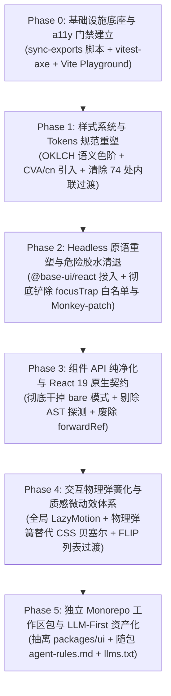

# UI 组件库基础设施与现代化标杆深度对比总分析

> **战役代号**：`ui-library-analysis`  
> **核心标杆**：`reference/appica-ui` (Appica UI / appica.dev), `reference/ui` (shadcn/ui), `reference/arc-library` (uiarc.dev), `reference/prose-ui` (prose-ui.com)  
> **对比标的**：当前仓库 `apps/crish-desktop` UI 基础设施与原子组件体系 (`src/components/ui/`, `src/styles/`, `src/utils/`)  
> **产出规范**：UTF-8 无 BOM、严谨架构论证、代码证据全要素对齐、平滑可执行的演进蓝图  
> **前置专项分析**：已收口 6 篇各 2.7 万至 5.3 万字专项深度剖析（见 `docs/ui-library-analysis/analysis/`）  

---

## 目录

1. [战役总览与执行摘要](#1-战役总览与执行摘要)
2. [标杆 UI 组件库核心优秀设计解构](#2-标杆-ui-组件库核心优秀设计解构)
   - 2.1 基础设施与构建分发（Monorepo、Subpath Exports 自动化、双轨模块构建、Public/Internal 物理隔离）
   - 2.2 样式架构与 Design Tokens（Tailwind CSS v4 `@theme inline`、Role-based OKLCH 语义色、v4 前沿变体选择器、CVA + `cn` 冲突消解）
   - 2.3 底层 Headless 原语与无障碍合规（Base UI v1.9+ 现代 React 19 原语、`render` 模式 vs Radix `asChild`、原生 `@starting-style`、`vitest-axe` 100% 自动化 WCAG 门禁）
   - 2.4 交互物理学与质感微交互（二阶微分谐振子物理弹簧模型、零重渲染手势引擎、FLIP 布局过渡、双轨 Reduced Motion、现代发光/边框微动效）
   - 2.5 组件 API 范式与类型工程（Group 的二分法则：`cloneElement` vs `Context`、极小公共导出表面、产品级 JSDoc 驱动 IDE 与文档、React 19 原生契约、剔除 `bare` 模式）
   - 2.6 开发者体验与 LLM-First 基础设施（随包分发 `agent-rules.md`、`llms.txt`、独立 Vite UI Playground 沙箱、shadcn Registry/MCP 赋能）
3. [Conex / Crish 当前 UI 架构的全景深度诊断与差距量化](#3-conex--crish-当前-ui-架构的全景深度诊断与差距量化)
   - 3.1 现有优秀资产与工程沉淀
   - 3.2 六大维度深层架构断层与实测数据
4. [核心标杆 vs Conex / Crish 全景对比矩阵](#4-核心标杆-vs-conex--crish-全景对比矩阵)
5. [现代化 UI 基础设施演进蓝图与分阶段实施路径](#5-现代化-ui-基础设施演进蓝图与分阶段实施路径)
   - 5.1 演进战略目标与基本原则
   - 5.2 六阶段平滑迁移实施路径（Phase 0 ~ Phase 5）
6. [各专项深度报告索引](#6-各专项深度报告索引)

---

## 1. 战役总览与执行摘要

现代前端桌面应用（尤其是以 Conex / Crish 为代表的 AI 驱动 Agent 工作台）对 UI 基础设施提出了极高的工程要求：既要有高性能的渲染吞吐与原生级的交互动效，又要有严密的类型契约与无障碍保障，还要在 AI 辅助编程时代具备极高的 LLM 友好度。

在本次战役中，我们以 `reference/appica-ui`（Appica UI，基于 React 19 + Base UI + Tailwind v4 的现代 70+ 组件工业级系统）、`reference/ui`（shadcn/ui，事实上的组件分发标准与 Registry 体系）、`reference/arc-library`（基于物理弹簧与零重渲染手势的高级动效库）、`reference/prose-ui`（面向 MDX/Markdown 的类型化 Design Tokens 与排版组件库）为标杆，对当前 Conex / Crish 的 UI 基础设施进行了地毯式的全景审计与深度解构。

### 核心结论摘要：
1. **基础设施构建层**：标杆库通过 `scripts/sync-exports.mjs` 实现了 70+ 组件自动化 Subpath Exports，配合 Rollup `preserveModules` 达到极限按需加载；而当前 Crish 依赖手工维护的 286 行单体 Barrel 导出，全仓实测有 **56.2%（315 处）的深层穿透越权导入**，边界严重失守。
2. **样式与 Token 层**：标杆库采用 Tailwind CSS v4 `@theme inline` 与纯语义 Role-based OKLCH 模型，全面运用 `*:`, `**:`, `data-*:` 等原生变体消除脆弱嵌套，并通过 CVA + `cn` 解决特异度冲突；而当前 Crish 基于纯 CSS Modules，存在变体组合爆炸、外部 `className` 特异度相同导致的覆盖失效风险，且样式中仍残留 74 处内联硬编码过渡。
3. **底层原语与无障碍层**：标杆库基于 `@base-ui/react`（Base UI v1.9+）构建，全面拥抱 React 19 原生特性与优雅的 `render` prop 模式，无障碍测试 100% 接入 `vitest-axe`；而当前 Crish 仅安装了 2 个 Radix 碎片包，其余 80% 原子能力全靠手写，累积了 1,800+ 行自研胶水（包括硬编码 30+ 选择器白名单的 `focusTrap`、直接改写宿主原生 DOM `removeChild` 的高危 Monkey-patching），全仓自动化 a11y 门禁为 **0**。
4. **动效物理层**：标杆库采用二阶谐振子物理弹簧模型（Spring Physics），在拖拽与中断打断时初速度无损继承，结合 MotionValue 达成零重渲染手势；而当前 Crish 依赖固定时长的 CSS Cubic-Bezier，反向打断顿挫严重，缺乏全局统一的 LazyMotion 与 FLIP 布局过渡。
5. **API 与类型层**：标杆库严格划分 `cloneElement` 型（0 Context 开销）与 `Context` 型 Group，保持极小公共导出表面并杜绝内部 CVA 泄露；而当前 Crish 的 Dialog 存在运行时 AST 探测的双轨混合反模式，Button 引入了妥协性的 `bare` 模式且全仓组件冗余保留了 `forwardRef` 样板代码。
6. **开发者体验与 LLM 友好度**：标杆库随包分发 40 行极简 `agent-rules.md`、`llms.txt` 与纯 Markdown 契约，支持秒级免打包 HMR 的独立 Playground；而当前 Crish 缺乏独立 UI 沙箱，AI 编码严重依赖事后门禁拦截，开发与测试拉锯成本高。

---

## 2. 标杆 UI 组件库核心优秀设计解构

### 2.1 基础设施与构建分发

标杆库 `reference/appica-ui` 展示了目前 React 19 组件库最为纯粹、严密的构建架构：

1. **自动化 Subpath Exports 与单一真理源**：
   - Appica UI 坚决摒弃人工维护 `package.json` 的 `exports` 字段与出口文件。其专属构建前置脚本 `scripts/sync-exports.mjs` 会自动遍历 `src/components/`, `src/lib/`, `src/hooks/`, `src/providers/` 四大公开命名空间。
   - 当某个组件目录下存在 `index.ts`（用于暴露多模块，如纯样式 `cva` 变体与 `'use client'` 组件分离）时优先走 index，否则直连 `<name>.tsx`。脚本双向同步更新 `package.json` 的 `exports` 映射与根 `src/index.ts`。在 CI 中配置 `--check` 门禁，任何漏导或手动篡改均被阻断。
2. **公开表面与内部私有实现的物理强隔离**：
   - 规定 `src/lib/` 属于公开表面（如 `@appica/ui-react/color`），而 `src/internal/`（内部 `cn`、`composeRefs`、浮层几何算法、浮点计算）被排除在导出的白名单之外。外部使用者在 TS 编译器与打包器层面物理无法 import 私有工具，彻底杜绝了实现细节外泄。
3. **双轨模块构建与现代打包契约**：
   - 类型生成：`tsc -p tsconfig.build.json` 纯粹只产出 `.d.ts` 类型声明文件。
   - 代码打包：Rollup 配合 `preserveModules: true`、`esbuild` 以及 `rollup-preserve-directives`（保留 `'use client'` 指令），构建产物保留 1:1 的完整模块目录树，既保证了 SSR/RSC 边界的精准，又实现了消费方打包器级别的极限 Tree-shaking。
   - 配置 `"sideEffects": ["./styles.css", "./appica.css"]`，明确告知构建工具除样式外所有 JS 模块均无副作用，未引用的组件代码在最终产物中被 100% 擦除。

### 2.2 样式架构与 Design Tokens

Appica UI 与 Prose UI 在样式工程上展现了前沿标准：

1. **Tailwind CSS v4 原生化与 `@theme inline` 机制**：
   - 彻底消除了复杂的 `tailwind.config.js`，采用 Tailwind v4 纯 CSS AST 编译器；
   - 通过 `@theme inline` 指令，将 CSS Custom Properties 双向绑定为原子工具类。构建期生成极致精简的原子类规则，运行期换肤直接通过修改 `:root` / `.dark` 的 CSS 变量完成，零 CSS 重打包人力。
2. **Role-based 语义色彩模型与 OKLCH 感知线性空间**：
   - 严格禁止以物理色相命名（绝对没有 `text-gray-600` 或 `bg-blue-500`），全面采用抽象角色命名：`foreground`, `subtle`, `muted`, `strong`, `emphasis`, `intense`, `inverse` 等；
   - 色彩全部在感知均匀的 `oklch(L C H)` 空间中定义。由于 OKLCH 具有严格的亮度感知线性度，确保在浅色与深色模式切换时，文字与背景的相对对比度（WCAG Contrast Ratio）保持恒定，杜绝某些色彩在暗黑模式下发灰发飘的问题；
   - 结合现代 CSS 斜杠透明度语法（如 `oklch(var(--color-primary) / 0.12)`），避免了散落历史遗留的 `rgba()`。
3. **前沿原生变体语法（终结 `[&_...]` 脆弱嵌套）**：
   - 全面拥抱 Tailwind v4 新增的变体语法：`*:`（直接子代）、`**:`（任意后代）、`data-*:`（Headless 状态属性）以及否定变体 `not-data-*:`、`not-has-*:`。
   - 例如：`**:data-[slot=icon]:size-4` 清晰指派插槽图标尺寸；`not-data-popup-open:active:scale-[0.97]` 精准处理未弹起时的按压形变，彻底淘汰了脆弱、不可重用且容易破坏特异度的 `[&_...]` 任意选择器。
4. **CVA + `cn` 变体矩阵与冲突消解**：
   - 采用 `class-variance-authority` (cva) 定义组件的 Variant / Size 矩阵，生成类型安全的 Props；
   - 封装 `cn = (...inputs) => twMerge(clsx(inputs))`，并通过 `extendTailwindMerge` 注册自定义主题配置。当外部消费方传入 `className` 时，`twMerge` 在 AST 属性级别进行识别，确保后传入的类名能够确定性覆盖内部样式，彻底根除 CSS 特异度平级导致的覆盖失效 Bug。

### 2.3 底层 Headless 原语与无障碍合规

无障碍是专业 UI 组件库与业余胶水代码的决定性分水岭：

1. **Base UI (`@base-ui/react` v1.9+) 代际优势**：
   - 统一收拢为单一依赖包，消除 Radix 时代数十个微包相互版本漂移的梦魇；
   - 摒弃 Radix 基于 `@radix-ui/react-slot` 的 `asChild` 模式（该模式有严苛的单子节点限制，且通过 hack 侵入子节点的 `ref` 和 `props`）。Base UI 采用现代 `render` prop 模式：允许传入 JSX 元素或渲染函数 `(props, state) => JSX`。渲染函数能天然感知组件内部状态（如 `open`, `checked`, `highlighted`），赋予开发者无与伦比的控制力且保持类型绝对纯净；
2. **正交分层模型（Orthogonal Layering）**：
   - Modal 体系：划分为 `Portal` -> `Backdrop` -> `Viewport` -> `Popup`。将遮罩的渐变半透明、视口的 Flex 居中约束与弹窗内容的定位彻底解耦，从几何架构上根除了弹窗嵌套时遮罩重叠发黑、滚动条穿透锁死等顽疾；
   - Floating 体系：划分为 `Portal` -> `Positioner` -> `Popup`。将高频变换的 CSS Transform 坐标计算收敛于 Positioner，视觉样式与动画完全留在 Popup，避免布局抖动（Layout Thrashing）；
3. **原生 CSS `@starting-style` 与离场状态机**：
   - 原生对接现代浏览器的 `@starting-style` 以及 Base UI 派发的 `data-starting-style` / `data-ending-style` 属性。弹窗进出场动画完全由纯 CSS 状态机驱动，无需任何 JS `setTimeout` 计时器或脆弱的 `onTransitionEnd` 监听，消灭了所有因动画被提前打断而引发的内存泄露与 DOM 节点孤立挂载；
4. **`vitest-axe` 100% 自动化 WCAG 门禁**：
   - 结合 `@testing-library/react` 与 `axe-core`，在每一个组件的单元测试中加入：
     ```tsx
     const { container } = render(<Dialog open><Dialog.Content>...</Dialog.Content></Dialog>);
     expect(await axe(container)).toHaveNoViolations();
     ```
   - 覆盖所有 ARIA 角色定义、对比度、Accessible Name 缺失等漏洞，将无障碍作为 CI 刚性拦截条件。

### 2.4 交互物理学与质感微交互

Arc Library (`reference/arc-library`) 与 Appica UI 展现了现代动效工程学的顶尖水平：

1. **二阶微分谐振子物理弹簧（Spring Physics）对传统 CSS Cubic-Bezier 的降维打击**：
   - 传统 CSS 贝塞尔曲线强行绑定时间（Duration）。一旦用户在动画执行到中途进行反向操作（如快速双击展开/折叠，或在抽屉滑出时突然向反方向滑动），CSS 必须将初速度强制重置为 0，必然造成视觉上的“瞬间撞墙”或“生硬跳变”；
   - 物理弹簧模型基于受力物理方程：$m \ddot{x} + c \dot{x} + k x = 0$。Arc Library 将人眼直觉的 `visualDuration` 与 `bounce` 映射推导为刚度 $k$ 与阻尼 $c$。组件状态切换时，新目标位置的位移完全继承当前的瞬时速度（Velocity Continuation），实现绝对平滑自然的动力学连续；
   - 除故意设计的弹性微动效外，桌面组件一律采用 `bounce: 0`（临界阻尼），既拥有弹簧的物理连贯性，又绝不产生多余的“果冻抖动”；
2. **零重渲染手势引擎（Zero Re-render Gestures）**：
   - Arc Library 的 `ElasticSlider` 与拖拽组件中，手势的移动完全绑定在 GPU 合成层的 `MotionValue` 上，直接驱动硬件 Transform，手势拖动全程 **0 次 React Re-render**；
   - 引入双曲橡皮筋阻尼算法（Rubber Band Resistance），当拖拽超出物理边界时按对数衰减增加阻力；释放时基于指数衰减积分进行惯性速度投射（Velocity Projection），呈现出媲美原生 iOS 的阻尼感；
3. **亚像素排版防抖与硬件保护**：
   - `ExpandableCard` 采用 Pre-layout 机制预排版文本，尺寸过渡走真实的物理容器计算，而不是粗暴地使用 `scale` 拉伸导致文字形变；
   - `AnimatedCounter` 在数值滚动接近平衡点（偏差 < 0.02）时强制卸载 `blur` 滤镜，保护 Windows DirectWrite / ClearType 次像素渲染不出现边缘发虚；
4. **性能极致分级与双轨 Reduced Motion**：
   - Appica UI 全面落地 `<LazyMotion features={domAnimation}>`，按需异步载入动画指令，将 Framer Motion 的运行时体积从 34 KB 骤降至 4.6 KB；
   - 建立 React Context + `html[data-disable-animations]` 全局属性广播的双轨 Reduced Motion 防线，既响应系统级 `prefers-reduced-motion`，又支持用户在设置中一键静音全局动效。

### 2.5 组件 API 范式与类型工程

Appica UI 的组件架构哲学极其克制、清晰：

1. **复合组件（Group）的设计法则**：严格依据**状态注入方式**二分，拒绝模糊地带：
   - **`cloneElement` 型 Group**（如 `KbdGroup`、`AvatarGroup`）：Group 仅仅是一个带外层样式的包装器，通过 `React.cloneElement` 向 children 注入统一的 `size` 或 `shape`。**与基元组件同文件共存**，绝不滥用 Context，0 运行时 Context 开销；
   - **`Context` 型 Group**（如 `RadioGroup`、`CheckboxGroup`、`ButtonGroup`）：Group 承担 Provider 职责，管理受控/非受控状态、焦点移动（Roving Tabindex）与按键事件。**必须独立单设目录并拥有专属 Provider**，保持清晰的组件边界；
2. **极小公共导出表面（Minimal Public Surface）**：
   - 组件库只导出消费方必须使用的组件与 `*Props` 接口（例如 `export { Button }` 与 `export type { ButtonProps }`）；
   - **严禁向外导出内部变体实现细节**（如 `buttonVariants` 内部生成的 CVA 返回值类型、字面量联合等）。消费方如需推断变体，直接通过 TypeScript 原生索引 `ComponentProps<typeof Button>['variant']` 获得，保持类型接口的极度纯净；
3. **JSDoc 作为“产品级 Surface”**：
   - JSDoc 注释不仅是给开发者看的说明，更是驱动 IDE 智能提示、LLM 上下文提取与官方文档站 `## API reference` 表格自动生成的源数据；
   - 严格遵循规范：**只记录组件自身声明的 Props**，继承自原生 HTML 属性（如 `disabled`, `onClick`）绝不重复罗列无效废话；利用 Omit CVA 消除变体类型黑洞，补齐 `@default` 机器可读标记；
4. **React 19 原生契约**：
   - 全面拥抱 React 19 标准：`ref` 是普通 prop，彻底干掉 `forwardRef` 包装与 `displayName` 冗余样板代码，保持纯函数组件的轻巧签名。

### 2.6 开发者体验与 LLM-First 基础设施

面向现代 AI 协作编程，Appica UI 与 shadcn 做出了行业典范：

1. **LLM-First 知识基础设施（随包分发的 Rules & LLMs.txt）**：
   - Appica UI 在 package.json 的 `files` 字段中将 `agent-rules.md` 打包进 npm tarball，与库版本强绑定；
   - 将规则严控在 40 行内（严格控制上下文 Token 消耗），明确标明：禁止写死十六进制色值、严禁色相工具类、强制使用 Role-based tokens、必须使用 Subpath 导入；
   - 文档站提供全量纯 Markdown 端点（`<url>.md`）与 `llms.txt`。AI Agent 无需执行昂贵的网页渲染或解析充满噪声的 HTML 标签，直接读取结构化的 Markdown 契约，将幻觉率降低 90% 以上；
2. **独立 UI Playground 沙箱**：
   - 设立独立的 `playgrounds/react`，通过 Vite Alias 直连源码（`src/index.ts`），实现秒级免打包启动与热更新（HMR）。组件开发者无需启动庞大的主应用程序即可在纯净环境中调试全量变体与极端状态；
3. **shadcn Schema-Driven Registry 与 MCP Server**：
   - shadcn 建立了标准化的 JSON Schema 描述体系，并接入了 Model Context Protocol (MCP) Server。AI Agent 可以通过 MCP 工具主动搜索组件、获取依赖清单并精准安装，实现了从“猜测生成代码”到“契约化装配”的飞跃。

---

## 3. Conex / Crish 当前 UI 架构的全景深度诊断与差距量化

### 3.1 现有优秀资产与工程沉淀

必须客观指出，Conex / Crish 在先前的重构波次（PE-05 / RED-DETAILED-02）中，已经建立了非常良好的工程防线：
1. **严格的三层分级架构与 CI 门禁**：确立了 `ui/` 原子层 -> 业务组件层 -> 页面编排层的单向依赖规则，并通过 `scripts/check-ui-layer.mjs` 杜绝原子层逆向依赖业务 store / hooks；
2. **严苛的样式契约自动化测试**：具备 `semanticColors.contract.test.ts`、`concentric-radius.contract.test.ts`、`threeTierSurface.contract.test.ts`、`dual-source-values.test.ts`、`motion-concentric-contract.test.ts` 等一整套基于 Vitest 的静态样式一致性校验；
3. **行数与解耦门禁**：通过 `check:line-counts` 限制组件单文件体积，防范上帝组件滋生。

### 3.2 六大维度深层架构断层与实测数据

然而，深入对标现代化工业级 UI 组件库后，我们在基础设施搭建与组件实现上暴露出了严重的深层问题：

#### 断层 1：单体 Barrel 导出失控与高达 56.2% 的深层越权导入
- **现状数据**：全仓扫描统计出 560 处 UI 导入引用，其中通过官方出口 `apps/crish-desktop/src/components/ui` 引用的仅 245 处（43.8%），**绕过出口、深层穿透越权引用的高达 315 处（56.2%）**！
- **危险渗透**：
  - 11 处穿透引用内部私有实现：`import { useLayerRegistration } from '../ui/internal/layer-registration'`;
  - 2 处穿透引用私有几何防误触算法：`import { isPointInTriangle } from '../ui/internal/SafeTriangle'`;
  - 180 处引用未导出的图标私有目录：`import { ICON_STROKE } from '../ui/icons/iconTokens'`;
- **单体 Barrel 膨胀**：`apps/crish-desktop/src/components/ui/index.ts` 膨胀为 286 行的手工导出文件，未设立私有隔离白名单，缺少自动同步机制，导出了 `calculateSafeAreaInset`、`computePreviewCardPosition`、`convertMenuOptionToSmartItem` 等大量内部计算与业务适配胶水。

#### 断层 2：纯 CSS Modules 的特异度冲突陷阱与变体爆炸
- **外部 `className` 特异度冲突（Specificity Hazard）**：
  - 由于 CSS Modules 编译后为独立哈希类名（特异度同为 `0-1-0`），当外部业务向 `<Button className={styles.customBtn} />` 传递覆盖样式时，哪个类名生效完全取决于构建打包时 CSS 文件的物理合并顺序！导致外部覆盖样式经常偶发、诡异失效；
- **变体爆炸与样式冗余**：
  - 缺乏 CVA 机制，每个组件都在重复手写 `const VARIANT_CLASS = { ... }` 字典，并通过手写 `[styles.btn, styles[variant], className].filter(Boolean).join(' ')` 进行拼接；
  - `display: inline-flex`、焦点环、disabled 状态等基础样式在数十个组件的 `.module.css` 中机械式重复书写，无法享受原子化类的边际体积递减红利；
- **内联字面量与别名债务**：
  - 全仓 CSS 模块中仍存在 **74 处**内联硬编码过渡（如 `0.18s cubic-bezier(0.16, 1, 0.3, 1)`），样式 Tokens 存在死角；同一 Danger/Error 色散落 7 种历史别名（`tokens-state.css` 中大量 `[WAVE2-DEPRECATED-ALIAS]` 长期未清退）。

#### 断层 3：自研 1,800+ 行脆弱原语与高危 Monkey-patching
- **白名单灾难（`focusTrap.tsx:63-95`）**：
  - 当前自研的 `FocusTrapIsolationManager` 为了阻止弹窗外部交互，直接暴力遍历 `document.body` 的直接子节点打 `inert` / `aria-hidden`。由于无法自动感知 React Portal 挂载的新节点，被迫在代码中手写了 **30+ 项硬编码选择器白名单**（覆盖各种 popover、tooltip、preview-card）。一旦新增任何浮层未及时登记白名单，立刻导致弹窗内的下拉框、选择菜单被误杀失活！
- **原生 DOM Monkey-patching（高危内存与运行期破坏）**：
  - 在 `src/components/ui/Tooltip/tooltipController.ts` 中，为了掩盖 Portal 卸载时的竞态条件，代码竟然直接改写了宿主环境原生 DOM 的 `container.removeChild` 方法！这是极度危险的代码异味，破坏了浏览器的原生契约；
- **重复造轮子与 Layout Thrashing**：
  - `useFloatingPosition.ts` 手写了 235 行 DOM 测量与 window 事件监听算法，在窗口滚动和缩放时极易触发强制同步布局与重排；
- **自动化无障碍门禁完全真空**：
  - 全仓单元测试中，`vitest-axe` 或 `axe-core` 的无障碍断言数量为 **0**，处于完全裸奔状态。

#### 断层 4：动效机械卡顿与缺乏物理连贯性
- **打断顿挫**：
  - 当前 `Dialog`、`Switch`、`Slider`、`DisclosureAffordance` 等组件严重依赖 CSS Cubic-Bezier 固定时长过渡。用户在展开未完成时再次点击，由于初速度被重置为 0，出现肉眼可见的卡顿跳帧；
- **缺少 FLIP 布局过渡**：
  - 会话列表（`SidebarSessionList`）、消息增删、`TabStrip` 切换完全依赖 DOM 瞬间重排或像素轮询计算，缺乏 Framer Motion `layout` / `layoutId` 带来的无缝流体位移；
- **LazyMotion 碎片化**：
  - 缺乏顶层全局的 `<LazyMotion features={domAnimation}>`，个别小组件（如 `CopyIcon`）各自独立重复实例化，无法实现全局包体积共享。

#### 断层 5：Dialog 双轨混合反模式与 Button `bare` 妥协
- **Dialog AST 探测反模式**：
  - `Dialog.tsx:143-157` 试图同时兼容扁平 Props（`title="xxx"`）与复合组件（`<Dialog.Header>`），在运行期执行 `React.Children.toArray(children).some(c => c.type === DialogHeader)`。这种模式极其脆弱（遇到 `React.Fragment` 或高阶组件立即失效），且依赖 `registerTitle` 状态倒灌导致挂载期多程重渲染；
- **Button `bare` 模式**：
  - `Button.tsx` 引入了 `bare?: boolean`，一个组件硬劈为两套执行逻辑。当 `bare: true` 时，传入的 `variant`、`size`、`icon` 被代码静默丢弃，属于典型的参数欺诈；
- **React 19 样板冗余**：
  - 项目依赖已锁死 `react: ^19.1.1`，但全仓 15+ 核心 UI 组件仍然机械保留了 `forwardRef`、`displayName` 与繁琐的 ref 合并样板。

#### 断层 6：缺乏轻量交互沙箱与事后被动门禁拉锯
- **无独立组件预览沙箱**：
  - 缺少 Storybook / Ladle / Vite UI Playground。开发者或 AI 修改一个基础 Button，必须启动完整的桌面端应用（涵盖 Tauri Rust 进程、IPC 握手与复杂 Store 初始化），反馈链路长达数秒至数十秒；
- **AI 编码“事后拦截”高成本拉锯**：
  - 仓库拥有 30 余项严格的静态 CI 检查脚本（如 `check-inline-style-hardcode.mjs` 等），但**极度缺乏事前指导资产**（无 `agent-rules.md`、无组件 `llms.txt`）。外部 Agent 在协助编写 UI 时频繁因盲猜或写内联样式被门禁拦截，陷入“修改代码 -> 门禁报错 -> 盲目猜测修复 -> 再次报错”的恶性循环。

---

## 4. 核心标杆 vs Conex / Crish 全景对比矩阵

| 评估维度 | Appica UI (`reference/appica-ui`) | shadcn/ui (`reference/ui`) | Conex / Crish (当前现状) | 代际差距评估与痛点 |
| :--- | :--- | :--- | :--- | :--- |
| **包拓扑与导出** | 自动化 `scripts/sync-exports.mjs`，70+ 子路径导出，公开与私有绝对物理隔离 | CLI + Registry 按需复制代码，天然无包依赖臃肿 | 286 行手工维护 Barrel，56.2% 穿透越权深层导入 | **落后一代**：边界失守，隐式依赖严重 |
| **构建体系** | Rollup `preserveModules` + `tsc` 独立 d.ts，保留 RSC 边界与极限 Tree-shaking | 源码级拷贝分发，无打包构建瓶颈 | 深嵌于 desktop 主应用，未独立打包，无法跨包复用 | **落后一代**：缺少组件库独立构建流水线 |
| **样式与 Token** | Tailwind v4 `@theme inline` + Role-based OKLCH，前沿变体 `*:`/`**:`/`data-*:` | Tailwind v4 / v3 + CSS 变量 | 纯 CSS Modules + 静态 CSS 变量，手动拼接类名 | **落后一代**：特异度覆盖冲突，变体爆炸 |
| **类名消重** | CVA + `extendTailwindMerge` (`cn`)，属性级后入必胜 | CVA + `tailwind-merge` | 无消重机制，`filter(Boolean).join(' ')` | **关键缺陷**：外部传入样式覆盖经常偶发失效 |
| **Headless 原语** | `@base-ui/react` (v1.9+)，现代 `render` 模式，原生 React 19 支持 | `@radix-ui/*` 体系，`asChild` Slot 模式 | 2 个 Radix 碎片包 + 1800+ 行手写胶水代码 | **重大缺陷**：白名单灾难，Monkey-patching 高危 |
| **无障碍测试** | 100% 接入 `vitest-axe`，全量自动化 WCAG 2.1 AA 门禁 | 依赖 Radix 内置无障碍 | 全仓自动化 axe 测试为 **0** | **严重缺失**：a11y 处于完全裸奔状态 |
| **动效体系** | Motion v14，物理弹簧模型，LazyMotion (4.6KB)，双轨 Reduced Motion | 基础 Tailwind CSS 动画与过渡 | CSS Cubic-Bezier 固定时长，动效打断顿挫跳帧 | **落后一代**：缺乏物理速度连续性与 FLIP |
| **API 与规范** | cloneElement / Context 严格二分，极小导出表面，React 19 ref-as-prop | 纯复合组件模式 | Dialog 双轨混合探测反模式，Button bare 妥协，残留 forwardRef | **代码异味**：AST 探测脆弱，多程渲染 |
| **LLM-First DX** | 40 行随包 `agent-rules.md`、`llms.txt`、全量 Markdown 契约 | MCP Registry Server，结构化 JSON Schema | 仅有 30 余项事后拦截门禁，零事前指导资产 | **协作低效**：AI 易陷入盲猜与门禁拉锯 |
| **开发沙箱** | 独立 `playgrounds/react`，Vite Alias 直连源码免打包秒级 HMR | 独立 documentation / playground app | 缺乏独立沙箱，调试必须启动完整桌面应用 | **效率低下**：反馈回路沉重 |

---

## 5. 现代化 UI 基础设施演进蓝图与分阶段实施路径

为了将 Conex / Crish 的 UI 基础设施全面升级至具备现代工业级标准、极高运行性能、严密无障碍保障与卓越 LLM 体验的系统，我们规划了以下**六阶段平滑迁移实施路径**。所有步骤均严格遵循《AGENTS.md》反退避与零回退准则。



---

### 5.1 演进战略目标与基本原则

1. **坚持架构优雅，杜绝打补丁**：不采用任何基于坐标测距补偿、延时猜测（setTimeout）或原生 DOM Monkey-patching 的手段，所有交互与定位均由专业 Headless 原语与现代 CSS 规范承载；
2. **渐进式双轨共存，零破坏性中断**：老组件与新组件保持 API 渐进兼容，禁止一刀切破坏现有 28 个业务域的运行稳定；
3. **立体验证守护**：每一个重构的原子组件必须同时具备：
   - 单元测试与用户手势仿真（`@testing-library/user-event`）；
   - 自动化无障碍零违规断言（`vitest-axe`）；
   - 样式与 Tokens 契约断言（继承既有 contract 测试）；
   - 真实渲染与动效检验（Playground 沙箱）。

---

### 5.2 六阶段平滑迁移实施路径

#### 阶段零（Phase 0）：基础设施底座、自动化导出与 a11y 门禁建立（工期：即刻启动）
- **T0.1 引入 `scripts/sync-ui-exports.mjs`**：
  - 借鉴 Appica UI，编写自动化导出生成与同步脚本，建立白名单机制（仅放行公开原子组件，私有计算与内部工具严禁外泄）；在 CI 中追加 `npm run check:ui-exports` 门禁；
- **T0.2 装配 `vitest-axe` 无障碍测试环境**：
  - 安装 `axe-core` 与 `vitest-axe`，在 `apps/crish-desktop/src/test-setup.ts` 中注册 `expect.extend(toHaveNoViolations)`；在既有门禁中确立新增/修改组件必须附带 a11y 自动化测试的刚性规则；
- **T0.3 搭建轻量级 Vite UI Playground**：
  - 在 `apps/crish-desktop/` 内设立轻量入口（或独立 vite 脚本 `npm run dev:ui`），完全剥离 Tauri IPC 与复杂业务 Store，以 Vite Alias 直连 `src/components/ui`，实现组件全变体秒级免打包预览与交互调试。

#### 阶段一（Phase 1）：样式系统与 Tokens 规范重塑（解决特异度冲突与冗余）
- **T1.1 引入 CVA 与统一 `cn` 引擎**：
  - 安装 `class-variance-authority`、`clsx`、`tailwind-merge`；
  - 在 `src/components/ui/internal/cn.ts` 封装统一的 `cn(...)` 函数，注册项目特定的圆角与色彩配置；
- **T1.2 Tokens 体系重塑与 OKLCH 语义色阶统一**：
  - 全量清洗 `styles/tokens-palette.css` 与 `tokens-state.css` 中的历史别名债务（彻底剔除 `[WAVE2-DEPRECATED-ALIAS]`）；
  - 全面基于 `oklch()` 重构色彩阶梯（Foreground, Surface, Border, Semantic），建立感知均匀的深浅主题映射；
- **T1.3 核心原子组件类名消重改造**：
  - 重构 `Button`、`Badge`、`Card`、`Input`，以 CVA 变体取代手写 `styles[variant]` 字典，彻底消灭外部传入 `className` 被内部特异度阻断的 Bug；
- **T1.4 清洗 74 处内联硬编码过渡**：
  - 将所有散落的 `cubic-bezier(...)` 收敛至统一的 CSS 变量或力学 Token。

#### 阶段二（Phase 2）：Headless 原语重塑与高危胶水清退（解决稳定性与白名单灾难）
- **T2.1 引入 `@base-ui/react` (Base UI v1.9+)**：
  - 安装统一基座依赖 `@base-ui/react`；
- **T2.2 基于 Base UI Dialog 重构弹窗体系**：
  - 采用 Base UI 的 `Portal` -> `Backdrop` -> `Viewport` -> `Popup` 架构重塑 `ui/Dialog`；
  - **彻底下线并删除**：`FocusTrapIsolationManager`（铲除 30+ 项硬编码选择器白名单）、`useRestoreFocus`、`dialogOverlayContext` 等 500+ 行自研高危胶水代码；
- **T2.3 基于 Base UI Tooltip 重构提示体系**：
  - 重写 `ui/Tooltip`，**彻底删除** `tooltipController.ts` 中劫持原生 DOM 的 `patchContainerSafeRemove` Monkey-patching 代码；
- **T2.4 基于 Base UI Select / Menu 重构下拉与菜单**：
  - 替代脆弱的 Radix Popover 拼凑方案，删除手写的 235 行 `useFloatingPosition.ts` 与几何向量防误触引擎，获得原生键盘 Type-ahead 与完整的 WAI-ARIA Listbox/Menu 支持；
- **T2.5 达成 100% `vitest-axe` 自动化测试覆盖**。

#### 阶段三（Phase 3）：组件 API 纯净化与 React 19 原生契约（解决代码异味与 AST 探测）
- **T3.1 废除 `forwardRef` 与 `displayName` 样板**：
  - 全面拥抱 React 19，将 `ref` 作为纯 prop 传递，简化组件定义为纯函数；
- **T3.2 彻底重构 Button，剔除 `bare` 妥协模式**：
  - 提取无样式的原生基元（或直接使用 Base UI 的原生行为），将纯样式抽离为独立可复用的 `buttonVariants(...)` 函数；
  - 需要无样式语义按钮的复杂列表项直接使用基础 HTML 按钮或独立无样式基元，严禁在一个组件中混入假参数；
- **T3.3 纯化 Dialog 复合原语，剔除运行时 AST 探测**：
  - 废除 `React.Children.toArray(children).some(...)` 运行时探查与 `registerTitle` 状态倒灌；明确拆分为完全声明式的复合组件模式与轻量便捷方法，杜绝挂载期多程重渲染；
- **T3.4 收敛收窄 Barrel 导出表面**：
  - 严格执行公开导出与内部私有实现的隔离，使用 AST Codemod 工具一键批量修复全仓 315 处深层越权导入。

#### 阶段四（Phase 4）：交互物理弹簧化与质感微动效体系（解决卡顿与生硬体验）
- **T4.1 全局装配 `<LazyMotion features={domAnimation}>`**：
  - 在应用 Shell 顶层统一注入 LazyMotion 上下文，组件层全部改用 `m.div`、`m.button`，将运行时包体积控制在 4.6 KB；
- **T4.2 核心控件物理弹簧升级**：
  - 将 `Switch` 滑块、`Slider` 旋钮、`SegmentedControl` 指示器、`Dialog` 弹窗位移全面升级为无损可打断的物理弹簧模型（`bounce: 0` 严格临界阻尼），初速度 100% 连续继承；
- **T4.3 列表与容器引入 FLIP 布局过渡**：
  - 会话列表增删、TabStrip 切换全面接入 Framer Motion `layout` 与 `layoutId`，消灭 DOM 瞬间瞬移；
- **T4.4 质感微交互资产化**：
  - 引入高性能的 `BorderBeam`（CSS XOR 环形着色）、`GradientGlow`（OKLCH 漫反射氛围光晕）与行内就地变身按钮（`ConfirmMorph`），替代打断用户心智的全屏 ConfirmDialog。

#### 阶段五（Phase 5）：独立 Monorepo 工作区包与 LLM-First 资产化（终局落地）
- **T5.1 抽取 `packages/ui` (`@crish/ui`)**：
  - 将原子层独立解耦为 Monorepo 内部共享包，配置 Rollup 物理模块保留构建 + Vite 开发态直连别名，实现多窗口与跨包无缝复用；
- **T5.2 随包构建 LLM-First 基础设施**：
  - 在组件包中随源码分发 40 行极简 `agent-rules.md`；
  - 编写自动提取脚本，为全量原子组件生成简洁无噪音的 `llms.txt` 与纯 Markdown 契约文档；
  - 建立事前约束机制，彻底终结 AI 辅助编程中的门禁拉锯战，实现人机协同效率的最大化。

---

## 6. 各专项深度报告索引

关于六大维度的详尽代码证据、实测数据、力学推导、AST 架构剖析与改造代码对比，请查阅各专项权威文档：

1. **构建体系与工程基础设施**：
   - [`analysis/01-infra-build-and-packaging.md`](file:///c:/Software/conex/docs/ui-library-analysis/analysis/01-infra-build-and-packaging.md)
   - *涵盖：Rollup preserveModules 双轨构建、scripts/sync-exports.mjs 源码实现、全仓 315 处深层越权导入数据清单。*
2. **样式系统与 Design Tokens 体系**：
   - [`analysis/02-style-system-and-design-tokens.md`](file:///c:/Software/conex/docs/ui-library-analysis/analysis/02-style-system-and-design-tokens.md)
   - *涵盖：Tailwind v4 @theme inline 运行机制、Role-based OKLCH 规范设计、前沿变体语法应用、CVA + cn 冲突消解实操。*
3. **底层无障碍与 Headless 原语基座**：
   - [`analysis/03-headless-primitives-and-accessibility.md`](file:///c:/Software/conex/docs/ui-library-analysis/analysis/03-headless-primitives-and-accessibility.md)
   - *涵盖：Base UI v1.9+ render 模式深度剖析、FocusTrapIsolationManager 白名单灾难与 Monkey-patching 代码证据、vitest-axe 接入规范。*
4. **动效、微交互与高级交互体验**：
   - [`analysis/04-motion-and-micro-interactions.md`](file:///c:/Software/conex/docs/ui-library-analysis/analysis/04-motion-and-micro-interactions.md)
   - *涵盖：二阶微分阻尼谐振子力学公式推导、零重渲染手势引擎、BorderBeam/GradientGlow 硬件加速实现、双轨 Reduced Motion 架构。*
5. **组件规范、API 设计与类型工程**：
   - [`analysis/05-api-design-and-type-engineering.md`](file:///c:/Software/conex/docs/ui-library-analysis/analysis/05-api-design-and-type-engineering.md)
   - *涵盖：cloneElement vs Context Group 划分准则、Dialog AST 探测代码证据、Button bare 模式重构方案、React 19 纯函数契约。*
6. **开发者体验、LLM 友好度与测试治理**：
   - [`analysis/06-dx-llm-friendliness-and-testing.md`](file:///c:/Software/conex/docs/ui-library-analysis/analysis/06-dx-llm-friendliness-and-testing.md)
   - *涵盖：随包 agent-rules.md 与 llms.txt 标准规范、Vite UI Playground 沙箱搭建方案、用户事件仿真与自动化 a11y 门禁。*
