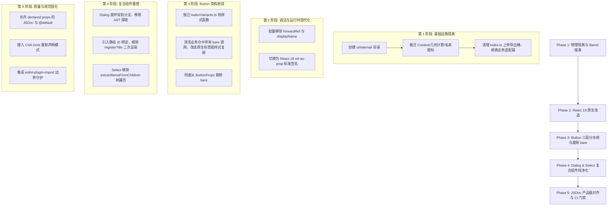

# 05-组件规范、API 设计与类型工程深度分析报告

> **战役代号**：`ui-library-analysis`  
> **报告主题**：组件规范、API 设计与类型工程（Component API & Type Engineering）  
> **专项角色**：组件规范、API 设计与类型工程分析专家（Component API & Type Analyst）  
> **对标标杆**：`reference/appica-ui` (Appica UI / appica.dev)  
> **审查标的**：`apps/crish-desktop/src/components/ui/` (Conex / Crish 原子 UI 组件库)  
> **生效标准**：React 19+、TypeScript 5.9+、现代 WAI-ARIA 规范、Tailwind CSS v4 语义架构  

---

## 摘要与核心发现 (Executive Summary)

本报告深入解剖现代化前沿 UI 组件库标杆 **Appica UI**（`reference/appica-ui`）在组件 API 规范、复合组件架构（Compound Component Patterns）、最小公共导出表面（Minimal Public Surface）、产品级 JSDoc 契约以及 React 19 原生工程化等维度的卓越设计实践；同时对照 Conex / Crish 当前桌面端原子 UI 组件库（`apps/crish-desktop/src/components/ui/`）的实现现状，进行了系统性审查与代码级证据挖掘。

### 五大核心失配与诊断结论

```
┌────────────────────────────────────────────────────────────────────────────────────────┐
│                                 五大维度对比诊断全景                                   │
├──────────────────────┬───────────────────────────────┬─────────────────────────────────┤
│ 分析维度             │ Appica UI 标杆范式            │ Conex / Crish 当前现状          │
├──────────────────────┼───────────────────────────────┼─────────────────────────────────┤
│ 1. 复合组件架构      │ 严格按注入状态二分            │ “双轨混合模式”反模式            │
│    (Compound Pattern)│ cloneElement 轻量 vs Context   │ 扁平 props 与子组件并存，运行时 │
│                      │ 目录隔离；纯单程声明式渲染    │ 脆弱 AST 探查与多程状态倒灌     │
├──────────────────────┼───────────────────────────────┼─────────────────────────────────┤
│ 2. 导出表面管理      │ 最小公共导出表面 (Minimal)    │ 单体大 Barrel 严重类型污染      │
│    (Public Surface)  │ 仅暴露 Component 与 *Props；  │ index.ts 286 行，过度暴露底层   │
│                      │ lib/ 与 internal/ 物理强隔离  │ Context、几何计算工具与适配器   │
├──────────────────────┼───────────────────────────────┼─────────────────────────────────┤
│ 3. 抽象分层与语义    │ 纯净分层 + CVA 变体函数       │ Button `bare` 模式妥协          │
│    (Layering & Sem.) │ BaseButton 基元 + Button 样式 │ 单组件劈开双执行路径，运行时静  │
│                      │ + buttonVariants 跨元素复用   │ 默丢失 props，伪无样式抽象泄漏  │
├──────────────────────┼───────────────────────────────┼─────────────────────────────────┤
│ 4. JSDoc 契约工程    │ “产品级 Surface”              │ 随意行内注释与类型黑洞          │
│    (Documentation)   │ 仅文档化自身声明属性；Omit CVA │ 缺乏 @default；继承属性噪音；   │
│                      │ 重声明补全；驱动官网与 IDE    │ 缺乏自动化验证，注释与实现漂移  │
├──────────────────────┼───────────────────────────────┼─────────────────────────────────┤
│ 5. React 19 现代化   │ 100% 落地 React 19 原生契约   │ 滞留 React 18 历史样板代码      │
│    (React 19 Native) │ ref-as-prop，完全废除         │ 充斥 forwardRef、displayName 与 │
│                      │ forwardRef；纯净函数签名      │ 手动 ref 转发合并防御性样板     │
└──────────────────────┴───────────────────────────────┴─────────────────────────────────┘
```

---

## 一、标杆深度解析：Appica UI 的组件 API 哲学与类型工程

Appica UI 作为专为 React 19 设计的下一代组件库，在其架构指令（[AGENTS.md](file:///c:/Software/conex/reference/appica-ui/packages/react/AGENTS.md) 与 [agent-rules.md](file:///c:/Software/conex/reference/appica-ui/packages/react/agent-rules.md)）中建立了极其严密、优雅且高度工程化的规范体系。

### 1.1 复合组件（Group）的设计法则：严格按状态注入机制二分

在构建成组交互组件（Group）时，传统组件库往往凭直觉随意决定是创建目录还是写在单文件。Appica UI 提出了硬性分流标准：**不以文件行数划分，而是完全由 Group 的“状态注入物理机制”决定**。

```
                          ┌───────────────────────────┐
                          │    创建 *Group 伴生组件   │
                          └─────────────┬─────────────┘
                                        │
                         Group 是否需要跨越深层 DOM 树?
                         是否包含选中状态/焦点漫游/键盘状态机?
                                        │
                      ┌─────────────────┴─────────────────┐
                     否 (纯粹样式与几何继承)              是 (状态与键盘事件广播)
                      │                                   │
          ┌───────────▼───────────┐           ┌───────────▼───────────┐
          │  cloneElement 型模式  │           │    Context 型解耦模式 │
          ├───────────────────────┤           ├───────────────────────┤
          │ • 机制: React.Children│           │ • 机制: Context.Provider│
          │   .map + cloneElement │           │ • 物理: 独立目录与独立│
          │ • 物理: 与基元同文件  │           │   *-context.ts 文件   │
          │ • 典型: KbdGroup,     │           │ • 典型: RadioGroup,   │
          │   AvatarGroup         │           │   ButtonGroup, Field  │
          │ • 开销: 0 Context 损耗│           │ • 优势: 边界显式、解耦│
          └───────────────────────┘           └───────────────────────┘
```

#### 模式 A：`cloneElement` 型轻量 Group（同文件共存）
适用于父容器仅作为视觉或布局包装器，只需将 `size`、`shape` 等属性向第一层子元素透传的场景。
- **源码实证 1**：[`KbdGroup` (reference/appica-ui/packages/react/src/components/kbd/kbd.tsx:35-53)](file:///c:/Software/conex/reference/appica-ui/packages/react/src/components/kbd/kbd.tsx#L35-L53)
  ```tsx
  interface KbdGroupProps extends React.ComponentProps<'span'> {
    /**
     * Default size applied to each child `Kbd` that doesn't set its own.
     * @default 'md'
     */
    size?: KbdSize
  }

  function KbdGroup({ className, size = 'md', children, ...props }: KbdGroupProps) {
    return (
      <span data-slot="kbd-group" className={cn('inline-flex items-center gap-0.5 align-middle', className)} {...props}>
        {React.Children.map(children, (child) => {
          if (!React.isValidElement<KbdProps>(child) || child.type !== Kbd) return child
          if (child.props.size !== undefined) return child // 子组件显式声明优先
          return React.cloneElement(child, { size })
        })}
      </span>
    )
  }
  ```
- **源码实证 2**：[`AvatarGroup` (reference/appica-ui/packages/react/src/components/avatar/avatar.tsx:121-155)](file:///c:/Software/conex/reference/appica-ui/packages/react/src/components/avatar/avatar.tsx#L121-L155)
  通过 `React.Children.map` 对直接子节点中的 `Avatar` 进行属性覆写，重叠环形头像负间距由父容器 Tailwind 选择器 `*:data-[slot=avatar]:ring-...` 原生解耦实现，完全无需 Context。

#### 模式 B：Context 型深度解耦 Group（独立目录物理隔离）
当组容器需要管理受控选中值、禁用继承、多选集以及跨越深层 DOM 树（包含 Tooltip、DropMenu 容器包裹）时，必须建立独立的 Context 目录。
- **源码实证**：[`button-group/button-group-context.ts:1-18`](file:///c:/Software/conex/reference/appica-ui/packages/react/src/components/button-group/button-group-context.ts#L1-L18) 与 [`button-group/button-group.tsx:1-69`](file:///c:/Software/conex/reference/appica-ui/packages/react/src/components/button-group/button-group.tsx#L1-L69)
  ```tsx
  // button-group-context.ts
  export interface ButtonGroupContextValue {
    variant?: ButtonGroupVariant
    size?: ButtonGroupSize
    disabled?: boolean
  }
  export const ButtonGroupContext = React.createContext<ButtonGroupContextValue | null>(null)

  // button.tsx 中直接消费
  function Button({ className, variant, size, disabled, ...props }: ButtonProps) {
    const group = React.useContext(ButtonGroupContext)
    const resolvedVariant = variant ?? group?.variant
    const resolvedSize = size ?? group?.size
    const resolvedDisabled = disabled || group?.disabled
    return (
      <BaseButton
        data-slot="button"
        disabled={resolvedDisabled}
        className={cn(buttonVariants({ variant: resolvedVariant, size: resolvedSize }), className)}
        {...props}
      />
    )
  }
  ```
- **设计哲学**：保持 subpath 导入 `@appica/ui-react/button-group` 的语义单一性；让 Context 的创建与消费具备清晰的物理文件树映射，严禁在单个文件中随意塞入多个 `createContext`。

---

### 1.2 最小公共导出表面（Minimal Public Surface）

Appica UI 奉行极简的 API 导出哲学：**仅导出消费方构建 UI 所必需的符号，坚决封死内部实现细节**。

1. **变体函数与联合类型不默认导出**：
   - 不导出内部 `cva` 变体函数（如 `chipSizeVariants`）。
   - 不导出多余的字面量联合类型（如 `ChipVariant`、`ChipSize`）。
   - **消费方推导契约**：消费方若在业务逻辑中需要某个变体类型，直接通过 TypeScript 标准工具提取：
     ```ts
     type MyVariant = React.ComponentProps<typeof Button>['variant'];
     ```
   - **特例显式白名单**：仅当变体确实被设计为跨越不同组件复用时（如 [`buttonVariants`](file:///c:/Software/conex/reference/appica-ui/packages/react/src/components/button/button-variants.ts#L15) 供 `<a>` 标签使用，[`inputVariants`](file:///c:/Software/conex/reference/appica-ui/packages/react/src/components/input/input-variants.ts) 供复合搜索框使用），才在独立文件中定义并通过 `index.ts` 导出。
2. **`src/lib/` 与 `src/internal/` 的绝对二元可见性隔离**：
   - `src/lib/<name>.ts`：作为公共 API 暴露给外部（例如 `src/lib/color.ts` 映射为 `@appica/ui-react/color`）。
   - `src/internal/<name>.ts`：库内部跨组件共享基础设施（如 [`internal/floating.ts`](file:///c:/Software/conex/reference/appica-ui/packages/react/src/internal/floating.ts)、[`internal/modal.ts`](file:///c:/Software/conex/reference/appica-ui/packages/react/src/internal/modal.ts)、[`internal/utils.ts`](file:///c:/Software/conex/reference/appica-ui/packages/react/src/internal/utils.ts)）。
   - 构建流水线中的 `scripts/sync-exports.mjs` 基于白名单扫描目录，`src/internal/` 的任何代码绝对不可能被误打包进 `package.json#exports`。

---

### 1.3 浮层与弹窗 Content 的统一折叠与逃生门设计

在基于 Headless 原语（Base UI / Radix）封装高级组件时，组件库面临一个普遍矛盾：
- 底层通常将浮层解构为三元组：`Portal` → `Positioner` → `Popup`；
- 消费方期望极简的 DX，只书写单一的 `<TooltipContent>` 或 `<PopoverContent>`。

如果粗暴地将 `...props` 仅传递给最内层的 `Popup`，外部将完全失去配置定位参数（`side`、`align`、`sideOffset`、`collisionPadding`）以及 Portal 容器（`container`）的能力；如果每个组件手工解构一遍，代码将迅速漂移。

Appica UI 在 [`src/internal/floating.ts`](file:///c:/Software/conex/reference/appica-ui/packages/react/src/internal/floating.ts) 中给出了业界教科书级的架构解法：

```tsx
// 1. 定义提升为顶层扁平 props 的白名单集合
export const FLOATING_POSITIONER_KEYS = [
  'side', 'sideOffset', 'align', 'alignOffset', 'anchor',
  'positionMethod', 'collisionBoundary', 'collisionPadding',
  'collisionAvoidance', 'sticky', 'arrowPadding', 'disableAnchorTracking',
] as const;
export const FLOATING_PORTAL_KEYS = ['container', 'keepMounted'] as const;

// 2. 泛型类型提取：自动与 Base UI 对应组件的 Positioner/Portal 保持严格类型同构
export type FloatingContentProps<Positioner, Portal> = 
  Pick<Positioner, Extract<keyof Positioner, (typeof FLOATING_POSITIONER_KEYS)[number]>> &
  Pick<Portal, Extract<keyof Portal, (typeof FLOATING_PORTAL_KEYS)[number]>> & {
    /** 逃生门：向下穿透给 Positioner 的非提升属性（如 style, render） */
    positionerProps?: Omit<Positioner, (typeof FLOATING_POSITIONER_KEYS)[number] | 'children'>
    /** 逃生门：向下穿透给 Portal 的非提升属性 */
    portalProps?: Omit<Portal, (typeof FLOATING_PORTAL_KEYS)[number] | 'children'>
  };

// 3. 运行时一键解构分发
export function splitFloatingProps(props: Record<string, unknown>): SplitFloatingProps { ... }
```

消费端组件（如 [TooltipContent](file:///c:/Software/conex/reference/appica-ui/packages/react/src/components/tooltip/tooltip.tsx#L24-L60)）仅需 3 行样板代码即可完美兼具“扁平 API 人体工程学”与“深层逃生门控制力”。

---

### 1.4 JSDoc 作为“产品级 Surface”的严苛契约

在 Appica UI 的理念中，**源码注释不是随手记事的草稿纸，而是一等公民的“产品交付物”（Product Surface）**。
JSDoc 注释会直接编译进入发布产物的 `.d.ts`，驱动消费方的 IDE 悬停（Hover）、LLM Agent 上下文解析，并作为脚本直接生成官方网站的 `## API reference` 属性表格。

#### 核心治理守则（摘自 AGENTS.md:71-120）
1. **只记录组件自身声明的属性**：
   - 严禁对继承自 HTML 或底层原语的属性（如 `className`、`children`、`disabled`、`id`）重复写注释。
   - 每一个组件自身声明的新属性，必须有且仅有一句精准的单行描述，若有默认值必须附带 `@default`。
2. **彻底攻克 CVA 变体在 TypeScript 中的“类型黑洞”**：
   - 当使用 `VariantProps<typeof buttonVariants>` 扩展 Props 接口时，`variant` 属性在 IDE 中展开为空白描述的字面量联合，没有任何说明与默认值。
   - **标杆解决方案**：使用 `Omit` 剔除 CVA 变体键，然后在接口中显式重声明，并挂载精美 JSDoc：
     ```tsx
     interface ButtonProps extends BaseButton.Props, Omit<VariantProps<typeof buttonVariants>, 'variant' | 'size'> {
       /**
        * Visual style.
        * @default 'primary'
        */
       variant?: VariantProps<typeof buttonVariants>['variant']
       /**
        * Height and padding. The `icon-*` sizes are square, for icon-only buttons.
        * @default 'md'
        */
       size?: VariantProps<typeof buttonVariants>['size']
     }
     ```
3. **消除冗余组件级 JSDoc**：不在组件函数上方写“这是一个按钮组件”这种废话，避免多源维护产生描述漂移。

---

### 1.5 React 19 原生契约实践：彻底废除 `forwardRef`

在 React 19 中，`ref` 已经正式降级为普通 prop，传统的 `React.forwardRef` 彻底沦为历史包袱。
Appica UI 全仓 100% 遵照 React 19 原生规范构建：
- **无 forwardRef 样板**：组件就是纯粹的 JavaScript 函数：
  ```tsx
  // ✅ Appica UI: 干净、直接的纯函数组件
  function Button({ className, variant, size, disabled, ...props }: ButtonProps) {
    return <BaseButton data-slot="button" className={...} disabled={disabled} {...props} />
  }
  ```
- **消灭 displayName**：不再需要为了调试工具在组件末尾手动书写 `Button.displayName = 'Button'`。
- **纯净类型继承**：组件 Props 直接继承 `BaseButton.Props` 或 `React.ComponentProps<'button'>`，无需繁复的泛型双重参数 `forwardRef<HTMLButtonElement, ButtonProps>`。

---

## 二、Conex / Crish 现状严苛审查与痛点剖析

对照 Appica UI 的卓越设计，对 `apps/crish-desktop/src/components/ui/` 进行全面审查，暴露出当前组件系统存在深度的架构妥协与类型膨胀。

### 2.1 Dialog 与 Select 的“双轨混合模式”复杂度恶化

在 Conex 当前的 [`Dialog`](file:///c:/Software/conex/apps/crish-desktop/src/components/ui/Dialog/Dialog.tsx) 与 [`Select`](file:///c:/Software/conex/apps/crish-desktop/src/components/ui/Select/SelectRoot.tsx) 中，存在一种试图“既当单体大组件，又当复合原语”的**双轨混合模式（Dual-track Hybrid Anti-Pattern）**。

#### 代码实证 1：Dialog 中的动态 AST 探查与装配逻辑
在 [`apps/crish-desktop/src/components/ui/Dialog/Dialog.tsx:528-581`](file:///c:/Software/conex/apps/crish-desktop/src/components/ui/Dialog/Dialog.tsx#L528-L581)：

```tsx
// 判定是否使用了复合原语（脆弱的运行时 JSX 类型探查）
const childrenArray = React.Children.toArray(children);
const hasOverlay = childrenArray.some(
  (c) => React.isValidElement(c) && c.type === DialogOverlay
);
const hasContent = childrenArray.some(
  (c) => React.isValidElement(c) && c.type === DialogContent
);
const hasSections = childrenArray.some(
  (c) =>
    React.isValidElement(c) &&
    (c.type === DialogHeader ||
      c.type === DialogTitle ||
      c.type === DialogDescription ||
      c.type === DialogBody ||
      c.type === DialogFooter ||
      c.type === DialogClose)
);

let renderedContent: React.ReactNode;
if (hasOverlay) {
  renderedContent = children;
} else if (hasContent) {
  renderedContent = <DialogOverlay>{children}</DialogOverlay>;
} else if (hasSections) {
  renderedContent = (
    <DialogOverlay>
      <DialogContent>{children}</DialogContent>
    </DialogOverlay>
  );
} else {
  // 渐进式语法糖模式（扁平 props 模式）
  renderedContent = (
    <DialogOverlay>
      <DialogContent>
        {title != null || (dismissible && showCloseButton) ? (
          <DialogHeader>
            {title != null ? <DialogTitle>{title}</DialogTitle> : null}
            {dismissible && showCloseButton ? <DialogClose /> : null}
          </DialogHeader>
        ) : null}
        {description != null ? <DialogDescription>{description}</DialogDescription> : null}
        <DialogBody>{children}</DialogBody>
        {footer != null ? <DialogFooter>{footer}</DialogFooter> : null}
      </DialogContent>
    </DialogOverlay>
  );
}
```

#### 代码实证 2：Select 中的递归 JSX 树解析
在 [`apps/crish-desktop/src/components/ui/Select/internal/extractChildrenItems.ts:12-44`](file:///c:/Software/conex/apps/crish-desktop/src/components/ui/Select/internal/extractChildrenItems.ts#L12-L44)：
```tsx
/**
 * 遍历 JSX 子树静态提取 Item 元数据，确保在浮层未展开前 SelectValue 能即时解析 Label
 */
export function extractItemsFromChildren(
  children: React.ReactNode,
  result: Map<string, ExtractedItemMeta> = new Map()
): Map<string, ExtractedItemMeta> {
  React.Children.forEach(children, (child) => {
    if (!React.isValidElement(child)) return;
    const props = child.props as Record<string, unknown> | null | undefined;
    if (props) {
      if ('value' in props && typeof props.value === 'string') {
        // 猜测 label 逻辑...
      }
      if (props.children) {
        extractItemsFromChildren(props.children as React.ReactNode, result);
      }
    }
  });
  return result;
}
```

#### 双轨模式带来的严重架构灾难
1. **运行时脆弱性与静默失效**：
   `React.Children.toArray(children).some(c => c.type === DialogHeader)` 极度脆弱！如果业务开发者对 `DialogHeader` 进行了包裹（例如使用 `React.memo`、自定义组件 `<MyModalHeader>`、或者包裹在 `<React.Fragment>` / 条件三元表达式中），`c.type === DialogHeader` 将直接返回 `false`。系统会误判为扁平模式，从而在外层错误地再套一层 `DialogContent` 与 `DialogBody`，造成 DOM 结构与样式的灾难性错乱！
2. **多程渲染与状态倒灌（Multi-pass Render Cascade）**：
   在 [`Dialog.tsx:461-474`](file:///c:/Software/conex/apps/crish-desktop/src/components/ui/Dialog/Dialog.tsx#L461-L474) 中，为了处理无障碍关联（`aria-labelledby` 应该指向 `DialogTitle`），父组件维护了 `titleCount` 状态。当子组件 `<DialogTitle>` 挂载时，在 `useEffect` 中调用 `ctx.registerTitle()` 倒灌通知父组件，导致父组件在初次挂载后**强制触发第二次重新渲染**，引发不必要的性能抖动与布局重排。
3. **反 React 范式的静态树遍历**：
   `Select` 因为在浮层未展开时找不到子项，不得不手写递归遍历 JSX 树（`extractItemsFromChildren`）。这种脱离组件正常生命周期的窥探手段，破坏了 React 的声明式单向数据流。
4. **API 认知失调**：
   同一个组件存在两种完全不同的使用方式，`DialogProps` 充斥着多达 18 个杂糅属性（既有 `title`, `description`, `footer`，又有 `classNames.panel`, `classNames.overlay`, `classNames.body`），团队成员心智模型断裂。

---

### 2.2 Button `bare` 模式：伪无样式基元与抽象泄漏

在 [`apps/crish-desktop/src/components/ui/Button/Button.tsx`](file:///c:/Software/conex/apps/crish-desktop/src/components/ui/Button/Button.tsx) 中，存在一个极具破坏性的参数：`bare?: boolean`。

#### 代码实证：[`Button.tsx:86-101`](file:///c:/Software/conex/apps/crish-desktop/src/components/ui/Button/Button.tsx#L86-L101)
```tsx
export const Button = React.forwardRef<HTMLButtonElement, ButtonProps>(
  function Button(
    {
      variant = 'secondary',
      size = 'md',
      icon,
      iconPosition = 'left',
      loading = false,
      block = false,
      active = false,
      bare = false,
      align,
      static: staticProp,
      disabled,
      className,
      children,
      type = 'button',
      ...restProps
    },
    ref
  ) {
    if (bare) {
      // ⚠️ 裸核心模式：完全剥离组件的所有视觉设计
      return (
        <button
          ref={ref}
          type={type}
          className={className}
          data-align={align}
          data-static={staticProp ? 'true' : undefined}
          disabled={disabled || loading}
          aria-busy={loading || undefined}
          {...restProps}
        >
          {children}
        </button>
      );
    }

    // 常规渲染逻辑...
```

#### `bare` 模式的本质与隐患
1. **一个组件，两套完全脱节的运行时**：
   传入 `bare=true` 时，组件直接在顶部 return。这意味着：
   - `variant` 被彻底忽略；
   - `size` 被彻底忽略；
   - `icon` 与 `iconPosition` 被彻底丢弃；
   - `loading` 仅保留了 `disabled` 与 `aria-busy`，转圈的 `styles.spinner` 彻底失效；
   - `block`、`active` 被彻底忽略；
   - 甚至 `children` 上的文字标签包装层 `styles.buttonLabel` 也消失了。
2. **TypeScript 类型欺诈（Type Fraud）**：
   在消费方 IDE 中，`<Button bare variant="primary" size="lg" icon={<SearchIcon />} />` 是完全合法的！TypeScript 没有任何类型守卫能够告诉开发者：只要传了 `bare`，你配置的所有尺寸、颜色、图标都将被静默吞没。
3. **妥协背后的根因**：
   Conex 过去缺少底层的无样式 Headless 交互基元（如 `BaseButton`），且缺少解耦的样式工具函数（如 CVA `buttonVariants`）。当业务需要一个没有边框背景但具备按钮无障碍特性的列表项、树节点折叠箭头或下拉菜单条目时，开发者无法优雅地组合，只能在原子 `Button` 内部开一个“后门”逃避样式，导致核心组件抽象严重泄漏。

---

### 2.3 `index.ts` 单体 Barrel 的过度暴露与类型污染

审查 [`apps/crish-desktop/src/components/ui/index.ts`](file:///c:/Software/conex/apps/crish-desktop/src/components/ui/index.ts)，整个出口文件长达 286 行，形成了典型的“上帝导出桶”（God Barrel）。

#### 暴露内容审查与缺陷清单

```tsx
// ❌ 缺陷 1: 裸露内部上下文 Hook，破坏组件黑盒封装
export { useDialogContext } from './Dialog/Dialog';
export { useSelectContext } from './Select';
export { useTabsContext } from './Tabs';
export { usePreviewCardContext } from './PreviewCard';
export { useFieldContext } from './Field';

// ❌ 缺陷 2: 裸露内部几何定位纯函数与魔术常量
export {
  calculateSafeAreaInset,
  computePreviewCardPosition,
  PREVIEW_CARD_EDGE_PAD,
  highlightMatches,
} from './...';

// ❌ 缺陷 3: 裸露内部私有 SVG 图标
export {
  StepperArrowUpIcon,
  StepperArrowDownIcon,
} from './ScrollArea';

// ❌ 缺陷 4: 暴露与原子 UI 无关的业务适配转换函数
export {
  convertMenuOptionToSmartItem,
  convertMenuOptionsToSmartItems,
  convertSmartItemToMenuOption,
  convertSmartItemsToMenuOptions,
  convertSelectOptionToSmartItem,
  convertSelectOptionsToSmartItems,
  convertSmartItemToSelectOption,
  convertSmartItemsToSelectOptions,
} from './SmartExpandablePanel';

// ❌ 缺陷 5: 机械导出数十个内部变体字面量联合
export type {
  ButtonVariant, ButtonSize,
  InputVariant, InputSize,
  DialogSize, DialogRole,
  SelectSize, SelectVariant,
  TabsVariant, TabsSize, TabsOrientation,
  ContextMenuSize, ContextMenuItemVariant,
  RowHeight, CardPadding, StandardBadgeTone,
} from './...';
```

#### 造成的危害
- **破坏重构自由度**：一旦业务代码通过 `@/components/ui` 直接 import 了 `computePreviewCardPosition` 或 `useDialogContext`，UI 基础设施团队就无法在不破坏全仓业务的前提下重构定位引擎或 Context 结构。
- **IDE 自动补全灾难**：开发者在任何文件中键入 `calc`、`convert` 或 `use`，智能感知会弹出海量本应属于 UI 内部的私有工具，极易误用。
- **循环引用风险**：业务适配器被揉碎在原子 UI 导出桶中，一旦业务代码反向引用适配器，极易形成跨模块循环依赖。

---

### 2.4 React 19 现代化滞后与 JSDoc 规范缺失

虽然 `apps/crish-desktop/package.json` 中已经锁定了 `react: "^19.1.1"`，但 `components/ui/` 目录下的组件依然普遍保留着 React 18 甚至更早时期的防卫性编程痕迹：

1. **`forwardRef` 全仓蔓延**：
   全仓 15+ 个核心组件均使用 `React.forwardRef<HTMLDivElement, ...>` 包裹，并伴随冗余的手工合并 ref 逻辑（如 [`Input.tsx:82-89`](file:///c:/Software/conex/apps/crish-desktop/src/components/ui/Input/Input.tsx#L82-L89)、[`Tooltip.tsx:48`](file:///c:/Software/conex/apps/crish-desktop/src/components/ui/Tooltip/Tooltip.tsx#L48) 的 `useMergeRefs`）。在 React 19 下，这些是完全可以剔除的纯样板垃圾代码。
2. **JSDoc 规范缺位**：
   - 缺乏 `@default` 机器可读标签；
   - 继承属性（如 `HTMLAttributes`）被随意重新声明或缺失注释；
   - 没有任何自动化脚本在 CI 中校验声明属性与文档的对齐状态；
   - 无法被 LLM 智能体高效解析为结构化 API 表格。

---

## 三、标杆对标对比矩阵 (Benchmark Matrix)

| 核心维度 | Appica UI (`reference/appica-ui`) | Conex / Crish (`apps/crish-desktop`) | 差距评级 | 根因与改进要点 |
| :--- | :--- | :--- | :---: | :--- |
| **复合组件架构** | 严格二分：`cloneElement` 轻量同文件 vs Context 独立目录；纯单程声明式渲染 | “双轨混合模式”：运行时 `React.Children` 探查 AST，`useEffect` 状态倒灌二次渲染 | 🔴 **严重失配** | 废止双轨模式，拆解为纯净复合子原语；彻底移除运行时 JSX 深度遍历 |
| **公共导出表面** | **Minimal Surface** 哲学：仅公开 Component 与 `*Props`；`internal/` 物理强隔离 | 单体 286 行 Barrel：暴露底层 Hook、几何计算、私有图标、业务适配器及海量联合类型 | 🔴 **严重失配** | 建立 `ui/internal/` 隔离层；变体联合类型改由推导；业务转换函数彻底剥离 |
| **抽象分层设计** | 极致解耦：BaseButton 基元 + Button 样式层 + `buttonVariants` 变体函数 | `Button` 引入 `bare?: boolean`：单一组件劈开两套执行路径，静默丢失参数 | 🔴 **严重失配** | 剥离 `bare` 模式；沉淀原子级 `buttonVariants` 样式工具与无样式交互原语 |
| **JSDoc 契约规范** | “产品级 Surface”：仅记录自身声明属性；Omit CVA 消除类型黑洞；驱动官网与 IDE | 碎片化中文注释，缺少 `@default` 规范；继承属性与私有属性混杂，无 CI 校验 | 🟡 **中度失配** | 制定 JSDoc 格式标准；使用 CVA Omit 重新声明模式；接入 JSDoc 审计脚本 |
| **React 19 规范** | 100% 原生：`ref-as-prop`，全面清退 `forwardRef` 与 `displayName` | 滞留 React 18 范式：全仓依然充斥 `forwardRef`、`displayName` 与手动 ref 转发 | 🟡 **中度失配** | 推进 React 19 纯函数组件现代化，直接将 `ref` 作为原生属性声明 |
| **浮层定位封装** | 统一提取 `FloatingContentProps` / `splitFloatingProps`；统一提升与逃生门 | 碎片化散落：Tooltip 手写 500 行定位控制；Select 手写浮层逻辑，缺乏统一提升契约 | 🔴 **严重失配** | 统一浮层与弹窗 Content 的解构助手（对齐 `floating.ts` 与 `modal.ts` 模式） |

---

## 四、现代 React 19 标准下的组件规范与类型工程治理准则

为彻底解决 Conex / Crish 当前组件体系的混乱与复杂度，提出以下五大刚性治理准则与规范化改造方案。

### 准则一：彻底确立纯粹的复合组件模式（根除“双轨混合模式”）

坚决废除 `Dialog`、`Select` 等组件中的运行时 JSX 探查与内部多分支拼装逻辑，树立纯粹、严谨的复合组件架构。

#### 1. 纯净 Dialog 复合标准
- **规范结构**：
  ```tsx
  <Dialog.Root open={open} onOpenChange={setOpen}>
    <Dialog.Portal>
      <Dialog.Overlay />
      <Dialog.Content>
        <Dialog.Header>
          <Dialog.Title>编辑配置</Dialog.Title>
          <Dialog.Description>请修改下方运行参数。</Dialog.Description>
          <Dialog.Close />
        </Dialog.Header>
        <Dialog.Body>
          {/* 表单内容 */}
        </Dialog.Body>
        <Dialog.Footer>
          <Button variant="ghost" onClick={handleCancel}>取消</Button>
          <Button variant="primary" onClick={handleSave}>保存</Button>
        </Dialog.Footer>
      </Dialog.Content>
    </Dialog.Portal>
  </Dialog.Root>
  ```
- **消除状态倒灌**：
  - 废除 `registerTitle` 与 `titleCount` 动态计数器。
  - 在 `Dialog.Root` 内部通过 `const titleId = useId()` 静态生成 ID，并下发给 Context。
  - `Dialog.Content` 直接通过 `aria-labelledby={titleId}` 进行静态可访问性绑定；`Dialog.Title` 自动绑定 `id={titleId}`。**全程单程渲染，零挂载期二次重新渲染**。
- **业务语法糖的正确分层**：
  如果业务侧极度渴望仅传 `title="xxx"` 与 `content="yyy"` 的简单调用，**严禁将该语法糖做在原子 Dialog 内部**！应在业务组件层（如 `apps/crish-desktop/src/components/modals/SimpleModal.tsx`）基于原子 Dialog 封装一层业务包装器，原子 UI 库必须保持纯粹。

---

### 准则二：重构按钮分层，彻底废除 `bare` 模式

针对 `Button` 中 `bare` 造成的类型欺诈与抽象泄露，实施“三层解耦”架构重构：

```
┌─────────────────────────────────────────────────────────────────────────────────┐
│                              现代化 Button 三层解耦架构                         │
├─────────────────────────────────────────────────────────────────────────────────┤
│ 1. 样式层 (Pure Style Function)                                                 │
│    文件: src/components/ui/Button/buttonVariants.ts                             │
│    能力: 基于 CVA 或纯函数输出 className，与 DOM 节点完全解耦                  │
│    场景: 供 <a> 链接、自定义可点击容器等复用按钮外观                           │
├─────────────────────────────────────────────────────────────────────────────────┤
│ 2. 原语层 (Headless Interaction Primitive)                                      │
│    文件: src/components/ui/Button/BaseButton.tsx                                │
│    能力: 处理 type="button" 默认值、disabled 合并、键盘 Space/Enter 规范交互    │
│    场景: 供列表项、菜单项、树折叠按钮等需要纯语义但自定义样式的场景直接使用    │
├─────────────────────────────────────────────────────────────────────────────────┤
│ 3. 原子组件层 (Design System Component)                                         │
│    文件: src/components/ui/Button/Button.tsx                                    │
│    能力: 组合 BaseButton 与 buttonVariants，承载完整的同心几何与设计 Token      │
│    场景: 绝大多数常规业务按钮                                                   │
└─────────────────────────────────────────────────────────────────────────────────┘
```

#### 实施代码规范：
1. **彻底从 `ButtonProps` 中删除 `bare` 属性**。
2. 抽离独立变体函数：
   ```ts
   // src/components/ui/Button/buttonVariants.ts
   export const buttonVariants = cva(
     'inline-flex items-center justify-center font-medium transition-colors outline-none ...',
     {
       variants: {
         variant: { primary: '...', secondary: '...', ghost: '...' },
         size: { sm: '...', md: '...', lg: '...' },
       },
       defaultVariants: { variant: 'secondary', size: 'md' },
     }
   );
   ```
3. 业务迁移指引：
   - 原本写 `<Button bare className="my-tree-item" onClick={...}>` 的地方，重构为直接写原生 `<button type="button" className="my-tree-item" onClick={...}>` 或 `<BaseButton className="my-tree-item">`；
   - 原本写 `<Button variant="primary" render={<a href="..." />}>` 的地方，重构为写 `<a href="..." className={buttonVariants({ variant: 'primary' })}>`.

---

### 准则三：实施“最小公共导出表面”（Minimal Public Surface）工程治理

重塑 `apps/crish-desktop/src/components/ui/` 的文件组织与导出纪律。

#### 1. 物理目录结构规范
```
apps/crish-desktop/src/components/ui/
├── index.ts                      # 唯一公共导出出口（严格受限）
├── internal/                     # 🛡️ 严格私有目录（禁止外部业务 import）
│   ├── floating.ts               # 浮层解构与提升助手
│   ├── modal.ts                  # 弹窗解构与提升助手
│   ├── geometry.ts               # calculateSafeAreaInset, computePosition
│   ├── icons.ts                  # 仅供原子内部使用的私有图标
│   └── useMergeRefs.ts           # 兼容过渡 Hook
├── Button/
│   ├── Button.tsx                # 仅导出 Button 与 ButtonProps
│   ├── buttonVariants.ts         # 显式白名单变体函数
│   └── BaseButton.tsx            # 无样式基础按钮
└── Dialog/
    ├── Dialog.tsx                # 导出 Dialog (含 Dialog.Root 等复合挂载)
    └── DialogContext.ts          # 仅在内部流转
```

#### 2. 公共导出瘦身法则
`ui/index.ts` 必须清退所有非核心符号：
- **禁止导出 Context 和 use*Context**；
- **禁止导出内部几何与计算函数**（如 `computePreviewCardPosition`）；
- **禁止导出内部私有图标**；
- **禁止导出上层业务适配器**（移至 `src/features/` 或 `src/utils/adapters/`）；
- **联合类型收敛**：不再显式导出 `ButtonVariant`、`InputSize` 等字符串联合，对外仅导出组件与 Props 契约。
- **配置 ESLint 阻断门禁**（`no-restricted-imports`）：刚性拦截外部对 `@/components/ui/internal/*` 的任何越权引用。

---

### 准则四：全面推行 React 19 原生标准与纯净函数签名

全面清退存量代码中的 `React.forwardRef` 与 `displayName` 样板，迈入 React 19 现代工程标准。

#### 改造前后代码对比

```tsx
// ❌ 改造前 (旧式 React 18 范式 - 繁琐、泛型断裂、增加组件堆栈)
export interface ButtonProps extends React.ButtonHTMLAttributes<HTMLButtonElement> {
  variant?: ButtonVariant;
}
export const Button = React.forwardRef<HTMLButtonElement, ButtonProps>(
  function Button({ variant = 'secondary', className, ...props }, ref) {
    return <button ref={ref} className={cn(styles.button, className)} {...props} />;
  }
);
Button.displayName = 'Button';

// ✅ 改造后 (现代化 React 19 范式 - 纯净、自然、零开销)
export interface ButtonProps extends React.ComponentProps<'button'> {
  /**
   * Visual style.
   * @default 'secondary'
   */
  variant?: 'primary' | 'secondary' | 'ghost' | 'danger';
}

export function Button({ ref, variant = 'secondary', className, ...props }: ButtonProps) {
  return (
    <button
      ref={ref}
      data-slot="button"
      className={cn(buttonVariants({ variant }), className)}
      {...props}
    />
  );
}
```

---

### 准则五：制定“产品级 Surface” JSDoc 规范

建立刚性的 JSDoc 编写铁律，让源码注释真正成为高质量的 IDE 感知与自动化文档源泉：

1. **单行描述 + `@default` 规范**：
   每个自主声明的 prop 必须附带精准说明，具备默认值的必须用 `@default` 标明：
   ```ts
   /**
    * Stack orientation of child avatars.
    * @default 'horizontal'
    */
   orientation?: 'horizontal' | 'vertical';
   ```
2. **严禁对继承属性制造噪音**：
   禁止对 `className`、`style`、`children`、`onClick` 等标准 DOM 属性重复书写没有营养的 `/** 自定义类名 */`。
3. **CVA 类型黑洞治理模板**：
   当组件通过 CVA 衍生类型时，必须使用 `Omit` 提取并重新声明，以便挂载 JSDoc：
   ```ts
   export interface BadgeProps
     extends React.ComponentProps<'span'>,
       Omit<VariantProps<typeof badgeVariants>, 'tone' | 'size'> {
     /**
      * Semantic tone representing the status level.
      * @default 'neutral'
      */
     tone?: VariantProps<typeof badgeVariants>['tone'];
     /**
      * Physical scale of the badge.
      * @default 'md'
      */
     size?: VariantProps<typeof badgeVariants>['size'];
   }
   ```

---

## 五、平滑迁移与落地实施规划 (Migration Roadmap)

为了在不阻塞日常业务迭代的前提下平稳实现组件架构收敛，制定分阶段迁移路径：



### 阶段里程碑与验收断言

1. **Phase 1 里程碑（无破坏性重构）**：
   - `apps/crish-desktop/src/components/ui/internal/` 建立完毕；
   - `ui/index.ts` 从 286 行缩减至 100 行以内，仅导出纯净组件与 `*Props`；
   - 业务适配器彻底移至 `apps/crish-desktop/src/utils/adapters/`。
2. **Phase 2 里程碑（React 19 纯洁性）**：
   - `components/ui/` 目录下 `React.forwardRef` 出现次数为 **0**；
   - 全量单测 `npm test` 绿灯，无任何 ref 丢失或焦点回退异常。
3. **Phase 3 里程碑（Button 架构清洗）**：
   - 全仓搜索 `bare=` 匹配数为 **0**；
   - `buttonVariants` 独立可用，`Button` 源码行数下降 40%。
4. **Phase 4 里程碑（复合原语确定性）**：
   - `Dialog` 与 `Select` 源码中 `React.Children` 探查代码为 **0**；
   - 弹窗打开时渲染次数减少 1 次（消除 `useEffect` 状态倒灌引起的多程渲染）。
5. **Phase 5 里程碑（工程化契约）**：
   - 核心组件 declared props 的 JSDoc 覆盖率达到 **100%**，均带有规范的 `@default` 标记。
