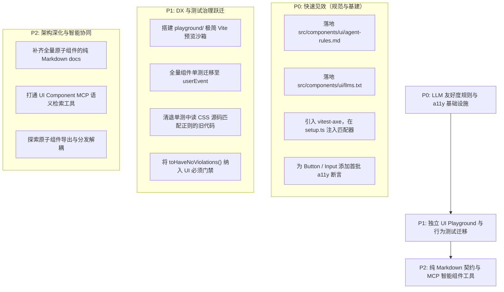

# 开发者体验、LLM 友好度与测试治理深度剖析与演进方案

> **战役代号**：`ui-library-analysis`  
> **报告编号**：`06-dx-llm-friendliness-and-testing`  
> **标杆对标**：`reference/appica-ui` (Appica UI), `reference/ui` (shadcn/ui), `reference/prose-ui`, `reference/arc-library`  
> **分析对象**：`apps/crish-desktop` UI 原子组件层（`src/components/ui/`）、开发测试基础设施与 Agent 协同机制  
> **撰写角色**：开发者体验、LLM 友好度与测试治理分析专家（DX & LLM-Friendliness Analyst）

---

## 一、概述与核心论点

在当今大语言模型（LLM）与自动化 AI Coding Agent 深刻改变前端工程范式的背景下，UI 组件库的衡量标准已从单一的“视觉美观与功能完备”，扩展为**人类开发者体验（DX）**、**AI Agent 友好度（LLM-Friendliness）** 与 **自动化测试与无障碍治理（Testing & Accessibility Governance）** 的三维一体。

通过对现代化前沿 UI 组件库标杆（`reference/appica-ui` 与 `reference/ui`）的源码级深入研读，我们发现其展现出了极其鲜明的“面向 AI 时代”的设计哲学：
1. **随包分发的极简 AI 规则与纯 Markdown 知识镜像**（Appica UI）：通过 `agent-rules.md`、`llms.txt` 和全量 `<url>.md` 纯文本端点，使 AI Agent 在微小 Context 消耗下精准掌握消费约束，彻底消除了爬取 HTML 带来的 90% 噪音与幻觉。
2. **立体化行为仿真与强制 WCAG 无障碍门禁**（Appica UI）：以 `Vitest + @testing-library/react + @testing-library/user-event + vitest-axe` 为标配，不仅仿真真实用户的按键与指针事件，更把 WCAG 2.1 无障碍断言作为每一个组件必须通过的单元测试底线。
3. **Schema-Driven 分发模型与原生 MCP 赋能**（shadcn/ui）：通过严谨的 Zod Schema 驱动组件解耦与源码级分发，并内置 Model Context Protocol (MCP) Server，使 AI 能够通过标准协议搜索组件、获取调用范例与执行自检清单。

**反观 Conex / Crish 当前的前端与 UI 架构现状**：
- **DX 存在沙箱真空**：原子组件库缺乏独立的预览沙箱（无 Storybook、无 Ladle、无轻量级 Playground），修改一个基础按钮或弹窗必须启动整个包含 Rust 引擎与复杂 Store 的桌面应用，反馈回路极其沉重；
- **测试治理失衡**：大量测试停留在“读取 CSS 文件做正则匹配”与“`fireEvent` 粗粒度触发”，缺乏真实的用户交互序列仿真，且整个仓室内**零自动化无障碍（a11y）门禁**；
- **LLM 消费陷入“事后惩罚”的恶性循环**：虽然配置了极其繁多的后置检查脚本（如 `check-inline-style-hardcode.mjs` 等 30 余个静态门禁），但前端缺乏“事前赋能”基础设施（无 `agent-rules.md`、无组件 `llms.txt`）。AI Agent 编写代码时因缺乏简明指导而频繁盲猜或手写内联样式，随后在 CI 门禁中被阻断，引发高成本的多轮返工拉锯。

本报告将通过详尽的代码证据解剖标杆设计，诊断 Conex / Crish 当前痛点，并提出切实可行的演进升级方案。

---

## 二、标杆前沿实践深度解剖

### 2.1 Appica UI 的 LLM-First 基础设施与 AI 友好设计

在 `reference/appica-ui` 中，LLM 友好性并非事后补充的文档包装，而是一等公民的基础设施：

#### 1. 随 npm 包强分发的 `agent-rules.md`（40 行精炼上下文法典）
在 [`reference/appica-ui/packages/react/package.json`](file:///c:/Software/conex/reference/appica-ui/packages/react/package.json#L465-L472) 中，`files` 白名单明确将规则文件打包发布：
```json
"files": [
  "dist",
  "src",
  "styles.css",
  "appica.css",
  "agent-rules.md",
  "CHANGELOG.md"
]
```
这意味着任何消费该组件库的工程，在 `npm install` 后，其磁盘目录 `node_modules/@appica/ui-react/agent-rules.md` 下天然存在一份**版本严格对齐**的 Agent 指南。

研读 [`reference/appica-ui/packages/react/agent-rules.md:1-41`](file:///c:/Software/conex/reference/appica-ui/packages/react/agent-rules.md#L1-L41)，其设计原则极其深刻：
```markdown
<!--
  Canonical rules for a coding agent writing Appica UI code in a CONSUMER's project.
  Ships in the tarball (`files` in package.json) so it travels with the version it describes.
  Keep it under ~40 lines of rules. It gets prepended to an agent's context, so
  length is a direct cost to every consumer.
-->

- Tailwind CSS v4 only. Do NOT create a `tailwind.config.js` - v4 config lives in CSS via `@theme`.
- React 19 is a hard requirement. No `forwardRef` - `ref` is a plain prop.
- Import from the subpath, one component per import:
  `import { Button } from '@appica/ui-react/button'`.
- Never write hex colors, px radii, or duration literals. Use the role-based tokens:
  `bg-background-muted`, `text-foreground-intense`, `border-border-strong`, `var(--radius-md)`.
- Never write hue-based utilities (`bg-gray-100`, `text-slate-600`). The palette is organized by role, not hue.
- Prefer v4 variant syntax (`*:`, `**:`, `data-*:`, `not-*:`) over `[&_...]` arbitrary selectors.
- For a link styled as a button, put `buttonVariants(...)` on the `<a>` - never `<Button render={<a/>}>`.
- Do not hand-roll a component that exists in the library. Check the component list first:
  https://appica.dev/ui/react/llms.txt
- Every documentation page is served as clean markdown at `<url>.md` - fetch that, not the HTML.
```
**关键价值剖析**：
- **Context 成本意识**：明确要求“控制在 ~40 行以内”，因为该文件会被注入到 AI Agent 的上下文开头，行数直接等同于消费者的 Token 成本；
- **消除歧义与消灭幻觉**：一针见血地指出“严禁裸色/裸半径”、“强制 Subpath 导入”、“禁用旧式 forwardRef”等高频错误点；
- **正向行为引导**：明确指示“严禁手写重复组件，先查 `llms.txt`”，并提供机器友好的入口。

#### 2. 在线纯 Markdown 镜像与 `llms.txt` 规范
传统组件文档网站（如 Ant Design、MUI）充斥着导航栏、动态脚本、复杂 iframe 与广告，AI Agent 抓取或解析时不仅耗费成千上万 Token，还极易丢失代码结构。

Appica UI 践行了现代 Web 文档标杆标准：
- **全站纯文本镜像**：每一个文档 URL 均对应一个同名的 `.md` 端点（例如 `https://appica.dev/ui/docs/react/colors.md`）；
- **标准 `llms.txt` 目录索引**：在 `packages/react/.context/base-ui-llms.txt` 中我们可以看到其引用的上游规范，提供了一个紧凑的大纲列表，每一项均为直接指向 `.md` 的链接：
  ```markdown
  ## Components
  - [Accordion](https://base-ui.com/react/components/accordion.md): A high-quality, unstyled React accordion component...
  - [Alert Dialog](https://base-ui.com/react/components/alert-dialog.md): A high-quality, unstyled React alert dialog...
  - [Button](https://base-ui.com/react/components/button.md): A high-quality, unstyled React button component...
  ```
AI 只需读取纯 Markdown，即可获取 100% 精确的 API 说明与代码示例，彻底消除了 HTML 解析的幻觉与 Token 浪费。

---

### 2.2 Appica UI 的立体化测试体系与 WCAG 自动化无障碍门禁

在组件测试与质量治理上，Appica UI 建立了兼顾**行为仿真**与**无障碍合规**的自动化防线：

#### 1. 测试工具链组合
查看 [`packages/react/package.json:509-531`](file:///c:/Software/conex/reference/appica-ui/packages/react/package.json#L509-L531)：
- 测试运行器：`vitest` (v5.0.3) + `jsdom` (v30.1.2)；
- DOM 渲染与断言：`@testing-library/react` (v16.3.3) + `@testing-library/jest-dom` (v7.0.1)；
- **用户行为高保真模拟**：`@testing-library/user-event` (v14.6.7)；
- **自动化 WCAG 引擎**：`vitest-axe` (v0.1.0) + `axe-core` (v4.14.0)。

#### 2. 全局无障碍断言挂载与环境补全
在 [`packages/react/src/test/setup.ts:1-27`](file:///c:/Software/conex/reference/appica-ui/packages/react/src/test/setup.ts#L1-L27) 中：
```typescript
import '@testing-library/jest-dom/vitest'
import { afterEach, expect } from 'vitest'
import { cleanup } from '@testing-library/react'
import * as matchers from 'vitest-axe/matchers'

// 扩展 vitest 断言，使 expect(...).toHaveNoViolations() 全局可用
expect.extend(matchers)

// 补全 jsdom 缺失的 matchMedia 原语，确保 useReducedMotion 等无障碍 hook 稳定运行
if (typeof window !== 'undefined' && !window.matchMedia) {
  window.matchMedia = (query: string) => ({
    matches: false,
    media: query,
    // ...
  }) as unknown as MediaQueryList
}
```

#### 3. 真实用户交互模拟与 a11y 门禁断言实证
以 [`src/components/accordion/accordion.test.tsx:50-64`](file:///c:/Software/conex/reference/appica-ui/packages/react/src/components/accordion/accordion.test.tsx#L50-L64) 为例：
```tsx
it('opens on trigger click and closes on a second click', async () => {
  const user = userEvent.setup()
  render(<Basic />)
  const trigger = screen.getByRole('button', { name: 'First' })

  await user.click(trigger)
  const panel = await screen.findByText('First body')
  expect(panel.closest('[data-slot="accordion-content"]')).not.toBeNull()
  expect(trigger).toHaveAttribute('data-panel-open')

  await user.click(trigger)
  await waitFor(() => {
    expect(screen.queryByText('First body')).toBeNull()
  })
})
```
测试完全使用 `userEvent.setup()` 模拟指针悬停、按下、释放的全套事件流。

同时，在每个组件测试套件的末尾，**均有一项强制的自动化无障碍违规扫描**（以 [`accordion.test.tsx:216-219`](file:///c:/Software/conex/reference/appica-ui/packages/react/src/components/accordion/accordion.test.tsx#L216-L219) 和 [`button.test.tsx:75-78`](file:///c:/Software/conex/reference/appica-ui/packages/react/src/components/button/button.test.tsx#L75-L78) 为例）：
```tsx
it('has no a11y violations when open', async () => {
  const { container } = render(<Basic defaultValue={['one']} />)
  expect(await axe(container)).toHaveNoViolations()
})

it('has no accessibility violations', async () => {
  const { container } = render(<Button>Accessible</Button>)
  expect(await axe(container)).toHaveNoViolations()
})
```
通过 `axe-core` 引擎，该断言会在 jsdom 渲染树上自动执行 WCAG 2.1 AA 维度的全面扫描，包括：
- 是否存在缺少文本标签的可交互元素；
- ARIA role 与 attribute 的组合是否合法有效；
- 对比度与可聚焦状态的合法性。
**这使得无障碍问题在单元测试阶段就被刚性阻断，绝不留到集成测试或人工盲测。**

#### 4. 零构建开销的极简 Playground 沙箱
在 [`reference/appica-ui/playgrounds/react/`](file:///c:/Software/conex/reference/appica-ui/playgrounds/react/) 目录下，提供了一个极简的 Vite 交互沙箱：
- 在 [`playgrounds/react/vite.config.ts:8-18`](file:///c:/Software/conex/reference/appica-ui/playgrounds/react/vite.config.ts#L8-L18) 中配置了直接指向源码的 alias：
  ```typescript
  resolve: {
    alias: [
      {
        find: /^@appica\/ui-react$/,
        replacement: fileURLToPath(new URL('../../packages/react/src/index.ts', import.meta.url)),
      },
    ],
  }
  ```
- 开发者修改 `packages/react/src` 下的任何组件，沙箱秒级 HMR，无需执行 Rollup 打包或 npm link，开发体验如丝般顺滑。

---

### 2.3 shadcn/ui 的 Schema-Driven 架构与原生 MCP 赋能

如果说 Appica UI 展示了打包分发型组件库的顶尖 DX，那么 `reference/ui` (shadcn) 则开创了源码级分发与 AI 智能体原语交互的新标杆。

#### 1. Schema-Driven 的组件元数据模型
在 [`reference/ui/packages/registry/src/registry/schema.ts:100-195`](file:///c:/Software/conex/reference/ui/packages/registry/src/registry/schema.ts#L100-L195) 中，shadcn 使用 Zod 构建了完备的组件结构 Schema：
```typescript
export const registryItemTypeSchema = z.enum([
  "registry:lib", "registry:block", "registry:component", "registry:ui",
  "registry:hook", "registry:page", "registry:file", "registry:theme", "registry:style"
])

export const registryItemCommonSchema = z.object({
  name: z.string(),
  type: registryItemTypeSchema,
  dependencies: z.array(z.string()).optional(),
  devDependencies: z.array(z.string()).optional(),
  registryDependencies: z.array(z.string()).optional(),
  files: z.array(registryItemFileSchema).optional(),
  tailwind: registryItemTailwindSchema.optional(),
  cssVars: registryItemCssVarsSchema.optional(),
  docs: z.string().optional(),
})
```
**架构收益**：
组件不再是一个不透明的二进制包，而是一个**结构化、可被机器完全解析、校验和转换的纯数据对象（Registry Item）**。任何 CLI、脚本或 AI Agent 都可以通过解析该 Schema，精准获知某个组件需要哪些依赖包、哪些内部依赖项、哪些 CSS 变量，以及文件目标落地位置。

#### 2. 原生内置的 Model Context Protocol (MCP) Server
在 [`reference/ui/packages/shadcn/src/mcp/index.ts:26-191`](file:///c:/Software/conex/reference/ui/packages/shadcn/src/mcp/index.ts#L26-L191) 中，shadcn 实现了官方标准的 MCP 服务器，向 AI Agent 暴露了结构化工具：
- `list_items_in_registries`：按类型和命名空间列出所有可用组件与块；
- `search_items_in_registries`：支持模糊匹配组件名称和描述；
- `view_items_in_registries`：获取组件源码内容、类型和元数据；
- `get_item_examples_from_registries`：搜索并返回完整的实战调用代码范例；
- `get_add_command_for_items`：获取精准的 CLI 安装命令；
- `get_audit_checklist`：生成代码后的合规性自检清单。

**这使得 AI Agent 能够从“凭记忆瞎猜 API”跃升为“主动通过 MCP 工具检索、阅读精准源码、查阅 Example 并执行自检”，代表了当今 AI 辅助编程的最前沿形态。**

---

## 三、Conex / Crish 现状诊断与痛点深挖

通过将上述标杆与当前仓库进行对照，我们梳理出 Conex / Crish 在前端 UI 基础设施上的三大核心问题。

### 3.1 开发者体验（DX）：组件沙箱真空与沉重的调试反馈回路

#### 现状调查
- `apps/crish-desktop` 是一个包含了 Tauri v2、IPC 通信、Rust 引擎侧边协作、Zustand Store、WorkerPool 等复杂运行时的大型桌面客户端。
- 在 [`apps/crish-desktop/package.json:8-19`](file:///c:/Software/conex/apps/crish-desktop/package.json#L8-L19) 中，脚本只有：
  ```json
  "scripts": {
    "dev": "node ../../node_modules/vite/bin/vite.js --force",
    "build": "...",
    "typecheck": "tsc -b --pretty false",
    "test:snapshots": "...",
    "test:visual": "playwright test"
  }
  ```
- 在整个仓库中，**不存在 Storybook、不存在 Ladle、也不存在任何独立的 UI 组件 Playground**。

#### 核心痛点
1. **反馈周期极长**：当开发者或 AI Agent 修改 `apps/crish-desktop/src/components/ui/` 下的某个基础原子组件（如 `Button`、`Select`、`ColorPicker` 或 `Dialog`）时，无法在干净隔离的环境中直接预览其所有变体、尺寸和状态。必须启动完整的桌面端应用（`npm run dev:workbench` 或 `npm run dev:desktop`），并在主界面中逐级点击导航到使用该组件的复杂业务场景中去肉眼确认；
2. **边缘状态难以肉眼验证**：例如 `Button` 的 `loading` 态、`align="start"` 模式、`Dialog` 的遮罩淡入淡出、`ContextMenu` 在窗口下边缘的防溢出翻转等微交互，在全量应用中构造触发条件极为繁琐；
3. **视觉调试与业务状态强耦合**：UI 样式的调试常受到主线程 IPC 通信、Session 数据加载或后端进程启动状态的干扰，极大拖慢了 UI 迭代效率。

---

### 3.2 测试治理体系：重静态/正则而轻真实交互仿真与 a11y 盲区

#### 现状调查
研读 [`apps/crish-desktop/src/components/ui/Button/Button.test.tsx`](file:///c:/Software/conex/apps/crish-desktop/src/components/ui/Button/Button.test.tsx)，我们发现了明显的测试理念偏差：

1. **粗粒度事件触发 vs 真实用户行为**：
   在 [`Button.test.tsx:138-150`](file:///c:/Software/conex/apps/crish-desktop/src/components/ui/Button/Button.test.tsx#L138-L150) 中：
   ```tsx
   it('点击回调透传且触发禁用保护', () => {
     const onClick = vi.fn();
     const { rerender } = render(<Button onClick={onClick}>可点</Button>);
     fireEvent.click(screen.getByText('可点'));
     expect(onClick).toHaveBeenCalledTimes(1);
     // ...
   });
   ```
   测试广泛使用 `fireEvent.click()`。`fireEvent` 只是生硬地分发单个 DOM 事件，无法模拟真实浏览器中的指针按下（`pointerdown`）、鼠标按下（`mousedown`）、获取焦点（`focus`）、指针抬起（`pointerup`）与点击（`click`）事件序列，更无法模拟键盘 `Tab` 移动焦点以及 `Enter`/`Space` 触发激活的真实交互链条。

2. **脆弱的“读源码文本做正则匹配”测试反模式**：
   在 [`Button.test.tsx:481-499`](file:///c:/Software/conex/apps/crish-desktop/src/components/ui/Button/Button.test.tsx#L481-L499) 中：
   ```tsx
   it('层叠顺序与悬停对比度：文本与内容节点 z-index: 1 始终高于 ::before 遮罩层 (z-index: 0)', () => {
     // 1. ::before 必须显式声明 z-index: 0
     expect(cssContent).toMatch(/\.button::before\s*\{[^}]*z-index:\s*0;/);

     // 2. danger 变体必须采用透明度为 10% 的透明 color-mix 遮罩
     expect(cssContent).toContain(
       '--btn-hover-overlay: color-mix(in srgb, var(--danger-fg) 10%, transparent);'
     );
   });
   ```
   **诊断**：因为 jsdom 无法计算真实 CSS 层叠上下文与伪元素样式，测试不得不采用 `fs.readFileSync(cssPath)` 并用正则表达式去搜 CSS 源码字符串！这种测试本质上是在“测代码有没有写特定字符”，极其脆弱——一旦 CSS 做了语法微调或重构（例如改为现代嵌套语法或换行），测试就会假死性报错，而当真正的运行时层叠出现穿透 bug 时，字符串匹配却无法感知。

3. **WCAG 无障碍门禁全域缺失**：
   检查 [`apps/crish-desktop/package.json`](file:///c:/Software/conex/apps/crish-desktop/package.json)，完全没有安装 `axe-core` 或 `vitest-axe`。在整个 `src/components/ui/` 的所有单测中，**找不到一处 `axe()` 自动化无障碍断言**。尽管有 `check:tooltip-hygiene`、`check:input-guard` 等静态脚本检查特定属性名，但对键盘焦点陷阱、ARIA 语义配对、文本对比度合规等核心 a11y 指标缺乏系统性的自动化门禁守门。

---

### 3.3 LLM 消费体验：“事后惩罚”与“事前指导匮乏”的恶性循环

Conex 仓室拥有极其强大的静态检查纪律。在根目录 [`package.json:56`](file:///c:/Software/conex/package.json#L56) 中，`npm run check:desktop` 挂载了多达 30 余项检查脚本：
- `check:ui-layer`（防止 UI 原子层反向依赖业务组件或 store）；
- `check:inline-style-hardcode`（基于 AST 严禁内联裸样式）；
- `check:color-ssot`、`check:hierarchy-ssot`、`check:text-color`；
- `check:tooltip-hygiene`、`check:input-guard`、`check:layout-tokens` 等。

**然而，在极其严格的“事后拦截”背后，却严重缺失“事前赋能”基础设施：**

```
┌────────────────────────────────────────────────────────────────────────┐
│                        当前 Conex AI 编码恶性循环                       │
└────────────────────────────────────────────────────────────────────────┘
  1. AI Agent 接收任务（如“实现新的设置页面卡片”）
       │
       ▼
  2. 缺乏简洁的 `agent-rules.md` 或 `llms.txt` 指引
     （AI 不知道有哪些封装好的 ui/* 组件，也不知道特定的 Design Token 名）
       │
       ▼
  3. AI 凭借通用大模型习惯生成代码
     （常见错误：手写 `<div style={{ gap: 8, color: '#333' }}>` 或裸 `<button>`）
       │
       ▼
  4. 提交前触发 `npm run check:desktop` 门禁暴雷
     （拦截：check-inline-style-hardcode 报警、check-ui-layer 报错）
       │
       ▼
  5. AI Agent 陷入盲人摸象式修复
     （反复尝试修补变量、不断读脚本源码，耗费大量 Token 与调试轮次）
```

查看 [`scripts/check-inline-style-hardcode.mjs:1-23`](file:///c:/Software/conex/scripts/check-inline-style-hardcode.mjs#L1-L23)，可以发现该脚本维护了一个庞大的 `inline-style-hardcode-baseline.md` 棘轮。这正是因为此前各个 Agent 在没有规则指引的情况下，不断留下内联样式硬编码，导致团队不得不写脚本去“围追堵截”。

**根本原因**：**教育在后，惩罚在前**。AI 缺乏一个开箱即用的“小抄”（Cheat Sheet）和精准的组件查询渠道。

---

## 四、深度对比矩阵

| 评估维度 | Appica UI (`reference/appica-ui`) | shadcn/ui (`reference/ui`) | Conex / Crish 当前现状 |
| :--- | :--- | :--- | :--- |
| **Agent 规则分发** | **随包分发**：`agent-rules.md` 写入 `files` 白名单，严格限制 40 行内 | 社区规则，结合 `components.json` 与模板提供规范 | **分散在 AGENTS.md** 巨型文档中，缺乏组件消费专项摘要 |
| **文档 AI 友好度** | **全站 `.md` 纯文本镜像** + 标准 `llms.txt` 目录索引 | 官网提供组件源码视图与示例仓库 | **无 `llms.txt`**，无纯 Markdown API 镜像，只能生读 TSX 源码 |
| **组件发现与检索** | 依赖文档与静态 `llms.txt` | **原生 MCP Server**（提供 search/view/examples/checklist） | **无任何结构化工具**，AI 只能通过全局 grep/ripgrep 翻找文件 |
| **组件预览沙箱 (DX)** | **内置极简 Playground**（Vite Alias 直连源码，免打包 HMR） | 完整的 Next.js 预览 App + 丰富的 Templates | **无独立沙箱**，只能运行全量 Tauri 桌面应用或跑脱水单测 |
| **交互行为测试** | **`@testing-library/user-event`** 全覆盖，测试指针与键盘真实事件序列 | Browser Tests + 单元测试覆盖 | **`fireEvent` 粗粒度触发**为主，偶有键盘测试，仿真度不足 |
| **无障碍 (a11y) 门禁** | **`vitest-axe` 强制全覆盖**，每个组件单测均断言 `toHaveNoViolations` | Radix 底层保障 + 基础 a11y 校验 | **零自动化 a11y 门禁**（仅有部分针对 HTML 属性的粗粒度正则脚本） |
| **样式与视觉断言** | 依托 Tailwind 语义类与浏览器真实表现断言 | 类名映射与视觉回归测试 | **读取 CSS 文本做正则匹配**（测试反模式），脆弱且易假死 |

---

## 五、Conex / Crish 前端 DX、LLM 友好度与测试治理演进方案

针对上述痛点，结合标杆优秀经验与 Conex 自身工程特性，提出以下四项系统性升级方案。

### 5.1 维度一：建立轻量级 UI Playground 独立交互沙箱（DX 跃迁）

为了彻底摆脱“改原子组件必须启动全量桌面应用”的沉重反馈回路，在 `apps/crish-desktop` 中建立轻量级的 UI 组件独立沙箱环境。

#### 1. 沙箱工程架构
在 `apps/crish-desktop/playgrounds/` 建立独立入口，或者复用 Vite 多页面模式：
- 目录结构：
  ```
  apps/crish-desktop/
  ├── src/components/ui/       # 原子组件库源码
  └── playground/              # 独立沙箱目录
      ├── index.html           # 沙箱独立 HTML 入口
      ├── main.tsx             # 沙箱渲染挂载点
      ├── PlaygroundApp.tsx    # 组件演示看板（分类展示 Button, Select, Dialog 等）
      └── vite.config.ts       # 极简 Vite 配置（零 Tauri 依赖）
  ```

#### 2. 核心 Vite 配置与 Mock 隔离
通过极简的 Vite 配置，剥离所有 Tauri 原生插件与后端 IPC 连接，直接引用组件库源码：
```typescript
// apps/crish-desktop/playground/vite.config.ts
import { defineConfig } from 'vite';
import react from '@vitejs/plugin-react';
import { resolve } from 'node:path';

export default defineConfig({
  root: resolve(__dirname),
  plugins: [react()],
  resolve: {
    alias: {
      '@/components/ui': resolve(__dirname, '../src/components/ui'),
      '@/styles': resolve(__dirname, '../src/styles'),
    },
  },
  server: {
    port: 5174,
  },
});
```
在 `package.json` 中增加轻量级脚本：
```json
"dev:ui": "vite --config playground/vite.config.ts"
```
**收益**：
- 毫秒级启动，免除 Rust 编译与 Tauri 运行时开销；
- 开发者与 AI Agent 可以在浏览器中直接肉眼审视所有变体、明暗主题切换与微交互；
- 彻底隔离桌面端复杂的全局 Store 与通信逻辑。

---

### 5.2 维度二：立体化行为仿真与 WCAG 自动化测试门禁落地（质量跃迁）

#### 1. 引入 `vitest-axe` 与配置全局无障碍环境
在 `apps/crish-desktop/package.json` 中引入无障碍检测依赖：
```bash
npm install -D vitest-axe axe-core
```
在 [`apps/crish-desktop/src/test-setup.ts`](file:///c:/Software/conex/apps/crish-desktop/src/test-setup.ts) 中注入全局匹配器与 DOM 补丁：
```typescript
import * as matchers from 'vitest-axe/matchers';
import { expect } from 'vitest';

// 扩展 Vitest 的断言库，支持 expect(container).toHaveNoViolations()
expect.extend(matchers);

// 补齐 matchMedia 供 prefers-reduced-motion 与暗黑主题查询
if (typeof window !== 'undefined' && !window.matchMedia) {
  window.matchMedia = (query: string) => ({
    matches: false,
    media: query,
    onchange: null,
    addListener: () => {},
    removeListener: () => {},
    addEventListener: () => {},
    removeEventListener: () => {},
    dispatchEvent: () => false,
  }) as unknown as MediaQueryList;
}
```

#### 2. 将 `toHaveNoViolations()` 设立为 UI 组件必过门禁
为 `src/components/ui/` 下的核心组件套件补齐 a11y 验收用例：
```tsx
// 示例：apps/crish-desktop/src/components/ui/Button/Button.test.tsx
import { axe } from 'vitest-axe';

describe('ui/Button Accessibility', () => {
  it('常规状态与禁用状态均无 WCAG 违规', async () => {
    const { container, rerender } = render(<Button>操作按钮</Button>);
    expect(await axe(container)).toHaveNoViolations();

    rerender(<Button disabled>禁用按钮</Button>);
    expect(await axe(container)).toHaveNoViolations();

    rerender(<Button loading>加载按钮</Button>);
    expect(await axe(container)).toHaveNoViolations();
  });
});
```

#### 3. 全面迁移至 `@testing-library/user-event`
废弃现存单测中的 `fireEvent.click()`，统一采用真实的 `userEvent.setup()`：
```tsx
it('支持键盘 Enter 激活与 Space 激活', async () => {
  const user = userEvent.setup();
  const onClick = vi.fn();
  render(<Button onClick={onClick}>键盘可达</Button>);

  const btn = screen.getByRole('button', { name: '键盘可达' });
  btn.focus();
  expect(btn).toHaveFocus();

  await user.keyboard('{Enter}');
  expect(onClick).toHaveBeenCalledTimes(1);

  await user.keyboard(' ');
  expect(onClick).toHaveBeenCalledTimes(2);
});
```

#### 4. 清退“读取 CSS 字符串正则匹配”的测试反模式
将 `Button.test.tsx` 中通过 `fs.readFileSync` 匹配 CSS 字符串的脆弱逻辑清退，改为通过标准 DOM 结构状态或快照/计算样式断言，解除对文件排版和源码字符的死锁绑定。

---

### 5.3 维度三：构建 LLM-First 基础设施三件套（AI 友好度跃迁）

为了将 AI Agent 从“被静态检查报错阻断后再排查”的被动泥潭中解放出来，建设**组件库 LLM-First 消费基础设施三件套**：

```
apps/crish-desktop/src/components/ui/
├── agent-rules.md     # 核心消费法典（严格限制 40 行，供 Agent 快速注入 Context）
├── llms.txt           # 组件速查大纲索引（包含组件名、分类、导入语句与核心语义）
└── docs/              # 纯 Markdown 格式的组件契约文档
    ├── button.md      # Button 属性表、变体表与合法示例
    ├── input.md       # Input 三型模式与合法示例
    ├── dialog.md      # Dialog 与 FocusTrap 规范
    └── tokens.md      # CSS 变量与 Design Token 速查表
```

#### 1. 拟定 `src/components/ui/agent-rules.md` 标准规范
```markdown
<!--
  Canonical rules for Coding Agents consuming Conex/Crish UI components.
  Keep under 40 lines. Injected into Agent Context before writing UI code.
-->

- Strict Layering: `components/ui/` is atomic layer. NEVER import upper modules (store, hooks, api, services).
- Import from barrel: Always import from `@/components/ui` (e.g. `import { Button, Dialog, Select } from '@/components/ui'`).
- Design Tokens SSOT: Never write raw hex colors (`#fff`), bare px radii, or magic numbers.
  Use CSS variables from `styles/tokens.css` (e.g., `var(--bg-card)`, `var(--text-primary)`, `var(--radius-md)`).
- Inline Style Ban: NEVER write hardcoded numbers in `style={{ ... }}` (e.g. `gap: 8` or `color: '#111'`).
  Use CSS Modules (`xxx.module.css`) for layout, and only use `style` for dynamic runtime calculations.
- Tooltip Rule: ALWAYS use `<Tooltip content="...">` from `@/components/ui`. NEVER use native HTML `title`.
- Focus & Active States: No heavy black border. Use subtle contrast (`color-mix` with <=10% text color).
- Buttons: Use `variant="primary" | "secondary" | "ghost" | "danger"`. Never wrap custom `div` as button.
- Accessibility: Ensure all interactive controls have accessible names (via children text or `aria-label`).
- Check Component List: Before building custom controls, ALWAYS check `src/components/ui/llms.txt`.
```

#### 2. 拟定 `src/components/ui/llms.txt` 速查大纲
```markdown
# Conex UI Component Catalog (llms.txt)
> Atom layer components located at `apps/crish-desktop/src/components/ui/`
> Import all components via `@/components/ui`

## Core Actions & Inputs
- [Button](docs/button.md): Standard button with `primary`, `secondary`, `ghost`, `danger`, `plain` variants, `xs`/`sm`/`md`/`lg` sizes, loading and icon slots.
- [IconButton](docs/button.md): Compact icon-only button wrapper with mandatory accessible label.
- [Input](docs/input.md): Text/Search/Password inputs with clearable, icon prefix/suffix, error message, and label support.
- [Switch](docs/switch.md): Accessible toggle switch for boolean settings.
- [Slider](docs/slider.md): Range slider for numeric parameters.

## Overlays & Dialogs
- [Dialog](docs/dialog.md): Base modal with FocusTrap, animated presence, backdrop dismissal, and LayerStack integration.
- [ConfirmDialog](docs/confirm-dialog.md): Alert dialog for destructive/confirmation actions with Promise-based hook bridge.
- [Tooltip](docs/tooltip.md): Lightweight popover tooltip replacing native HTML title.
- [Menu](docs/menu.md): Popover dropdown menu with roving tabindex and keyboard navigation.
- [ContextMenu](docs/context-menu.md): Right-click context menu positioning engine.

## Layout & Display
- [Badge](docs/badge.md): Small status/label indicator.
- [Card](docs/card.md): Standard bordered container with consistent background and padding.
- [Tabs](docs/tabs.md): Tabbed navigation container.
- [ScrollArea](docs/scroll-area.md): Custom-styled cross-platform scroll container.
- [ColorPicker](docs/color-picker.md): OKLCH/HSLA color picker with contrast ratio validation.
```

**收益**：
当主 Agent 分配前端任务给子 Agent 时，只需将 `agent-rules.md`（或 `llms.txt` 相关行）作为输入提示词注入。子 Agent 立即明确：
1. 哪些组件现成可用，绝不自造轮子；
2. 哪些写法（内联硬编码、原生 title、硬编码色值）会被直接打回；
3. 一次编码即通过 CI 门禁，将研发与协作摩擦降至最低。

---

### 5.4 维度四：基于 MCP 的组件语义检索与合规自检（未来增强方案）

借鉴 shadcn/ui 的原生 MCP 设计，鉴于 Conex 原生具备强大的 MCP 与 Agent 基础设施（`crates/conex-mcp`），未来可在工程内落地专属的 UI MCP 工具：
1. `search_conex_components(query: string)`：AI Agent 通过 MCP 查询工程现存组件及 API 示例；
2. `get_token_spec(category: string)`：查询当前合规的 Design Tokens 映射关系（如获取所有的颜色语义变量）；
3. `lint_ui_snippet(code: string)`：在代码生成前，通过 MCP 工具预检代码片段是否违反 `check-inline-style-hardcode` 或 `check-ui-layer`，实现“边写边测、就地纠偏”。

---

## 六、演进落地路线图与风险控制

为确保演进过程稳健可控，不破坏现有业务与发布节奏，建议划分为三阶段渐进推进：



### 1. P0 阶段：规则注入与 a11y 门禁建立（快速见效，低风险）
- **产出**：
  1. 在 `apps/crish-desktop/src/components/ui/` 创建 `agent-rules.md` 与 `llms.txt`；
  2. 在 `package.json` 引入 `vitest-axe` 与 `axe-core`，配置 `src/test-setup.ts`；
  3. 为 `Button.test.tsx`、`Input.test.tsx` 编写 `toHaveNoViolations()` 范例；
  4. 将 `agent-rules.md` 同步登记到根目录 `AGENTS.md`，使主控 Agent 在调度前端任务时强制携带。
- **风险控制**：完全不改动业务运行时代码，零回归风险。

### 2. P1 阶段：轻量沙箱与行为测试迁移（DX 提升与质量收敛）
- **产出**：
  1. 搭建 `playground/` 独立 Vite 沙箱，挂载所有原子组件的典型状态；
  2. 将 `src/components/ui/` 下存量组件测试中的 `fireEvent.click()` 批量替换为 `@testing-library/user-event`；
  3. 清理测试中基于正则扫描 CSS 文本的坏味道，改为标准行为测试与状态测试；
  4. 覆盖 `Dialog`、`Select`、`Menu`、`Tooltip` 等复杂弹层组件的 a11y 自动化测试。
- **风险控制**：沙箱独立运行，不侵入构建流水线；单测重构保持原有行为断言不变。

### 3. P2 阶段：文档资产化与智能辅助（长效机制）
- **产出**：
  1. 在 `ui/docs/` 下沉淀各组件的纯 Markdown API 契约文档；
  2. 结合 Conex 内部 Agent 工具集，提供 UI 语义查询工具，彻底闭环“检索 -> 规范消费 -> 自动化测试 -> 门禁放行”的全生命周期。

---

## 七、总结

通过对 `reference/appica-ui` 和 `reference/ui` (shadcn) 的深度剖析，我们清晰地看到：**现代前沿 UI 组件库的强大，不仅体现在精致的视觉与动画上，更体现在其对“人类开发者”与“AI Agent”双重视角的极致关怀，以及无障碍与自动化测试的一等公民化治理。**

Conex / Crish 已经具备极为坚实的底层架构与严格的静态检查防线。通过补充**轻量级独立 Playground 沙箱**、**基于 `userEvent + vitest-axe` 的高保真测试与无障碍门禁**、以及以 **`agent-rules.md` 和 `llms.txt` 为核心的 LLM-First 基础设施**，Conex 前端将真正实现从“事后被动拦截”到“事前精准赋能”的质的飞跃，全面拥抱 AI Agent 协同编程时代的高效与稳健。
