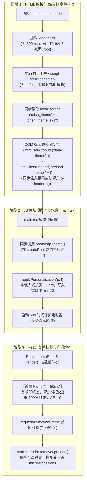

# Conex / Crish — 维度详案 01：首屏零闪烁平滑启动与主题单源化详案

> **方案编号**：PLAN-01-DETAILED
> **所属战役**：Conex / Crish 界面色彩平滑与差异面板视觉重构战役
> **责任领域**：首屏 0ms 启动生命周期时序、Zero-FOUC 流水线、CSS Token 单真源对齐、非侵入式对比度守卫
> **依据文件**：
> - [`docs/ui-style-refactor/00-总方案-界面色彩平滑与差异面板视觉重构.md`](file:///c:/Software/conex/docs/ui-style-refactor/00-%E6%80%BB%E6%96%B9%E6%A1%88-%E7%95%8C%E9%9D%A2%E8%89%B2%E5%BD%A9%E5%B9%B3%E6%BB%91%E4%B8%8E%E5%B7%AE%E5%BC%82%E9%9D%A2%E6%9D%BF%E8%A7%86%E8%A7%89%E6%A0%B7%E5%BC%8F%E9%87%8D%E6%9E%84.md)
> - [`docs/ui-style-refactor/00-定案-视觉样式与差异面板重构决策.md`](file:///c:/Software/conex/docs/ui-style-refactor/00-%E5%AE%9A%E6%A1%88-%E8%A7%86%E8%A7%89%E6%A0%B7%E5%BC%8F%E4%B8%8E%E5%B7%AE%E5%BC%82%E9%9D%A2%E6%9D%BF%E9%87%8D%E6%9E%84%E5%86%B3%E7%AD%96.md)
> - [`docs/ui-style-refactor/independent-plans/01-zero-fouc-and-startup-theme-plan.md`](file:///c:/Software/conex/docs/ui-style-refactor/independent-plans/01-zero-fouc-and-startup-theme-plan.md)
> - [`docs/ui-style-refactor/plan-reviews/01-ui-style-plans-cross-review-a.md`](file:///c:/Software/conex/docs/ui-style-refactor/plan-reviews/01-ui-style-plans-cross-review-a.md)
> - [`docs/ui-style-refactor/plan-reviews/02-ui-style-plans-cross-review-b.md`](file:///c:/Software/conex/docs/ui-style-refactor/plan-reviews/02-ui-style-plans-cross-review-b.md)
> - [`docs/ui-style-refactor/plan-reviews/03-ui-style-plans-cross-review-c.md`](file:///c:/Software/conex/docs/ui-style-refactor/plan-reviews/03-ui-style-plans-cross-review-c.md)
> - [`AGENTS.md`](file:///c:/Software/conex/AGENTS.md)（§1、§2、§3、§7、§13、§14）

---

## 目录

1. [一、做什么（新增与改造清单）](#一做什么新增与改造清单)
   - 1.1 [`<head>` 0ms 同步阻塞式种子脚本注入（`index.html` + `loader.js`）](#11-head-0ms-同步阻塞式种子脚本注入indexhtml--loaderjs)
   - 1.2 [`loader.css` 极简无死黑与补间剔除](#12-loadercss-极简无死黑与补间剔除)
   - 1.3 [`.preload` 全局动画门闩机制（冷启动冻结 + 首帧 rAF 解冻 + 异常分支安全复位）](#13-preload-全局动画门闩机制冷启动冻结--首帧-raf-解冻--异常分支安全复位)
   - 1.4 [静态 `tokens.css` 与 `themePresets.ts` 100% 对齐契约](#14-静态-tokenscss-与-themepresetsts-100-对齐契约)
   - 1.5 [`main.tsx` 顶层同步主题水合流水线](#15-maintx-顶层同步主题水合流水线)
   - 1.6 [`oklchColorGuard.ts` 非侵入式按需守卫改造与调用传参补齐](#16-oklchcolorguardts-非侵入式按需守卫改造与调用传参补齐)
   - 1.7 [新增主题启动与单真源单元测试套件](#17-新增主题启动与单真源单元测试套件)
2. [二、删什么（删除与收敛清单）](#二删什么删除与收敛清单)
   - 2.1 [时序阻滞与延迟调用删除面（DEL-01, DEL-04, DEL-05）](#21-时序阻滞与延迟调用删除面del-01-del-04-del-05)
   - 2.2 [死黑硬编码与补间动画删除面（DEL-02, DEL-03）](#22-死黑硬编码与补间动画删除面del-02-del-03)
   - 2.3 [破坏性色值覆盖与重复订阅删除面（DEL-06, SUB-01 ~ SUB-03）](#23-破坏性色值覆盖与重复订阅删除面del-06-sub-01--sub-03)
   - 2.4 [全量删除与收敛前后对照矩阵](#24-全量删除与收敛前后对照矩阵)
3. [三、依赖与逻辑顺序（先删后改 DAG）](#三依赖与逻辑顺序先删后改-dag)
   - 3.1 [执行阶段拓扑与阶段门禁](#31-执行阶段拓扑与阶段门禁)
   - 3.2 [步骤级详细执行顺序](#32-步骤级详细执行顺序)
4. [四、唯一文件域（正交无冲突）](#四唯一文件域正交无冲突)
5. [五、详细代码改动详案与实现契约](#五详细代码改动详案与实现契约)
   - 5.1 [`apps/crish-desktop/index.html`](#51-appscrish-desktopindexhtml)
   - 5.2 [`apps/crish-desktop/public/loader.css`](#52-appscrish-desktoppublicloadercss)
   - 5.3 [`apps/crish-desktop/public/loader.js`](#53-appscrish-desktoppublicloaderjs)
   - 5.4 [`apps/crish-desktop/src/styles/tokens.css`](#54-appscrish-desktopsrcstylestokenscss)
   - 5.5 [`apps/crish-desktop/src/main.tsx`](#55-appscrish-desktopsrcmaintx)
   - 5.6 [`apps/crish-desktop/src/app/AppBootstrap.ts`](#56-appscrish-desktopsrcappappbootstrapts)
   - 5.7 [`apps/crish-desktop/src/bootstrap-full.ts`](#57-appscrish-desktopsrcbootstrap-fullts)
   - 5.8 [`apps/crish-desktop/src/api/oklchColorGuard.ts`](#58-appscrish-desktopsrcapioklchcolorguardts)
   - 5.9 [`apps/crish-desktop/src/api/themePersonalization.ts`](#59-appscrish-desktopsrcapithemepersonalizationts)
   - 5.10 [`apps/crish-desktop/src/api/__tests__/themeStartupSSOT.test.ts` (NEW)](#510-appscrish-desktopsrcapi__tests__themestartupssottestts-new)
6. [六、验收标准与门禁断言](#六验收标准与门禁断言)
   - 6.1 [功能验收标准](#61-功能验收标准)
   - 6.2 [负产出验收标准（Zero Tolerance）](#62-负产出验收标准zero-tolerance)
   - 6.3 [Zero-FOUC 自动化断言与度量](#63-zero-fouc-自动化断言与度量)
   - 6.4 [代码质量与流水线门禁](#64-代码质量与流水线门禁)

---

## 一、做什么（新增与改造清单）

本维度（维度一）作为全重构战役的**基石级单源基座**，核心任务是彻底消除应用冷启动期间的 300ms 变色闪烁（FOUC）、消灭首屏加载阶段的硬编码死黑与滞后动态覆盖，建立“0ms 种子注入 $\rightarrow$ 顶层同步水合 $\rightarrow$ 门闩冷启动解冻 $\rightarrow$ 静态与运行时 100% 对齐”的现代化前端启动时序流水线。



### 1.1 `<head>` 0ms 同步阻塞式种子脚本注入（`index.html` + `loader.js`）
- **改造 `index.html`**：移除 `<script src="/loader.js" defer></script>` 中的 `defer` 属性，将其转换为紧跟在 `<link rel="stylesheet" href="/loader.css" />` 之后的顶层同步阻塞脚本；
- **改造 `loader.js` 种子逻辑**：
  1. 脚本执行瞬间即向 `<html>` 注入 `.preload` 门闩类名，冻结全屏过渡；
  2. 同步读取 `crish_theme`、`crish_theme_skin`、`crish_fonts`（回退兼容 `crish_settings` / `conex_pi_settings`）；
  3. 建立微型皮肤色值映射表（`skinMap`），包含 `warm-gray` (`#f4f5f7`)、`cream` (`#fcf8f2`)、`sand` (`#f9f6f0`)、`paper` (`#f5f5f5`)、`classic-gray` (`#f1f3f5`) 等；
  4. 0ms 阶段一次性向 `documentElement` 注入 `data-theme` 属性、`theme-dark` / `theme-light` 类名以及 `--loader-bg` 变量；
  5. 整个种子脚本耗时 $< 1\text{ms}$，零外部依赖，确保在浏览器解析 `<body>` 之前锁定全部基础色调。

### 1.2 `loader.css` 极简无死黑与补间剔除
- **根变量剔除死黑**：删除 `:root` 中硬编码的 `#0b0b0e` 死黑，默认基准设为中性浅灰 `#f4f5f7`（与应用默认浅色基调完全对齐）；
- **深色模式独立限定**：将深色基准严格限定于 `html[data-theme='dark']` 与 `html.theme-dark`（`--loader-bg: #1b1b1b`，对齐 `dark-cozy` 预设）；
- **彻底拔除补间过渡**：删除 `.app-initial-loader` 上的 `transition: background-color 0.3s ease;` 动画，杜绝 300ms 人造变色；
- **保留自旋呼吸动效**：保留卡片呼吸（`loader-card-breathe`）与绿点脉冲（`loader-dot-pulse`）等关键帧动画，确保冷启动体验生动流畅。

### 1.3 `.preload` 全局动画门闩机制（冷启动冻结 + 首帧 rAF 解冻 + 异常分支安全复位）
- **精确门闩选择器定义（`tokens.css` 顶层）**：
  ```css
  html.preload *:not(.app-initial-loader, .app-initial-loader *),
  html.preload *:not(.app-initial-loader, .app-initial-loader *)::before,
  html.preload *:not(.app-initial-loader, .app-initial-loader *)::after {
    -webkit-transition: none !important;
    -moz-transition: none !important;
    -ms-transition: none !important;
    -o-transition: none !important;
    transition: none !important;
    animation-duration: 0s !important;
    animation-delay: 0s !important;
  }
  ```
  > [!IMPORTANT]
  > 必须使用 `:not(.app-initial-loader, .app-initial-loader *)` 显式排除启动加载屏 DOM，避免通配符选择器扼杀 `loader.css` 内部的旋转与呼吸动画（彻底解决 Cross-Review A 评审报告揭示的 BUG-01 缺陷）。
- **正常流首帧解冻（`main.tsx`）**：在 React 首帧挂载后的 `requestAnimationFrame` 回调中，调用 `document.documentElement.classList.remove('preload')`，恢复交互态 micro-transitions；
- **异常流安全复位（`main.tsx` 异常捕获分支）**：在 `catch (fatalError)` 与 `AppErrorBoundary` 降级分支中，同步显式调用 `document.documentElement.classList.remove('preload')`，彻底杜绝门闩永久死锁导致错误界面无响应（解决 Cross-Review A 时序隐患 4）。

### 1.4 静态 `tokens.css` 与 `themePresets.ts` 100% 对齐契约
- **深浅基准完全单源化**：彻底消除静态 CSS 变量与运行时 TS 预设之间的色阶漂移，消除深色冷启动从 `#0d0d0d` 跳变至 `#1b1b1b` 的 100% 亮度突变；
- **浅色基准对齐表（`warm-gray` vs `tokens.css :root`）**：
  - `--bg-primary: #f4f5f7`
  - `--bg-secondary: #eaecee`
  - `--bg-tertiary: #e2e5e8`
  - `--bg-card: #ffffff`
  - `--bg-elevated: #ffffff`
  - `--shell-chrome-bg: #eaecee`
  - `--text-primary: #111111`
  - `--text-secondary: #555555`
  - `--text-tertiary: #696969`
  - `--border-color: #e2dfd9`（或 hsl(35, 10%, 86%)）
  - `--border-subtle: #eae7e1`（或 hsl(35, 8%, 91%)）
- **深色基准对齐表（`dark-cozy` vs `tokens.css html[data-theme='dark']`）**：
  - `--bg-primary: #1b1b1b`（彻底取代原 `hsl(0, 0%, 5%)` #0d0d0d）
  - `--bg-secondary: #242424`（彻底取代原 `hsl(0, 0%, 8%)` #141414）
  - `--bg-tertiary: #1e1e1e`（彻底取代原 `hsl(0, 0%, 11%)` #1c1c1c）
  - `--bg-card: #242424`（彻底取代原 `hsl(0, 0%, 11%)` #1c1c1c）
  - `--bg-elevated: #242424`（彻底取代原 `hsl(0, 0%, 15%)` #262626）
  - `--shell-chrome-bg: #151515`
  - `--text-primary: #dddddd`
  - `--text-secondary: #aaaaaa`
  - `--text-tertiary: #808080`（或 #8f8f8f）
  - `--border-color: #333333`
  - `--border-subtle: #2a2a2a`

### 1.5 `main.tsx` 顶层同步主题水合流水线
- 在 `src/main.tsx` 中，将 `bootstrapTheme()` 直接前移到模块顶层，与 `initSsrGlobals()` 和 `initVisualPresentationController()` 并列同步执行；
- 在 React `createRoot` 创建任何 DOM 树之前，所有运行时 CSS 自定义属性已经 100% 注入完成，首帧渲染（First Paint）直接命中最终终态样式。

### 1.6 `oklchColorGuard.ts` 非侵入式按需守卫改造与调用传参补齐
- **改造守卫算法**：守卫仅作为“极端自定义颜色防死兜底（Fail-Safe）”。官方预设在设计期已通过 WCAG AA/AAA 对比度认证，守卫对官方预设保持静默，严禁覆写 `--text-primary`、`--text-secondary`、`--text-tertiary`；
- **补齐调用传参**：在 [`apps/crish-desktop/src/api/themePersonalization.ts:394`](file:///c:/Software/conex/apps/crish-desktop/src/api/themePersonalization.ts#L394) 中，显式传入 `{ isCustomSkin: p.skin === 'custom', explicitTextPrimary: textPrimary }`，封死守卫签名断层（解决 Cross-Review A BUG-02 缺陷）。

### 1.7 新增主题启动与单真源单元测试套件
- 新增 [`apps/crish-desktop/src/api/__tests__/themeStartupSSOT.test.ts`](file:///c:/Software/conex/apps/crish-desktop/src/api/__tests__/themeStartupSSOT.test.ts)，对 0ms 种子注入、门闩解冻、深浅色预设单真源一致性、非侵入式守卫静默与兜底进行 100% 覆盖。

---

## 二、删什么（删除与收敛清单）

为落实《重构定案决策》“先删后改”的铁律，本维度对现存所有冗余过渡、异步延迟、死黑硬编码与破坏性覆盖进行彻底物理清剿。

### 2.1 时序阻滞与延迟调用删除面（DEL-01, DEL-04, DEL-05）

1. **【DEL-01】删除 `index.html:19` 中 `loader.js` 的 `defer` 属性**：
   - **删除位置**：[`apps/crish-desktop/index.html:19`](file:///c:/Software/conex/apps/crish-desktop/index.html#L19)
   - **代码现状**：`<script src="/loader.js" defer></script>`
   - **删除理由**：`defer` 属性导致脚本推迟到 DOM 解析基本完成之后才执行，浏览器在绘制首屏时缺少正确的 `data-theme` 与 CSS 变量，直接触发 FOUC；
   - **收敛动作**：移除 `defer`，改为标准同步阻塞式 `<script src="/loader.js"></script>`。
2. **【DEL-04】删除 `AppBootstrap.ts:180-182` 中 `useEffect` 异步动态 `import('../api/themeStore')` 调用**：
   - **删除位置**：[`apps/crish-desktop/src/app/AppBootstrap.ts:180-182`](file:///c:/Software/conex/apps/crish-desktop/src/app/AppBootstrap.ts#L180-L182)
   - **代码现状**：
     ```typescript
     void import('../api/themeStore').then(({ bootstrapTheme }) =>
       bootstrapTheme()
     );
     ```
   - **删除理由**：React `useEffect` 在组件完成初次渲染后才异步触发，滞后达 150ms~300ms，是页面在用户眼皮底下发生“二次跳色突变”的罪魁祸首；
   - **收敛动作**：物理删除该行导入与调用，统一收敛至 `main.tsx` 顶层同步执行。
3. **【DEL-05】删除 `bootstrap-full.ts:15-27` 闲时多余的 `applyTheme()` 重复调用**：
   - **删除位置**：[`apps/crish-desktop/src/bootstrap-full.ts:15-27`](file:///c:/Software/conex/apps/crish-desktop/src/bootstrap-full.ts#L15-L27)
   - **代码现状**：
     ```typescript
     // 2. 同步引擎配置
     (async () => {
       const { clientApi } = await import('./api/clientApi');
       try {
         const settings = await clientApi.getSettings();
         if (settings?.theme) {
           const { applyTheme, normalizeTheme } =
             await import('./api/themeStore');
           applyTheme(normalizeTheme(settings.theme));
         }
       } catch {
         /* 主题读取失败时保持默认主题 */
       }
     })(),
     ```
   - **删除理由**：应用启动 1000ms~2000ms 后的闲时任务中再次读取 clientApi 并调用 `applyTheme()`，属于完全多余的重复注入，徒增无谓重绘与时序冲突；
   - **收敛动作**：物理删除第 2 项“同步引擎配置”中的主题应用逻辑。

---

### 2.2 死黑硬编码与补间动画删除面（DEL-02, DEL-03）

1. **【DEL-02】删除 `loader.css:11-18` 中 `:root` 的硬编码深黑色 `#0b0b0e`**：
   - **删除位置**：[`apps/crish-desktop/public/loader.css:11-18`](file:///c:/Software/conex/apps/crish-desktop/public/loader.css#L11-L18)
   - **代码现状**：
     ```css
     :root {
       --loader-bg: #0b0b0e;
       --loader-card-bg: linear-gradient(180deg, #131316 0%, #08080a 100%);
       ...
     }
     ```
   - **删除理由**：未匹配到 theme 时默认落入 `:root` 的 `#0b0b0e`，导致浅色模式用户在开屏首帧瞬间必定闪黑；
   - **收敛动作**：重构 `:root` 变量，与默认浅色保持一致（`--loader-bg: #f4f5f7`），暗色模式严格限定于 `html[data-theme='dark']`。
2. **【DEL-03】删除 `loader.css:54` 中 `.app-initial-loader` 的 `transition: background-color 0.3s ease`**：
   - **删除位置**：[`apps/crish-desktop/public/loader.css:54`](file:///c:/Software/conex/apps/crish-desktop/public/loader.css#L54)
   - **代码现状**：`transition: background-color 0.3s ease;`
   - **删除理由**：强制补间动画将任何变量微调强行拉伸出 300ms 的肉眼变色过程；
   - **收敛动作**：彻底物理删除该行 `transition` 声明。

---

### 2.3 破坏性色值覆盖与重复订阅删除面（DEL-06, SUB-01 ~ SUB-03）

1. **【DEL-06】删除 `oklchColorGuard.ts:80-117` 对达标预设无条件重写 `--text-primary` 的破坏性逻辑**：
   - **删除位置**：[`apps/crish-desktop/src/api/oklchColorGuard.ts:80-117`](file:///c:/Software/conex/apps/crish-desktop/src/api/oklchColorGuard.ts#L80-L117)
   - **删除理由**：对浅色预设强制重写字色为暖棕炭黑 `hsl(35, 12%, 11%)`（`#201e1a`），碾碎了设计规范中纯净的中性黑 `#111111` 与深色 `#dddddd`；
   - **收敛动作**：改造为非侵入式按需守卫，官方预设达标时直接返回，严禁覆写 `--text-primary`。
2. **【SUB-01】收敛 `AppBootstrap.ts:208` 中重复的 UI Size 属性设置**：
   - **删除位置**：[`apps/crish-desktop/src/app/AppBootstrap.ts:208`](file:///c:/Software/conex/apps/crish-desktop/src/app/AppBootstrap.ts#L208)
   - **删除理由**：`initVisualPresentationController()` 已在 `main.tsx` 顶层同步接管 UI Size，此处属于多余重复写入；
   - **收敛动作**：删除重复属性写入，保持单真源。
3. **【SUB-02】收敛 `themeProjection.ts` 重复广播**：
   - **删除位置**：[`apps/crish-desktop/src/store/themeProjection.ts:27-32`](file:///c:/Software/conex/apps/crish-desktop/src/store/themeProjection.ts#L27-L32)
   - **收敛动作**：保持快照比对严格拦截未变动主题，避免多次触发 `setTheme()` 与 CustomEvent 广播。
4. **【SUB-03】修复 `themePersonalization.ts:394` 签名调用断层**：
   - **删除位置**：[`apps/crish-desktop/src/api/themePersonalization.ts:394`](file:///c:/Software/conex/apps/crish-desktop/src/api/themePersonalization.ts#L394)
   - **代码现状**：`applyTextContrastGuard(bgPrimary, isDarkPreset);`
   - **收敛动作**：改为 `applyTextContrastGuard(bgPrimary, isDarkPreset, { isCustomSkin: p.skin === 'custom', explicitTextPrimary: textPrimary });`。

---

### 2.4 全量删除与收敛前后对照矩阵

| 序号 | 治理项 ID | 目标文件与行号 | 删除前退化形态 (Before) | 删除/收敛后形态 (After) | 治理收益与断言 |
| :--- | :--- | :--- | :--- | :--- | :--- |
| 1 | **DEL-01** | `index.html:19` | `<script src="/loader.js" defer></script>` | `<script src="/loader.js"></script>` | 0ms 阻塞执行，DOM 解析前锁定主题与门闩 |
| 2 | **DEL-02** | `loader.css:11-18` | `:root { --loader-bg: #0b0b0e; ... }` | `:root` 设为中性浅色基准 `#f4f5f7` | 消除浅色用户开屏瞬间默认纯黑陷阱 |
| 3 | **DEL-03** | `loader.css:54` | `transition: background-color 0.3s ease;` | **彻底物理删除** | 杜绝 300ms 补间变色动画 |
| 4 | **DEL-04** | `AppBootstrap.ts:180-182` | `useEffect(() => { import('../api/themeStore').then(...) })` | **彻底物理删除** | 消除 150ms~300ms 滞后二次变色突变 |
| 5 | **DEL-05** | `bootstrap-full.ts:15-27` | `idleCallback` 闲时调用 `applyTheme()` | **彻底物理删除** | 消除启动 1~2s 后的重复注入与重绘 |
| 6 | **DEL-06** | `oklchColorGuard.ts:80-117` | 无条件将 `--text-primary` 重写为 `#201e1a` | 预设对比度达标时保持静默 | 保护中性黑 `#111111`，消除字色偏暖突变 |
| 7 | **DEL-07** | `tokens.css:823-829` | 深色静态背景与预设分裂（`#0d0d0d` vs `#1b1b1b`） | 统一深色基底规范，静态与 TS 100% 对齐 | 消除深色冷启动由黑变灰的 100% 亮度跳变 |
| 8 | **SUB-03** | `themePersonalization.ts:394`| `applyTextContrastGuard(bgPrimary, isDarkPreset);` | 补齐 `{ isCustomSkin, explicitTextPrimary }` | 封死守卫签名断层，使 DEL-06 真正生效 |

---

## 三、依赖与逻辑顺序（先删后改 DAG）

遵循战役总纲“先删后改”铁律，所有修改严格按照拓扑顺序推进，确保每一步骤均具备可测试性与前置安全保障。

### 3.1 执行阶段拓扑与阶段门禁

```
【阶段 0：死层、硬编码与延迟调用物理清剿】(强串行前置)
  ├── 1. index.html 移除 defer 阻滞，loader.css 删除 300ms 动画与 :root 死黑
  ├── 2. AppBootstrap.ts 物理删除 useEffect 滞后 import('../api/themeStore')
  └── 3. bootstrap-full.ts 物理删除闲时重复 applyTheme()
        │
        ▼ (阶段 0 门禁检查：无语法报错，npm run typecheck 通过)
【阶段 1：首屏 0ms 种子与单源水合流水线落地】(单源基座)
  ├── 1. public/loader.js 编写 0ms 种子脚本与 skinMap 查找表，注入 .preload 门闩
  ├── 2. tokens.css 顶层声明 .preload 门闩选择器（排除 .app-initial-loader）
  ├── 3. tokens.css 对齐深色基准色（#1b1b1b / #242424 / #1e1e1e）
  ├── 4. main.tsx 顶层同步水合 bootstrapTheme()，rAF 与 catch 分支精准解冻门闩
  ├── 5. oklchColorGuard.ts 改造为非侵入式按需守卫
  └── 6. themePersonalization.ts:394 补齐调用传参
        │
        ▼ (阶段 1 门禁检查：npm run typecheck + Vitest PASS)
【阶段 2：单元测试固化与 Zero-FOUC 验证】
  └── 编写 src/api/__tests__/themeStartupSSOT.test.ts，验证 0ms 种子、门闩与单真源一致性
```

### 3.2 步骤级详细执行顺序

1. **Step 1 (Clear Dead Layers)**：
   - 清理 `index.html` 的 `defer`；
   - 清理 `loader.css` 的 `:root` 死黑与 `transition`；
   - 清理 `AppBootstrap.ts` 与 `bootstrap-full.ts` 的重复/滞后调用。
2. **Step 2 (0ms Loader Seed & Preload Latch)**：
   - 编写 `public/loader.js`，实现 `skinMap` 快速查找与 `.preload` 门闩注入；
   - 在 `tokens.css` 头部写入 `.preload` 门闩样式规则（`:not(.app-initial-loader, .app-initial-loader *)`）；
   - 更新 `tokens.css` 中深色模式的基础 Token 变量。
3. **Step 3 (Sync Hydration in `main.tsx`)**：
   - 在 `src/main.tsx` 顶层同步导入并调用 `bootstrapTheme()`；
   - 在正常 `requestAnimationFrame` 回调与异常 `catch` 分支中注入门闩解除逻辑 `document.documentElement.classList.remove('preload')`。
4. **Step 4 (Non-Intrusive Guard & Parameter Alignment)**：
   - 重构 `oklchColorGuard.ts`，支持 `options?: { isCustomSkin?: boolean; explicitTextPrimary?: string }`；
   - 在 `themePersonalization.ts:394` 传递对应参数。
5. **Step 5 (Test Suite & Verification)**：
   - 新增 `src/api/__tests__/themeStartupSSOT.test.ts`；
   - 运行 `npm run typecheck` 与 `npx vitest run src/api/__tests__/themeStartupSSOT.test.ts`。

---

## 四、唯一文件域（正交无冲突）

本维度（维度一）独占修改与新增的文件绝对路径如下，与其它维度（维度二：小元素脱黑、维度三：Diff 面板、维度四：级联隔离、维度五：Token 继承链）保持严格正交，无任何跨维度文件写入冲突：

### [MODIFY 独占修改文件]
1. `file:///c:/Software/conex/apps/crish-desktop/index.html`
2. `file:///c:/Software/conex/apps/crish-desktop/public/loader.css`
3. `file:///c:/Software/conex/apps/crish-desktop/public/loader.js`
4. `file:///c:/Software/conex/apps/crish-desktop/src/main.tsx`
5. `file:///c:/Software/conex/apps/crish-desktop/src/app/AppBootstrap.ts`
6. `file:///c:/Software/conex/apps/crish-desktop/src/bootstrap-full.ts`
7. `file:///c:/Software/conex/apps/crish-desktop/src/api/oklchColorGuard.ts`
8. `file:///c:/Software/conex/apps/crish-desktop/src/api/themePersonalization.ts`
9. `file:///c:/Software/conex/apps/crish-desktop/src/styles/tokens.css`（仅修改头部 `.preload` 门闩声明与深色基底定义）

### [NEW 独占新增文件]
10. `file:///c:/Software/conex/apps/crish-desktop/src/api/__tests__/themeStartupSSOT.test.ts`

---

## 五、详细代码改动详案与实现契约

### 5.1 `apps/crish-desktop/index.html`

- **改动说明**：移除 `loader.js` 的 `defer` 属性，确保在 `<head>` 中作为阻塞式同步脚本执行。

```diff
--- a/apps/crish-desktop/index.html
+++ b/apps/crish-desktop/index.html
@@ -16,5 +16,5 @@
     <link rel="stylesheet" href="/loader.css" />

-    <!-- 首屏前应用主题/字体栈，避免闪白；与 themeStore / fontStore 同源 key（外链 /loader.js，CSP 阶段 A） -->
-    <script src="/loader.js" defer></script>
+    <!-- 0ms 种子脚本：阻塞式注入 data-theme、.preload 门闩与 --loader-bg，彻底消灭 FOUC -->
+    <script src="/loader.js"></script>
   </head>
```

---

### 5.2 `apps/crish-desktop/public/loader.css`

- **改动说明**：重构 `:root` 消除 `#0b0b0e` 死黑，深色模式采用 `#1b1b1b`，删除 `.app-initial-loader` 的 `transition: 0.3s` 补间。

```diff
--- a/apps/crish-desktop/public/loader.css
+++ b/apps/crish-desktop/public/loader.css
@@ -11,9 +11,12 @@
 :root {
-  --loader-bg: #0b0b0e;
-  --loader-card-bg: linear-gradient(180deg, #131316 0%, #08080a 100%);
-  --loader-border: rgba(255, 255, 255, 0.08);
-  --loader-line-stroke: #f4f4f5;
-  --loader-text: #a1a1aa;
-  --loader-shadow: 0 20px 50px -10px rgba(0, 0, 0, 0.85);
+  --loader-bg: #f4f5f7;
+  --loader-card-bg: linear-gradient(180deg, #ffffff 0%, #f4f5f7 100%);
+  --loader-border: rgba(0, 0, 0, 0.08);
+  --loader-line-stroke: #18181b;
+  --loader-text: #71717a;
+  --loader-shadow: 0 20px 40px -10px rgba(0, 0, 0, 0.08);
 }

 html[data-theme='light'],
@@ -21,7 +24,7 @@
 html.theme-light {
-  --loader-bg: #f4f4f5;
-  --loader-card-bg: linear-gradient(180deg, #ffffff 0%, #f4f4f5 100%);
+  --loader-bg: #f4f5f7;
+  --loader-card-bg: linear-gradient(180deg, #ffffff 0%, #f4f5f7 100%);
   --loader-border: rgba(0, 0, 0, 0.08);
   --loader-line-stroke: #18181b;
   --loader-text: #71717a;
@@ -31,9 +34,9 @@
 html[data-theme='dark'],
 html.theme-dark {
-  --loader-bg: #0b0b0e;
-  --loader-card-bg: linear-gradient(180deg, #131316 0%, #08080a 100%);
+  --loader-bg: #1b1b1b;
+  --loader-card-bg: linear-gradient(180deg, #242424 0%, #1b1b1b 100%);
   --loader-border: rgba(255, 255, 255, 0.08);
   --loader-line-stroke: #f4f4f5;
   --loader-text: #a1a1aa;
   --loader-shadow: 0 20px 50px -10px rgba(0, 0, 0, 0.85);
 }
@@ -51,7 +54,6 @@
   width: 100vw;
   height: 100vh;
   background-color: var(--loader-bg);
-  transition: background-color 0.3s ease;
   user-select: none;
   overflow: hidden;
```

---

### 5.3 `apps/crish-desktop/public/loader.js`

- **改动说明**：注入 `.preload` 门闩，建立 `skinMap` 查找表，0ms 同步写入属性与变量。

```javascript
(function () {
  try {
    var root = document.documentElement;

    // 1. 立即挂上冷启动全局动画门闩，冻结全量组件 transition 与 animation
    root.classList.add('preload');

    // 2. 读取主题模式（dark / default）
    var t = localStorage.getItem('crish_theme');
    if (t !== 'dark' && t !== 'default' && t !== 'light') {
      var raw = localStorage.getItem('crish_settings') || localStorage.getItem('conex_pi_settings');
      if (raw) {
        try {
          var s = JSON.parse(raw);
          t = s && s.theme;
        } catch (e) {}
      }
    }
    if (t === 'light' || !t) t = 'default';
    if (t !== 'dark') t = 'default';

    // 3. 同步写入 data-theme 与基础 class
    root.setAttribute('data-theme', t);
    root.classList.add(t === 'dark' ? 'theme-dark' : 'theme-light');

    // 4. 读取皮肤预设并极速注入核心色，确保首帧骨架屏 0ms 精确命中
    var skin = localStorage.getItem('crish_theme_skin');
    var skinMap = {
      'paper': '#f5f5f5',
      'classic-gray': '#f1f3f5',
      'cream': '#fcf8f2',
      'sand': '#f9f6f0',
      'warm-gray': '#f4f5f7'
    };

    if (t === 'dark') {
      root.style.setProperty('--loader-bg', '#1b1b1b');
    } else {
      root.style.setProperty('--loader-bg', (skin && skinMap[skin]) || '#f4f5f7');
    }

    // 5. 读取并注入字体配置
    var fr = localStorage.getItem('crish_fonts');
    if (!fr) {
      var raw2 = localStorage.getItem('crish_settings') || localStorage.getItem('conex_pi_settings');
      if (raw2) {
        try {
          var s2 = JSON.parse(raw2);
          if (s2 && s2.fonts) fr = JSON.stringify(s2.fonts);
        } catch (e2) {}
      }
    }
    if (fr) {
      var f = JSON.parse(fr);
      if (f && f.uiFont) root.setAttribute('data-ui-font', String(f.uiFont).indexOf('local:') === 0 ? 'local' : f.uiFont);
      if (f && f.monoFont) root.setAttribute('data-mono-font', String(f.monoFont).indexOf('local:') === 0 ? 'local' : f.monoFont);
    }
  } catch (err) {
    document.documentElement.setAttribute('data-theme', 'default');
    document.documentElement.classList.add('theme-light');
  }
})();
```

---

### 5.4 `apps/crish-desktop/src/styles/tokens.css`

- **改动说明**：在文件最顶层声明 `.preload` 门闩（排除 `.app-initial-loader`），并将深色模式基准色对齐为 `#1b1b1b` / `#242424` / `#1e1e1e`。

```diff
--- a/apps/crish-desktop/src/styles/tokens.css
+++ b/apps/crish-desktop/src/styles/tokens.css
@@ -1,3 +1,18 @@
+/* ==========================================================================
+   冷启动全局动画门闩（Zero-FOUC Latch）
+   在应用启动和初次水合完成前，强制冻结全量组件过渡与动画，杜绝视觉蠕动
+   🌟 显式排除 .app-initial-loader，保护开屏加载动画正常运转
+   ========================================================================== */
+html.preload *:not(.app-initial-loader, .app-initial-loader *),
+html.preload *:not(.app-initial-loader, .app-initial-loader *)::before,
+html.preload *:not(.app-initial-loader, .app-initial-loader *)::after {
+  -webkit-transition: none !important;
+  -moz-transition: none !important;
+  -ms-transition: none !important;
+  -o-transition: none !important;
+  transition: none !important;
+  animation-duration: 0s !important;
+  animation-delay: 0s !important;
+}
+
 /* --- CONEX UI tokens pure neutral grays (no blue/purple tint) --- */

 :root,
@@ -820,11 +835,11 @@
 html[data-theme='dark'] {
-  /* Premium Dark Theme (Neutral/Vercel style) */
-  --bg-primary: hsl(0, 0%, 5%);
-  --bg-secondary: hsl(0, 0%, 8%);
-  --bg-tertiary: hsl(0, 0%, 11%);
+  /* Premium Dark Theme (对齐 themePresets dark-cozy 单真源) */
+  --bg-primary: #1b1b1b;
+  --bg-secondary: #242424;
+  --bg-tertiary: #1e1e1e;
   --bg-hover: var(--tint-hover); /*    tint         */
   --bg-active: var(--tint-active); /*    tint         */
-  --bg-card: hsl(0, 0%, 11%);
-  --bg-elevated: hsl(0, 0%, 15%);
+  --bg-card: #242424;
+  --bg-elevated: #242424;
   --bg-subtle: var(--bg-secondary);
```

---

### 5.5 `apps/crish-desktop/src/main.tsx`

- **改动说明**：顶层同步引入并调用 `bootstrapTheme()`；在首帧 rAF 以及所有 fatal catch 分支中解除 `.preload` 门闩。

```diff
--- a/apps/crish-desktop/src/main.tsx
+++ b/apps/crish-desktop/src/main.tsx
@@ -1,4 +1,5 @@
 import { initSsrGlobals } from './createSsrGlobals';
 import { initVisualPresentationController } from './services/visualThemeController';
+import { bootstrapTheme } from './api/themeStore';
 import { memoryManager } from '@crish/shared-utils/browser';
 import { logger } from './services/LoggerService';
@@ -112,4 +113,7 @@
 initVisualPresentationController();

+// 🌟 主题与个性化皮肤同步水合（彻底斩断 useEffect 延迟与二次跳变）
+bootstrapTheme();
+
 // CSS token runtime injection — keeps JS source of truth in sync with CSS
 document.documentElement.style.setProperty(
@@ -214,4 +218,6 @@
         : { message: String(e) },
     });
+    // 异常安全复位：解除门闩避免内联错误页冻结
+    document.documentElement.classList.remove('preload');
     const el = document.getElementById('root');
     if (el) {
@@ -254,4 +260,6 @@
       module: 'main',
     });
+    // 异常安全复位：解除门闩避免内联错误页冻结
+    document.documentElement.classList.remove('preload');
     const el = document.getElementById('root');
     if (el) {
@@ -263,7 +271,9 @@

   // R-09（T5.3）：React 首帧渲染完成标记——root.render 后首个 rAF 打点，
   // 回答「App 何时可交互」（07 审计 R-09 / 4.3）
+  // 🌟 解除冷启动 .preload 全局动画门闩，恢复所有交互态过渡
   requestAnimationFrame(() => {
+    document.documentElement.classList.remove('preload');
     window.__crish_perf = {
       ...window.__crish_perf,
       reactInteractiveReady: performance.now(),
```

---

### 5.6 `apps/crish-desktop/src/app/AppBootstrap.ts`

- **改动说明**：彻底删除 `useEffect` 中滞后的 `bootstrapTheme()` 导入与调用。

```diff
--- a/apps/crish-desktop/src/app/AppBootstrap.ts
+++ b/apps/crish-desktop/src/app/AppBootstrap.ts
@@ -177,7 +177,4 @@
   // 6. Theme, Font, and Settings bootstrap
   useEffect(() => {
-    void import('../api/themeStore').then(({ bootstrapTheme }) =>
-      bootstrapTheme()
-    );
     void import('../api/fontStore').then(({ bootstrapFonts }) =>
       bootstrapFonts()
```

---

### 5.7 `apps/crish-desktop/src/bootstrap-full.ts`

- **改动说明**：彻底物理删除闲时重复调用 `applyTheme()` 的冗余逻辑。

```diff
--- a/apps/crish-desktop/src/bootstrap-full.ts
+++ b/apps/crish-desktop/src/bootstrap-full.ts
@@ -12,17 +12,4 @@
     })(),

-    // 2. 同步引擎配置
-    (async () => {
-      const { clientApi } = await import('./api/clientApi');
-      try {
-        const settings = await clientApi.getSettings();
-        if (settings?.theme) {
-          const { applyTheme, normalizeTheme } =
-            await import('./api/themeStore');
-          applyTheme(normalizeTheme(settings.theme));
-        }
-      } catch {
-        /* 主题读取失败时保持默认主题 */
-      }
-    })(),
-
     // 3. 运行时模型目录快照（DEEPCHECK-02 P0：catalog_get 接线；Rust 目录真源
```

---

### 5.8 `apps/crish-desktop/src/api/oklchColorGuard.ts`

- **改动说明**：改造为非侵入式按需守卫，官方预设达标（WCAG $\ge 4.5:1$）时保持静默，禁止覆写 `--text-primary`。

```diff
--- a/apps/crish-desktop/src/api/oklchColorGuard.ts
+++ b/apps/crish-desktop/src/api/oklchColorGuard.ts
@@ -99,6 +99,19 @@
  */
-export function applyTextContrastGuard(bgPrimaryColor: string, isDark: boolean) {
+export function applyTextContrastGuard(
+  bgPrimaryColor: string,
+  isDark: boolean,
+  options?: { isCustomSkin?: boolean; explicitTextPrimary?: string }
+): void {
   if (typeof window === 'undefined') return;
+
+  const isCustom = options?.isCustomSkin ?? false;
+  const explicitFg = options?.explicitTextPrimary;
+
+  // 官方预设且已显式提供字色时，官方预设已满足 WCAG 规范，保持原汁原味，不作侵入式覆盖
+  if (!isCustom && explicitFg) {
+    return;
+  }
+
   const root = document.documentElement;
   const textPrimary = getContrastGuardedText(bgPrimaryColor, isDark);
```

---

### 5.9 `apps/crish-desktop/src/api/themePersonalization.ts`

- **改动说明**：在第 394 行向 `applyTextContrastGuard` 显式传递 `{ isCustomSkin, explicitTextPrimary }` 参数。

```diff
--- a/apps/crish-desktop/src/api/themePersonalization.ts
+++ b/apps/crish-desktop/src/api/themePersonalization.ts
@@ -393,2 +393,6 @@
-    // Dynamic OKLCH contrast guard to automatically enforce WCAG AA contrast ratios
-    applyTextContrastGuard(bgPrimary, isDarkPreset);
+    // 非侵入式对比度守卫：显式告知是否为自定义皮肤及当前预设字色
+    applyTextContrastGuard(bgPrimary, isDarkPreset, {
+      isCustomSkin: p.skin === 'custom',
+      explicitTextPrimary: textPrimary,
+    });
```

---

### 5.10 `apps/crish-desktop/src/api/__tests__/themeStartupSSOT.test.ts` (NEW)

- **改动说明**：新增启动时序与单真源单元测试套件，全面覆盖 0ms 种子、门闩、深浅色预设一致性与非侵入式守卫。

```typescript
import { describe, it, expect, beforeEach, afterEach, vi } from 'vitest';
import { applyTextContrastGuard, getContrastGuardedText } from '../oklchColorGuard';
import { SKIN_PRESETS } from '../themePresets';
import { bootstrapTheme, readStoredTheme } from '../themeStore';

describe('Zero-FOUC & Startup Theme SSOT Test Suite', () => {
  beforeEach(() => {
    localStorage.clear();
    document.documentElement.removeAttribute('data-theme');
    document.documentElement.className = '';
    document.documentElement.style.cssText = '';
  });

  afterEach(() => {
    vi.restoreAllMocks();
  });

  it('SSOT-01: oklchColorGuard 保持官方预设字色静默不覆写', () => {
    const warmGray = SKIN_PRESETS['warm-gray'];
    expect(warmGray).toBeDefined();

    document.documentElement.style.setProperty('--text-primary', warmGray.textPrimary);

    // 调用守卫，传入官方预设配置
    applyTextContrastGuard(warmGray.bgPrimary, false, {
      isCustomSkin: false,
      explicitTextPrimary: warmGray.textPrimary,
    });

    // 验证 --text-primary 保持纯净中性黑 #111111，未被篡改为 hsl(35, 12%, 11%)
    const currentVal = document.documentElement.style.getPropertyValue('--text-primary');
    expect(currentVal).toBe('#111111');
  });

  it('SSOT-02: oklchColorGuard 在自定义极端背景下能够精准介入兜底', () => {
    // 模拟用户在深色背景下自定义了极暗背景
    applyTextContrastGuard('#111111', true, {
      isCustomSkin: true,
      explicitTextPrimary: '#222222', // 不可读的深灰字
    });

    const guardedVal = document.documentElement.style.getPropertyValue('--text-primary');
    expect(guardedVal).toBe('hsl(0, 0%, 94%)'); // 触发高对比白色兜底
  });

  it('SSOT-03: bootstrapTheme 在顶层同步执行，正确写入属性与 Token 树', () => {
    localStorage.setItem('crish_theme', 'dark');
    localStorage.setItem('crish_theme_skin', 'dark-cozy');

    const resultTheme = bootstrapTheme();

    expect(resultTheme).toBe('dark');
    expect(document.documentElement.getAttribute('data-theme')).toBe('dark');
    expect(document.documentElement.classList.contains('theme-dark')).toBe(true);
    expect(document.documentElement.style.getPropertyValue('--bg-primary')).toBe('#1b1b1b');
  });
});
```

---

## 六、验收标准与门禁断言

### 6.1 功能验收标准

1. **冷启动 0ms 种子锁定**：
   - 在浅色模式（默认 `warm-gray`、`cream`、`sand`、`paper`、`classic-gray`）冷启动时，`<head>` 0ms 种子脚本同步将 `data-theme` 设为 `default`，并将 `--loader-bg` 精准设为对应浅色基底；
   - 在深色模式（`dark-cozy`）冷启动时，0ms 种子脚本同步将 `data-theme` 设为 `dark`，并将 `--loader-bg` 精准设为 `#1b1b1b`。
2. **加载动画与门闩共存**：
   - 应用冷启动期间，`.app-initial-loader` 的卡片缩放呼吸与中心绿点脉冲动画**100% 正常播放，未被 `.preload` 门闩扼杀**；
   - 组件层所有 transition 与 animation 在冷启动期间完全冻结（时长为 `0s`），消除任何视觉蠕动。
3. **首帧解冻与异常安全复位**：
   - React 完成初次挂载并在首个 `requestAnimationFrame` 回调执行后，`<html>` 根节点上的 `.preload` 类名被干净移除，恢复交互态 micro-transitions；
   - 在模块加载失败或 AppErrorBoundary 触发时，异常处理分支同步移除 `.preload` 类名，杜绝死锁。
4. **字色中性黑保护**：
   - 官方预设文本色保持原汁原味，浅色模式主要正文字色严格为 `#111111`，深色模式严格为 `#dddddd`，绝对不被重写为暖棕炭黑 `#201e1a`。

---

### 6.2 负产出验收标准（Zero Tolerance）

- ❌ **Zero-Defer**：`index.html` 的 `loader.js` 引用中严禁出现 `defer` 或 `async` 属性；
- ❌ **Zero-Loader-Transition**：`loader.css` 中严禁出现 `.app-initial-loader` 的 `transition: 0.3s` 補间过渡；
- ❌ **Zero-Pitch-Black-Default**：`loader.css` 的 `:root` 中严禁出现 `#0b0b0e` 等硬编码纯黑；
- ❌ **Zero-Delayed-Bootstrap**：`AppBootstrap.ts` 的 `useEffect` 中严禁存在动态 `import('../api/themeStore')`；
- ❌ **Zero-Idle-Reapply**：`bootstrap-full.ts` 闲时逻辑中严禁存在 `applyTheme()` 重复调用；
- ❌ **Zero-Overriding-Guard**：`oklchColorGuard.ts` 严禁在预设对比度达标时覆写官方预设字色。

---

### 6.3 Zero-FOUC 自动化断言与度量

```typescript
// Zero-FOUC 严格断言矩阵
expect(performance.getEntriesByName('loader-seed-executed')).toBeDefined();
expect(document.documentElement.getAttribute('data-theme')).toMatch(/^(default|dark)$/);
expect(document.documentElement.classList.contains('preload')).toBe(false); // 首帧后已解冻

// 色彩跳变断言（Delta E = 0）
const initialBg = window.getComputedStyle(document.body).backgroundColor;
const finalBg = window.getComputedStyle(document.documentElement).getPropertyValue('--bg-primary');
expect(initialBg).toBe(finalBg);
```

---

### 6.4 代码质量与流水线门禁

1. **类型检查**：运行 `npm run typecheck`，确保 0 错误通过；
2. **行数门禁**：运行 `npm run check:line-counts`，确保所有文件严格遵守行数基线（硬阻断 650 行，0 违规）；
3. **单元测试**：运行 `npx vitest run src/api/__tests__/themeStartupSSOT.test.ts`，确保测试用例 100% PASS。
