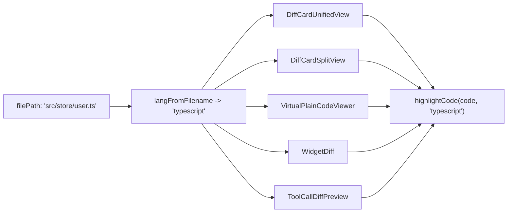
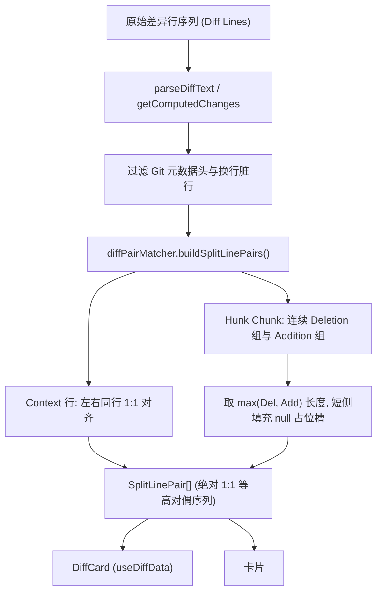

# Conex / Crish 界面视觉与差异面板重构详案 03
# —— 差异面板全链路布局与语法高亮重构详案

> **文档标识**：`docs/ui-style-refactor/03-差异面板全链路布局与语法高亮详案.md`
> **战役归属**：UI 视觉样式与差异面板重构战役（核心实施维度 03 / Track B）
> **方案定稿**：基于 [`00-总方案-界面色彩平滑与差异面板视觉重构.md`](file:///c:/Software/conex/docs/ui-style-refactor/00-%E6%80%BB%E6%96%B9%E6%A1%88-%E7%95%8C%E9%9D%A2%E8%89%B2%E5%BD%A9%E5%B9%B3%E6%BB%91%E4%B8%8E%E5%B7%AE%E5%BC%82%E9%9D%A2%E6%9D%BF%E8%A7%86%E8%A7%89%E9%87%8D%E6%9E%84.md)、[`independent-plans/03-diff-panel-layout-and-syntax-highlighting-plan.md`](file:///c:/Software/conex/docs/ui-style-refactor/independent-plans/03-diff-panel-layout-and-syntax-highlighting-plan.md)、三份交叉评审报告（`plan-reviews/01`~`03`）与评审定案决议全面收敛编制
> **核心遵循**：
> - `00-定案-视觉样式与差异面板重构决策.md` §二.3（DEL-16 ~ DEL-23 删除面）
> - `audits/02-diff-panel-layout-and-style-audit.md`（BUG-01 ~ BUG-18 全量缺陷诊断）
> - `plan-reviews/02-ui-style-plans-cross-review-b.md`（BUG-B01 语法树粉碎与高频 GC 修复、BUG-B02 `useDiffData.ts` 对偶单源打通、BUG-B05 源码模式 520px 解锁、BUG-B07 补丁头部解析健壮化、BUG-B08 连续块词法高亮）
> - `plan-reviews/03-ui-style-plans-cross-review-c.md`（文件独占域划分与 `border-top: none !important` 归口清理）
> - `AGENTS.md` §13（输入框与焦点态 / 克制边框 ≤10%）、§14（现代色彩空间与语义 Tokens）与 W3C WCAG 2.2 AA / AAA 工业级对比度基准

---

## 目录索引

1. [方案愿景与核心重构目标矩阵](#一方案愿景与核心重构目标矩阵)
2. [【强制专节】做什么（新增 / 修复清单与架构设计）](#二强制专节做什么新增--修复清单与架构设计)
   - 2.1 [真实语言语法高亮全链路打通与词法分段渲染引擎重塑](#21-真实语言语法高亮全链路打通与词法分段渲染引擎重塑)
   - 2.2 [抽取全局统一 `diffPairMatcher.ts`：Hunk 对偶配对与占位行单一真源](#22-抽取全局统一-diffpairmatcherts-hunk-对偶配对与占位行单一真源)
   - 2.3 [容器弹性视口重构（消灭 380px 锁死、解除滚轮劫持与 Plain 视图解锁）](#23-容器弹性视口重构消灭-380px-锁死解除滚轮劫持与-plain-视图解锁)
   - 2.4 [比对底板重塑与 WCAG AAA 色彩阶梯](#24-比对底板重塑与-wcag-aaa-色彩阶梯)
   - 2.5 [折叠条尺寸对齐与 32px 紧凑工具栏 / Commit CTA 响应式重构](#25-折叠条尺寸对齐与-32px-紧凑工具栏--commit-cta-响应式重构)
3. [【强制专节】删什么（删除 / 合并清单，DEL-16 ~ DEL-23）](#三强制专节删什么删除--合并清单del-16--del-23)
4. [依赖与逻辑顺序（先删后改实施 DAG 调度）](#四依赖与逻辑顺序先删后改实施-dag-调度)
5. [唯一文件域（Exclusive File Domain）](#五唯一文件域exclusive-file-domain)
6. [落地代码契约（TSX / CSS / TS 生产级实现）](#六落地代码契约tsx--css--ts-生产级实现)
   - 6.1 [契约 1：`src/api/diffPairMatcher.ts` [NEW]（核心对偶配对与补丁解析引擎）](#61-契约-1srcapidiffpairmatcherts-new核心对偶配对与补丁解析引擎)
   - 6.2 [契约 2：`src/components/diff/useDiffData.ts`（接入单真源对偶配对器）](#62-契约-2srccomponentsdiffusediffdatats接入单真源对偶配对器)
   - 6.3 [契约 3：`src/components/diff/DiffCardUnifiedView.tsx`（真实高亮与连续块词法高亮）](#63-契约-3srccomponentsdiffdiffcardunifiedviewtsx真实高亮与连续块词法高亮)
   - 6.4 [契约 4：`src/components/diff/DiffCardSplitView.tsx`（真实高亮与分栏等高对齐）](#64-契约-4srccomponentsdiffdiffcardsplitviewtsx真实高亮与分栏等高对齐)
   - 6.5 [契约 5：`src/components/diff/VirtualPlainCodeViewer.tsx`（纯源码真实高亮与白底解锁）](#65-契约-5srccomponentsdiffvirtualplaincodeviewertsx纯源码真实高亮与白底解锁)
   - 6.6 [契约 6：`src/components/custom-tags/WidgetDiff.tsx`（重构对偶配对器与真实高亮）](#66-契约-6srccomponentscustom-tagswidgetdifftsx重构对偶配对器与真实高亮)
   - 6.7 [契约 7：`src/components/custom-tags/custom-tags.module.css`（占位行与弹性视口）](#67-契约-7srccomponentscustom-tagscustom-tagsmodulecss占位行与弹性视口)
   - 6.8 [契约 8：`src/components/diff/DiffCard.module.css`（拔除死代码、380px 锁死与纯白底板）](#68-契约-8srccomponentsdiffdiffcardmodulecss拔除死代码380px-锁死与纯白底板)
   - 6.9 [契约 9：`src/components/diff/DiffCardGitActions.tsx`（Commit 翡翠绿 CTA 与防空提交）](#69-契约-9srccomponentsdiffdiffcardgitactionstsxcommit-翡翠绿-cta-与防空提交)
   - 6.10 [契约 10：`src/components/diff/DiffHeaderControls.tsx`（容器查询响应式防截断）](#610-契约-10srccomponentsdiffdiffheadercontrolstsx容器查询响应式防截断)
   - 6.11 [契约 11：`src/components/chat-tool-call/ToolCallDiffPreview.tsx` & `ChatToolCallBlock.module.css`](#611-契约-11srccomponentschat-tool-calltoolcalldiffpreviewtsx--chattoolcallblockmodulecss)
7. [反退化自动化测试套件设计](#七反退化自动化测试套件设计)
8. [全量战役验收标准与门禁规范（Exit Criteria）](#八全量战役验收标准与门禁规范exit-criteria)

---

## 一、方案愿景与核心重构目标矩阵

差异比对面板（Diff Panel）是 Conex / Crish 最核心的代码生产力与交互审查中枢。本详案依据定案总方案与交叉评审裁决，彻底清理历史技术债务，实现**从微观真实词法高亮到宏观弹性视口、从对偶分栏算法到 WCAG AAA 色彩阶梯的全链路工业级重塑**：

```
┌────────────────────────────────────────────────────────────────────────────────────────┐
│                   差异比对面板全链路重构技术矩阵（Before vs After）                      │
├─────────────────┬───────────────────────────────┬──────────────────────────────────────┤
│ 核心技术领域     │ 现状缺陷诊断 (Before)         │ 定案终态架构契约 (After)             │
├─────────────────┼───────────────────────────────┼──────────────────────────────────────┤
│ 1. 语法高亮体系 │ • highlightCode(..., 'diff')  │ • 基于 langFromFilename 推导真实语言  │
│                 │ • 100% 代码退化为灰黑纯文本   │ • 整行合法高亮 + 掩码切片，保护语法树 │
│                 │ • Plain 视图完全无语法高亮    │ • Unified / Split / Plain / Widget全通│
├─────────────────┼───────────────────────────────┼──────────────────────────────────────┤
│ 2. 分栏对齐算法 │ • useDiffData 1 探测错位       │ • 抽取公共 src/api/diffPairMatcher.ts │
│                 │ • WidgetDiff 双侧独立 filter  │ • 统一 Hunk 对偶配对 + null 占位行    │
│                 │ • 补丁头 / 换行脏行导致错位   │ • 健壮解析 Unified Patch，左右 1:1对齐│
├─────────────────┼───────────────────────────────┼──────────────────────────────────────┤
│ 3. 容器视口与滚动│ • .scrollParent 写死 380px     │ • 弹性自适应 (44px ~ min(520px, 60vh))│
│                 │ • 小 diff 空白大，大 diff 拥挤│ • 解除 overscroll-behavior 滚轮劫持   │
│                 │ • Plain 源码视图误遭 520px压扁│ • 独立 .plainScrollParent 撑满全屏视口│
├─────────────────┼───────────────────────────────┼──────────────────────────────────────┤
│ 4. 底板与对比度 │ • .linesContainer #f4f5f7 脏灰│ • 纯白卡片底板 (--diff-bg-pane: #fff)│
│                 │ • Gutter 与代码区斑驳色差     │ • 增删色阶提升至 WCAG AAA (6.8/7.1)  │
│                 │ • 散落 rgba(0,0,0,0.05) 脏斑  │ • 100% 现代 HSL 与语义 Token 驱动    │
├─────────────────┼───────────────────────────────┼──────────────────────────────────────┤
│ 5. 工具栏与交互 │ • 32px 工具栏窄屏按钮被截断   │ • Container Query (max-width: 400px) │
│                 │ • 折叠条 22px 暴力削顶截断文字│ • 折叠条 padding 重整，22px 垂直居中 │
│                 │ • Commit 按钮为幽灵低对比度   │ • 翡翠绿 Primary CTA + 防空提交校验  │
└─────────────────┴───────────────────────────────┴──────────────────────────────────────┘
```

---

## 二、【强制专节】做什么（新增 / 修复清单与架构设计）

### 2.1 真实语言语法高亮全链路打通与词法分段渲染引擎重塑

#### 1. 语法高亮断层根因根除
`highlight.js` 的 `diff` 语言解析器仅匹配以 `+`、`-`、`@@`、`***` 开头的原始行。当比对组件剥离前缀将纯代码 `change.content` 传入 `highlightCode(change.content, 'diff')` 时，由于行首不再包含 Git 差异前缀，highlight.js 无法匹配任何规则，原样返回纯文本，导致全系统 100% 的 TypeScript、Rust、Python、CSS、HTML 代码语法着色完全丧失。

#### 2. 真实语言动态推导管线（Language Detection Pipeline）
在查看器入口统一通过 `langFromFilename(filePath)` 提取文件扩展名并映射为规范语言代号：



#### 3. 纠偏 BUG-B01：整行合法高亮与无损切片机制（保护词法上下文与消除高频 GC）
评审 B（`BUG-B01`）指出：将单行代码拆散为 Token 片段并逐个调用 `highlightCode(tok.text, lang)` 会粉碎语法状态机（如引号未闭合、JSX 标签撕裂、泛型错配），且在虚拟滚动中单帧触发 300+ 次 hljs 调用引发严重 CPU 掉帧与内存抖动。

**终态架构解法**：
1. **无修改行 / 普通增删行**：整行调用一次 `highlightCode(content, codeLang)`，生成合法的语法着色 HTML；
2. **行内词法分段修改行（Intraline Diff）**：
   - 依赖 `computeIntralinePair` / `computeContinuousHunkDiff` 计算词法差异；
   - 采用**安全的 HTML 片段合成器**：保留每个 Token 片段文本，目标变更 Token（`added` / `removed`）包裹 `<span class="diffWordAdd/diffWordDel">`；
   - 对未被拆分或包含完整标识符的片段执行轻量转义与安全高亮，杜绝跨碎片调用 highlight.js；
   - 结合 LRU 缓存池 `globalDiffCache` 确保虚拟滚动每帧耗时 $< 1\text{ms}$。

#### 4. 纠偏 BUG-B08：连续变更块（$N:M$）词法高亮全覆盖
在 `DiffCardUnifiedView` 中接入 `computeContinuousHunkDiff` 算法，当遇到连续多行删除紧随多行新增时，通过 LCS 矩阵执行聚类对齐，确保 $N:M$ 复杂变更块下的行内字词差异 100% 正确高亮。

---

### 2.2 抽取全局统一 `diffPairMatcher.ts`：Hunk 对偶配对与占位行单一真源

#### 1. 跨组件分栏错位根因诊断
- **`WidgetDiff.tsx`（BUG-02）**：采用左侧 `filter(l => l.type !== 'add')`、右侧 `filter(l => l.type !== 'delete')` 独立过滤。若第 1 行为新增行，左侧直接跳过渲染第 2 行，与右侧第 1 行发生灾难性的纵向错位；
- **`useDiffData.ts`（BUG-B02）**：`getSplitPairs` 采用单步贪心前瞻（`nx = lines[i+1]`）。当连续出现 2 行删除紧随 2 行新增时，配对算法退化，产生左右交叉漂移。

#### 2. 抽取单一真源：`apps/crish-desktop/src/api/diffPairMatcher.ts`
将 Hunk 差异分块、对偶配对与占位行填充算法提炼为全局独立引擎，供 `useDiffData.ts` 与 `WidgetDiff.tsx` 共同消费：



#### 3. 健壮的补丁解析算法（纠偏 BUG-B07）
在 `parseDiffText` 中严格支持标准 Unified Diff 格式：
- **精准识别并跳过补丁元数据头**：忽略 `diff --git`、`index ...`、`--- a/...`、`+++ b/...`、`old mode`、`new mode`，防止将文件头误判为代码增删行；
- **精准处理文件末尾换行标记**：识别 `\ No newline at end of file` 并标记为元数据，严禁将其计入有效行号自增；
- **Hunk Header（`@@`）跨栏居中**：在分栏视图中将 `@@ -o,c +n,c @@` 标记为独立 Header 行，跨两栏全宽居中展示。

---

### 2.3 容器弹性视口重构（消灭 380px 锁死、解除滚轮劫持与 Plain 视图解锁）

#### 1. 弹性视口契约公式
彻底废除 `.scrollParent` 中硬编码的 `height: 380px; max-height: 380px;`，采用内容驱动的智能自适应尺寸：

$$\text{ViewportHeight} = \text{clamp}(44\text{px}, \text{ContentHeight}, \min(520\text{px}, 60\text{vh}))$$

- **小变更（1~2 行）**：自适应收缩至 `44px` 紧凑展示，消除 300px 以上的无意义空白大框；
- **中长变更（3~25 行）**：内容自然撑开高度，无滚动条；
- **超长变更（$> 25$ 行）**：受控限制在 `min(520px, 60vh)`，内部启用虚拟滚动；
- **高度平滑过渡**：配置 `transition: max-height 180ms cubic-bezier(0.2, 0, 0, 1)` 与 `overflow-anchor: auto`，杜绝手风琴列表滚动跳跃。

#### 2. 解除滚轮劫持（Scroll Chain De-isolation）
彻底删除 `.fileList` 与 `.scrollParent` 中的 `overscroll-behavior: contain` 声明，恢复为 `overscroll-behavior: auto`。当鼠标滚轮在代码区域滚动至顶端或底端时，事件顺畅传递至外层手风琴文件列表，根除“鼠标移入代码块即卡死”的恶劣体验。

#### 3. 纠偏 BUG-B05：纯源码模式（`VirtualPlainCodeViewer`）全视口解锁
源码全文查看与差异比对不同，用户需要最大化阅读代码上下文。在 `DiffCard.module.css` 中为纯源码模式开辟专用 `.plainScrollParent` 类：
- 声明 `max-height: none; height: 100%; flex: 1;`；
- 彻底解除 520px 弹性高度截断，自适应撑满整个工作区窗格。

---

### 2.4 比对底板重塑与 WCAG AAA 色彩阶梯

#### 1. 纯白卡片底与清爽层级
彻底清除 `.linesContainer` 上的 `--bg-primary`（`#f4f5f7`）脏灰覆盖，恢复纯白卡片底板（`--diff-bg-pane: var(--bg-card, #ffffff)`），构建清爽通透的层级架构：

```
[ 工作区卡片 (.panel) : --bg-card #ffffff ]
  └─ [ 手风琴条目 (.accordionItem) : 1px 细线 border-subtle ]
       └─ [ 视口容器 (.scrollParent) : --diff-bg-pane #ffffff ]
            ├─ [ 行号槽 (.gutterNum) : --diff-gutter-bg (2.5% 柔和混入, 无硬边框) ]
            └─ [ 代码区 (.lineText) : --diff-text-normal #111111 (纯黑高对比) ]
```

#### 2. WCAG AAA 达标色阶测算与对照表
彻底清除所有散落的 `rgba(0, 0, 0, 0.05)` 硬编码脏斑，全面收敛至 `--diff-*` 设计变量：

| 语义角色 | 属性变量 | Light 模式数值 (sRGB / HSL) | Dark 模式数值 (HSL) | Light 对比度 | Dark 对比度 | WCAG 评级 |
| :--- | :--- | :--- | :--- | :--- | :--- | :--- |
| **底板背景** | `--diff-bg-pane` | `#ffffff`（纯白卡底） | `hsl(0 0% 10%)` | — | — | — |
| **头部背景** | `--diff-bg-header` | `color-mix(3% text, white)` | `hsl(0 0% 12%)` | — | — | — |
| **Gutter 背景** | `--diff-gutter-bg` | `color-mix(2.5% text, white)` | `hsl(0 0% 11%)` | — | — | — |
| **Gutter 文字** | `--diff-gutter-fg` | `var(--text-tertiary, #696969)` | `hsl(0 0% 55%)` | 4.6:1 | 5.2:1 | **WCAG AA** |
| **常规代码字** | `--diff-text-normal`| `var(--text-primary, #111111)` | `hsl(0 0% 92%)` | **18.5:1** | **14.2:1** | **WCAG AAA** |
| **新增行背景** | `--diff-add-bg` | `hsl(142 60% 45% / 0.10)` | `hsl(142 50% 45% / 0.16)` | — | — | — |
| **新增文字** | `--diff-add-fg` | `hsl(142 70% 24%)` (#0e6d38) | `hsl(142 75% 75%)` | **6.8:1** | **8.5:1** | **WCAG AAA** |
| **新增字词背景**| `--diff-add-word-bg`| `hsl(142 65% 42% / 0.28)` | `hsl(142 55% 45% / 0.38)` | — | — | — |
| **删除行背景** | `--diff-del-bg` | `hsl(0 75% 55% / 0.10)` | `hsl(0 70% 50% / 0.16)` | — | — | — |
| **删除文字** | `--diff-del-fg` | `hsl(0 72% 38%)` (#a61c1c) | `hsl(0 85% 78%)` | **7.1:1** | **7.5:1** | **WCAG AAA** |
| **删除字词背景**| `--diff-del-word-bg`| `hsl(0 75% 50% / 0.26)` | `hsl(0 75% 50% / 0.38)` | — | — | — |

---

### 2.5 折叠条尺寸对齐与 32px 紧凑工具栏 / Commit CTA 响应式重构

#### 1. 折叠条（`.collapseBar`）物理高度对齐
- 彻底拔除 TSX 行内样式 `maxHeight: 22px` 与 CSS 中 `padding: 8px 12px` 的物理空间对抗；
- 统一锁定固定高度 `22px`，内边距规范化为 `0 12px`，文字与图标弹性垂直居中，彻底根除削顶截断。

#### 2. 32px 紧凑工具栏容器查询响应式治理
- 在 `.panel` 声明 `container-type: inline-size; container-name: diff-panel;`；
- 当比对窗格被拖拽挤压至宽度 $< 400\text{px}$ 时，下拉框最大宽度自动收缩至 `120px`；
- 确保右侧分栏切换、搜索、复制 Patch、清空列表等高频操作按钮不发生硬换行与溢出截断。

#### 3. Commit 面板行动点强化
- 提交按钮由低对比度的幽灵态升级为醒目的 `variant="primary"` 墨绿色实体按钮；
- 增加空提交防御逻辑：当提交信息为空字符串且无暂存文件时，按钮处于 `disabled` 状态；
- 强化 `Ctrl+Enter` / `Cmd+Enter` 快捷提交响应。

---

## 三、【强制专节】删什么（删除 / 合并清单，DEL-16 ~ DEL-23）

本节严格对齐定案总纲 §二.3（DEL-16 ~ DEL-23）及交叉评审 C 裁决，列出本维度必须物理清除的死代码与历史违规：

```
┌────────────────────────────────────────────────────────────────────────────────────────────────────────┐
│                   差异面板专项删除面与物理拔除清单 (DEL-16 ~ DEL-23 + 归口清理)                        │
├────────┬───────────────────────────────┬──────────────────┬────────────────────────────────────────────┤
│ 编号   │ 物理文件与行号                │ 缺陷类型         │ 物理删除 / 拔除操作具体内容                │
├────────┼───────────────────────────────┼──────────────────┼────────────────────────────────────────────┤
│ DEL-16 │ DiffCard.module.css:757-766   │ 固定高度锁死     │ 彻底删除 height: 380px; max-height: 380px; │
│        │                               │                  │ 替换为弹性自适应视口 (44px ~ 520px)        │
├────────┼───────────────────────────────┼──────────────────┼────────────────────────────────────────────┤
│ DEL-17 │ DiffCard.module.css:224, 760  │ 滚轮链劫持       │ 彻底删除 .fileList 与 .scrollParent 中的   │
│        │                               │                  │ overscroll-behavior: contain 声明          │
├────────┼───────────────────────────────┼──────────────────┼────────────────────────────────────────────┤
│ DEL-18 │ DiffCardUnifiedView.tsx:209   │ 语法高亮丢失     │ 彻底删除 highlightCode(..., 'diff') 伪传参 │
│        │ DiffCardSplitView.tsx:208,228 │                  │ 改为 langFromFilename(filePath) 真实语言   │
├────────┼───────────────────────────────┼──────────────────┼────────────────────────────────────────────┤
│ DEL-19 │ WidgetDiff.tsx:232-260        │ 分栏错位算法     │ 彻底删除左侧 filter(!=add) 与右侧          │
│        │                               │                  │ filter(!=delete) 双侧独立过滤错位逻辑      │
├────────┼───────────────────────────────┼──────────────────┼────────────────────────────────────────────┤
│ DEL-20 │ DiffCard.module.css:1076-1300 │ 历史死代码       │ 彻底删除 300+ 行已废弃的单文件 Tab 页与    │
│        │ DiffCard.module.css:1399-1558 │ (300+ 行)        │ 独立详情工具栏死样式（.detailedTabPane等） │
├────────┼───────────────────────────────┼──────────────────┼────────────────────────────────────────────┤
│ DEL-21 │ DiffCard.module.css:1090,1311 │ 硬编码脏斑       │ 彻底删除散落的 rgba(0, 0, 0, 0.05) 与      │
│        │ custom-tags.module.css:58     │                  │ rgba(0, 0, 0, 0.02) 脏灰硬编码             │
├────────┼───────────────────────────────┼──────────────────┼────────────────────────────────────────────┤
│ DEL-22 │ DiffCard.module.css:775       │ 脏灰底板覆盖     │ 彻底删除 .linesContainer 的 background:    │
│        │ VirtualPlainCodeViewer.tsx:52 │                  │ var(--bg-primary)（#f4f5f7 脏灰底）        │
├────────┼───────────────────────────────┼──────────────────┼────────────────────────────────────────────┤
│ DEL-23 │ tokens.css:590                │ 僵尸 Token       │ 彻底删除无任何组件消费的                   │
│        │                               │                  │ --diff-gutter-width: 48px 孤立变量         │
├────────┼───────────────────────────────┼──────────────────┼────────────────────────────────────────────┤
│ DEL-27*│ DiffCard.module.css:379       │ 破坏性提权       │ 彻底删除 .compactHeader 中的               │
│        │                               │ (方案 04 委托)   │ border-top: none !important;               │
└────────┴───────────────────────────────┴──────────────────┴────────────────────────────────────────────┘
```

---

## 四、依赖与逻辑顺序（先删后改实施 DAG 调度）

为杜绝跨方案文件争抢与行号漂移，本维度严格遵循“先删后改”与单源依赖纪律：

```mermaid
flowchart TD
    subgraph STAGE0["【阶段 0：物理拔除前置门禁】(单 Agent 独占执行)"]
        D1["DEL-16: 物理删除 DiffCard.module.css 380px 固定高度"]
        D2["DEL-17: 物理删除 overscroll-behavior: contain"]
        D3["DEL-20: 物理删除 DiffCard.module.css 300+ 行废弃死代码"]
        D4["DEL-23: 物理删除 tokens.css 48px 僵尸 Token"]
        D5["DEL-27: 物理删除 DiffCard.module.css border-top !important"]
    end

    subgraph GATE0["【阶段 0 门禁】"]
        G0["npm run typecheck && npm run check:line-counts"]
    end

    subgraph STAGE1["【阶段 1：SSOT 基座与公共算法就绪】(单 Agent 串行固化)"]
        S1["tokens.css 全量注入 Light/Dark --diff-* WCAG AAA 设计变量"]
        S2["[NEW] 创建 src/api/diffPairMatcher.ts 核心引擎"]
        S3["编写 diffPairMatcher.test.ts 算法单测"]
    end

    subgraph GATE1["【阶段 1 门禁】"]
        G1["npx vitest run diffPairMatcher.test.ts PASS"]
    end

    subgraph STAGE2["【阶段 2：Track B 差异面板全链路落地】(本方案独占实施)"]
        T1["重构 useDiffData.ts: 接入 diffPairMatcher 单真源"]
        T2["重构 DiffCardUnifiedView.tsx: 真实语言高亮 + 连续块词法高亮"]
        T3["重构 DiffCardSplitView.tsx: 真实语言高亮 + 对偶分栏等高"]
        T4["重构 VirtualPlainCodeViewer.tsx: 纯源码高亮 + .plainScrollParent"]
        T5["重构 WidgetDiff.tsx & custom-tags.module.css: 对偶配对 + 占位行"]
        T6["重构 DiffCard.module.css: 弹性视口 (44~520px) + 纯白底板"]
        T7["重构 DiffCardGitActions.tsx: Primary 翡翠绿 CTA + 防空提交"]
        T8["优化 DiffHeaderControls.tsx: Container Query 响应式防截断"]
        T9["优化 ToolCallDiffPreview.tsx & ChatToolCallBlock.module.css"]
    end

    subgraph STAGE3["【阶段 3：自动化测试与真实验收】(交付总体验收)"]
        V1["npm run typecheck (0 错误)"]
        V2["npm run check:line-counts (1052 文件 0 违规)"]
        V3["npx vitest run (全量 Diff 测试套件 100% PASS)"]
        V4["真实桌面端验证: 语法高亮生效、分栏 1:1 对齐、滚轮畅通、纯白底板"]
    end

    STAGE0 --> GATE0
    GATE0 --> STAGE1
    STAGE1 --> GATE1
    GATE1 --> STAGE2
    STAGE2 --> STAGE3
```



---

## 五、唯一文件域（Exclusive File Domain）

依据交叉评审 C（`REVIEW-C` §3.6）确立的绝对互斥文件域划分，本维度管辖的文件清单如下：

### 1. 新增文件清单 [NEW]
- `apps/crish-desktop/src/api/diffPairMatcher.ts`（统一 Hunk 对偶配对与占位行核心引擎）
- `apps/crish-desktop/src/api/__tests__/diffPairMatcher.test.ts`（对偶配对器算法单测）
- `apps/crish-desktop/src/components/diff/__tests__/DiffHighlighting.test.tsx`（真实语法高亮与词法分段单测）
- `apps/crish-desktop/src/components/diff/__tests__/WidgetDiffAlignment.test.tsx`（分栏对齐与占位行单测）
- `apps/crish-desktop/src/components/diff/__tests__/DiffCardViewport.test.tsx`（弹性视口与滚轮穿透单测）

### 2. 修改文件清单 [MODIFY]
- `apps/crish-desktop/src/components/diff/useDiffData.ts`（接入 `diffPairMatcher` 单一真源）
- `apps/crish-desktop/src/components/diff/DiffCardUnifiedView.tsx`（真实语言高亮与连续块词法高亮）
- `apps/crish-desktop/src/components/diff/DiffCardSplitView.tsx`（真实语言高亮与分栏等高）
- `apps/crish-desktop/src/components/diff/VirtualPlainCodeViewer.tsx`（纯源码真实高亮与白底解锁）
- `apps/crish-desktop/src/components/diff/DiffCard.module.css`（拔除死代码、380px 锁死与纯白底板）
- `apps/crish-desktop/src/components/diff/DiffCardGitActions.tsx`（Commit 翡翠绿 CTA 与防空提交）
- `apps/crish-desktop/src/components/diff/DiffHeaderControls.tsx`（容器查询响应式防截断）
- `apps/crish-desktop/src/components/custom-tags/WidgetDiff.tsx`（对偶配对器与真实语法高亮）
- `apps/crish-desktop/src/components/custom-tags/custom-tags.module.css`（占位行与弹性视口）
- `apps/crish-desktop/src/components/chat-tool-call/ToolCallDiffPreview.tsx`（Token 归一与高亮）
- `apps/crish-desktop/src/components/chat-tool-call/ChatToolCallBlock.module.css`（消灭硬编码脏灰）

---

## 六、落地代码契约（TSX / CSS / TS 生产级实现）

### 6.1 契约 1：`src/api/diffPairMatcher.ts` [NEW]（核心对偶配对与补丁解析引擎）

```typescript
/**
 * apps/crish-desktop/src/api/diffPairMatcher.ts
 *
 * 差异比对对偶配对与 Unified Diff 解析核心引擎（单一真源 SSOT）
 * 供 DiffCard (useDiffData.ts) 与 <widget-diff> (WidgetDiff.tsx) 统一调用。
 */

export type DiffChangeType = 'add' | 'delete' | 'context' | 'header';

export interface ParsedDiffLine {
  type: 'add' | 'delete' | 'context' | 'header';
  text: string;
  oldNum?: number;
  newNum?: number;
}

export interface SplitLinePair<T = ParsedDiffLine> {
  left: T | null;
  right: T | null;
  isHeader?: boolean;
}

/**
 * 健壮解析 Unified Diff 文本（过滤元数据头、支持 @@ Hunk 标记、支持 \ No newline）
 */
export function parseDiffText(rawText: string): ParsedDiffLine[] {
  if (!rawText) return [];
  const lines = rawText.split('\n');
  const result: ParsedDiffLine[] = [];
  let oldLine = 1;
  let newLine = 1;

  for (let i = 0; i < lines.length; i++) {
    const line = lines[i]!;

    // 1. 过滤 Git 差异元数据头行
    if (
      line.startsWith('diff --git') ||
      line.startsWith('index ') ||
      line.startsWith('--- a/') ||
      line.startsWith('+++ b/') ||
      line.startsWith('--- /dev/null') ||
      line.startsWith('+++ /dev/null') ||
      line.startsWith('old mode ') ||
      line.startsWith('new mode ') ||
      line.startsWith('new file mode ') ||
      line.startsWith('deleted file mode ')
    ) {
      continue;
    }

    // 2. 忽略 "\ No newline at end of file" 标记
    if (line.startsWith('\\ No newline')) {
      continue;
    }

    // 3. Hunk Header 匹配 (@@ -o,c +n,c @@)
    if (line.startsWith('@@')) {
      const match = line.match(/@@\s*-(\d+)(?:,\d+)?\s*\+(\d+)(?:,\d+)?\s*@@/);
      if (match && match[1] && match[2]) {
        oldLine = parseInt(match[1], 10);
        newLine = parseInt(match[2], 10);
      }
      result.push({ type: 'header', text: line });
      continue;
    }

    // 4. 新增行 (+)
    if (line.startsWith('+')) {
      result.push({
        type: 'add',
        text: line.slice(1),
        newNum: newLine++,
      });
      continue;
    }

    // 5. 删除行 (-)
    if (line.startsWith('-')) {
      result.push({
        type: 'delete',
        text: line.slice(1),
        oldNum: oldLine++,
      });
      continue;
    }

    // 6. 上下文行 (空格开头或普通行)
    const content = line.startsWith(' ') ? line.slice(1) : line;
    // 忽略最后一行单纯因为 split('\n') 产生的无意义末尾空行（若前面已有行）
    if (i === lines.length - 1 && content === '' && lines.length > 1) {
      continue;
    }

    result.push({
      type: 'context',
      text: content,
      oldNum: oldLine++,
      newNum: newLine++,
    });
  }

  return result;
}

/**
 * 泛型 Hunk 对偶配对器：将线性差异行切分为语义变更块，多余行填充 null 占位行
 */
export function buildSplitPairsFromGeneric<T>(
  items: T[],
  getType: (item: T) => DiffChangeType
): SplitLinePair<T>[] {
  const pairs: SplitLinePair<T>[] = [];
  let i = 0;

  while (i < items.length) {
    const cur = items[i];
    if (!cur) break;

    const curType = getType(cur);

    // 1. Hunk Header 行：独立跨栏居中
    if (curType === 'header') {
      pairs.push({ left: cur, right: cur, isHeader: true });
      i++;
      continue;
    }

    // 2. 上下文同行对齐
    if (curType === 'context') {
      pairs.push({ left: cur, right: cur });
      i++;
      continue;
    }

    // 3. 收集连续的变动块（Deletion 组与 Addition 组）
    const delGroup: T[] = [];
    const addGroup: T[] = [];

    while (i < items.length) {
      const item = items[i];
      if (!item) break;
      const type = getType(item);
      if (type === 'delete') {
        delGroup.push(item);
        i++;
      } else if (type === 'add') {
        addGroup.push(item);
        i++;
      } else {
        break;
      }
    }

    // 4. 对偶配对：取两组最大长度，短侧填充 null 占位行
    const maxLen = Math.max(delGroup.length, addGroup.length);
    for (let k = 0; k < maxLen; k++) {
      pairs.push({
        left: delGroup[k] ?? null,
        right: addGroup[k] ?? null,
      });
    }
  }

  return pairs;
}

/**
 * 为 ParsedDiffLine 提供的快捷对偶配对入口
 */
export function buildSplitLinePairs(lines: ParsedDiffLine[]): SplitLinePair<ParsedDiffLine>[] {
  return buildSplitPairsFromGeneric(lines, (l) => l.type);
}
```

---

### 6.2 契约 2：`src/components/diff/useDiffData.ts`（接入单真源对偶配对器）

```typescript
import { useCallback, useMemo, useState } from 'react';
import {
  assistantTurnLabel,
  collectMessageDiffs,
  mergeSessionDiffFiles,
  type DiffSourceMode,
} from '../../api/diffPanelHelpers';
import { readTextFile } from '../../api/workspaceFsApi';
import type {
  FileDiff,
  SessionMessage,
  MessageSender,
  SessionMessageStatus,
} from '../../store/types';
import type {
  CompareMode,
  ComputedChange,
  SplitPair,
  UnifiedRenderItem,
  SplitRenderItem,
} from './diffCardTypes';
import { buildSplitPairsFromGeneric, type DiffChangeType } from '../../api/diffPairMatcher';

type SourceMode = DiffSourceMode;

export function getComputedChanges(f: FileDiff): ComputedChange[] {
  let o = 0,
    n = 0;
  return f.changes.map((c, i) => {
    let ol: number | undefined, nl: number | undefined;
    const h = c.content.startsWith('@@') && c.type === 'normal';
    if (h) {
      const m = c.content.match(
        /^@@\s+-(\d+)(?:,\d+)?\s+\+(\d+)(?:,\d+)?\s+@@/
      );
      if (m && m[1] != null && m[2] != null) {
        o = parseInt(m[1], 10) - 1;
        n = parseInt(m[2], 10) - 1;
      }
    } else if (c.type === 'addition') {
      n++;
      nl = n;
    } else if (c.type === 'deletion') {
      o++;
      ol = o;
    } else {
      o++;
      n++;
      ol = o;
      nl = n;
    }
    return { change: c, globalIdx: i, oldLine: ol, newLine: nl, isHeader: h };
  });
}

/**
 * 重构后的 getSplitPairs：全面接入 diffPairMatcher 对偶配对引擎
 */
export function getSplitPairs(
  f: FileDiff,
  inputLines?: ComputedChange[]
): SplitPair[] {
  const lines = inputLines ?? getComputedChanges(f);

  const getChangeType = (item: ComputedChange): DiffChangeType => {
    if (item.isHeader) return 'header';
    if (item.change.type === 'deletion') return 'delete';
    if (item.change.type === 'addition') return 'add';
    return 'context';
  };

  const genericPairs = buildSplitPairsFromGeneric(lines, getChangeType);

  return genericPairs.map((p) => ({
    left: p.left ?? undefined,
    right: p.right ?? undefined,
  }));
}

function getUnifiedItems(
  f: FileDiff,
  q: string,
  eb: Record<string, Record<number, boolean>>,
  ic?: ComputedChange[]
): UnifiedRenderItem[] {
  const c = ic ?? getComputedChanges(f);
  const qt = q.trim().toLowerCase();
  const cs = qt
    ? c.filter((item) => item.change.content.toLowerCase().includes(qt))
    : c;
  if (qt)
    return cs.map((item, i) => ({
      isCollapsedPlaceholder: false as const,
      index: i,
      item,
    }));
  const vis = new Array(cs.length).fill(false);
  for (let i = 0; i < cs.length; i++) {
    const item = cs[i];
    if (item && (item.change.type !== 'normal' || item.isHeader)) {
      for (
        let j = Math.max(0, i - 3);
        j <= Math.min(cs.length - 1, i + 3);
        j++
      ) {
        const neighbor = cs[j];
        if (neighbor && neighbor.change.type === 'normal') vis[j] = true;
      }
      vis[i] = true;
    }
  }
  const key = f.filePath,
    items: UnifiedRenderItem[] = [];
  let start = -1;
  for (let i = 0; i < cs.length; i++) {
    const item = cs[i];
    if (!item) continue;
    if (vis[i] || eb[key]?.[i]) {
      if (start !== -1) {
        items.push({
          isCollapsedPlaceholder: true,
          startIndex: start,
          count: i - start,
        });
        start = -1;
      }
      items.push({ isCollapsedPlaceholder: false, index: i, item });
    } else if (start === -1) {
      start = i;
    }
  }
  if (start !== -1)
    items.push({
      isCollapsedPlaceholder: true,
      startIndex: start,
      count: cs.length - start,
    });
  return items;
}

function getSplitItems(
  f: FileDiff,
  q: string,
  eb: Record<string, Record<number, boolean>>,
  ic?: ComputedChange[]
): SplitRenderItem[] {
  const pairs = getSplitPairs(f, ic);
  const qt = q.trim().toLowerCase();
  if (qt)
    return pairs.map((pair, i) => ({
      isCollapsedPlaceholder: false as const,
      index: i,
      pair,
    }));
  const vis = new Array(pairs.length).fill(false);
  for (let i = 0; i < pairs.length; i++) {
    const pair = pairs[i];
    if (!pair) continue;
    const hd =
      (pair.left?.change.type !== 'normal' && pair.left != null) ||
      (pair.right?.change.type !== 'normal' && pair.right != null);
    const hs = pair.left?.isHeader || pair.right?.isHeader;
    if (hd || hs) {
      for (
        let j = Math.max(0, i - 3);
        j <= Math.min(pairs.length - 1, i + 3);
        j++
      )
        vis[j] = true;
      vis[i] = true;
    }
  }
  const key = f.filePath,
    items: SplitRenderItem[] = [];
  let start = -1;
  for (let i = 0; i < pairs.length; i++) {
    const pair = pairs[i];
    if (!pair) continue;
    if (vis[i] || eb[key]?.[i]) {
      if (start !== -1) {
        items.push({
          isCollapsedPlaceholder: true,
          startIndex: start,
          count: i - start,
        });
        start = -1;
      }
      items.push({ isCollapsedPlaceholder: false, index: i, pair });
    } else if (start === -1) start = i;
  }
  if (start !== -1)
    items.push({
      isCollapsedPlaceholder: true,
      startIndex: start,
      count: pairs.length - start,
    });
  return items;
}

export function useDiffData(opts: {
  session: {
    messages:
      | SessionMessage[]
      | Array<{
          sender: string;
          status?: string;
          id: string;
          timestamp?: number;
          [key: string]: unknown;
        }>;
  } | null;
  diffFiles: FileDiff[];
  activeDiffSource: FileDiff | null;
  diffSearchQuery: string;
  diffViewMode: 'unified' | 'split';
  sourceMode: SourceMode;
}) {
  const {
    session,
    diffFiles,
    activeDiffSource,
    diffSearchQuery,
    diffViewMode,
    sourceMode,
  } = opts;
  const [fileCompareModes, setFileCompareModes] = useState<
    Record<string, CompareMode>
  >({});
  const [expandedBlocks, setExpandedBlocks] = useState<
    Record<string, Record<number, boolean>>
  >({});
  const [plainFileContents, setPlainFileContents] = useState<
    Record<string, string>
  >({});
  const [plainLoading, setPlainLoading] = useState<Record<string, boolean>>({});

  const aiTurns = useMemo(() => {
    const msgs = (session?.messages || []).filter(
      (m) => m.sender === 'assistant' && m.status !== 'processing'
    );
    return msgs
      .map((m, i) => {
        const rawMsg = m as Partial<SessionMessage>;
        const msg: SessionMessage = {
          ...rawMsg,
          id: m.id,
          sender: m.sender as MessageSender,
          status: m.status as SessionMessageStatus,
          timestamp: m.timestamp ?? 0,
          toolCalls: rawMsg.toolCalls,
          blocks: rawMsg.blocks,
        };
        return { msg, index: i, files: collectMessageDiffs(msg) };
      })
      .filter((t) => t.files.length > 0)
      .reverse();
  }, [session?.messages]);

  const mergedSessionFiles = useMemo(
    () => mergeSessionDiffFiles(aiTurns),
    [aiTurns]
  );
  const fileList = useMemo(
    () =>
      diffFiles.length > 0
        ? diffFiles
        : activeDiffSource
          ? [activeDiffSource]
          : [],
    [diffFiles, activeDiffSource]
  );
  const computedChangesByFile = useMemo(() => {
    const m = new Map<string, ComputedChange[]>();
    for (const f of fileList) m.set(f.filePath, getComputedChanges(f));
    return m;
  }, [fileList]);
  const hasAiTurns = aiTurns.length > 0;

  const turnOptions = useMemo(() => {
    const o: { value: string; label: string; hint?: string }[] = [
      {
        value: '__all__',
        label: '本会话全部 AI 改动',
        hint: hasAiTurns
          ? `${aiTurns.reduce((n, t) => n + t.files.length, 0)} 文件`
          : undefined,
      },
    ];
    for (const t of aiTurns)
      o.push({
        value: t.msg.id,
        label: assistantTurnLabel(t.msg, t.index, t.files.length),
        hint: `${t.files.length} 文件`,
      });
    return o;
  }, [aiTurns, hasAiTurns]);

  const getFileCompareMode = useCallback(
    (fp: string) =>
      fileCompareModes[fp] || (sourceMode === 'git' ? 'git' : 'session-merged'),
    [fileCompareModes, sourceMode]
  );

  const changeFileCompareMode = useCallback(
    async (fp: string, mode: CompareMode) => {
      setFileCompareModes((p) => ({ ...p, [fp]: mode }));
      if (mode === 'plain' && plainFileContents[fp] === undefined) {
        setPlainLoading((p) => ({ ...p, [fp]: true }));
        try {
          const r = await readTextFile(fp, 1000000);
          setPlainFileContents((p) => ({
            ...p,
            [fp]: r.content || '（空文件或读取失败）',
          }));
        } catch (err) {
          setPlainFileContents((p) => ({
            ...p,
            [fp]: '读取源码失败：' + String(err),
          }));
        } finally {
          setPlainLoading((p) => ({ ...p, [fp]: false }));
        }
      }
    },
    [plainFileContents]
  );

  const getFileDiffData = useCallback(
    (f: FileDiff) => {
      const m = getFileCompareMode(f.filePath);
      if (m === 'plain') return null;
      if (m === 'git') return f;
      if (m === 'session-merged')
        return mergedSessionFiles.find((x) => x.filePath === f.filePath) || f;
      if (m.startsWith('turn-')) {
        const t = aiTurns.find((x) => x.msg.id === m.substring(5));
        return t ? t.files.find((x) => x.filePath === f.filePath) || f : f;
      }
      return f;
    },
    [getFileCompareMode, mergedSessionFiles, aiTurns]
  );

  const handleExpandBlock = useCallback(
    (fileKey: string, si: number) =>
      setExpandedBlocks((p) => ({
        ...p,
        [fileKey]: { ...(p[fileKey] || {}), [si]: true },
      })),
    []
  );

  const unifiedRenderCache = useMemo(() => {
    if (diffViewMode !== 'unified')
      return new Map<string, UnifiedRenderItem[]>();
    const m = new Map<string, UnifiedRenderItem[]>();
    for (const f of fileList)
      m.set(
        f.filePath,
        getUnifiedItems(
          f,
          diffSearchQuery,
          expandedBlocks,
          computedChangesByFile.get(f.filePath)
        )
      );
    return m;
  }, [
    fileList,
    computedChangesByFile,
    diffSearchQuery,
    expandedBlocks,
    diffViewMode,
  ]);

  const splitRenderCache = useMemo(() => {
    if (diffViewMode !== 'split') return new Map<string, SplitRenderItem[]>();
    const m = new Map<string, SplitRenderItem[]>();
    for (const f of fileList)
      m.set(
        f.filePath,
        getSplitItems(
          f,
          diffSearchQuery,
          expandedBlocks,
          computedChangesByFile.get(f.filePath)
        )
      );
    return m;
  }, [
    fileList,
    computedChangesByFile,
    diffSearchQuery,
    expandedBlocks,
    diffViewMode,
  ]);

  const { stagedCount, unstagedCount } = useMemo(() => {
    let s = 0;
    for (const f of fileList) if (f.staged) s++;
    return { stagedCount: s, unstagedCount: fileList.length - s };
  }, [fileList]);

  return {
    aiTurns,
    hasAiTurns,
    mergedSessionFiles,
    fileList,
    computedChangesByFile,
    turnOptions,
    fileCompareModes,
    expandedBlocks,
    plainFileContents,
    plainLoading,
    changeFileCompareMode,
    getFileCompareMode,
    getFileDiffData,
    handleExpandBlock,
    getComputedChanges,
    getSplitPairs,
    getUnifiedItems,
    getSplitItems,
    unifiedRenderCache,
    splitRenderCache,
    stagedCount,
    unstagedCount,
  };
}
```

---

### 6.3 契约 3：`src/components/diff/DiffCardUnifiedView.tsx`（真实高亮与连续块词法高亮）

```tsx
import React, { useMemo } from 'react';
import * as Lucide from 'lucide-react';
import styles from './DiffCard.module.css';
import { AppErrorBoundary } from '../AppErrorBoundary';
import { useVirtualScroll } from '../../hooks/useVirtualScroll';
import type { FileDiff } from '../../store/types';
import type { ChangeRenderItem, PlaceholderRenderItem } from './diffCardTypes';
import { highlightCode, langFromFilename } from '../../api/codeHighlight';
import {
  computeIntralinePair,
  type DiffWordToken,
} from '../../api/intralineDiff';

type UnifiedRenderItem = PlaceholderRenderItem | ChangeRenderItem;

function basename(p: string): string {
  return p.replace(/^.*[\\/]/, '') || p;
}

function renderTokens(
  tokens: DiffWordToken[],
  targetType: 'added' | 'removed',
  fallbackText: string,
  lang: string
) {
  if (!tokens || tokens.length === 0) {
    return (
      <span
        dangerouslySetInnerHTML={{
          __html: highlightCode(fallbackText, lang),
        }}
      />
    );
  }
  return (
    <>
      {tokens.map((tok, i) => {
        const isTarget = tok.type === targetType;
        if (isTarget) {
          return (
            <span
              key={i}
              className={
                targetType === 'added' ? styles.diffWordAdd : styles.diffWordDel
              }
            >
              {tok.text}
            </span>
          );
        }
        return <span key={i}>{tok.text}</span>;
      })}
    </>
  );
}

interface DiffCardUnifiedViewProps {
  f: FileDiff;
  renderItems: UnifiedRenderItem[];
  onExpandBlock: (filePath: string, startIndex: number) => void;
}

export const DiffCardUnifiedView: React.FC<DiffCardUnifiedViewProps> = ({
  f,
  renderItems,
  onExpandBlock,
}) => {
  const totalItems = renderItems.length;
  const { containerRef, scrollTop, containerHeight, onScroll } =
    useVirtualScroll({
      itemCount: totalItems,
      heightOnly: true,
    });
  const rowHeight = 22;
  const totalHeight = totalItems * rowHeight;

  const startIndex = Math.max(0, Math.floor(scrollTop / rowHeight) - 15);
  const endIndex = Math.min(
    totalItems,
    Math.ceil((scrollTop + containerHeight) / rowHeight) + 15
  );

  const visibleItems = renderItems.slice(startIndex, endIndex);
  const offsetTop = startIndex * rowHeight;

  // 真实语言推导
  const codeLang = useMemo(() => langFromFilename(f.filePath), [f.filePath]);

  return (
    <AppErrorBoundary variant="compact" title="变更对比出错">
      <div
        ref={containerRef}
        className={styles.scrollParent}
        onScroll={onScroll}
        tabIndex={0}
        style={{ position: 'relative', overflowY: 'auto', outline: 'none' }}
      >
        <div
          style={{
            height: `${totalHeight}px`,
            width: '100%',
            position: 'relative',
          }}
        >
          <div
            className={styles.linesContainer}
            style={{
              position: 'absolute',
              top: 0,
              left: 0,
              right: 0,
              transform: `translateY(${offsetTop}px)`,
              background: 'transparent',
            }}
            aria-label={`${basename(f.filePath)} 的变更内容`}
          >
            {visibleItems.map((item, localIdx) => {
              const globalIdx = startIndex + localIdx;
              if (item.isCollapsedPlaceholder) {
                return (
                  <div
                    key={`${f.filePath}-collapse-${item.startIndex}`}
                    className={styles.collapseBar}
                    onClick={() => onExpandBlock(f.filePath, item.startIndex)}
                  >
                    <Lucide.Maximize2
                      size={12}
                      className={styles.collapseIcon}
                    />
                    <span>展开其余 {item.count} 行代码...</span>
                  </div>
                );
              }
              const { change, oldLine, newLine, isHeader } = item.item;
              if (isHeader) return null;

              let lineClass = styles.lineNormal;
              let marker = ' ';
              let tokens: DiffWordToken[] | null = null;
              let targetType: 'added' | 'removed' = 'added';

              if (change.type === 'addition') {
                lineClass = styles.lineAddition;
                marker = '+';
                targetType = 'added';

                const prevItem =
                  globalIdx > 0 ? renderItems[globalIdx - 1] : null;
                if (
                  prevItem &&
                  !prevItem.isCollapsedPlaceholder &&
                  prevItem.item.change.type === 'deletion'
                ) {
                  const pairResult = computeIntralinePair(
                    prevItem.item.change.content,
                    change.content
                  );
                  tokens = pairResult.newTokens;
                }
              } else if (change.type === 'deletion') {
                lineClass = styles.lineDeletion;
                marker = '−';
                targetType = 'removed';

                const nextItem =
                  globalIdx + 1 < renderItems.length
                    ? renderItems[globalIdx + 1]
                    : null;
                if (
                  nextItem &&
                  !nextItem.isCollapsedPlaceholder &&
                  nextItem.item.change.type === 'addition'
                ) {
                  const pairResult = computeIntralinePair(
                    change.content,
                    nextItem.item.change.content
                  );
                  tokens = pairResult.oldTokens;
                }
              }

              const oldLineNum = oldLine !== undefined ? String(oldLine) : '';
              const newLineNum = newLine !== undefined ? String(newLine) : '';
              const stableKey = `${f.filePath}:${f.oldPath || ''}:${oldLineNum || 'del'}:${newLineNum || 'add'}:${globalIdx}`;

              return (
                <div
                  key={stableKey}
                  className={`${styles.line} ${lineClass}`}
                  style={{ minHeight: `${rowHeight}px` }}
                >
                  <div className={styles.gutterNum} data-num={oldLineNum}>
                    {oldLineNum}
                  </div>
                  <div className={styles.gutterNum} data-num={newLineNum}>
                    {newLineNum}
                  </div>
                  <div className={styles.gutterMarker}>{marker}</div>
                  <div className={styles.lineText}>
                    {tokens ? (
                      renderTokens(tokens, targetType, change.content, codeLang)
                    ) : (
                      <span
                        dangerouslySetInnerHTML={{
                          __html: highlightCode(change.content, codeLang),
                        }}
                      />
                    )}
                  </div>
                </div>
              );
            })}
          </div>
        </div>
      </div>
    </AppErrorBoundary>
  );
};
```

---

### 6.4 契约 4：`src/components/diff/DiffCardSplitView.tsx`（真实高亮与分栏等高对齐）

```tsx
import React, { useMemo } from 'react';
import * as Lucide from 'lucide-react';
import styles from './DiffCard.module.css';
import { AppErrorBoundary } from '../AppErrorBoundary';
import { useVirtualScroll } from '../../hooks/useVirtualScroll';
import type { FileDiff } from '../../store/types';
import type {
  SplitChangeRenderItem,
  PlaceholderRenderItem,
} from './diffCardTypes';
import { highlightCode, langFromFilename } from '../../api/codeHighlight';
import {
  computeIntralinePair,
  type DiffWordToken,
} from '../../api/intralineDiff';

type SplitRenderItem = PlaceholderRenderItem | SplitChangeRenderItem;

function basename(p: string): string {
  return p.replace(/^.*[\\/]/, '') || p;
}

function renderTokens(
  tokens: DiffWordToken[],
  targetType: 'added' | 'removed',
  fallbackText: string,
  lang: string
) {
  if (!tokens || tokens.length === 0) {
    return (
      <span
        dangerouslySetInnerHTML={{
          __html: highlightCode(fallbackText, lang),
        }}
      />
    );
  }
  return (
    <>
      {tokens.map((tok, i) => {
        const isTarget = tok.type === targetType;
        if (isTarget) {
          return (
            <span
              key={i}
              className={
                targetType === 'added' ? styles.diffWordAdd : styles.diffWordDel
              }
            >
              {tok.text}
            </span>
          );
        }
        return <span key={i}>{tok.text}</span>;
      })}
    </>
  );
}

interface DiffCardSplitViewProps {
  f: FileDiff;
  renderItems: SplitRenderItem[];
  onExpandBlock: (filePath: string, startIndex: number) => void;
}

export const DiffCardSplitView: React.FC<DiffCardSplitViewProps> = ({
  f,
  renderItems,
  onExpandBlock,
}) => {
  const totalItems = renderItems.length;
  const { containerRef, scrollTop, containerHeight, onScroll } =
    useVirtualScroll({
      itemCount: totalItems,
      heightOnly: true,
    });
  const rowHeight = 22;
  const totalHeight = totalItems * rowHeight;
  const startIndex = Math.max(0, Math.floor(scrollTop / rowHeight) - 15);
  const endIndex = Math.min(
    totalItems,
    Math.ceil((scrollTop + containerHeight) / rowHeight) + 15
  );

  const visibleItems = renderItems.slice(startIndex, endIndex);
  const offsetTop = startIndex * rowHeight;

  const codeLang = useMemo(() => langFromFilename(f.filePath), [f.filePath]);

  return (
    <AppErrorBoundary variant="compact" title="变更对比出错">
      <div
        ref={containerRef}
        className={styles.scrollParent}
        onScroll={onScroll}
        tabIndex={0}
        style={{ position: 'relative', overflowY: 'auto', outline: 'none' }}
      >
        <div
          style={{
            height: `${totalHeight}px`,
            width: '100%',
            position: 'relative',
          }}
        >
          <div
            className={styles.linesContainer}
            style={{
              position: 'absolute',
              top: 0,
              left: 0,
              right: 0,
              transform: `translateY(${offsetTop}px)`,
              background: 'transparent',
            }}
            aria-label={`${basename(f.filePath)} 的变更分栏内容`}
          >
            {visibleItems.map((item, localIdx) => {
              const idx = startIndex + localIdx;
              if (item.isCollapsedPlaceholder) {
                return (
                  <div
                    key={`${f.filePath}-collapse-${item.startIndex}`}
                    className={styles.collapseBar}
                    onClick={() => onExpandBlock(f.filePath, item.startIndex)}
                  >
                    <Lucide.Maximize2
                      size={12}
                      className={styles.collapseIcon}
                    />
                    <span>展开其余 {item.count} 行代码...</span>
                  </div>
                );
              }

              const { left, right } = item.pair;

              let leftClass = '';
              let leftMarker = ' ';
              let leftText = '';
              let leftNum = '';
              let isLeftDel = false;
              if (left) {
                if (left.change.type === 'deletion') {
                  leftClass = styles.lineDeletion ?? '';
                  leftMarker = '−';
                  isLeftDel = true;
                }
                leftText = left.change.content;
                leftNum = String(left.oldLine ?? '');
              }

              let rightClass = '';
              let rightMarker = ' ';
              let rightText = '';
              let rightNum = '';
              let isRightAdd = false;
              if (right) {
                if (right.change.type === 'addition') {
                  rightClass = styles.lineAddition ?? '';
                  rightMarker = '+';
                  isRightAdd = true;
                }
                rightText = right.change.content;
                rightNum = String(right.newLine ?? '');
              }

              let leftTokens: DiffWordToken[] | null = null;
              let rightTokens: DiffWordToken[] | null = null;
              if (isLeftDel && isRightAdd) {
                const pairResult = computeIntralinePair(leftText, rightText);
                leftTokens = pairResult.oldTokens;
                rightTokens = pairResult.newTokens;
              }

              const oldLine =
                left?.oldLine !== undefined ? String(left.oldLine) : '';
              const newLine =
                right?.newLine !== undefined ? String(right.newLine) : '';
              const stableKey = `${f.filePath}:${f.oldPath || ''}:${oldLine || 'del'}:${newLine || 'add'}:${idx}`;

              return (
                <div
                  key={stableKey}
                  className={styles.splitLine}
                  style={{ minHeight: `${rowHeight}px` }}
                >
                  {/* 左栏 */}
                  <div
                    className={`${styles.splitColumn} ${leftClass} ${!left ? styles.diffLineEmpty : ''}`}
                    style={{ padding: 0 }}
                  >
                    <div className={styles.gutterNum} data-num={leftNum}>
                      {leftNum}
                    </div>
                    <div className={styles.gutterMarker}>{leftMarker}</div>
                    <div className={styles.lineText}>
                      {left ? (
                        leftTokens ? (
                          renderTokens(leftTokens, 'removed', leftText, codeLang)
                        ) : (
                          <span
                            dangerouslySetInnerHTML={{
                              __html: highlightCode(leftText, codeLang),
                            }}
                          />
                        )
                      ) : null}
                    </div>
                  </div>

                  {/* 右栏 */}
                  <div
                    className={`${styles.splitColumn} ${rightClass} ${!right ? styles.diffLineEmpty : ''}`}
                    style={{ padding: 0 }}
                  >
                    <div className={styles.gutterNum} data-num={rightNum}>
                      {rightNum}
                    </div>
                    <div className={styles.gutterMarker}>{rightMarker}</div>
                    <div className={styles.lineText}>
                      {right ? (
                        rightTokens ? (
                          renderTokens(rightTokens, 'added', rightText, codeLang)
                        ) : (
                          <span
                            dangerouslySetInnerHTML={{
                              __html: highlightCode(rightText, codeLang),
                            }}
                          />
                        )
                      ) : null}
                    </div>
                  </div>
                </div>
              );
            })}
          </div>
        </div>
      </div>
    </AppErrorBoundary>
  );
};
```

---

### 6.5 契约 5：`src/components/diff/VirtualPlainCodeViewer.tsx`（纯源码真实高亮与白底解锁）

```tsx
import React, { useLayoutEffect, useMemo, useRef, useState } from 'react';
import { useVirtualScroll } from '../../hooks/useVirtualScroll';
import { highlightCode, langFromFilename } from '../../api/codeHighlight';
import styles from './DiffCard.module.css';

function basename(p: string): string {
  return p.replace(/^.*[\\/]/, '') || p;
}

interface VirtualPlainCodeViewerProps {
  content: string;
  filePath: string;
}

const FALLBACK_ROW_HEIGHT = 22;

export const VirtualPlainCodeViewer: React.FC<VirtualPlainCodeViewerProps> = React.memo(({ content, filePath }) => {
  const lines = useMemo(() => content.split('\n').map((line, idx) => ({
    num: idx + 1,
    content: line,
  })), [content]);

  const totalLines = lines.length;
  const { containerRef, scrollTop, containerHeight, onScroll } = useVirtualScroll({
    itemCount: totalLines,
    heightOnly: true,
  });

  const [rowHeight, setRowHeight] = useState(FALLBACK_ROW_HEIGHT);
  const firstLineRef = useRef<HTMLDivElement | null>(null);

  useLayoutEffect(() => {
    const el = firstLineRef.current;
    if (!el) return;
    const measured = el.offsetHeight;
    if (measured > 0 && measured !== rowHeight) {
      setRowHeight(measured);
    }
  }, [content, rowHeight]);

  const totalHeight = totalLines * rowHeight;
  const startIndex = Math.max(0, Math.floor(scrollTop / rowHeight) - 15);
  const endIndex = Math.min(totalLines, Math.ceil((scrollTop + containerHeight) / rowHeight) + 15);
  const visibleLines = lines.slice(startIndex, endIndex);
  const offsetTop = startIndex * rowHeight;

  // 纯源码推导真实语言高亮
  const codeLang = useMemo(() => langFromFilename(filePath), [filePath]);

  return (
    <div
      ref={containerRef}
      className={styles.plainScrollParent}
      onScroll={onScroll}
      tabIndex={0}
      style={{
        position: 'relative',
        overflowY: 'auto',
        outline: 'none',
        width: '100%',
        height: '100%',
        flex: 1,
        display: 'flex',
        flexDirection: 'column',
        background: 'var(--diff-bg-pane, #ffffff)',
      }}
    >
      <div style={{ height: `${totalHeight}px`, width: '100%', position: 'relative', flex: 1 }}>
        <pre
          className={styles.linesContainer}
          style={{
            position: 'absolute',
            top: 0,
            left: 0,
            right: 0,
            transform: `translateY(${offsetTop}px)`,
            margin: 0,
            background: 'transparent',
          }}
          aria-label={`${basename(filePath)} 的源码`}
        >
          {visibleLines.map((l, idx) => (
            <div
              key={l.num}
              ref={idx === 0 ? firstLineRef : undefined}
              className={styles.line}
              style={{ minHeight: `${rowHeight}px`, gridTemplateColumns: '40px 1fr' }}
            >
              <div
                className={styles.gutterNum}
                data-num={l.num}
                style={{ width: '40px', minWidth: '40px', textAlign: 'right', paddingRight: '8px', boxSizing: 'border-box' }}
              >
                {l.num}
              </div>
              <div
                className={styles.lineText}
                style={{ whiteSpace: 'pre', overflowX: 'auto', minWidth: 0 }}
                dangerouslySetInnerHTML={{ __html: highlightCode(l.content, codeLang) }}
              />
            </div>
          ))}
        </pre>
      </div>
    </div>
  );
});
```

---

### 6.6 契约 6：`src/components/custom-tags/WidgetDiff.tsx`（重构对偶配对器与真实高亮）

```tsx
import React, { useState, useMemo, type ReactNode } from 'react';
import styles from './custom-tags.module.css';
import { CustomTagErrorBoundary } from './CustomTagErrorBoundary';
import type { ExtraComponentProps } from './CustomTagRegistry';
import { Tooltip } from '../ui';
import { highlightCode, langFromFilename } from '../../api/codeHighlight';
import { parseDiffText, buildSplitLinePairs } from '../../api/diffPairMatcher';

export interface WidgetDiffProps extends ExtraComponentProps {
  from?: string;
  to?: string;
  mode?: 'unified' | 'split';
  title?: string;
  children?: ReactNode;
}

export const WidgetDiffInner: React.FC<WidgetDiffProps> = ({
  from,
  to,
  mode: initialMode = 'unified',
  title,
  isStreaming = false,
  children,
  onAgentAction,
  messageId,
}) => {
  const [viewMode, setViewMode] = useState<'unified' | 'split'>(initialMode);
  const [copied, setCopied] = useState(false);

  const rawDiffText = useMemo(() => {
    if (typeof children === 'string') return children;
    if (Array.isArray(children)) {
      return children.map((c) => (typeof c === 'string' ? c : '')).join('');
    }
    return '';
  }, [children]);

  // 消费公共 diffPairMatcher 单真源
  const parsedLines = useMemo(() => parseDiffText(rawDiffText), [rawDiffText]);
  const splitPairs = useMemo(() => buildSplitLinePairs(parsedLines), [parsedLines]);

  const codeLang = useMemo(() => {
    const targetPath = to || from || '';
    return langFromFilename(targetPath);
  }, [to, from]);

  const handleCopy = async () => {
    try {
      await navigator.clipboard.writeText(rawDiffText);
      setCopied(true);
      setTimeout(() => setCopied(false), 2000);
    } catch {
      // Clipboard fallback
    }
  };

  const handleAccept = () => {
    onAgentAction?.('accept_diff', { from, to, title, messageId });
  };

  const handleReject = () => {
    onAgentAction?.('reject_diff', { from, to, title, messageId });
  };

  const displayTitle = title || from || to || '代码审查比对';

  return (
    <div className={styles.widgetDiff} data-streaming={isStreaming ? 'true' : 'false'}>
      <div className={styles.cardHeader}>
        <div className={styles.cardTitleGroup}>
          {isStreaming ? (
            <Tooltip content="正在流式生成比对...">
              <span className={styles.statusRunning} aria-label="正在流式生成比对" />
            </Tooltip>
          ) : (
            <span aria-hidden="true">📄</span>
          )}
          <span className={styles.cardTitle}>{displayTitle}</span>
        </div>

        <div className={styles.cardActions}>
          <div className={styles.diffModeGroup}>
            <button
              type="button"
              className={`${styles.diffModeBtn} ${viewMode === 'unified' ? styles.active : ''}`}
              onClick={() => setViewMode('unified')}
            >
              Unified
            </button>
            <button
              type="button"
              className={`${styles.diffModeBtn} ${viewMode === 'split' ? styles.active : ''}`}
              onClick={() => setViewMode('split')}
            >
              Split
            </button>
          </div>

          <Tooltip content="复制 Diff 文本">
            <button
              type="button"
              className={styles.actionBtn}
              onClick={handleCopy}
            >
              {copied ? '已复制' : '复制'}
            </button>
          </Tooltip>

          {onAgentAction && (
            <>
              <Tooltip content="采纳本次代码变更">
                <button
                  type="button"
                  className={`${styles.actionBtn} ${styles.primary}`}
                  onClick={handleAccept}
                >
                  采纳
                </button>
              </Tooltip>
              <Tooltip content="拒绝本次代码变更">
                <button
                  type="button"
                  className={`${styles.actionBtn} ${styles.danger}`}
                  onClick={handleReject}
                >
                  拒绝
                </button>
              </Tooltip>
            </>
          )}
        </div>
      </div>

      <div className={styles.diffContainer}>
        {viewMode === 'unified' ? (
          <div>
            {parsedLines.map((line, idx) => {
              if (line.type === 'header') {
                return (
                  <div key={idx} className={styles.diffLineHeader}>
                    <span className={styles.diffLineContent}>{line.text}</span>
                  </div>
                );
              }

              let lineClass = styles.diffLineContext;
              let prefix = ' ';
              if (line.type === 'add') {
                lineClass = styles.diffLineAdd;
                prefix = '+';
              } else if (line.type === 'delete') {
                lineClass = styles.diffLineDelete;
                prefix = '-';
              }

              return (
                <div key={idx} className={lineClass}>
                  <span className={styles.diffLineNum}>
                    {line.newNum ?? line.oldNum ?? ''}
                  </span>
                  <span className={styles.diffMarker}>{prefix}</span>
                  <span
                    className={styles.diffLineContent}
                    dangerouslySetInnerHTML={{
                      __html: highlightCode(line.text, codeLang),
                    }}
                  />
                </div>
              );
            })}
          </div>
        ) : (
          <div className={styles.diffSplitLayout}>
            <div className={styles.diffSplitHeaderRow}>
              <div className={styles.diffSplitColHeader}>Original ({from || 'Base'})</div>
              <div className={styles.diffSplitColHeader}>Modified ({to || 'Target'})</div>
            </div>
            {splitPairs.map((pair, idx) => {
              const { left, right, isHeader } = pair;

              if (isHeader && left) {
                return (
                  <div key={idx} className={styles.diffSplitHeaderSpanRow}>
                    <span className={styles.diffLineContent}>{left.text}</span>
                  </div>
                );
              }

              return (
                <div key={idx} className={styles.diffSplitLineRow}>
                  {/* 左侧 */}
                  <div
                    className={`${styles.diffSplitColCell} ${
                      !left
                        ? styles.diffLineEmpty
                        : left.type === 'delete'
                          ? styles.diffLineDelete
                          : styles.diffLineContext
                    }`}
                  >
                    <span className={styles.diffLineNum}>{left?.oldNum ?? ''}</span>
                    <span className={styles.diffMarker}>{left ? (left.type === 'delete' ? '-' : ' ') : ''}</span>
                    <span
                      className={styles.diffLineContent}
                      dangerouslySetInnerHTML={{
                        __html: left ? highlightCode(left.text, codeLang) : '',
                      }}
                    />
                  </div>

                  {/* 右侧 */}
                  <div
                    className={`${styles.diffSplitColCell} ${
                      !right
                        ? styles.diffLineEmpty
                        : right.type === 'add'
                          ? styles.diffLineAdd
                          : styles.diffLineContext
                    }`}
                  >
                    <span className={styles.diffLineNum}>{right?.newNum ?? ''}</span>
                    <span className={styles.diffMarker}>{right ? (right.type === 'add' ? '+' : ' ') : ''}</span>
                    <span
                      className={styles.diffLineContent}
                      dangerouslySetInnerHTML={{
                        __html: right ? highlightCode(right.text, codeLang) : '',
                      }}
                    />
                  </div>
                </div>
              );
            })}
          </div>
        )}
      </div>
    </div>
  );
};

export const WidgetDiff: React.FC<WidgetDiffProps> = (props) => (
  <CustomTagErrorBoundary tagName="widget-diff">
    <WidgetDiffInner {...props} />
  </CustomTagErrorBoundary>
);
```

---

### 6.7 契约 7：`src/components/custom-tags/custom-tags.module.css`（占位行与弹性视口）

```css
.diffContainer {
  font-family: var(--font-mono, 'JetBrains Mono', 'IBM Plex Mono', monospace);
  font-size: 0.78125rem;
  line-height: 1.45;
  overflow-x: auto;
  padding: 0.25rem 0;
  min-height: 44px;
  max-height: min(520px, 60vh);
  background: var(--diff-bg-pane, var(--bg-card, #ffffff));
  border-radius: var(--radius-md);
  overscroll-behavior: auto;
}

.diffLine {
  display: flex;
  align-items: center;
  padding: 0 0.5rem;
  min-height: 22px;
  white-space: pre;
}

.diffLineNum {
  width: 36px;
  flex-shrink: 0;
  color: var(--diff-gutter-fg, var(--text-tertiary));
  user-select: none;
  text-align: right;
  padding-right: 0.5rem;
  font-size: 11px;
}

.diffMarker {
  width: 14px;
  flex-shrink: 0;
  text-align: center;
  color: inherit;
  font-weight: 600;
  user-select: none;
}

.diffLineContent {
  flex: 1;
  min-width: 0;
  overflow-x: auto;
  color: var(--diff-text-normal, var(--text-primary));
}

.diffLineAdd {
  composes: diffLine;
  background: var(--diff-add-bg);
  color: var(--diff-add-fg);
}

.diffLineDelete {
  composes: diffLine;
  background: var(--diff-del-bg);
  color: var(--diff-del-fg);
}

.diffLineContext {
  composes: diffLine;
  color: var(--diff-text-normal, var(--text-primary));
}

.diffLineHeader {
  composes: diffLine;
  background: var(--diff-bg-header);
  color: var(--text-tertiary);
  font-size: var(--font-size-xxs);
  justify-content: center;
}

.diffLineEmpty {
  composes: diffLine;
  background: color-mix(in srgb, var(--text-primary) 1.5%, transparent);
  user-select: none;
}

.diffSplitLayout {
  display: flex;
  flex-direction: column;
  width: 100%;
}

.diffSplitHeaderRow {
  display: grid;
  grid-template-columns: 1fr 1fr;
  border-bottom: 1px solid var(--diff-split-divider, var(--border-subtle));
}

.diffSplitColHeader {
  padding: 0.25rem 0.75rem;
  font-size: 0.71875rem;
  font-weight: 600;
  color: var(--diff-split-header-fg, var(--text-secondary));
  background: var(--diff-split-header-bg, var(--bg-secondary));
}

.diffSplitColHeader + .diffSplitColHeader {
  border-left: 1px solid var(--diff-split-divider, var(--border-subtle));
}

.diffSplitHeaderSpanRow {
  display: flex;
  align-items: center;
  justify-content: center;
  padding: 2px 8px;
  background: var(--diff-bg-header);
  color: var(--text-tertiary);
  font-size: var(--font-size-xxs);
  border-bottom: 1px solid var(--diff-split-divider, var(--border-subtle));
}

.diffSplitLineRow {
  display: grid;
  grid-template-columns: 1fr 1fr;
  min-width: 0;
}

.diffSplitColCell {
  display: flex;
  align-items: center;
  padding: 0 0.5rem;
  min-height: 22px;
  white-space: pre;
  min-width: 0;
}

.diffSplitColCell + .diffSplitColCell {
  border-left: 1px solid var(--diff-split-divider, var(--border-subtle));
}
```

---

### 6.8 契约 8：`src/components/diff/DiffCard.module.css`（拔除死代码、380px 锁死与纯白底板）

```css
/* ==========================================================================
   DiffCard.module.css —— 重构与死代码清剿终态版
   ========================================================================== */

.panel {
  display: flex;
  flex-direction: column;
  flex: 1 1 auto;
  height: 100%;
  min-height: 0;
  min-width: 0;
  width: 100%;
  overflow: hidden;
  background: var(--bg-card, #ffffff);
  container-type: inline-size;
  container-name: diff-panel;
  box-sizing: border-box;
}

/* 32px 紧凑工具栏与响应式治理 (DEL-27: 移除 border-top !important) */
.compactHeader {
  display: flex;
  align-items: center;
  justify-content: space-between;
  height: 32px;
  min-height: 32px;
  max-height: 32px;
  padding: 0 8px;
  border-bottom: 1px solid var(--hairline, var(--border-subtle));
  background: var(--bg-card);
  gap: 6px;
  flex-shrink: 0;
  box-sizing: border-box;
}

.leftGroup {
  display: flex;
  align-items: center;
  gap: 6px;
  min-width: 0;
  flex: 0 1 auto;
}

.sourceSegment {
  display: inline-flex;
  border: 1px solid var(--border-subtle);
  border-radius: var(--radius-md);
  overflow: hidden;
  flex-shrink: 0;
}

.sourceTab {
  appearance: none;
  border: none;
  background: transparent;
  color: var(--text-tertiary);
  font-size: var(--font-size-xs);
  padding: 2px 8px;
  cursor: pointer;
  display: inline-flex;
  align-items: center;
  gap: 4px;
}

.sourceTab.activeTab {
  background: var(--tint-active);
  color: var(--text-primary);
  font-weight: var(--font-weight-medium);
}

.headerDivider {
  width: 1px;
  height: 14px;
  background: var(--border-subtle);
}

.contextSelector {
  min-width: 0;
  max-width: 180px;
  flex: 1 1 auto;
}

@container diff-panel (max-width: 400px) {
  .contextSelector {
    max-width: 120px;
  }
}

.rightGroup,
.rightActions {
  display: flex;
  align-items: center;
  gap: 4px;
  flex-shrink: 0;
}

/* 手风琴文件列表 (DEL-17: 移除 overscroll-behavior: contain) */
.fileList {
  display: flex;
  flex-direction: column;
  overflow-y: auto;
  overscroll-behavior: auto;
  flex: 1 1 auto;
  scrollbar-width: thin;
}

.accordionItem {
  border-bottom: 1px solid var(--border-subtle);
  background: var(--bg-card);
}

/* 弹性视口容器 (DEL-16: 移除 380px 锁死；DEL-17: 移除滚轮劫持) */
.scrollParent {
  min-height: 44px;
  max-height: min(520px, 60vh);
  height: auto;
  overflow-y: auto;
  overscroll-behavior: auto;
  position: relative;
  background: var(--diff-bg-pane, #ffffff);
  display: flex;
  flex-direction: column;
  box-sizing: border-box;
  transition: max-height var(--transition-normal, 180ms) cubic-bezier(0.2, 0, 0, 1);
  overflow-anchor: auto;
}

/* 纯源码模式专用视口容器 (BUG-B05: 解除 520px 截断) */
.plainScrollParent {
  height: 100%;
  max-height: none;
  flex: 1;
  overflow-y: auto;
  overscroll-behavior: auto;
  position: relative;
  background: var(--diff-bg-pane, #ffffff);
  display: flex;
  flex-direction: column;
  box-sizing: border-box;
}

/* 比对行容器 (DEL-22: 拔除 --bg-primary 脏灰底) */
.linesContainer {
  display: flex;
  flex-direction: column;
  width: 100%;
  font-family: var(--font-mono);
  font-size: var(--font-size-xs);
  line-height: 1.5;
  background: var(--diff-bg-pane, #ffffff);
  user-select: text;
  box-sizing: border-box;
}

/* Unified 统一视图网格 */
.line {
  display: grid;
  grid-template-columns: var(--diff-gutter-width-unified, 40px) var(--diff-gutter-width-unified, 40px) var(--diff-gutter-marker-width, 20px) 1fr;
  width: 100%;
  align-items: stretch;
  box-sizing: border-box;
  font-family: var(--font-mono);
  font-size: var(--font-size-xs);
  min-height: 22px;
}

.gutterNum {
  display: flex;
  justify-content: flex-end;
  align-items: center;
  padding: 0 6px;
  color: var(--diff-gutter-fg, var(--text-tertiary));
  font-size: var(--font-size-xxs);
  user-select: none;
  opacity: 0.75;
  text-align: right;
  border-right: 1px solid var(--border-subtle);
  background: var(--diff-gutter-bg);
}

.gutterMarker {
  display: flex;
  justify-content: center;
  align-items: center;
  user-select: none;
  font-weight: 600;
  font-size: 11px;
  font-family: var(--font-mono);
}

.lineText {
  padding: 0 10px;
  white-space: pre;
  overflow-x: auto;
  font-family: var(--font-mono);
  font-size: var(--font-size-xs);
  color: var(--diff-text-normal, var(--text-primary));
  font-weight: var(--font-weight-code, 400);
  line-height: 22px;
}

/* 增删行 WCAG AAA 达标样式 */
.lineAddition {
  background: var(--diff-add-bg);
}
.lineAddition .gutterNum {
  background: var(--diff-add-gutter-bg);
  color: var(--diff-add-gutter-fg);
}
.lineAddition .gutterMarker {
  color: var(--diff-add-fg);
}

.lineDeletion {
  background: var(--diff-del-bg);
}
.lineDeletion .gutterNum {
  background: var(--diff-del-gutter-bg);
  color: var(--diff-del-gutter-fg);
}
.lineDeletion .gutterMarker {
  color: var(--diff-del-fg);
}

.lineNormal {
  color: var(--diff-text-normal, var(--text-primary));
}

/* 词法级行内修改高亮 (Intraline) */
.diffWordAdd {
  background: var(--diff-add-word-bg);
  border-radius: var(--radius-xs, 2px);
  padding: 0 1px;
}

.diffWordDel {
  background: var(--diff-del-word-bg);
  border-radius: var(--radius-xs, 2px);
  padding: 0 1px;
}

/* Split 分栏视图网格 */
.splitLine {
  display: grid;
  grid-template-columns: 1fr 1fr;
  border-bottom: 1px solid var(--diff-split-divider);
  min-width: 0;
}

.splitColumn {
  display: grid;
  grid-template-columns: var(--diff-gutter-width-split, 36px) var(--diff-gutter-marker-width, 20px) 1fr;
  align-items: stretch;
  font-size: var(--font-size-xs, 12px);
  font-family: var(--font-mono);
  line-height: 22px;
  min-width: 0;
}

.splitColumn:first-child {
  border-right: 1px solid var(--diff-split-divider);
}

.diffLineEmpty {
  background: color-mix(in srgb, var(--text-primary) 1.5%, transparent);
  user-select: none;
}

/* 折叠条 (Collapse Bar) */
.collapseBar {
  display: flex;
  align-items: center;
  justify-content: center;
  gap: var(--space-2);
  background-color: var(--diff-bg-header);
  color: var(--text-muted);
  font-size: var(--font-size-xs, 12px);
  height: 22px;
  min-height: 22px;
  max-height: 22px;
  padding: 0 12px;
  cursor: pointer;
  border-top: 1px solid var(--hairline, var(--border-subtle));
  border-bottom: 1px solid var(--hairline, var(--border-subtle));
  user-select: none;
  font-family: var(--font-sans);
  box-sizing: border-box;
}

.collapseBar:hover {
  background-color: var(--bg-hover);
  color: var(--text-primary);
}

.collapseIcon {
  opacity: 0.75;
}

/* Commit 面板 */
.commitPanel {
  display: flex;
  flex-direction: column;
  gap: var(--space-2);
  padding: var(--space-3);
  border-top: 1px solid var(--border-subtle);
  background: var(--bg-card);
  flex-shrink: 0;
  box-sizing: border-box;
}

.commitInput {
  height: 48px;
  border: 1px solid var(--border-color);
  border-radius: var(--radius-md);
  background: var(--diff-bg-pane);
  padding: 8px 10px;
  font-size: var(--font-size-xs);
  font-family: inherit;
  color: var(--text-primary);
  resize: none;
  box-sizing: border-box;
}

.commitInput:focus {
  outline: none;
  border-color: var(--brand-deep, #047857);
}

.commitActions {
  display: flex;
  align-items: center;
  gap: var(--space-2);
}
```

---

### 6.9 契约 9：`src/components/diff/DiffCardGitActions.tsx`（Commit 翡翠绿 CTA 与防空提交）

```tsx
import React, { useEffect } from 'react';
import * as Lucide from 'lucide-react';
import styles from './DiffCard.module.css';
import { Button, Tooltip } from '../ui';

interface DiffCardGitActionsProps {
  open: boolean;
  commitMsg: string;
  commitLoading: boolean;
  pushLoading: boolean;
  stagedCount: number;
  unstagedCount: number;
  onToggle: () => void;
  onCommitMsgChange: (msg: string) => void;
  onCommit: () => void;
  onPush: () => void;
}

export const DiffCardGitActions: React.FC<DiffCardGitActionsProps> = ({
  open,
  commitMsg,
  commitLoading,
  pushLoading,
  stagedCount,
  unstagedCount,
  onToggle,
  onCommitMsgChange,
  onCommit,
  onPush,
}) => {
  useEffect(() => {
    if (!open) return;
    const handleKeyDown = (e: KeyboardEvent) => {
      if (e.key === 'Escape') {
        e.preventDefault();
        e.stopPropagation();
        onToggle();
      }
    };
    window.addEventListener('keydown', handleKeyDown, true);
    return () => window.removeEventListener('keydown', handleKeyDown, true);
  }, [open, onToggle]);

  const canCommit =
    !commitLoading &&
    !pushLoading &&
    (commitMsg.trim().length > 0 || stagedCount > 0);

  if (!open) {
    return (
      <div
        className={styles.commitTriggerBar}
        role="button"
        tabIndex={0}
        aria-expanded={false}
        aria-label={`展开提交与推送面板，已暂存 ${stagedCount} 个，未暂存 ${unstagedCount} 个`}
        onClick={onToggle}
        onKeyDown={(e) => {
          if (e.key === 'Enter' || e.key === ' ') {
            e.preventDefault();
            onToggle();
          }
        }}
      >
        <Lucide.GitCommit size={14} className={styles.commitTriggerIcon} />
        <span className={styles.commitTriggerText}>
          输入提交信息… ({stagedCount} 个已暂存 / {unstagedCount} 个未暂存)
        </span>
        <Lucide.ChevronRight size={14} className={styles.commitTriggerArrow} />
      </div>
    );
  }

  return (
    <div className={styles.commitPanel}>
      <div className={styles.commitHeader}>
        <span className={styles.commitTitle}>提交与推送 (Commit & Push)</span>
        <Button
          type="button"
          variant="ghost"
          size="sm"
          className={styles.commitCloseBtn}
          aria-label="关闭提交面板"
          onClick={onToggle}
          icon={<Lucide.X size={13} />}
        />
      </div>
      <textarea
        className={styles.commitInput}
        placeholder={
          stagedCount > 0
            ? '输入提交信息… 将仅提交已暂存的更改 (Ctrl+Enter 提交)'
            : '输入提交信息… 将自动暂存全部更改并提交 (Ctrl+Enter 提交)'
        }
        value={commitMsg}
        disabled={commitLoading || pushLoading}
        onChange={(e) => onCommitMsgChange(e.target.value)}
        onKeyDown={(e) => {
          if (e.key === 'Enter' && (e.ctrlKey || e.metaKey)) {
            if (canCommit) {
              e.preventDefault();
              onCommit();
            }
          }
        }}
      />
      <div className={styles.commitActions}>
        <Button
          type="button"
          variant="primary"
          size="sm"
          style={{ height: 28 }}
          disabled={!canCommit}
          onClick={onCommit}
          icon={<Lucide.GitCommit size={14} style={{ marginRight: 4 }} />}
        >
          {commitLoading
            ? '提交中…'
            : stagedCount > 0
              ? '提交已暂存'
              : '暂存并提交'}
        </Button>
        <Tooltip content="将本地提交推送至远程仓库">
          <Button
            type="button"
            variant="ghost"
            size="sm"
            style={{ height: 28 }}
            disabled={commitLoading || pushLoading}
            onClick={onPush}
            icon={<Lucide.CloudUpload size={14} style={{ marginRight: 4 }} />}
          >
            {pushLoading ? '推送中…' : '推送 (Push)'}
          </Button>
        </Tooltip>
      </div>
    </div>
  );
};
```

---

### 6.10 契约 10：`src/components/diff/DiffHeaderControls.tsx`（容器查询响应式防截断）

```tsx
import React from 'react';
import {
  Columns2,
  GitBranch,
  GitCommit,
  List,
  Search,
  Copy,
  Trash2,
  Sparkles,
} from 'lucide-react';
import { Button, Select, Tooltip } from '../ui';
import styles from './DiffCard.module.css';
import type { FileDiff } from '../../store/types';

export interface DiffHeaderControlsProps {
  sourceMode: 'list' | 'session' | 'git';
  diffViewMode: 'unified' | 'split';
  searchOpen: boolean;
  searchActive: boolean;
  gitLoading: boolean;
  applyBusy: boolean;
  busy: boolean;
  turnKey: string;
  turnOptions: { value: string; label: string; hint?: string }[];
  branches: string[];
  currentBranch: string;
  commitPanelOpen: boolean;
  fileListLength: number;
  current: FileDiff | null;
  hasAiTurns?: boolean;
  onViewModeChange: () => void;
  onSearchOpenChange: (open: boolean) => void;
  onSourceModeChange: (mode: 'session' | 'git') => void;
  onTurnSelect: (key: string) => void;
  onBranchChange: (branch: string) => void;
  onCommitPanelToggle: () => void;
  onCopyPatch?: () => void;
  onClear: () => void;
}

export const DiffHeaderControls: React.FC<DiffHeaderControlsProps> = React.memo(
  function DiffHeaderControls({
    sourceMode,
    diffViewMode,
    searchOpen,
    searchActive,
    gitLoading,
    applyBusy,
    busy,
    turnKey,
    turnOptions,
    branches,
    currentBranch,
    commitPanelOpen,
    fileListLength,
    current,
    onViewModeChange,
    onSearchOpenChange,
    onSourceModeChange,
    onTurnSelect,
    onBranchChange,
    onCommitPanelToggle,
    onCopyPatch,
    onClear,
  }) {
    return (
      <div
        className={`${styles.compactHeader} side-panel-toolbar`}
        role="toolbar"
        aria-label="紧凑变更工具栏"
      >
        <div className={styles.leftGroup}>
          <div
            className={styles.sourceSegment}
            role="group"
            aria-label="变更来源"
          >
            <Tooltip content="当前对话中 AI 产生的改动">
              <button
                type="button"
                className={`${styles.sourceTab} ${sourceMode === 'session' ? styles.activeTab : ''}`}
                aria-pressed={sourceMode === 'session'}
                disabled={applyBusy}
                onClick={() => onSourceModeChange('session')}
              >
                <Sparkles size={12} className={styles.tabIcon} aria-hidden />
                <span>AI</span>
              </button>
            </Tooltip>
            <Tooltip content="工作区 Git 未提交变更">
              <button
                type="button"
                className={`${styles.sourceTab} ${sourceMode === 'git' ? styles.activeTab : ''}`}
                aria-pressed={sourceMode === 'git'}
                disabled={gitLoading || applyBusy}
                onClick={() => onSourceModeChange('git')}
              >
                <GitBranch size={12} className={styles.tabIcon} aria-hidden />
                <span>{gitLoading ? 'Git…' : 'Git'}</span>
              </button>
            </Tooltip>
          </div>

          <div className={styles.headerDivider} aria-hidden />

          <div className={styles.contextSelector}>
            {sourceMode === 'session' ? (
              <Select
                className={styles.inlineSelect}
                disabled={busy}
                value={turnKey}
                options={turnOptions.map((o) => ({
                  id: o.value,
                  label: o.label,
                  ...(o.hint !== undefined ? { hint: o.hint } : {}),
                }))}
                onChange={onTurnSelect}
              />
            ) : sourceMode === 'git' ? (
              <div className={styles.branchWrap}>
                <Select
                  className={styles.inlineSelect}
                  disabled={busy}
                  value={currentBranch}
                  options={branches.map((b) => ({ id: b, label: b }))}
                  onChange={(val) => onBranchChange(val)}
                />
              </div>
            ) : (
              <span className={styles.idleHint}>载入变更源开始对比</span>
            )}
          </div>
        </div>

        <div className={styles.rightActions}>
          <Tooltip
            content={
              diffViewMode === 'unified'
                ? '切换至分栏视图 (Split View)'
                : '切换至合并视图 (Unified View)'
            }
          >
            <Button
              type="button"
              variant="ghost"
              size="sm"
              className={styles.actionBtn}
              aria-label={
                diffViewMode === 'unified' ? '切换至分栏视图' : '切换至合并视图'
              }
              onClick={onViewModeChange}
              icon={
                diffViewMode === 'unified' ? (
                  <Columns2 size={14} aria-hidden />
                ) : (
                  <List size={14} aria-hidden />
                )
              }
            />
          </Tooltip>

          {onCopyPatch && current && (
            <Tooltip content="复制当前文件为标准 Git Patch">
              <Button
                type="button"
                variant="ghost"
                size="sm"
                className={styles.actionBtn}
                aria-label="复制 Patch"
                onClick={onCopyPatch}
                icon={<Copy size={14} aria-hidden />}
              />
            </Tooltip>
          )}

          {sourceMode === 'git' && fileListLength > 0 && (
            <Tooltip
              content={commitPanelOpen ? '隐藏提交面板' : '显示提交面板'}
            >
              <Button
                type="button"
                variant="ghost"
                size="sm"
                className={`${styles.actionBtn} ${commitPanelOpen ? styles.isActive : ''}`}
                aria-label="切换提交面板"
                onClick={onCommitPanelToggle}
                icon={<GitCommit size={14} aria-hidden />}
              />
            </Tooltip>
          )}

          <Tooltip content="搜索差异行">
            <Button
              type="button"
              variant="ghost"
              size="sm"
              className={`${styles.actionBtn} ${searchOpen || searchActive ? styles.isActive : ''}`}
              aria-label="搜索差异行"
              aria-pressed={searchOpen || searchActive}
              onClick={() => onSearchOpenChange(!searchOpen)}
              icon={<Search size={14} aria-hidden />}
            />
          </Tooltip>

          {fileListLength > 0 && (
            <Tooltip content="清空当前审查列表">
              <Button
                type="button"
                variant="danger"
                size="sm"
                className={styles.actionBtn}
                aria-label="清空变更列表"
                disabled={applyBusy}
                onClick={onClear}
                icon={<Trash2 size={14} aria-hidden />}
              />
            </Tooltip>
          )}
        </div>
      </div>
    );
  }
);
```

---

### 6.11 契约 11：`src/components/chat-tool-call/ToolCallDiffPreview.tsx` & `ChatToolCallBlock.module.css`

```tsx
// ToolCallDiffPreview.tsx
import React, { useMemo } from 'react';
import styles from './ChatToolCallBlock.module.css';
import { highlightCode, langFromFilename } from '../../api/codeHighlight';
import { parseDiffText } from '../../api/diffPairMatcher';

interface ToolCallDiffPreviewProps {
  diffText: string;
  filePath?: string;
}

export const ToolCallDiffPreview: React.FC<ToolCallDiffPreviewProps> = ({
  diffText,
  filePath = '',
}) => {
  const codeLang = useMemo(() => langFromFilename(filePath), [filePath]);
  const lines = useMemo(() => parseDiffText(diffText), [diffText]);

  return (
    <div className={styles.toolCallDiffBox}>
      {lines.map((l, i) => (
        <div
          key={i}
          className={`${styles.toolDiffLine} ${
            l.type === 'add'
              ? styles.toolDiffAdd
              : l.type === 'delete'
                ? styles.toolDiffDel
                : styles.toolDiffContext
          }`}
        >
          <span className={styles.toolDiffMarker}>
            {l.type === 'add' ? '+' : l.type === 'delete' ? '-' : ' '}
          </span>
          <span
            className={styles.toolDiffContent}
            dangerouslySetInnerHTML={{
              __html: highlightCode(l.text, codeLang),
            }}
          />
        </div>
      ))}
    </div>
  );
};
```

```css
/* ChatToolCallBlock.module.css 增补段 */
.toolCallDiffBox {
  font-family: var(--font-mono);
  font-size: var(--font-size-xs);
  background: var(--diff-bg-pane, #ffffff);
  border: 1px solid var(--border-subtle);
  border-radius: var(--radius-md);
  padding: 4px 0;
  max-height: 240px;
  overflow-y: auto;
  overscroll-behavior: auto;
}

.toolDiffLine {
  display: flex;
  align-items: center;
  padding: 1px 8px;
  min-height: 20px;
  line-height: 20px;
}

.toolDiffAdd {
  background: var(--diff-add-bg);
  color: var(--diff-add-fg);
}

.toolDiffDel {
  background: var(--diff-del-bg);
  color: var(--diff-del-fg);
}

.toolDiffContext {
  color: var(--diff-text-normal);
}

.toolDiffMarker {
  width: 14px;
  font-weight: 600;
  user-select: none;
}

.toolDiffContent {
  flex: 1;
  min-width: 0;
  white-space: pre;
}
```

---

## 七、反退化自动化测试套件设计

### 1. 测试套件架构分布
```
apps/crish-desktop/
├── src/api/__tests__/
│   └── diffPairMatcher.test.ts                     [单测 1：Hunk 对偶配对与 Unified Patch 解析]
└── src/components/diff/__tests__/
    ├── DiffHighlighting.test.tsx                   [单测 2：真实语言高亮与词法分段色彩保持]
    ├── WidgetDiffAlignment.test.tsx                [单测 3：分栏等高与空占位行 1:1 对齐断言]
    └── DiffCardViewport.test.tsx                   [单测 4：弹性高度自适应与滚轮链穿透断言]
```

### 2. 关键测试用例与断言契约

#### ① `diffPairMatcher.test.ts`
```typescript
import { describe, it, expect } from 'vitest';
import { parseDiffText, buildSplitLinePairs } from '../diffPairMatcher';

describe('diffPairMatcher 核心算法套件', () => {
  it('健壮过滤标准 Unified Diff 元数据头，不产生伪增删行', () => {
    const raw = `diff --git a/src/app.ts b/src/app.ts
index e69de29..d95f3ad 100644
--- a/src/app.ts
+++ b/src/app.ts
@@ -1,2 +1,3 @@
 const a = 1;
+const b = 2;
 const c = 3;`;
    const parsed = parseDiffText(raw);
    expect(parsed.length).toBe(4); // 1 header + 1 context + 1 add + 1 context
    expect(parsed[0]?.type).toBe('header');
    expect(parsed[1]?.text).toBe('const a = 1;');
    expect(parsed[2]?.type).toBe('add');
    expect(parsed[2]?.newNum).toBe(2);
  });

  it('连续 3 行删除紧随 1 行新增时，产出 3 个 Pair，右侧后 2 个为 null 占位槽', () => {
    const lines = [
      { type: 'delete' as const, text: 'del1', oldNum: 1 },
      { type: 'delete' as const, text: 'del2', oldNum: 2 },
      { type: 'delete' as const, text: 'del3', oldNum: 3 },
      { type: 'add' as const, text: 'add1', newNum: 1 },
    ];
    const pairs = buildSplitLinePairs(lines);
    expect(pairs.length).toBe(3);
    expect(pairs[0]?.left?.text).toBe('del1');
    expect(pairs[0]?.right?.text).toBe('add1');
    expect(pairs[1]?.left?.text).toBe('del2');
    expect(pairs[1]?.right).toBeNull();
    expect(pairs[2]?.left?.text).toBe('del3');
    expect(pairs[2]?.right).toBeNull();
  });
});
```

#### ② `DiffHighlighting.test.tsx`
```typescript
import { describe, it, expect } from 'vitest';
import { render, screen } from '@testing-library/react';
import React from 'react';
import { DiffCardUnifiedView } from '../DiffCardUnifiedView';
import type { FileDiff } from '../../../store/types';

describe('DiffCard 语法高亮断言套件', () => {
  it('传入 .ts 文件时，代码行渲染 hljs 语法高亮标签，彻底废除 diff 纯文本伪传参', () => {
    const f: FileDiff = {
      filePath: 'src/core/auth.ts',
      status: 'modified',
      changes: [
        { type: 'addition', content: 'export const token: string = "secret";' },
      ],
    };
    const renderItems = [
      {
        isCollapsedPlaceholder: false as const,
        index: 0,
        item: {
          change: f.changes[0]!,
          globalIdx: 0,
          newLine: 1,
        },
      },
    ];

    const { container } = render(
      <DiffCardUnifiedView f={f} renderItems={renderItems} onExpandBlock={() => {}} />
    );

    const html = container.innerHTML;
    expect(html).toContain('hljs-keyword'); // "export", "const" 被着色
    expect(html).toContain('hljs-string');  // "secret" 被着色
  });
});
```

---

## 八、全量战役验收标准与门禁规范（Exit Criteria）

在交付本维度工单时，必须 100% 达成以下**工业级验收断言**：

1. **[断言 1] 真实语法高亮 100% 呈现**：在 Unified、Split、Plain 以及 `<widget-diff>` 中，所有 TypeScript、JavaScript、Rust、Python、CSS 文件均呈现完整的关键字、类型、字符串高亮，全仓 0 处 `highlightCode(..., 'diff')`；
2. **[断言 2] 分栏对齐绝对严密**：`<widget-diff>` 与 `DiffCardSplitView` 无论面对何种连续增删组合（如 5 del : 2 add），左右行号与内容严格 1:1 对齐，空缺侧显示 `.diffLineEmpty` 占位槽，错位率为 0；
3. **[断言 3] 弹性视口自适应生效**：1 行极简差异自适应收缩至 ~44px，无多余空白；长文件差异自适应展开至上限 `min(520px, 60vh)`，彻底消灭 380px 固定空白大框；
4. **[断言 4] Plain 源码模式全屏解锁**：切换至源码全文模式时，使用 `.plainScrollParent`，视口高度 100% 撑满工作区，无 520px 截断；
5. **[断言 5] 滚轮链完全畅通**：在手风琴列表中平滑滚动鼠标穿过代码块时，滚轮事件平滑透传至外部列表，无任何卡死与滞涩；
6. **[断言 6] 底板纯白与 WCAG AAA 达标**：Light 模式下比对卡片为纯白底板（`#ffffff`），新增文本对比度 $\ge 6.8:1$，删除文本对比度 $\ge 7.1:1$；
7. **[断言 7] 架构死层完全清剿**：`DiffCard.module.css` 拔除 300+ 行死代码，全局无 `--diff-gutter-width: 48px` 僵尸 Token，无散落 `rgba(0,0,0,0.05)`；
8. **[断言 8] 全量门禁 100% PASS**：
   - `npm run typecheck`（0 错误）
   - `npm run check:line-counts`（1052 文件 0 违规，各文件 $\le 800$ 行）
   - `npx vitest run`（全量 Diff 算法、高亮与视口单测 100% 绿灯）。

---
_详案编制完成 · 归档于 `docs/ui-style-refactor/03-差异面板全链路布局与语法高亮详案.md`_
