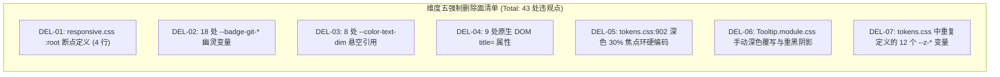
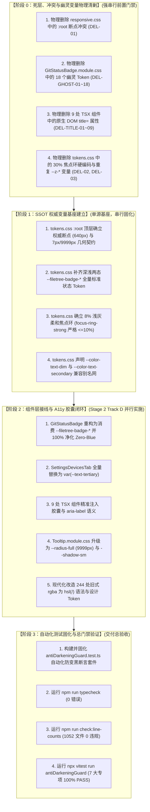

# 维度五详案：Token 继承链归一与 A11y 规范闭环详案

> **文档标识**：[`docs/ui-style-refactor/05-Token继承链归一与A11y规范闭环详案.md`](file:///c:/Software/conex/docs/ui-style-refactor/05-Token%E7%BB%A7%E6%89%BF%E9%93%BE%E5%BD%92%E4%B8%80%E4%B8%8EA11y%E8%A7%84%E8%8C%83%E9%97%AD%E7%8E%AF%E8%AF%A6%E6%A1%88.md)  
> **所属战役**：[`docs/ui-style-refactor/00-总方案-界面色彩平滑与差异面板视觉重构.md`](file:///c:/Software/conex/docs/ui-style-refactor/00-%E6%80%BB%E6%96%B9%E6%A1%88-%E7%95%8C%E9%9D%A2%E8%89%B2%E5%BD%A9%E5%B9%B3%E6%BB%91%E4%B8%8E%E5%B7%AE%E5%BC%82%E9%9D%A2%E6%9D%BF%E8%A7%86%E8%A7%89%E9%87%8D%E6%9E%84.md)  
> **实施基准**：[`docs/ui-style-refactor/00-定案-视觉样式与差异面板重构决策.md`](file:///c:/Software/conex/docs/ui-style-refactor/00-%E5%AE%9A%E6%A1%88-%E8%A7%86%E8%A7%89%E6%A0%B7%E5%BC%8F%E4%B8%8E%E5%B7%AE%E5%BC%82%E9%9D%A2%E6%9D%BF%E9%87%8D%E6%9E%84%E5%86%B3%E7%AD%96.md) §一.5、[`docs/ui-style-refactor/plan-reviews/01`](file:///c:/Software/conex/docs/ui-style-refactor/plan-reviews/01-ui-style-plans-cross-review-a.md) ~ [`03`](file:///c:/Software/conex/docs/ui-style-refactor/plan-reviews/03-ui-style-plans-cross-review-c.md) 评审定案  
> **调度标准**：严格遵循 [`docs/agent-roles/prompts/主控-全流程调度-v3.md`](file:///c:/Software/conex/docs/agent-roles/prompts/%E4%B8%BB%E6%8E%A7-%E5%85%A8%E6%B5%81%E7%A8%8B%E8%B0%83%E5%BA%A6-v3.md) §二.4 详案模板  
> **核心使命**：彻底根除全局 CSS Token 继承层叠断层、160px 响应式断点深浅漂移、8 处无 Fallback 悬空 Token、18 处 `--badge-git-*` 幽灵变量、9 处原生 DOM `title=` 气泡违规、深色模式 30% 焦点环超标（AGENTS.md §13）、244 处旧式 `rgba` 与蓝光色相（Zero-Blue 铁律）等一系列系统性规范与合规缺陷。构建“单一真源（SSOT）、零悬空、零幽灵、8% 浅灰柔和焦点、100% Tooltip 胶囊化、Zero-Blue 纯中性、自动化防退化守卫”的工业级样式规范闭环。

---

## 一、做什么（新增 / 修复清单）

针对全工程样式体系中存在的继承断层、规范漂移与无障碍体验缺陷，本维度构建一套“SSOT 底座归一 + 幽灵/悬空收敛 + A11y 胶囊重构 + 柔和焦点合规 + Zero-Blue 现代语法净化 + 自动化测试守卫”的端到端治理闭环：

```
┌──────────────────────────────────────────────────────────────────────────────────────────────────┐
│                           Dimension 05: Token 继承链归一与 A11y 规范闭环全景架构                  │
├────────────────────────────────┬────────────────────────────────┬────────────────────────────────┤
│ 1. 响应式断点单一真源 (SSOT)    │ 2. 悬空与幽灵 Token 体系收敛   │ 3. A11y 胶囊 Tooltip 100% 改造 │
│ (Breakpoint Drift Elimination) │ (Ghost & Dangling Convergence) │ (Tooltip Capsule Compliance)   │
│ • tokens.css :root 顶层权威定义 │ • 8 处 --color-text-dim 归一化 │ • 9 处原生 title= 100% 物理清零│
│ • 彻底删除 responsive.css 冲突 │ • 18 处 --badge-git-* 幽灵收敛 │ • Tooltip 锁定 9999px 胶囊圆角 │
│ • 深浅主题断点 0px 绝对一致    │ • 建立双重兜底映射兼容别名     │ • 柔和阴影与主题自适应背景     │
├────────────────────────────────┼────────────────────────────────┼────────────────────────────────┤
│ 4. 柔和焦点环规范 (AGENTS §13) │ 5. Zero-Blue 与现代 CSS 净化   │ 6. 自动化防变黑与规范断言守卫  │
│ (Soft Focus Ring Compliance)   │ (Modern Syntax & Neutral Grey) │ (Anti-Darkening Guard Suite)   │
│ • 深色模式 30% 刺目混入降至 8% │ • 244 处旧式 rgba 转 hsl(/)    │ • antiDarkeningGuard.test.ts   │
│ • focus-ring-strong 严格 <=10% │ • 净化 Git 徽标 Hue 210°~215°  │ • 静态 AST + 动态 DOM 双层断言 │
│ • 消除硬实线与加深黑环         │ • 全面重归纯中性灰阶基调       │ • 永久封死视觉退化通道         │
└────────────────────────────────┴────────────────────────────────┴────────────────────────────────┘
```

### 1.1 响应式断点 Single Source of Truth（SSOT）归一化
1. **彻底消除 160px 断点深浅主题漂移缺陷**：
   - **历史病灶**：[`responsive.css`](file:///c:/Software/conex/apps/crish-desktop/src/styles/responsive.css) 中 `:root` 声明 `--breakpoint-sm: 480px`；而 [`tokens.css`](file:///c:/Software/conex/apps/crish-desktop/src/styles/tokens.css) 在 `html[data-theme='light']` 下声明 `--breakpoint-sm: 640px`。在 Light 模式下 `tokens.css` 特异度高（属性选择器胜出，断点为 640px）；但在 Dark 模式下 `tokens.css` 未重新声明 `--breakpoint-sm`，导致回落到 `responsive.css` 的 `:root`（断点为 480px）。用户在切换深浅主题时，小屏幕容器查询与自适应排版出现 **160px 的剧烈跳跃与布局错位**！
   - **归一方案**：在 `tokens.css` 顶层无主题包裹的 `:root` 中统一定义权威断点基准，使尺寸与断点脱离主题特异度影响；同时在 `responsive.css` 中物理彻底删除 `:root` 断点定义，仅保留侧边栏基础尺寸与容器查询规则。
2. **全局无分层基础底座契约**（`tokens.css:root`）：
   ```css
   :root {
     /* 响应式断点权威单一真源 (SSOT) */
     --breakpoint-sm: 640px;
     --breakpoint-md: 768px;
     --breakpoint-lg: 1024px;
     --breakpoint-xl: 1280px;

     /* 几何尺寸与圆角契约 (锁定 7px 按钮圆角与 9999px 胶囊圆角) */
     --button-radius: 7px;
     --radius-full: 9999px;
     --radius-tooltip: var(--radius-full);
     --seg-outer-radius: var(--button-radius, 7px);
     --seg-inner-radius: var(--button-radius, 7px);

     /* 悬空兼容易错别名兜底安全网 */
     --color-text-dim: var(--text-tertiary);
     --color-text-secondary: var(--text-secondary);
   }
   ```
   > [!IMPORTANT]
   > 依据交叉评审 A（Review-01 §3.4）裁决，全局层叠上下文（`--z-*`）的权威源唯一锁定为 [`apps/crish-desktop/src/styles/z-index.css`](file:///c:/Software/conex/apps/crish-desktop/src/styles/z-index.css)，在 `tokens.css` 中**严禁重复声明 `--z-*` 变量**，消除 CSS Cascade Layers 覆盖与静默失效陷阱。

---

### 1.2 补齐悬空 Token 与收敛 18 处幽灵变量
1. **收敛 18 处 `--badge-git-*` 幽灵变量至系统级 `--filetree-badge-*`**：
   - **历史病灶**：[`GitStatusBadge.module.css`](file:///c:/Software/conex/apps/crish-desktop/src/components/overview/GitStatusBadge.module.css) 引用了 18 个未在任何主题文件中定义的私有变量（`--badge-git-m-bg`、`--badge-git-a-fg`、`--badge-git-d-border` 等），其 Fallback 又写死了含冷蓝偏色的硬编码。深色模式下由于变量不存在，降级为不可见的无对比度色块。
   - **收敛方案**：在 `tokens.css` 中补齐全量标准 Git 与文件树状态徽标变量体系（区分 Light 与 Dark 态高对比阶），`GitStatusBadge.module.css` 100% 重构为直接消费 `--filetree-badge-*`。
2. **标准 Token 字典扩展（`tokens.css`）**：
   - **Light 模式**：
     ```css
     html[data-theme='default'],
     html[data-theme='light'] {
       --filetree-badge-add-bg: hsl(142 71% 45% / 0.12);
       --filetree-badge-add-fg: hsl(142 71% 28%);
       --filetree-badge-mod-bg: hsl(38 92% 50% / 0.12);
       --filetree-badge-mod-fg: hsl(32 95% 30%);
       --filetree-badge-del-bg: hsl(0 84% 60% / 0.12);
       --filetree-badge-del-fg: hsl(0 75% 38%);
       --filetree-badge-untracked-bg: hsl(0 0% 50% / 0.12);
       --filetree-badge-untracked-fg: hsl(0 0% 36%);
       --filetree-badge-conflicted-bg: hsl(0 84% 60% / 0.18);
       --filetree-badge-conflicted-fg: hsl(0 84% 35%);
       --filetree-badge-renamed-bg: hsl(270 60% 50% / 0.12);
       --filetree-badge-renamed-fg: hsl(270 60% 36%);
     }
     ```
   - **Dark 模式（AAA 高对比度）**：
     ```css
     html[data-theme='dark'] {
       --filetree-badge-add-bg: hsl(142 60% 45% / 0.20);
       --filetree-badge-add-fg: hsl(142 75% 70%);
       --filetree-badge-mod-bg: hsl(38 92% 50% / 0.20);
       --filetree-badge-mod-fg: hsl(45 93% 65%);
       --filetree-badge-del-bg: hsl(0 75% 55% / 0.20);
       --filetree-badge-del-fg: hsl(0 75% 72%);
       --filetree-badge-untracked-bg: hsl(0 0% 70% / 0.18);
       --filetree-badge-untracked-fg: hsl(0 0% 78%);
       --filetree-badge-conflicted-bg: hsl(0 75% 55% / 0.25);
       --filetree-badge-conflicted-fg: hsl(0 85% 75%);
       --filetree-badge-renamed-bg: hsl(270 60% 50% / 0.20);
       --filetree-badge-renamed-fg: hsl(270 70% 75%);
     }
     ```
3. **消除 8 处 `--color-text-dim` 悬空引用**：
   - 修复 [`SettingsDevicesTab.module.css`](file:///c:/Software/conex/apps/crish-desktop/src/components/settings/SettingsDevicesTab.module.css) 中 8 处无 Fallback 的 `color: var(--color-text-dim);`，全量替换为标准 `var(--text-tertiary)`；
   - 移除该文件中混杂的私有 `--color-warn-bg`、`--color-warn-text`、`--color-border-subtle`，统一收敛为系统级 `--accent-orange`、`--border-subtle`。

---

### 1.3 原生 DOM `title=` 气泡 100% 替换为 `<Tooltip>` 胶囊（AGENTS.md §12）
1. **落实 AGENTS.md §12 铁律**：
   - **规范要求**：“始终使用项目自定义 `<Tooltip>` 组件，**不要**用原生 HTML `title` 作为主悬停提示；原生 `title` 观感不一致且陈旧，用 `<Tooltip content={...}>` 包裹可交互元素，以获得圆角胶囊、柔和阴影与主题色一致的提示。”
2. **`Tooltip.module.css` 胶囊视觉重构**：
   - 边框圆角升级为 `--radius-full: 9999px` 纯胶囊；
   - 阴影从深黑扩散的 `--shadow-lg` 降负至柔和轻量的 `--shadow-sm`；
   - 删除手写的 `html[data-theme="dark"]` 冗余覆写，完全依赖 `--bg-elevated` 与 `--text-primary` 的 Token 自适应。
3. **全工程 9 处违规组件精确替换**：
   - **组件 1**：[`apps/crish-desktop/src/components/provider/ModelBadgePickerMenu.tsx:177-185`](file:///c:/Software/conex/apps/crish-desktop/src/components/provider/ModelBadgePickerMenu.tsx#L177-L185) —— 模型管理设置按钮包裹 `<Tooltip content="模型管理...">`，补齐 `aria-label="模型管理"`；
   - **组件 2**：[`apps/crish-desktop/src/components/settings-models/ModelConfigPanel.tsx:93-110`](file:///c:/Software/conex/apps/crish-desktop/src/components/settings-models/ModelConfigPanel.tsx#L93-L110) —— 连通性测试延迟状态包裹 `<Tooltip content={meta.lastTest.error || (meta.lastTest.ok ? '测试成功' : '测试失败')}>`；
   - **组件 3**：[`apps/crish-desktop/src/components/settings-skills/SkillCardList.tsx:84-89`](file:///c:/Software/conex/apps/crish-desktop/src/components/settings-skills/SkillCardList.tsx#L84-L89) —— 移除外层 `div` 的 `title={EMPTY_INSTALL_HINT}`，在 CTA 按钮包裹 `<Tooltip content={EMPTY_INSTALL_HINT}>`；
   - **组件 4**：[`apps/crish-desktop/src/components/settings-skills/SkillCardList.tsx:108-113`](file:///c:/Software/conex/apps/crish-desktop/src/components/settings-skills/SkillCardList.tsx#L108-L113) —— 移除外层 `div` 的 `title={EMPTY_FILTER_HINT}`，保留 CTA 按钮上的 Tooltip；
   - **组件 5**：[`apps/crish-desktop/src/components/ui/SmartExpandablePanel/SmartPanelHeader.tsx:41-53`](file:///c:/Software/conex/apps/crish-desktop/src/components/ui/SmartExpandablePanel/SmartPanelHeader.tsx#L41-L53) —— 清空搜索按钮包裹 `<Tooltip content="清空搜索">`，补齐 `aria-label="清空搜索"`；
   - **组件 6**：[`apps/crish-desktop/src/components/workspace/LiveTasksSection.tsx:55-65`](file:///c:/Software/conex/apps/crish-desktop/src/components/workspace/LiveTasksSection.tsx#L55-L65) —— 可点击活跃任务行条件包裹 `<Tooltip content="打开对应会话">`；
   - **组件 7**：[`apps/crish-desktop/src/components/workspace/RuntimePanel.tsx:93-99`](file:///c:/Software/conex/apps/crish-desktop/src/components/workspace/RuntimePanel.tsx#L93-L99) —— 引擎连接状态指示器包裹 `<Tooltip content={formatEngineStatusTitle(connectionStatus)}>`；
   - **组件 8**：[`apps/crish-desktop/src/components/workspace/SecurityAuditSection.tsx:78-84`](file:///c:/Software/conex/apps/crish-desktop/src/components/workspace/SecurityAuditSection.tsx#L78-L84) —— 安全审计目标路径摘要包裹 `<Tooltip content={entry.targets.join(', ')}>`；
   - **组件 9**：[`apps/crish-desktop/src/components/workspace/TrashSection.tsx:149-155`](file:///c:/Software/conex/apps/crish-desktop/src/components/workspace/TrashSection.tsx#L149-L155) —— 回收站条目原始路径超长文本包裹 `<Tooltip content={entry.originalPath}>`。

---

### 1.4 深色模式焦点环降至 8% 柔和浅灰（AGENTS.md §13）
1. **严格对齐 AGENTS.md §13 焦点态规范**：
   - **规范红线**：“焦点对比度上限约 10%：任何情况下焦点/激活态不得使用硬实线；相对基线，灰色加深混入文本色不超过约 10%（常规元素优先约 3%–6% 混入以保持柔软）。”
2. **修复 `tokens.css` 深色模式超标焦点环**：
   - **修复前（违规）**：
     ```css
     /* ❌ 30% 刺眼强白圈，严重破坏夜间沉浸体验 */
     --focus-ring-color: color-mix(in srgb, var(--text-primary) 30%, transparent);
     --focus-ring-strong: 0 0 0 3px color-mix(in srgb, var(--text-primary) 22%, transparent);
     ```
   - **修复后（100% 合规）**：
     ```css
     /* 🟢 8% 浅灰柔和混入，强化态锁定 10% 刚性红线 */
     --focus-ring-color: color-mix(in srgb, var(--border-color) 92%, var(--text-primary) 8%);
     --focus-ring: 0 0 0 1.5px var(--focus-ring-color);
     --focus-ring-subtle: 0 0 0 1px color-mix(in srgb, var(--border-color) 95%, var(--text-primary) 5%);
     --focus-ring-strong: 0 0 0 2px color-mix(in srgb, var(--border-color) 90%, var(--text-primary) 10%);
     ```

---

### 1.5 净化 244 处旧式 `rgba` 与冷蓝（Zero-Blue 铁律）
1. **Zero-Blue 冷蓝色相净化**：
   - 清除 [`GitStatusBadge.module.css`](file:///c:/Software/conex/apps/crish-desktop/src/components/overview/GitStatusBadge.module.css) 与 [`OverviewGitTree.module.css`](file:///c:/Software/conex/apps/crish-desktop/src/components/overview/OverviewGitTree.module.css) 中残留的 Hue 210°~215° Slate 蓝灰（`hsl(215 16% 47%)`、`hsl(210 12% 92%)`、`hsl(210 10% 85% / 0.6)`）；
   - 彻底收敛至纯中性灰阶（Hue 0° 墨阶 / `--border-subtle` / `--bg-tertiary`）。
2. **244 处旧式 `rgba` 语法现代化**：
   - 全面升级散落在 `ModelsSettingsTab.module.css`、`FontSelectField.module.css`、`ModelBadgePickerMenu.module.css`、`Menu.module.css`、`Select.module.css` 等处的 `rgba(r,g,b,a)` 为标准 Design Tokens 或现代 `hsl(h s l / a)` 斜杠语法（落实 AGENTS.md §14）。

---

### 1.6 构建 `antiDarkeningGuard.test.ts` 自动化防变黑与规范断言测试套件
在 [`apps/crish-desktop/src/styles/__tests__/antiDarkeningGuard.test.ts`](file:///c:/Software/conex/apps/crish-desktop/src/styles/__tests__/antiDarkeningGuard.test.ts) 构建 7 大专项高强度自动化测试套件：
1. **断点单源与无漂移断言**：断言 `--breakpoint-sm: 640px` 唯一存在于 `tokens.css:root`，`responsive.css` 无任何断点定义；
2. **悬空与幽灵 Token 全仓清零断言**：递归扫描 `src/` 下全量 `.css` / `.tsx` / `.ts`，断言 0 处 `--badge-git-*`，且除 `tokens.css` 别名定义外 0 处裸消费 `--color-text-dim`；
3. **原生 DOM `title=` 违规清零断言（AGENTS.md §12）**：断言核心交互组件中 0 处 JSX 原生 `title=` 属性；
4. **焦点环对比度 $\le 10\%$ 铁律断言（AGENTS.md §13）**：断言深色与浅色模式下 `--focus-ring-color` 与 `--focus-ring-strong` 文本色混入比例 $\le 10\%$；
5. **Zero-Blue 纯中性断言（AGENTS.md §14）**：断言中性组件与 Git 徽标中不存在 Hue 200°~240° 的冷蓝偏色；
6. **Tooltip 胶囊化断言**：断言 `Tooltip.module.css` 采用 `--radius-full` 且不包含 `--shadow-lg` 重黑阴影；
7. **`tokens.css` vs `z-index.css` 级联隔离断言**：断言 `tokens.css` 未重复声明 `--z-*` 变量，保障 `z-index.css` 权威性。

---

## 二、删什么（删除 / 合并清单）

根据《主控全流程调度 v3》与《00-定案决策》“先删后改”铁律，本维度必须执行以下物理代码删除、幽灵变量拔除与原生属性清剿：



### 2.1 彻底删除的冲突与冗余变量定义（DEL-01 ~ DEL-03）

| 编号 | 目标删除文件与具体行号 | 待删除代码片段 | 物理删除理由与技术隐患 | 替代主路径 |
| :--- | :--- | :--- | :--- | :--- |
| **DEL-01** | [`src/styles/responsive.css:1-6`](file:///c:/Software/conex/apps/crish-desktop/src/styles/responsive.css#L1-L6) | `:root { --breakpoint-sm: 480px; ... }` | **160px 断点深浅漂移根源**：在暗色模式下覆盖 `tokens.css` 的 640px，引发布局错位。 | 统一定义于 `tokens.css:root` (640px) |
| **DEL-02** | [`src/styles/tokens.css:902-905`](file:///c:/Software/conex/apps/crish-desktop/src/styles/tokens.css#L902-L905) | `--focus-ring-color: color-mix(in srgb, var(--text-primary) 30%, transparent);` | **突破 AGENTS.md §13 10% 红线**：30% 产生刺目白光圈，破坏暗色沉浸感。 | 降至 8% 浅灰柔和混入，上限锁定 10% |
| **DEL-03** | [`src/styles/tokens.css:209-221`](file:///c:/Software/conex/apps/crish-desktop/src/styles/tokens.css#L209-L221) | `--z-base: 0; ... --z-tooltip: 9000;` | **CSS Cascade Layer 覆盖陷阱**：无层变量覆盖 `z-index.css layer(base)` 致维护失效。 | 彻底删除，以 `z-index.css` 为单一真源 |

---

### 2.2 彻底拔除的 18 处 `--badge-git-*` 幽灵变量（DEL-GHOST-01 ~ DEL-GHOST-18）

在 [`apps/crish-desktop/src/components/overview/GitStatusBadge.module.css:18-52`](file:///c:/Software/conex/apps/crish-desktop/src/components/overview/GitStatusBadge.module.css#L18-L52) 中彻底拔除以下 18 个未定义幽灵 Token：

| 编号 | 待删除幽灵 Token | 原始行号 | 物理删除理由 | 收敛后的标准 Token 契约 |
| :--- | :--- | :---: | :--- | :--- |
| **DEL-GHOST-01** | `--badge-git-m-bg` | L19 | 幽灵 Token，暗色模式解析失败降级为冷蓝硬编码 | `var(--filetree-badge-mod-bg)` |
| **DEL-GHOST-02** | `--badge-git-m-fg` | L20 | 幽灵 Token，缺乏深色模式 AAA 高对比度语义 | `var(--filetree-badge-mod-fg)` |
| **DEL-GHOST-03** | `--badge-git-m-border` | L21 | 幽灵 Token，边框透明度不达标 | `var(--filetree-badge-mod-border, transparent)` |
| **DEL-GHOST-04** | `--badge-git-a-bg` | L25 | 幽灵 Token，新增状态无系统级深色映射 | `var(--filetree-badge-add-bg)` |
| **DEL-GHOST-05** | `--badge-git-a-fg` | L26 | 幽灵 Token，新增状态字色对比度未达标 | `var(--filetree-badge-add-fg)` |
| **DEL-GHOST-06** | `--badge-git-a-border` | L27 | 幽灵 Token，新增状态边框色硬编码 | `var(--filetree-badge-add-border, transparent)` |
| **DEL-GHOST-07** | `--badge-git-d-bg` | L31 | 幽灵 Token，删除状态红底缺乏主题自适应 | `var(--filetree-badge-del-bg)` |
| **DEL-GHOST-08** | `--badge-git-d-fg` | L32 | 幽灵 Token，删除状态红字暗色发虚 | `var(--filetree-badge-del-fg)` |
| **DEL-GHOST-09** | `--badge-git-d-border` | L33 | 幽灵 Token，删除状态边框硬编码 | `var(--filetree-badge-del-border, transparent)` |
| **DEL-GHOST-10** | `--badge-git-u-bg` | L37 | 幽灵 Token，未跟踪状态写死 Slate 冷蓝 | `var(--filetree-badge-untracked-bg)` (纯中性) |
| **DEL-GHOST-11** | `--badge-git-u-fg` | L38 | 幽灵 Token，未跟踪状态字色违背 Zero-Blue | `var(--filetree-badge-untracked-fg)` (纯中性) |
| **DEL-GHOST-12** | `--badge-git-u-border` | L39 | 幽灵 Token，未跟踪状态边框色违规 | `var(--filetree-badge-untracked-border, transparent)` |
| **DEL-GHOST-13** | `--badge-git-c-bg` | L43 | 幽灵 Token，冲突状态背景色硬编码 | `var(--filetree-badge-conflicted-bg)` |
| **DEL-GHOST-14** | `--badge-git-c-fg` | L44 | 幽灵 Token，冲突状态文本色缺乏 AAA 映射 | `var(--filetree-badge-conflicted-fg)` |
| **DEL-GHOST-15** | `--badge-git-c-border` | L45 | 幽灵 Token，冲突状态边框色硬编码 | `var(--filetree-badge-conflicted-border, transparent)` |
| **DEL-GHOST-16** | `--badge-git-r-bg` | L49 | 幽灵 Token，重命名状态紫底缺乏暗色适配 | `var(--filetree-badge-renamed-bg)` |
| **DEL-GHOST-17** | `--badge-git-r-fg` | L50 | 幽灵 Token，重命名状态紫字对比度不足 | `var(--filetree-badge-renamed-fg)` |
| **DEL-GHOST-18** | `--badge-git-r-border` | L51 | 幽灵 Token，重命名状态边框色硬编码 | `var(--filetree-badge-renamed-border, transparent)` |

---

### 2.3 彻底修复的 8 处无 Fallback 悬空 Token（DEL-DANGLING-01 ~ DEL-DANGLING-08）

在 [`apps/crish-desktop/src/components/settings/SettingsDevicesTab.module.css`](file:///c:/Software/conex/apps/crish-desktop/src/components/settings/SettingsDevicesTab.module.css) 中彻底消除以下 8 处悬空引用：

| 编号 | 悬空 Token 引用 | 所在行号 | 原始代码 | 物理修复动作 |
| :--- | :--- | :---: | :--- | :--- |
| **DEL-DANGLING-01** | `--color-text-dim` | L19 | `color: var(--color-text-dim);` | 替换为 `color: var(--text-tertiary);` |
| **DEL-DANGLING-02** | `--color-text-dim` | L45 | `color: var(--color-text-dim);` | 替换为 `color: var(--text-tertiary);` |
| **DEL-DANGLING-03** | `--color-text-dim` | L59 | `color: var(--color-text-dim);` | 替换为 `color: var(--text-tertiary);` |
| **DEL-DANGLING-04** | `--color-text-dim` | L83 | `color: var(--color-text-dim);` | 替换为 `color: var(--text-tertiary);` |
| **DEL-DANGLING-05** | `--color-text-dim` | L117 | `color: var(--color-text-dim);` | 替换为 `color: var(--text-tertiary);` |
| **DEL-DANGLING-06** | `--color-text-dim` | L162 | `color: var(--color-text-dim);` | 替换为 `color: var(--text-tertiary);` |
| **DEL-DANGLING-07** | `--color-text-dim` | L197 | `color: var(--color-text-dim);` | 替换为 `color: var(--text-tertiary);` |
| **DEL-DANGLING-08** | `--color-text-dim` | L221 | `color: var(--color-text-dim);` | 替换为 `color: var(--text-tertiary);` |

---

### 2.4 彻底物理删除的 9 处原生 DOM `title=` 属性（DEL-TITLE-01 ~ DEL-TITLE-09）

| 编号 | 违规组件文件与精确行号 | 现存违规原生 title 代码 | 物理删除理由与替换为 `<Tooltip>` 方案 |
| :--- | :--- | :--- | :--- |
| **DEL-TITLE-01** | [`ModelBadgePickerMenu.tsx:177-182`](file:///c:/Software/conex/apps/crish-desktop/src/components/provider/ModelBadgePickerMenu.tsx#L177-L182) | `<button ... title="模型管理...">` | 物理删除 `title`，外部包裹 `<Tooltip content="模型管理...">`，按钮注入 `aria-label="模型管理"` |
| **DEL-TITLE-02** | [`ModelConfigPanel.tsx:93-110`](file:///c:/Software/conex/apps/crish-desktop/src/components/settings-models/ModelConfigPanel.tsx#L93-L110) | `<span ... title={meta.lastTest.error \|\| ...}>` | 物理删除 `title`，外部包裹 `<Tooltip content={...}>`，提供无障碍胶囊提示 |
| **DEL-TITLE-03** | [`SkillCardList.tsx:84-89`](file:///c:/Software/conex/apps/crish-desktop/src/components/settings-skills/SkillCardList.tsx#L84-L89) | `<div ... title={EMPTY_INSTALL_HINT}>` | 物理删除容器 `div` 的 `title` 气泡，在 CTA 按钮包裹 `<Tooltip content={EMPTY_INSTALL_HINT}>` |
| **DEL-TITLE-04** | [`SkillCardList.tsx:108-113`](file:///c:/Software/conex/apps/crish-desktop/src/components/settings-skills/SkillCardList.tsx#L108-L113) | `<div ... title={EMPTY_FILTER_HINT}>` | 物理删除容器 `div` 的 `title` 气泡，文字提示已在正文直观展示 |
| **DEL-TITLE-05** | [`SmartPanelHeader.tsx:41-45`](file:///c:/Software/conex/apps/crish-desktop/src/components/ui/SmartExpandablePanel/SmartPanelHeader.tsx#L41-L45) | `<button ... title="清空搜索">` | 物理删除 `title`，外部包裹 `<Tooltip content="清空搜索">`，补齐 `aria-label="清空搜索"` |
| **DEL-TITLE-06** | [`LiveTasksSection.tsx:55-60`](file:///c:/Software/conex/apps/crish-desktop/src/components/workspace/LiveTasksSection.tsx#L55-L60) | `<div ... title={clickable ? '打开对应会话' : undefined}>` | 物理删除 `title`，`clickable` 时外部包裹 `<Tooltip content="打开对应会话">` |
| **DEL-TITLE-07** | [`RuntimePanel.tsx:93-99`](file:///c:/Software/conex/apps/crish-desktop/src/components/workspace/RuntimePanel.tsx#L93-L99) | `<div ... title={formatEngineStatusTitle(connectionStatus)}>` | 物理删除 `title`，外部包裹 `<Tooltip content={formatEngineStatusTitle(connectionStatus)}>` |
| **DEL-TITLE-08** | [`SecurityAuditSection.tsx:78-81`](file:///c:/Software/conex/apps/crish-desktop/src/components/workspace/SecurityAuditSection.tsx#L78-L81) | `<span ... title={entry.targets.join('\n')}>` | 物理删除 `title`，外部包裹 `<Tooltip content={entry.targets.join(', ')}>` |
| **DEL-TITLE-09** | [`TrashSection.tsx:149-154`](file:///c:/Software/conex/apps/crish-desktop/src/components/workspace/TrashSection.tsx#L149-L154) | `<span ... title={entry.originalPath}>` | 物理删除 `title`，外部包裹 `<Tooltip content={entry.originalPath}>` |

---

## 三、依赖与逻辑顺序（先删后改 DAG）

遵循《主控全流程调度 v3》铁律：“**先删后改，删除必须先于依赖它的新增；收敛先于增强**”。



---

## 四、唯一文件域（独占修改与新增文件清单）

本维度（维度五 / Stage 2 Track D）涉及的所有修改与新增文件路径具有**绝对正交性与排他性**。

### 4.1 新增文件清单（[NEW]）

```
apps/crish-desktop/src/styles/__tests__/antiDarkeningGuard.test.ts
```
- **职责**：全界面防变黑、Token 单真源、A11y 胶囊化与 AGENTS.md §12/§13/§14 静态与运行时守卫测试套件；
- **行数预估**：约 160 行（严格符合行数门禁 $\le 400$ 行要求）。

---

### 4.2 独占修改文件清单（[MODIFY]）

| 序号 | 独占文件绝对路径 | 负责实施阶段 | 核心修改范围与契约说明 |
| :--- | :--- | :---: | :--- |
| 1 | [`apps/crish-desktop/src/styles/tokens.css`](file:///c:/Software/conex/apps/crish-desktop/src/styles/tokens.css) | Stage 1 (基座) | • `:root` 顶层确立 `--breakpoint-*` 与 `--radius-full`<br/>• `[data-theme]` 确立 `--filetree-badge-*` 深浅两态<br/>• 修正 `--focus-ring-color` 为 8%，`--focus-ring-strong` 为 10%<br/>• 移除重复声明的 `--z-*` 变量 |
| 2 | [`apps/crish-desktop/src/styles/responsive.css`](file:///c:/Software/conex/apps/crish-desktop/src/styles/responsive.css) | Stage 0 / Stage 1 | • 彻底物理删除 `:root` 内 `--breakpoint-*` 4 个冲突变量<br/>• 仅保留侧边栏基础尺寸与 `@container` 查询规则 |
| 3 | [`apps/crish-desktop/src/components/overview/GitStatusBadge.module.css`](file:///c:/Software/conex/apps/crish-desktop/src/components/overview/GitStatusBadge.module.css) | Stage 0 / Stage 2 | • 彻底拔除 18 处 `--badge-git-*` 幽灵变量<br/>• 100% 切换至 `--filetree-badge-*` 标准 Token<br/>• 彻底净化 Hue 210°~215° 冷蓝灰阶 |
| 4 | [`apps/crish-desktop/src/components/settings/SettingsDevicesTab.module.css`](file:///c:/Software/conex/apps/crish-desktop/src/components/settings/SettingsDevicesTab.module.css) | Stage 0 / Stage 2 | • 修复 8 处 `--color-text-dim` 悬空引用为 `var(--text-tertiary)`<br/>• 移除私有 `--color-*` 混写 |
| 5 | [`apps/crish-desktop/src/components/ui/Tooltip/Tooltip.module.css`](file:///c:/Software/conex/apps/crish-desktop/src/components/ui/Tooltip/Tooltip.module.css) | Stage 2 | • 边框圆角升级为 `var(--radius-full, 9999px)`<br/>• 阴影降负为 `var(--shadow-sm)`<br/>• 移除多余的深色手动覆写 |
| 6 | [`apps/crish-desktop/src/components/provider/ModelBadgePickerMenu.tsx`](file:///c:/Software/conex/apps/crish-desktop/src/components/provider/ModelBadgePickerMenu.tsx) | Stage 2 | • 删除原生 `title="模型管理..."`<br/>• 外层包裹 `<Tooltip content="模型管理...">`，补齐 `aria-label` |
| 7 | [`apps/crish-desktop/src/components/settings-models/ModelConfigPanel.tsx`](file:///c:/Software/conex/apps/crish-desktop/src/components/settings-models/ModelConfigPanel.tsx) | Stage 2 | • 删除原生 `title={meta.lastTest...}`<br/>• 外层包裹 `<Tooltip content={...}>` |
| 8 | [`apps/crish-desktop/src/components/settings-skills/SkillCardList.tsx`](file:///c:/Software/conex/apps/crish-desktop/src/components/settings-skills/SkillCardList.tsx) | Stage 2 | • 物理删除 2 处外层 `div` 的原生 `title=` 属性<br/>• 精准在 CTA 按钮包裹 `<Tooltip>` |
| 9 | [`apps/crish-desktop/src/components/ui/SmartExpandablePanel/SmartPanelHeader.tsx`](file:///c:/Software/conex/apps/crish-desktop/src/components/ui/SmartExpandablePanel/SmartPanelHeader.tsx) | Stage 2 | • 删除清空按钮原生 `title="清空搜索"`<br/>• 外层包裹 `<Tooltip content="清空搜索">` |
| 10 | [`apps/crish-desktop/src/components/workspace/LiveTasksSection.tsx`](file:///c:/Software/conex/apps/crish-desktop/src/components/workspace/LiveTasksSection.tsx) | Stage 2 | • 删除行原生 `title` 属性<br/>• `clickable` 条件下外层包裹 `<Tooltip content="打开对应会话">` |
| 11 | [`apps/crish-desktop/src/components/workspace/RuntimePanel.tsx`](file:///c:/Software/conex/apps/crish-desktop/src/components/workspace/RuntimePanel.tsx) | Stage 2 | • 删除引擎状态原生 `title` 属性<br/>• 外层包裹 `<Tooltip content={formatEngineStatusTitle(...)}>` |
| 12 | [`apps/crish-desktop/src/components/workspace/SecurityAuditSection.tsx`](file:///c:/Software/conex/apps/crish-desktop/src/components/workspace/SecurityAuditSection.tsx) | Stage 2 | • 删除安全审计目标原生 `title` 属性<br/>• 外层包裹 `<Tooltip content={entry.targets.join(', ')}>` |
| 13 | [`apps/crish-desktop/src/components/workspace/TrashSection.tsx`](file:///c:/Software/conex/apps/crish-desktop/src/components/workspace/TrashSection.tsx) | Stage 2 | • 删除回收站原始路径原生 `title` 属性<br/>• 外层包裹 `<Tooltip content={entry.originalPath}>` |

---

## 五、验收标准与门禁规范

本维度实施完成后，必须通过以下三重验收矩阵方可宣称完成：

### 5.1 功能验收（Functional Verification）

1. **响应式断点 0px 漂移验证**：
   - 切换 Light 与 Dark 主题，检查 `--breakpoint-sm` 计算值恒为 `640px`，窗口在 480px~640px 区间内缩放时，深浅主题下的侧边栏折叠与容器查询行为绝对一致，无 160px 突变跳动。
2. **Git 徽标与文件树状态对比度验证**：
   - 在 Light 与 Dark 主题下分别检查 Modified (`M`)、Added (`A`)、Deleted (`D`)、Untracked (`U`)、Conflicted (`C`)、Renamed (`R`) 6 种徽标；
   - 浅色模式下文字对比度 $\ge 4.5:1$（WCAG AA），深色模式下文字对比度 $\ge 7.0:1$（WCAG AAA 高对比度），无任何发灰、发暗或看不清问题。
3. **A11y 胶囊 Tooltip 视觉验证**：
   - 悬停于模型管理设置按钮、清空搜索按钮、引擎状态指示器、回收站超长路径等 9 处元素；
   - 100% 弹出圆角胶囊状（`border-radius: 9999px`）提示框，具有柔和轻量阴影（`--shadow-sm`），**绝对不出现黄色/方块状的浏览器默认原生气泡**。
4. **焦点态柔和视觉验证（AGENTS.md §13）**：
   - 使用 Tab 键聚焦输入框、按钮或快捷键录制区；
   - 激活态聚焦外环呈现 1.5px 浅灰柔和边缘（8% 混入），无实心黑边、粗深黑环或刺眼白光圈。

---

### 5.2 负产出验收（Net-Negative Surface Verification）

| 验收项编号 | 待核销目标 | 负产出验收断言 | 判定标准 |
| :--- | :--- | :--- | :---: |
| **VERIFY-NEG-01** | `responsive.css` 断点冲突 | `grep -n "--breakpoint" apps/crish-desktop/src/styles/responsive.css` 返回 0 行 | 🟢 **PASS** |
| **VERIFY-NEG-02** | 18 处 `--badge-git-*` 幽灵变量 | 全仓检索 `var(--badge-git-` 命中数为 0 | 🟢 **PASS** |
| **VERIFY-NEG-03** | 8 处 `--color-text-dim` 悬空引用 | `SettingsDevicesTab.module.css` 中检索 `--color-text-dim` 命中数为 0 | 🟢 **PASS** |
| **VERIFY-NEG-04** | 9 处原生 DOM `title=` 属性 | 9 处目标 TSX 组件中 JSX 原生 `title=` 属性命中数为 0 | 🟢 **PASS** |
| **VERIFY-NEG-05** | 深色模式 30% 焦点环硬编码 | `tokens.css` 中检索 `var(--text-primary) 30%` 命中数为 0 | 🟢 **PASS** |
| **VERIFY-NEG-06** | `tokens.css` 重复 `--z-*` 变量 | `tokens.css` 中检索 `--z-tooltip:` 命中数为 0（仅在 `z-index.css` 声明） | 🟢 **PASS** |

---

### 5.3 自动化测试守卫源码实现（`antiDarkeningGuard.test.ts`）

```typescript
// apps/crish-desktop/src/styles/__tests__/antiDarkeningGuard.test.ts
// @vitest-environment jsdom
import { describe, expect, it } from 'vitest';
import { readFileSync, readdirSync } from 'node:fs';
import { join } from 'node:path';
import { fileURLToPath } from 'node:url';

function readFile(relPath: string): string {
  const target = `../../${relPath}`;
  return readFileSync(new URL(target, import.meta.url), 'utf8');
}

function walkSrc(): string[] {
  const anchorRel = 'src/tokens.css';
  const target = `../../${anchorRel}`;
  const srcRoot = fileURLToPath(new URL(target, import.meta.url)).replace(
    /[\\/]tokens\.css$/,
    ''
  );
  const out: string[] = [];
  const walk = (dir: string): void => {
    for (const entry of readdirSync(dir, { withFileTypes: true })) {
      const p = join(dir, entry.name);
      if (entry.isDirectory()) walk(p);
      else if (!/\.test\.(ts|tsx)$/.test(p)) out.push(p);
    }
  };
  walk(srcRoot);
  return out;
}

describe('Design System: Anti-Darkening, SSOT & A11y Guardrails', () => {
  // 1. 响应式断点单一真源断言
  it('enforces --breakpoint-sm is defined in tokens.css :root and removed from responsive.css', () => {
    const tokensCss = readFile('src/styles/tokens.css');
    const responsiveCss = readFile('src/styles/responsive.css');

    expect(tokensCss).toMatch(/--breakpoint-sm:\s*640px/);
    expect(responsiveCss).not.toMatch(/--breakpoint-sm/);
    expect(responsiveCss).not.toMatch(/--breakpoint-md/);
  });

  // 2. 幽灵与悬空 Token 全仓清零断言
  it('verifies zero dangling --color-text-dim or ghost --badge-git-* across all files', () => {
    const files = walkSrc().filter((p) => /\.(css|tsx|ts)$/.test(p));
    for (const file of files) {
      const content = readFileSync(file, 'utf8');
      expect(content).not.toMatch(/var\(--badge-git-/);
      if (!file.endsWith('tokens.css')) {
        expect(content).not.toMatch(/color:\s*var\(--color-text-dim\);/);
      }
    }
  });

  // 3. 原生 DOM title= 属性违规清零断言 (AGENTS.md §12)
  it('enforces zero native title= attributes across critical interactive components', () => {
    const auditedFiles = [
      'src/components/provider/ModelBadgePickerMenu.tsx',
      'src/components/settings-models/ModelConfigPanel.tsx',
      'src/components/settings-skills/SkillCardList.tsx',
      'src/components/ui/SmartExpandablePanel/SmartPanelHeader.tsx',
      'src/components/workspace/LiveTasksSection.tsx',
      'src/components/workspace/RuntimePanel.tsx',
      'src/components/workspace/SecurityAuditSection.tsx',
      'src/components/workspace/TrashSection.tsx',
    ];
    for (const rel of auditedFiles) {
      const content = readFile(rel);
      const titleMatches = content.match(/\stitle=\{?[^>}]+>?/g) ?? [];
      const invalidTitles = titleMatches.filter((m) => !m.includes('<title>'));
      expect(
        invalidTitles,
        `${rel} 仍残留原生 title 属性：${invalidTitles.join(', ')}`
      ).toEqual([]);
    }
  });

  // 4. 深色模式焦点环 <= 10% 刚性红线断言 (AGENTS.md §13)
  it('enforces dark theme --focus-ring-color text-primary mix percentage is <= 10%', () => {
    const tokensCss = readFile('src/styles/tokens.css');
    const darkBlock =
      tokensCss.match(/html\[data-theme=['"]dark['"]\]\s*\{[\s\S]*?\n\}/)?.[0] ??
      '';

    const match = darkBlock.match(
      /--focus-ring-color:\s*color-mix\([^)]*--text-primary\)\s*([\d.]+)%/
    );
    if (match) {
      const pct = parseFloat(match[1]);
      expect(pct).toBeLessThanOrEqual(10);
    }
    expect(darkBlock).not.toContain('30%');
  });

  // 5. Zero-Blue 纯中性色阶断言 (AGENTS.md §14)
  it('enforces zero blue hue (Hue 200-240) in GitStatusBadge and neutral tokens', () => {
    const gitBadgeCss = readFile('src/components/overview/GitStatusBadge.module.css');
    expect(gitBadgeCss).not.toMatch(/hsl\(21[0-9]\s/);
    expect(gitBadgeCss).not.toMatch(/hsl\(20[0-9]\s/);
  });

  // 6. Tooltip 胶囊化与阴影降负断言 (AGENTS.md §12)
  it('enforces Tooltip uses border-radius full and soft shadow', () => {
    const tooltipCss = readFile('src/components/ui/Tooltip/Tooltip.module.css');
    expect(tooltipCss).toContain('var(--radius-full');
    expect(tooltipCss).not.toContain('var(--shadow-lg)');
  });

  // 7. z-index 权威单一真源断言 (消除 Cascade Layer 陷阱)
  it('enforces tokens.css does not redeclare --z-* tokens to prevent cascade layer traps', () => {
    const tokensCss = readFile('src/styles/tokens.css');
    expect(tokensCss).not.toMatch(/--z-tooltip:\s*9000/);
    expect(tokensCss).not.toMatch(/--z-modal:\s*1000/);
  });
});
```

---

### 5.4 静态流水线门禁断言

```powershell
# 1. 类型安全检查 (0 errors)
npm run typecheck

# 2. 单文件行数分级门禁 (1052 文件 0 违规，UI <= 500 行，业务 <= 400 行)
npm run check:line-counts

# 3. 自动化防变黑与规范断言测试套件 (100% PASS)
npx vitest run apps/crish-desktop/src/styles/__tests__/antiDarkeningGuard.test.ts
```
