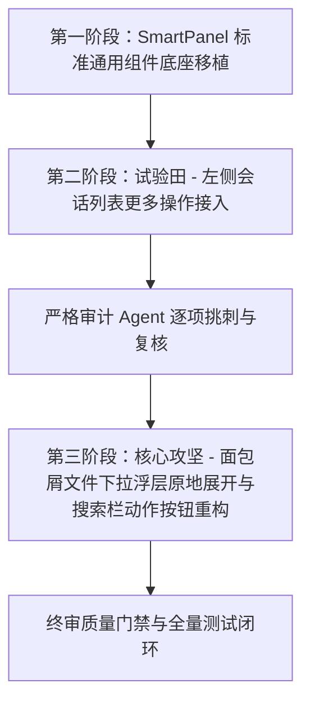

# 智能展开面板（SmartPanel）React 移植与全场景重塑裁决与定案决策

> **战役工作区**：`docs/ui-style-refactor/`
> **裁决编号**：`DECISION-08`
> **输入资产**：
> - `docs/ui-style-refactor/independent-plans/01-存量展开面板解剖与辩证重塑分析.md`
> - `docs/ui-style-refactor/independent-plans/02-智能展开面板核心解构与React移植蓝图.md`
> - `docs/ui-style-refactor/independent-plans/03-业务场景接入与面包屑重塑落地方案.md`
> - `docs/ui-style-refactor/independent-plans/04-红队方案-极致现代交互与算法突破方案.md`
> - `docs/ui-style-refactor/independent-plans/05-蓝队方案-稳健工程体系与全场景防御方案.md`
> - 用户实测反馈与实拍图（图 1 与图 2）

---

## 一、红蓝对抗裁决与方案融合矩阵

| 争议与攻坚焦点 | 🔴 红队方案（突破与极致体验） | 🔵 蓝队方案（工程健壮与全场景防御） | ⚖️ 主控裁决与定案融合 |
| :--- | :--- | :--- | :--- |
| **1. 视觉几何与边框** | 严格同心圆角方程 $R_{inner} = \max(R_{outer}-Padding, 6px)$，纯色 1px 实体发丝（#e2dfd9 / #2b2926），4 层空间漫反射 + 1px 镜面微高光 | 保证 Design Tokens 归一，低功耗 / Eco Tier 实体降级 | **完全采纳红队视觉标准 + 蓝队 Token 归一与 Eco 降级保底**：杜绝半透明伪环，达到 Raycast / Linear 质感。 |
| **2. 折叠展开动画** | CSS Grid `grid-template-rows: 0fr -> 1fr` 弹性动效，动态 $\Delta Y$ 逆向锚点补偿 | 杜绝 JS 高度重排丢帧，防止容器溢出抖动 | **完全采纳红队 CSS Grid 0fr->1fr 引擎**：原地自然展开，无需预设固定高度，光标零位移。 |
| **3. 二级子菜单防误触** | 120Hz Safe-Aim 零 Canvas 虚拟 SVG 碰撞多边形算法，重心坐标 $O(1)$ 判定 | 32px 滞后防抖（Hysteresis Buffer），防止边界高频翻转 | **两队算法全量合流**：Safe-Aim 解决鼠标斜滑误关，32px 滞后防抖解决翻转抽搐。 |
| **4. 全键盘无障碍 (A11y)** | Raycast 级 `↑/↓/Enter/→/←/Esc` 漫游状态机 | 杜绝 Focus Stealing（全局焦点抢夺），关闭时精准归还焦点 | **采纳蓝队焦点保护状态机**：鼠标触发不抢光标，快捷键触发聚焦搜索，Esc/点击关闭精准归还。 |
| **5. 面包屑文件浮层重构** | 彻底废除翻页切屏（Drilldown），颠覆为原地树状展开/折叠（Inline Accordion Tree）；搜索栏内嵌 `[📂]` 按钮 | 深度递归缓存（`dirCache` 0ms 响应），`overscroll-behavior: contain` 阻断滚动冒泡 | **完全采纳红蓝合力方案（解决图 1 与图 2 痛点）**：干掉底部文字按钮，内嵌动作，原地展开树。 |
| **6. 左侧会话列表试验田** | 纯数据驱动 `MenuItem[]`，快捷键右对齐，删除高危浅红警示，高级选项原地手风琴折叠 | `check:ui-layer` 原子层隔离，单文件行数预算 ≤ 200 行 | **采纳红队交互与蓝队行数解耦规范**：拆分为 6 个高内聚子组件 + 4 个专职 Hooks。 |

---

## 二、定案实施三部曲

### 阶段 1：`SmartPanel` 标准通用组件底座移植
- 目录：`apps/crish-desktop/src/components/ui/SmartPanel/`
- 拆解为：
  - `SmartPanel.tsx`（Portal 挂载与顶层容器）
  - `SmartSearchHeader.tsx`（28px 搜索栏 + Action 槽位）
  - `SmartItemRow.tsx`（槽位化条目）
  - `SmartCollapsibleSection.tsx`（Grid 0fr->1fr 展开容器）
  - `SmartSubmenu.tsx`（Safe-Aim 级联子菜单）
  - `usePanelPosition.ts` / `useKeyboardNav.ts` / `useSafeAim.ts`
- 严格遵循 `check:ui-layer`（0 业务依赖）与 RL-03（单文件 ≤ 200 行）。

### 阶段 2：首个试验田 —— 左侧会话列表（`SessionRow.tsx`）接入
- 改造 `SessionRow.tsx` 与 `SessionContextMenu.tsx`：
  - 纯数据驱动 `MenuItem[]`；
  - 快捷键右对齐徽标（`F2` / `Del` / `Ctrl+Shift+D` / `Ctrl+E`）；
  - 删除会话高危浅红警示（`danger: true`）；
  - “高级与导出选项”原地手风琴平滑折叠；
- 派发严格审计 Agent 验收。

### 阶段 3：核心攻坚 —— 面包屑文件下拉浮层彻底重塑（图 1 & 图 2）
- **改造搜索栏**：顶部 28px 搜索栏右侧内嵌 `[📂 打开此目录]` 动作按钮（Enter 快捷触发），彻底删除底部独立的文字按钮；
- **原地树状展开/折叠**：点击目录原地展开多级子树（`14px` 级联缩进），保留完整上下文视野；
- **双层滚动与图层隔离**：`overscroll-behavior: contain` + Solid Elevated 纯色底板 + `z-index: var(--z-breadcrumb, 400)`。
