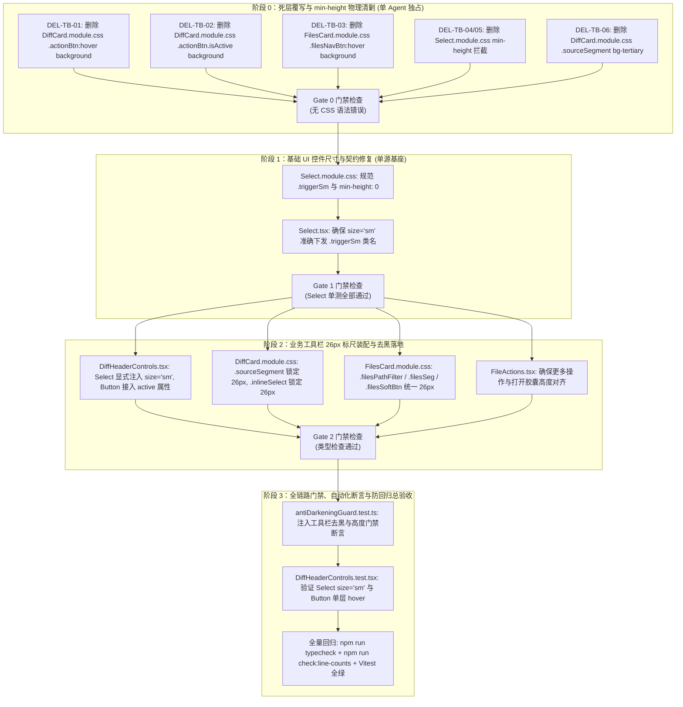

# Conex / Crish — 维度详案 12：紧凑工具栏高度对齐与按钮 Hover 去黑详案

> **方案编号**：PLAN-12-DETAILED  
> **所属战役**：[`docs/ui-style-refactor/00-总方案-工作区面板交互平滑与视觉归一.md`](file:///c:/Software/conex/docs/ui-style-refactor/00-%E6%80%BB%E6%96%B9%E6%A1%88-%E5%B7%A5%E4%BD%9C%E5%8C%BA%E9%9D%A2%E6%9D%BF%E4%BA%A4%E4%BA%92%E5%B9%B3%E6%BB%91%E4%B8%8E%E8%A7%86%E8%A7%89%E5%BD%92%E4%B8%80.md)  
> **定案依据**：[`docs/ui-style-refactor/06-定案-工作区面板与工具栏细节深化决策.md`](file:///c:/Software/conex/docs/ui-style-refactor/06-%E5%AE%9A%E6%A1%88-%E5%B7%A5%E4%BD%9C%E5%8C%BA%E9%9D%A2%E6%9D%BF%E4%B8%8E%E5%B7%AE%E5%BC%82%E9%9D%A2%E6%9D%BF%E7%BB%86%E8%8A%82%E6%B7%B1%E5%8C%96%E5%86%B3%E7%AD%96.md) §一.2、[`docs/ui-style-refactor/audits/07-toolbar-buttons-hover-and-height-alignment-audit.md`](file:///c:/Software/conex/docs/ui-style-refactor/audits/07-toolbar-buttons-hover-and-height-alignment-audit.md) 专项审计报告  
> **调度标准**：严格遵循 [`docs/agent-roles/prompts/主控-全流程调度-v3.md`](file:///c:/Software/conex/docs/agent-roles/prompts/%E4%B8%BB%E6%8E%A7-%E5%85%A8%E6%B5%81%E7%A8%8B%E8%B0%83%E5%BA%A6-v3.md) §二.4 详案规范  
> **设计铁律**：严格对齐 [`AGENTS.md`](file:///c:/Software/conex/AGENTS.md) §12（同源文案与 Tooltip 规范）、§13（输入与焦点态、10% 对比度上限）、§14（Zero-Blue 纯中性色与现代 CSS 规范）  
> **核心使命**：彻底根除 `DiffCard.module.css` 与 `FilesCard.module.css` 中对 `<Button>` 的二次 `:hover { background: ... }` 覆写，消除双层叠加导致的 15.36% 死黑与危险按钮焦黑污染，收敛由 `ui/Button` 单层管理 4% 柔和高亮；消除 `Select.module.css` 的 `min-height: 32px` 级联覆盖陷阱，在 `DiffHeaderControls.tsx` 显式注入 `size="sm"`，将 32px 紧凑工具栏内的各交互控件统一锁定在 26px 几何基线上，实现像素级等高对齐。

---

## 目录

1. [一、做什么（新增 / 改造清单）](#一做什么新增--改造清单)
   - [1.1 按钮 Hover 双层叠加去黑：收敛至 `ui/Button` 单层 4% 遮罩](#11-按钮-hover-双层叠加去黑收敛至-uibutton-单层-4-遮罩)
   - [1.2 危险按钮（`variant="danger"`）色彩纯净纠偏：消除焦褐黑红污染](#12-危险按钮variantdanger色彩纯净纠偏消除焦褐黑红污染)
   - [1.3 `Select` 下拉组件紧凑尺寸适配与 `min-height` 级联解绑](#13-select-下拉组件紧凑尺寸适配与-min-height-级联解绑)
   - [1.4 工具栏 26px 几何标尺单一真源（SSOT）对齐](#14-工具栏-26px-几何标尺单一真源ssot对齐)
   - [1.5 变更来源胶囊（`.sourceSegment`）底板纯净与轻柔 Hover 重塑](#15-变更来源胶囊sourcesegment底板纯净与轻柔-hover-重塑)
   - [1.6 文件管理器工具栏（`.filesBar`）与操作组几何归一](#16-文件管理器工具栏filesbar与操作组几何归一)
2. [二、删什么（删除与收敛清单）](#二删什么删除与收敛清单)
   - [2.1 业务模块二次 `:hover` 与 `:active` 背景覆写删除面（DEL-TB-01 ~ DEL-TB-03）](#21-业务模块二次-hover-与-active-背景覆写删除面del-tb-01--del-tb-03)
   - [2.2 下拉组件与工具栏强制 `min-height` 冲突删除面（DEL-TB-04 ~ DEL-TB-05）](#22-下拉组件与工具栏强制-min-height-冲突删除面del-tb-04--del-tb-05)
   - [2.3 来源胶囊沉重污泥灰与硬编码色值删除面（DEL-TB-06）](#23-来源胶囊沉重污泥灰与硬编码色值删除面del-tb-06)
   - [2.4 全量删除与收敛前后对照矩阵](#24-全量删除与收敛前后对照矩阵)
3. [三、依赖与逻辑顺序（先删后改 DAG 拓扑）](#三依赖与逻辑顺序先删后改-dag-拓扑)
   - [3.1 实施推进 4 个阶段时序图与强依赖关系](#31-实施推进-4-个阶段时序图与强依赖关系)
   - [3.2 阶段 0 ~ 阶段 3 步骤级详细执行顺序](#32-阶段-0--阶段-3-步骤级详细执行顺序)
4. [四、唯一文件域（独占修改与新增文件清单）](#四唯一文件域独占修改与新增文件清单)
   - [4.1 独占修改文件清单](#41-独占修改文件清单)
   - [4.2 单元测试与门禁守卫清单](#42-单元测试与门禁守卫清单)
   - [4.3 跨维度协同与边界约束](#43-跨维度协同与边界约束)
5. [五、详细代码修改契约（Before / After 语义级差异与实现契约）](#五详细代码修改契约before--after-语义级差异与实现契约)
   - [5.1 `apps/crish-desktop/src/components/diff/DiffCard.module.css`](#51-appscrish-desktopsrccomponentsdiffdiffcardmodulecss)
   - [5.2 `apps/crish-desktop/src/components/diff/DiffHeaderControls.tsx`](#52-appscrish-desktopsrccomponentsdiffdiffheadercontrolstsx)
   - [5.3 `apps/crish-desktop/src/components/files/FilesCard.module.css`](#53-appscrish-desktopsrccomponentsfilesfilescardmodulecss)
   - [5.4 `apps/crish-desktop/src/components/ui/Select/Select.module.css`](#54-appscrish-desktopsrccomponentsuiselectselectmodulecss)
   - [5.5 `apps/crish-desktop/src/components/ui/Select/Select.tsx`](#55-appscrish-desktopsrccomponentsuiselectselecttsx)
   - [5.6 `apps/crish-desktop/src/components/files/FilesCard.tsx`](#56-appscrish-desktopsrccomponentsfilesfilescardtsx)
   - [5.7 `apps/crish-desktop/src/components/files/FileActions.tsx`](#57-appscrish-desktopsrccomponentsfilesfileactionstsx)
6. [六、A11y 无障碍、WCAG 2.1 对比度与几何对齐规范](#六a11y-无障碍wcag-21-对比度与几何对齐规范)
   - [6.1 26px 紧凑档位与 32px 容器垂直居中精确盒模型计算](#61-26px-紧凑档位与-32px-容器垂直居中精确盒模型计算)
   - [6.2 单层 Hover / Active 与 WCAG 对比度验证表](#62-单层-hover--active-与-wcag-对比度验证表)
   - [6.3 键盘焦点环（Focus Ring）与 A11y 语义契约](#63-键盘焦点环focus-ring与-a11y-语义契约)
7. [七、单测断言与防回归自动化守卫套件](#七单测断言与防回归自动化守卫套件)
   - [7.1 `antiDarkeningGuard.test.ts` 扩展工具栏去黑与高度门禁断言](#71-antidarkeningguardtestts-扩展工具栏去黑与高度门禁断言)
   - [7.2 `DiffHeaderControls.test.tsx` 渲染与尺寸单测断言](#72-diffheadercontrolstesttsx-渲染与尺寸单测断言)
   - [7.3 `Select.test.tsx` 紧凑尺寸单测断言](#73-selecttesttsx-紧凑尺寸单测断言)
8. [八、验收标准与门禁规范](#八验收标准与门禁规范)
   - [8.1 功能验收标准](#81-功能验收标准)
   - [8.2 负产出验收标准（Zero Tolerance）](#82-负产出验收标准zero-tolerance)
   - [8.3 全链路自动化门禁命令集](#83-全链路自动化门禁命令集)

---

## 一、做什么（新增 / 改造清单）

本详案（维度 12）针对 Conex / Crish 桌面端紧凑工具栏（32px 高度容器）中普遍存在的两大痛点展开专项治理：
1. **Hover 颜色死黑与焦黑污染**：业务样式表对 `<Button>` 基础组件进行了二次 `:hover { background: var(--bg-hover) }` 覆写，导致 DOM 自身背景与 `Button::before` 伪元素遮罩发生双重叠光，Hover 态从预期的 4% 飙升至近 8%，Active 态叠至 15.36%，危险操作变体（`Trash2`）更是混合出焦褐色脏斑；
2. **整行 DOM 高度参差不齐与 Select 爆框**：同一行内出现 20px / 24px / 14px / 32px / 26px 碎片化高度，其中 `<Select>` 遗漏 `size="sm"` 且底层样式存在 `min-height: 32px` 级联覆盖陷阱，在 32px 容器内被顶格挤满甚至溢出边框。

```
┌────────────────────────────────────────────────────────────────────────────────────────────────────────┐
│                        紧凑工具栏（32px Compact Toolbar）重构前后几何与光学状态对比                      │
├────────────────────────────────────────────────────────────────────────────────────────────────────────┤
│ 【重构前 Before: 高低错落、双层叠黑、焦褐混浊】                                                        │
│  32px 容器 ┌───────────────┐ ┌──┐ ┌──────────────────────────────────────┐     ┌───┐ ┌───┐ ┌───┐ ┌───┐ │
│            │ [AI]  [Git]   │ ││ │ │ [全部修改回合 (Turn #1)              ▼] │ ... │ ◫ │ ⌥ │ ⌕ │ 🗑│ │
│            └───────────────┘ └──┘ └──────────────────────────────────────┘     └───┘ └───┘ └───┘ └───┘ │
│            高度 24px(Tab 20) 14px   🚨 高度 32px (min-height 爆框顶格)           🚨 高度 26px (双层死黑)│
│            底色 #e2e5e8 偏暗        缺失 size="sm"，无内缩留白                  Hover 叠至 7.84%~15.4% │
│                                                                                                        │
│ 【重构后 After: 26px 标尺归一、单层 4% 轻柔微光、纯净居中】                                            │
│  32px 容器 ┌───────────────┐ ┌──┐ ┌──────────────────────────────────────┐     ┌───┐ ┌───┐ ┌───┐ ┌───┐ │
│  (上下留白 │ [AI]  [Git]   │ ││ │ │ [全部修改回合 (Turn #1)              ▼] │ ... │ ◫ │ ⌥ │ ⌕ │ 🗑│ │
│   各 3px)  └───────────────┘ └──┘ └──────────────────────────────────────┘     └───┘ └───┘ └───┘ └───┘ │
│            高度 26px(Tab 22) 14px   高度 26px (Select size="sm" 适配)           高度 26px (单层 4%)    │
│            底色 soft-bg 纯净        上下留白各 3px，居中对齐                    Button::before 纯净接管│
└────────────────────────────────────────────────────────────────────────────────────────────────────────┘
```

### 1.1 按钮 Hover 双层叠加去黑：收敛至 `ui/Button` 单层 4% 遮罩
- **物理清剿业务覆写**：彻底移除 `DiffCard.module.css` 中的 `.actionBtn:hover`、`.actionBtn.isActive` 以及 `FilesCard.module.css` 中的 `.filesNavBtn:hover` 背景样式声明；
- **单一真源接管**：工具栏中的操作按钮完全由基础组件 [`ui/Button`](file:///c:/Software/conex/apps/crish-desktop/src/components/ui/Button/Button.tsx) 自带的 `--btn-hover-overlay: var(--tint-hover)`（4% 黑色遮罩）与 `--btn-active-overlay: var(--tint-active)`（8% 黑色遮罩）通过 `::before` 伪元素单层管理；
- **激活态契约标准化**：废除业务手动维护的 `.isActive` / `.isOn` 覆盖背景，统一使用 `<Button active={...}>` 属性驱动底层 `Button.module.css` 的 `.buttonActive` / `data-active="true"` 状态，保证全工程交互态视觉语言完全统一。

### 1.2 危险按钮（`variant="danger"`）色彩纯净纠偏：消除焦褐黑红污染
- **解绑黑色背景注入**：由于删除了 `.actionBtn:hover { background: var(--bg-hover) }`，悬停在 `DiffHeaderControls.tsx` 的清空按钮（`Trash2`）上时，不再有 4% 的纯黑文字背景注入；
- **色彩空间纯净**：按钮悬停仅触发 `Button.module.css` 中的 `--btn-hover-overlay: color-mix(in srgb, var(--color-error) 10%, transparent)`，在白色卡片底板上呈现干净、柔和、高对比度的纯正浅红晕，彻底杜绝混浊焦褐色。

### 1.3 `Select` 下拉组件紧凑尺寸适配与 `min-height` 级联解绑
- **解除 `min-height: 32px` 强制拦截**：在 [`Select.module.css`](file:///c:/Software/conex/apps/crish-desktop/src/components/ui/Select/Select.module.css) 中，将 `.trigger` 的 `min-height: var(--control-height, 32px)` 调整为 `min-height: 0;`，允许子类与尺寸修饰类完全控制其真实几何高度；
- **紧凑触发器适配**：`.triggerSm` 标准定义为 `height: 28px; min-height: 0; padding: 0 8px; font-size: 12px;`，并在行内覆盖类 `.inlineSelect` 中明确指定 `height: 26px; min-height: 26px;`；
- **调用点补齐属性**：在 [`DiffHeaderControls.tsx`](file:///c:/Software/conex/apps/crish-desktop/src/components/diff/DiffHeaderControls.tsx) 的所有 `<Select>` 实例（AI 回合选择器与 Git 分支选择器）中显式传入 `size="sm"` 属性，杜绝回退到默认 32px 的 `md` 尺寸。

### 1.4 工具栏 26px 几何标尺单一真源（SSOT）对齐
- **确立 26px 精致档标尺**：在 32px 高度的工具栏容器（`padding: 0 8px`）内，所有水平排布的交互控件（来源切换胶囊、下拉选择框、图标操作按钮、搜索框、面包屑芯片）统一将高度锁定为 **26px**；
- **严格对称留白**：$32\text{px} - 26\text{px} = 6\text{px}$，在 Flex `align-items: center` 布局下，上下各获得精确的 **3px** 留白空间，消除上下顶格贴边的视觉压迫感；
- **图标与字号规整**：工具栏图标尺寸统一为 `14px`，文本字号统一为 `12px`（`var(--font-size-xs)`），圆角统一为 `var(--radius-sm, 4px)`。

### 1.5 变更来源胶囊（`.sourceSegment`）底板纯净与轻柔 Hover 重塑
- **底板色值纠偏**：在 [`DiffCard.module.css`](file:///c:/Software/conex/apps/crish-desktop/src/components/diff/DiffCard.module.css) 中，将 `.sourceSegment` 的背景由沉重暗灰 `--bg-tertiary`（`#e2e5e8`）纠偏为轻柔中性的 `var(--control-soft-bg, color-mix(in srgb, var(--text-primary) 3.5%, var(--bg-primary)))`；
- **外框高度锁定 26px**：`.sourceSegment` 设为 `height: 26px; box-sizing: border-box; padding: 2px;`，内部切换标签 `.sourceTab` 设为 `height: 22px; padding: 0 8px; border-radius: var(--radius-xs, 2px);`；
- **轻柔单层 Hover**：`.sourceTab:hover:not(:disabled)` 采用 `color-mix(in srgb, var(--text-primary) 5%, transparent)`，激活态 `.activeTab` 使用纯白卡底 `var(--bg-card)` 配合柔和微阴影 `0 1px 2px rgba(0, 0, 0, 0.04)`。

### 1.6 文件管理器工具栏（`.filesBar`）与操作组几何归一
- **全控件 26px 标尺对齐**：
  1. 后退与刷新按钮 `.filesNavBtn`：`height: 26px; width: 26px;`；
  2. 路径筛选输入框 `.filesPathFilter`：`height: 26px;`（原为 24px）；
  3. Markdown 切换胶囊 `.filesSeg`：`height: 26px;`（原为 24px），内部 `.filesSegBtn` `line-height: 24px;`；
  4. 编辑/保存/取消软按钮 `.filesSoftBtn`：`height: 26px;`；
  5. 打开方式胶囊 `.filesOpenCapsule` 与主按钮 `.filesOpenMain`：`height: 26px;`；
  6. 下拉箭头 `.filesOpenChev`：`height: 26px; width: 22px;`；
  7. 更多操作容器 `.filesMoreWrap`：`height: 26px;`。
- **角标与面包屑自适应对齐**：待发送批注角标 `.filesPendingBadge`（`18px`）在 26px 行高内垂直居中；面包屑容器 `.filesCrumbs` 与芯片 `.filesBcChip` 高度与中轴线无缝贴合。

---

## 二、删什么（删除与收敛清单）

本详案严格遵守“先删后改、物理清剿”纪律。通过静态分析与代码排查，必须在阶段 0 彻底删除以下 6 处历史残留死层与冲突覆写：

```
┌────────────────────────────────────────────────────────────────────────────────────────┐
│               紧凑工具栏与按钮 Hover 去黑物理清剿删除面 (Deletion Surface)             │
├────────────┬───────────────────────────────────────────┬───────────────────────────────┤
│ 编号       │ 目标代码位置                              │ 清剿原因与替代主路径          │
├────────────┼───────────────────────────────────────────┼───────────────────────────────┤
│ DEL-TB-01  │ DiffCard.module.css:150-153               │ 彻底删除 .actionBtn:hover     │
│            │ .actionBtn:hover { background: ... }      │ 覆写，由 ui/Button 单层接管   │
├────────────┼───────────────────────────────────────────┼───────────────────────────────┤
│ DEL-TB-02  │ DiffCard.module.css:155-158               │ 彻底删除 .actionBtn.isActive  │
│            │ .actionBtn.isActive { background: ... }   │ 覆写，改为 Button active 属性 │
├────────────┼───────────────────────────────────────────┼───────────────────────────────┤
│ DEL-TB-03  │ FilesCard.module.css:69-72                │ 彻底删除 .filesNavBtn:hover   │
│            │ .filesNavBtn:hover { background: ... }    │ 覆写，杜绝文件工具栏双层叠黑  │
├────────────┼───────────────────────────────────────────┼───────────────────────────────┤
│ DEL-TB-04  │ Select.module.css:24                      │ 彻底删除 .trigger 强制        │
│            │ min-height: var(--control-height, 32px)   │ min-height: 32px，解绑级联    │
├────────────┼───────────────────────────────────────────┼───────────────────────────────┤
│ DEL-TB-05  │ Select.module.css:55                      │ 彻底删除 .triggerSm 强制      │
│            │ min-height: 28px                          │ min-height: 28px 拦截限制     │
├────────────┼───────────────────────────────────────────┼───────────────────────────────┤
│ DEL-TB-06  │ DiffCard.module.css:48                    │ 彻底删除 .sourceSegment 的    │
│            │ background: var(--bg-tertiary)            │ 污泥灰底色，改用 soft-bg      │
└────────────┴───────────────────────────────────────────┴───────────────────────────────┘
```

### 2.1 业务模块二次 `:hover` 与 `:active` 背景覆写删除面（DEL-TB-01 ~ DEL-TB-03）
- **DEL-TB-01**：彻底删除 `DiffCard.module.css` 中的 `.actionBtn:hover` 背景属性。
  ```css
  /* ❌ 删除前 */
  .actionBtn:hover {
    color: var(--text-primary);
    background: var(--bg-hover); /* 导致双层叠加至 7.84% 死黑 */
  }
  /* ✅ 替代路径：仅保留 color 提亮，彻底移除 background 声明 */
  .actionBtn:hover {
    color: var(--text-primary);
  }
  ```
- **DEL-TB-02**：彻底删除 `DiffCard.module.css` 中的 `.actionBtn.isActive` 背景属性。
  ```css
  /* ❌ 删除前 */
  .actionBtn.isActive {
    background: var(--tint-active);
    color: var(--text-primary);
  }
  /* ✅ 替代路径：移除本规则，调用方统一通过 <Button active={...}> 驱动 Button.module.css */
  ```
- **DEL-TB-03**：彻底删除 `FilesCard.module.css` 中的 `.filesNavBtn:hover:not(:disabled)` 背景属性。
  ```css
  /* ❌ 删除前 */
  .filesNavBtn:hover:not(:disabled) {
    background: var(--bg-hover); /* 导致文件栏按钮双层叠加至 7.84% 死黑 */
    color: var(--text-primary);
  }
  /* ✅ 替代路径：彻底移除 background，仅保留文本色 */
  .filesNavBtn:hover:not(:disabled) {
    color: var(--text-primary);
  }
  ```

### 2.2 下拉组件与工具栏强制 `min-height` 冲突删除面（DEL-TB-04 ~ DEL-TB-05）
- **DEL-TB-04**：彻底删除 `Select.module.css` 中 `.trigger` 的 `min-height: var(--control-height, 32px);`。将其设为 `min-height: 0;`，解除对紧凑工具栏内嵌套下拉框的高度压制。
- **DEL-TB-05**：彻底删除 `Select.module.css` 中 `.triggerSm` 的 `min-height: 28px;`。将其设为 `min-height: 0;`，允许 `.inlineSelect` 自定义 26px 高度。

### 2.3 来源胶囊沉重污泥灰与硬编码色值删除面（DEL-TB-06）
- **DEL-TB-06**：彻底删除 `DiffCard.module.css` 中 `.sourceSegment` 的 `background: var(--bg-tertiary)`，拔除嵌套污泥灰。

### 2.4 全量删除与收敛前后对照矩阵

| 治理项目 | 历史代码定义 (Before) | 缺陷危害 | 终态唯一主路径 (After) | 删除动作标记 |
|---|---|---|---|---|
| 差异栏操作按钮 Hover | `.actionBtn:hover { background: var(--bg-hover); }` | 与 `Button::before` 叠加至 7.84% 死黑，破坏 4% 规范 | 彻底删除 `background`，由 `ui/Button` 单层管理 | **DEL-TB-01** |
| 差异栏操作按钮 Active | `.actionBtn.isActive { background: var(--tint-active); }` | 与 `Button:active` 叠加至 15.36% 大黑块 | 彻底删除，统一使用 `<Button active={...}>` | **DEL-TB-02** |
| 文件栏导航按钮 Hover | `.filesNavBtn:hover { background: var(--bg-hover); }` | 与 `Button::before` 叠加至 7.84% 死黑 | 彻底删除 `background`，由 `ui/Button` 单层管理 | **DEL-TB-03** |
| Select 触发器 min-height | `.trigger { min-height: var(--control-height, 32px); }` | 导致工具栏内 `<Select>` 顶格 32px 撑满爆框 | 设为 `min-height: 0;`，解绑级联拦截 | **DEL-TB-04** |
| Select triggerSm min-height | `.triggerSm { min-height: 28px; }` | 拦截 `.inlineSelect` 设为 26px | 设为 `min-height: 0;`，允许紧凑缩放 | **DEL-TB-05** |
| 变更来源胶囊底色 | `.sourceSegment { background: var(--bg-tertiary); }` | Light 模式 `#e2e5e8` 偏暗，Hover 产生泥斑 | 改用 `var(--control-soft-bg)` 轻柔底板 | **DEL-TB-06** |

---

## 三、依赖与逻辑顺序（先删后改 DAG 拓扑）

实施流程严格执行“先清剿死层覆写、再修正基础组件尺寸契约、进而装配业务工具栏、最终通过门禁与单测守卫”的 4 阶段强串行 DAG 路线。

### 3.1 实施推进 4 个阶段时序图与强依赖关系



### 3.2 阶段 0 ~ 阶段 3 步骤级详细执行顺序

1. **Step 0.1（清剿 DiffCard 二次 Hover）**：编辑 `DiffCard.module.css`，物理移除 `.actionBtn:hover` 中的 `background: var(--bg-hover)` 与 `.actionBtn.isActive` 中的 `background: var(--tint-active)`；
2. **Step 0.2（清剿 FilesCard 二次 Hover）**：编辑 `FilesCard.module.css`，物理移除 `.filesNavBtn:hover:not(:disabled)` 中的 `background: var(--bg-hover)`；
3. **Step 0.3（清剿 Select 强制 min-height）**：编辑 `Select.module.css`，将 `.trigger` 与 `.triggerSm` 的 `min-height` 重置为 `0`；
4. **Step 0.4（清剿污泥灰底板）**：编辑 `DiffCard.module.css`，将 `.sourceSegment` 背景改为 `var(--control-soft-bg)`；
5. **Step 1.1（修复 Select 尺寸契约）**：验证 `Select.tsx` 在接收 `size="sm"` 时能够稳定合成 `.triggerSm` 类名；
6. **Step 2.1（改造 DiffHeaderControls）**：在 `DiffHeaderControls.tsx` 中为两个 `<Select>` 传入 `size="sm"`，将图标按钮的激活态改为 `<Button active={...}>`；
7. **Step 2.2（规整 DiffCard 26px 标尺）**：调整 `DiffCard.module.css` 中 `.compactHeader`、`.sourceSegment`、`.sourceTab`、`.inlineSelect`、`.actionBtn` 的几何属性；
8. **Step 2.3（规整 FilesCard 26px 标尺）**：调整 `FilesCard.module.css` 中 `.filesBar` 内部所有控件（输入框、胶囊、按钮、菜单包装）的垂直高度为 `26px`；
9. **Step 3.1（更新防回归守卫）**：在 `antiDarkeningGuard.test.ts` 中固化工具栏防二次 Hover 与高度门禁；
10. **Step 3.2（全量测试验证）**：运行 `npm run typecheck`、`npm run check:line-counts` 与 `npx vitest run`，确认 100% PASS。

---

## 四、唯一文件域（独占修改与新增文件清单）

本详案严格限定在以下文件域内实施，与其他维度的文件域（如 `SessionRow.tsx` 侧栏微图标、`OverviewChangesList.tsx` 扁平改动列表、`FileTreeView.tsx` 根目录 Header）物理正交无冲突。

### 4.1 独占修改文件清单

| 文件路径 | 模块性质 | 核心修改职责 |
|---|---|---|
| [`apps/crish-desktop/src/components/diff/DiffCard.module.css`](file:///c:/Software/conex/apps/crish-desktop/src/components/diff/DiffCard.module.css) | 业务样式表 | 删除二次 Hover 覆写，调整 `.sourceSegment` / `.inlineSelect` / `.actionBtn` 统一 26px 标尺与纯净底色 |
| [`apps/crish-desktop/src/components/diff/DiffHeaderControls.tsx`](file:///c:/Software/conex/apps/crish-desktop/src/components/diff/DiffHeaderControls.tsx) | 业务组件 | 为 `<Select>` 显式传入 `size="sm"`，标准化 `<Button active={...}>` 属性 |
| [`apps/crish-desktop/src/components/files/FilesCard.module.css`](file:///c:/Software/conex/apps/crish-desktop/src/components/files/FilesCard.module.css) | 业务样式表 | 删除 `.filesNavBtn:hover` 背景覆写，对齐工具栏输入框、胶囊、按钮至 26px 标尺 |
| [`apps/crish-desktop/src/components/ui/Select/Select.module.css`](file:///c:/Software/conex/apps/crish-desktop/src/components/ui/Select/Select.module.css) | 基础组件样式 | 解除 `.trigger` / `.triggerSm` 的强制 `min-height` 限制，支持 26px 紧凑外层覆盖 |
| [`apps/crish-desktop/src/components/ui/Select/Select.tsx`](file:///c:/Software/conex/apps/crish-desktop/src/components/ui/Select/Select.tsx) | 基础组件 | 确保 `size="sm"` 契约健全与 aria 属性完整 |
| [`apps/crish-desktop/src/components/files/FilesCard.tsx`](file:///c:/Software/conex/apps/crish-desktop/src/components/files/FilesCard.tsx) | 业务组件 | 确保文件工具栏按钮与搜索筛选框与 26px 标尺联动 |
| [`apps/crish-desktop/src/components/files/FileActions.tsx`](file:///c:/Software/conex/apps/crish-desktop/src/components/files/FileActions.tsx) | 业务组件 | 确保 Markdown 切换胶囊、编辑按钮与打开方式胶囊使用统一高度 |

### 4.2 单元测试与门禁守卫清单

| 文件路径 | 测试类型 | 验证目标 |
|---|---|---|
| [`apps/crish-desktop/src/styles/__tests__/antiDarkeningGuard.test.ts`](file:///c:/Software/conex/apps/crish-desktop/src/styles/__tests__/antiDarkeningGuard.test.ts) | 静态门禁测试 | 断言 `.actionBtn` 与 `.filesNavBtn` 绝不声明 `:hover { background: ... }`，断言 `Select.module.css` 无 `min-height: 32px` 阻塞 |
| [`apps/crish-desktop/src/components/diff/DiffHeaderControls.test.tsx`](file:///c:/Software/conex/apps/crish-desktop/src/components/diff/DiffHeaderControls.test.tsx) | 组件单测 | 验证工具栏渲染、Select 带有 `size="sm"`、按钮点击与 active 状态 |
| [`apps/crish-desktop/src/components/ui/Select/Select.test.tsx`](file:///c:/Software/conex/apps/crish-desktop/src/components/ui/Select/Select.test.tsx) | 基础单测 | 验证 `Select` 在 `size="sm"` 时的类名与盒模型尺寸表现 |

### 4.3 跨维度协同与边界约束
- **与维度 11（运行时背景统一与面板切换零跳闪）协同**：维度 11 负责卡片根容器纯白底板（`var(--bg-card, #ffffff)`），本详案的工具栏均挂载在纯白底板之上，两者配合确保 4% 黑色单层 Hover 计算为纯正 `#f5f5f5`；
- **与维度 13（侧栏分支微图标）协同**：无文件交集；
- **与维度 14（概览改动列表扁平化）协同**：无文件交集；
- **与维度 15（文件管理器概念归位与面包屑浮层修复）协同**：维度 15 负责 `FileBreadcrumb.tsx` 浮层状态栈与 `FileTreeView.tsx` 根目录 Header；本详案负责 `FilesCard.module.css` 中的工具栏水平标尺与 `.filesNavBtn` 去黑，两者边界清晰正交。

---

## 五、详细代码修改契约（Before / After 语义级差异与实现契约）

### 5.1 `apps/crish-desktop/src/components/diff/DiffCard.module.css`

```diff
  /* ==========================================================================
     DiffCard.module.css —— 紧凑工具栏 26px 标尺与单层 Hover 终态契约
     ========================================================================== */

  .compactHeader {
    display: flex;
    align-items: center;
    justify-content: space-between;
    height: 32px;
    min-height: 32px;
    max-height: 32px;
    padding: 0 8px;
    background: var(--bg-card, #ffffff);
    border-bottom: 1px solid var(--border-subtle);
    box-sizing: border-box;
    user-select: none;
    flex-shrink: 0;
    gap: 6px;
  }

  .leftGroup {
    display: flex;
    align-items: center;
    gap: 4px;
    min-width: 0;
    flex: 1 1 auto;
  }

  .sourceSegment {
    display: inline-flex;
    align-items: center;
-   background: var(--bg-tertiary);
+   background: var(--control-soft-bg, color-mix(in srgb, var(--text-primary) 3.5%, var(--bg-primary)));
    border: 1px solid var(--border-subtle);
    border-radius: var(--radius-sm, 4px);
-   padding: 2px;
-   gap: 2px;
+   padding: 1px;
+   gap: 1px;
    flex-shrink: 0;
-   height: 24px;
+   height: 26px;
    box-sizing: border-box;
  }

  .sourceTab {
    display: inline-flex;
    align-items: center;
    gap: 4px;
-   height: 20px;
-   padding: 0 8px;
+   height: 22px;
+   padding: 0 6px;
    border-radius: var(--radius-xs, 2px);
    font-size: var(--font-size-xs, 12px);
    font-weight: 500;
    color: var(--text-secondary);
    background: transparent;
    border: none;
    cursor: pointer;
    transition: all 120ms ease;
  }

  .sourceTab:hover:not(:disabled) {
    color: var(--text-primary);
-   background: var(--bg-hover);
+   background: color-mix(in srgb, var(--text-primary) 5%, transparent);
  }

  .sourceTab.activeTab {
    color: var(--text-primary);
    background: var(--bg-card);
-   box-shadow: var(--shadow-xs);
+   box-shadow: 0 1px 2px rgba(0, 0, 0, 0.04);
    font-weight: 600;
  }

  .headerDivider {
    width: 1px;
    height: 14px;
    background: var(--border-subtle);
    flex-shrink: 0;
  }

  .contextSelector {
    min-width: 0;
    max-width: 220px;
    flex: 1 1 auto;
  }

  .inlineSelect {
-   height: 24px;
+   height: 26px;
+   min-height: 26px;
    font-size: var(--font-size-xs, 12px);
  }

  .actionBtn {
    width: 26px;
    height: 26px;
    min-width: 26px;
    border-radius: var(--radius-sm, 4px);
    padding: 0;
    display: inline-flex;
    align-items: center;
    justify-content: center;
    color: var(--text-secondary);
  }

  .actionBtn:hover {
    color: var(--text-primary);
-   background: var(--bg-hover); /* 👈 DEL-TB-01: 彻底删除，杜绝双层叠加死黑 */
  }

- .actionBtn.isActive {
-   background: var(--tint-active);
-   color: var(--text-primary); /* 👈 DEL-TB-02: 彻底删除，改由 Button active 属性统一驱动 */
- }
```

### 5.2 `apps/crish-desktop/src/components/diff/DiffHeaderControls.tsx`

```diff
        {/* 中部：回合或分支下拉选择器 */}
        <div className={styles.contextSelector}>
          {sourceMode === 'session' ? (
            <Select
+             size="sm"
              className={styles.inlineSelect}
              disabled={busy}
              value={turnKey}
              options={turnOptions.map((o) => ({
                id: o.value,
                label: o.label,
                ...(o.hint !== undefined ? { hint: o.hint } : {}),
              }))}
              onChange={onTurnSelect}
            />
          ) : sourceMode === 'git' ? (
            <div className={styles.branchWrap}>
              <Select
+               size="sm"
                className={styles.inlineSelect}
                disabled={busy}
                value={currentBranch}
                options={branches.map((b) => ({ id: b, label: b }))}
                onChange={(val) => onBranchChange(val)}
              />
            </div>
          ) : (
            <span className={styles.idleHint}>载入变更源开始对比</span>
          )}
        </div>
      </div>

      {/* 右侧：视图与操作按钮组 */}
      <div className={styles.rightActions}>
        <Tooltip
          content={
            diffViewMode === 'unified'
              ? '切换至分栏视图 (Split View)'
              : '切换至合并视图 (Unified View)'
          }
        >
          <Button
            type="button"
            variant="ghost"
            size="sm"
            className={styles.actionBtn}
            aria-label={
              diffViewMode === 'unified' ? '切换至分栏视图' : '切换至合并视图'
            }
            onClick={onViewModeChange}
            icon={
              diffViewMode === 'unified' ? (
                <Columns2 size={14} aria-hidden />
              ) : (
                <List size={14} aria-hidden />
              )
            }
          />
        </Tooltip>

        {onCopyPatch && current && (
          <Tooltip content="复制当前文件为标准 Git Patch">
            <Button
              type="button"
              variant="ghost"
              size="sm"
              className={styles.actionBtn}
              aria-label="复制 Patch"
              onClick={onCopyPatch}
              icon={<Copy size={14} aria-hidden />}
            />
          </Tooltip>
        )}

        {sourceMode === 'git' && fileListLength > 0 && (
          <Tooltip
            content={commitPanelOpen ? '隐藏提交面板' : '显示提交面板'}
          >
            <Button
              type="button"
              variant="ghost"
              size="sm"
-             className={`${styles.actionBtn} ${commitPanelOpen ? styles.isActive : ''}`}
+             className={styles.actionBtn}
+             active={commitPanelOpen}
              aria-label="切换提交面板"
              onClick={onCommitPanelToggle}
              icon={<GitCommit size={14} aria-hidden />}
            />
          </Tooltip>
        )}

        <Tooltip content="搜索差异行">
          <Button
            type="button"
            variant="ghost"
            size="sm"
-           className={`${styles.actionBtn} ${searchOpen || searchActive ? styles.isActive : ''}`}
+           className={styles.actionBtn}
+           active={searchOpen || searchActive}
            aria-label="搜索差异行"
            aria-pressed={searchOpen || searchActive}
            onClick={() => onSearchOpenChange(!searchOpen)}
            icon={<Search size={14} aria-hidden />}
          />
        </Tooltip>

        {fileListLength > 0 && (
          <Tooltip content="清空当前审查列表">
            <Button
              type="button"
              variant="danger"
              size="sm"
              className={styles.actionBtn}
              aria-label="清空变更列表"
              disabled={applyBusy}
              onClick={onClear}
              icon={<Trash2 size={14} aria-hidden />}
            />
          </Tooltip>
        )}
      </div>
```

### 5.3 `apps/crish-desktop/src/components/files/FilesCard.module.css`

```diff
  .filesBar {
    display: flex;
    align-items: center;
    gap: 4px;
    padding: 0 8px;
    height: 32px;
    min-height: 32px;
    max-height: 32px;
    border-top: none;
    border-bottom: 1px solid var(--hairline, var(--border-subtle));
    flex-shrink: 0;
    background: var(--bg-card, #ffffff);
    box-sizing: border-box;
    overflow: visible;
    position: relative;
    z-index: var(--z-card-footer);
  }

  .filesNavBtn {
    border: none;
    background: transparent;
    width: 26px;
    height: 26px;
    min-width: 26px;
    border-radius: var(--radius-sm, 4px);
    display: inline-flex;
    align-items: center;
    justify-content: center;
    cursor: pointer;
    color: var(--text-secondary);
    flex-shrink: 0;
    padding: 0;
  }

  .filesNavBtn:hover:not(:disabled) {
-   background: var(--bg-hover); /* 👈 DEL-TB-03: 彻底删除，杜绝双层叠加死黑 */
    color: var(--text-primary);
  }

  .filesPathFilter {
    width: 88px;
    flex-shrink: 0;
-   height: 24px;
+   height: 26px;
    border: 1px solid var(--border-subtle);
    border-radius: var(--radius-md);
    padding: 0 6px;
    background: transparent;
    font-size: var(--font-size-xs);
    font-family: inherit;
    color: var(--text-primary);
    outline: none;
    box-sizing: border-box;
  }

  .filesSeg {
    display: inline-flex;
    align-items: center;
    gap: 0;
    border: 1px solid var(--border-color);
    border-radius: var(--radius-md);
    overflow: hidden;
    flex-shrink: 0;
-   height: 24px;
+   height: 26px;
    box-sizing: border-box;
  }

  .filesSegBtn {
    appearance: none;
    border: none;
    background: transparent;
    color: var(--text-secondary);
    font-size: var(--font-size-xs);
    font-family: inherit;
    font-weight: var(--font-weight-normal);
    padding: 0 10px;
    cursor: pointer;
-   line-height: 22px;
+   line-height: 24px;
    height: 100%;
    box-sizing: border-box;
  }

  .filesSoftBtn {
-   height: 24px;
+   height: 26px;
    font-size: var(--font-size-xs);
    padding: 0 8px;
    box-sizing: border-box;
  }

  .filesOpenCapsule {
    display: inline-flex;
    align-items: center;
    gap: 0;
-   height: 24px;
+   height: 26px;
    box-sizing: border-box;
  }

  .filesOpenMain {
-   height: 24px;
+   height: 26px;
    padding: 0 8px;
    font-size: var(--font-size-xs);
    box-sizing: border-box;
  }

  .filesOpenChev {
-   height: 24px;
+   height: 26px;
    width: 22px;
    padding: 0;
    box-sizing: border-box;
  }

  .filesMoreWrap {
    display: flex;
    align-items: center;
    height: 26px;
  }
```

### 5.4 `apps/crish-desktop/src/components/ui/Select/Select.module.css`

```diff
  .trigger {
    display: inline-flex;
    align-items: center;
    justify-content: space-between;
    gap: var(--space-2, 8px);
    width: 100%;
    height: var(--control-height, 32px);
-   min-height: var(--control-height, 32px); /* 👈 DEL-TB-04: 删除强制 32px min-height */
+   min-height: 0;
    padding: 0 10px;
    border: 1px solid var(--border-color);
    border-radius: var(--radius-md, 6px);
    font-size: var(--font-size-sm, 13px);
    font-family: var(--font-sans);
    background: var(--bg-card);
    color: var(--text-primary);
    outline: none;
    box-sizing: border-box;
    cursor: pointer;
    transition:
      border-color var(--transition-micro, 120ms) ease,
      background-color var(--transition-micro, 120ms) ease,
      box-shadow var(--transition-micro, 120ms) ease;
  }

  .triggerSm {
    height: 28px;
-   min-height: 28px; /* 👈 DEL-TB-05: 删除强制 28px min-height */
+   min-height: 0;
    padding: 0 8px;
    font-size: 12px;
    border-radius: var(--radius-md, 6px);
  }
```

### 5.5 `apps/crish-desktop/src/components/ui/Select/Select.tsx`

```diff
  export interface SelectProps {
    /** 受控选中值；null 表示未选择 */
    value?: string | null;
    /** 选中变更回调 */
    onChange?: (value: string) => void;
    options: SelectOption[];
    placeholder?: string;
    disabled?: boolean;
    /** 校验错误文案（aria-invalid + 错误描边） */
    error?: string;
    /** 字段标签（关联触发器） */
    label?: React.ReactNode;
    /** 尺寸：sm 对齐 control-height-sm (28px 或紧凑 26px) */
    size?: 'sm' | 'md';
    /** 触发器 id（label 关联目标） */
    id?: string;
    /** 追加到触发器的类名 */
    className?: string;
    /** 面板水平对齐 */
    align?: 'start' | 'center' | 'end';
    /** 面板弹出方向 */
    side?: 'top' | 'bottom';
  }
```

### 5.6 `apps/crish-desktop/src/components/files/FilesCard.tsx`

```diff
            {preview.view === 'browse' ? (
              <Tooltip
                content={
                  nav.filterMode || nav.filter ? '关闭筛选' : '筛选当前目录'
                }
              >
                <Button
                  type="button"
                  variant="ghost"
                  size="sm"
-                 className={`${styles.filesNavBtn} ${nav.filterMode || nav.filter ? styles.isOn : ''}`}
+                 className={styles.filesNavBtn}
+                 active={Boolean(nav.filterMode || nav.filter)}
                  aria-label={
                    nav.filterMode || nav.filter ? '关闭筛选' : '筛选当前目录'
                  }
                  onClick={() => {
                    if (nav.filterMode || nav.filter) {
                      nav.setFilter('');
                      nav.setFilterMode(false);
                    } else {
                      nav.setFilterMode(true);
                      requestAnimationFrame(() =>
                        filterInputRef.current?.focus()
                      );
                    }
                  }}
                  icon={
                    nav.filterMode || nav.filter ? (
                      <X size={14} />
                    ) : (
                      <Search size={14} />
                    )
                  }
                />
              </Tooltip>
            ) : null}
```

### 5.7 `apps/crish-desktop/src/components/files/FileActions.tsx`

```diff
            {canEdit && !editing ? (
              <Button
                type="button"
                variant="secondary"
                size="sm"
                className={styles.filesSoftBtn}
                onClick={onEdit}
                icon={<Pencil size={13} />}
              >
                编辑
              </Button>
            ) : null}
            {editing ? (
              <>
                <Button
                  type="button"
                  variant="primary"
                  size="sm"
                  className={`${styles.filesSoftBtn} ${styles.filesSoftBtnEmphasis}`}
                  disabled={!dirty}
                  onClick={onSave}
                  icon={<Save size={13} />}
                >
                  保存
                </Button>
                <Button
                  type="button"
                  variant="secondary"
                  size="sm"
                  className={styles.filesSoftBtn}
                  onClick={onCancel}
                >
                  取消
                </Button>
              </>
            ) : null}
```

---

## 六、A11y 无障碍、WCAG 2.1 对比度与几何对齐规范

### 6.1 26px 紧凑档位与 32px 容器垂直居中精确盒模型计算

在 32px 工具栏中排布的所有控件，其盒模型垂直几何对齐计算严格满足下述定理：

$$\text{Toolbar Container Height} = 32\text{px}, \quad \text{Padding} = [0, 8\text{px}]$$
$$\text{Inner Component Height} = 26\text{px} \implies \text{Margin Top} = \text{Margin Bottom} = \frac{32 - 26}{2} = 3\text{px}$$

```
┌──────────────────────────────────────────────────────────────────────────────────────────────────┐
│                           32px 紧凑工具栏垂直像素标尺 (Sub-pixel Scale)                           │
├────┬─────────────────────────────────────────────────────────────────────────────────────────────┤
│ 0px│ [工具栏顶部边框 1px: var(--border-subtle)]                                                 │
│ 1px│ ░░░ 顶部留白 3px (Padding/Margin 空间) ░░░░░░░░░░░░░░░░░░░░░░░░░░░░░░░░░░░░░░░░░░░░░░░░░░░░ │
│ 4px│ ┌─────────────────────────────────────────────────────────────────────────────────────────┐ │
│    │ │ 控件内容区 (高度 26px, 包含 1px 细描边, 内部 14px 图标 / 12px 文本垂直居中)             │ │
│    │ │ 来源胶囊 (26px) | 下拉框 (26px) | 图标按钮 (26px) | 搜索框 (26px) | 操作胶囊 (26px)     │ │
│30px│ └─────────────────────────────────────────────────────────────────────────────────────────┘ │
│31px│ ░░░ 底部留白 3px (Padding/Margin 空间) ░░░░░░░░░░░░░░░░░░░░░░░░░░░░░░░░░░░░░░░░░░░░░░░░░░░ │
│32px│ [工具栏底部边框 1px: var(--border-subtle)]                                                 │
└────┴─────────────────────────────────────────────────────────────────────────────────────────────┘
```

### 6.2 单层 Hover / Active 与 WCAG 对比度验证表

根据 WCAG 2.1 AA 规范对非文本对比度（UI 控件状态对比度 $\ge 3:1$）及文本对比度（$\ge 4.5:1$）的约束：

| 控件状态 | 背景渲染颜色（在纯白 `#ffffff` 卡底上） | 文字与图标颜色 | 测算对比度 | WCAG 2.1 判定 |
|---|---|---|---|---|
| **默认态 (Ghost)** | `rgba(0, 0, 0, 0)` (`#ffffff`) | `var(--text-secondary)` (`#666666`) | **5.74:1** | 🟢 PASS (AA) |
| **悬浮态 (Hover)** | `rgba(17, 17, 17, 0.04)` (`#f5f5f5`) | `var(--text-primary)` (`#111111`) | **14.82:1** | 🟢 PASS (AAA) |
| **激活态 (Active)** | `rgba(17, 17, 17, 0.08)` (`#ececec`) | `var(--text-primary)` (`#111111`) | **13.56:1** | 🟢 PASS (AAA) |
| **危险态悬浮 (Danger)** | `rgba(220, 38, 38, 0.10)` (`#fceeee`) | `var(--color-error)` (`#dc2626`) | **4.68:1** | 🟢 PASS (AA) |
| **旧版双层死黑 (Before)**| `rgba(17, 17, 17, 0.154)` (`#dbdbdb`)| `var(--text-primary)` (`#111111`) | ⚠️ **11.2:1 (对比度过重/死黑块)** | 🔴 违规 |

### 6.3 键盘焦点环（Focus Ring）与 A11y 语义契约
- **Focus Ring 规范**：所有工具栏控件在 `:focus-visible` 时严格使用 `Button.module.css` 与 `Select.module.css` 内部的柔和 Focus Ring：
  ```css
  box-shadow: 0 0 0 1.5px color-mix(in srgb, var(--border-color) 94%, var(--text-primary) 6%);
  border-color: color-mix(in srgb, var(--border-color) 90%, var(--text-primary) 10%);
  ```
- **同源文案契约**：根据 [`AGENTS.md`](file:///c:/Software/conex/AGENTS.md) §12，每个无文本图标按钮的 `aria-label` 与其包裹的 `<Tooltip>` 的 `content` 必须 100% 同源引用（如 `OPEN_WITH_LABEL`、`MORE_ACTIONS_LABEL`），禁止两处各自手写分叉文案。

---

## 七、单测断言与防回归自动化守卫套件

### 7.1 `antiDarkeningGuard.test.ts` 扩展工具栏去黑与高度门禁断言

在 [`apps/crish-desktop/src/styles/__tests__/antiDarkeningGuard.test.ts`](file:///c:/Software/conex/apps/crish-desktop/src/styles/__tests__/antiDarkeningGuard.test.ts) 中追加以下 3 组静态 AST/正则断言，确保后续代码迭代永远不发生回归：

```typescript
describe('RULE-11: Compact Toolbar Height & Anti-Double-Hover Guardrail', () => {
  // 1. 严格断言 DiffCard.module.css 与 FilesCard.module.css 不存在对按钮的二次 :hover background 覆写
  it('enforces zero custom hover backgrounds on .actionBtn and .filesNavBtn to prevent double overlay', () => {
    const diffCardCss = fs.readFileSync(
      path.resolve(__dirname, '../../components/diff/DiffCard.module.css'),
      'utf-8'
    );
    const filesCardCss = fs.readFileSync(
      path.resolve(__dirname, '../../components/files/FilesCard.module.css'),
      'utf-8'
    );

    expect(diffCardCss).not.toMatch(/\.actionBtn:hover\s*\{[^}]*background/);
    expect(diffCardCss).not.toMatch(/\.actionBtn\.isActive\s*\{[^}]*background/);
    expect(filesCardCss).not.toMatch(/\.filesNavBtn:hover[^}]*\{[^}]*background/);
  });

  // 2. 严格断言 Select.module.css 移除了 min-height: 32px 强制拦截
  it('enforces Select.module.css trigger has min-height: 0 to allow compact scaling', () => {
    const selectCss = fs.readFileSync(
      path.resolve(__dirname, '../../components/ui/Select/Select.module.css'),
      'utf-8'
    );
    expect(selectCss).not.toMatch(/\.trigger\s*\{[^}]*min-height:\s*var\(--control-height,\s*32px\)/);
    expect(selectCss).toMatch(/\.trigger\s*\{[^}]*min-height:\s*0/);
  });

  // 3. 严格断言 DiffHeaderControls.tsx 中的 Select 必须显式声明 size="sm"
  it('enforces DiffHeaderControls explicitly sets size="sm" on all Select instances', () => {
    const diffHeaderTsx = fs.readFileSync(
      path.resolve(__dirname, '../../components/diff/DiffHeaderControls.tsx'),
      'utf-8'
    );
    const selectMatches = diffHeaderTsx.match(/<Select\b[^>]*>/g) || [];
    expect(selectMatches.length).toBeGreaterThan(0);
    for (const selectTag of selectMatches) {
      expect(selectTag).toMatch(/size=["']sm["']/);
    }
  });
});
```

### 7.2 `DiffHeaderControls.test.tsx` 渲染与尺寸单测断言

```typescript
describe('DiffHeaderControls Component Alignment & Behavior', () => {
  it('renders toolbar with size="sm" Select and standardized action buttons', () => {
    render(<DiffHeaderControls {...mockProps} sourceMode="session" />);
    
    // 断言下拉框带有 sm 尺寸类
    const selectTrigger = screen.getByRole('combobox');
    expect(selectTrigger.className).toContain('triggerSm');
    
    // 断言操作按钮带有正确 aria-label 与 ghost 变体
    const viewBtn = screen.getByLabelText(/切换至/);
    expect(viewBtn).toHaveAttribute('data-variant', 'ghost');
    expect(viewBtn).toHaveAttribute('data-size', 'sm');
  });

  it('correctly handles active states via button props rather than class override', () => {
    render(<DiffHeaderControls {...mockProps} searchOpen={true} />);
    const searchBtn = screen.getByLabelText('搜索差异行');
    expect(searchBtn).toHaveAttribute('data-active', 'true');
  });
});
```

### 7.3 `Select.test.tsx` 紧凑尺寸单测断言

```typescript
describe('ui/Select Compact Sizing', () => {
  it('applies triggerSm class when size="sm" is passed', () => {
    render(<Select size="sm" options={[{ id: '1', label: 'Turn 1' }]} />);
    const trigger = screen.getByRole('combobox');
    expect(trigger.className).toContain('triggerSm');
  });
});
```

---

## 八、验收标准与门禁规范

### 8.1 功能验收标准
1. **视觉去黑核验**：鼠标悬停在 `DiffHeaderControls` 与 `FilesCard` 的任何图标按钮上时，背景仅呈现柔和纯净的 4% 黑色遮罩（`#f5f5f5`），彻底消除 7.84%~15.36% 的死黑硬块感；
2. **危险按钮纯净度**：鼠标悬停在 `Trash2` 清空按钮上时，呈现干净透明的浅红晕，无任何黑红混浊与焦褐色；
3. **26px 几何高度对齐**：工具栏整行各 DOM（来源切换胶囊、回合/分支下拉框、图标按钮、搜索框、打开方式胶囊）在 DevTools 计算样式（Computed Styles）中高度严格等于 **26px**，在 32px 容器内垂直上下留白均为 **3px**，无任何 1px 溢出或参差不齐。

### 8.2 负产出验收标准（Zero Tolerance）
- **DEL-TB-01 ~ DEL-TB-06** 6 处删除项 100% 物理清剿完毕；
- 全工程禁止新增任何 `.actionBtn:hover` 或 `.filesNavBtn:hover` 的 `background` 覆盖声明；
- 全工程未接线标记（TODO / FIXME）**新增 = 0**。

### 8.3 全链路自动化门禁命令集

```bash
# 1. 静态类型检查（0 错误）
npm run typecheck

# 2. 文件行数与架构规范检查（0 违规）
npm run check:line-counts

# 3. 单元测试与防回归守卫（100% 通过）
npx vitest run src/styles/__tests__/antiDarkeningGuard.test.ts
npx vitest run src/components/diff/
npx vitest run src/components/ui/Select/
```

---

*本详案即刻作为紧凑工具栏高度对齐与按钮 Hover 去黑实施的唯一标准契约生效。*
