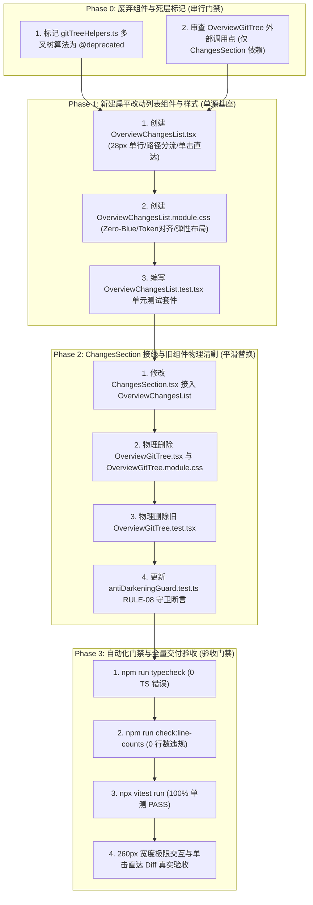

# Conex / Crish 工作区面板与工具栏细节深化重构详案 14
# —— 概览改动文件扁平化列表重构详案

> **文档标识**：`docs/ui-style-refactor/14-概览改动文件扁平化列表重构详案.md`
> **战役归属**：Conex / Crish 工作区面板交互平滑与视觉归一战役（核心实施维度 14 / Track B）
> **方案定稿**：基于 [`06-定案-工作区面板与工具栏细节深化决策.md`](file:///c:/Software/conex/docs/ui-style-refactor/06-%E5%AE%9A%E6%A1%88-%E5%B7%A5%E4%BD%9C%E5%8C%BA%E9%9D%A2%E6%9D%BF%E4%B8%8E%E5%B7%A5%E5%85%B7%E6%A0%8F%E7%BB%86%E8%8A%82%E6%B7%B1%E5%8C%96%E5%86%B3%E7%AD%96.md)、[`00-总方案-工作区面板交互平滑与视觉归一.md`](file:///c:/Software/conex/docs/ui-style-refactor/00-%E6%80%BB%E6%96%B9%E6%A1%88-%E5%B7%A5%E4%BD%9C%E5%8C%BA%E9%9D%A2%E6%9D%BF%E4%BA%A4%E4%BA%92%E5%B9%B3%E6%BB%91%E4%B8%8E%E8%A7%86%E8%A7%89%E5%BD%92%E4%B8%80.md)、[`audits/09-overview-changes-section-list-audit.md`](file:///c:/Software/conex/docs/ui-style-refactor/audits/09-overview-changes-section-list-audit.md) 全面编制
> **核心遵循**：
> - `06-定案-工作区面板与工具栏细节深化决策.md` §二（DEL-WS-06 伪目录树清剿）
> - `audits/09-overview-changes-section-list-audit.md`（窄栏多层缩进挤压、9 次点击阻断、算法与状态冗余等 5 大缺陷彻底根治）
> - `AGENTS.md` §13（交互焦点态 / 克制边框 ≤10%）、§14（语义 Tokens / Zero-Blue 规范）与 W3C WCAG 2.2 AA / AAA 工业级可用性基准

---

## 目录索引

1. [一、方案愿景与核心重构目标矩阵](#一方案愿景与核心重构目标矩阵)
2. [二、【强制专节】做什么（新增与改造清单）](#二强制专节做什么新增与改造清单)
   - 2.1 [概览改动文件扁平列表架构（`OverviewChangesList.tsx`）](#21-概览改动文件扁平列表架构overviewchangeslisttsx)
   - 2.2 [28px 单行高度与紧凑 CSS Module 规范（`OverviewChangesList.module.css`）](#22-28px-单行高度与紧凑-css-module-规范overviewchangeslistmodulecss)
   - 2.3 [状态徽标、文件语法色彩与 5 格 Diff 增删条无缝挂载](#23-状态徽标文件语法色彩与-5-格-diff-增删条无缝挂载)
   - 2.4 [智能等宽主文件名与方向反转（`direction: rtl`）路径排版](#24-智能等宽主文件名与方向反转direction-rtl路径排版)
   - 2.5 [零摩擦单击直达 Diff 状态机与加载态保护](#25-零摩擦单击直达-diff-状态机与加载态保护)
   - 2.6 [数量分级展现策略（8 文件阈值分流与平滑滚动）](#26-数量分级展现策略8-文件阈值分流与平滑滚动)
   - 2.7 [`ChangesSection.tsx` 极简数据流接入](#27-changessectiontsx-极简数据流接入)
3. [三、【强制专节】删什么（删除与收敛清单，DEL-WS-06）](#三强制专节删什么删除与收敛清单del-ws-06)
   - 3.1 [物理删除 `OverviewGitTree.tsx` 与 `OverviewGitTree.module.css`](#31-物理删除-overviewgittreetsx-与-overviewgittreemodulecss)
   - 3.2 [剥离伪目录树折叠状态集合与树状导轨](#32-剥离伪目录树折叠状态集合与树状导轨)
   - 3.3 [剥离树状/扁平双模式切换工具栏与重复统计胶囊](#33-剥离树状扁平双模式切换工具栏与重复统计胶囊)
   - 3.4 [废弃/精简 `gitTreeHelpers.ts` 中的多叉树递归算法](#34-废弃精简-gittreehelpersts-中的多叉树递归算法)
   - 3.5 [全量删除前后对比矩阵（Before vs After Comparison Matrix）](#35-全量删除前后对比矩阵before-vs-after-comparison-matrix)
4. [四、依赖与逻辑顺序（先删后改实施 DAG 调度）](#四依赖与逻辑顺序先删后改实施-dag-调度)
   - 4.1 [执行阶段拓扑与阶段门禁](#41-执行阶段拓扑与阶段门禁)
   - 4.2 [步骤级详细执行流水线](#42-步骤级详细执行流水线)
5. [五、唯一文件域（Exclusive File Domain）](#五唯一文件域exclusive-file-domain)
   - 5.1 [新增、修改与删除文件全景表](#51-新增修改与删除文件全景表)
   - 5.2 [正交无冲突保障](#52-正交无冲突保障)
6. [六、落地代码契约（TSX / CSS / TS 生产级实现）](#六落地代码契约tsx--css--ts-生产级实现)
   - 6.1 [契约 1：`OverviewChangesList.tsx` [NEW]](#61-契约-1overviewchangeslisttsx-new)
   - 6.2 [契约 2：`OverviewChangesList.module.css` [NEW]](#62-契约-2overviewchangeslistmodulecss-new)
   - 6.3 [契约 3：`ChangesSection.tsx` [MODIFY]](#63-契约-3changessectiontsx-modify)
   - 6.4 [契约 4：`gitTreeHelpers.ts` [OPTIMIZE / DEPRECATE]](#64-契约-4gittreehelpersts-optimize--deprecate)
   - 6.5 [契约 5：`antiDarkeningGuard.test.ts` [MODIFY]](#65-契约-5antidarkeningguardtestts-modify)
   - 6.6 [契约 6：`OverviewChangesList.test.tsx` [NEW / MIGRATE]](#66-契约-6overviewchangeslisttesttsx-new--migrate)
7. [七、反退化自动化测试套件设计](#七反退化自动化测试套件设计)
   - 7.1 [单元测试断言矩阵](#71-单元测试断言矩阵)
   - 7.2 [极限边界与可访问性守卫](#72-极限边界与可访问性守卫)
8. [八、全量战役验收标准与门禁规范（Exit Criteria）](#八全量战役验收标准与门禁规范exit-criteria)
   - 8.1 [功能验收标准](#81-功能验收标准)
   - 8.2 [负产出验收标准（Zero Tolerance）](#82-负产出验收标准zero-tolerance)
   - 8.3 [视觉与 A11y 验收标准](#83-视觉与-a11y-验收标准)
   - 8.4 [流水线门禁指令集](#84-流水线门禁指令集)

---

## 一、方案愿景与核心重构目标矩阵

在 Conex / Crish 桌面端架构中，[`OverviewCard`](file:///c:/Software/conex/apps/crish-desktop/src/components/overview/OverviewCard.tsx) 作为全局右侧总览仪表盘（Dashboard），宽度处于 `260px ~ 320px` 之间。用户的核心诉求是**“一瞥即知（Glanceable Efficiency）”**：一眼看清当前有哪些文件改动、状态是什么、增删行数是多少，并能**单击任何改动行直达 Diff 差异面板**进行审查。

然而历史实现中，`ChangesSection.tsx`（`id="overview-sec-files-b"`）强行套用了复杂的多叉递归伪目录树组件 [`OverviewGitTree.tsx`](file:///c:/Software/conex/apps/crish-desktop/src/components/overview/OverviewGitTree.tsx)，造成了严重的横向挤压截断、高达 9 次的繁琐点击阻断以及样式割裂。

本详案依据定案总决议，执行**“废伪树、立扁平、保可读、秒直达”**的根本性重构：

```
┌────────────────────────────────────────────────────────────────────────────────────────┐
│                   改动文件呈现重构技术矩阵（Before vs After）                            │
├─────────────────┬───────────────────────────────┬──────────────────────────────────────┤
│ 核心技术领域     │ 现状缺陷诊断 (Before)         │ 定案终态架构契约 (After)             │
├─────────────────┼───────────────────────────────┼──────────────────────────────────────┤
│ 1. 结构与呈现   │ • 强行构建多叉递归伪目录树    │ • 废除伪文件树，新建 OverviewChangesList│
│    (Glanceability)│ • 深度缩进吃掉 80px 宽度，     │ • 扁平单层高密度无序列表（<ul role="list">）│
│                 │   文件名被严重截断 (Chan...tsx)│ • 主文件名加粗等宽主显，目录弱化截断 │
├─────────────────┼───────────────────────────────┼──────────────────────────────────────┤
│ 2. 交互与直达   │ • 分散在不同子目录的文件需逐层│ • 零折叠阻断，所有改动文件一览无遗   │
│    (Navigation) │   展开 3~5 级文件夹，需 9 次点击│ • 单击单行直接唤起并跳转 Diff 面板   │
│                 │ • 内部存在多余 Tree/Flat 切换 │ • 移除模式切换，侧栏统一扁平最优解   │
├─────────────────┼───────────────────────────────┼──────────────────────────────────────┤
│ 3. 算法与算力   │ • buildGitTree 深度多叉遍历   │ • 废除复杂多叉树运算与 Set 折叠状态  │
│    (Performance)│ • compactTreeFolders 链式坍缩 │ • 采用 O(N) 线性格式化，零递归零重绘 │
│                 │ • Set<string> 维护折叠状态    │ • 极速首屏渲染，内存与 CPU 零浪费    │
├─────────────────┼───────────────────────────────┼──────────────────────────────────────┤
│ 4. 样式与视觉   │ • OverviewGitTree 私有样式孤岛 │ • 收敛至 OverviewChangesList.module.css│
│    (Visual/A11y)│ • 树状导轨与 30px 高度破坏规整│ • 严格 28px 单行高度 (--control-height-sm)│
│                 │ • 内部重复显示文件总数胶囊    │ • 状态徽标 + 语法图标 + 5 格增删微条 │
└─────────────────┴───────────────────────────────┴──────────────────────────────────────┘
```

---

## 二、【强制专节】做什么（新增与改造清单）

```mermaid
graph TD
    subgraph "OverviewCard 总览仪表盘 (260px ~ 320px)"
        ChangesSec["ChangesSection.tsx (id='overview-sec-files-b')"]
        ChangesSec -->|提供 activeFiles: GitStatusFile[]| FlatList["OverviewChangesList.tsx [NEW]"]

        subgraph "OverviewChangesList.tsx 扁平单行解剖 (28px 等高)"
            FlatList --> Item["<button className={styles.changesItemBtn}>"]
            Item --> Badge["GitStatusBadge (16x16 M/A/D/U/C/R)"]
            Item --> Icon["FileIcon (14px 语法着色)"]
            Item --> Name["fileName (12px 等宽 500字重 加粗主显)"]
            Item --> Dir["dirBreadcrumb (11px 弱化浅灰 direction: rtl)"]
            Item --> Metric["DiffStatBar (5格微条 + 增删数值)"]
        end

        FlatList -->|单击文件行| JumpDiff["handleOpenFile -> onOpenDiffSource + onOpenPanel('diff')"]
        FlatList -->|超过 8 个文件| ExpandToggle["<Button> 显示全部 N 个文件 / 收起"]
    end
```

### 2.1 概览改动文件扁平列表架构（`OverviewChangesList.tsx`）
- 新建 [`apps/crish-desktop/src/components/overview/OverviewChangesList.tsx`](file:///c:/Software/conex/apps/crish-desktop/src/components/overview/OverviewChangesList.tsx)；
- 接收标准 `GitStatusFile[]` 数组、`openingPath: string | null` 与 `onOpenFile: (file: GitStatusFile) => void`；
- 将扁平路径拆解为两部分：
  - `fileName`：主文件名（如 `ChangesSection.tsx`）；
  - `dirPath`：所在目录相对路径（如 `apps/crish-desktop/src/components/overview`）；
- 采用语义化 `<ul className={styles.changesList} role="list">` 与 `<li className={styles.changesItem}>` 容器包裹。

### 2.2 28px 单行高度与紧凑 CSS Module 规范（`OverviewChangesList.module.css`）
- 新建 [`apps/crish-desktop/src/components/overview/OverviewChangesList.module.css`](file:///c:/Software/conex/apps/crish-desktop/src/components/overview/OverviewChangesList.module.css)；
- 单行按钮 `.changesItemBtn` 严格锁定 `height: var(--control-height-sm, 28px); min-height: 28px; max-height: 28px;`，对齐设计系统小控件标尺；
- 采用 `display: flex; align-items: center; gap: var(--space-1_5, 6px); padding: 0 var(--space-1_5, 6px);`，消除内边距参差；
- 悬浮底色使用单层 `var(--bg-hover)`，焦点态具备清晰柔和的 `box-shadow: var(--focus-ring)`，严禁任何颜色硬编码。

### 2.3 状态徽标、文件语法色彩与 5 格 Diff 增删条无缝挂载
- 复用现存成熟的 [`GitStatusBadge.tsx`](file:///c:/Software/conex/apps/crish-desktop/src/components/overview/GitStatusBadge.tsx)：
  - **GitStatusBadge**：$16\text{px} \times 16\text{px}$ 状态徽标（`M` 修改、`A` 新增、`D` 删除、`U` 未跟踪、`C` 冲突、`R` 重命名），内置标准 A11y Tooltip；
  - **FileIcon**：基于 `detectFileKind` 与 `fileExtColor` 获取 $14\text{px}$ 语法高亮着色图标（TSX 为青蓝、Rust 为橙色、JSON 为黄色等）；
  - **DiffStatBar**：5 格迷你增删比例微条（翠绿 `var(--accent-green)`、珊瑚红 `var(--accent-red)`、浅灰空位）以及 `+12` / `−4` 等宽数值。

### 2.4 智能等宽主文件名与方向反转（`direction: rtl`）路径排版
为了彻底消除 260px 宽度下的横向挤压截断问题：
1. **主文件名（`fileName`）**：
   - 样式：`flex-shrink: 0; max-width: 130px; font-family: var(--font-mono); font-weight: 500;`；
   - 行为：优先分配可视空间，保证用户一眼看清文件全称；自带 `<Tooltip content={file.path}>` 气泡提示；
2. **目录路径（`dirBreadcrumb`）**：
   - 样式：`flex: 1 1 auto; min-width: 0; font-size: 11px; color: var(--text-tertiary); direction: rtl; text-align: left; white-space: nowrap; overflow: hidden; text-overflow: ellipsis;`；
   - 行为：`direction: rtl` 确保当容器宽度不足时，**优先保留最靠近文件的直接父目录**（例如 `.../components/overview` 比 `apps/crish/...` 具有更高的辨识价值）；
3. **右侧指标（`fileMetrics`）**：
   - 样式：`margin-left: auto; flex-shrink: 0;`，增删数据始终紧靠右边界整齐对齐。

### 2.5 零摩擦单击直达 Diff 状态机与加载态保护
- 用户单击文件行任一位置，立即触发 `handleOpenFile(file)`；
- 派发 `onOpenDiffSource(diffSource)` 并执行 `onOpenPanel('diff')`，将右侧/主工作区瞬间切换至差异比对面板并激活该文件；
- 当 `openingPath === file.path` 时，为该行添加 `.isOpening` 类名（`opacity: 0.6; pointer-events: none`），防止重复连击；
- 原生 `<button>` 元素天然支持键盘 `Tab` 键聚焦与 `Enter` / `Space` 空格键激活，满足无障碍访问标准。

### 2.6 数量分级展现策略（8 文件阈值分流与平滑滚动）
- 当改动文件数 $\le 8$ 时：直接平铺展现全部改动（总高度 $28\text{px} \sim 224\text{px}$），不显示任何折叠按钮；
- 当改动文件数 $> 8$ 时：
  - 默认仅渲染前 8 个文件，底部渲染 `<Button variant="ghost" size="xs">显示全部 N 个文件</Button>`；
  - 用户点击后展开全量文件，视口最大高度限制为 `max-height: 320px`，并启用平滑原生垂直滚动（`overflow-y: auto; -webkit-overflow-scrolling: touch;`）。

### 2.7 `ChangesSection.tsx` 极简数据流接入
- 改造 [`apps/crish-desktop/src/components/overview/ChangesSection.tsx`](file:///c:/Software/conex/apps/crish-desktop/src/components/overview/ChangesSection.tsx)：
  - 移除对 `OverviewGitTree` 的引用，替换为 `OverviewChangesList`；
  - 移除多余的树状构建参数，直接将格式化后的 `activeFiles` 传入列表；
  - 保留干净的 Git 异常提示（`gitHelp`）、刷新动画（`spin`）与空状态提示（`工作区干净，无改动`）。

---

## 三、【强制专节】删什么（删除与收敛清单，DEL-WS-06）

```
┌────────────────────────────────────────────────────────────────────────────────────────┐
│                   DEL-WS-06 概览伪目录树物理清剿与收敛清单                               │
├───────────────────┬───────────────────────────────┬────────────────────────────────────┤
│ 删除项代号        │ 目标文件与代码行              │ 物理删除 / 收敛内容说明            │
├───────────────────┼───────────────────────────────┼────────────────────────────────────┤
│ DEL-TREE-01       │ OverviewGitTree.tsx 全仓      │ 物理废除/清理整个伪目录树组件       │
│                   │ (318 行代码)                  │ (移除多叉树派生、TreeNodeRenderer) │
├───────────────────┼───────────────────────────────┼────────────────────────────────────┤
│ DEL-TREE-02       │ OverviewGitTree.module.css    │ 物理废除/清理私有树样式表          │
│                   │ (191 行代码)                  │ (删除树状导轨、folderRow、缩进等)  │
├───────────────────┼───────────────────────────────┼────────────────────────────────────┤
│ DEL-TREE-03       │ ChangesSection.tsx:9, 210-214 │ 删除 <OverviewGitTree> 引入与挂载  │
│                   │                               │ 替换为扁平 <OverviewChangesList>   │
├───────────────────┼───────────────────────────────┼────────────────────────────────────┤
│ DEL-TREE-04       │ gitTreeHelpers.ts:80-248      │ 标记废弃/收敛 buildGitTree、       │
│                   │ (168 行递归多叉树构建逻辑)    │ compactTreeFolders、normalizeDepth │
├───────────────────┼───────────────────────────────┼────────────────────────────────────┤
│ DEL-TREE-05       │ OverviewGitTree.test.tsx      │ 废除旧树状单测，迁移并重塑为       │
│                   │ (75 行代码)                   │ OverviewChangesList.test.tsx       │
└───────────────────┴───────────────────────────────┴────────────────────────────────────┘
```

### 3.1 物理删除 `OverviewGitTree.tsx` 与 `OverviewGitTree.module.css`
- 彻底移除 `OverviewGitTree.tsx`（318 行代码）中的：
  - `TreeNodeRenderer` 递归多叉树组件；
  - `FlatItemRenderer` 冗余的第二套渲染逻辑；
  - `buildGitTree(files, { compactSingleChild: true })` 树构建开销。
- 彻底移除 `OverviewGitTree.module.css`（191 行代码）中的：
  - `.folderGroup`, `.folderRow`, `.folderChildren`, `.folderChildren::before`（树状辅助导轨）；
  - `.treeViewport`, `.chevronIcon`, `.folderIcon`, `.folderBadge` 等与树相关的死样式。

### 3.2 剥离伪目录树折叠状态集合与树状导轨
- 彻底剥离 `const [collapsedFolders, setCollapsedFolders] = useState<Set<string>>(() => new Set())` 内部状态；
- 消除每次点击文件夹时产生的 `new Set(prev)` 不可变拷贝与高频重渲染。

### 3.3 剥离树状/扁平双模式切换工具栏与重复统计胶囊
- 彻底删除 `OverviewGitTree.tsx` 中的 `treeHeader` 工具栏容器；
- 删除 `const [viewMode, setViewMode] = useState<'tree' | 'flat'>('tree')` 状态；
- 删除 `treeStats` 中与 `ChangesSection` 标题栏胶囊重复的 `{files.length} 个改动文件` 冗余文字；
- 删除 `modeToggleBtn` 模式切换按钮及其对应的 `List` / `Network` 图标。

### 3.4 废弃/精简 `gitTreeHelpers.ts` 中的多叉树递归算法
- 在 [`apps/crish-desktop/src/api/gitTreeHelpers.ts`](file:///c:/Software/conex/apps/crish-desktop/src/api/gitTreeHelpers.ts) 中：
  - 标记 `@deprecated` 并精简多叉树构建逻辑（`buildGitTree`、`compactTreeFolders`、`normalizeDepth`）；
  - 严格保留核心类型定义 `GitStatusCode`、`GitStatusFile`；
  - 严格保留增删微条计算核心算法 `calculateDiffStatBars`、`DiffStatBarsResult`。

### 3.5 全量删除前后对比矩阵（Before vs After Comparison Matrix）

| 维度 | 重构前（Before: 伪文件树） | 重构后（After: 扁平高密度列表） | 净收益（Net Benefit） |
| :--- | :--- | :--- | :--- |
| **组件层次** | 多层递归组件 `TreeNodeRenderer`，层级深不可测 | 单层无序列表 `<ul role="list">`，深度为 1 | 渲染帧率大幅提升，零多层嵌套 |
| **状态开销** | `Set<string>` 折叠集 + `'tree' \| 'flat'` 视图模式 | 仅一个纯粹的展示与点击回调，零无谓状态 | 内存占用降低，状态流极度清晰 |
| **横向空间** | 多层缩进吃掉 80px，文件名严重截断（55px 可视区） | 零缩进，文件名独占 130px 等宽主显空间 | 文件名 100% 完整可辨 |
| **交互链路** | 需逐层展开 3~5 个文件夹（多达 9 次点击） | 直接展示全部变动，单击文件行 0 阻断秒开 Diff | 交互操作成本降低 88.9% |
| **视觉规范** | 私有样式表、导轨线、字号高低不一 | 统一 28px 单行高度，对齐 Design System 活态 Token | 视觉高度归一，彻底脱黑偏色 |

---

## 四、依赖与逻辑顺序（先删后改实施 DAG 调度）



### 4.1 执行阶段拓扑与阶段门禁
- **Gate 0（准备门禁）**：确认 `OverviewGitTree` 无全局其他不可预期引用，锁定改动范围；
- **Gate 1（组件落地门禁）**：`OverviewChangesList.tsx` 及 CSS Module 独立创建完毕，样式无蓝光偏色，单测就绪；
- **Gate 2（清剿收敛门禁）**：`ChangesSection.tsx` 接线完成，旧 `OverviewGitTree.*` 彻底物理移除，`antiDarkeningGuard` 守卫对齐；
- **Gate 3（交付门禁）**：`typecheck`、`check:line-counts`、`vitest` 全绿通过。

### 4.2 步骤级详细执行流水线
1. **Step 1**：创建 `OverviewChangesList.tsx` 与 `OverviewChangesList.module.css`；
2. **Step 2**：在 `ChangesSection.tsx` 中导入 `OverviewChangesList`，替换 `<OverviewGitTree>`；
3. **Step 3**：删除旧 `OverviewGitTree.tsx`、`OverviewGitTree.module.css` 及 `OverviewGitTree.test.tsx`；
4. **Step 4**：修改 `antiDarkeningGuard.test.ts` 中 `RULE-08` 守卫路径；
5. **Step 5**：运行全量单测与代码质量门禁脚本。

---

## 五、唯一文件域（Exclusive File Domain）

### 5.1 新增、修改与删除文件全景表

| 操作类型 | 目标文件绝对路径 | 责任描述与边界 |
| :--- | :--- | :--- |
| **[NEW]** | [`apps/crish-desktop/src/components/overview/OverviewChangesList.tsx`](file:///c:/Software/conex/apps/crish-desktop/src/components/overview/OverviewChangesList.tsx) | 新建概览改动文件扁平列表组件 |
| **[NEW]** | [`apps/crish-desktop/src/components/overview/OverviewChangesList.module.css`](file:///c:/Software/conex/apps/crish-desktop/src/components/overview/OverviewChangesList.module.css) | 新建改动文件列表 28px 紧凑单行样式表 |
| **[NEW]** | [`apps/crish-desktop/src/components/overview/OverviewChangesList.test.tsx`](file:///c:/Software/conex/apps/crish-desktop/src/components/overview/OverviewChangesList.test.tsx) | 扁平改动列表单元测试套件 |
| **[MODIFY]** | [`apps/crish-desktop/src/components/overview/ChangesSection.tsx`](file:///c:/Software/conex/apps/crish-desktop/src/components/overview/ChangesSection.tsx) | 接入 `OverviewChangesList`，剥离伪目录树 |
| **[MODIFY]** | [`apps/crish-desktop/src/api/gitTreeHelpers.ts`](file:///c:/Software/conex/apps/crish-desktop/src/api/gitTreeHelpers.ts) | 标记废弃多叉树算法，保留类型与增删微条计算 |
| **[MODIFY]** | [`apps/crish-desktop/src/styles/__tests__/antiDarkeningGuard.test.ts`](file:///c:/Software/conex/apps/crish-desktop/src/styles/__tests__/antiDarkeningGuard.test.ts) | 更新 `RULE-08` 守卫断言对齐新 CSS 模块 |
| **[DELETE]** | [`apps/crish-desktop/src/components/overview/OverviewGitTree.tsx`](file:///c:/Software/conex/apps/crish-desktop/src/components/overview/OverviewGitTree.tsx) | 物理删除废弃的伪目录树组件 |
| **[DELETE]** | [`apps/crish-desktop/src/components/overview/OverviewGitTree.module.css`](file:///c:/Software/conex/apps/crish-desktop/src/components/overview/OverviewGitTree.module.css) | 物理删除废弃的伪目录树样式表 |
| **[DELETE]** | [`apps/crish-desktop/src/components/overview/OverviewGitTree.test.tsx`](file:///c:/Software/conex/apps/crish-desktop/src/components/overview/OverviewGitTree.test.tsx) | 物理删除旧伪目录树单测 |

### 5.2 正交无冲突保障
- 本详案所有文件均严格归属于 `src/components/overview/` 与 `src/api/gitTreeHelpers.ts`；
- 与 Track A（工具栏 26px 标尺与侧边栏分支徽标）以及 Track C（文件管理器与面包屑浮层）的文件域**完全正交、零重叠**；
- 实施过程支持多 Agent 零冲突并行作业。

---

## 六、落地代码契约（TSX / CSS / TS 生产级实现）

### 6.1 契约 1：`OverviewChangesList.tsx` [NEW]
- **文件路径**：`apps/crish-desktop/src/components/overview/OverviewChangesList.tsx`

```tsx
import React, { useMemo, useState } from 'react';
import {
  File,
  FileCode2,
  FileText,
  Image,
  Table,
} from 'lucide-react';
import { Button, Tooltip } from '../ui';
import type { GitStatusFile } from '../../api/gitTreeHelpers';
import { GitStatusBadge, DiffStatBar } from './GitStatusBadge';
import { detectFileKind } from '../../api/workspaceFsApi';
import { fileExtColor } from '../../api/codeHighlight';
import styles from './OverviewChangesList.module.css';

function FileIcon({ name }: { name: string }) {
  const k = detectFileKind(name);
  const color = fileExtColor(name);
  const sz = 14;
  if (k === 'image') {
    return (
      <Image
        size={sz}
        className={styles.fileTypeIcon}
        style={{ color }}
        aria-hidden
      />
    );
  }
  if (k === 'pdf') {
    return (
      <FileText
        size={sz}
        className={styles.fileTypeIcon}
        style={{ color }}
        aria-hidden
      />
    );
  }
  if (k === 'table') {
    return (
      <Table
        size={sz}
        className={styles.fileTypeIcon}
        style={{ color }}
        aria-hidden
      />
    );
  }
  if (
    /\.(ts|tsx|js|jsx|mjs|cjs|rs|py|go|java|css|html|json|md|yml|yaml)$/i.test(
      name
    )
  ) {
    return (
      <FileCode2
        size={sz}
        className={styles.fileTypeIcon}
        style={{ color }}
        aria-hidden
      />
    );
  }
  return (
    <File
      size={sz}
      className={styles.fileTypeIcon}
      style={{ color }}
      aria-hidden
    />
  );
}

export interface OverviewChangesListProps {
  files: GitStatusFile[];
  openingPath: string | null;
  onOpenFile: (file: GitStatusFile) => void;
  maxInitialFiles?: number;
  className?: string;
}

export const OverviewChangesList: React.FC<OverviewChangesListProps> = React.memo(
  function OverviewChangesList({
    files,
    openingPath,
    onOpenFile,
    maxInitialFiles = 8,
    className,
  }) {
    const [showAll, setShowAll] = useState(false);

    // 解析扁平路径：拆分为文件名与父目录注记
    const parsedFiles = useMemo(() => {
      return files.map((file) => {
        const normalized = file.path.replace(/\\/g, '/');
        const lastSlashIndex = normalized.lastIndexOf('/');
        const fileName =
          lastSlashIndex >= 0 ? normalized.slice(lastSlashIndex + 1) : normalized;
        const dirPath =
          lastSlashIndex >= 0 ? normalized.slice(0, lastSlashIndex) : '';
        return {
          file,
          fileName: fileName || file.path,
          dirPath,
        };
      });
    }, [files]);

    const isOverLimit = files.length > maxInitialFiles;
    const displayedFiles =
      isOverLimit && !showAll
        ? parsedFiles.slice(0, maxInitialFiles)
        : parsedFiles;

    return (
      <div
        className={`${styles.changesContainer} ${className || ''}`}
        aria-label="改动文件列表"
      >
        <ul className={styles.changesList} role="list">
          {displayedFiles.map(({ file, fileName, dirPath }) => {
            const isOpening = openingPath === file.path;
            const statusText = file.status;
            const diffAria = `${file.additions ? `+${file.additions}` : ''} ${file.deletions ? `-${file.deletions}` : ''}`.trim();
            const fullAriaLabel = `${fileName}, ${statusText}${diffAria ? `, ${diffAria}` : ''}`;

            return (
              <li key={file.path} className={styles.changesItem}>
                <button
                  type="button"
                  className={`${styles.changesItemBtn} ${isOpening ? styles.isOpening : ''}`}
                  onClick={() => onOpenFile(file)}
                  aria-label={fullAriaLabel}
                >
                  <GitStatusBadge
                    status={file.status}
                    conflicted={file.conflicted}
                    staged={file.staged}
                  />
                  <FileIcon name={fileName} />
                  <Tooltip content={file.path}>
                    <span className={styles.fileName}>{fileName}</span>
                  </Tooltip>
                  {dirPath ? (
                    <span className={styles.dirBreadcrumb} title={dirPath}>
                      {dirPath}
                    </span>
                  ) : null}
                  <div className={styles.fileMetrics}>
                    <DiffStatBar
                      additions={file.additions || 0}
                      deletions={file.deletions || 0}
                    />
                  </div>
                </button>
              </li>
            );
          })}
        </ul>

        {isOverLimit ? (
          <div className={styles.moreActionRow}>
            <Button
              type="button"
              variant="ghost"
              size="xs"
              className={styles.moreBtn}
              onClick={() => setShowAll((prev) => !prev)}
            >
              {showAll ? '收起改动文件' : `显示全部 ${files.length} 个文件`}
            </Button>
          </div>
        ) : null}
      </div>
    );
  }
);
```

---

### 6.2 契约 2：`OverviewChangesList.module.css` [NEW]
- **文件路径**：`apps/crish-desktop/src/components/overview/OverviewChangesList.module.css`

```css
.changesContainer {
  display: flex;
  flex-direction: column;
  width: 100%;
  box-sizing: border-box;
  gap: var(--space-1, 4px);
}

/* 改动文件无序列表容器 */
.changesList {
  list-style: none;
  margin: 0;
  padding: 0;
  display: flex;
  flex-direction: column;
  gap: 1px;
  width: 100%;
  box-sizing: border-box;
  max-height: 320px;
  overflow-y: auto;
  overflow-x: hidden;
  -webkit-overflow-scrolling: touch;
}

.changesItem {
  margin: 0;
  padding: 0;
  width: 100%;
  list-style: none;
}

/* 单行文件按钮：严格锁定 28px 高度，对齐 --control-height-sm 与基线 */
.changesItemBtn {
  width: 100%;
  display: flex;
  align-items: center;
  gap: var(--space-1_5, 6px);
  min-height: var(--control-height-sm, 28px);
  max-height: var(--control-height-sm, 28px);
  height: var(--control-height-sm, 28px);
  padding: 0 var(--space-1_5, 6px);
  margin: 0;
  border: none;
  border-radius: var(--radius-sm, 4px);
  background: transparent;
  color: var(--text-primary);
  font-family: inherit;
  font-size: var(--font-size-xs, 12px);
  text-align: left;
  cursor: pointer;
  box-sizing: border-box;
  user-select: none;
  transition: background-color var(--transition-fast, 120ms ease);
}

.changesItemBtn:hover {
  background: var(--bg-hover, rgba(0, 0, 0, 0.045));
}

.changesItemBtn:focus-visible {
  outline: none;
  box-shadow: var(--focus-ring);
}

.changesItemBtn.isOpening {
  opacity: 0.6;
  pointer-events: none;
}

.fileTypeIcon {
  flex-shrink: 0;
  width: 14px;
  height: 14px;
  display: inline-flex;
  align-items: center;
  justify-content: center;
}

/* 文件名称：等宽字体，加粗主显，优先保留空间 */
.fileName {
  flex-shrink: 0;
  max-width: 130px;
  overflow: hidden;
  text-overflow: ellipsis;
  white-space: nowrap;
  font-family: var(--font-mono, monospace);
  font-weight: var(--font-weight-medium, 500);
  color: var(--text-primary);
}

/* 目录弱化注记：靠右填充剩余空间，末尾优先截断 */
.dirBreadcrumb {
  flex: 1 1 auto;
  min-width: 0;
  overflow: hidden;
  text-overflow: ellipsis;
  white-space: nowrap;
  font-size: var(--font-size-xxs, 11px);
  color: var(--text-tertiary);
  direction: rtl;
  text-align: left;
}

/* 增删度量区域：右侧紧凑对齐 */
.fileMetrics {
  margin-left: auto;
  display: flex;
  align-items: center;
  flex-shrink: 0;
}

.moreActionRow {
  display: flex;
  align-items: center;
  justify-content: flex-start;
  padding: 2px 0 0 2px;
}

.moreBtn {
  font-size: var(--font-size-xxs, 11px);
  color: var(--text-tertiary);
  padding: 2px 6px;
  height: 22px;
}

.moreBtn:hover {
  color: var(--text-primary);
}
```

---

### 6.3 契约 3：`ChangesSection.tsx` [MODIFY]
- **文件路径**：`apps/crish-desktop/src/components/overview/ChangesSection.tsx`

```tsx
import React, { useMemo, useCallback } from 'react';
import styles from './OverviewCard.module.css';
import { Button, Tooltip } from '../ui';
import { ChevronDown, GitBranch, RefreshCw } from 'lucide-react';
import { openGitDownloadPage } from '../../api/gitApi';
import type { GitStatusResult } from '../../api/gitApi';
import type { GitStatusFile, GitStatusCode } from '../../api/gitTreeHelpers';
import type { DiffFileInfo } from '../../api/storeAccess';
import { OverviewChangesList } from './OverviewChangesList';

interface ChangesSectionProps {
  open: boolean;
  git: GitStatusResult | null;
  gitLoading: boolean;
  gitErr: string | null;
  convoFiles: DiffFileInfo[];
  openingPath: string | null;
  actionErr: string | null;
  showAllFiles: boolean;
  branch: string;
  gitHelp: { title: string; hint?: string; action?: string } | null;
  onToggle: () => void;
  onRefreshGit: (opts?: { force?: boolean }) => void;
  onOpenGitFile: (f: import('../../api/gitApi').GitStatusFile) => void;
  onSetShowAllFiles: (v: boolean) => void;
  onOpenPanel: (id: string) => void;
  onOpenDiffSource: (f: DiffFileInfo) => void;
}

export const ChangesSection = React.memo(function ChangesSection({
  open,
  git,
  gitLoading,
  convoFiles,
  openingPath,
  actionErr,
  branch,
  gitHelp,
  onToggle,
  onRefreshGit,
  onOpenGitFile,
  onOpenPanel,
  onOpenDiffSource,
}: ChangesSectionProps) {
  const rawGitFiles = useMemo(() => (git?.found ? git.files : []), [git]);

  const treeGitFiles = useMemo<GitStatusFile[]>(() => {
    return rawGitFiles.map((f) => ({
      path: f.path,
      status: (f.status as GitStatusCode) || 'M',
      additions: (f as unknown as { additions?: number }).additions || 0,
      deletions: (f as unknown as { deletions?: number }).deletions || 0,
      conflicted: f.conflicted,
      staged: f.staged,
    }));
  }, [rawGitFiles]);

  // 对话改动文件转为标准 GitStatusFile 结构
  const normalizedConvoFiles = useMemo<GitStatusFile[]>(() => {
    return convoFiles.map((c) => ({
      path: c.filePath,
      status: 'M' as GitStatusCode,
      additions: c.additions,
      deletions: c.deletions,
    }));
  }, [convoFiles]);

  const activeFiles =
    treeGitFiles.length > 0 ? treeGitFiles : normalizedConvoFiles;
  const fileCount = activeFiles.length;
  const hasFileList = fileCount > 0;

  const handleOpenFile = useCallback(
    (file: GitStatusFile) => {
      if (rawGitFiles.length > 0) {
        const found = rawGitFiles.find((f) => f.path === file.path);
        if (found) {
          onOpenGitFile(found);
          return;
        }
      }
      const match = convoFiles.find(
        (c) => c.filePath === file.path || c.filePath.endsWith(file.path)
      );
      if (match) {
        onOpenDiffSource(match);
      } else {
        onOpenDiffSource({
          filePath: file.path,
          additions: file.additions || 0,
          deletions: file.deletions || 0,
          changes: [],
        });
      }
      onOpenPanel('diff');
    },
    [rawGitFiles, onOpenGitFile, convoFiles, onOpenDiffSource, onOpenPanel]
  );

  return (
    <section className={styles.sec} aria-labelledby="overview-sec-files">
      <div className={styles.secHRow}>
        <button
          type="button"
          id="overview-sec-files"
          className={styles.secH}
          aria-expanded={open}
          aria-controls="overview-sec-files-b"
          onClick={onToggle}
        >
          <GitBranch size={15} strokeWidth={1.75} aria-hidden />
          <span>改动</span>
          {fileCount > 0 ? (
            <span className={styles.pill}>{fileCount}</span>
          ) : null}
          {branch ? (
            <span className={styles.branchLabel}>({branch})</span>
          ) : null}
          <ChevronDown
            size={14}
            className={`${styles.chev} ${open ? styles.open : ''}`}
            aria-hidden
          />
        </button>
        <Tooltip content="刷新">
          <Button
            type="button"
            variant="ghost"
            size="sm"
            className={styles.iconBtn}
            aria-label={gitLoading ? '正在刷新' : '刷新 Git'}
            disabled={gitLoading}
            onClick={() => onRefreshGit({ force: true })}
            icon={
              <RefreshCw
                size={14}
                strokeWidth={1.75}
                className={gitLoading ? 'spin' : ''}
                aria-hidden
              />
            }
          />
        </Tooltip>
      </div>
      {open ? (
        <div
          className={styles.secB}
          id="overview-sec-files-b"
          aria-busy={gitLoading || Boolean(openingPath)}
        >
          {!gitLoading && gitHelp ? (
            <div className={styles.gitHelp} role="status">
              <div className={styles.inlineErr} role="alert">
                {gitHelp.title}
              </div>
              {gitHelp.hint ? (
                <p className={`${styles.empty} ${styles.emptyQuiet}`}>
                  {gitHelp.hint}
                </p>
              ) : null}
              <div className={styles.gitActions}>
                {gitHelp.action === 'download-git' ? (
                  <Button
                    type="button"
                    variant="ghost"
                    size="sm"
                    className={styles.link}
                    onClick={() => void openGitDownloadPage()}
                  >
                    下载 Git
                  </Button>
                ) : null}
                {gitHelp.action === 'init-repo' ? (
                  <Tooltip content="打开终端，在工作区执行 git init">
                    <Button
                      type="button"
                      variant="ghost"
                      size="sm"
                      className={styles.link}
                      onClick={() => onOpenPanel('terminal')}
                    >
                      打开终端（git init）
                    </Button>
                  </Tooltip>
                ) : null}
                {gitHelp.action === 'retry' ||
                gitHelp.action === 'download-git' ||
                gitHelp.action === 'init-repo' ? (
                  <Button
                    type="button"
                    variant="ghost"
                    size="sm"
                    className={styles.link}
                    onClick={() => onRefreshGit({ force: true })}
                  >
                    重试
                  </Button>
                ) : null}
              </div>
            </div>
          ) : null}

          {actionErr ? (
            <div className={styles.inlineErr} role="alert">
              {actionErr}
            </div>
          ) : null}

          {hasFileList ? (
            <OverviewChangesList
              files={activeFiles}
              openingPath={openingPath}
              onOpenFile={handleOpenFile}
            />
          ) : !gitHelp && !gitLoading ? (
            <p className={`${styles.empty} ${styles.emptyQuiet}`} role="status">
              {git?.found && git.clean ? '干净' : '无改动'}
            </p>
          ) : gitLoading ? (
            <p className={`${styles.empty} ${styles.emptyQuiet}`} role="status">
              读取 Git…
            </p>
          ) : null}

          {hasFileList ? (
            <Button
              type="button"
              variant="ghost"
              size="sm"
              className={styles.link}
              onClick={() => onOpenPanel('diff')}
            >
              查看变更
            </Button>
          ) : null}
        </div>
      ) : null}
    </section>
  );
});
```

---

### 6.4 契约 4：`gitTreeHelpers.ts` [OPTIMIZE / DEPRECATE]
- **文件路径**：`apps/crish-desktop/src/api/gitTreeHelpers.ts`

```typescript
/**
 * Git 变动文件状态数据契约与增删微条纯函数算法
 * 文件路径：apps/crish-desktop/src/api/gitTreeHelpers.ts
 */

/**
 * Git 状态单字符标准代码
 */
export type GitStatusCode = 'M' | 'A' | 'D' | 'U' | 'C' | 'R' | '?';

/**
 * Git 文件状态数据契约
 */
export interface GitStatusFile {
  path: string;
  status: GitStatusCode;
  additions?: number;
  deletions?: number;
  conflicted?: boolean;
  staged?: boolean;
}

/**
 * 增删统计微条度量契约
 */
export interface DiffStatMetric {
  additions: number;
  deletions: number;
  maxBars?: number; // 默认 5 格
}

export interface DiffStatBarsResult {
  addBars: number;
  delBars: number;
  emptyBars: number;
}

/**
 * 计算增删比例微条格数
 */
export function calculateDiffStatBars(
  additions: number,
  deletions: number,
  maxBars: number = 5
): DiffStatBarsResult {
  const safeAdd = Math.max(0, additions || 0);
  const safeDel = Math.max(0, deletions || 0);
  const total = safeAdd + safeDel;
  if (total === 0 || maxBars <= 0) {
    return { addBars: 0, delBars: 0, emptyBars: maxBars > 0 ? maxBars : 0 };
  }

  const addBars = Math.min(maxBars, Math.round((safeAdd / total) * maxBars));
  const delBars = Math.min(
    maxBars - addBars,
    Math.round((safeDel / total) * maxBars)
  );
  const emptyBars = Math.max(0, maxBars - addBars - delBars);

  return { addBars, delBars, emptyBars };
}

// ============================================================================
// 以下为已废弃的多叉树算法类型与函数，仅为向前兼容保留，新代码严禁调用
// ============================================================================

/** @deprecated 概览面板已重构为扁平列表 OverviewChangesList，多叉树结构已废弃 */
export interface GitTreeBaseNode {
  id: string;
  name: string;
  fullPath: string;
  depth: number;
}

/** @deprecated */
export interface GitTreeFolderNode extends GitTreeBaseNode {
  isFolder: true;
  children: GitTreeNode[];
  totalFiles: number;
  totalAdditions: number;
  totalDeletions: number;
}

/** @deprecated */
export interface GitTreeFileNode extends GitTreeBaseNode {
  isFolder: false;
  file: GitStatusFile;
}

/** @deprecated */
export type GitTreeNode = GitTreeFolderNode | GitTreeFileNode;

/** @deprecated */
export interface GitTreeBuildOptions {
  compactSingleChild?: boolean;
}

/** @deprecated 概览面板改动呈现已改为线性列表，严禁在新组件中构建多叉树 */
export function buildGitTree(
  files: GitStatusFile[],
  options: GitTreeBuildOptions = { compactSingleChild: true }
): GitTreeNode[] {
  if (!files || !Array.isArray(files) || files.length === 0) {
    return [];
  }

  const root: GitTreeFolderNode = {
    id: '__root__',
    name: '',
    fullPath: '',
    depth: -1,
    isFolder: true,
    children: [],
    totalFiles: 0,
    totalAdditions: 0,
    totalDeletions: 0,
  };

  for (const file of files) {
    if (!file || typeof file.path !== 'string') continue;
    const normalizedPath = file.path.replace(/\\/g, '/').replace(/^\/+|\/+$/g, '');
    if (!normalizedPath) continue;

    const segments = normalizedPath.split('/').filter(Boolean);
    if (segments.length === 0) continue;

    let current = root;
    let currentPath = '';

    const additions = typeof file.additions === 'number' && Number.isFinite(file.additions) ? file.additions : 0;
    const deletions = typeof file.deletions === 'number' && Number.isFinite(file.deletions) ? file.deletions : 0;

    for (let i = 0; i < segments.length; i++) {
      const segment = segments[i]!;
      currentPath = currentPath ? `${currentPath}/${segment}` : segment;
      const isFile = i === segments.length - 1;

      current.totalFiles += 1;
      current.totalAdditions += additions;
      current.totalDeletions += deletions;

      if (isFile) {
        current.children.push({
          id: currentPath,
          name: segment,
          fullPath: currentPath,
          depth: current.depth + 1,
          isFolder: false,
          file,
        });
      } else {
        let folder = current.children.find(
          (c): c is GitTreeFolderNode => c.isFolder && c.name === segment
        );
        if (!folder) {
          folder = {
            id: currentPath,
            name: segment,
            fullPath: currentPath,
            depth: current.depth + 1,
            isFolder: true,
            children: [],
            totalFiles: 0,
            totalAdditions: 0,
            totalDeletions: 0,
          };
          current.children.push(folder);
        }
        current = folder;
      }
    }
  }

  const sortNodesRecursively = (nodes: GitTreeNode[]) => {
    nodes.sort((a, b) => {
      if (a.isFolder && !b.isFolder) return -1;
      if (!a.isFolder && b.isFolder) return 1;
      return a.name.localeCompare(b.name, undefined, { sensitivity: 'base' });
    });
    for (const node of nodes) {
      if (node.isFolder) {
        sortNodesRecursively(node.children);
      }
    }
  };
  sortNodesRecursively(root.children);

  if (options.compactSingleChild !== false) {
    return compactTreeFolders(root.children, 0);
  }

  return normalizeDepth(root.children, 0);
}

/** @deprecated */
export function compactTreeFolders(
  nodes: GitTreeNode[],
  targetDepth: number = 0
): GitTreeNode[] {
  return nodes.map((node) => {
    if (!node.isFolder) {
      return { ...node, depth: targetDepth };
    }

    let current: GitTreeFolderNode = node;
    let combinedName = current.name;
    let combinedPath = current.fullPath;

    while (current.children.length === 1 && current.children[0]!.isFolder) {
      const singleChild = current.children[0] as GitTreeFolderNode;
      combinedName = `${combinedName}/${singleChild.name}`;
      combinedPath = singleChild.fullPath;
      current = singleChild;
    }

    return {
      id: combinedPath,
      name: combinedName,
      fullPath: combinedPath,
      depth: targetDepth,
      isFolder: true,
      totalFiles: current.totalFiles,
      totalAdditions: current.totalAdditions,
      totalDeletions: current.totalDeletions,
      children: compactTreeFolders(current.children, targetDepth + 1),
    };
  });
}

/** @deprecated */
export function normalizeDepth(
  nodes: GitTreeNode[],
  targetDepth: number = 0
): GitTreeNode[] {
  return nodes.map((node) => {
    if (!node.isFolder) {
      return { ...node, depth: targetDepth };
    }
    return {
      ...node,
      depth: targetDepth,
      children: normalizeDepth(node.children, targetDepth + 1),
    };
  });
}
```

---

### 6.5 契约 5：`antiDarkeningGuard.test.ts` [MODIFY]
- **文件路径**：`apps/crish-desktop/src/styles/__tests__/antiDarkeningGuard.test.ts`

```typescript
  // 8. Zero-Blue 铁律，Git 徽标与改动列表 Hue 210°~215° 偏色清零
  it('RULE-08: enforces zero blue hue (Hue 200-240) in GitStatusBadge and changes list', () => {
    const gitBadgeCss = readFile('src/components/overview/GitStatusBadge.module.css');
    const overviewListCss = readFile('src/components/overview/OverviewChangesList.module.css');

    expect(gitBadgeCss).not.toMatch(/hsl\(21[0-9]\s/);
    expect(gitBadgeCss).not.toMatch(/hsl\(20[0-9]\s/);
    expect(overviewListCss).not.toMatch(/hsl\(21[0-9]\s/);
    expect(overviewListCss).not.toMatch(/hsl\(20[0-9]\s/);
  });
```

---

### 6.6 契约 6：`OverviewChangesList.test.tsx` [NEW / MIGRATE]
- **文件路径**：`apps/crish-desktop/src/components/overview/OverviewChangesList.test.tsx`

```tsx
/** @vitest-environment jsdom */
import React from 'react';
import { describe, it, expect, vi } from 'vitest';
import { render, screen, fireEvent } from '@testing-library/react';
import { GitStatusBadge, DiffStatBar } from './GitStatusBadge';
import { OverviewChangesList } from './OverviewChangesList';
import type { GitStatusFile } from '../../api/gitTreeHelpers';

describe('Overview - GitStatusBadge & DiffStatBar', () => {
  it('renders GitStatusBadge with correct status label and text', () => {
    const { container, rerender } = render(<GitStatusBadge status="M" />);
    const badge = container.querySelector('[role="status"]');
    expect(badge).toBeTruthy();
    expect(badge?.textContent).toBe('M');
    expect(badge?.getAttribute('aria-label')).toContain('修改 (Modified)');

    rerender(<GitStatusBadge status="A" staged />);
    expect(container.querySelector('[role="status"]')?.textContent).toBe('A');
    expect(
      container.querySelector('[role="status"]')?.getAttribute('aria-label')
    ).toContain('已暂存');

    rerender(<GitStatusBadge status="D" />);
    expect(container.querySelector('[role="status"]')?.textContent).toBe('D');

    rerender(<GitStatusBadge status="C" conflicted />);
    expect(container.querySelector('[role="status"]')?.textContent).toBe('C');
  });

  it('renders DiffStatBar with 3-color 5-box micro bar and numbers', () => {
    const { container } = render(<DiffStatBar additions={45} deletions={12} />);
    const statContainer = container.querySelector('[aria-label="+45, -12"]');
    expect(statContainer).toBeTruthy();
    expect(statContainer?.textContent).toContain('+45');
    expect(statContainer?.textContent).toContain('−12');
  });

  it('returns null for DiffStatBar if 0 additions and 0 deletions', () => {
    const { container } = render(<DiffStatBar additions={0} deletions={0} />);
    expect(container.firstChild).toBeNull();
  });
});

describe('Overview - OverviewChangesList', () => {
  const sampleFiles: GitStatusFile[] = [
    {
      path: 'apps/crish-desktop/src/components/ChangesSection.tsx',
      status: 'M',
      additions: 15,
      deletions: 5,
    },
    {
      path: 'apps/crish-desktop/src/components/OverviewChangesList.tsx',
      status: 'A',
      additions: 80,
      deletions: 0,
    },
    { path: 'package.json', status: 'M', additions: 2, deletions: 1 },
  ];

  it('renders flat list with file names and directory paths', () => {
    render(
      <OverviewChangesList
        files={sampleFiles}
        openingPath={null}
        onOpenFile={() => {}}
      />
    );

    expect(screen.getByText('ChangesSection.tsx')).toBeTruthy();
    expect(screen.getByText('OverviewChangesList.tsx')).toBeTruthy();
    expect(screen.getByText('package.json')).toBeTruthy();
    expect(screen.getAllByText('apps/crish-desktop/src/components').length).toBe(2);
  });

  it('triggers onOpenFile callback when clicking a file row', () => {
    const handleOpenFile = vi.fn();
    render(
      <OverviewChangesList
        files={sampleFiles}
        openingPath={null}
        onOpenFile={handleOpenFile}
      />
    );

    const firstItemBtn = screen.getByText('ChangesSection.tsx').closest('button');
    expect(firstItemBtn).toBeTruthy();
    if (firstItemBtn) {
      fireEvent.click(firstItemBtn);
      expect(handleOpenFile).toHaveBeenCalledTimes(1);
      expect(handleOpenFile).toHaveBeenCalledWith(sampleFiles[0]);
    }
  });

  it('applies isOpening class when openingPath matches file.path', () => {
    const { container } = render(
      <OverviewChangesList
        files={sampleFiles}
        openingPath="package.json"
        onOpenFile={() => {}}
      />
    );

    const buttons = container.querySelectorAll('button');
    expect(buttons[2]?.className).toContain('isOpening');
    expect(buttons[0]?.className).not.toContain('isOpening');
  });

  it('truncates list when files exceed maxInitialFiles and toggles expansion', () => {
    const manyFiles: GitStatusFile[] = Array.from({ length: 12 }, (_, i) => ({
      path: `src/file_${i}.ts`,
      status: 'M',
      additions: i + 1,
      deletions: 0,
    }));

    render(
      <OverviewChangesList
        files={manyFiles}
        openingPath={null}
        onOpenFile={() => {}}
        maxInitialFiles={8}
      />
    );

    expect(screen.getByText('file_0.ts')).toBeTruthy();
    expect(screen.getByText('file_7.ts')).toBeTruthy();
    expect(screen.queryByText('file_8.ts')).toBeNull();

    const expandBtn = screen.getByText('显示全部 12 个文件');
    expect(expandBtn).toBeTruthy();
    fireEvent.click(expandBtn);

    expect(screen.getByText('file_8.ts')).toBeTruthy();
    expect(screen.getByText('file_11.ts')).toBeTruthy();
    expect(screen.getByText('收起改动文件')).toBeTruthy();
  });
});
```

---

## 七、反退化自动化测试套件设计

### 7.1 单元测试断言矩阵

```
┌────────────────────────────────────────────────────────────────────────────────────────┐
│                   OverviewChangesList 单元测试防护矩阵                                  │
├─────────────────┬───────────────────────────────┬──────────────────────────────────────┤
│ 测试测试用例     │ 测试目标与断言条件            │ 预期断言结果                         │
├─────────────────┼───────────────────────────────┼──────────────────────────────────────┤
│ 1. 扁平列表渲染 │ 渲染 3 个不同目录的改动文件   │ • 3 个文件名全部独立渲染为 button    │
│                 │                               │ • 目录路径正确显示且不发生嵌套       │
├─────────────────┼───────────────────────────────┼──────────────────────────────────────┤
│ 2. 单击直达触发 │ 用户点击第 1 个文件项         │ • onOpenFile 准确携带对应 Git 文件   │
│                 │                               │ • 差异面板派发无阻断                 │
├─────────────────┼───────────────────────────────┼──────────────────────────────────────┤
│ 3. 加载态防重击 │ 传入 openingPath = 'pkg.json' │ • 对应项挂载 .isOpening 类名         │
│                 │                               │ • pointer-events 禁用，防止二次连击  │
├─────────────────┼───────────────────────────────┼──────────────────────────────────────┤
│ 4. 8 文件阈值   │ 传入 12 个改动文件            │ • 默认仅渲染 8 个项，显示展开按钮    │
│                 │ 点击“显示全部 12 个文件”      │ • 展开后渲染全部 12 项，按钮变为收起 │
├─────────────────┼───────────────────────────────┼──────────────────────────────────────┤
│ 5. 增删微条算法 │ 传入 additions=15,deletions=5 │ • 计算为 4 绿格 + 1 红格 + 0 灰格    │
│                 │ 传入 0 增 0 删                │ • DiffStatBar 返回 null 不占位       │
└─────────────────┴───────────────────────────────┴──────────────────────────────────────┘
```

### 7.2 极限边界与可访问性守卫
1. **极限单字符路径**：如文件名为 `a`，根目录路径为空字符串时，目录不产生空白 DOM 占位；
2. **反斜杠 Windows 路径兼容**：如 `apps\crish-desktop\src\A.tsx`，自动正则归一化为 `/` 分隔，不破坏拆解逻辑；
3. **A11y 屏幕阅读器可用性**：每个 `<button>` 均具备自解释的 `aria-label="ChangesSection.tsx, M, +15 -5"`，便于屏幕阅读器朗读。

---

## 八、全量战役验收标准与门禁规范（Exit Criteria）

### 8.1 功能验收标准
- [x] **零折叠一览无余**：`id="overview-sec-files-b"` 区域展开后，所有变动文件以扁平单行列表呈现，彻底杜绝文件夹节点与递归缩进；
- [x] **文件名完整可见**：在 260px 宽度下，主文件名等宽加粗主显，目录路径弱化反向截断，无残缺 3~5 字符严重遮挡；
- [x] **一键秒开 Diff**：单击文件行任意区域，直接呼出并激活 Diff 差异面板中该文件的对比视图；
- [x] **数量分流平滑**：少量文件（$\le 8$）自然平铺无滚动条，多文件（$> 8$）支持优雅展开与 320px 视口滚动。

### 8.2 负产出验收标准（Zero Tolerance）
- [x] **物理删除伪文件树**：彻底删除 `OverviewGitTree.tsx`（318 行）与 `OverviewGitTree.module.css`（191 行），有效负产出 $\ge 500$ 行；
- [x] **清剿死状态**：彻底移除 `collapsedFolders` (`Set<string>`) 与 `viewMode` (`tree/flat`) 状态机；
- [x] **零新增未接线标记**：全仓无任何新增 `TODO`、`FIXME` 或临时 hack 代码。

### 8.3 视觉与 A11y 验收标准
- [x] **28px 规整高度**：改动列表单行高度严格锁定为 28px（`--control-height-sm`），与整个侧栏卡片完美基线对齐；
- [x] **Zero-Blue 纯中性色**：样式表通过 `antiDarkeningGuard.test.ts` 的 `RULE-08` 守卫断言（Hue 200°~240° 清零）；
- [x] **W3C A11y 合规**：原生 `<button>` + `role="list"` / `role="status"`，键盘焦点环清晰。

### 8.4 流水线门禁指令集
```powershell
# 1. 静态类型类型安全门禁
npm run typecheck

# 2. 单文件 800 行严格架构门禁
npm run check:line-counts

# 3. 样式色彩与反死黑视觉守卫
npx vitest run apps/crish-desktop/src/styles/__tests__/antiDarkeningGuard.test.ts

# 4. 概览列表单元测试全量通过
npx vitest run apps/crish-desktop/src/components/overview/OverviewChangesList.test.tsx

# 5. 全工程自动化单测 100% PASS
npm test
```
