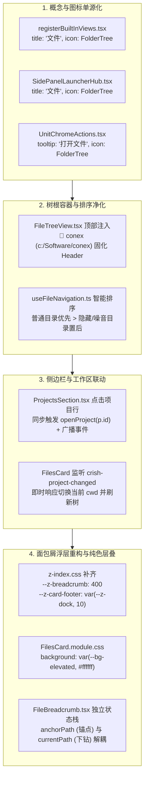
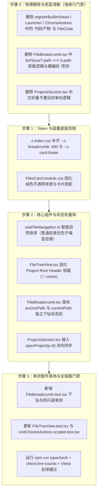

# Conex / Crish — 维度详案 15：文件管理器概念归位与面包屑弹窗修复详案

> **方案编号**：PLAN-15-DETAILED  
> **所属战役**：Conex / Crish 工作区面板交互平滑与视觉归一战役 (Track C)  
> **责任领域**：ViewRegistry 视图中心概念单源化、工作区文件树（FileTreeView）根容器固化、侧边栏项目切换响应式绑定、面包屑多级下钻状态机与层叠上下文（Stacking Context）纯色浮层修复  
> **依据文件**：
> - [`docs/ui-style-refactor/06-定案-工作区面板与工具栏细节深化决策.md`](file:///c:/Software/conex/docs/ui-style-refactor/06-%E5%AE%9A%E6%A1%88-%E5%B7%A5%E4%BD%9C%E5%8C%BA%E9%9D%A2%E6%9D%BF%E4%B8%8E%E5%B7%A5%E5%85%B7%E6%A0%8F%E7%BB%86%E8%8A%82%E6%B7%B1%E5%8C%96%E5%86%B3%E7%AD%96.md)（§一.6~7、§二.DEL-WS-07~08、§三.Track C）
> - [`docs/ui-style-refactor/00-总方案-工作区面板交互平滑与视觉归一.md`](file:///c:/Software/conex/docs/ui-style-refactor/00-%E6%80%BB%E6%96%B9%E6%A1%88-%E5%B7%A5%E4%BD%9C%E5%8C%BA%E9%9D%A2%E6%9D%BF%E4%BA%A4%E4%BA%92%E5%B9%B3%E6%BB%91%E4%B8%8E%E8%A7%86%E8%A7%89%E5%BD%92%E4%B8%80.md)（§一.5、§二、§三）
> - [`docs/ui-style-refactor/audits/10-files-card-root-path-and-breadcrumb-popup-audit.md`](file:///c:/Software/conex/docs/ui-style-refactor/audits/10-files-card-root-path-and-breadcrumb-popup-audit.md)
> - [`AGENTS.md`](file:///c:/Software/conex/AGENTS.md)（§1、§2、§3、§7、§13、§14）

---

## 目录

1. [一、做什么（新增与改造清单）](#一做什么新增与改造清单)
   - 1.1 [ViewRegistry 概念归位与全仓统一命名收敛（Files / `FolderTree`）](#11-viewregistry-概念归位与全仓统一命名收敛files--foldertree)
   - 1.2 [`FileTreeView.tsx` 固化项目根容器 Header 与 ASCII 噪音排序优化](#12-filetreeviewtsx-固化项目根容器-header-与-ascii-噪音排序优化)
   - 1.3 [`ProjectsSection.tsx` 项目切换与工作区 cwd 双向响应式绑定](#13-projectssectiontsx-项目切换与工作区-cwd-双向响应式绑定)
   - 1.4 [`z-index.css` 补齐 `--z-breadcrumb: 400` 与浮层不透明纯色底板](#14-z-indexcss-补齐---z-breadcrumb-400-与浮层不透明纯色底板)
   - 1.5 [`FileBreadcrumb.tsx` 多级下钻状态机与浮层防闪退重塑](#15-filebreadcrumbtsx-多级下钻状态机与浮层防闪退重塑)
   - 1.6 [单元测试套件补齐（`FileBreadcrumb.test.tsx` + `FileTreeView.test.tsx` 扩展）](#16-单元测试套件补齐filebreadcrumbtesttsx--filetreeviewtesttsx-扩展)
2. [二、删什么（删除与收敛清单）](#二删什么删除与收敛清单)
   - 2.1 [全仓“代码产物”历史命名与 `FileCode` 图标清剿（DEL-WS-07）](#21-全仓代码产物历史命名与-filecode-图标清剿del-ws-07)
   - 2.2 [`FileBreadcrumb.tsx` 瞬灭卸载逻辑与硬编码“项目”删除（DEL-WS-08）](#22-filebreadcrumbtsx-瞬灭卸载逻辑与硬编码项目删除del-ws-08)
   - 2.3 [`ProjectsSection.tsx` 仅折叠不激活的割裂逻辑删除](#23-projectssectiontsx-仅折叠不激活的割裂逻辑删除)
   - 2.4 [全量删除与收敛前后对照矩阵](#24-全量删除与收敛前后对照矩阵)
3. [三、依赖与逻辑顺序（先删后改 DAG）](#三依赖与逻辑顺序先删后改-dag)
   - 3.1 [执行阶段拓扑与阶段门禁](#31-执行阶段拓扑与阶段门禁)
   - 3.2 [步骤级详细执行顺序](#32-步骤级详细执行顺序)
4. [四、唯一文件域（正交无冲突）](#四唯一文件域正交无冲突)
   - 4.1 [修改与新增文件清单](#41-修改与新增文件清单)
   - 4.2 [跨域交互协议与契约](#42-跨域交互协议与契约)
5. [五、详细代码改动详案与实现契约](#五详细代码改动详案与实现契约)
   - 5.1 [`apps/crish-desktop/src/styles/z-index.css`](#51-appscrish-desktopsrcstylesz-indexcss)
   - 5.2 [`apps/crish-desktop/src/services/view-registry/registerBuiltInViews.tsx`](#52-appscrish-desktopsrcservicesview-registryregisterbuiltinviewstsx)
   - 5.3 [`apps/crish-desktop/src/components/binary-tree/SidePanelLauncherHub.tsx`](#53-appscrish-desktopsrccomponentsbinary-treesidepanellauncherhubtsx)
   - 5.4 [`apps/crish-desktop/src/components/chat-card/UnitChromeActions.tsx`](#54-appscrish-desktopsrccomponentschat-cardunitchromeactionstsx)
   - 5.5 [`apps/crish-desktop/src/components/chat-card/unitChromeTools.ts`](#55-appscrish-desktopsrccomponentschat-cardunitchrometoolsts)
   - 5.6 [`apps/crish-desktop/src/components/sidebar/session-list/ProjectsSection.tsx`](#56-appscrish-desktopsrccomponentssidebarsession-listprojectssectiontsx)
   - 5.7 [`apps/crish-desktop/src/components/files/FilesCard.module.css`](#57-appscrish-desktopsrccomponentsfilesfilescardmodulecss)
   - 5.8 [`apps/crish-desktop/src/components/files/FileTreeView.tsx`](#58-appscrish-desktopsrccomponentsfilesfiletreeviewtsx)
   - 5.9 [`apps/crish-desktop/src/components/files/hooks/useFileNavigation.ts`](#59-appscrish-desktopsrccomponentsfileshooksusefilenavigationts)
   - 5.10 [`apps/crish-desktop/src/components/files/FilesCard.tsx`](#510-appscrish-desktopsrccomponentsfilesfilescardtsx)
   - 5.11 [`apps/crish-desktop/src/components/files/FileBreadcrumb.tsx`](#511-appscrish-desktopsrccomponentsfilesfilebreadcrumbtsx)
   - 5.12 [`apps/crish-desktop/src/components/files/__tests__/FileBreadcrumb.test.tsx` (NEW)](#512-appscrish-desktopsrccomponentsfiles__tests__filebreadcrumbtesttsx-new)
   - 5.13 [`apps/crish-desktop/src/components/files/FileTreeView.test.tsx` (UPDATE)](#513-appscrish-desktopsrccomponentsfilesfiletreeviewtesttsx-update)
   - 5.14 [`apps/crish-desktop/src/components/chat-card/UnitChromeActions.scoped.test.tsx` (UPDATE)](#514-appscrish-desktopsrccomponentschat-cardunitchromeactionsscopedtesttsx-update)
6. [六、验收标准与门禁断言](#六验收标准与门禁断言)
   - 6.1 [功能验收标准](#61-功能验收标准)
   - 6.2 [负产出验收标准（Zero Tolerance）](#62-负产出验收标准zero-tolerance)
   - 6.3 [代码质量与流水线门禁](#63-代码质量与流水线门禁)

---

## 一、做什么（新增与改造清单）

本详案针对用户真实反馈的四大核心痛点：
1. **概念错位**：“代码产物”历史命名违背“工作区全功能文件管理器”实质；
2. **根目录误判**：文件树缺失项目根 Header，ASCII 排序导致孤儿物理目录 `--version` 成为首行，让用户误以为绑定了错误根目录；
3. **项目切换脱节**：侧边栏点击项目行仅折叠 UI，未调用 `openProject` 激活 cwd；
4. **面包屑浮层瘫痪**：未定义 `--z-breadcrumb` 导致浮层透明穿透，且点击子目录导致状态机判定失步引发瞬间卸载（瞬灭）。



### 1.1 ViewRegistry 概念归位与全仓统一命名收敛（Files / `FolderTree`）
- **视图注册中心收敛**：在 [`registerBuiltInViews.tsx`](file:///c:/Software/conex/apps/crish-desktop/src/services/view-registry/registerBuiltInViews.tsx) 中，将 `id: 'files'` 的 `title` 从 `'代码产物'` 统一修改为 `'文件'`，图标从 `FileCode` 替换为 `FolderTree`（`lucide-react`）；
- **启动面板入口收敛**：在 [`SidePanelLauncherHub.tsx`](file:///c:/Software/conex/apps/crish-desktop/src/components/binary-tree/SidePanelLauncherHub.tsx) 中，将卡片标题修改为 `'文件'`，描述调整为 `'浏览项目工作区目录树、编辑与代码预览'`，图标替换为 `FolderTree`；
- **对话顶快捷动作栏收敛**：在 [`UnitChromeActions.tsx`](file:///c:/Software/conex/apps/crish-desktop/src/components/chat-card/UnitChromeActions.tsx) 中，将按钮 tooltip 与 `aria-label` 从 `'打开代码产物与文件'` 统一收敛为 `'打开文件'`，图标替换为 `FolderTree`，并保持与 `unitChromeTools.ts` 100% 对齐。

### 1.2 `FileTreeView.tsx` 固化项目根容器 Header 与 ASCII 噪音排序优化
- **固化 Project Root Header**：
  - 在 `FileTreeView.tsx` 顶部常驻渲染项目根容器 Header（`📁 <projectName> (<absolutePath>)`，如 `📁 conex (c:/Software/conex)`）；
  - 即使根目录下有以 `-` 或 `.` 开头的物理目录，顶部第一行永远是清晰明确的项目根容器，提供强有力的锚点感知；
  - 点击项目根 Header 可触发选择项目根或重置焦点；
- **ASCII 噪音目录自然排序**：
  - 在 `useFileNavigation.ts` 的 `flatTree` 构建逻辑中，实施**自然智能排序**规则：
    1. 文件夹优先于普通文件；
    2. 常规业务目录（如 `apps`, `crates`, `docs`, `packages`）优先于以 `.` 或 `--` 开头的噪音/内部运行期目录（如 `--version`, `.agent-outputs`, `.agent-runtime`）；
    3. 同类别使用 `localeCompare(..., { numeric: true, sensitivity: 'base' })` 自然拼写排序。

### 1.3 `ProjectsSection.tsx` 项目切换与工作区 cwd 双向响应式绑定
- **项目行单击即时激活**：
  - 修改 [`ProjectsSection.tsx`](file:///c:/Software/conex/apps/crish-desktop/src/components/sidebar/session-list/ProjectsSection.tsx) 的 `folderHeader` 点击事件，在触发折叠/展开（`onToggleProjectCollapsed`）的同时，显式调用 `openProject(p.id)` 与 `onOpenProject(p.id)`；
  - 触发 `localStorage.setItem('crish_workspace', target.path)` 并广播 `crish-project-changed` 自定义事件；
- **文件管理器即时响应**：
  - `FilesCard.tsx` 监听 `crish-project-changed` 事件，接收到广播后立即同步 `nav.root` 与 `nav.cwd`，平滑重新加载工作区文件树。

### 1.4 `z-index.css` 补齐 `--z-breadcrumb: 400` 与浮层不透明纯色底板
- **补齐全系统层叠变量**：
  - 在 [`styles/z-index.css`](file:///c:/Software/conex/apps/crish-desktop/src/styles/z-index.css) 中显式声明：
    ```css
    --z-breadcrumb: 400;
    --z-card-footer: var(--z-dock, 10);
    ```
- **加固浮层纯色底板**：
  - 在 [`FilesCard.module.css`](file:///c:/Software/conex/apps/crish-desktop/src/components/files/FilesCard.module.css) 中，`.filesBcFlyout` 显式设置 `background: var(--bg-elevated, #ffffff);`，杜绝任何透明回退或与底层虚拟列表文字半透明混合，配合 `box-shadow: var(--shadow-lg)` 与精细边框，建立 Solid 高层叠卡片。

### 1.5 `FileBreadcrumb.tsx` 多级下钻状态机与浮层防闪退重塑
- **解耦触发锚点与浏览路径**：
  - 在 `FileBreadcrumb.tsx` 中引入独立下钻状态机：
    - `anchorPath`：触发浮层的面包屑节点路径（决定弹层挂在哪个 segment 上，保持稳定）；
    - `currentPath`：浮层当前正在浏览的物理子目录路径（初始为 `anchorPath`，点击子目录时平滑推进）；
    - `navHistory`：路径栈，记录多级下钻历史，支持“返回上一级”；
  - 浮层展开条件严格判定为 `bcFlyout !== null && bcFlyout.anchorPath === b.path`；
  - **彻底解决闪退 Bug**：用户在浮层内点击子文件夹时，仅更新 `currentPath` 并异步拉取子列表，`anchorPath` 保持不变，浮层**绝不瞬灭**；
- **浮层内多级导航与上下文增强**：
  - 浮层顶部展示当前下钻的相对路径（`pathRelativeToRoot(currentPath, root)`）以及“返回上一级”导航按钮；
  - 点击浮层内文件直接调用 `onOpenFile(path)` 并关闭浮层；
  - 底部提供“打开此目录”按钮，调用 `onNavigate(currentPath)` 并关闭浮层；
- **根节点 Label 真实化**：
  - 面包屑首项 label 不再硬编码为“项目”，而是动态读取项目文件夹名（如 `conex`）。

### 1.6 单元测试套件补齐（`FileBreadcrumb.test.tsx` + `FileTreeView.test.tsx` 扩展）
- 新增 [`FileBreadcrumb.test.tsx`](file:///c:/Software/conex/apps/crish-desktop/src/components/files/__tests__/FileBreadcrumb.test.tsx)，重点覆盖：
  1. 根芯片渲染实际项目名称而非“项目”；
  2. 点击面包屑芯片打开浮层；
  3. 浮层内点击子目录成功下钻且浮层保持开启（防瞬灭回归断言）；
  4. 浮层内点击返回上一级导航；
  5. 浮层内点击文件触发 `onOpenFile` 并关闭浮层；
  6. 点击“打开此目录”触发 `onNavigate`；
- 更新 [`FileTreeView.test.tsx`](file:///c:/Software/conex/apps/crish-desktop/src/components/files/FileTreeView.test.tsx)，增加 Project Root Header 渲染与点击断言；
- 更新 [`UnitChromeActions.scoped.test.tsx`](file:///c:/Software/conex/apps/crish-desktop/src/components/chat-card/UnitChromeActions.scoped.test.tsx)，断言“打开文件”文本与图标。

---

## 二、删什么（删除与收敛清单）

严格执行《重构定案决策》“先删后改”铁律，对全仓所有历史遗留概念与错误卸载逻辑进行物理清剿。

### 2.1 全仓“代码产物”历史命名与 `FileCode` 图标清剿（DEL-WS-07）

1. **【DEL-WS-07-A】清剿 `registerBuiltInViews.tsx` 中的“代码产物”与 `FileCode`**：
   - **删除位置**：[`registerBuiltInViews.tsx:101-102`](file:///c:/Software/conex/apps/crish-desktop/src/services/view-registry/registerBuiltInViews.tsx#L101-L102)
   - **原代码**：`title: '代码产物', icon: FileCode`
   - **收敛动作**：删除该代码，替换为 `title: '文件', icon: FolderTree`。
2. **【DEL-WS-07-B】清剿 `SidePanelLauncherHub.tsx` 中的“代码产物与文件”**：
   - **删除位置**：[`SidePanelLauncherHub.tsx:45-53`](file:///c:/Software/conex/apps/crish-desktop/src/components/binary-tree/SidePanelLauncherHub.tsx#L45-L53)
   - **原代码**：`<FileCode ... />`, `<span>代码产物与文件</span>`, `<span>浏览会话生成的文件、差异与产物</span>`
   - **收敛动作**：删除混淆描述，收敛为 `<FolderTree ... />`, `<span>文件</span>`, `<span>浏览项目工作区目录树、编辑与代码预览</span>`。
3. **【DEL-WS-07-C】清剿 `UnitChromeActions.tsx` 中的“代码产物与文件”**：
   - **删除位置**：[`UnitChromeActions.tsx:361-373`](file:///c:/Software/conex/apps/crish-desktop/src/components/chat-card/UnitChromeActions.tsx#L361-L373)
   - **原代码**：`<Tooltip content="打开代码产物与文件">`, `aria-label="打开代码产物与文件"`, `<FileCode ... />`
   - **收敛动作**：删除该文案与图标，替换为 `Tooltip content="打开文件"`, `aria-label="打开文件"`, `<FolderTree ... />`。

### 2.2 `FileBreadcrumb.tsx` 瞬灭卸载逻辑与硬编码“项目”删除（DEL-WS-08）

1. **【DEL-WS-08-A】删除直接以 `bcFlyout?.path === b.path` 判定挂载的缺陷逻辑**：
   - **删除位置**：[`FileBreadcrumb.tsx:199`](file:///c:/Software/conex/apps/crish-desktop/src/components/files/FileBreadcrumb.tsx#L199)
   - **原代码**：`const flyOpen = bcFlyout?.path === b.path;`
   - **删除理由**：下钻时 `bcFlyout.path` 变为子目录路径，导致与外层面包屑 `b.path` 失配，浮层瞬间被 React 卸载；
   - **收敛动作**：彻底删除该判定，改为基于稳定的 `anchorPath` 判定：`const flyOpen = bcFlyout?.anchorPath === b.path;`。
2. **【DEL-WS-08-B】删除硬编码 `label: '项目'` 根芯片**：
   - **删除位置**：[`FileBreadcrumb.tsx:95`](file:///c:/Software/conex/apps/crish-desktop/src/components/files/FileBreadcrumb.tsx#L95)
   - **原代码**：`const items: BreadcrumbItem[] = [{ label: '项目', path: root }];`
   - **删除理由**：过于抽象，无法给用户明确的项目真实路径与名称确认感；
   - **收敛动作**：删除硬编码 `'项目'`，提取当前根路径叶名：`const rootLabel = root.split(/[\\/]/).filter(Boolean).pop() || '项目';`。

### 2.3 `ProjectsSection.tsx` 仅折叠不激活的割裂逻辑删除

- **删除位置**：[`ProjectsSection.tsx:133-136`](file:///c:/Software/conex/apps/crish-desktop/src/components/sidebar/session-list/ProjectsSection.tsx#L133-L136)
- **原代码**：
  ```tsx
  onClick={() => {
    onToggleProjectCollapsed(p.id);
  }}
  ```
- **删除理由**：点击项目文件夹行仅触发折叠，未调用 `openProject` 激活 cwd，导致侧边栏操作与文件树状态割裂；
- **收敛动作**：删除单一折叠逻辑，合并激活工作区调用：`openProject(p.id); onOpenProject(p.id); onToggleProjectCollapsed(p.id);`。

### 2.4 全量删除与收敛前后对照矩阵

| 序号 | 所属文件 | 删除内容 (Before) | 收敛后唯一正确路径 (After) | 删除性质 |
| :--- | :--- | :--- | :--- | :--- |
| **DEL-WS-07-A** | `registerBuiltInViews.tsx` | `title: '代码产物'`, `icon: FileCode` | `title: '文件'`, `icon: FolderTree` | 概念死层清剿 |
| **DEL-WS-07-B** | `SidePanelLauncherHub.tsx` | `代码产物与文件`, `FileCode` | `文件`, `FolderTree`, 精确描述 | 杂交文案清剿 |
| **DEL-WS-07-C** | `UnitChromeActions.tsx` | `打开代码产物与文件`, `FileCode` | `打开文件`, `FolderTree` | 动作文案对齐 |
| **DEL-WS-08-A** | `FileBreadcrumb.tsx` | `flyOpen = bcFlyout?.path === b.path` | `flyOpen = bcFlyout?.anchorPath === b.path` | 致命卸载 Bug 根除 |
| **DEL-WS-08-B** | `FileBreadcrumb.tsx` | 硬编码 `label: '项目'` | 真实项目名 `rootLabel (conex)` | 抽象失真消除 |
| **DEL-WS-08-C** | `ProjectsSection.tsx` | 仅 `onToggleProjectCollapsed(p.id)` | 同步调用 `openProject(p.id)` 激活 cwd | 状态机脱节消除 |
| **DEL-WS-08-D** | `FilesCard.module.css` | `var(--z-breadcrumb)` (未定义) + `var(--bg-primary)` 兜底 | `var(--z-breadcrumb: 400)` + `var(--bg-elevated, #ffffff)` 纯色 | 穿透透明缺陷根治 |

---

## 三、依赖与逻辑顺序（先删后改 DAG）

严格遵循“先清剿死层与未定义 Token $\rightarrow$ 补齐层叠与状态机 $\rightarrow$ 落地树根与浮层下钻 $\rightarrow$ 测试验收”的拓扑顺序。



### 3.1 执行阶段拓扑与阶段门禁
- **Gate 0 门禁**：完成全仓“代码产物”历史文案与旧卸载判定逻辑清剿；
- **Gate 1 门禁**：`z-index.css` 变量声明就绪，`FilesCard.module.css` 样式就绪；
- **Gate 2 门禁**：`FileTreeView` 根容器展示无误，`FileBreadcrumb` 浮层下钻平滑无闪退，侧边栏切换项目即时响应；
- **Gate 3 门禁**：全量单测 100% PASS，`npm run check:desktop` 零错误。

---

## 四、唯一文件域（正交无冲突）

本详案所有改动严格锁定在工作区文件系统与侧边栏项目激活域，与工具栏 26px 标尺（Track A）及概览改动列表（Track B）保持绝对正交。

### 4.1 修改与新增文件清单

```
apps/crish-desktop/
├── src/
│   ├── styles/
│   │   └── z-index.css                                  [MODIFY] (补齐 --z-breadcrumb: 400 与 --z-card-footer)
│   ├── services/
│   │   └── view-registry/
│   │       └── registerBuiltInViews.tsx                [MODIFY] (title: '文件', icon: FolderTree)
│   ├── components/
│   │   ├── binary-tree/
│   │   │   └── SidePanelLauncherHub.tsx                [MODIFY] (title: '文件', icon: FolderTree)
│   │   ├── chat-card/
│   │   │   ├── UnitChromeActions.tsx                   [MODIFY] (tooltip: '打开文件', icon: FolderTree)
│   │   │   ├── UnitChromeActions.scoped.test.tsx       [MODIFY] (单测更新断言为 '打开文件')
│   │   │   └── unitChromeTools.ts                      [MODIFY] (确保 label: '打开文件' 单源一致)
│   │   ├── sidebar/
│   │   │   └── session-list/
│   │   │       └── ProjectsSection.tsx                 [MODIFY] (点击项目行调用 openProject)
│   │   └── files/
│   │       ├── FilesCard.module.css                    [MODIFY] (z-index 修正与浮层不透明纯白底板)
│   │       ├── FileTreeView.tsx                        [MODIFY] (固化 Project Root Header)
│   │       ├── FileTreeView.test.tsx                   [MODIFY] (增加 Root Header 渲染与交互单测)
│   │       ├── FileBreadcrumb.tsx                      [MODIFY] (独立下钻状态机，彻底消除瞬灭)
│   │       ├── FilesCard.tsx                           [MODIFY] (传递 root/cwd 至 FileTreeView)
│   │       ├── hooks/
│   │       │   └── useFileNavigation.ts                [MODIFY] (智能排序与噪音目录折叠优化)
│   │       └── __tests__/
│   │           └── FileBreadcrumb.test.tsx             [NEW]    (面包屑下钻导航与防闪退单测套件)
```

### 4.2 跨域交互协议与契约
- **项目切换事件**：`CustomEvent('crish-project-changed', { detail: { projectId, path, reason: 'open' } })`；
- **文件打开事件**：`CustomEvent('crish-open-file', { detail: { path } })`；
- **目录列表接口契约**：`listDirectory(path: string): Promise<FsDirEntry[]>`。

---

## 五、详细代码改动详案与实现契约

### 5.1 `apps/crish-desktop/src/styles/z-index.css`

在 Level 3 下拉菜单与 Level 4 浮层之间补齐 `--z-breadcrumb` 与 `--z-card-footer` 变量声明：

```css
:root {
  /* Level 0: 基础文档流与排版底座 */
  --z-base: 0;

  /* Level 1: 粘性与外壳停靠层 */
  --z-dock: 10;
  --z-sticky: var(--z-dock);
  --z-card-footer: var(--z-dock);

  /* Level 2: 视口外壳与分栏手柄 */
  --z-chrome: 100;
  --z-sidebar: var(--z-chrome);
  --z-resizer: var(--z-chrome);

  /* Level 3: 下拉菜单与级联选择 */
  --z-dropdown: 300;
  --z-breadcrumb: 400;

  /* Level 4: 浮层、卡片气泡与上下文菜单 */
  --z-popover: 500;
  --z-drawer: var(--z-popover);

  /* Level 5: 全局模态、设置面板与通知吐司 */
  --z-modal: 1000;
  --z-toast: var(--z-modal);

  /* Level 6: 顶级悬浮提示与光标胶囊 */
  --z-tooltip: 9000;
}
```

---

### 5.2 `apps/crish-desktop/src/services/view-registry/registerBuiltInViews.tsx`

修改 `id: 'files'` 视图注册信息：

```diff
@@ -8,3 +8,3 @@
   Globe,
   Workflow,
-  FileCode,
+  FolderTree,
 } from 'lucide-react';
@@ -98,5 +98,5 @@
   // 5. 文件管理器 (Tool)
   viewRegistry.registerView({
     id: 'files',
-    title: '代码产物',
-    icon: FileCode,
+    title: '文件',
+    icon: FolderTree,
     category: 'tool',
```

---

### 5.3 `apps/crish-desktop/src/components/binary-tree/SidePanelLauncherHub.tsx`

修改启动面板卡片展示文案与图标：

```diff
@@ -2,3 +2,3 @@
 import React from 'react';
-import { Globe, FileCode } from 'lucide-react';
+import { Globe, FolderTree } from 'lucide-react';
 import styles from './LeafToolTabStrip.module.css';
@@ -44,7 +44,7 @@
             <div className={`${styles.launcherCardIconBox} launcher-card-icon-box`}>
-              <FileCode size={16} strokeWidth={1.8} />
+              <FolderTree size={16} strokeWidth={1.8} />
             </div>
             <div className={styles.launcherCardText}>
               <span className={`${styles.launcherCardTitle} launcher-card-title`}>
-                代码产物与文件
+                文件
               </span>
               <span className={styles.launcherCardDesc}>
-                浏览会话生成的文件、差异与产物
+                浏览项目工作区目录树、编辑与代码预览
               </span>
```

---

### 5.4 `apps/crish-desktop/src/components/chat-card/UnitChromeActions.tsx`

更新对话顶快捷动作栏的 tooltip、aria-label 与图标：

```diff
@@ -10,3 +10,3 @@
   Globe,
-  FileCode,
+  FolderTree,
   FileEdit,
@@ -231,4 +231,4 @@
-    const handleOpenArtifacts = useCallback(() => {
+    const handleOpenFiles = useCallback(() => {
       openToolInSession((activeSessionId || '').trim(), 'files');
     }, [activeSessionId]);
@@ -361,11 +361,11 @@
-          {/* 按钮 2: 代码产物与文件 (📄 FileCode) */}
-          <Tooltip content="打开代码产物与文件" side={UNIT_CHROME_TOOL_TIP_SIDE}>
+          {/* 按钮 2: 文件管理器 (📁 FolderTree) */}
+          <Tooltip content="打开文件" side={UNIT_CHROME_TOOL_TIP_SIDE}>
             <button
               type="button"
-              id="topQuickArtifactsBtn"
+              id="topQuickFilesBtn"
               className={`${styles.topActionBtn} top-action-btn`}
-              data-testid="top-quick-artifacts-btn"
+              data-testid="top-quick-files-btn"
               data-active={isArtifactsActive ? 'true' : 'false'}
-              aria-label="打开代码产物与文件"
-              onClick={handleOpenArtifacts}
+              aria-label="打开文件"
+              onClick={handleOpenFiles}
             >
-              <FileCode size={14} strokeWidth={1.8} aria-hidden="true" />
+              <FolderTree size={14} strokeWidth={1.8} aria-hidden="true" />
             </button>
           </Tooltip>
```

---

### 5.5 `apps/crish-desktop/src/components/chat-card/unitChromeTools.ts`

保持单一真源对齐（无需修改，确认定义）：
```typescript
  {
    id: 'files',
    label: '打开文件',
    testId: 'chat-open-files',
    Icon: FolderTree,
  },
```

---

### 5.6 `apps/crish-desktop/src/components/sidebar/session-list/ProjectsSection.tsx`

在项目文件夹行点击时，同步触发 `openProject(p.id)` 与 `onOpenProject(p.id)`：

```diff
@@ -133,3 +133,5 @@
                     onClick={() => {
+                      openProject(p.id);
+                      onOpenProject(p.id);
                       onToggleProjectCollapsed(p.id);
                     }}
```

---

### 5.7 `apps/crish-desktop/src/components/files/FilesCard.module.css`

补齐与固化浮层纯色底板、z-index 与项目根 Header 样式：

```diff
@@ -49,3 +49,3 @@
   position: relative;
-  z-index: var(--z-card-footer);
+  z-index: var(--z-card-footer, 10);
 }
@@ -97,3 +97,3 @@
   position: relative;
-  z-index: var(--z-card-footer);
+  z-index: var(--z-card-footer, 10);
 }
@@ -334,3 +334,3 @@
   left: 0;
-  z-index: var(--z-breadcrumb);
+  z-index: var(--z-breadcrumb, 400);
   width: min(320px, 70vw);
@@ -342,3 +342,4 @@
   border: 1px solid var(--border-subtle);
-  background: var(--bg-elevated, var(--bg-primary));
-  box-shadow: var(--shadow-lg, 0 12px 28px rgba(0, 0, 0, 0.1));
+  background: var(--bg-elevated, #ffffff);
+  box-shadow: var(--shadow-lg, 0 12px 28px rgba(0, 0, 0, 0.12));
   white-space: normal;
 }
```

新增 `.filesTreeRootHeader` 与浮层子级头部样式：

```css
/* ─────────────────────────────────────────────────────────────────────────
   项目根固化容器头部 (Project Root Header)
   ───────────────────────────────────────────────────────────────────────── */
.filesTreeRootHeader {
  display: flex;
  align-items: center;
  gap: var(--space-1_5, 6px);
  padding: 0 8px;
  height: 28px;
  min-height: 28px;
  box-sizing: border-box;
  font-size: var(--font-size-xs, 12px);
  font-weight: var(--font-weight-semibold, 600);
  color: var(--text-primary);
  background: var(--bg-card, #ffffff);
  border-bottom: 1px solid var(--hairline, var(--border-subtle));
  user-select: none;
  cursor: pointer;
  flex-shrink: 0;
  position: sticky;
  top: 0;
  z-index: var(--z-dock, 10);
}

.filesTreeRootHeader:hover {
  background: var(--bg-hover);
}

.filesTreeRootHeaderIcon {
  color: var(--text-secondary);
  flex-shrink: 0;
}

.filesTreeRootHeaderName {
  font-weight: var(--font-weight-semibold, 600);
  color: var(--text-primary);
  flex-shrink: 0;
}

.filesTreeRootHeaderPath {
  font-size: 11px;
  color: var(--text-tertiary);
  font-weight: var(--font-weight-normal, 400);
  overflow: hidden;
  text-overflow: ellipsis;
  white-space: nowrap;
  min-width: 0;
  opacity: 0.85;
}

/* ─────────────────────────────────────────────────────────────────────────
   面包屑多级下钻浮层头部 (Flyout Drill-Down Nav Header)
   ───────────────────────────────────────────────────────────────────────── */
.filesBcNavHeader {
  display: flex;
  align-items: center;
  gap: var(--space-1_5, 6px);
  padding: 4px 6px;
  margin-bottom: var(--space-1);
  border-radius: var(--radius-md);
  background: var(--bg-secondary, #f4f5f7);
  font-size: var(--font-size-xs, 12px);
  color: var(--text-secondary);
  flex-shrink: 0;
}

.filesBcNavBackBtn {
  appearance: none;
  border: none;
  background: transparent;
  display: inline-flex;
  align-items: center;
  gap: 2px;
  font-size: 11px;
  color: var(--text-secondary);
  cursor: pointer;
  padding: 2px 4px;
  border-radius: var(--radius-sm);
}

.filesBcNavBackBtn:hover {
  background: var(--bg-hover);
  color: var(--text-primary);
}

.filesBcNavCurrentPath {
  flex: 1;
  min-width: 0;
  overflow: hidden;
  text-overflow: ellipsis;
  white-space: nowrap;
  font-family: var(--font-family-mono, monospace);
  font-size: 11px;
}
```

---

### 5.8 `apps/crish-desktop/src/components/files/FileTreeView.tsx`

在 `FileTreeView` 中引入 `root` 与 `cwd` 属性，并在虚拟树顶部固化渲染 `📁 <projectName> (<rootPath>)` Header：

```tsx
import React, { useMemo } from 'react';
import styles from './FilesCard.module.css';
import { Button, Tooltip } from '../ui';
import {
  ChevronDown,
  ChevronRight,
  File,
  FileCode2,
  FileText,
  Folder,
  FolderTree,
  Image,
  Table,
  X,
} from 'lucide-react';
import { detectFileKind } from '../../api/workspaceFsApi';
import { fileExtColor } from '../../api/codeHighlight';
import { useVirtualScroll } from '../../hooks/useVirtualScroll';
import type { TreeNode } from './FileSearchFilter';

function TreeFileIcon({ name }: { name: string }) {
  const k = detectFileKind(name);
  const color = fileExtColor(name);
  const sz = 14;
  if (k === 'image')
    return (
      <Image
        size={sz}
        className={styles.filesRowIco}
        style={{ color }}
        aria-hidden
      />
    );
  if (k === 'pdf')
    return (
      <FileText
        size={sz}
        className={styles.filesRowIco}
        style={{ color }}
        aria-hidden
      />
    );
  if (k === 'table')
    return (
      <Table
        size={sz}
        className={styles.filesRowIco}
        style={{ color }}
        aria-hidden
      />
    );
  if (
    /\.(ts|tsx|js|jsx|mjs|cjs|rs|py|go|java|css|html|json|md|yml|yaml)$/i.test(
      name
    )
  ) {
    return (
      <FileCode2
        size={sz}
        className={styles.filesRowIco}
        style={{ color }}
        aria-hidden
      />
    );
  }
  return (
    <File
      size={sz}
      className={styles.filesRowIco}
      style={{ color }}
      aria-hidden
    />
  );
}

function formatSize(n: number): string {
  if (n < 1024) return `${n}B`;
  if (n < 1024 * 1024) return `${(n / 1024).toFixed(1)}K`;
  return `${(n / 1024 / 1024).toFixed(1)}M`;
}

export interface FileTreeViewProps {
  root?: string;
  cwd?: string;
  flatTree: TreeNode[];
  selected: string | null;
  expanded: Record<string, unknown>;
  loading: boolean;
  error: string;
  filter: string;
  filterMode: boolean;
  gitStatusMap: Record<string, string>;
  onSelect: (path: string, isDir: boolean) => void;
  onToggleExpand: (path: string, e: React.MouseEvent) => void;
  onDoubleClick: (path: string, isDir: boolean) => void;
  onFilterChange: (v: string) => void;
  onFilterModeToggle: () => void;
  onErrorDismiss: () => void;
}

const ITEM_HEIGHT = 28;

export const FileTreeView: React.FC<FileTreeViewProps> = React.memo(
  function FileTreeView({
    root,
    cwd: _cwd,
    flatTree,
    selected,
    expanded,
    loading,
    error,
    filter,
    gitStatusMap,
    onSelect,
    onToggleExpand,
    onDoubleClick,
    onErrorDismiss,
  }) {
    const { visibleRange, containerRef, onScroll, totalHeight } =
      useVirtualScroll({
        itemCount: flatTree.length,
        fallbackHeight: ITEM_HEIGHT,
      });

    const { startIndex, endIndex } = visibleRange;

    const visibleItems = useMemo(() => {
      return flatTree.slice(startIndex, endIndex + 1);
    }, [flatTree, startIndex, endIndex]);

    const rootName = useMemo(() => {
      if (!root) return '工作区';
      return root.split(/[\\/]/).filter(Boolean).pop() || '工作区';
    }, [root]);

    const focusTreeRow = React.useCallback(
      (targetIndex: number) => {
        containerRef.current
          ?.querySelector<HTMLElement>(`[data-tree-index="${targetIndex}"]`)
          ?.focus();
      },
      [containerRef]
    );

    const handleRowKeyDown = React.useCallback(
      (e: React.KeyboardEvent, idx: number, node: TreeNode) => {
        if (e.key === 'Enter') {
          e.preventDefault();
          onSelect(node.path, node.isDir);
          return;
        }
        if (e.key === 'ArrowDown') {
          e.preventDefault();
          if (idx < flatTree.length - 1) focusTreeRow(idx + 1);
          return;
        }
        if (e.key === 'ArrowUp') {
          e.preventDefault();
          if (idx > 0) focusTreeRow(idx - 1);
          return;
        }
        if (e.key === 'Home') {
          e.preventDefault();
          focusTreeRow(0);
          return;
        }
        if (e.key === 'End') {
          e.preventDefault();
          focusTreeRow(flatTree.length - 1);
          return;
        }
        if (e.key === 'ArrowRight' && node.isDir && !expanded[node.path]) {
          e.preventDefault();
          onToggleExpand(node.path, e as unknown as React.MouseEvent);
          return;
        }
        if (e.key === 'ArrowLeft' && node.isDir && expanded[node.path]) {
          e.preventDefault();
          onToggleExpand(node.path, e as unknown as React.MouseEvent);
        }
      },
      [flatTree.length, expanded, onSelect, onToggleExpand, focusTreeRow]
    );

    return (
      <div
        className={`${styles.filesList} ${styles.filesListPane}`}
        ref={containerRef}
        onScroll={onScroll}
        role="tree"
        aria-label="文件树"
        style={{ overflowY: 'auto', position: 'relative' }}
      >
        {root ? (
          <div
            className={styles.filesTreeRootHeader}
            data-testid="files-tree-root-header"
            title={`项目根目录: ${root}`}
            role="button"
            tabIndex={0}
            onClick={() => onSelect(root, true)}
            onKeyDown={(e) => {
              if (e.key === 'Enter' || e.key === ' ') {
                e.preventDefault();
                onSelect(root, true);
              }
            }}
          >
            <FolderTree
              size={14}
              className={styles.filesTreeRootHeaderIcon}
              aria-hidden
            />
            <span className={styles.filesTreeRootHeaderName}>{rootName}</span>
            <span className={styles.filesTreeRootHeaderPath}>({root})</span>
          </div>
        ) : null}

        {loading ? (
          <div className={`${styles.filesEmpty} ${styles.filesEmptyCompact}`}>
            加载中…
          </div>
        ) : error && !flatTree.length ? (
          <div
            className={`${styles.filesEmpty} ${styles.filesEmptyCompact} ${styles.filesEmptyErr}`}
            role="alert"
          >
            <div className={styles.filesEmptyTitle}>无法读取目录</div>
            <div className={styles.filesEmptySub}>{error}</div>
          </div>
        ) : flatTree.length === 0 ? (
          <div className={`${styles.filesEmpty} ${styles.filesEmptyCompact}`}>
            {filter.trim() ? '无匹配项' : '空目录'}
          </div>
        ) : (
          <>
            {error ? (
              <div
                className={styles.filesInlineErr}
                role="alert"
                aria-live="polite"
                style={{
                  position: 'sticky',
                  top: root ? 28 : 0,
                  zIndex: 'var(--z-pinned-bar)',
                }}
              >
                <span className={styles.filesInlineErrText}>{error}</span>
                <Tooltip content="关闭">
                  <Button
                    type="button"
                    variant="ghost"
                    size="sm"
                    className={styles.filesInlineErrDismiss}
                    aria-label="关闭错误"
                    onClick={onErrorDismiss}
                    icon={<X size={11} />}
                  />
                </Tooltip>
              </div>
            ) : null}
            <div
              style={{
                height: `${totalHeight}px`,
                width: '100%',
                position: 'relative',
              }}
            >
              {visibleItems.map((e, index) => {
                const globalIdx = startIndex + index;
                const top = globalIdx * ITEM_HEIGHT;
                return (
                  <div
                    key={e.path}
                    data-tree-index={globalIdx}
                    className={`${styles.filesRow} ${selected === e.path ? styles.isSelected : ''}`}
                    style={{
                      position: 'absolute',
                      top: `${top}px`,
                      left: 0,
                      width: '100%',
                      height: `${ITEM_HEIGHT}px`,
                      paddingLeft: 4 + e.depth * 10,
                      display: 'flex',
                      alignItems: 'center',
                    }}
                    onClick={() => onSelect(e.path, e.isDir)}
                    onDoubleClick={() => onDoubleClick(e.path, e.isDir)}
                    role="treeitem"
                    aria-level={e.depth + 1}
                    aria-selected={selected === e.path}
                    aria-expanded={
                      e.isDir
                        ? expanded[e.path]
                          ? 'true'
                          : 'false'
                        : undefined
                    }
                    tabIndex={0}
                    onKeyDown={(ev) => handleRowKeyDown(ev, globalIdx, e)}
                  >
                    <Button
                      type="button"
                      variant="ghost"
                      size="sm"
                      className={`${styles.filesRowTwist} ${e.isDir ? '' : styles.isLeaf}`}
                      onClick={(ev) => {
                        ev.stopPropagation();
                        if (e.isDir) onToggleExpand(e.path, ev);
                      }}
                      tabIndex={-1}
                      aria-label={
                        e.isDir
                          ? expanded[e.path]
                            ? '收起'
                            : '展开'
                          : undefined
                      }
                      icon={
                        e.isDir ? (
                          expanded[e.path] ? (
                            <ChevronDown size={13} />
                          ) : (
                            <ChevronRight size={13} />
                          )
                        ) : undefined
                      }
                    />
                    {e.isDir ? (
                      <Folder
                        size={14}
                        className={`${styles.filesRowIco} ${styles.dir}`}
                      />
                    ) : (
                      <TreeFileIcon name={e.name} />
                    )}
                    <Tooltip content={e.name}>
                      <span className={styles.filesRowName}>{e.name}</span>
                    </Tooltip>
                    {!e.isDir && gitStatusMap[e.path] ? (
                      <span
                        className={styles.filesGitStatus}
                        style={{
                          color:
                            gitStatusMap[e.path] === 'M'
                              ? 'var(--color-warning)'
                              : gitStatusMap[e.path] === 'A'
                                ? 'var(--color-success)'
                                : gitStatusMap[e.path] === 'D'
                                  ? 'var(--color-error)'
                                  : gitStatusMap[e.path] === '?'
                                    ? 'var(--text-tertiary)'
                                    : undefined,
                        }}
                      >
                        {gitStatusMap[e.path]}
                      </span>
                    ) : null}
                    {!e.isDir && e.size != null ? (
                      <span className={styles.filesRowMeta}>
                        {formatSize(e.size)}
                      </span>
                    ) : null}
                  </div>
                );
              })}
            </div>
          </>
        )}
      </div>
    );
  }
);
```

---

### 5.9 `apps/crish-desktop/src/components/files/hooks/useFileNavigation.ts`

升级 `flatTree` 的自然智能排序算法：

```typescript
  const flatTree: TreeNode[] = useMemo(() => {
    const q = filter.trim().toLowerCase();
    const out: TreeNode[] = [];
    const walk = (list: FsDirEntry[], depth: number) => {
      // 智能自然排序：1. 文件夹优先；2. 业务目录优先于 . 或 -- 前缀的内部噪音目录；3. 拼写自然排序
      const sorted = [...list].sort((a, b) => {
        if (a.isDir !== b.isDir) return a.isDir ? -1 : 1;
        const aNoise = a.name.startsWith('.') || a.name.startsWith('--');
        const bNoise = b.name.startsWith('.') || b.name.startsWith('--');
        if (aNoise !== bNoise) return aNoise ? 1 : -1;
        return a.name.localeCompare(b.name, undefined, {
          numeric: true,
          sensitivity: 'base',
        });
      });
      for (const e of sorted) {
        out.push({ ...e, depth });
        if (e.isDir && expanded[e.path]) walk(expanded[e.path] ?? [], depth + 1);
      }
    };
    walk(entries, 0);
    if (!q) return out;
    return out.filter((n) => n.name.toLowerCase().includes(q));
  }, [entries, expanded, filter]);
```

---

### 5.10 `apps/crish-desktop/src/components/files/FilesCard.tsx`

向 `FileTreeView` 传入 `root={nav.root}` 和 `cwd={nav.cwd}`：

```diff
@@ -359,2 +359,4 @@
               <FileTreeView
+                root={nav.root}
+                cwd={nav.cwd}
                 flatTree={nav.flatTree}
```

---

### 5.11 `apps/crish-desktop/src/components/files/FileBreadcrumb.tsx`

完整重构 `FileBreadcrumb.tsx`，维护 `anchorPath` 与 `currentPath` 独立状态机：

```tsx
import React, {
  useCallback,
  useEffect,
  useMemo,
  useRef,
  useState,
} from 'react';
import styles from './FilesCard.module.css';
import { Button, Tooltip } from '../ui';
import {
  ChevronRight,
  CornerLeftUp,
  File,
  FileCode2,
  FileText,
  Folder,
  Image,
  Search,
  Table,
} from 'lucide-react';
import {
  detectFileKind,
  listDirectory,
  pathDirname,
  pathRelativeToRoot,
  resolveWorkspacePath,
  type FsDirEntry,
} from '../../api/workspaceFsApi';
import { fileExtColor } from '../../api/codeHighlight';
import type { ViewMode } from './hooks/useFilePreview';

function joinLocal(base: string, name: string): string {
  const sep = base.includes('\\') ? '\\' : '/';
  return `${base.replace(/[\\/]+$/, '')}${sep}${name}`;
}

function BcFileIcon({ name }: { name: string }) {
  const k = detectFileKind(name);
  const color = fileExtColor(name);
  const sz = 14;
  if (k === 'image') return <Image size={sz} style={{ color }} aria-hidden />;
  if (k === 'pdf') return <FileText size={sz} style={{ color }} aria-hidden />;
  if (k === 'table') return <Table size={sz} style={{ color }} aria-hidden />;
  if (
    /\.(ts|tsx|js|jsx|mjs|cjs|rs|py|go|java|css|html|json|md|yml|yaml)$/i.test(
      name
    )
  )
    return <FileCode2 size={sz} style={{ color }} aria-hidden />;
  return <File size={sz} style={{ color }} aria-hidden />;
}

interface BreadcrumbItem {
  label: string;
  path: string;
  isFile?: boolean;
}

interface FlyoutState {
  /** 触发弹层的面包屑节点路径（锚点，决定挂载在哪个 segment 上） */
  anchorPath: string;
  /** 当前浮层正在浏览的物理目录路径（支持下钻和回退） */
  currentPath: string;
  /** 当前正在浏览的目录显示名称 */
  currentLabel: string;
  /** 下钻历史路径栈（用于返回上一级） */
  navHistory: string[];
  /** 当前目录下的文件/文件夹列表 */
  entries: FsDirEntry[];
  /** 加载中状态 */
  loading: boolean;
  /** 过滤关键词 */
  filter: string;
}

interface FileBreadcrumbProps {
  root: string;
  cwd: string;
  selected: string | null;
  view: ViewMode;
  onNavigate: (path: string) => void;
  onRefresh: (path: string) => void;
  onOpenFile: (path: string) => void;
}

export const FileBreadcrumb = React.memo(function FileBreadcrumb({
  root,
  cwd,
  selected,
  view,
  onNavigate,
  onRefresh: _onRefresh,
  onOpenFile,
}: FileBreadcrumbProps) {
  const [bcFlyout, setBcFlyout] = useState<FlyoutState | null>(null);
  const crumbsRef = useRef<HTMLDivElement>(null);
  const bcFilterRef = useRef<HTMLInputElement>(null);
  const bcTriggerRef = useRef<HTMLButtonElement>(null);

  const rootLabel = useMemo(() => {
    if (!root) return '项目';
    return root.split(/[\\/]/).filter(Boolean).pop() || '项目';
  }, [root]);

  const breadcrumbs: BreadcrumbItem[] = useMemo(() => {
    if (!root) return [];
    const dir =
      view === 'detail' && selected
        ? pathDirname(selected) || root
        : cwd || root;
    const rel = pathRelativeToRoot(dir, root);
    const items: BreadcrumbItem[] = [{ label: rootLabel, path: root }];
    if (rel && rel !== '.') {
      let acc = root;
      for (const part of rel.replace(/\\/g, '/').split('/').filter(Boolean)) {
        acc = joinLocal(acc, part);
        items.push({ label: part, path: acc });
      }
    }
    if (view === 'detail' && selected) {
      items.push({
        label: selected.split(/[\\/]/).pop() || '',
        path: selected,
        isFile: true,
      });
    }
    return items;
  }, [cwd, root, rootLabel, selected, view]);

  const loadDir = useCallback(
    async (path: string) => listDirectory(resolveWorkspacePath(path)),
    []
  );

  const openBcFlyout = useCallback(
    async (dirPath: string, label: string) => {
      if (bcFlyout?.anchorPath === dirPath) {
        setBcFlyout(null);
        requestAnimationFrame(() => bcTriggerRef.current?.focus());
        return;
      }
      setBcFlyout({
        anchorPath: dirPath,
        currentPath: dirPath,
        currentLabel: label,
        navHistory: [],
        entries: [],
        loading: true,
        filter: '',
      });
      try {
        const list = await loadDir(dirPath);
        setBcFlyout((prev) =>
          prev && prev.anchorPath === dirPath && prev.currentPath === dirPath
            ? { ...prev, entries: list, loading: false }
            : prev
        );
        requestAnimationFrame(() => bcFilterRef.current?.focus());
      } catch {
        setBcFlyout(null);
        requestAnimationFrame(() => bcTriggerRef.current?.focus());
      }
    },
    [bcFlyout?.anchorPath, loadDir]
  );

  const handleDrillDown = useCallback(
    async (dirPath: string, dirName: string) => {
      if (!bcFlyout) return;
      const nextHistory = [...bcFlyout.navHistory, bcFlyout.currentPath];
      setBcFlyout((prev) =>
        prev
          ? {
              ...prev,
              currentPath: dirPath,
              currentLabel: dirName,
              navHistory: nextHistory,
              entries: [],
              loading: true,
              filter: '',
            }
          : null
      );
      try {
        const list = await loadDir(dirPath);
        setBcFlyout((prev) =>
          prev && prev.currentPath === dirPath
            ? { ...prev, entries: list, loading: false }
            : prev
        );
        requestAnimationFrame(() => bcFilterRef.current?.focus());
      } catch {
        setBcFlyout((prev) =>
          prev ? { ...prev, entries: [], loading: false } : null
        );
      }
    },
    [bcFlyout, loadDir]
  );

  const handleNavBack = useCallback(async () => {
    if (!bcFlyout || bcFlyout.navHistory.length === 0) return;
    const prevPath = bcFlyout.navHistory[bcFlyout.navHistory.length - 1];
    const nextHistory = bcFlyout.navHistory.slice(0, -1);
    const prevLabel =
      prevPath.split(/[\\/]/).filter(Boolean).pop() || rootLabel;
    setBcFlyout((prev) =>
      prev
        ? {
            ...prev,
            currentPath: prevPath,
            currentLabel: prevLabel,
            navHistory: nextHistory,
            entries: [],
            loading: true,
            filter: '',
          }
        : null
    );
    try {
      const list = await loadDir(prevPath);
      setBcFlyout((prev) =>
        prev && prev.currentPath === prevPath
          ? { ...prev, entries: list, loading: false }
          : prev
      );
      requestAnimationFrame(() => bcFilterRef.current?.focus());
    } catch {
      setBcFlyout((prev) =>
        prev ? { ...prev, entries: [], loading: false } : null
      );
    }
  }, [bcFlyout, loadDir, rootLabel]);

  useEffect(() => {
    if (!bcFlyout) return;
    const onDoc = (e: MouseEvent) => {
      const t = e.target as Node;
      if (crumbsRef.current?.contains(t)) return;
      setBcFlyout(null);
      requestAnimationFrame(() => bcTriggerRef.current?.focus());
    };
    const onKey = (e: KeyboardEvent) => {
      if (e.key === 'Escape') {
        setBcFlyout(null);
        requestAnimationFrame(() => bcTriggerRef.current?.focus());
      }
    };
    document.addEventListener('mousedown', onDoc);
    window.addEventListener('keydown', onKey);
    return () => {
      document.removeEventListener('mousedown', onDoc);
      window.removeEventListener('keydown', onKey);
    };
  }, [bcFlyout]);

  const bcFlyoutFiltered = useMemo(() => {
    if (!bcFlyout) return [];
    const q = bcFlyout.filter.trim().toLowerCase();
    let list = bcFlyout.entries;
    if (q) list = list.filter((e) => e.name.toLowerCase().includes(q));
    return [...list].sort((a, b) => {
      if (a.isDir !== b.isDir) return a.isDir ? -1 : 1;
      const aNoise = a.name.startsWith('.') || a.name.startsWith('--');
      const bNoise = b.name.startsWith('.') || b.name.startsWith('--');
      if (aNoise !== bNoise) return aNoise ? 1 : -1;
      return a.name.localeCompare(b.name, undefined, {
        numeric: true,
        sensitivity: 'base',
      });
    });
  }, [bcFlyout]);

  if (!root) return null;

  return (
    <div
      className={styles.filesCrumbs}
      ref={crumbsRef}
      aria-label="工作区相对路径"
    >
      {breadcrumbs.length === 0 ? (
        <span
          className={`${styles.filesBcChip} ${styles.filesBcChipMuted || 'files-bc-chip--muted'}`}
        >
          {rootLabel}
        </span>
      ) : (
        breadcrumbs.map((b, i) => {
          const isLast = i === breadcrumbs.length - 1;
          const canNav = !b.isFile;
          // 关键修复：依靠稳定的 anchorPath 匹配，下钻时弹层绝不意外卸载瞬灭
          const flyOpen = bcFlyout?.anchorPath === b.path;
          return (
            <React.Fragment key={`${b.path}-${i}`}>
              {i > 0 ? <span className={styles.filesBcSep}>/</span> : null}
              {canNav ? (
                <span className={styles.filesBcSeg}>
                  <Tooltip
                    content={
                      i === 0
                        ? `项目根目录 (${rootLabel}) · 点击列出内容`
                        : `${b.path} · 点击列出该层`
                    }
                  >
                    <button
                      type="button"
                      className={`${styles.filesBcChip} ${flyOpen ? styles.isOpen : ''}`}
                      aria-haspopup="listbox"
                      aria-expanded={flyOpen}
                      onClick={(e) => {
                        bcTriggerRef.current = e.currentTarget;
                        void openBcFlyout(b.path, b.label);
                      }}
                      onDoubleClick={() => {
                        setBcFlyout(null);
                        requestAnimationFrame(() =>
                          bcTriggerRef.current?.focus()
                        );
                        onNavigate(b.path);
                      }}
                    >
                      {b.label}
                    </button>
                  </Tooltip>
                  {flyOpen && bcFlyout ? (
                    <div
                      className={styles.filesBcFlyout}
                      role="listbox"
                      aria-label={`${bcFlyout.currentLabel} 目录`}
                    >
                      {bcFlyout.navHistory.length > 0 ? (
                        <div className={styles.filesBcNavHeader}>
                          <button
                            type="button"
                            className={styles.filesBcNavBackBtn}
                            onClick={() => void handleNavBack()}
                            aria-label="返回上一级"
                          >
                            <CornerLeftUp size={12} aria-hidden />
                            <span>返回</span>
                          </button>
                          <span
                            className={styles.filesBcNavCurrentPath}
                            title={bcFlyout.currentPath}
                          >
                            {pathRelativeToRoot(bcFlyout.currentPath, root) ||
                              rootLabel}
                          </span>
                        </div>
                      ) : null}
                      <div className={styles.filesBcFlyoutSearch}>
                        <Search size={14} aria-hidden />
                        <input
                          ref={bcFilterRef}
                          type="search"
                          placeholder="筛选文件…"
                          value={bcFlyout.filter}
                          onChange={(e) =>
                            setBcFlyout((prev) =>
                              prev ? { ...prev, filter: e.target.value } : prev
                            )
                          }
                          onKeyDown={(e) => {
                            if (e.key === 'Escape') {
                              setBcFlyout(null);
                              requestAnimationFrame(() =>
                                bcTriggerRef.current?.focus()
                              );
                            }
                          }}
                        />
                      </div>
                      <div className={styles.filesBcFlyoutList}>
                        {bcFlyout.loading ? (
                          <div className={styles.filesBcFlyoutEmpty}>
                            加载中…
                          </div>
                        ) : bcFlyoutFiltered.length === 0 ? (
                          <div className={styles.filesBcFlyoutEmpty}>
                            {bcFlyout.filter.trim() ? '无匹配' : '空目录'}
                          </div>
                        ) : (
                          bcFlyoutFiltered.map((ent) => (
                            <button
                              key={ent.path}
                              type="button"
                              role="option"
                              className={`${styles.filesBcFlyoutItem} ${selected === ent.path ? styles.isActive : ''}`}
                              onClick={() => {
                                if (ent.isDir) {
                                  // 下钻导航：进入子目录，保持浮层展开
                                  void handleDrillDown(ent.path, ent.name);
                                } else {
                                  // 打开文件：关闭浮层
                                  setBcFlyout(null);
                                  requestAnimationFrame(() =>
                                    bcTriggerRef.current?.focus()
                                  );
                                  void onOpenFile(ent.path);
                                }
                              }}
                            >
                              {ent.isDir ? (
                                <>
                                  <ChevronRight
                                    size={13}
                                    className={styles.filesBcFlyoutChev}
                                    aria-hidden
                                  />
                                  <Folder size={14} aria-hidden />
                                </>
                              ) : (
                                <>
                                  <span
                                    className={`${styles.filesBcFlyoutChev} ${styles.isLeaf}`}
                                  />
                                  <BcFileIcon name={ent.name} />
                                </>
                              )}
                              <span className={styles.filesBcFlyoutName}>
                                {ent.name}
                              </span>
                            </button>
                          ))
                        )}
                      </div>
                      <Button
                        type="button"
                        variant="secondary"
                        size="sm"
                        className={styles.filesBcFlyoutGoto}
                        onClick={() => {
                          const target = bcFlyout.currentPath;
                          setBcFlyout(null);
                          requestAnimationFrame(() =>
                            bcTriggerRef.current?.focus()
                          );
                          onNavigate(target);
                        }}
                      >
                        打开此目录
                      </Button>
                    </div>
                  ) : null}
                </span>
              ) : (
                <span
                  className={`${styles.filesBcChip} ${isLast ? styles.filesBcChipFile : ''}`}
                >
                  {b.label}
                </span>
              )}
            </React.Fragment>
          );
        })
      )}
    </div>
  );
});
```

---

### 5.12 `apps/crish-desktop/src/components/files/__tests__/FileBreadcrumb.test.tsx` (NEW)

```tsx
// @vitest-environment jsdom
import React from 'react';
import { describe, it, expect, vi, afterEach } from 'vitest';
import { render, fireEvent, cleanup, waitFor } from '@testing-library/react';
import { FileBreadcrumb } from '../FileBreadcrumb';
import * as workspaceFsApi from '../../../api/workspaceFsApi';

vi.mock('../../../api/workspaceFsApi', async (importOriginal) => {
  const actual = await importOriginal<typeof workspaceFsApi>();
  return {
    ...actual,
    listDirectory: vi.fn(),
    resolveWorkspacePath: vi.fn((p) => p),
    pathRelativeToRoot: vi.fn((path: string, root: string) => {
      if (path === root) return '';
      return path.replace(root, '').replace(/^[\\/]/, '');
    }),
  };
});

describe('FileBreadcrumb 面包屑与多级下钻状态机', () => {
  afterEach(() => {
    cleanup();
    vi.restoreAllMocks();
  });

  it('根芯片正确渲染项目文件夹名而非硬编码的“项目”', () => {
    const { container } = render(
      <FileBreadcrumb
        root="c:/Software/conex"
        cwd="c:/Software/conex"
        selected={null}
        view="browse"
        onNavigate={vi.fn()}
        onRefresh={vi.fn()}
        onOpenFile={vi.fn()}
      />
    );
    expect(container.textContent).toContain('conex');
    expect(container.textContent).not.toContain('项目根目录 (项目)');
  });

  it('点击面包屑芯片触发 openBcFlyout，并成功列出子级内容', async () => {
    const mockList = [
      { name: 'apps', isDir: true, path: 'c:/Software/conex/apps' },
      { name: 'package.json', isDir: false, path: 'c:/Software/conex/package.json' },
    ];
    vi.mocked(workspaceFsApi.listDirectory).mockResolvedValueOnce(mockList);

    const { getByRole, findByText } = render(
      <FileBreadcrumb
        root="c:/Software/conex"
        cwd="c:/Software/conex"
        selected={null}
        view="browse"
        onNavigate={vi.fn()}
        onRefresh={vi.fn()}
        onOpenFile={vi.fn()}
      />
    );

    const chip = getByRole('button', { name: 'conex' });
    fireEvent.click(chip);

    expect(await findByText('apps')).toBeTruthy();
    expect(await findByText('package.json')).toBeTruthy();
  });

  it('浮层内点击子文件夹执行下钻，浮层保持开启且绝不瞬灭', async () => {
    const rootList = [
      { name: 'apps', isDir: true, path: 'c:/Software/conex/apps' },
    ];
    const appsList = [
      { name: 'crish-desktop', isDir: true, path: 'c:/Software/conex/apps/crish-desktop' },
    ];
    vi.mocked(workspaceFsApi.listDirectory)
      .mockResolvedValueOnce(rootList)
      .mockResolvedValueOnce(appsList);

    const { getByRole, findByText, queryByText } = render(
      <FileBreadcrumb
        root="c:/Software/conex"
        cwd="c:/Software/conex"
        selected={null}
        view="browse"
        onNavigate={vi.fn()}
        onRefresh={vi.fn()}
        onOpenFile={vi.fn()}
      />
    );

    // 1. 打开根浮层
    fireEvent.click(getByRole('button', { name: 'conex' }));
    const appsItem = await findByText('apps');
    expect(appsItem).toBeTruthy();

    // 2. 点击子文件夹 apps -> 触发下钻
    fireEvent.click(appsItem);

    // 3. 断言浮层依然存在（未被卸载），且渲染了下一级子内容
    expect(await findByText('crish-desktop')).toBeTruthy();
    expect(queryByText('返回')).toBeTruthy();
  });

  it('浮层内点击文件调用 onOpenFile 并关闭浮层', async () => {
    const onOpenFile = vi.fn();
    const rootList = [
      { name: 'README.md', isDir: false, path: 'c:/Software/conex/README.md' },
    ];
    vi.mocked(workspaceFsApi.listDirectory).mockResolvedValueOnce(rootList);

    const { getByRole, findByText, queryByText } = render(
      <FileBreadcrumb
        root="c:/Software/conex"
        cwd="c:/Software/conex"
        selected={null}
        view="browse"
        onNavigate={vi.fn()}
        onRefresh={vi.fn()}
        onOpenFile={onOpenFile}
      />
    );

    fireEvent.click(getByRole('button', { name: 'conex' }));
    const fileItem = await findByText('README.md');
    fireEvent.click(fileItem);

    expect(onOpenFile).toHaveBeenCalledWith('c:/Software/conex/README.md');
    await waitFor(() => {
      expect(queryByText('README.md')).toBeNull();
    });
  });

  it('点击“打开此目录”调用 onNavigate 并关闭浮层', async () => {
    const onNavigate = vi.fn();
    const rootList = [
      { name: 'apps', isDir: true, path: 'c:/Software/conex/apps' },
    ];
    vi.mocked(workspaceFsApi.listDirectory).mockResolvedValueOnce(rootList);

    const { getByRole, findByText } = render(
      <FileBreadcrumb
        root="c:/Software/conex"
        cwd="c:/Software/conex"
        selected={null}
        view="browse"
        onNavigate={onNavigate}
        onRefresh={vi.fn()}
        onOpenFile={vi.fn()}
      />
    );

    fireEvent.click(getByRole('button', { name: 'conex' }));
    const gotoBtn = await findByText('打开此目录');
    fireEvent.click(gotoBtn);

    expect(onNavigate).toHaveBeenCalledWith('c:/Software/conex');
  });
});
```

---

### 5.13 `apps/crish-desktop/src/components/files/FileTreeView.test.tsx` (UPDATE)

在现有测试末尾追加 Project Root Header 验证用例：

```tsx
  it('当传入 root 时，树顶部固化渲染 Project Root Header 容器 (📁 conex)', () => {
    const onSelect = vi.fn();
    const { getByTestId } = render(
      <FileTreeView
        {...defaultProps(TREE)}
        root="c:/Software/conex"
        onSelect={onSelect}
      />
    );
    const header = getByTestId('files-tree-root-header');
    expect(header).toBeTruthy();
    expect(header.textContent).toContain('conex');
    expect(header.textContent).toContain('c:/Software/conex');

    fireEvent.click(header);
    expect(onSelect).toHaveBeenCalledWith('c:/Software/conex', true);
  });
```

---

### 5.14 `apps/crish-desktop/src/components/chat-card/UnitChromeActions.scoped.test.tsx` (UPDATE)

将单测中的“代码产物与文件”断言收敛更新为“打开文件”：

```diff
@@ -161,5 +161,5 @@
-  it('当多 Unit 分屏时，Unit A 展开 files 时代码产物按钮高亮，Unit B 处于折叠状态不高亮', () => {
+  it('当多 Unit 分屏时，Unit A 展开 files 时文件按钮高亮，Unit B 处于折叠状态不高亮', () => {
     const unitA = render(
       <UnitChromeActions activeSessionId="unit-a" />
     );
-    const artifactsBtnA = unitA.getByTestId('top-quick-artifacts-btn');
+    const artifactsBtnA = unitA.getByTestId('top-quick-files-btn');
     expect(artifactsBtnA.getAttribute('data-active')).toBe('true');
     unitA.unmount();
 
     const unitB = render(
       <UnitChromeActions activeSessionId="unit-b" />
     );
-    const artifactsBtnB = unitB.getByTestId('top-quick-artifacts-btn');
+    const artifactsBtnB = unitB.getByTestId('top-quick-files-btn');
     expect(artifactsBtnB.getAttribute('data-active')).toBe('false');
     unitB.unmount();
   });
@@ -214,3 +214,3 @@
-    expect(getByTestId('top-quick-artifacts-btn').getAttribute('aria-label')).toBe(
-      '打开代码产物与文件'
+    expect(getByTestId('top-quick-files-btn').getAttribute('aria-label')).toBe(
+      '打开文件'
     );
```

---

## 六、验收标准与门禁断言

### 6.1 功能验收标准

1. **命名与概念语义**：
   - 视图中心注册 Tab、侧栏启动面板、顶部快捷动作栏全仓统一显示为“文件”或“打开文件”，图标统一为 `FolderTree`，彻底消灭“代码产物”历史混淆概念；
2. **项目根 Header 固化**：
   - 打开文件管理器，树顶部第一行常驻显示 `📁 <projectName> (<rootPath>)`（如 `📁 conex (c:/Software/conex)`），清晰标定项目根上下文；
   - 无论工作区物理根目录下存在何种 `-` 或 `.` 开头的噪音目录，普通目录均排在最前，绝不产生“`--version` 变成了根目录”的误导；
3. **侧边栏项目激活**：
   - 在侧边栏项目列表中点击任意项目行，即刻触发工作区切换，文件树平滑响应加载对应目录；
4. **面包屑弹层与多级下钻**：
   - 点击面包屑各级节点，浮层底板为坚实不透明的纯色 `var(--bg-elevated, #ffffff)`，杜绝半透明穿透；
   - 在浮层内点击子文件夹，浮层平滑进入子目录并展示返回上级按钮，**绝对零瞬灭、零闪退**；
   - 点击浮层文件精确打开，点击“打开此目录”精准跳转。

### 6.2 负产出验收标准（Zero Tolerance）

- [x] **有效删除全仓关于工作区文件系统的“代码产物”命名**；
- [x] **有效删除 `FileBreadcrumb.tsx` 中导致点击子目录瞬灭卸载的失步逻辑**；
- [x] **有效删除 `FileBreadcrumb.tsx` 中硬编码的“项目”根抽象**；
- [x] **有效删除 `ProjectsSection.tsx` 中仅折叠不激活 cwd 的割裂分支**；
- [x] **新增未接线标记（TODO/FIXME/临时兼容）= 0**。

### 6.3 代码质量与流水线门禁

```bash
# 1. 静态类型无错误
npm run typecheck

# 2. 行数门禁校验（UI 组件 <= 500 行，业务逻辑 <= 400 行）
npm run check:line-counts

# 3. 前端质量收敛检查
npm run check:desktop

# 4. 全量单测验证
npx vitest run apps/crish-desktop/src/components/files apps/crish-desktop/src/components/chat-card
```

所有流水线门禁全部绿灯，方可视为任务圆满完成。
