# Conex / Crish — 界面视觉修复与差异面板重构建议详案（提案 A）

> **方案版本**：v1.0.0 · 提案 A（系统级重构与单源收敛详案）  
> **编制日期**：2026-08-30  
> **责任域**：UI 架构治理、Design Tokens 单源化、FOUC 变色根治、差异面板全链路重构、选择器级联绝缘  
> **输入审计资产**：
> - [`docs/ui-style-refactor/audits/01-theme-flash-and-fouc-audit.md`](file:///c:/Software/conex/docs/ui-style-refactor/audits/01-theme-flash-and-fouc-audit.md)
> - [`docs/ui-style-refactor/audits/02-diff-panel-layout-and-style-audit.md`](file:///c:/Software/conex/docs/ui-style-refactor/audits/02-diff-panel-layout-and-style-audit.md)
> - [`docs/ui-style-refactor/audits/03-small-elements-darkening-and-borders-audit.md`](file:///c:/Software/conex/docs/ui-style-refactor/audits/03-small-elements-darkening-and-borders-audit.md)
> - [`docs/ui-style-refactor/audits/04-tokens-inheritance-and-conflicts-audit.md`](file:///c:/Software/conex/docs/ui-style-refactor/audits/04-tokens-inheritance-and-conflicts-audit.md)
> - [`docs/ui-style-refactor/audits/05-runtime-cascading-and-visual-compliance-audit.md`](file:///c:/Software/conex/docs/ui-style-refactor/audits/05-runtime-cascading-and-visual-compliance-audit.md)  
> **实施纪律**：严格遵守 [`AGENTS.md`](file:///c:/Software/conex/AGENTS.md) §1（逻辑规划与反退避）、§12（Tooltip 胶囊化）、§13（输入框与焦点态 / ≤10% 柔和边框）、§14（现代 HSLA 与 Zero-Blue 铁律）、[`ANTI_OVERENGINEERING_GUARDRAILS.md`](file:///c:/Software/conex/ANTI_OVERENGINEERING_GUARDRAILS.md)。严禁执行 git 操作。

---

## 目录

1. [执行摘要与提案 A 设计哲学](#一执行摘要与提案-a-设计哲学)
2. [重构领域核心维度概念划分 (Core Dimensions)](#二重构领域核心维度概念划分-core-dimensions)
   - [2.1 维度一：首屏无闪烁平滑启动与主题/调色板单源化（彻底根治 FOUC 变色）](#21-维度一首屏无闪烁平滑启动与主题调色板单源化彻底根治-fouc-变色)
   - [2.2 维度二：全局活态 Token 纠偏与全界面小元素脱黑（消除死黑块与重边框）](#22-维度二全局活态-token-纠偏与全界面小元素脱黑消除死黑块与重边框)
   - [2.3 维度三：差异面板容器到原子元素全链路重构（语法高亮恢复与弹性分栏）](#23-维度三差异面板容器到原子元素全链路重构语法高亮恢复与弹性分栏)
   - [2.4 维度四：选择器级联污染清剿与悬空/幽灵 Token 单源收敛（绝缘性与合规性）](#24-维度四选择器级联污染清剿与悬空幽灵-token-单源收敛绝缘性与合规性)
3. [【核心】死层、硬编码与粗黑样式删除面清单 (Deletion Surface)](#三核心死层硬编码与粗黑样式删除面清单-deletion-surface)
   - [3.1 启动时序与 FOUC 消除删除面 (Loader & Transition Deletion)](#31-启动时序与-fouc-消除删除面-loader--transition-deletion)
   - [3.2 小元素发黑与实心黑填充删除面 (Pitch Black & Heavy Borders Deletion)](#32-小元素发黑与实心黑填充删除面-pitch-black--heavy-borders-deletion)
   - [3.3 差异面板硬编码与死代码删除面 (Diff Panel Dead Code & Lock Deletion)](#33-差异面板硬编码与死代码删除面-diff-panel-dead-code--lock-deletion)
   - [3.4 选择器级联泄漏与破坏性覆写删除面 (Cascading & Specificity Deletion)](#34-选择器级联泄漏与破坏性覆写删除面-cascading--specificity-deletion)
   - [3.5 悬空、幽灵与违规蓝光 Token 删除面 (Ghost Tokens & Zero-Blue Deletion)](#35-悬空幽灵与违规蓝光-token-删除面-ghost-tokens--zero-blue-deletion)
4. [技术依赖顺序与 DAG 执行路径 (先删后改 · 单向依赖)](#四技术依赖顺序与-dag-执行路径-先删后改--单向依赖)
   - [4.1 战役分阶段 DAG 执行拓扑图](#41-战役分阶段-dag-执行拓扑图)
   - [4.2 阶段实施矩阵与门禁断言表 (Phase 0 ~ Phase 5)](#42-阶段实施矩阵与门禁断言表-phase-0--phase-5)
5. [提案 A 收益对比与验收断言 (Verification Checklist)](#五提案-a-收益对比与验收断言-verification-checklist)

---

## 一、执行摘要与提案 A 设计哲学

通过对 5 份严苛审计报告（共涵盖 112 个样式文件、469 个组件及 18 项 Diff 缺陷、38 处发黑小元素、5 大 Token 架构缺陷与 55 处深色硬编码）的系统性综合，提案 A 确立了**“拔毒除根、先删后改、单真源注入、原生绝缘”**的核心重构路线。

### 提案 A 四大核心设计哲学：
1. **零闪烁物理时序（0ms Single-Shot Paint）**：彻底推翻现行“HTML 加载黑屏 $\to$ Loader 300ms 补间 $\to$ 静态 CSS 渲染 $\to$ React `useEffect` 异步覆盖 $\to$ Idle 二次触发”的 5 阶段变色断层。将主题决策前置至 `<head>` 0ms 同步阻塞注入，配合 `.preload` 门闩冻结冷启动 transition，实现首帧即终态。
2. **活态语义归位与去黑化（Living Semantic Alignment）**：将异化为 15% 死黑的 `--accent-color` 纠偏归位为翡翠绿活态签名（`hsl(160 84% 36%)`），彻底终结 Button、Switch、Badge、Slider 等微小控件发黑现象；将行内代码微胶囊与引用块从错配的外层暗底剥离，归位到纯净白底，严格落实 [`AGENTS.md`](file:///c:/Software/conex/AGENTS.md) §13 边框加深 $\le 10\%$ 红线。
3. **差异面板工业级体验重塑（Industrial Diff Experience）**：穿透修复 `highlightCode(..., 'diff')` 语言陷阱，恢复 100% 代码真实语法高亮；重写 `<widget-diff>` 分栏对齐算法，根治双列错位；彻底粉碎 `.scrollParent` 380px 固定高度锁死与滚轮劫持，重构为纯白卡片底与自适应弹性视口。
4. **级联绝缘与 Token 单源收敛（CSS Modules Isolation & SSOT）**：清剿纯全局 `:global` 泄漏规则与 `[class*='...']` 模糊穿透反模式；拔除 55 处 `:global(html[data-theme='dark'])` 手动覆写，使组件 100% 依赖原生 CSS 自定义属性切换；消除 44 处 `!important`，归一响应式断点与 z-index 体系。

---

## 二、重构领域核心维度概念划分 (Core Dimensions)

提案 A 将全战役重构工作划分为 **4 个高内聚、弱耦合的核心领域维度**：

```
┌──────────────────────────────────────────────────────────────────────────────────────────┐
│                                提案 A 重构领域 4 大核心维度                               │
├──────────────────────────────────────────────────────────────────────────────────────────┤
│                                                                                          │
│  [维度一：首屏无闪烁平滑启动与主题/调色板单源化]                                          │
│  ├─ 0ms <head> 同步阻塞种子注入 (去除 loader.js defer)                                    │
│  ├─ loader.css 移除死黑 :root 与 300ms 过渡动画                                          │
│  ├─ html.preload 全局冷启动过渡门闩                                                      │
│  ├─ tokens.css 静态基座与 themePresets.ts 100% 对齐 (消除 Dark 112% 亮度跳变)             │
│  ├─ bootstrapTheme() 同步前移至 main.tsx 顶层 (剥离 useEffect 延迟调用)                  │
│  └─ oklchColorGuard 改造为非侵入式守卫 (解除 16 种皮肤文字色覆盖)                        │
│                                                                                          │
│  [维度二：全局活态 Token 纠偏与全界面小元素脱黑]                                          │
│  ├─ --accent-color 纠偏为翡翠绿活态签名 (hsl(160 84% 36%))                               │
│  ├─ 基础 UI 控件脱黑 (Button 默认 primary 改 ghost/去实心黑、Switch、Badge、Slider)       │
│  ├─ 裸写 background: var(--text-primary) 清除 (Approval 允许按钮、计划步骤点)            │
│  ├─ 正文 Markdown 行内代码微胶囊去黑 (底板归位 --bg-card，消除脏灰补丁)                  │
│  ├─ 引用块 Blockquote 边框加深降至 8% (收敛至 2px，对齐 AGENTS.md §13)                   │
│  ├─ 思考链导轨与指示条透明度降至极柔 4%~6%                                               │
│  └─ Tooltip 胶囊化 (radius-full) 与阴影减负 (shadow-sm，对齐 AGENTS.md §12)              │
│                                                                                          │
│  [维度三：差异面板容器到原子元素全链路重构]                                              │
│  ├─ BUG-01 语言推导修复 (langFromFilename 动态传参，恢复 100% 真实语法高亮)              │
│  ├─ BUG-02 <widget-diff> 分栏算法重构 (废除独立 filter，引入双列配对对齐算法)            │
│  ├─ BUG-03 容器弹性高度重构 (彻底删除 .scrollParent 380px 锁死与空白塌陷)                │
│  ├─ BUG-04 滚轮劫持解除 (移除 overscroll-behavior: contain)                              │
│  ├─ BUG-05 比对底色纯净化 (.linesContainer 恢复纯白卡片底，消除 Gutter 斑驳色差)          │
│  ├─ BUG-06 Intraline 词法比对语法高亮接通 (renderHighlightedTokens)                      │
│  ├─ BUG-07~BUG-18 布局/对齐/规范修复 (折叠条高度、32px 工具栏响应式折叠、三库合一)        │
│  └─ DiffCard.module.css 300+ 行死代码清理                                                │
│                                                                                          │
│  [维度四：选择器级联污染清剿与悬空/幽灵 Token 单源收敛]                                  │
│  ├─ 11 处纯全局未限定 :global 规则作用域封装 (Tiptap Mention, Menu safe-aim)             │
│  ├─ 26 处 [class*='...'] 模糊穿透废除 (推行 data-sidebar-collapsed 统一属性下发)        │
│  ├─ 55 处 :global(html[data-theme='dark']) 手动覆写清剿 (回归 Token 驱动)                │
│  ├─ 44 处组件级 !important 消除 (容器管理卡片上边框，微按钮变体解耦)                     │
│  ├─ 响应式断点统一归一于 tokens.css :root (消除 responsive.css 160px 漂移)               │
│  ├─ z-index.css 确立为唯一真源 (解耦 @layer(base)，拔除 SettingsPanel 局部劫持)          │
│  ├─ 8 处无 Fallback 悬空 Token 补齐 (--color-text-dim 等)                                │
│  ├─ 18 处 --badge-git-* 幽灵 Token 收敛至全局 --filetree-badge-*                         │
│  ├─ 9 处原生 DOM title= 替换为项目标准 <Tooltip> (对齐 AGENTS.md §12)                    │
│  └─ 244 处旧式 rgba 语法收敛为现代 hsl(... / a) 与 Zero-Blue 蓝光色相净化               │
│                                                                                          │
└──────────────────────────────────────────────────────────────────────────────────────────┘
```

---

### 2.1 维度一：首屏无闪烁平滑启动与主题/调色板单源化（彻底根治 FOUC 变色）

#### 核心治理范围与技术方案：
1. **0ms `<head>` 同步阻塞种子注入**：
   - 改造 [`apps/crish-desktop/index.html`](file:///c:/Software/conex/apps/crish-desktop/index.html#L18-L20)，移除 `loader.js` 上的 `defer` 标签（或直接内联关键启动逻辑），保证在浏览器解析 `<body>` 之前同步读取 `localStorage`（`crish_theme` 与 `crish_theme_skin`）；
   - 在 `<html>` 根节点同步打上 `data-theme` 属性与核心背景色（`--bg-primary`、`--text-primary`、`--loader-bg`），实现 T0 时刻（0ms）首帧绝对对齐。
2. **`loader.css` 死黑与过渡动画剥离**：
   - 彻底删除 [`apps/crish-desktop/public/loader.css:41-60`](file:///c:/Software/conex/apps/crish-desktop/public/loader.css#L41-L60) 中 `.app-initial-loader` 的 `transition: background-color 0.3s ease;`；
   - 移除 `:root` 中硬编码的死黑 `--loader-bg: #0b0b0e`，采用自适应或纯中性浅灰基底，消除冷启动黑屏。
3. **全局 `.preload` 冷启动过渡门闩**：
   - 在 `loader.js` 启动时向 `document.documentElement` 添加 `classList.add('preload')`；
   - 在 [`tokens.css`](file:///c:/Software/conex/apps/crish-desktop/src/styles/tokens.css) 中声明 `html.preload, html.preload * { transition: none !important; animation-duration: 0s !important; }`；
   - 在 [`main.tsx`](file:///c:/Software/conex/apps/crish-desktop/src/main.tsx) 首次挂载完成后的 `requestAnimationFrame` 中移除 `.preload` 类，确保冷启动全过程绝对无任何组件发生蠕动补间动画。
4. **静态 Token 基座与 TS 运行时预设 100% 对齐**：
   - 校准 [`themePresets.ts`](file:///c:/Software/conex/apps/crish-desktop/src/api/themePresets.ts#L142-L155) 的 `dark-cozy` 预设，将其 `bgPrimary` 对齐为 `hsl(0, 0%, 5%)`（`#0d0d0d`）、`bgCard` 为 `#1c1c1c`、`bgElevated` 为 `#262626`，彻底消灭深色模式水合瞬间的 +112% 亮度跳闪与卡片深度塌陷。
5. **主题初始化时序前移与冗余调用拔除**：
   - 将 `bootstrapTheme()` 从 [`AppBootstrap.ts:179-194`](file:///c:/Software/conex/apps/crish-desktop/src/app/AppBootstrap.ts#L179-L194) 的 `useEffect` 异步导入中剥离，前移至 [`main.tsx`](file:///c:/Software/conex/apps/crish-desktop/src/main.tsx) 顶层同步执行区间；
   - 彻底删除 [`bootstrap-full.ts:18-23`](file:///c:/Software/conex/apps/crish-desktop/src/bootstrap-full.ts#L18-L23) 中 idleCallback 的多余 `applyTheme()` 调用。
6. **OKLCH 对比度守卫（Color Guard）非侵入式重构**：
   - 重构 [`oklchColorGuard.ts:101-117`](file:///c:/Software/conex/apps/crish-desktop/src/api/oklchColorGuard.ts#L101-L117)，增加对比度检查门禁：对于官方皮肤预设或对比度已满足 WCAG AA（$\ge 4.5:1$）的配置，守卫保持静默，严禁覆写 `--text-primary`、`--text-secondary` 和 `--text-tertiary`。

---

### 2.2 维度二：全局活态 Token 纠偏与全界面小元素脱黑（消除死黑块与重边框）

#### 核心治理范围与技术方案：
1. **`--accent-color` 活态语义纠偏**：
   - 将 [`tokens.css:179`](file:///c:/Software/conex/apps/crish-desktop/src/styles/tokens.css#L179) 中的 `--accent-color: hsl(35, 16%, 15%);` 纠偏为温和通透的翡翠绿活态签名：
     $$\text{--accent-color: hsl(160 84\% 36\%);}$$
   - 一举恢复 `Button`、`Switch`、`Badge`、`Slider`、`ChatToolCall` 运行小点等微小控件的品牌活态意图。
2. **基础 UI 组件库脱黑治理**：
   - **`Button` / `IconButton`**：在 [`Button.tsx:56`](file:///c:/Software/conex/apps/crish-desktop/src/components/ui/Button/Button.tsx#L56) 将默认变体从 `primary` 调整为 `ghost` / `secondary`；在 [`Button.module.css:127-129`](file:///c:/Software/conex/apps/crish-desktop/src/components/ui/Button/Button.module.css#L127-L129) 将 Primary 变体绑定至 `--brand: hsl(160 84% 39%)`，彻底删除混入 `black 20%` 的深黑硬实线；
   - **`Switch`**：在 [`Switch.module.css:48-51`](file:///c:/Software/conex/apps/crish-desktop/src/components/ui/Switch/Switch.module.css#L48-L51) 开启态绑定 `--brand`，消除纯黑轨道；
   - **`Badge`**：在 [`Badge.module.css:65-77`](file:///c:/Software/conex/apps/crish-desktop/src/components/ui/Badge/Badge.module.css#L65-L77) Brand 态采用 `--brand` 柔和混色，消除黑字黑框；
   - **`Slider`**：在 [`Slider.module.css:46-65`](file:///c:/Software/conex/apps/crish-desktop/src/components/ui/Slider/Slider.module.css#L46-L65) 轨道与 Thumb 描边改为 `--brand` 翡翠绿。
3. **清除裸写 `background: var(--text-primary)`（#111111）**：
   - 改造 [`ApprovalAskCard.module.css:235-244`](file:///c:/Software/conex/apps/crish-desktop/src/components/agent-card/ApprovalAskCard.module.css#L235-L244) 中的 `.approvalCardBtn.allow`，使用 `--brand-deep: #059669` 搭配 `--brand-primary: #10b981` 边框与白字，彻底消除纯黑实体砖块；
   - 改造 [`ChatComposer.module.css:402-404`](file:///c:/Software/conex/apps/crish-desktop/src/components/chat-composer/ChatComposer.module.css#L402-L404) 计划完成步骤圆点与 [`FlowScrubber.module.css:88, 105`](file:///c:/Software/conex/apps/crish-desktop/src/components/chat-message-list/FlowScrubber.module.css#L88)，使用 `--brand` 或柔和深灰代替纯黑。
4. **正文 Markdown 微胶囊与引用块去黑**：
   - **行内代码**：重构 [`tokens.css:476-480`](file:///c:/Software/conex/apps/crish-desktop/src/styles/tokens.css#L476-L480)，底色归位到底板纯白：
     ```css
     --md-code-inline-bg: color-mix(in srgb, var(--text-primary) 3.5%, var(--bg-card));
     --md-code-inline-fg: var(--text-primary);
     --md-code-inline-border: var(--border-subtle);
     ```
     彻底消除聊天卡片中行内代码的灰黑补丁感；
   - **引用块**：重构 [`tokens.css:503-509`](file:///c:/Software/conex/apps/crish-desktop/src/styles/tokens.css#L503-L509)，边框混入比例从违规的 20% 降至 **8%**，线宽从 3px 收敛为 **2px**，严格对齐 [`AGENTS.md`](file:///c:/Software/conex/AGENTS.md) §13；
   - **思考链**：重构 [`tokens.css:651, 659`](file:///c:/Software/conex/apps/crish-desktop/src/styles/tokens.css#L651)，透明度降至极柔的 4%~6%。
5. **子代理徽标去除 `--bg-tertiary` 污泥灰**：
   - 改造 [`SubagentHeaderPanel.module.css:120-142`](file:///c:/Software/conex/apps/crish-desktop/src/components/chat-card/SubagentHeaderPanel.module.css#L120-L142)，非活跃小徽标改用 `color-mix(in srgb, var(--text-primary) 5%, transparent)`，消除发黑泥斑。
6. **Tooltip 与弹出层合规性重构**：
   - 改造 [`Tooltip.module.css:48-49`](file:///c:/Software/conex/apps/crish-desktop/src/components/ui/Tooltip/Tooltip.module.css#L48-L49)，圆角改为胶囊型 `var(--radius-full, 9999px)`，阴影从 `--shadow-lg` 降为 `--shadow-sm`，严格对齐 [`AGENTS.md`](file:///c:/Software/conex/AGENTS.md) §12。

---

### 2.3 维度三：差异面板容器到原子元素全链路重构（语法高亮恢复与弹性分栏）

#### 核心治理范围与技术方案（逐项击穿 18 项缺陷）：
1. **真实代码语法高亮恢复（根除 BUG-01 与 BUG-17）**：
   - 在 [`DiffCardUnifiedView.tsx`](file:///c:/Software/conex/apps/crish-desktop/src/components/diff/DiffCardUnifiedView.tsx#L209)、[`DiffCardSplitView.tsx`](file:///c:/Software/conex/apps/crish-desktop/src/components/diff/DiffCardSplitView.tsx#L208) 与 [`VirtualPlainCodeViewer.tsx`](file:///c:/Software/conex/apps/crish-desktop/src/components/diff/VirtualPlainCodeViewer.tsx#L65) 中引入 `langFromFilename(f.filePath)`；
   - 彻底废除向 `highlightCode` 传递硬编码 `'diff'` 的错误逻辑，将文件真实语言（`typescript`, `rust`, `python` 等）动态传入，恢复 100% 的关键字、变量、类型与字符串色彩。
2. **`<widget-diff>` 对齐算法重构（根除 BUG-02 伪分栏错位）**：
   - 彻底废除 [`WidgetDiff.tsx:227-261`](file:///c:/Software/conex/apps/crish-desktop/src/components/custom-tags/WidgetDiff.tsx#L227-L261) 中基于双侧独立 `filter` 的伪分栏；
   - 引入基于 Hunk 行对齐的标准双列配对器（Line Pair Matching），为缺失端自动注入 Empty Filler Row 占位行，确保左右行号与代码逐行绝对对齐。
3. **容器弹性高度与解除 380px 锁死（根除 BUG-03 空白塌陷）**：
   - 重构 [`DiffCard.module.css:757-766`](file:///c:/Software/conex/apps/crish-desktop/src/components/diff/DiffCard.module.css#L757-L766) 中的 `.scrollParent`：
     ```css
     .scrollParent {
       max-height: min(520px, 60vh);
       min-height: 44px;
       height: auto;
       overflow-y: auto;
       position: relative;
       background: var(--diff-bg-pane, var(--bg-card));
       display: flex;
       flex-direction: column;
       box-sizing: border-box;
       overscroll-behavior: auto; /* 根除 BUG-04 滚轮劫持 */
     }
     ```
   - 行数少时高度自适应贴合代码，行数多时在最大高度内滚动，彻底消灭小 Diff 撑出 300px 空白框的顽疾。
4. **比对底板纯净化与 Gutter 基线对齐（根除 BUG-05、BUG-08、BUG-16）**：
   - 重构 `.linesContainer` 与 `.gutterNum`，底板统一收敛至纯白卡片底 `var(--diff-bg-pane, var(--bg-card))`；
   - 将行号（Unified 40px / Split 36px）、Marker（20px）、代码文字统一为等宽字体基线（`font-family: var(--font-mono); line-height: 22px;`），消除垂直错位；
   - 提升 Diff Add/Del 色阶对比度至 10% 混入（增量 fg 为 `hsl(142 70% 24%)` 达 6.8:1，删减 fg 为 `hsl(0 72% 38%)` 达 7.1:1，达标 WCAG AAA）。
5. **Intraline 词法比对语法高亮接通（根除 BUG-06）**：
   - 重构 `renderTokens` 为 `renderHighlightedTokens`，在拆分 `DiffWordToken[]` 的同时对各 token 片段调用 `highlightCode(tok.text, lang)`，保持语法高亮与词法背景高亮共存。
6. **紧凑工具栏与提交面板交互升级（根除 BUG-07、BUG-11）**：
   - 为 [`DiffHeaderControls.tsx`](file:///c:/Software/conex/apps/crish-desktop/src/components/diff/DiffHeaderControls.tsx) 增加窄屏折叠菜单，防止右侧按钮被截断；
   - 将 [`DiffCardGitActions.tsx`](file:///c:/Software/conex/apps/crish-desktop/src/components/diff/DiffCardGitActions.tsx) 中的 Commit CTA 升级为 Primary 品牌色，并增加空白消息与无变更时的 `disabled` 校验。
7. **三库 Token 统一与死代码清理（根除 BUG-09、BUG-10、BUG-12、BUG-13、BUG-18）**：
   - 统一 `DiffCard`、`WidgetDiff`、`ToolCallDiffPreview` 至标准 `--diff-*` 设计变量体系；
   - 彻底清理 `DiffCard.module.css` 中 300+ 行废弃样式（已淘汰的 Tab 页与旧工具栏残余）；
   - 对齐 `.collapseBar` 高度为 22px，消除垂直文字裁切。

---

### 2.4 维度四：选择器级联污染清剿与悬空/幽灵 Token 单源收敛（绝缘性与合规性）

#### 核心治理范围与技术方案：
1. **清剿 11 处纯全局未限定 `:global` 泄漏规则**：
   - 将 [`TiptapEditorField.module.css:179-215`](file:///c:/Software/conex/apps/crish-desktop/src/components/chat-composer/TiptapEditorField.module.css#L179-L215) 中的 `.mention-chip`、`.mention-icon-box` 等规则强制包裹在 `.proseMirrorField` 作用域内；
   - 将 [`Menu.module.css:151-170`](file:///c:/Software/conex/apps/crish-desktop/src/components/ui/Menu/Menu.module.css#L151-L170) 的全屏遮罩移入 `design-system.css` 并加命名空间；
   - 将 [`NotePaperPanel.module.css:255, 266`](file:///c:/Software/conex/apps/crish-desktop/src/components/notes/NotePaperPanel.module.css#L255) 的挂载点包裹在 `.panel` 之下。
2. **废除 26 处 `[class*='...']` 模糊穿透反模式**：
   - 彻底移除 [`Sidebar.module.css:355-450`](file:///c:/Software/conex/apps/crish-desktop/src/components/sidebar/Sidebar.module.css#L355-L450) 的全部 10 条模糊穿透选择器；
   - 在 `Sidebar` 根容器注入 `data-sidebar-collapsed="true"`，由各子组件（`SidebarNav`、`SessionList` 等）在其自身 Module 中通过 `:global([data-sidebar-collapsed='true']) .selfClass` 自治声明折叠行为。
3. **拔除 9 个模块 55 处 `:global(html[data-theme='dark'])` 手动覆写**：
   - 彻底删除 `ModelsSettingsTab`（17处）、`FontSelectField`（14处）、`Select`（8处）、`Menu`（4处）等模块中的手动暗色覆写；
   - 组件内所有属性一律引用标准的 CSS 变量（`var(--bg-card)`、`var(--border-color)`、`var(--shadow-dropdown)`），让浏览器依据 `data-theme` 属性原生切换，组件特异性归零。
4. **消除 44 处组件级 `!important`**：
   - 移除 `AgentCard`、`DiffCard`、`FilesCard`、`PreviewCard` 中的 `border-top: none !important;`，由 `BinaryTreeWorkspace` 容器统一管理页签与卡片接缝边框；
   - 移除 `PreviewCard.module.css` 中的 6 个 `!important`，将微型按钮抽象为标准变体 `.miniActionBtn`。
5. **响应式断点与 z-index 单源收敛**：
   - 将 `--breakpoint-*` 从 [`responsive.css`](file:///c:/Software/conex/apps/crish-desktop/src/styles/responsive.css) 剥离，收敛并仅在 [`tokens.css:root`](file:///c:/Software/conex/apps/crish-desktop/src/styles/tokens.css) 中统一定义，彻底根除深浅主题下 160px 的断点漂移；
   - 将 `z-index.css` 确立为 z-index 的唯一权威定义，解除 `@layer(base)` 遮蔽，并移除 [`SettingsPanel.module.css:263`](file:///c:/Software/conex/apps/crish-desktop/src/components/settings/SettingsPanel.module.css#L263) 对 `--z-dropdown: 20` 的恶意劫持；
   - 统一 `SettingsTabs` 中 5 处私有 `--seg-outer-radius`，消费标准的 `var(--button-radius, 7px)`。
6. **补齐 8 处无 Fallback 悬空 Token 与收敛 18 处幽灵 Token**：
   - 修复 [`SettingsDevicesTab.module.css`](file:///c:/Software/conex/apps/crish-desktop/src/components/settings-devices/SettingsDevicesTab.module.css) 8 处 `--color-text-dim` 悬空引用（替换为 `--text-tertiary`）；
   - 将 [`GitStatusBadge.module.css:18-52`](file:///c:/Software/conex/apps/crish-desktop/src/components/overview/GitStatusBadge.module.css#L18-L52) 的 18 个 `--badge-git-*` 私有幽灵变量全部重构为消费全局标准 Token（`--filetree-badge-*`）。
7. **规范化治理（Tooltip、旧式 rgba、Zero-Blue 铁律）**：
   - 替换 9 处原生 DOM `title=` 属性为 `<Tooltip>` 组件（对齐 [`AGENTS.md`](file:///c:/Software/conex/AGENTS.md) §12）；
   - 净化全仓 244 处旧式 `rgba(...)`，收敛为现代 `hsl(... / a)` 语法；
   - 净化 `GitStatusBadge`、`OverviewGitTree` 与预设中的 7 处蓝光色相污染（对齐 [`AGENTS.md`](file:///c:/Software/conex/AGENTS.md) §14 Zero-Blue 铁律）。

---

## 三、【核心】死层、硬编码与粗黑样式删除面清单 (Deletion Surface)

> **原则**：重构的第一要务是**减法**。必须先将散落各处的死代码、过度提权、硬编码黑底与私有泄漏选择器进行地毯式清除，切断污染源后，再行单真源接线。

### 3.1 启动时序与 FOUC 消除删除面 (Loader & Transition Deletion)

| 目标文件路径 | 所在行号 | 待删除/清除的代码内容 | 删除原因与消除隐患 |
| :--- | :--- | :--- | :--- |
| `apps/crish-desktop/index.html` | [L18-L20](file:///c:/Software/conex/apps/crish-desktop/index.html#L18-L20) | `<script src="/loader.js" defer></script>` 中的 `defer` 属性 | 阻滞脚本执行导致首帧以默认黑屏渲染，产生 FOUC |
| `apps/crish-desktop/public/loader.css` | [L11-L18](file:///c:/Software/conex/apps/crish-desktop/public/loader.css#L11-L18) | `:root { --loader-bg: #0b0b0e; ... }` 硬编码深黑变量块 | 无论用户配置何种主题，开屏第一帧被强制绘制为死黑 |
| `apps/crish-desktop/public/loader.css` | [L45](file:///c:/Software/conex/apps/crish-desktop/public/loader.css#L45) | `transition: background-color 0.3s ease;` | 在 `loader.js` 写入主题时触发 300ms 补间动画，肉眼可见黑变白 |
| `apps/crish-desktop/src/app/AppBootstrap.ts` | [L179-L194](file:///c:/Software/conex/apps/crish-desktop/src/app/AppBootstrap.ts#L179-L194) | `useEffect` 内异步 `import('../api/themeStore').then(...)` 调用 | 将核心视觉 Token 推迟到 DOM 挂载后执行，导致页面二次突变 |
| `apps/crish-desktop/src/bootstrap-full.ts` | [L18-L23](file:///c:/Software/conex/apps/crish-desktop/src/bootstrap-full.ts#L18-L23) | `requestIdleCallback` 内调用的 `clientApi.getSettings().then(applyTheme)` | 闲时重复触发全量主题注入，引发无谓重绘与抖动 |
| `apps/crish-desktop/src/api/oklchColorGuard.ts` | [L101-L117](file:///c:/Software/conex/apps/crish-desktop/src/api/oklchColorGuard.ts#L101-L117) | `applyTextContrastGuard` 中无条件覆写 `--text-primary/secondary/tertiary` 的逻辑 | 暴力碾碎 16 种皮肤预设中精调的个性化文字色彩 |

---

### 3.2 小元素发黑与实心黑填充删除面 (Pitch Black & Heavy Borders Deletion)

| 目标文件路径 | 所在行号 | 待删除/清除的代码内容 | 删除原因与消除隐患 |
| :--- | :--- | :--- | :--- |
| `apps/crish-desktop/src/styles/tokens.css` | [L179](file:///c:/Software/conex/apps/crish-desktop/src/styles/tokens.css#L179) | `--accent-color: hsl(35, 16%, 15%);` (15% 亮度近黑墨阶) | 导致 Button、Switch、Badge 等被染成死黑块的总毒源 |
| `apps/crish-desktop/src/components/ui/Button/Button.module.css` | [L127-L129](file:///c:/Software/conex/apps/crish-desktop/src/components/ui/Button/Button.module.css#L127-L129) | `--btn-bg: var(--accent-color); --btn-border: color-mix(..., black 20%);` | 主按钮呈现为死黑块，且边框混入真实 black 20% |
| `apps/crish-desktop/src/components/ui/Button/Button.tsx` | [L56](file:///c:/Software/conex/apps/crish-desktop/src/components/ui/Button/Button.tsx#L56) | `variant = 'primary'` 默认入参 | 使未显式声明变体的按钮默认全盘发黑 |
| `apps/crish-desktop/src/components/ui/Button/IconButton.tsx` | [L33](file:///c:/Software/conex/apps/crish-desktop/src/components/ui/Button/IconButton.tsx#L33) | `variant = 'primary'` 默认入参 | 使未显式声明变体的图标按钮默认全盘发黑 |
| `apps/crish-desktop/src/components/agent-card/ApprovalAskCard.module.css` | [L236-L238](file:///c:/Software/conex/apps/crish-desktop/src/components/agent-card/ApprovalAskCard.module.css#L236-L238) | `.approvalCardBtn.allow { background: var(--text-primary); ... }` | 允许按钮使用 `#111111` 实心纯黑大砖块，压迫感极强 |
| `apps/crish-desktop/src/components/chat-composer/ChatComposer.module.css` | [L402-L404](file:///c:/Software/conex/apps/crish-desktop/src/components/chat-composer/ChatComposer.module.css#L402-L404) | `.planExpandedStep.completed .planStepDot { background: var(--text-primary); }` | 计划步骤完成点使用 `#111111` 纯黑圆点 |
| `apps/crish-desktop/src/components/chat-message-list/FlowScrubber.module.css` | [L88, L105](file:///c:/Software/conex/apps/crish-desktop/src/components/chat-message-list/FlowScrubber.module.css#L88) | `background-color: var(--text-primary);` | 步骤拖拽手柄直接涂黑 |
| `apps/crish-desktop/src/styles/tokens.css` | [L503-L505](file:///c:/Software/conex/apps/crish-desktop/src/styles/tokens.css#L503-L505) | `--md-quote-border-color: color-mix(in srgb, var(--text-primary) 20%, ...); width: 3px;` | 20% 混黑与 3px 宽粗实心竖线，突破 §13 边框红线 |
| `apps/crish-desktop/src/components/chat-card/PlanGoalRibbons.module.css` | [L101, L118](file:///c:/Software/conex/apps/crish-desktop/src/components/chat-card/PlanGoalRibbons.module.css#L101) | `border: color-mix(..., 35%); fill: color-mix(..., 75%, var(--text-primary));` | 边框加深 35% 超标 3.5 倍，填充条 100% 死黑 |
| `apps/crish-desktop/src/components/chat-card/ChatStatusRibbons.module.css` | [L66-L70](file:///c:/Software/conex/apps/crish-desktop/src/components/chat-card/ChatStatusRibbons.module.css#L66-L70) | `border-color: color-mix(in srgb, var(--accent-color) 30%, ...);` | 激活胶囊边框混入 30% 近黑，呈现黑框 |
| `apps/crish-desktop/src/components/chat-tool-call/ChatToolCallBlock.module.css` | [L263](file:///c:/Software/conex/apps/crish-desktop/src/components/chat-tool-call/ChatToolCallBlock.module.css#L263) | `border-left: 2px solid var(--accent-color);` | 工具调用组左侧呈现 2px 实心深黑竖线 |
| `apps/crish-desktop/src/components/ui/Tooltip/Tooltip.module.css` | [L49](file:///c:/Software/conex/apps/crish-desktop/src/components/ui/Tooltip/Tooltip.module.css#L49) | `box-shadow: var(--shadow-lg);` | 悬停气泡挂载 4 层 48px 重阴影黑光晕，违反 §12/§13 |
| `apps/crish-desktop/src/styles/tokens.css` | [L902](file:///c:/Software/conex/apps/crish-desktop/src/styles/tokens.css#L902) | `html[data-theme='dark'] { --focus-ring-color: color-mix(in srgb, var(--text-primary) 30%, transparent); }` | 暗色焦点环 30% 混入，严重违背 §13 上限 10% 红线 |

---

### 3.3 差异面板硬编码与死代码删除面 (Diff Panel Dead Code & Lock Deletion)

| 目标文件路径 | 所在行号 | 待删除/清除的代码内容 | 删除原因与消除隐患 |
| :--- | :--- | :--- | :--- |
| `apps/crish-desktop/src/components/diff/DiffCard.module.css` | [L757-L766](file:///c:/Software/conex/apps/crish-desktop/src/components/diff/DiffCard.module.css#L757-L766) | `.scrollParent { height: 380px; max-height: 380px; ... }` | 锁死 380px 固定高度，小 Diff 撑出巨大空白框，大 Diff 逼仄 |
| `apps/crish-desktop/src/components/diff/DiffCard.module.css` | [L211, L760](file:///c:/Software/conex/apps/crish-desktop/src/components/diff/DiffCard.module.css#L211) | `overscroll-behavior: contain;` | 嵌套滚动阻断外层滚动链，引发严重滚轮劫持卡死 |
| `apps/crish-desktop/src/components/diff/DiffCard.module.css` | [L775, L868](file:///c:/Software/conex/apps/crish-desktop/src/components/diff/DiffCard.module.css#L775) | `.linesContainer { background: var(--bg-primary); }` 与 `.lineNormal { color: var(--text-secondary); }` | 代码底板涂成外壳脏灰（#f4f5f7），代码全盘降级为灰字 |
| `apps/crish-desktop/src/components/diff/DiffCardUnifiedView.tsx` | [L209](file:///c:/Software/conex/apps/crish-desktop/src/components/diff/DiffCardUnifiedView.tsx#L209) | `highlightCode(change.content, 'diff')` 硬编码 `'diff'` | highlight.js 不匹配无 +/- 的单行，导致代码语法高亮 100% 丢失 |
| `apps/crish-desktop/src/components/diff/DiffCardSplitView.tsx` | [L208, L228](file:///c:/Software/conex/apps/crish-desktop/src/components/diff/DiffCardSplitView.tsx#L208) | `highlightCode(change.content, 'diff')` 硬编码 `'diff'` | 分栏视图语法高亮 100% 丢失 |
| `apps/crish-desktop/src/components/custom-tags/WidgetDiff.tsx` | [L227-L261](file:///c:/Software/conex/apps/crish-desktop/src/components/custom-tags/WidgetDiff.tsx#L227-L261) | `parsedLines.filter((l) => l.type !== 'add')` 双列独立过滤 | 伪分栏无对齐占位行，左右行号与内容绝对错位 |
| `apps/crish-desktop/src/components/diff/DiffCard.module.css` | [L1076-L1300, L1399-L1558](file:///c:/Software/conex/apps/crish-desktop/src/components/diff/DiffCard.module.css#L1076-L1300) | 超过 300 行已废弃的单文件 Tab 页与独立详情工具栏无主 CSS | 样式单体严重膨胀（34.6KB），增加打包与维护负担 |
| `apps/crish-desktop/src/components/diff/DiffCard.module.css` | [L691, L707, L1090](file:///c:/Software/conex/apps/crish-desktop/src/components/diff/DiffCard.module.css#L691) | `border-bottom: 1px solid var(--border-subtle, rgba(0, 0, 0, 0.05));` | 散落旧式 `rgba(0,0,0,0.05)`，深色模式形成脏斑 |
| `apps/crish-desktop/src/styles/tokens.css` | [L590](file:///c:/Software/conex/apps/crish-desktop/src/styles/tokens.css#L590) | `--diff-gutter-width: 48px;` | 僵尸 Token，全仓所有 Diff 组件均未消费此变量 |

---

### 3.4 选择器级联泄漏与破坏性覆写删除面 (Cascading & Specificity Deletion)

| 目标文件路径 | 所在行号 | 待删除/清除的代码内容 | 删除原因与消除隐患 |
| :--- | :--- | :--- | :--- |
| `apps/crish-desktop/src/components/chat-composer/TiptapEditorField.module.css` | [L179-L215](file:///c:/Software/conex/apps/crish-desktop/src/components/chat-composer/TiptapEditorField.module.css#L179-L215) | `:global(.mention-chip)`, `:global(.mention-icon-box)` 等 5 条纯全局选择器 | 脱离组件作用域，直接污染全局 DOM 树中同名类名 |
| `apps/crish-desktop/src/components/ui/Menu/Menu.module.css` | [L151-L170](file:///c:/Software/conex/apps/crish-desktop/src/components/ui/Menu/Menu.module.css#L151-L170) | `:global(.sep-safe-aim-overlay)` 等 3 条未限定全局全屏遮罩规则 | 在基础 UI 组件中裸写全屏覆盖层，破坏样式绝缘 |
| `apps/crish-desktop/src/components/sidebar/Sidebar.module.css` | [L355-L450](file:///c:/Software/conex/apps/crish-desktop/src/components/sidebar/Sidebar.module.css#L355-L450) | 10 条 `.iconCollapse .sidebarScroll :global([class*='...'])` 规则 | 跨组件模糊类名穿透破壁，CSS 引擎正则匹配性能开销与脆弱性 |
| `apps/crish-desktop/src/components/settings-models/ModelsSettingsTab.module.css` 等 9 文件 | 全文共 55 处 | `:global(html[data-theme='dark']) .localClass { background: #181715; ... }` | 绕过 Token 单一真源，手动抬高特异性覆写暗色，导致主题维护分裂 |
| `apps/crish-desktop/src/components/agent-card/AgentCard.module.css` 等 6 卡片 | [L34](file:///c:/Software/conex/apps/crish-desktop/src/components/agent-card/AgentCard.module.css#L34) 等 8 处 | `border-top: none !important;` | 滥用 `!important` 与外层容器进行边框消除对抗 |
| `apps/crish-desktop/src/components/workspace/PreviewCard.module.css` | [L202-L207](file:///c:/Software/conex/apps/crish-desktop/src/components/workspace/PreviewCard.module.css#L202-L207) | `.miniButton` 内部连续 6 处 `!important` 尺寸声明 | 无法覆盖全局按钮高度，被迫连发 6 记 `!important` 强力镇压 |
| `apps/crish-desktop/src/components/settings/SettingsPanel.module.css` | [L263](file:///c:/Software/conex/apps/crish-desktop/src/components/settings/SettingsPanel.module.css#L263) | `.settingsCoverOverlay { --z-dropdown: 20; }` | 恶意劫持全局 `--z-dropdown: 300`，导致设置弹窗子菜单被遮挡 |
| `apps/crish-desktop/src/components/settings-schedule/SettingsScheduleTab.module.css` 等 5 处 | [L48-L52](file:///c:/Software/conex/apps/crish-desktop/src/components/settings-schedule/SettingsScheduleTab.module.css#L48-L52) | `--seg-outer-radius: 6px; --seg-inner-radius: 5px;` | 私自篡改分段控制器圆角，破坏全局 7px 契约 |

---

### 3.5 悬空、幽灵与违规蓝光 Token 删除面 (Ghost Tokens & Zero-Blue Deletion)

| 目标文件路径 | 所在行号 | 待删除/清除的代码内容 | 删除原因与消除隐患 |
| :--- | :--- | :--- | :--- |
| `apps/crish-desktop/src/styles/responsive.css` | [L1-L9](file:///c:/Software/conex/apps/crish-desktop/src/styles/responsive.css#L1-L9) | `:root { --breakpoint-sm: 480px; ... }` | 与 `tokens.css` (640px) 冲突，导致明暗主题切换时断点漂移 160px |
| `apps/crish-desktop/src/components/settings-devices/SettingsDevicesTab.module.css` | [L19-L221](file:///c:/Software/conex/apps/crish-desktop/src/components/settings-devices/SettingsDevicesTab.module.css#L19) (8处) | `color: var(--color-text-dim);` (无 Fallback) | 变量未定义且无 fallback，深色模式下直接回退为系统黑字不可见 |
| `apps/crish-desktop/src/components/overview/GitStatusBadge.module.css` | [L18-L52](file:///c:/Software/conex/apps/crish-desktop/src/components/overview/GitStatusBadge.module.css#L18-L52) | 18 处 `--badge-git-*` 私有幽灵变量与硬编码浅色 fallback | 深色模式下对比度崩溃（<1.8:1），重复造轮子 |
| `apps/crish-desktop/src/components/overview/GitStatusBadge.module.css` | [L37-L57](file:///c:/Software/conex/apps/crish-desktop/src/components/overview/GitStatusBadge.module.css#L37-L57) | `hsl(215 16% 47% / 0.12)`, `hsl(210 12% 92%)` 等蓝光灰阶 | 违反 [`AGENTS.md`](file:///c:/Software/conex/AGENTS.md) §14 Zero-Blue 铁律 |
| `apps/crish-desktop/src/components/overview/OverviewGitTree.module.css` | [L189](file:///c:/Software/conex/apps/crish-desktop/src/components/overview/OverviewGitTree.module.css#L189) | `hsl(210 10% 85% / 0.6)` (冷蓝导轨) | 违反 Zero-Blue 铁律 |
| `apps/crish-desktop/src/components/provider/ModelBadgePickerMenu.tsx` 等 9 文件 | [L177](file:///c:/Software/conex/apps/crish-desktop/src/components/provider/ModelBadgePickerMenu.tsx#L177) 等 9 处 | 原生 DOM `title="..."` 属性声明 | 违背 [`AGENTS.md`](file:///c:/Software/conex/AGENTS.md) §12，绕过自定义 Tooltip 胶囊组件 |

---

## 四、技术依赖顺序与 DAG 执行路径 (先删后改 · 单向依赖)

为了保证多 Agent 协同施工期间工作区干净、互不阻塞、零回路循环，提案 A 制定了严格的 **“先清剿死层 $\to$ 单源归一基座 $\to$ 阻断 FOUC 链路 $\to$ 组件原子脱黑 $\to$ 差异面板重构 $\to$ 级联绝缘收拢 $\to$ 自动化防回归门禁”** 六阶段 DAG 执行路径。

### 4.1 战役分阶段 DAG 执行拓扑图

```mermaid
graph TD
    classDef phase0 fill:#fee2e2,stroke:#ef4444,stroke-width:2px;
    classDef phase1 fill:#fef3c7,stroke:#f59e0b,stroke-width:2px;
    classDef phase2 fill:#dbeafe,stroke:#3b82f6,stroke-width:2px;
    classDef phase3 fill:#dcfce7,stroke:#10b981,stroke-width:2px;
    classDef phase4 fill:#ede9fe,stroke:#8b5cf6,stroke-width:2px;
    classDef phase5 fill:#f1f5f9,stroke:#64748b,stroke-width:2px;

    subgraph "Phase 0: 全局死层与硬编码删除面清剿 (Delete First)"
        P0_1["0.1 清除 loader.css 300ms transition 与死黑 :root"]:::phase0
        P0_2["0.2 清除 DiffCard.module.css 300+ 行死代码与 380px 锁死"]:::phase0
        P0_3["0.3 清除 55 处 :global(html[data-theme='dark']) 覆写"]:::phase0
        P0_4["0.4 清除 SettingsPanel --z-dropdown 劫持与 44 处 !important"]:::phase0
    end

    subgraph "Phase 1: Design Tokens 基底单真源归一 (SSOT Alignment)"
        P1_1["1.1 tokens.css --accent-color 纠偏为翡翠绿 (hsl(160 84% 36%))"]:::phase1
        P1_2["1.2 tokens.css 与 themePresets.ts 100% 对齐 (消除 Dark 112% 漂移)"]:::phase1
        P1_3["1.3 行内代码/引用块/思考链 Token 归位白底与 <=8% 边框 (AGENTS.md §13)"]:::phase1
        P1_4["1.4 收敛断点至 tokens.css:root 并统一 z-index.css"]:::phase1
    end

    subgraph "Phase 2: 启动生命周期 0ms 种子与 FOUC 彻底阻断"
        P2_1["2.1 index.html 移除 loader.js defer (改为 0ms 同步阻塞种子注入)"]:::phase2
        P2_2["2.2 tokens.css 声明 html.preload 门闩 (冷启动 0 transition)"]:::phase2
        P2_3["2.3 main.tsx 顶层同步执行 bootstrapTheme()并在首帧 rAF 解冻 preload"]:::phase2
        P2_4["2.4 改造 oklchColorGuard 为非侵入式守卫 (保留 16 种皮肤文字色彩)"]:::phase2
        P2_5["2.5 剥离 AppBootstrap 的 useEffect 异步导入与 bootstrap-full 闲时调用"]:::phase2
    end

    subgraph "Phase 3: 基础 UI 与全界面小元素精致化脱黑"
        P3_1["3.1 Button/IconButton 默认变体改 ghost，Primary 变体绑定 --brand"]:::phase3
        P3_2["3.2 Switch / Badge[data-tone='brand'] / Slider 绑定 --brand 翡翠绿"]:::phase3
        P3_3["3.3 ApprovalAskCard 允许按钮与步骤点清除 #111111 实心纯黑"]:::phase3
        P3_4["3.4 Tooltip 胶囊化 (radius-full) 与阴影降载至 shadow-sm (AGENTS.md §12)"]:::phase3
        P3_5["3.5 子代理徽标清除 --bg-tertiary 污泥灰，9 处原生 title 替换为 Tooltip"]:::phase3
    end

    subgraph "Phase 4: 差异面板 (Diff Panel) 容器到原子全链路重构"
        P4_1["4.1 DiffCard / VirtualPlainCodeViewer 接入 langFromFilename 真实高亮"]:::phase4
        P4_2["4.2 WidgetDiff 重构双列配对对齐算法 (废除独立 filter，彻底根治错位)"]:::phase4
        P4_3["4.3 .scrollParent 重构为自适应弹性视口 (min 44px, max 520px)"]:::phase4
        P4_4["4.4 .linesContainer 恢复纯白卡片底，对齐 Gutter 与等宽代码基线"]:::phase4
        P4_5["4.5 renderHighlightedTokens 接通词法比对语法高亮"]:::phase4
        P4_6["4.6 工具栏响应式折叠、Commit CTA 升级与三库 Token 合一"]:::phase4
    end

    subgraph "Phase 5: CSS Modules 级联绝缘与自动化防回归门禁"
        P5_1["5.1 11 处纯全局 :global 作用域封装 (Tiptap Mention, Menu safe-aim)"]:::phase5
        P5_2["5.2 26 处 [class*='...'] 废除，推行 data-sidebar-collapsed 属性下发"]:::phase5
        P5_3["5.3 补齐 8 处悬空 Token，收敛 18 处幽灵 Token，净化 244 处旧式 rgba"]:::phase5
        P5_4["5.4 固化 static style-contract 与 anti-darkening 自动化测试门禁"]:::phase5
    end

    %% DAG 依赖约束
    P0_1 & P0_2 & P0_3 & P0_4 --> P1_1 & P1_2 & P1_3 & P1_4
    P1_1 & P1_2 & P1_3 & P1_4 --> P2_1 & P2_2 & P2_3 & P2_4 & P2_5
    P1_1 & P1_2 & P1_3 --> P3_1 & P3_2 & P3_3 & P3_4 & P3_5
    P1_2 & P1_3 & P2_3 --> P4_1 & P4_2 & P4_3 & P4_4 & P4_5 & P4_6
    P3_1 & P3_2 & P4_1 & P4_3 --> P5_1 & P5_2 & P5_3
    P5_1 & P5_2 & P5_3 --> P5_4
```



---

### 4.2 阶段实施矩阵与门禁断言表 (Phase 0 ~ Phase 5)

| 阶段编号 | 阶段名称 | 核心实施任务目标 | 前置依赖阶段 | 核心产出文件 / 模块 | 质量门禁验收断言 (Gate Criteria) |
| :--- | :--- | :--- | :--- | :--- | :--- |
| **Phase 0** | **死层与硬编码清剿** | 清除 loader.css 过渡、DiffCard 死代码、55 处深色覆写、层级劫持与 `!important` | 无 (即刻启动) | `loader.css`, `DiffCard.module.css`, `SettingsPanel.module.css`, `ModelsSettingsTab.module.css` 等 | 全仓搜索 `:global(html[data-theme='dark'])` 为 0，`DiffCard.module.css` 体积缩减 >25%，无 `--z-dropdown: 20` 劫持。 |
| **Phase 1** | **Design Tokens 归一** | `--accent-color` 纠偏为翡翠绿，对齐深色基座，重构行内代码/引用块 Token，收敛断点与 z-index | Phase 0 | `tokens.css`, `themePresets.ts`, `responsive.css`, `z-index.css` | `tokens.css` 与 `themePresets.ts` 深色底板 100% 对齐（`#0d0d0d` / `#1c1c1c` / `#262626`），断点仅在 `tokens.css:root` 声明。 |
| **Phase 2** | **启动 0ms 种子与 FOUC 根治** | 去除 `loader.js` defer，注入 `.preload` 门闩，`main.tsx` 顶层同步 `bootstrapTheme()`，守卫非侵入改造 | Phase 1 | `index.html`, `loader.js`, `main.tsx`, `oklchColorGuard.ts`, `AppBootstrap.ts`, `bootstrap-full.ts` | 应用冷启动全过程背景色与文字色无跳闪（$\Delta E = 0$），首帧 0 补间动画，16 种皮肤文字色彩完整保留。 |
| **Phase 3** | **基础 UI 与小元素脱黑** | Button/Switch/Badge/Slider 脱黑，清除 `#111111` 实体黑，Tooltip 胶囊化，替换 9 处原生 title | Phase 1 | `Button/`, `Switch/`, `Badge/`, `Slider/`, `Tooltip/`, `ApprovalAskCard.module.css`, `ChatComposer.module.css` | 全组件库 Primary 按钮为翡翠绿，激活 Switch 无纯黑轨道，Markdown 行内代码呈纯白胶囊，引用块边框混入 $\le 8\%$。 |
| **Phase 4** | **差异面板全链路重构** | 恢复真实代码高亮，重构 `<widget-diff>` 对齐算法，重构 `.scrollParent` 弹性视口，底板恢复纯白 | Phase 1, Phase 2 | `DiffCardUnifiedView.tsx`, `DiffCardSplitView.tsx`, `WidgetDiff.tsx`, `DiffCard.module.css`, `VirtualPlainCodeViewer.tsx` | 无论何种语言 100% 显示语法色彩；分栏模式左右行号绝对对齐；无 380px 空白框；滚轮穿透不卡死；底板为纯白卡片底。 |
| **Phase 5** | **级联绝缘与自动化门禁** | 封装 11 处全局规则，废除 26 处模糊穿透，补齐悬空 Token，净化旧式 rgba，固化防回归门禁 | Phase 3, Phase 4 | `TiptapEditorField.module.css`, `Sidebar.module.css`, `GitStatusBadge.module.css`, `tests/style/style-contract.test.ts` | CSS Modules 中纯全局与 `[class*='...']` 规则清零；悬空 Token 清零；`npm run typecheck` 与 `npm test` 100% 全绿。 |

---

## 五、提案 A 收益对比与验收断言 (Verification Checklist)

### 5.1 提案 A 重构前后关键指标对比

| 体验 / 架构指标 | 重构前现状 (Audit Baseline) | 提案 A 重构后预期 | 提升幅度 / 质量飞跃 |
| :--- | :--- | :--- | :--- |
| **冷启动变色闪烁 (FOUC)** | 5 阶段阶梯式变色，开屏黑屏并伴随 300ms 补间 | **0ms 单真源同步绘制，首帧即终态** | 彻底消除变色闪烁（$\Delta E = 0$） |
| **微小可交互元素色彩** | 主按钮、Switch、Badge 等呈现 15% 死黑炭块 | **统一呈现翡翠绿活态签名（`#10b981`）** | 界面活态与品牌感全面复苏 |
| **正文行内代码与引用块** | 行内代码呈脏灰补丁，引用块 3px 粗黑竖线 | **行内代码纯白胶囊，引用块 2px 极柔 8% 边框** | 消除正文脏黑，对齐 [`AGENTS.md`](file:///c:/Software/conex/AGENTS.md) §13 |
| **Diff 代码语法高亮** | 硬编码 `'diff'`，导致 100% 代码全盘降级为黑灰纯文本 | **根据文件后缀动态高亮，100% 恢复语法色彩** | 代码可读性发生质的飞跃 |
| **Diff 分栏视图对齐度** | `<widget-diff>` 独立 filter，增删行导致左右绝对错位 | **双列行配对对齐算法，左右行号逐行绝对对齐** | 代码比对结果 100% 精确可信 |
| **Diff 容器自适应能力** | `.scrollParent` 写死 380px，小 Diff 大空白，大 Diff 逼仄 | **智能弹性视口（44px ~ 520px），高度随内容自适应** | 消除空白塌陷，解除滚轮劫持 |
| **CSS Modules 绝缘性** | 11 处纯全局泄漏，26 处模糊穿透，55 处深色覆写 | **0 处全局泄漏，0 处模糊穿透，100% Token 驱动** | 样式架构达到工业级高内聚强绝缘 |
| **规范遵从性与干净度** | 44 处 `!important`，244 处旧式 rgba，9 处原生 title | **0 处组件级 `!important`，标准 HSLA，Tooltip 胶囊化** | 100% 遵守 [`AGENTS.md`](file:///c:/Software/conex/AGENTS.md) §12/§13/§14 |

---

### 5.2 战役终态六大硬核验收断言 (Ultimate Acceptance Criteria)

- [ ] **[断言 1 · 零闪启动]**：在冷启动（默认浅色、深色、16 种皮肤预设）全流程中，首帧直接使用最终色调渲染，无任何黑屏过渡、无 300ms 补间、无 `useEffect` 滞后突变；
- [ ] **[断言 2 · 活态脱黑]**：全局任何 Primary 按钮、开启态 Switch、Brand 徽标、Slider 轨道与 Approval 允许按钮，严禁渲染为实心死黑（`#111111` 或 `hsl(35, 16%, 15%)`），必须呈现标准翡翠绿或柔和主题色；
- [ ] **[断言 3 · 语法高亮]**：差异面板在 Unified、Split、Plain 查看器以及 `<widget-diff>` 中，代码必须按其真实编程语言呈现清晰的多色语法高亮，Intraline 词法比对行不高亮坍塌；
- [ ] **[断言 4 · 弹性对齐]**：差异比对视口在行数少时自适应收紧（无 380px 空白），行数多时在最大视口内滚动；分栏视图左右两侧行号与代码行必须对偶精准对齐；手风琴列表中滚动滚轮畅通无阻；
- [ ] **[断言 5 · 边框合规]**：全仓输入框、微胶囊、引用块、焦点环与卡片边框，混入文本黑的比例绝对 $\le 10\%$（常规元素优先 $3\% \sim 6\%$），Tooltip 呈圆角胶囊且无重黑阴影，绝对禁止粗、深、实心黑边；
- [ ] **[断言 6 · 门禁全绿]**：CSS Modules 级联泄漏与私有覆写完全清零，前端门禁 `npm run typecheck` 与 `npm test` 全量通过，自动化样式契约与对比度防回归测试 100% 绿灯。

---
_提案 A 编制完成 · 落盘于 `docs/ui-style-refactor/analysis/01-ui-style-proposal-a.md`_
