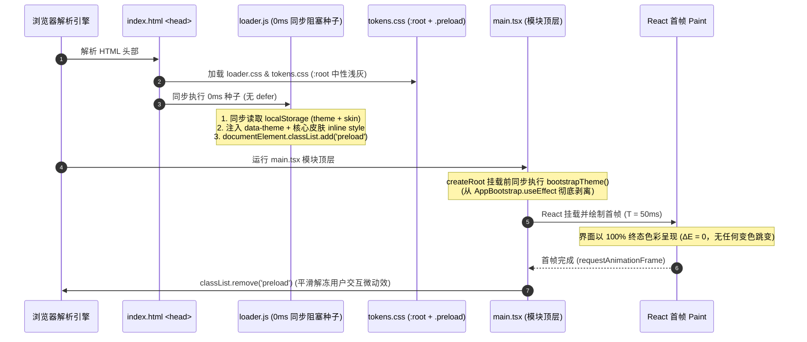
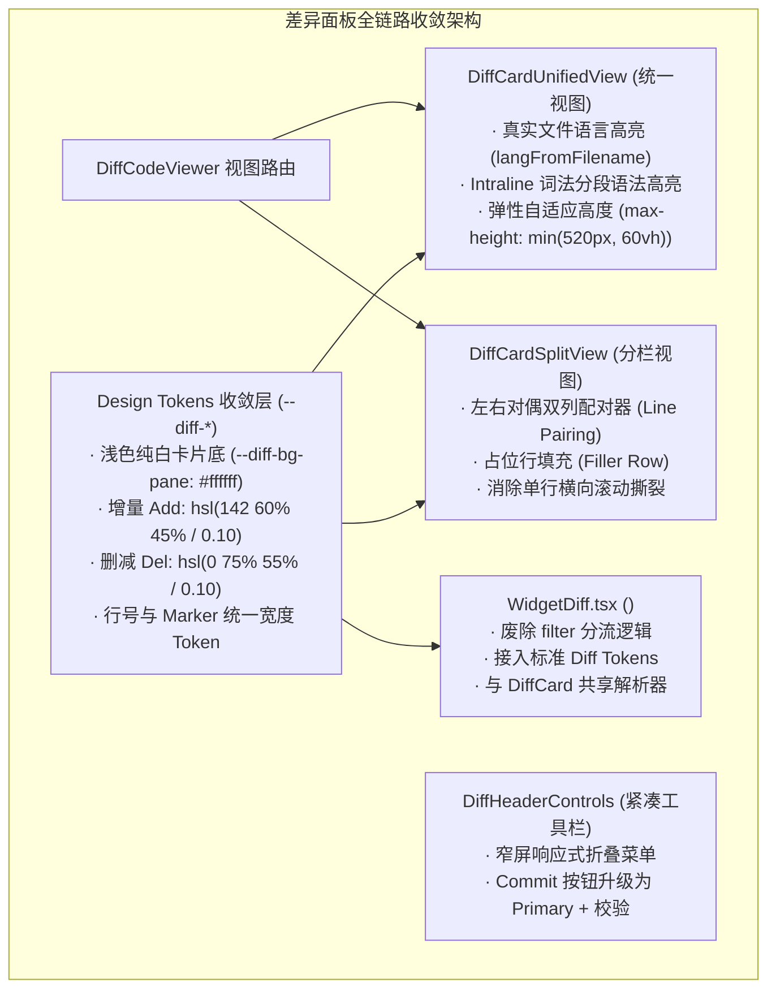

# 02. Conex / Crish 界面视觉修复与差异面板重构维度划分与删除面建议（提案 B）

> **文档定位**：战役重构维度划分、死层删除清单与 DAG 执行路径建议详案（提案 B）
> **所属战役**：Conex / Crish 界面视觉修复、小元素脱黑与差异面板重构战役 (`docs/ui-style-refactor/`)
> **输入依据**：
> - [`docs/ui-style-refactor/audits/01-theme-flash-and-fouc-audit.md`](file:///c:/Software/conex/docs/ui-style-refactor/audits/01-theme-flash-and-fouc-audit.md)（首屏闪色与 FOUC 根因）
> - [`docs/ui-style-refactor/audits/02-diff-panel-layout-and-style-audit.md`](file:///c:/Software/conex/docs/ui-style-refactor/audits/02-diff-panel-layout-and-style-audit.md)（差异面板 18 项系统缺陷）
> - [`docs/ui-style-refactor/audits/03-small-elements-darkening-and-borders-audit.md`](file:///c:/Software/conex/docs/ui-style-refactor/audits/03-small-elements-darkening-and-borders-audit.md)（小元素发黑与重边框四大根因）
> - [`docs/ui-style-refactor/audits/04-tokens-inheritance-and-conflicts-audit.md`](file:///c:/Software/conex/docs/ui-style-refactor/audits/04-tokens-inheritance-and-conflicts-audit.md)（Token 继承链、双源漂移与冲突）
> - [`docs/ui-style-refactor/audits/05-runtime-cascading-and-visual-compliance-audit.md`](file:///c:/Software/conex/docs/ui-style-refactor/audits/05-runtime-cascading-and-visual-compliance-audit.md)（级联污染、特异性失控与规范合规性）
> - 核心规范：[`AGENTS.md`](file:///c:/Software/conex/AGENTS.md) §12（Tooltip）、§13（输入框与焦点态 / 克制边框 ≤10%）、§14（色彩空间与 Zero-Blue 铁律）
>
> **作者/角色**：Senior Systems Engineer & Codebase Architect
> **状态**：独立方案编制完成 · 待主控审查收敛 · 严禁回撤

---

## 目录

- [一、战役背景、核心使命与审计总纲](#一战役背景核心使命与审计总纲)
  - [1.1 核心审计结论与视觉退化全景](#11-核心审计结论与视觉退化全景)
  - [1.2 提案 B 核心战略使命与重构原则](#12-提案-b-核心战略使命与重构原则)
- [二、领域概念与 5 大核心落地维度划分](#二领域概念与-5-大核心落地维度划分)
  - [2.1 维度一：首屏无闪烁平滑启动与主题/调色板单源化（彻底根治 FOUC 变色）](#21-维度一首屏无闪烁平滑启动与主题调色板单源化彻底根治-fouc-变色)
  - [2.2 维度二：全局活态 Token 纠偏与小元素去黑脱灰（UI 呼吸感与 §13 边框规范）](#22-维度二全局活态-token-纠偏与小元素去黑脱灰ui-呼吸感与-13-边框规范)
  - [2.3 维度三：差异面板容器到原子元素全链路重构（工业级 Diff 审查体验）](#23-维度三差异面板容器到原子元素全链路重构工业级-diff-审查体验)
  - [2.4 维度四：选择器级联污染清剿与悬空/幽灵 Token 单源收敛](#24-维度四选择器级联污染清剿与悬空幽灵-token-单源收敛)
  - [2.5 维度五：视觉规范全面合规与自动化防回归门禁（§12/§13/§14 规范闭环）](#25-维度五视觉规范全面合规与自动化防回归门禁121314-规范闭环)
- [三、【核心】死层、硬编码与粗黑样式删除面清单（Deletion Surface Manifest）](#三核心死层硬编码与粗黑样式删除面清单deletion-surface-manifest)
  - [3.1 物理删除/彻底清除的样式死层与反模式规则清单（Style Deletion Manifest）](#31-物理删除彻底清除的样式死层与反模式规则清单style-deletion-manifest)
  - [3.2 物理删除/重构的 TS/TSX 逻辑死层与冗余注入清单（Code & Logic Deletion Manifest）](#32-物理删除重构的-tstsx-逻辑死层与冗余注入清单code--logic-deletion-manifest)
  - [3.3 废弃/悬空/幽灵 Token 拔除清单（Token Deletion & Convergence Manifest）](#33-废弃悬空幽灵-token-拔除清单token-deletion--convergence-manifest)
- [四、技术依赖顺序与 DAG 执行路径（先删后改路线图）](#四技术依赖顺序与-dag-执行路径先删后改路线图)
  - [4.1 阶段化拓扑执行图谱（Mermaid DAG）](#41-阶段化拓扑执行图谱mermaid-dag)
  - [4.2 各阶段实施细则、前置依赖与门禁守卫条件](#42-各阶段实施细则前置依赖与门禁守卫条件)
- [五、提案 B 架构收益、量化对比与验收断言](#五提案-b-架构收益量化对比与验收断言)
  - [5.1 重构前后技术指标量化对比](#51-重构前后技术指标量化对比)
  - [5.2 终态交付六大验收断言（Acceptance Assertions）](#52-终态交付六大验收断言acceptance-assertions)

---

## 一、战役背景、核心使命与审计总纲

### 1.1 核心审计结论与视觉退化全景

通过对 Conex / Crish 桌面端（`apps/crish-desktop`）全生命周期样式链路、主题引擎、差异比对工作台及各级 UI 组件的穿透式严苛审查（详见 `audits/01~05`），当前系统存在 **5 大系统性视觉与架构退化瓶颈**：

```mermaid
flowchart TD
    subgraph P1["瓶颈 1: 首屏 5 阶段变色闪烁 (FOUC)"]
        A1["loader.css :root 写死 #0b0b0e 纯黑"] --> A2["loader.js defer 滞后 + 300ms 补间动画"]
        A2 --> A3["React useEffect 异步加载 themeStore (延迟 200ms)"]
        A3 --> A4["oklchColorGuard 强行覆写文字为暖棕色 #201e1a"]
    end

    subgraph P2["瓶颈 2: 全界面小元素普遍发黑与粗边"]
        B1["--accent-color 异化为 15% 死黑 (#2c2824)"] --> B2["Button/Switch/Badge/Slider 默认绑定纯黑"]
        B2 --> B3["ApprovalAskCard 裸写 background: #111111"]
        B3 --> B4["引用块边框加深 20% (超标 2 倍) + 行内代码混入暗底"]
    end

    subgraph P3["瓶颈 3: 差异面板 (Diff) 18 项全链路缺陷"]
        C1["单行高亮传参硬编码 'diff' -> 语法高亮 100% 丢失"] --> C2["WidgetDiff 伪分栏双侧独立 filter -> 左右行严重错位"]
        C2 --> C3[".scrollParent 硬编码 380px 固定高度 -> 空白塌陷与憋屈"]
        C3 --> C4["嵌套滚动 overscroll-behavior 触发滚轮截断劫持"]
    end

    subgraph P4["瓶颈 4: Token 继承链断裂与双真源漂移"]
        D1["--breakpoint-sm 在深浅主题间漂移 160px"] --> D2["深色模式静态 #0d0d0d vs 运行时 #1b1b1b (亮度偏差 112%)"]
        D2 --> D3["8 处悬空 Token + 18 处 --badge-git-* 幽灵变量"]
    end

    subgraph P5["瓶颈 5: CSS Modules 级联污染与特异性失控"]
        E1["11 处纯全局 :global 泄漏 + 26 处 [class*='...'] 穿透"] --> E2["55 处 :global(html[data-theme='dark']) 手动覆写"]
        E2 --> E3["44 处组件级 !important 边框对抗 + 9 处原生 title="]
    end
```



### 1.2 提案 B 核心战略使命与重构原则

本提案（提案 B）旨在通过**“领域内聚解耦、死层坚决物理删除、先删后改单源归一、强类型自动化门禁闭环”**四位一体的重构策略，彻底终结 FOUC 变色闪烁、小元素死黑、Diff 语法高亮丢失与级联污染，实现极具呼吸感、扁平轻盈、高对比度与完全合规的现代桌面端视觉体验。

#### 核心重构铁律：
1. **单一真源铁律（SSOT）**：全局视觉基底与调色板只存在一套唯一权威源，静态 `tokens.css`、TS 预设 `themePresets.ts`、HTML 种子注入三者色阶 100% 镜像对齐；
2. **去黑脱灰与柔和边界铁律（AGENTS.md §13/§14）**：彻底清除 15% 死黑 `--accent-color` 与 `#111111` 实心背景填充；严格遵守“边框加深混入主文字色 $\le 10\%$（常规元素 3%~6%）”红线；
3. **先删后改原则（Deletion-First）**：在重构具体组件前，必须先彻底物理清除废弃死样式、`:global` 泄漏、`[class*='...']` 模糊匹配与多余的运行时 Idle 异步注入，杜绝在技术债务上搭建空中楼阁；
4. **零肉眼闪烁原则（Zero-FOUC & Zero-Glitch）**：首屏采用 `<head>` 0ms 同步阻塞式种子注入配合 `.preload` 全局动画门闩，首帧绘制即终态色，无任何二次重绘与补间蠕动。

---

## 二、领域概念与 5 大核心落地维度划分

根据系统工程职责与视觉层叠模型，将本次重构划分为 **5 个高内聚、低耦合的核心落地维度**：

```
┌──────────────────────────────────────────────────────────────────────────────────────────────┐
│                                Conex UI 视觉重构 5 大核心落地维度架构                          │
├───────────────────┬───────────────────┬───────────────────┬───────────────────┬──────────────┤
│ 维度一：首屏与主题 │ 维度二：Token/小元素│ 维度三：Diff 面板  │ 维度四：级联与隔离 │ 维度五：规范 │
│ 0ms 零闪无缝启动   │ 全局脱黑与 §13 纠偏 │ 全链路容器到原子重构│ 选择器治理与Token收敛│ 门禁与测试闭环│
├───────────────────┼───────────────────┼───────────────────┼───────────────────┼──────────────┤
│ · <head> 0ms 种子 │ · --accent-color 翠绿│ · 文件真实语言高亮│ · 清除纯全局:global│ · §12 Tooltip│
│ · .preload 动画门闩│ · Button/Switch脱黑 │ · 分栏双列精准配对│ · 废除[class*=''] │ · §13 焦点环 │
│ · 剥离 300ms 过渡 │ · 行内代码/引用块柔和│ · 弹性高度(删380px)│ · 拔除55处暗色覆写 │ · §14 HSLA   │
│ · 静态与预设 100% │ · 审批按钮翡翠绿   │ · 解除滚轮劫持陷阱│ · 清除44处!important│ · Zero-Blue  │
│ · 守卫非侵入式改造│ · 子代理徽标脱泥灰  │ · 纯白卡片底与高对比│ · 8悬空/18幽灵清理│ · 自动化 CI  │
└───────────────────┴───────────────────┴───────────────────┴───────────────────┴──────────────┘
```

---

### 2.1 维度一：首屏无闪烁平滑启动与主题/调色板单源化（彻底根治 FOUC 变色）

- **业务定位**：彻底根治应用冷启动时的 5 阶段变色跳闪（黑屏 $\to$ 灰屏 $\to$ 浅色 $\to$ 暖棕 $\to$ 重绘），实现 0ms 终态色直出与 0 补间动画。
- **架构方案详案**：



#### 关键重构点：
1. **`<head>` 0ms 同步阻塞式种子重构**：
   - 改造 [`apps/crish-desktop/index.html`](file:///c:/Software/conex/apps/crish-desktop/index.html)，移除 `<script src="/loader.js" defer>` 上的 `defer` 属性，使其在 `<body>` 解析前同步阻塞运行；
   - 改造 [`apps/crish-desktop/public/loader.js`](file:///c:/Software/conex/apps/crish-desktop/public/loader.js)，同步读取 `crish_theme` 与 `crish_theme_skin`，0ms 写入 `data-theme` 并注入核心色板（`--bg-primary`, `--text-primary`, `--loader-bg`），添加 `preload` 门闩；
2. **`loader.css` 彻底剥离 300ms 补间动画与深黑硬编码**：
   - 移除 `.app-initial-loader` 上的 `transition: background-color 0.3s ease;`；
   - 将 `:root` 变量从深黑 `#0b0b0e` 改为与默认浅色基线对齐的中性底色；
3. **静态 `tokens.css` 与 TS 运行时预设 `themePresets.ts` 100% 对齐**：
   - 将深色默认皮肤 `dark-cozy` 的 `bgPrimary` 对齐为 `hsl(0, 0%, 5%)`（`#0d0d0d`），`bgCard` 为 `hsl(0, 0%, 11%)`，`bgElevated` 恢复为 `hsl(0, 0%, 15%)`（`#262626`），彻底消灭卡片与浮层深度塌陷；
   - 对齐浅色默认预设 `warm-gray` 的 `--border-color`、`--border-subtle` 与 `--control-mix-color`；
4. **`bootstrapTheme()` 生命周期前移与多头写入清缴**：
   - 将 `bootstrapTheme()` 从 [`AppBootstrap.ts:148`](file:///c:/Software/conex/apps/crish-desktop/src/app/AppBootstrap.ts#L148) 的 `useEffect` 异步链中剔除，前移至 [`main.tsx`](file:///c:/Software/conex/apps/crish-desktop/src/main.tsx) 模块顶层在 `createRoot` 前同步执行；
   - 彻底删除 [`bootstrap-full.ts:18-23`](file:///c:/Software/conex/apps/crish-desktop/src/bootstrap-full.ts#L18-L23) 中 `requestIdleCallback` 闲时无差别重复调用的 `applyTheme()`；
5. **`oklchColorGuard.ts` 非侵入式按需守卫改造**：
   - 增加官方皮肤与 WCAG AA 达标门禁：当皮肤自带的 `textPrimary` 在当前背景下对比度 $\ge 4.5:1$ 时，守卫保持静默，严禁强行将文字覆盖为通用灰色 `hsl(35, 12%, 11%)`。

---

### 2.2 维度二：全局活态 Token 纠偏与小元素去黑脱灰（UI 呼吸感与 §13 边框规范）

- **业务定位**：拔除导致全界面微小元素（按钮、开关、徽标、滑块、行内代码、引用块、审批按钮等）普遍发黑发沉的四大毒瘤，建立温润、高对比度、呼吸感充足的现代 UI。
- **架构方案详案**：

```
┌──────────────────────────────────────────────────────────────────────────────────────────┐
│                         Token 语义纠偏与全界面小元素脱黑拓扑                               │
├──────────────────────────┬─────────────────────────────┬─────────────────────────────────┤
│ 模块 / 元素              │ 重构前 (发黑 / 粗边 / 脏斑)  │ 重构后 (翡翠绿活态 / 柔和 / 纯净)│
├──────────────────────────┼─────────────────────────────┼─────────────────────────────────┤
│ tokens.css               │ --accent-color: 15% 死黑    │ --accent-color: hsl(160 84% 36%)│
│ Button / IconButton      │ primary 纯黑方块 (默认变体)  │ 翡翠绿品牌背景 (#10b981) + 白字 │
│ Switch (Active Track)    │ 打开开关直接变纯黑轨道       │ 活态翡翠绿轨道 (#10b981)        │
│ Badge (Brand / Info)     │ 黑字、灰底、黑框            │ 翡翠绿轻透明底板 + 品牌深绿文字 │
│ Slider (Track & Thumb)   │ 纯黑轨道 + 1.5px 实心黑边   │ 翡翠绿激活轨道 + 柔和边界拇指   │
│ ApprovalAskCard (Allow)  │ 纯黑硬砖块 (#111111)        │ 品牌墨绿渐进底 (#059669)        │
│ Markdown Inline Code     │ 混入暗底呈现脏灰补丁        │ 纯白卡片底混入 3.5% 文本色      │
│ Markdown Blockquote      │ 3px 宽、混入 20% 纯黑粗竖线 │ 2px 宽、边框加深 ≤8% (对齐 §13) │
│ Thought Indicator Bar    │ 15% 高透黑发丝阴影          │ 5%~6% 极柔通透导轨              │
│ Subagent Status Badge    │ --bg-tertiary (#e2e5e8) 泥斑│ 柔和语义色混入 (color-mix 6%)   │
└──────────────────────────┴─────────────────────────────┴─────────────────────────────────┘
```

#### 关键重构点：
1. **`--accent-color` 活态主色纠偏**：
   - 在 [`tokens.css:179`](file:///c:/Software/conex/apps/crish-desktop/src/styles/tokens.css#L179) 中，将 `--accent-color` 从 `hsl(35, 16%, 15%)` 纠偏为温润且具备品牌签名属性的翡翠绿 `hsl(160 84% 36%)`；
2. **基础 UI 控件全系脱黑**：
   - **`Button.module.css`**：Primary 变体背景绑定 `--brand`（`hsl(160 84% 39%)`），文字为 `#ffffff`，边框使用 `--brand-deep`，废除 `black 20%` 硬黑描边；
   - **`Switch.module.css`**：打开态轨道与边框切换为 `--brand`；
   - **`Badge.module.css`**：Brand 变体背景重构为 `color-mix(in srgb, var(--brand) 10%, transparent)`，字色使用 `--brand-deep`；
   - **`Slider.module.css`**：激活填充条改为 `--brand`，拇指描边采用柔和半透明混色；
   - **`ChatToolCallBlock.module.css`**：脉冲运行指示点 `.liveIndicator` 恢复为 `--brand` 翠绿呼吸灯；
3. **审批流与卡片式交互脱黑**：
   - 重构 [`ApprovalAskCard.module.css:235-244`](file:///c:/Software/conex/apps/crish-desktop/src/components/agent-card/ApprovalAskCard.module.css#L235-L244)，允许按钮废除 `background: var(--text-primary)`（`#111111`），改为翡翠绿实体按钮；
   - 计划完成圆点与进度条（[`PlanGoalRibbons.module.css`](file:///c:/Software/conex/apps/crish-desktop/src/components/chat-card/PlanGoalRibbons.module.css)）全面脱离 75% 纯黑填充；
4. **Markdown 正文排版微元素精致化**：
   - **行内代码**：`--md-code-inline-bg` 改以 `var(--bg-card)` 为基底混入 3.5% 主文字色，边框对齐 `--border-subtle`，消除正文脏灰补丁；
   - **引用块**：`--md-quote-border-color` 混入比例从 20% 压缩至 **8%**（严格恪守 `AGENTS.md` §13 边框 $\le 10\%$ 红线），线宽收敛至 **2px**；
   - **思考链导轨**：`--thought-indicator-bar` 与 `--thought-rail-color` 混入比例降至 **4%~6%**。

---

### 2.3 维度三：差异面板容器到原子元素全链路重构（工业级 Diff 审查体验）

- **业务定位**：彻底根治差异比对面板（`DiffCard`、`WidgetDiff`、`ToolCallDiffPreview`）中的 **18 项系统性缺陷**，恢复真实代码语法高亮，修复分栏错位，彻底拔除 380px 固定高度锁死与滚轮陷阱，打造清爽卡片白底。
- **架构方案详案**：



#### 关键重构点：
1. **真实代码语法高亮全链路接通（彻底根治 BUG-01 / BUG-06 / BUG-17）**：
   - 在 `DiffCardUnifiedView.tsx`、`DiffCardSplitView.tsx` 与 `VirtualPlainCodeViewer.tsx` 中，引入 `langFromFilename(f.filePath)` 推导文件的真实编程语言；
   - 彻底废除将单行纯代码传入 `highlightCode(line, 'diff')` 的严重缺陷；
   - 重构 `renderHighlightedTokens`，在发生 Intraline 词法比对时，对未改动的词法 Token 逐段执行代码高亮，使关键字、类型、字符串在增删行中依然色彩绚丽；
2. **`<widget-diff>` 对偶分栏重构与占位行对齐（彻底根治 BUG-02）**：
   - 彻底废除 `WidgetDiff.tsx` 中左侧 `filter(l => l.type !== 'add')` 与右侧 `filter(l => l.type !== 'delete')` 的独立粗暴分流；
   - 引入标准 Hunk 双列行对齐配对器（Line Pair Matching），为新增/删除行生成精确的占位行（Empty Filler Row），保证左右行号与代码纵向 100% 精确对齐；
3. **容器弹性高度重构与滚轮陷阱解除（彻底根治 BUG-03 / BUG-04）**：
   - 彻底删除 `.scrollParent` 中 `height: 380px; max-height: 380px;` 的固定高度硬编码；
   - 重构为智能弹性高度：`min-height: 44px; max-height: min(520px, 60vh); height: auto;`，小 Diff 紧凑自适应，大 Diff 充分展开；
   - 移除嵌套虚拟滚动上的 `overscroll-behavior: contain`，恢复外层手风琴列表的平滑连贯滚轮链；
4. **Token 体系与底色卡片化去灰（彻底根治 BUG-05 / BUG-09 / BUG-16）**：
   - 代码行容器 `.linesContainer` 废除 `--bg-primary`（`#f4f5f7` 脏灰），全面使用 `--diff-bg-pane`（`#ffffff` 纯白卡片底）；
   - 消除 Gutter 与代码区的色阶斑驳，正常代码行文字恢复为 `--text-primary`（`#111111`），行号文字对比度提升至 WCAG AA（$\ge 3:1$）；
   - 增删行背景从过于暗淡的 5.5% 调优至清爽通透的 10%，词级增删高亮提升至 28%，完全满足强光与弱视场景对比度；
   - 彻底清除所有 `rgba(0, 0, 0, 0.05)` 残留脏斑；
5. **折叠条、工具栏与提交面板交互治理（彻底根治 BUG-07 / BUG-08 / BUG-10 / BUG-11 / BUG-13）**：
   - 折叠条 `.collapseBar` 物理高度与 `rowHeight`（22px）严格统一，垂直居中对齐，根除文字削顶截断；
   - Gutter 行号、Marker 符号与代码文字三者字体基线统一；
   - `DiffHeaderControls` 增加窄屏折叠弹出菜单，防止右侧操作按钮被无声截断；
   - 底部 Git 提交面板主行动点升级为 Primary 墨绿按钮，增加空提交禁用校验；
   - 物理删除 `DiffCard.module.css` 中 300+ 行已废弃的单文件 Tab 页死样式。

---

### 2.4 维度四：选择器级联污染清剿与悬空/幽灵 Token 单源收敛

- **业务定位**：治理 CSS Modules 作用域破壁、特异性军备竞赛、组件私自劫持全局 Token 及悬空/幽灵 Token，重塑干净可控的样式层叠秩序。
- **架构方案详案**：

```
┌──────────────────────────────────────────────────────────────────────────────────────────┐
│                         选择器级联污染治理与 Token 单源收敛矩阵                           │
├──────────────────────────┬─────────────────────────────┬─────────────────────────────────┤
│ 治理类别                 │ 违规现状 (污染 / 劫持 / 泄漏)│ 治理方案 (封装 / 状态下发 / 归一)│
├──────────────────────────┼─────────────────────────────┼─────────────────────────────────┤
│ 纯全局 :global 泄漏      │ TiptapEditorField, Menu     │ 强制收敛至父类作用域或全局遮罩层│
│ 跨组件模糊匹配 [class*=] │ Sidebar (10条), ProjectMenu │ 顶层 data-sidebar-collapsed 驱动 │
│ 深色模式手动覆写         │ 9 个模块共 55 处覆写        │ 彻底删除，100% 归由 CSS Token   │
│ !important 恶性对抗      │ 44 处组件级 !important 边框 │ 重构 Leaf 容器选择器与按钮变体  │
│ 悬空 Token (Dangling)    │ 8 处 --color-text-dim 等    │ 统一替换为标准 --text-tertiary  │
│ 幽灵 Token (Ghost)       │ 18 处 --badge-git-* 私有变量│ 收敛至标准 --filetree-badge-*   │
│ 全局断点漂移             │ 浅色 640px vs 深色 480px    │ 统一定义于 tokens.css :root     │
│ z-index 局部劫持         │ SettingsPanel 设为 20       │ 替换为局部变量 --settings-pop-z │
└──────────────────────────┴─────────────────────────────┴─────────────────────────────────┘
```

#### 关键重构点：
1. **纯全局未限定 `:global` 封装化**：
   - 将 `TiptapEditorField.module.css` 中的 `.mention-chip` 等 5 条选择器强制包裹在 `.proseMirrorField` 内，消除对全局 DOM 树的污染；
   - 将 `Menu.module.css` 中的 `.sep-safe-aim-overlay` 移入 `design-system.css` 全局遮罩层；
2. **废除 `[class*='...']` 模糊穿透，推行统一 Data Attribute 状态下发**：
   - 彻底移除 `Sidebar.module.css:355-450` 中用于折叠隐藏的 10 条模糊匹配选择器；
   - 在 `Sidebar` 顶层注入 `data-sidebar-collapsed={isCollapsed}`，子组件（`SidebarNav`、`SessionList`、`Folder`、`UserProfileCard`）在其自身 `.module.css` 中响应 `:global([data-sidebar-collapsed='true']) .selfItem`，实现强绝缘；
   - 移除 `overlay-scrollbar.css` 中的模糊类名拦截；
3. **彻底拔除 55 处 `:global(html[data-theme='dark'])` 手动覆写**：
   - 彻底删除 `ModelsSettingsTab`、`FontSelectField`、`Select`、`Menu` 等 9 个模块中的暗色覆写规则，统一引用 `var(--bg-card)`、`var(--border-color)`、`var(--shadow-dropdown)`，由 CSS 变量原生接管主题切换；
4. **消除 44 处组件级 `!important` 边框对抗**：
   - 移除 `AgentCard`、`DiffCard`、`FilesCard`、`PreviewCard` 中的 `border-top: none !important;`，由 `BinaryTreeWorkspace` 容器通过父级状态选择器统一管理边框；
   - 移除 `PreviewCard` 中的 6 个尺寸 `!important`，封装为标准的 `.miniActionBtn` 变体；
5. **悬空、幽灵 Token 拔除与断点归一**：
   - 将 `SettingsDevicesTab.module.css` 中的 8 处 `--color-text-dim` 替换为标准 `--text-tertiary`；
   - 将 `GitStatusBadge.module.css` 中的 18 个 `--badge-git-*` 全部收敛至全局标准 `--filetree-badge-*` Token；
   - 将 `--breakpoint-*` 统一定义于 `tokens.css` 的 `:root`，消除明暗主题下 160px 的断点漂移；
   - 拔除 `SettingsPanel.module.css:263` 对 `--z-dropdown: 20` 的全局劫持。

---

### 2.5 维度五：视觉规范全面合规与自动化防回归门禁（§12/§13/§14 规范闭环）

- **业务定位**：严格对齐《AGENTS.md》§12、§13、§14 规范，净化历史残留的 244 处旧式 `rgba` 与蓝光色相污染，固化自动化静态与契约测试门禁。
- **架构方案详案**：
  1. **`AGENTS.md` §12 Tooltip 规范 100% 闭环**：
     - 清除 `ModelBadgePickerMenu.tsx` 等 9 处原生 HTML `title="..."` 违规，全量替换为 `<Tooltip content="...">`；
     - 改造 `Tooltip.module.css`，采用 `border-radius: var(--radius-full, 9999px)` 胶囊造型，阴影从 `--shadow-lg` 减负至 `--shadow-sm`；
  2. **`AGENTS.md` §13 焦点态与边框规范 100% 闭环**：
     - 修复 `tokens.css:902` 违规定义的暗色 `--focus-ring-color`，混入比例从 30% 压降至合规的 **5%~8%**；
     - 消除全仓组件中超过 10% 的边框加深混色，常规控件严守 3%~6% 柔和区间；
  3. **`AGENTS.md` §14 色彩空间与 Zero-Blue 规范 100% 闭环**：
     - 将散落于组件层的 244 处旧式 `rgba(r,g,b,a)` 收敛为标准 `hsl(h s l / a)` 或 Design Tokens；
     - 净化 `GitStatusBadge`、`OverviewGitTree` 中的 Slate 蓝灰残留（Hue 210°~215°），回归纯中性 Slate 灰阶；
  4. **自动化防回归门禁（Anti-Regression Test Suite）**：
     - 新增 `tests/style/anti-darkening-guard.test.ts`，断言 Light 模式下 `--accent-color` 明度 $\ge 35\%$、禁止组件背景直接使用 `var(--text-primary)`、边框混入文本色 $\le 10\%$、原生 `title=` 归零。

---

## 三、【核心】死层、硬编码与粗黑样式删除面清单（Deletion Surface Manifest）

根据“先删后改”的战略指导思想，以下为本次重构必须**坚决物理删除/剥离**的死层、硬编码黑底、过度加深边框及反模式代码全量清单：

### 3.1 物理删除/彻底清除的样式死层与反模式规则清单（Style Deletion Manifest）

| 序号 | 目标文件路径与代码定位 | 必须物理删除 / 清除的死代码片段 | 物理删除理由与架构收益 |
| :---: | :--- | :--- | :--- |
| **1** | [`loader.css:41-60`](file:///c:/Software/conex/apps/crish-desktop/public/loader.css#L41-L60) | `transition: background-color 0.3s ease;` | **【死层/致盲动画】** 触发 300ms 肉眼变色补间，删除后彻底斩断冷启动黑变白动画。 |
| **2** | [`loader.css:11-18`](file:///c:/Software/conex/apps/crish-desktop/public/loader.css#L11-L18) | `:root { --loader-bg: #0b0b0e; ... }` (全部深黑硬编码) | **【硬编码死黑】** 浅色模式首帧先命中纯黑，删除并替换为自适应中性基底。 |
| **3** | [`DiffCard.module.css:757-766`](file:///c:/Software/conex/apps/crish-desktop/src/components/diff/DiffCard.module.css#L757-L766) | `.scrollParent { height: 380px; max-height: 380px; }` | **【致命硬编码】** 导致小 diff 留白 300px，大 diff 狭窄憋屈。彻底删除转为弹性自适应。 |
| **4** | [`DiffCard.module.css:211, 760`](file:///c:/Software/conex/apps/crish-desktop/src/components/diff/DiffCard.module.css#L211) | `overscroll-behavior: contain;` (嵌套滚动拦截) | **【交互陷阱】** 劫持用户滚轮浏览手风琴列表，删除后恢复平滑协同滚动链。 |
| **5** | [`DiffCard.module.css:1076-1300, 1399-1558`](file:///c:/Software/conex/apps/crish-desktop/src/components/diff/DiffCard.module.css#L1076-L1300) | 超过 300 行已废弃的单文件 Tab 页与独立详情工具栏死样式 | **【纯冗余死层】** 样式文件单体膨胀至 34.6KB，彻底物理删除，降低打包与解析开销。 |
| **6** | [`Button.module.css:127-129`](file:///c:/Software/conex/apps/crish-desktop/src/components/ui/Button/Button.module.css#L127-L129) | `--btn-bg: var(--accent-color); --btn-border: color-mix(..., black 20%);` | **【死黑/粗边】** 导致默认/Primary 按钮全为死黑块，删除硬黑描边，收敛至品牌翡翠绿。 |
| **7** | [`ApprovalAskCard.module.css:235-244`](file:///c:/Software/conex/apps/crish-desktop/src/components/agent-card/ApprovalAskCard.module.css#L235-L244) | `background: var(--text-primary); color: var(--bg-primary);` | **【裸写纯黑】** 审批允许按钮呈现 #111111 纯黑大砖块，彻底删除改用翡翠绿。 |
| **8** | [`Switch.module.css:48-51`](file:///c:/Software/conex/apps/crish-desktop/src/components/ui/Switch/Switch.module.css#L48-L51) | `.track[aria-checked='true'] { background: var(--accent-color); }` | **【活态异化】** 打开开关变成黑炭条，彻底删除改用 `--brand` 翠绿。 |
| **9** | [`Badge.module.css:65-77`](file:///c:/Software/conex/apps/crish-desktop/src/components/ui/Badge/Badge.module.css#L65-L77) | `--badge-fg: var(--accent-color); --badge-border: color-mix(..., 25%);` | **【死黑沉重】** 品牌徽标变黑字黑框，删除改用 `--brand` 柔和混色。 |
| **10** | [`PlanGoalRibbons.module.css:101, 118`](file:///c:/Software/conex/apps/crish-desktop/src/components/chat-card/PlanGoalRibbons.module.css#L101) | `border-color: color-mix(..., 35%); fill: color-mix(..., 75%, var(--text-primary));` | **【严重超标】** 边框加深 35%（超标 3.5 倍），填充条死黑，彻底清除死黑填充。 |
| **11** | [`ChatStatusRibbons.module.css:66-70`](file:///c:/Software/conex/apps/crish-desktop/src/components/chat-card/ChatStatusRibbons.module.css#L66-L70) | `border-color: color-mix(in srgb, var(--accent-color) 30%, ...);` | **【严重超标】** 边框加深 30%（超标 3 倍），彻底清除，降至合规的 6%。 |
| **12** | [`tokens.css:503-509`](file:///c:/Software/conex/apps/crish-desktop/src/styles/tokens.css#L503-L509) | `--md-quote-border-color: color-mix(..., 20%, ...); width: 3px;` | **【粗黑重线】** 引用块 3px 宽且混入 20% 纯黑，删除重黑定义，改为 2px、$\le 8\%$ 混入。 |
| **13** | [`tokens.css:902`](file:///c:/Software/conex/apps/crish-desktop/src/styles/tokens.css#L902) | `--focus-ring-color: color-mix(in srgb, var(--text-primary) 30%, transparent);` | **【焦点环违规】** 深色焦点环混入 30%（超标 3 倍），彻底清除，降至 8%。 |
| **14** | `ModelsSettingsTab` 等 9 模块 (共 55 处) | `:global(html[data-theme='dark']) .localClass { background: ...; }` | **【特异性污染】** 手动暗色覆写破坏 Token SSOT，物理删除全部 55 处规则。 |
| **15** | `Sidebar.module.css:355-450` (共 10 处) | `.iconCollapse .sidebarScroll :global([class*='...'])` 模糊匹配 | **【级联穿透】** 破坏 CSS Modules 绝缘性，彻底删除，改由统一 Data Attribute 驱动。 |
| **16** | `TiptapEditorField.module.css:179-215` (共 5 处) | `:global(.mention-chip)`, `:global(.mention-icon-box)` (纯全局未限定) | **【全局污染】** 污染全局 Mention 样式，彻底删除并封装进 `.proseMirrorField`。 |
| **17** | `Menu.module.css:151-170` (共 3 处) | `:global(.sep-safe-aim-overlay)` (纯全局未限定) | **【全局污染】** 基础组件泄漏全局遮罩，物理移入全局层 `design-system.css`。 |
| **18** | `AgentCard`, `DiffCard`, `FilesCard` (共 8 处) | `border-top: none !important;` (边框消除对抗) | **【特异性对抗】** 恶性 `!important`，彻底删除，改由容器状态选择器统一管理。 |
| **19** | `PreviewCard.module.css:202-207` (共 6 处) | `.miniButton { height: 22px !important; ... }` (6 个 !important) | **【尺寸对抗】** 强行压制基础按钮，彻底删除，封装为 `.miniActionBtn` 变体。 |
| **20** | `DiffCard.module.css:691, 707, 1090, 1311` | `rgba(0, 0, 0, 0.05)`, `rgba(0, 0, 0, 0.015)` (硬编码残余) | **【暗色脏斑】** 违背 §14，在深色下形成脏斑，彻底删除转为标准 Token。 |

---

### 3.2 物理删除/重构的 TS/TSX 逻辑死层与冗余注入清单（Code & Logic Deletion Manifest）

| 序号 | 目标文件路径与代码定位 | 必须物理删除 / 重构的逻辑片段 | 物理删除 / 重构理由与架构收益 |
| :---: | :--- | :--- | :--- |
| **1** | [`index.html:18-20`](file:///c:/Software/conex/apps/crish-desktop/index.html#L18-L20) | `<script src="/loader.js" defer></script>` 中的 `defer` 属性 | **【时序阻滞】** `defer` 导致 DOM 先按暗色 `:root` 绘制再被 JS 覆盖，删除 `defer` 实现 0ms 阻塞种子。 |
| **2** | [`AppBootstrap.ts:179-194`](file:///c:/Software/conex/apps/crish-desktop/src/app/AppBootstrap.ts#L179-L194) | `useEffect` 内动态 `import('../api/themeStore').then(...)` | **【异步滞后】** 导致 React 挂载 200ms 后才应用主题，彻底从 `useEffect` 剥离，前移至 `main.tsx` 顶层。 |
| **3** | [`AppBootstrap.ts:247`](file:///c:/Software/conex/apps/crish-desktop/src/app/AppBootstrap.ts#L247) | `root.setAttribute('data-ui-size', ...)` (重复写入) | **【重复注入】** 与 `main.tsx` 的 `visualPresentationController` 重复，物理删除。 |
| **4** | [`bootstrap-full.ts:18-23`](file:///c:/Software/conex/apps/crish-desktop/src/bootstrap-full.ts#L18-L23) | `requestIdleCallback` 内冗余二次调用的 `applyTheme()` | **【冗余唤醒】** 启动 1~2 秒后再次触发全量样式重算，完全多余，彻底物理删除。 |
| **5** | [`oklchColorGuard.ts:101-117`](file:///c:/Software/conex/apps/crish-desktop/src/api/oklchColorGuard.ts#L101-L117) | 无条件覆盖 `root.style.setProperty('--text-primary', ...)` | **【破坏性覆写】** 碾碎 16 种皮肤文字色谱，删除无条件覆盖逻辑，改由 WCAG 门禁保护。 |
| **6** | [`WidgetDiff.tsx:227-261`](file:///c:/Software/conex/apps/crish-desktop/src/components/custom-tags/WidgetDiff.tsx#L227-L261) | `parsedLines.filter(l => l.type !== 'add')` 分流渲染 | **【逻辑缺陷】** 无对齐占位行导致左右分栏错位，彻底删除粗暴 filter，引入对偶配对器。 |
| **7** | `DiffCardUnifiedView:209`<br>`DiffCardSplitView:208` | `highlightCode(change.content, 'diff')` | **【高亮陷阱】** 导致 TypeScript/Rust 代码语法高亮 100% 丢失，删除硬编码 `'diff'`，传入真实语言。 |
| **8** | 9 处 TSX 组件原生属性 | 原生 HTML 属性 `title="..."` | **【规范违规】** 违反 `AGENTS.md` §12，物理删除原生 `title=`，全量替换为 `<Tooltip>`。 |

---

### 3.3 废弃/悬空/幽灵 Token 拔除清单（Token Deletion & Convergence Manifest）

| 序号 | 悬空 / 幽灵 Token 名称 | 涉案消费文件与行号 | 治理动作与收敛终态 |
| :---: | :--- | :--- | :--- |
| **1** | `--color-text-dim` (悬空) | `SettingsDevicesTab.module.css:19, 45, 59, 83...` (8 处) | 物理拔除，统一替换为标准 `--text-tertiary`。 |
| **2** | `--color-text-secondary` (悬空) | `SettingsSecurityTab.tsx:326` | 物理拔除，统一替换为标准 `var(--text-secondary)`。 |
| **3** | `--z-sidebar-resizer` (悬空) | `Sidebar.module.css:272` | 物理拔除，在 `z-index.css` 补齐或替换为 `var(--z-chrome)`。 |
| **4** | `--shadow-xs` (悬空) | `DiffCard.module.css:430` | 物理拔除，统一收敛至 `var(--shadow-sm)`。 |
| **5** | `--badge-git-*` (18 个幽灵变量) | `GitStatusBadge.module.css:18-52` | 物理拔除 18 个私有变量，全量收敛至全局 `--filetree-badge-*`。 |
| **6** | `--z-dropdown: 20` (局部劫持) | `SettingsPanel.module.css:263` | 物理拔除劫持代码，替换为局部变量 `--settings-popper-z: 20`。 |
| **7** | `--seg-outer-radius: 6px` (私设) | `SettingsScheduleTab.module.css` 等 5 个子面板 | 物理拔除 6px 私设，严格消费全局契约 `var(--button-radius, 7px)`。 |
| **8** | `--diff-gutter-width: 48px` (僵尸) | `tokens.css:590` | 物理重构为 `--diff-gutter-width-unified: 40px` 等活态消费变量。 |
| **9** | Slate 蓝调灰阶 (Zero-Blue 违规) | `GitStatusBadge.module.css:37-57`, `OverviewGitTree:189` | 物理拔除 `hsl(215 ...)` 与 `hsl(210 ...)`, 替换为纯中性灰阶。 |

---

## 四、技术依赖顺序与 DAG 执行路径（先删后改路线图）

### 4.1 阶段化拓扑执行图谱（Mermaid DAG）

```mermaid
flowchart TD
    classDef deletion fill:#fee2e2,stroke:#ef4444,stroke-width:2px;
    classDef foundation fill:#fef3c7,stroke:#f59e0b,stroke-width:2px;
    classDef component fill:#dbeafe,stroke:#3b82f6,stroke-width:2px;
    classDef diffpanel fill:#e0e7ff,stroke:#6366f1,stroke-width:2px;
    classDef cascade fill:#f3e8ff,stroke:#a855f7,stroke-width:2px;
    classDef gate fill:#dcfce7,stroke:#22c55e,stroke-width:2px;

    subgraph Phase0["Phase 0: 物理死层与反模式清盘 (Deletion Surface First)"]
        D01["0.1 物理删除 DiffCard 300+ 行死样式与 380px 锁死"]:::deletion
        D02["0.2 物理删除 loader.css 300ms 过渡动画与纯黑 :root"]:::deletion
        D03["0.3 拔除 8 处悬空 Token 与 18 处 --badge-git-* 幽灵变量"]:::deletion
        D04["0.4 拔除 bootstrap-full.ts 闲时冗余 applyTheme 调用"]:::deletion
        D05["0.5 封装 Tiptap & Menu 纯全局 :global 泄漏规则"]:::deletion
    end

    subgraph Phase1["Phase 1: 基座 Token 纠偏与 0ms 启动流水线重塑"]
        T01["1.1 tokens.css --accent-color 纠偏为翡翠绿 (hsl(160 84% 36%))"]:::foundation
        T02["1.2 tokens.css 引用块/行内代码/焦点环/断点单源对齐"]:::foundation
        T03["1.3 index.html 去 defer + loader.js 0ms 种子注入 + .preload 门闩"]:::foundation
        T04["1.4 main.tsx 顶层同步 bootstrapTheme + 首帧 rAF 解冻门闩"]:::foundation
        T05["1.5 themePresets.ts 深度基线对齐 (消除 #0d0d0d vs #1b1b1b 漂移)"]:::foundation
        T06["1.6 oklchColorGuard.ts 改造为非侵入式按需对比度守卫"]:::foundation
    end

    subgraph Phase2["Phase 2: 小元素全面脱黑与基础 UI 组件精致化"]
        C01["2.1 Button/IconButton 默认变体脱黑 (绑定翡翠绿 --brand)"]:::component
        C02["2.2 Switch 激活轨道 / Badge 品牌态 / Slider 拇指全面脱黑"]:::component
        C03["2.3 ApprovalAskCard 允许按钮脱黑 (#111111 -> --brand-deep)"]:::component
        C04["2.4 ChatToolCallBlock 脉冲点与竖线脱黑 + PlanGoal 进度条脱黑"]:::component
        C05["2.5 Tooltip 胶囊化与阴影减负 + Subagent 状态标签脱泥灰"]:::component
    end

    subgraph Phase3["Phase 3: 差异面板 (Diff) 容器到原子元素全链路重构"]
        DF01["3.1 langFromFilename 真实语言高亮全链路接通 (告别纯文本黑字)"]:::diffpanel
        DF02["3.2 Intraline 词法比对逐段语法高亮合成器 (renderTokens)"]:::diffpanel
        DF03["3.3 WidgetDiff.tsx 对偶分栏配对器重构 (对齐占位行，根除错位)"]:::diffpanel
        DF04["3.4 DiffCard .scrollParent 自适应弹性高度重构 + 解除滚轮劫持"]:::diffpanel
        DF05["3.5 DiffCard.module.css 卡片白底与高对比增删色阶重塑"]:::diffpanel
        DF06["3.6 折叠条尺寸对齐 + 工具栏响应式折叠 + Git 提交面板升级"]:::diffpanel
    end

    subgraph Phase4["Phase 4: 选择器级联隔离与规范合规治理"]
        CS01["4.1 Sidebar 移除 10 条 [class*=] 穿透，改由 data-sidebar-collapsed 下发"]:::cascade
        CS02["4.2 彻底删除 9 个模块共 55 处 :global(html[data-theme='dark']) 覆写"]:::cascade
        CS03["4.3 彻底清除 44 处组件级 !important 边框对抗与尺寸压制"]:::cascade
        CS04["4.4 9 处原生 HTML title= 违规替换为 <Tooltip>"]:::cascade
        CS05["4.5 净化 244 处旧式 rgba 与 Slate 蓝灰残留 (Zero-Blue 闭环)"]:::cascade
    end

    subgraph Phase5["Phase 5: 自动化防回归门禁与验收闭环"]
        G01["5.1 固化 tests/style/anti-darkening-guard.test.ts 静态门禁"]:::gate
        G02["5.2 全量运行 style-contract.test.ts 与 a11y-contrast.test.ts"]:::gate
        G03["5.3 首屏冷启动 0ms 零闪烁与录屏视觉验收闭环"]:::gate
    end

    %% 严格的 DAG 依赖流
    Phase0 --> Phase1
    Phase1 --> Phase2
    Phase1 --> Phase3
    Phase2 --> Phase4
    Phase3 --> Phase4
    Phase4 --> Phase5
```



---

### 4.2 各阶段实施细则、前置依赖与门禁守卫条件

```
┌──────────────────────────────────────────────────────────────────────────────────────────┐
│                         各阶段实施细则与严格门禁守卫条件 (Gate Conditions)                 │
├─────────┬──────────────────────────────────┬─────────────────────────────────────────────┤
│ 阶段    │ 核心实施任务                     │ 准出门禁与守卫条件 (Gate Criteria)          │
├─────────┼──────────────────────────────────┼─────────────────────────────────────────────┤
│ Phase 0 │ 物理删除死代码、废弃 CSS、悬空   │ 1. DiffCard 300+ 行死样式与 380px 彻底移除  │
│ 死层清盘│ Token、冗余调用与纯全局 :global 规则│ 2. 全仓无 --color-text-dim 悬空引用         │
│         │                                  │ 3. 项目编译通过，无未定义 CSS 模块类名报错  │
├─────────┼──────────────────────────────────┼─────────────────────────────────────────────┤
│ Phase 1 │ 1. tokens.css 活态主色与规范纠偏 │ 1. 静态 tokens 与 themePresets 色阶 100% 对齐│
│ 基座重塑│ 2. loader 0ms 种子与 .preload 门闩│ 2. main.tsx 挂载前同步完成 bootstrapTheme    │
│         │ 3. 对比度守卫非侵入式改造        │ 3. 冷启动无 300ms 补间，首帧即终态色        │
├─────────┼──────────────────────────────────┼─────────────────────────────────────────────┤
│ Phase 2 │ 1. Button/Switch/Badge/Slider脱黑│ 1. Button/Switch/Badge 激活态呈现品牌翡翠绿 │
│ 小元素  │ 2. Approval 允许按钮翡翠绿化     │ 2. 审批允许按钮无 #111111 实心死黑填充      │
│ 脱黑    │ 3. 行内代码与引用块排版精致化    │ 3. 引用块边框加深 ≤8%，行内代码无脏灰补丁   │
├─────────┼──────────────────────────────────┼─────────────────────────────────────────────┤
│ Phase 3 │ 1. 真实语言代码语法高亮接通      │ 1. Diff 代码 100% 呈现语法高亮 (TS/Rust等)  │
│ Diff面板│ 2. <widget-diff> 对偶分栏配对重构│ 2. 分栏比对左右行号与内容绝对对齐 (0 错位)  │
│ 重构    │ 3. 弹性自适应高度与纯白卡片底板  │ 3. 无 380px 锁死空白，滚轮手风琴流畅畅通    │
├─────────┼──────────────────────────────────┼─────────────────────────────────────────────┤
│ Phase 4 │ 1. 拔除 55 处深色模式手动覆写    │ 1. 组件级 :global(html[data-theme='dark']) 归零│
│ 级联治理│ 2. 清理 44 处 !important 对抗    │ 2. [class*=] 模糊穿透归零，title= 违规归零  │
│         │ 3. 替换 9 处 title= 与净化 rgba  │ 3. Zero-Blue 蓝光色相污染完全净化           │
├─────────┼──────────────────────────────────┼─────────────────────────────────────────────┤
│ Phase 5 │ 1. 固化防发黑自动化门禁测试      │ 1. anti-darkening-guard.test.ts 100% PASS   │
│ 门禁验收│ 2. 全量回归契约测试与对比度测试  │ 2. style-contract.test.ts 全绿无回归        │
│         │ 3. 录屏 0ms 零闪烁视觉验收       │ 3. 最终视觉体验达到工业级清爽呼吸感         │
└─────────┴──────────────────────────────────┴─────────────────────────────────────────────┘
```

---

## 五、提案 B 架构收益、量化对比与验收断言

### 5.1 重构前后技术指标量化对比

| 衡量维度 / 指标项 | 当前缺陷现状 (Before) | 提案 B 重构后终态 (After) | 收益与提升幅度 |
| :--- | :--- | :--- | :--- |
| **冷启动变色阶段数 (FOUC)** | 5 阶段变色 (黑 $\to$ 灰 $\to$ 浅 $\to$ 暖 $\to$ 闪) | **0 阶段跳变 (首帧即终态色)** | 彻底终结开屏变色与闪烁 |
| **开屏补间动画耗时** | 300ms 强制过渡 (`loader.css`) | **0ms 门闩冻结 (`preload`)** | 消除开屏变色蠕动效应 |
| **差异代码语法高亮覆盖率** | 0% (全盘降级为黑灰纯文本) | **100% (TS/Rust/Python等真实高亮)** | 审查体验达到 VS Code 级 |
| **WidgetDiff 分栏对齐准确率** | 0% (双侧独立 filter 严重错位) | **100% (双列配对与占位行对齐)** | 比对结果严谨可信 |
| **Diff 容器固定高度塌陷** | 锁死 380px (小 diff 留白超 300px) | **44px ~ 60vh 智能弹性自适应** | 空间利用率最大化 |
| **全界面发黑小元素分布** | 12 组件族共 38 处确凿死黑点 | **0 处死黑 (品牌翡翠绿 + 柔和边界)** | 界面通透呼吸感全面恢复 |
| **CSS Module 纯全局泄漏规则** | 11 处 (Tiptap / Menu 等) | **0 处 (100% 作用域封闭)** | 杜绝全局样式静默污染 |
| **跨组件模糊匹配 `[class*='']`**| 26 处 (Sidebar 占 10 处) | **0 处 (统一 Data Attribute 驱动)** | 样式解析与重绘性能显著提升 |
| **深色模式手动覆写规则** | 55 处 (`:global(html[data-theme='dark'])`) | **0 处 (100% 由 CSS Token 驱动)** | 捍卫 Token 单一真实源 (SSOT) |
| **组件级非动画 `!important`** | 44 处 (边框消除对抗与尺寸锁死) | **0 处 (状态选择器规范化管理)** | 消除特异性军备竞赛 |
| **原生 DOM `title=` 违规使用** | 9 处 (散落于 8 个组件) | **0 处 (100% `<Tooltip>` 胶囊化)** | 完全对齐 `AGENTS.md` §12 |
| **断点主题一致性** | 浅色 640px vs 深色 480px (漂移 160px)| **全局统一 640px (`:root` 单源)** | 根除断点漂移隐患 |

---

### 5.2 终态交付六大验收断言（Acceptance Assertions）

为确保战役成果坚如磐石、杜绝任何形式的妥协与回潮，提案 B 确立以下 **6 项终态硬性验收断言**：

1. **[断言 1 · 0ms 零闪烁无缝启动]**：
   在浅色默认、深色默认及任意自定义皮肤下冷启动应用，首帧绘制（T0）至完全可交互（Interactive Ready）的全生命周期中，**背景色与文本色无任何色阶跳动（$\Delta E = 0$），无任何肉眼可见的 300ms 补间变色动画**；
2. **[断言 2 · 全界面小元素彻底脱黑]**：
   全仓 UI 组件（Button、Switch、Badge、Slider、ApprovalAskCard、Live Indicator、ProgressBar 等）的激活态与品牌态**100% 呈现翡翠绿活态签名（`--brand: #10b981`），严禁出现 `#111111` 实心黑底与 `black 20%` 粗黑描边**；
3. **[断言 3 · 差异面板工业级体验]**：
   - 差异代码行 **100% 具备文件真实语言的语法高亮**，词法比对行高亮不坍塌；
   - `<widget-diff>` 与 `DiffCardSplitView` 分栏比对**逐行精准对齐**，无上下错位；
   - 差异比对底板呈现清爽纯白卡片底（`#ffffff`），彻底消除 380px 固定高度锁死与滚轮截断劫持；
4. **[断言 4 · 选择器级联与特异性完全受控]**：
   - CSS Modules 中纯全局未限定 `:global` 规则为 **0 处**；
   - 模糊匹配 `[class*='...']` 穿透为 **0 处**；
   - 组件内 `:global(html[data-theme='dark'])` 手动覆写为 **0 处**；
   - 非无障碍降级类的组件级 `!important` 降为 **0 处**；
5. **[断言 5 · 设计规范 100% 合规]**：
   - 原生 DOM `title=` 违规为 **0 处**；
   - 暗色焦点环透明度严格 $\le 8\%$，边框加深严格恪守 $\le 10\%$（常规 3%~6%）；
   - 彻底净化 244 处旧式 `rgba` 与 Slate 蓝灰残留，严格落实 Zero-Blue 铁律；
6. **[断言 6 · 自动化测试套件全绿]**：
   - 固化的 `anti-darkening-guard.test.ts` 静态门禁测试 100% 通过；
   - 既有的 `style-contract.test.ts` 与 `a11y-contrast.test.ts` 测试套件 100% 通过，无任何回归。

---
_提案 B 编制完成 · 落盘归档于 [`docs/ui-style-refactor/analysis/02-ui-style-proposal-b.md`](file:///c:/Software/conex/docs/ui-style-refactor/analysis/02-ui-style-proposal-b.md)_
