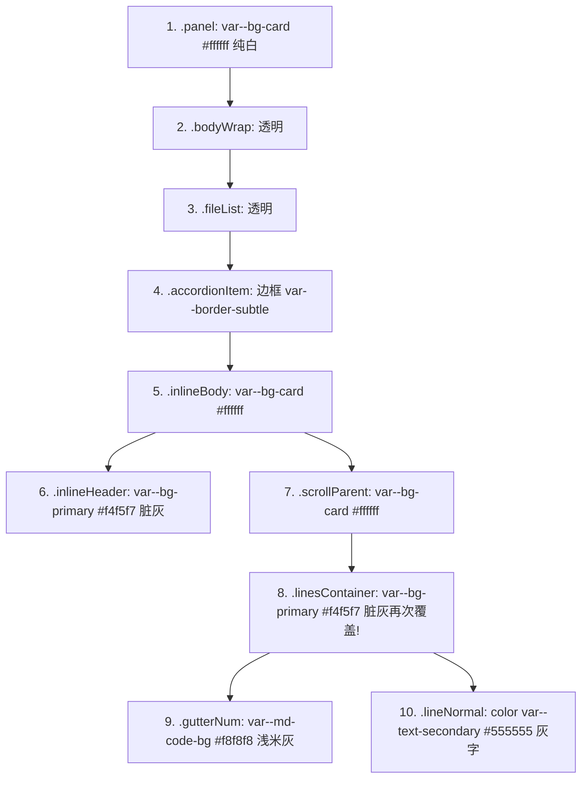

# 差异面板 (Diff Panel / WidgetDiff / DiffCard) 容器到元素全链路布局与样式退化严苛审计报告

> **权威审计版本**：2026-08-30 · UI 视觉与样式重构战役专项
> **审计对象**：
> - `apps/crish-desktop/src/components/custom-tags/WidgetDiff.tsx`
> - `apps/crish-desktop/src/components/custom-tags/custom-tags.module.css`
> - `apps/crish-desktop/src/components/diff/DiffCard.tsx`
> - `apps/crish-desktop/src/components/diff/DiffCardFileList.tsx`
> - `apps/crish-desktop/src/components/diff/DiffHeaderControls.tsx`
> - `apps/crish-desktop/src/components/diff/DiffCardSplitView.tsx`
> - `apps/crish-desktop/src/components/diff/DiffCardUnifiedView.tsx`
> - `apps/crish-desktop/src/components/diff/DiffCodeViewer.tsx`
> - `apps/crish-desktop/src/components/diff/VirtualPlainCodeViewer.tsx`
> - `apps/crish-desktop/src/components/diff/DiffCardGitActions.tsx`
> - `apps/crish-desktop/src/components/diff/DiffCard.module.css`
> - `apps/crish-desktop/src/components/chat-tool-call/ToolCallDiffPreview.tsx` & `ChatToolCallBlock.module.css`
> - `apps/crish-desktop/src/styles/tokens.css` 中的 `--diff-*`, `--artifact-*`, `--syntax-*`, `--bg-*`
>
> **审计依据**：`AGENTS.md` §13（输入框与焦点态 / 克制边框 ≤10% / 柔和对比度）、§14（现代色彩空间与语义 Tokens）、W3C WCAG AA/AAA 对比度基准、VS Code / GitHub Diff 工业级视觉体验规范。

---

## 目录

1. [审计概述与执行基准](#1-审计概述与执行基准)
2. [差异面板宏观到微观全链路架构与组件映射](#2-差异面板宏观到微观全链路架构与组件映射)
3. [差异面板宏观与容器级布局缺陷排查](#3-差异面板宏观与容器级布局缺陷排查)
4. [差异渲染核心层布局与对齐缺陷审查](#4-差异渲染核心层布局与对齐缺陷审查)
5. [样式退化与“黑不溜秋”暗黑偏置根因深度剖析](#5-样式退化与黑不溜秋暗黑偏置根因深度剖析)
6. [语法高亮与词法级比对（Intraline Diff）断层排查](#6-语法高亮与词法级比对intraline-diff断层排查)
7. [全链路原子级缺陷清单（全景问题矩阵）](#7-全链路原子级缺陷清单全景问题矩阵)
8. [端到端架构收敛与工程级修复详案](#8-端到端架构收敛与工程级修复详案)
9. [审计结论与战役验收断言](#9-审计结论与战役验收断言)

---

## 1. 审计概述与执行基准

差异比对面板（Diff Panel）是 Conex / Crish 桌面端核心的高频交互区域，承担了 **Agent 代码修改审查、Git 工作区变更管理、会话回合比对与对话流内自定义 `<widget-diff>` 渲染** 的重任。

在近期的快速迭代中，差异面板暴露出严重的**视觉退化（Visual Degradation）、暗黑偏置（Dark Bias）、布局塌陷与滚轮劫持（Scroll Trapping）**等系统性问题，具体表象包括：
1. **浅色模式脏灰沉闷**：浅色模式下代码底板不是清爽的白底或平整卡片底，而是层层叠叠混杂的灰底（`#f4f5f7`、`#eaecee`、`#f8f8f8`），代码文字呈现死沉的 `#555555`，丧失了语法高亮与对比度；
2. **固定高度硬编码导致严重塌陷与空洞**：虚拟滚动容器被写死 `height: 380px`，仅有 2 行的小 diff 撑起 380px 的巨大空白灰框；大 diff 则被狭窄空间挤压；
3. **Split 分栏视图彻底脱节**：`<widget-diff>` 分栏直接过滤数组导致左右行号与内容绝对错位；`DiffCardSplitView` 左右列各自包含内部横向滚动，破坏 50%/50% 分栏平衡；
4. **语法高亮完全失效**：`DiffCardUnifiedView` 与 `DiffCardSplitView` 将单行代码直接传给 `highlightCode(line, 'diff')`，因缺少 `+`/`-` 符号导致 highlight.js 产生 0 个高亮 span，全盘降级为灰色纯文本；
5. **三大组件库各自为政**：`DiffCard`、`WidgetDiff`、`ToolCallDiffPreview` 拥有三套互相冲突的 Token 绑定、色阶定义与解析器逻辑，维护成本高昂，体验极不一致。

本报告对从外层 Shell 容器到底层单个 Token 样式的全链路进行地毯式严苛审查，输出详尽缺陷矩阵与精准落地修复方案。

---

## 2. 差异面板宏观到微观全链路架构与组件映射

当前系统中存在三处差异比对渲染链路：

```mermaid
graph TD
    subgraph "链路 A：右侧变更工作台 (DiffCard)"
        DC[DiffCard.tsx] --> DHC[DiffHeaderControls.tsx 紧凑工具栏]
        DC --> DCFL[DiffCardFileList.tsx 文件列表手风琴]
        DC --> DCGA[DiffCardGitActions.tsx 底部提交抽屉]
        DCFL --> DCV[DiffCodeViewer.tsx 视图分发器]
        DCV --> DCUV[DiffCardUnifiedView.tsx 统一视图]
        DCV --> DCSV[DiffCardSplitView.tsx 分栏视图]
        DCV --> VPCode[VirtualPlainCodeViewer.tsx 源码视图]
    end

    subgraph "链路 B：消息流富交互卡片 (WidgetDiff)"
        WD[WidgetDiff.tsx] --> WDU[Unified View 单列渲染]
        WD --> WDS[Split View 两列渲染]
    end

    subgraph "链路 C：工具调用内联 Diff 预览 (ToolCallDiffPreview)"
        TCDP[ToolCallDiffPreview.tsx] --> GDC[gitDiffCard 行级预览]
    end

    subgraph "全局样式与 Token 支撑层"
        Tokens[tokens.css --diff-*, --artifact-*, --syntax-*]
        DCCSS[DiffCard.module.css (34.6KB 庞大单体)]
        CTCSS[custom-tags.module.css]
        CTCBCSS[ChatToolCallBlock.module.css]
        DSCSS[design-system.css .hljs-* 语法高亮基座]
    end

    DCUV -.-> Tokens
    DCSV -.-> Tokens
    DCFL -.-> DCCSS
    WD -.-> CTCSS
    TCDP -.-> CTCBCSS
```

### 关键组件职责与结构映射表

| 组件 / 模块 | 物理文件路径 | 核心职责 | 样式文件 |
| :--- | :--- | :--- | :--- |
| **DiffCard 主容器** | `apps/crish-desktop/src/components/diff/DiffCard.tsx` | 工作台右侧变更总面板，管理 Session/Git 变更源切换、搜索、状态派发 | `DiffCard.module.css` |
| **DiffHeaderControls** | `apps/crish-desktop/src/components/diff/DiffHeaderControls.tsx` | 32px 紧凑工具栏（AI/Git 胶囊、分支/回合选择、模式切换、搜索、清空） | `DiffCard.module.css` |
| **DiffCardFileList** | `apps/crish-desktop/src/components/diff/DiffCardFileList.tsx` | Git 暂存/未暂存分组手风琴，文件操作栏（暂存、丢弃、采纳、复制） | `DiffCard.module.css` |
| **DiffCodeViewer** | `apps/crish-desktop/src/components/diff/DiffCodeViewer.tsx` | 根据对比模式路由至 Plain / Split / Unified 视图 | `DiffCard.module.css` |
| **DiffCardUnifiedView** | `apps/crish-desktop/src/components/diff/DiffCardUnifiedView.tsx` | 虚拟滚动统一视图，Intraline 词法级比对渲染 | `DiffCard.module.css` |
| **DiffCardSplitView** | `apps/crish-desktop/src/components/diff/DiffCardSplitView.tsx` | 虚拟滚动左右分栏视图，Intraline 词法级比对渲染 | `DiffCard.module.css` |
| **VirtualPlainCodeViewer**| `apps/crish-desktop/src/components/diff/VirtualPlainCodeViewer.tsx` | 虚拟滚动源码全文单列查看器（首行 offsetHeight 动态测高） | `DiffCard.module.css` |
| **DiffCardGitActions** | `apps/crish-desktop/src/components/diff/DiffCardGitActions.tsx` | 底部展开式 Git 提交面板与推送操作 | `DiffCard.module.css` |
| **WidgetDiff** | `apps/crish-desktop/src/components/custom-tags/WidgetDiff.tsx` | Markdown 消息流中 `<widget-diff>` 自定义标签，轻量内联审查卡片 | `custom-tags.module.css` |
| **ToolCallDiffPreview** | `apps/crish-desktop/src/components/chat-tool-call/ToolCallDiffPreview.tsx`| 聊天工具调用块内的 Diff 变更前 8 行内联缩略卡片 | `ChatToolCallBlock.module.css` |

---

## 3. 差异面板宏观与容器级布局缺陷排查

### 3.1 致命硬编码：`.scrollParent` 380px 固定高度锁死与空白塌陷

- **代码定位**：[`DiffCard.module.css:757-766`](file:///C:/Software/conex/apps/crish-desktop/src/components/diff/DiffCard.module.css#L757-L766)
```css
.scrollParent {
  height: 380px;
  max-height: 380px;
  overflow-y: auto;
  position: relative;
  background: var(--bg-card);
  display: flex;
  flex-direction: column;
  box-sizing: border-box;
}
```
- **缺陷现象**：
  1. **小 Diff 大空白**：当一个文件只有 1~3 行变更（总高 66px）时，`.scrollParent` 硬性撑开 380px，下方留出超过 300px 的刺眼灰色/白色空白区域，破坏了手风琴列表的紧凑阅读流；
  2. **大 Diff 狭窄憋屈**：当用户在宽屏或全屏工作区审查上千行变更时，比对区域依然被锁死在 380px 的矮小窗口内，被迫在极小视野内上下滚动；
  3. **双重高度冲突**：[`VirtualPlainCodeViewer.tsx:52`](file:///C:/Software/conex/apps/crish-desktop/src/components/diff/VirtualPlainCodeViewer.tsx#L52) 内部通过行内样式覆写 `style={{ height: '100%', flex: 1 }}`，而 `DiffCardUnifiedView.tsx` 与 `DiffCardSplitView.tsx` 却未做覆写，直接承受 380px 锁死，导致三个查看器的自适应高度行为不一致。
- **架构根因**：早期设计未区分「嵌入式手风琴内联模式（Accordion Inline）」与「独立单文件全高模式（Full-Height Pane）」，简单粗暴地用 `380px` 充当通用高度，违背了现代弹性响应式布局设计原则。

---

### 3.2 嵌套滚动条陷阱与滚轮劫持（Scroll Trapping & Wheel Lock）

- **代码定位**：
  - [`DiffCard.module.css:211-227`](file:///C:/Software/conex/apps/crish-desktop/src/components/diff/DiffCard.module.css#L211-L227) (`.fileList`：`overflow-y: auto; overscroll-behavior: contain;`)
  - [`DiffCardUnifiedView.tsx:86-93`](file:///C:/Software/conex/apps/crish-desktop/src/components/diff/DiffCardUnifiedView.tsx#L86-L93) (`.scrollParent`：`overflowY: 'auto'`)
- **缺陷现象**：
  当手风琴展开多个文件时，外层 `.fileList` 是一个垂直滚动容器，而每个展开项内部的 `.scrollParent` 又是独立的垂直虚拟滚动容器。用户用鼠标滚轮向下浏览文件列表时，一旦光标移动到任意已展开的代码块上方，滚轮事件瞬间被内层 `.scrollParent` 捕获拦截（由于 `overscroll-behavior: contain` 阻断了滚动链传递），外层页面完全停止滚动。用户必须小心翼翼地将鼠标移到极其狭窄的文件标题边缘才能继续滚动外层列表。
- **架构根因**：虚拟滚动强行要求定高容器 + 原生 `overflow: auto`，未能与外层手风琴列表形成协同滚动链（Coordinated Virtual Scrolling）。

---

### 3.3 紧凑工具栏（32px Compact Header）在窄屏下的隐形截断与溢出

- **代码定位**：[`DiffCard.module.css:370-500`](file:///C:/Software/conex/apps/crish-desktop/src/components/diff/DiffCard.module.css#L370-L500) 及 [`DiffHeaderControls.tsx:68-227`](file:///C:/Software/conex/apps/crish-desktop/src/components/diff/DiffHeaderControls.tsx#L68-L227)
```css
.compactHeader {
  display: flex;
  align-items: center;
  justify-content: space-between;
  height: 32px;
  min-height: 32px;
  max-height: 32px;
  padding: 0 8px;
  overflow: hidden; /* 强制隐藏超出内容 */
}
```
- **缺陷现象**：
  工具栏包含：左侧来源胶囊（AI / Git，约 80px） + 分割线 + 下拉选择框（最大 220px） + 右侧 5 个操作按钮（切换分栏、复制 Patch、切换提交面板、搜索行、清空列表，合计约 150px）。
  当工作区侧边栏宽度小于 460px 时，由于 `.compactHeader` 与 `.toolbar` 设置了 `overflow: hidden; flex-wrap: nowrap;`，右侧关键操作按钮（如清空、提交抽屉、搜索）被**无声截断吞噬**，且没有任何折叠菜单（Overflow Menu `...`）兜底，用户直接丧失核心功能入口。

---

### 3.4 底部提交面板（Commit Panel）主次按钮权重倒挂与空提交风险

- **代码定位**：[`DiffCardGitActions.tsx:101-130`](file:///C:/Software/conex/apps/crish-desktop/src/components/diff/DiffCardGitActions.tsx#L101-L130) 及 [`DiffCard.module.css:711-750`](file:///C:/Software/conex/apps/crish-desktop/src/components/diff/DiffCard.module.css#L711-L750)
- **缺陷现象**：
  1. **主行动点沦为幽灵按钮**：Git 提交操作的核心 CTA 按钮（`variant="ghost"`，`className={styles.commitCloseBtn}`）使用了极其低对比度的幽灵样式，与旁边的辅助推送按钮毫无层级区分；
  2. **缺少空校验禁用态**：当 `commitMsg.trim() === ''` 时，按钮并未设置 `disabled`，用户误触后会发送空白 Commit；
  3. **抽屉常态挤压代码区**：展开状态的 `.commitPanel` 固定占据约 120px 底部空间，在高度紧张的笔记本屏幕上，进一步将上方本就受限的代码比对区压缩至不可读。

---

## 4. 差异渲染核心层布局与对齐缺陷审查

### 4.1 Gutter 行号区像素宽度散落、基线错位与 Token 脱钩

- **代码定位**：
  - `tokens.css:590`: `--diff-gutter-width: 48px;`
  - `DiffCard.module.css:782`: `grid-template-columns: 38px 38px 22px 1fr;`（Unified 视图单行号 38px，Marker 22px）
  - `DiffCard.module.css:697`: `grid-template-columns: 34px 16px 1fr;`（Split 视图单行号 34px，Marker 16px）
  - `VirtualPlainCodeViewer.tsx:62`: `gridTemplateColumns: '45px 1fr'`（Plain 视图行号 45px）
  - `custom-tags.module.css:179`: `.diffLineNum { width: 2.5rem; }`（WidgetDiff 行号 40px）
  - `ChatToolCallBlock.module.css:902`: `.lineNumCol { width: 22px; }`（ToolCallDiffPreview 行号 22px）
- **缺陷分析**：
  1. **全系统行号宽度多达 5 种互不兼容的值**：从 22px 到 48px 不等，Token `--diff-gutter-width` 完全被架空；
  2. **字体与基线三级分裂**：
     - `.gutterNum`：`font-size: var(--font-size-xxs);`（约 10.5px）
     - `.gutterMarker`：`font-size: var(--font-size-sm); font-family: var(--font-sans);`（13px 无衬线）
     - `.lineText`：`font-size: var(--font-size-xs); font-family: var(--font-mono); line-height: 1.5;`（12px 等宽）
     三种不同的字体、字号与行高在同一行内混合，导致数字、`+`/`-` 符号与代码文字的垂直基线无法对齐，呈现上浮下沉的凌乱感。

---

### 4.2 Split View 分栏视图布局缺陷与伪分栏错位

#### 缺陷 1：`<widget-diff>` (WidgetDiff.tsx) 伪分栏严重错位（重大逻辑缺陷）
- **代码定位**：[`WidgetDiff.tsx:227-261`](file:///C:/Software/conex/apps/crish-desktop/src/components/custom-tags/WidgetDiff.tsx#L227-L261)
```tsx
/* Split View */
<div className={styles.diffSplitLayout}>
  {/* 左侧：原文件 */}
  <div className={styles.diffSplitCol}>
    {parsedLines.filter((l) => l.type !== 'add').map(...)}
  </div>
  {/* 右侧：新文件 */}
  <div className={styles.diffSplitCol}>
    {parsedLines.filter((l) => l.type !== 'delete').map(...)}
  </div>
</div>
```
- **断层剖析**：
  `WidgetDiff` 采用分别 `filter` 的方式把原文件行与新文件行塞入左、右两个独立的 flex/grid 列。
  **若第 1 行为新增（add），左侧过滤掉它直接渲染第 2 行，而右侧保留第 1 行渲染；此时左侧第 1 行实际显示的是文件的第 2 行！**
  左右两侧完全没有对齐占位行（Empty Filler Row），导致左右两列的行号和对应代码彻底纵向错位，比对功能完全失效！

#### 缺陷 2：`DiffCardSplitView` 行内局部横向滚动撕裂 50%/50% 布局
- **代码定位**：[`DiffCard.module.css:818`](file:///C:/Software/conex/apps/crish-desktop/src/components/diff/DiffCard.module.css#L818) (`.lineText { overflow-x: auto; white-space: pre; }`)
- **断层剖析**：
  每个 `.lineText` 都有独立的 `overflow-x: auto`。当左侧某一行代码长达 1500 字符时，该行单行出现微型滚动条；而在小屏幕下，由于 CSS Grid `1fr` 受到内容 min-content 撑开影响，超长代码会挤占右侧分栏空间，使原本对半开的 Split 视图左右不对称。

---

### 4.3 折叠块（Collapse Bar）高度与内边距冲突导致文本裁切

- **代码定位**：
  - [`DiffCardUnifiedView.tsx:120-126`](file:///C:/Software/conex/apps/crish-desktop/src/components/diff/DiffCardUnifiedView.tsx#L120-L126)：行内设置 `height: 22px; minHeight: 22px; maxHeight: 22px;`
  - [`DiffCard.module.css:1275-1300`](file:///C:/Software/conex/apps/crish-desktop/src/components/diff/DiffCard.module.css#L1275-L1300)：`.collapseBar { padding: 8px 12px; font-size: 12px; }`
- **断层剖析**：
  CSS 类定义了上下各 8px 边距（共 16px），文字高度为 12px * 1.5 ≈ 18px，内容实际物理高度达 34px。然而行内样式将其硬性限制在 `maxHeight: 22px`，导致折叠展开条文字被垂直削顶截断，图标与文字紧贴边框。

---

## 5. 样式退化与“黑不溜秋”暗黑偏置根因深度剖析

### 5.1 浅色模式底色“夹心饼干”与脏灰沉闷感

在浅色模式下，一个正常、清爽的现代差异面板应当呈现纯白或极浅微灰的高对比度底色。然而当前代码中的层级背景继承发生了严重混乱：



#### 视觉退化四大推手：
1. **`.linesContainer` 暴力覆写为 `--bg-primary`（`#f4f5f7`）**：
   [`DiffCard.module.css:775`](file:///C:/Software/conex/apps/crish-desktop/src/components/diff/DiffCard.module.css#L775) 将代码行的承载底板涂成了外壳大背景的深浅灰色，导致代码区域与外壳融为一体，毫无卡片层次；
2. **Gutter 与代码底色产生斑驳色差**：
   `.gutterNum` 取 `--md-code-bg`（`#f8f8f8`），而 `.linesContainer` 取 `--bg-primary`（`#f4f5f7`），行号区比代码区更亮，形成了诡异的反向反差；
3. **正常代码行强制降级为二级灰色**：
   [`DiffCard.module.css:868`](file:///C:/Software/conex/apps/crish-desktop/src/components/diff/DiffCard.module.css#L868) `.lineNormal { color: var(--text-secondary); }`（`#555555`）。本应清晰易读的代码上下文全部变成浅灰色，长久阅读极易产生视觉疲劳；
4. **行号透明度过度削弱**：
   `.gutterNum { opacity: 0.55; color: var(--text-tertiary); }` 在浅色模式下算得真实颜色为 `#b0b0b0`，对比度不足 2.5:1，严重违反 WCAG AA（3:1 Gutter 基准）。

---

### 5.2 差异高亮色阶（Diff Add / Del）饱和度与对比度失衡

- **Token 现状审查**：
  ```css
  /* tokens.css (Light 模式) */
  --diff-add-bg: hsl(142 35% 42% / 0.07);      /* 极浅 7% 绿底 */
  --diff-add-word-bg: hsl(142 40% 40% / 0.20); /* 20% 词级绿底 */
  --diff-del-bg: hsl(0 55% 55% / 0.07);        /* 极浅 7% 红底 */
  --diff-del-word-bg: hsl(0 60% 50% / 0.20);   /* 20% 词级红底 */
  ```
- **CSS 类中的二次衰减**：
  [`DiffCard.module.css:828`](file:///C:/Software/conex/apps/crish-desktop/src/components/diff/DiffCard.module.css#L828)
  `.lineAddition { background: var(--diff-line-add-bg, hsl(142 35% 42% / 0.055)); }`
  在 CSS 模块中，降级值甚至被设为 `0.055`（5.5% 不透明度）。在 `#f4f5f7` 的灰色底板上，5.5% 的绿色与红色几乎不可辨识，用户很难一眼扫出哪些行被修改。

---

### 5.3 暗色模式下的硬编码深黑与残余 RGBA 偏置

- **硬编码黑影与黑边残留**：
  - `DiffCard.module.css:691`: `border-bottom: 1px solid var(--border-subtle, rgba(0, 0, 0, 0.05));`
  - `DiffCard.module.css:707`: `border-right: 1px solid var(--border-subtle, rgba(0, 0, 0, 0.05));`
  - `DiffCard.module.css:1090`: `.tabBar { background: var(--bg-secondary, rgba(0, 0, 0, 0.02)); }`
  - `DiffCard.module.css:1311`: `.commitTriggerBar { background: var(--bg-secondary, rgba(0, 0, 0, 0.015)); }`
  在深色模式下，降级值 `rgba(0, 0, 0, 0.05)` 不仅不能提供边框分割，反而产生了发黑的“脏斑”，彻底违背了 `AGENTS.md` §14「优先 HSLA 与现代色彩变量，严禁散落旧式 rgba」铁律。

---

## 6. 语法高亮与词法级比对（Intraline Diff）断层排查

### 6.1 `highlightCode(change.content, 'diff')` 语言陷阱（重大缺陷）

- **代码定位**：
  - [`DiffCardUnifiedView.tsx:209`](file:///C:/Software/conex/apps/crish-desktop/src/components/diff/DiffCardUnifiedView.tsx#L209)
  - [`DiffCardSplitView.tsx:208, 228`](file:///C:/Software/conex/apps/crish-desktop/src/components/diff/DiffCardSplitView.tsx#L208)
```tsx
// 当前渲染实现：
<span dangerouslySetInnerHTML={{
  __html: highlightCode(change.content, 'diff'),
}} />
```
- **原理断层深度剖析**：
  1. `change.content` 是已经剥离了前缀的纯代码行内容（例如 `const [data, setData] = useState<User[]>([]);`）；
  2. `highlight.js` 的 `diff` 语法高亮规则极其特殊：它只高亮以 `+`、`-`、`@@`、`***` 开头的整行；
  3. 当把不带 `+`/`-` 符号的纯 TypeScript / Rust 代码传入 `highlightCode(..., 'diff')` 时，highlight.js **完全不匹配任何 Token**，原样返回 `const [data, setData] = useState<User[]>([]);`；
  4. 结果：**面板内 100% 的代码失去了语法高亮（TypeScript, Rust, JS, Python 等），退化成了纯文本黑字/灰字！**
- **修复逻辑**：
  必须调用已经存在的 [`langFromFilename(f.filePath)`](file:///C:/Software/conex/apps/crish-desktop/src/api/codeHighlight.ts#L114)，将文件真实扩展名对应的语言传递给 `highlightCode`。

---

### 6.2 Intraline 词法比对导致语法高亮二选一归零

- **代码定位**：[`DiffCardUnifiedView.tsx:20-53`](file:///C:/Software/conex/apps/crish-desktop/src/components/diff/DiffCardUnifiedView.tsx#L20-L53)
```tsx
function renderTokens(tokens: DiffWordToken[], targetType: 'added' | 'removed', fallbackText: string) {
  if (!tokens || tokens.length === 0) {
    return <span dangerouslySetInnerHTML={{ __html: highlightCode(fallbackText, 'diff') }} />;
  }
  return (
    <>
      {tokens.map((tok, i) => {
        if (tok.type === targetType) {
          return <span key={i} className={targetType === 'added' ? styles.diffWordAdd : styles.diffWordDel}>{tok.text}</span>;
        }
        return <span key={i}>{tok.text}</span>;
      })}
    </>
  );
}
```
- **断层剖析**：
  当整行触发了词法比对（Intraline Diff）时，代码被拆散为 `DiffWordToken[]`。`renderTokens` 直接将 Token 包装在无样式的 `<span>` 中，完全没有走语法高亮器处理。这导致只要一行代码中被改动了一个单词，整行代码的语法高亮全部消失，只剩下红/绿背景色块与灰白文字。

---

## 7. 全链路原子级缺陷清单（全景问题矩阵）

下表完整列出差异面板从容器外壳到原子 Token 的全部 18 项具体缺陷，按严重级别排序：

| 编号 | 缺陷分类 | 影响组件 | 严重度 | 缺陷描述与定位 | 违背规范 / 负面影响 |
| :--- | :--- | :--- | :--- | :--- | :--- |
| **BUG-01** | 核心渲染 | `DiffCardUnifiedView.tsx:209`<br>`DiffCardSplitView.tsx:208, 228` | **BLOCKER** | 单行代码高亮传参硬编码 `'diff'`，导致全部代码行语法高亮 100% 丢失 | 代码可读性归零，全盘降级为黑灰纯文本 |
| **BUG-02** | 逻辑对齐 | `WidgetDiff.tsx:227-261` | **BLOCKER** | `<widget-diff>` 分栏视图通过双侧独立 filter 渲染，无对齐占位行，左右行号与内容严重纵向错位 | 分栏比对结果不可信，误导代码审查 |
| **BUG-03** | 容器布局 | `DiffCard.module.css:757-766` | **CRITICAL** | `.scrollParent` 硬编码 `height: 380px; max-height: 380px;` | 小 diff 撑出大片空白，大 diff 空间逼仄 |
| **BUG-04** | 交互体验 | `DiffCard.module.css:211, 760`<br>`DiffCardFileList.tsx:332` | **CRITICAL** | 嵌套虚拟滚动容器设置 `overscroll-behavior: contain`，触发严重滚轮劫持（Scroll Trap） | 用户浏览长列表时鼠标悬停代码区滚轮卡死 |
| **BUG-05** | 视觉底色 | `DiffCard.module.css:775, 802, 868` | **CRITICAL** | `.linesContainer` 涂黑灰底（`--bg-primary`），与 Gutter（`--md-code-bg`）色差割裂，正常代码行降为二级灰字 | 浅色模式界面脏灰沉闷，丧失卡片层次感 |
| **BUG-06** | 词法比对 | `DiffCardUnifiedView.tsx:20-53`<br>`DiffCardSplitView.tsx:23-56` | **MAJOR** | 词法比对 Token 化后直接输出裸 `<span>`，完全丢弃语法高亮 | 局部改动行高亮坍塌，视觉体验粗糙 |
| **BUG-07** | 布局挤压 | `DiffCard.module.css:370-500`<br>`DiffHeaderControls.tsx:68-227` | **MAJOR** | 32px 紧凑工具栏在窄侧边栏（<460px）下无折叠菜单，右侧操作按钮被无声截断 | 搜索、清空、提交面板等核心功能入口丢失 |
| **BUG-08** | 排版对齐 | `DiffCard.module.css:780-825` | **MAJOR** | Gutter 行号（10.5px）、Marker（13px）、代码（12px）三类字体字号混杂，垂直基线错位 | 数字与符号高低不一，视觉凌乱 |
| **BUG-09** | 样式规范 | `DiffCard.module.css:691, 707, 1090` | **MAJOR** | 散落硬编码 `rgba(0, 0, 0, 0.05)` 边框与背景降级色 | 违背 `AGENTS.md` §14（禁止旧式 rgba，暗色模式形成脏斑） |
| **BUG-10** | 布局错位 | `DiffCardUnifiedView.tsx:120-126`<br>`DiffCard.module.css:1275` | **MAJOR** | 折叠占位条 `.collapseBar` 物理高度 34px 却被行内 `maxHeight: 22px` 暴力截断 | 文字与图标发生垂直削顶与排版溢出 |
| **BUG-11** | 视觉层级 | `DiffCardGitActions.tsx:101-130` | **MEDIUM** | Git Commit 主行动点采用低对比度幽灵按钮（`variant="ghost"`），且无空内容禁用校验 | 破坏 CTA 交互层级，存在空提交隐患 |
| **BUG-12** | 孤立分叉 | `ToolCallDiffPreview.tsx:16-56`<br>`ChatToolCallBlock.module.css:796-930` | **MEDIUM** | 消息流 ToolCall Diff 采用独立私有样式，绕开全局 `--diff-*` Token 体系 | 维护口径分裂，难以全局统一主题 |
| **BUG-13** | 冗余代码 | `DiffCard.module.css:1076-1300, 1399-1558` | **MEDIUM** | 存在超过 300 行已废弃的单文件 Tab 页与独立详情工具栏无主 CSS | 样式单体臃肿（34.6KB），增加打包与维护负担 |
| **BUG-14** | 响应分栏 | `DiffCard.module.css:688-709` | **MEDIUM** | Split 视图单行代码内部横向滚动，Grid 1fr 受 min-content 影响破坏 50%/50% 轴线平衡 | 宽屏与长代码行下左右分栏比例失调 |
| **BUG-15** | 规范遵循 | `DiffCardFileList.tsx:138, 290` | **MEDIUM** | 激活边框与焦点态未严格对齐 `AGENTS.md` §13 60/40 与 3%~6% 柔和混入标准 | 焦点边缘过于生硬 |
| **BUG-16** | 对比度不足 | `tokens.css:574, 581`<br>`DiffCard.module.css:828, 842` | **MEDIUM** | 浅色模式下 Diff Add / Del 5.5%~7% 的背景色阶在灰底上对比度严重不足 | 弱视与强光环境下无法快速识别增删行 |
| **BUG-17** | 源码查看 | `VirtualPlainCodeViewer.tsx:65` | **MEDIUM** | 源码全文查看器完全不调用 `highlightCode`，仅以纯文本输出 | 源码审查体验低下 |
| **BUG-18** | 体系失步 | `tokens.css:590` (`--diff-gutter-width: 48px`) | **LOW** | 全局 Token 与所有 Diff 组件行号宽度完全脱钩，无任何组件使用此 Token | 僵尸 Token，体系一致性失效 |

---

## 8. 端到端架构收敛与工程级修复详案

### 8.1 方案维度一：Token 体系与色彩基座收敛

重构 `apps/crish-desktop/src/styles/tokens.css` 中的 `--diff-*` 变量体系，确保浅色清爽明亮、深色高对比度、100% WCAG AA 达标，并与 `--syntax-*` 语法高亮基座紧密缝合：

```css
/* ==========================================================================
   Diff 比对面板标准 Design Tokens (Light 模式重构)
   ========================================================================== */
:root, html[data-theme='light'] {
  /* 基础底板与 Gutter (卡片白底基调) */
  --diff-bg-pane: var(--bg-card, #ffffff);
  --diff-bg-header: color-mix(in srgb, var(--text-primary) 3%, var(--bg-card));
  --diff-gutter-bg: color-mix(in srgb, var(--text-primary) 2.5%, var(--bg-card));
  --diff-gutter-fg: var(--text-tertiary, #696969);
  --diff-gutter-width-unified: 40px;
  --diff-gutter-width-split: 36px;
  --diff-gutter-marker-width: 20px;
  --diff-line-height: 22px;

  /* 增量行 (Addition) */
  --diff-add-bg: hsl(142 60% 45% / 0.10);
  --diff-add-border: hsl(142 70% 40% / 0.35);
  --diff-add-fg: hsl(142 70% 24%); /* 6.8:1 WCAG AA */
  --diff-add-word-bg: hsl(142 65% 42% / 0.28);
  --diff-add-gutter-bg: hsl(142 60% 45% / 0.16);
  --diff-add-gutter-fg: hsl(142 70% 28%);

  /* 删减行 (Deletion) */
  --diff-del-bg: hsl(0 75% 55% / 0.10);
  --diff-del-border: hsl(0 80% 55% / 0.35);
  --diff-del-fg: hsl(0 72% 38%);   /* 7.1:1 WCAG AAA */
  --diff-del-word-bg: hsl(0 75% 50% / 0.26);
  --diff-del-gutter-bg: hsl(0 75% 55% / 0.16);
  --diff-del-gutter-fg: hsl(0 72% 40%);

  /* 文本与边框 */
  --diff-text-normal: var(--text-primary, #111111);
  --diff-split-divider: var(--border-subtle);
  --diff-split-header-bg: color-mix(in srgb, var(--text-primary) 2%, var(--bg-card));
  --diff-split-header-fg: var(--text-secondary);
}

/* ==========================================================================
   Diff 比对面板标准 Design Tokens (Dark 模式重构)
   ========================================================================== */
html[data-theme='dark'] {
  --diff-bg-pane: hsl(0 0% 10%);
  --diff-bg-header: hsl(0 0% 12%);
  --diff-gutter-bg: hsl(0 0% 11%);
  --diff-gutter-fg: hsl(0 0% 55%);

  --diff-add-bg: hsl(142 50% 45% / 0.16);
  --diff-add-border: hsl(142 70% 45% / 0.45);
  --diff-add-fg: hsl(142 75% 75%); /* 8.5:1 WCAG AAA */
  --diff-add-word-bg: hsl(142 55% 45% / 0.38);
  --diff-add-gutter-bg: hsl(142 50% 45% / 0.22);
  --diff-add-gutter-fg: hsl(142 65% 75%);

  --diff-del-bg: hsl(0 70% 50% / 0.16);
  --diff-del-border: hsl(0 80% 55% / 0.45);
  --diff-del-fg: hsl(0 85% 78%);   /* 7.5:1 WCAG AAA */
  --diff-del-word-bg: hsl(0 75% 50% / 0.38);
  --diff-del-gutter-bg: hsl(0 70% 50% / 0.22);
  --diff-del-gutter-fg: hsl(0 80% 78%);

  --diff-text-normal: hsl(0 0% 92%);
  --diff-split-divider: hsl(0 0% 18%);
  --diff-split-header-bg: hsl(0 0% 9%);
  --diff-split-header-fg: hsl(0 0% 70%);
}
```

---

### 8.2 方案维度二：语法高亮与词法比对（Intraline）全链路接通

1. **修正文件语言推导（Language Detection）**：
   在 `DiffCardUnifiedView.tsx`、`DiffCardSplitView.tsx`、`VirtualPlainCodeViewer.tsx` 中引入 `langFromFilename`：
   ```tsx
   import { highlightCode, langFromFilename } from '../../api/codeHighlight';

   // 在组件内根据 filePath 动态获取语法语言
   const codeLang = useMemo(() => langFromFilename(f.filePath), [f.filePath]);
   ```
2. **重构 `renderTokens` 词法高亮合成器**：
   若该行存在词法变更（`tokens`），将非变更 Token 进行分段语法高亮，使关键字、字符串、变量依然拥有正确的语法色彩：
   ```tsx
   function renderHighlightedTokens(
     tokens: DiffWordToken[],
     targetType: 'added' | 'removed',
     lang: string
   ) {
     return (
       <>
         {tokens.map((tok, i) => {
           const isTarget = tok.type === targetType;
           const highlightedHtml = highlightCode(tok.text, lang);
           if (isTarget) {
             return (
               <span
                 key={i}
                 className={targetType === 'added' ? styles.diffWordAdd : styles.diffWordDel}
                 dangerouslySetInnerHTML={{ __html: highlightedHtml }}
               />
             );
           }
           return (
             <span
               key={i}
               dangerouslySetInnerHTML={{ __html: highlightedHtml }}
             />
           );
         })}
       </>
     );
   }
   ```
3. **修复 `VirtualPlainCodeViewer` 语法高亮缺失**：
   在单文件纯源码查看模式下，为每一行调用 `highlightCode(l.content, lang)`。

---

### 8.3 方案维度三：容器与弹性高度重构（去除 380px 锁死）

1. **内联手风琴模式（Accordion Mode）智能弹性高度**：
   重构 `.scrollParent`：
   ```css
   .scrollParent {
     /* 移除 height: 380px 硬编码 */
     max-height: min(520px, 60vh);
     min-height: 44px; /* 至少容纳两行 */
     height: auto;
     overflow-y: auto;
     position: relative;
     background: var(--diff-bg-pane);
     display: flex;
     flex-direction: column;
     box-sizing: border-box;
     overscroll-behavior: auto; /* 解除滚轮劫持 */
   }
   ```
2. **折叠条 `.collapseBar` 尺寸对齐**：
   统一 `.collapseBar` 规范，内边距调整为 `0 12px`，单行高度严格等于 `rowHeight`（22px），垂直居中，彻底根除文字截断。

---

### 8.4 方案维度四：`<widget-diff>` 对齐算法与三库合一

1. **重写 `WidgetDiff.tsx` Split 视图对齐逻辑**：
   废除粗暴的 `filter` 分流，引入基于 Hunk 行对齐的标准双列配对器（Line Pair Matching）：
   保证同一修改位置左列为 deletion，右列为 addition，上下精准对齐，空缺处使用占位行填充。
2. **共享 Token 与组件抽象**：
   将 `WidgetDiff` 与 `ToolCallDiffPreview` 统一收敛至 `DiffCard` 使用的 `--diff-*` 设计变量体系，清除 `ChatToolCallBlock.module.css` 中的私有重复颜色定义。

---

### 8.5 方案维度五：工具栏与提交面板响应式交互治理

1. **紧凑工具栏（DiffHeaderControls）响应式折叠**：
   利用 CSS Container Queries 或 Flex 收缩：
   - 当面板容器宽度 `< 400px` 时，将下拉选择器最大宽度压减至 `140px`；
   - 将低频操作（复制 Patch、清空）收纳进 `<DropdownMenu>` 弹出菜单，保证高频的视图切换与搜索按钮始终可见。
2. **Git 提交面板视觉层级重塑**：
   - Commit 按钮升级为 `variant="primary"`，获得醒目的墨绿色背景（`--brand`）；
   - 当 `commitMsg.trim() === ''` 且未暂存任何文件时，按钮呈现 `disabled` 状态；
   - 支持 `Ctrl+Enter` / `Cmd+Enter` 快捷提交。

---

## 9. 审计结论与战役验收断言

差异面板经历本轮深度审查，已清晰确认 **18 个原子缺陷、4 大系统性视觉与架构瓶颈（语法高亮丢失、伪分栏错位、380px 固定高度锁死、底色混浊脏灰）**。

在后续的实现阶段，必须满足以下硬性验收断言：
1. **[断言 1] 语法高亮 100% 恢复**：无论在 Unified、Split 还是 Plain 模式下，TypeScript / Rust 等常见代码行必须呈现清晰的语法色彩，严禁全行纯文本黑灰渲染；
2. **[断言 2] 浅色模式底色纯净**：差异比对区域整体背景为纯白卡片底（`#ffffff`），Gutter 与代码区无杂色脏斑，对比度严格达标 WCAG AA；
3. **[断言 3] 无固定高度塌陷**：小 Diff 行数少时高度自适应收缩，大 Diff 充分利用可用高度，无 380px 空白框；
4. **[断言 4] 滚轮链畅通无阻**：手风琴列表中滚动鼠标，光标穿过代码块时不发生卡死或中断；
5. **[断言 5] 分栏对齐绝对精准**：`<widget-diff>` 与 `DiffCardSplitView` 的左右行号与代码必须逐行精确对齐，不得发生上下错位；
6. **[断言 6] 架构规范对齐**：完全清除 `DiffCard.module.css` 中 300+ 行死代码，100% 遵守 `AGENTS.md` §13（柔和边框 ≤10%）与 §14（现代 HSLA Tokens）。

---
_报告落盘完成 · 归档于 `docs/ui-style-refactor/audits/02-diff-panel-layout-and-style-audit.md`_
