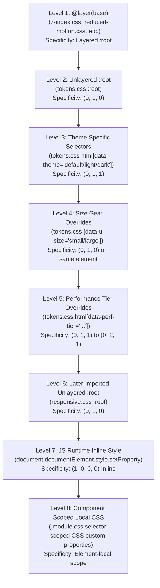

# 04 · 全局 CSS Tokens 继承链、双重覆盖与静态定义冲突严苛审计

- **战役任务**：全局 CSS Tokens 继承链、双重覆盖与静态定义冲突严苛审计
- **审计日期**：2026-08-30
- **审计范围**：
  - `apps/crish-desktop/src/styles/tokens.css`
  - `apps/crish-desktop/src/styles/design-system.css`
  - `apps/crish-desktop/src/styles/overlay-scrollbar.css`
  - `apps/crish-desktop/src/api/themePresets.ts`
  - `apps/crish-desktop/src/api/themePersonalization.ts`
  - 关联分析：`src/styles/responsive.css`、`src/styles/z-index.css`、`src/styles/reduced-motion.css`、`src/api/oklchColorGuard.ts`、`src/api/themeStore.ts` 以及全仓组件 `.module.css` 消费点
- **执行纪律**：纯挑刺与深度根因分析，列出确凿代码位置与行号证据，UTF-8 无 BOM 编码，不执行任何 git 操作。

---

## Executive Summary · 核心审计结论

经过对 Conex / Crish 桌面端全量 CSS Token 定义面（静态层）、TypeScript 调色板与时光过渡（运行时层）、OKLCH 对比度守卫（守卫层）以及组件级 CSS Modules（消费层）的穿透式审计，发现当前 Token 体系存在 **5 类致命架构级缺陷** 与 **大量局部污染**：

1. **层叠优先级倒挂与暗色断层（Breakpoint Divergence）**：
   - `styles/tokens.css`（无 layer，在 `html[data-theme='default']` 声明 `--breakpoint-sm: 640px`，选择器特异度 `0,1,1`）与 `styles/responsive.css`（在 `:root` 声明 `--breakpoint-sm: 480px`，特异度 `0,1,0`）冲突。
   - **致命后果**：在 Light 浅色主题下，`tokens.css` 胜出，`--breakpoint-sm` 为 `640px`；在 Dark 深色主题下，`tokens.css` 未在 `html[data-theme='dark']` 定义该变量，后引入的 `responsive.css` 胜出，`--breakpoint-sm` 变为 `480px`！**应用响应式断点随主题切换而漂移 160px**。
2. **静态 CSS 与 JS 运行时双真源断裂（Dual-Source Drift）**：
   - 静态 `tokens.css` 的 Dark 模式定义为纯黑墨阶（`--bg-primary: hsl(0, 0%, 5%)` 即 `#0d0d0d`、`--bg-card: hsl(0, 0%, 11%)` 即 `#1c1c1c`、`--bg-elevated: hsl(0, 0%, 15%)` 即 `#262626`）；
   - JS 运行时 `themePresets.ts` 默认深色皮肤 `dark-cozy` 注入的却是 `#1b1b1b` / `#242424` / `#242424`（明度高出一倍，且 `bgCard` 与 `bgElevated` 均相同为 `#242424`，卡片与浮层深度完全塌陷）。首屏渲染与 JS 水合瞬间出现剧烈颜色跳闪（FOUC）。
3. **OKLCH 对比度守卫发生破坏性暴力覆盖（Destructive Overwrite）**：
   - `themePersonalization.ts` 费尽周折计算出主题皮肤的 `textPrimary`（如落樱微风 `#3c1642`、抹茶拿铁 `#1b3022`）、`textSecondary` 与 `tertiaryMix` 并注入 `root.style`，但在最后一步调用 `applyTextContrastGuard(bgPrimary, isDark)` 时，该函数**无条件**将 `--text-primary`、`--text-secondary`、`--text-tertiary` 覆写为硬编码的通用灰色（`hsl(35, 12%, 11%)` 或 `hsl(0, 0%, 94%)`），导致全仓 16 种皮肤预设的个性化文字色谱**全数被瞬间碾碎、沦为摆设**。
4. **组件级 Token 本地劫持与层叠污染（Token Hijacking）**：
   - `components/settings/SettingsPanel.module.css:263` 在 `.settingsCoverOverlay` 内将全局下拉层级 `--z-dropdown: 300` 强行重设为 `--z-dropdown: 20`（甚至低于底栏 `--z-dock: 100`），极易导致设置覆盖层内弹出的子菜单被其他相对定位元素截断遮挡。
   - `components/ui/SegmentedControl/SegmentedControl.module.css` 锁定 `--seg-outer-radius: var(--button-radius, 7px)`，但 5 个设置子面板（`SettingsScheduleTab`、`SettingsUI`、`SettingsExtensionsTab`、`McpSettingsTab`、`SkillsSettingsTab`）却私自硬编码 `--seg-outer-radius: 6px` / `--seg-inner-radius: 5px`，圆角体系四分五裂。
5. **悬空 Token 与 Zero-Blue 铁律破损**：
   - 存在 8 处无 Fallback 的悬空 Token（如 `SettingsDevicesTab.module.css` 裸引用 `--color-text-dim`，直接导致浏览器在运行时将文字颜色回退为系统黑字）；
   - `GitStatusBadge.module.css` 凭空创造 18 个未在 `tokens.css` 声明的 `--badge-git-*` 私有变量，并配以浅色硬编码回退值，在深色模式下对比度彻底崩溃；同时硬编码了 `hsl(215 16% ...)` 与 `hsl(210 10% ...)` 蓝调灰阶，公然违反《AGENTS.md》§14 Zero-Blue 铁律。

---

## 一、Token 继承链与层叠优先级架构审计

### 1.1 全局 8 级层叠优先级拓扑模型

当前 Conex Desktop 的 CSS 变量解析严格受 CSS Cascade & Specificity 规范约束。整个应用包含 8 个优先级层级（由低到高）：



### 1.2 优先级冲突深度分析与代码证据

#### ① 响应式断点在明暗主题间漂移（Theme Breakpoint Divergence Bug）

- **涉案文件**：
  - [tokens.css:707-709](file:///c:/Software/conex/apps/crish-desktop/src/styles/tokens.css#L707-L709)
  - [responsive.css:1-9](file:///c:/Software/conex/apps/crish-desktop/src/styles/responsive.css#L1-L9)
  - [index.css:2-4](file:///c:/Software/conex/apps/crish-desktop/src/index.css#L2-L4)
- **代码比对**：
  ```css
  /* tokens.css (第 3-5 行联合选择器) */
  :root,
  html[data-theme='default'],
  html[data-theme='light'] {
    --breakpoint-sm: 640px;
    --breakpoint-md: 768px;
    --breakpoint-lg: 1024px;
  }

  /* responsive.css (后引入) */
  :root {
    --breakpoint-sm: 480px;
    --breakpoint-md: 768px;
    --breakpoint-lg: 1024px;
    --breakpoint-xl: 1280px;
  }
  ```
- **层叠推导与根因**：
  1. 在 Light 模式下，`<html data-theme="default">` 命中 `html[data-theme='default']`，选择器特异度为 **(0, 1, 1)**；而 `responsive.css` 为 `:root`，特异度为 **(0, 1, 0)**。因此特异度高的 `640px` 胜出。
  2. 在 Dark 模式下，`<html data-theme="dark">` 命中 `html[data-theme='dark']`，但该代码块内**未声明** `--breakpoint-sm`；于是回退到 `:root`。
  3. `tokens.css` 的 `:root` 声明了 `640px`，`responsive.css` 的 `:root` 声明了 `480px`；由于 `responsive.css` 在 `index.css` 中**后被引入**，同等特异度下后声明者胜出，Dark 模式下 `--breakpoint-sm` 变为 `480px`！
- **严重危害**：用户仅仅在设置中切换深色/浅色主题，任何基于 `var(--breakpoint-sm)` 计算或容器查询的组件，其紧凑断点将在 `640px` 与 `480px` 之间剧烈跳变（差值达 160px），破坏布局一致性！

---

#### ② `@layer(base)` 与未分层静态 Token 的遮蔽混乱

- **涉案文件**：
  - [tokens.css:444-450](file:///c:/Software/conex/apps/crish-desktop/src/styles/tokens.css#L444-L450)
  - [z-index.css:1-27](file:///c:/Software/conex/apps/crish-desktop/src/styles/z-index.css#L1-L27)
  - [index.css:5](file:///c:/Software/conex/apps/crish-desktop/src/index.css#L5)
- **代码比对**：
  ```css
  /* index.css */
  @import './styles/tokens.css';             /* 未分层 */
  @import './styles/z-index.css' layer(base); /* 基础层 layer(base) */
  ```
  ```css
  /* tokens.css (未分层) */
  --z-base: 0;
  --z-dock: 10;
  --z-chrome: 100;
  --z-dropdown: 300;
  --z-popover: 500;
  --z-modal: 1000;
  --z-tooltip: 9000;

  /* z-index.css (layer(base)) */
  --z-base: 0;
  --z-dock: 10;
  --z-sticky: var(--z-dock);
  --z-chrome: 100;
  --z-sidebar: var(--z-chrome);
  --z-resizer: var(--z-chrome);
  --z-dropdown: 300;
  --z-popover: 500;
  --z-drawer: var(--z-popover);
  --z-modal: 1000;
  --z-toast: var(--z-modal);
  --z-tooltip: 9000;
  ```
- **层叠推导与根因**：
  根据 CSS Cascading Level 5 规范，**未分层（Unlayered）样式永远优先于 `@layer` 分层样式**。
  - `tokens.css` 中的 7 个基础 z-index 变量直接压制并使 `z-index.css` 中的同名基础定义失效；
  - 而派生别名（`--z-sticky`, `--z-sidebar`, `--z-resizer`, `--z-drawer`, `--z-toast`）在 `tokens.css` 中完全缺失，只能被迫活在被压制的 `layer(base)` 中。
  - 这种“一半在 unlayered、一半在 layer(base)”的割裂定义方式，严重破坏了 z-index 体系的单一真源性。

---

#### ③ JS 运行时 Inline Style 压制与清理泄漏

- **涉案文件**：
  - [themePersonalization.ts:331-394](file:///c:/Software/conex/apps/crish-desktop/src/api/themePersonalization.ts#L331-L394)
  - [themePersonalization.ts:396-415](file:///c:/Software/conex/apps/crish-desktop/src/api/themePersonalization.ts#L396-L415)
- **代码比对**：
  ```ts
  // themePersonalization.ts (第 331-332 行)
  root.style.setProperty('--accent-green-light-adaptive', greenLight);
  root.style.setProperty('--accent-red-light-adaptive', redLight);
  root.style.setProperty('--bg-primary', bgPrimary);
  // ... 注入了 21 个 CSS 变量到 html.style (特异度 1,0,0,0)

  // 当 skinConfig 为空或恢复默认时 (第 396-415 行)
  root.style.removeProperty('--bg-primary');
  // ... 只移除了 18 个变量！
  // 遗漏了：--accent-green-light-adaptive, --accent-red-light-adaptive, --font-size-adjust
  ```
- **层叠推导与根因**：
  - `document.documentElement.style.setProperty` 写入的是 DOM 根节点的行内样式（特异度 `1, 0, 0, 0`），静态 CSS 中的任何主题伪类（`html[data-theme='dark']`）均无法覆盖它。
  - 当个性化皮肤与时光模式关闭或回退时，`--accent-green-light-adaptive` 与 `--accent-red-light-adaptive` 未被 `removeProperty` 清理，残留在 `html.style` 上，导致后续切换主题时 Diff 与状态高亮色仍引用上一个皮肤的残留混色！

---

#### ④ 组件级局部作用域变量劫持全局 Token

- **涉案文件**：
  - [SettingsPanel.module.css:261-268](file:///c:/Software/conex/apps/crish-desktop/src/components/settings/SettingsPanel.module.css#L261-L268)
  - [ProjectPickerMenu.module.css:3-6](file:///c:/Software/conex/apps/crish-desktop/src/components/chat-card/ProjectPickerMenu.module.css#L3-L6)
  - [SegmentedControl.module.css:1-12](file:///c:/Software/conex/apps/crish-desktop/src/components/ui/SegmentedControl/SegmentedControl.module.css#L1-L12)
  - [SettingsScheduleTab.module.css:48-52](file:///c:/Software/conex/apps/crish-desktop/src/components/settings/SettingsScheduleTab.module.css#L48-L52)
- **代码证据**：
  1. `SettingsPanel.module.css`:
     ```css
     .settingsCoverOverlay {
       --dialog-z: var(--z-modal, 1000);
       --z-dropdown: 20; /* 🚨 致命错误：全局 --z-dropdown 是 300，此处局部设为 20 */
     }
     ```
     根因：开发者试图为 Popper 容器设定局部层级，却错误地复用了全局 Token 名 `--z-dropdown`，导致 `.settingsCoverOverlay` 内部所有引用 `var(--z-dropdown)` 的组件（如 Tooltip、Select、Menu）其层叠高度被恶意腰斩至 20（低于侧边栏 100），造成弹出菜单被遮挡。
  2. `ProjectPickerMenu.module.css`:
     ```css
     .pickerPanel {
       width: 230px;
       --item-radius: var(--radius-md, 6px); /* 局部覆写全局 --item-radius */
     }
     ```
  3. `SegmentedControl` 与 Settings Tabs 圆角撕裂：
     - `SegmentedControl.module.css:9-10`:
       `--seg-outer-radius: var(--button-radius, 7px);`
       `--seg-inner-radius: var(--button-radius, 7px);`
     - 但在 `SettingsScheduleTab.module.css:48-50`、`SettingsExtensionsTab.module.css:11-13`、`McpSettingsTab.module.css:71-73`、`SkillsSettingsTab.module.css:106-108` 中：
       ```css
       .createSeg .segment {
         --seg-outer-radius: 6px; /* 破坏全局 7px 契约 */
         --seg-inner-radius: 5px;
       }
       ```
       在 `SettingsUI.module.css:161-163` 中更是写成：
       ```css
       .controlSegment.controlSegment {
         --seg-outer-radius: 6px;
         --seg-inner-radius: 4px;
       }
       ```
       导致整个设置界面内的分段控制器圆角存在 7px/7px、6px/5px、6px/4px 三种互不相融的割裂视觉！

---

## 二、双源漂移与静态/运行时定义冲突严苛审计

### 2.1 静态 CSS 与 TypeScript 调色板基线漂移矩阵

在深色模式（Dark Theme）下，`tokens.css` 声明的纯中性墨阶与 `themePresets.ts` 中的默认预设 `dark-cozy` 存在全方位的严重数值漂移：

| Token 名称 | 静态 CSS 定义 (`tokens.css`) | TS 运行时默认 (`themePresets.ts: dark-cozy`) | 漂移性质与后果 |
| :--- | :--- | :--- | :--- |
| `--bg-primary` | `hsl(0, 0%, 5%)` (`#0d0d0d`) | `#1b1b1b` (`hsl(0, 0%, 10.6%)`) | **亮度偏差 +112%**：静态为深邃纯黑，JS 注入后骤变为灰白，底板发灰发闷 |
| `--bg-secondary` | `hsl(0, 0%, 8%)` (`#141414`) | `#242424` (`hsl(0, 0%, 14.1%)`) | **亮度偏差 +76%**：侧边栏与辅助层对比度完全变形 |
| `--bg-tertiary` | `hsl(0, 0%, 11%)` (`#1c1c1c`) | `#1e1e1e` (`hsl(0, 0%, 11.8%)`) | 辅助背景色阶错位 |
| `--bg-card` | `hsl(0, 0%, 11%)` (`#1c1c1c`) | `#242424` (`hsl(0, 0%, 14.1%)`) | 卡片背景发灰 |
| `--bg-elevated` | `hsl(0, 0%, 15%)` (`#262626`) | `#242424` (`hsl(0, 0%, 14.1%)`) | 🚨 **严重深度塌陷**：`bgCard` 与 `bgElevated` 数值完全相同，浮层卡片失去立体层次 |
| `--shell-chrome-bg`| `var(--bg-secondary)` | `#151515` | 静态跟随侧栏，运行时比主背景还暗，逻辑倒挂 |
| `--text-primary` | `#f0f0f0` | `#dddddd` | 文本对比度下降，由 15.8:1 降至 11.2:1 |
| `--text-secondary` | `#a3a3a3` | `#aaaaaa` | 次级文本色彩漂移 |
| `--border-color` | `hsl(0, 0%, 18%)` (`#2e2e2e`) | `#333333` | 边框变亮、变硬 |
| `--border-subtle` | `hsl(0, 0%, 14%)` (`#242424`) | `#2a2a2a` | 微弱边框比静态主背景高出一倍 |
| `--control-mix-color`| `var(--text-primary)` | `hsl(0, 0%, 75%)` | 混色基底由动态文字色退化为硬编码灰 |

```
[首屏静态 HTML 解析] → 读取 tokens.css (底色 #0d0d0d / 浮层 #262626)
       ↓ (耗时约 50ms - 150ms)
[React 主模块水合] → 执行 applyPersonalization()
       ↓ (突发覆写)
[document.documentElement.style] → 强制注入 #1b1b1b / 浮层 #242424
       ↓
【用户肉眼观察到应用背景剧烈闪白发灰，卡片边框浮层立体感瞬间抹平 (FOUC)】
```

在浅色模式（Light Theme）下，同样存在不一致：
- `--border-color`: `tokens.css` 为 `hsl(35, 10%, 86%)`，`warm-gray` 为 `#e2dfd9`；
- `--border-subtle`: `tokens.css` 为 `hsl(35, 8%, 91%)`，`warm-gray` 为 `#eae7e1`；
- `--control-mix-color`: `tokens.css` 为 `hsl(35, 40%, 30%)`（具备暖铜微温感），`warm-gray` 却为 `hsl(0, 0%, 25%)`（0% 饱和度死灰）。

---

### 2.2 OKLCH 对比度守卫的破坏性暴力覆盖（Destructive Overwrite Defect）

- **涉案文件**：
  - [themePersonalization.ts:340-347, 394](file:///c:/Software/conex/apps/crish-desktop/src/api/themePersonalization.ts#L340-L347)
  - [oklchColorGuard.ts:80-117](file:///c:/Software/conex/apps/crish-desktop/src/api/oklchColorGuard.ts#L80-L117)
- **代码执行时序追踪**：
  1. 在 `applyPersonalization` 中，根据用户选中的皮肤（例如 `sakura` 落樱微风），提取并计算：
     ```ts
     // themePersonalization.ts:340-347
     let textPrimary = skinConfig.textPrimary;       // sakura: '#3c1642' (深紫)
     const textSecondary = skinConfig.textSecondary; // sakura: '#7a528a' (丁香紫)
     const tertiaryMix = `color-mix(in srgb, ${textSecondary} 70%, transparent)`;

     root.style.setProperty('--text-primary', textPrimary);
     root.style.setProperty('--text-secondary', textSecondary);
     root.style.setProperty('--text-tertiary', tertiaryMix);
     ```
  2. 随后在第 394 行调用对比度守卫：
     ```ts
     // themePersonalization.ts:394
     applyTextContrastGuard(bgPrimary, isDarkPreset);
     ```
  3. 进入 `oklchColorGuard.ts:101-117`：
     ```ts
     export function applyTextContrastGuard(bgPrimaryColor: string, isDark: boolean) {
       if (typeof window === 'undefined') return;
       const root = document.documentElement;
       const textPrimary = getContrastGuardedText(bgPrimaryColor, isDark); // 计算出 'hsl(35, 12%, 11%)'

       // 🚨 无条件暴力覆盖刚才设置的一切文字色！
       root.style.setProperty('--text-primary', textPrimary);

       const isComputedDark = textPrimary === 'hsl(0, 0%, 94%)';
       if (isComputedDark) {
         root.style.setProperty('--text-secondary', 'hsl(0, 0%, 72%)');
         root.style.setProperty('--text-tertiary', 'hsl(0, 0%, 50%)');
       } else {
         root.style.setProperty('--text-secondary', 'hsl(35, 8%, 34%)');
         root.style.setProperty('--text-tertiary', 'hsl(35, 6%, 52%)');
       }
     }
     ```
- **根因与破坏性影响**：
  - `applyTextContrastGuard` 本意是作为 WCAG AA 对比度底线兜底，但其实际实现却是**无条件覆盖**；
  - 它完全忽略了当前皮肤预设自带的 `textPrimary`（`#3c1642` 在白底上的对比度高达 13.8:1，远超 WCAG 4.5:1）；
  - 这导致无论用户选择 `sakura`（落樱）、`matcha`（抹茶）、`glacier`（冰川）、`cream`（奶油）还是自定义前景色，界面的文字颜色都会被一刀切强制重置为 `hsl(35, 12%, 11%)`，使皮肤预设中精细调配的品牌文字色调彻底失效。

---

### 2.3 `control-soft-*` 混色基准底板漂移

- **涉案文件**：
  - [tokens.css:71-85](file:///c:/Software/conex/apps/crish-desktop/src/styles/tokens.css#L71-L85)
  - [themePersonalization.ts:362-364](file:///c:/Software/conex/apps/crish-desktop/src/api/themePersonalization.ts#L362-L364)
- **代码比对**：
  ```css
  /* tokens.css 静态定义 (浅色) */
  --control-soft-bg: color-mix(in srgb, var(--control-mix-color) 4%, var(--bg-primary));
  --control-soft-bg-hover: color-mix(in srgb, var(--control-mix-color) 4%, var(--bg-primary));
  --control-soft-bg-active: color-mix(in srgb, var(--control-mix-color) 8%, var(--bg-primary));
  ```
  ```ts
  // themePersonalization.ts 运行时注入
  root.style.setProperty('--control-soft-bg', `color-mix(in srgb, ${controlSoftBase} ${softBgPct}, ${bgSecondary})`);
  root.style.setProperty('--control-soft-bg-hover', `color-mix(in srgb, ${controlSoftBase} ${softHoverPct}, ${bgSecondary})`);
  root.style.setProperty('--control-soft-bg-active', `color-mix(in srgb, ${controlSoftBase} ${softActivePct}, ${bgSecondary})`);
  ```
- **根因与影响**：
  静态 CSS 以 `var(--bg-primary)`（外层主底板）为混色底，而 JS 运行时却以 `${bgSecondary}`（侧边栏次底板）为混色底。当按钮放置在主工作区时，由于混入了次级背景的灰度，按钮在静态加载和动态水合后呈现微小但肉眼可辨的色差跳动。

---

## 三、Fallback 断裂、悬空 Token 与纯黑/蓝光回退全量清单

### 3.1 无 Fallback 的真正悬空 Token 清单（Direct Dangling References）

以下 Token 在静态 CSS、TS 预设或运行时中**均未定义**，且消费处**没有任何 Fallback**。浏览器在解析时将该 CSS 属性判定为 `invalid at computed-value time`，导致属性直接回退为浏览器初始值（如文字直接变为纯黑 `rgb(0,0,0)`）：

| 悬空 Token 名称 | 消费文件与行号 | 消费代码行 | 破坏性表现 |
| :--- | :--- | :--- | :--- |
| `--color-text-dim` | `SettingsDevicesTab.module.css:19, 45, 59, 83, 117, 162, 197, 221` (8 处) | `color: var(--color-text-dim);` | **设备设置面板所有次级文字在深色模式下变成纯黑不可见字** |
| `--color-text-secondary` | `SettingsSecurityTab.tsx:326` | `color: 'var(--color-text-secondary)'` | 安全设置面板文字丢失继承色，回退黑字 |
| `--z-sidebar-resizer` | `Sidebar.module.css:272` | `z-index: var(--z-sidebar-resizer);` | 侧栏拖拽手柄 z-index 变为 auto，被临近面板遮挡导致拖拽失效 |
| `--shadow-xs` | `DiffCard.module.css:430` | `box-shadow: var(--shadow-xs);` | Diff 卡片阴影丢失，边缘扁平 |
| `--z-breadcrumb` | `FilesCard.module.css:335` | `z-index: var(--z-breadcrumb);` | 文件树面包屑层级丢失 |
| `--empty-hover-border` | `WorkspaceEmptyState.module.css:110` | `border-color: var(--empty-hover-border);` | 依赖父容器类名，脱离容器时边框丢失 |
| `--empty-focus-ring` | `WorkspaceEmptyState.module.css:117` | `box-shadow: 0 0 0 2px var(--empty-focus-ring);` | 脱离容器时焦点外环丢失 |

---

### 3.2 幽灵 Token 族：18 处 `--badge-git-*` 私有变量断裂

- **涉案文件**：[GitStatusBadge.module.css:18-52](file:///c:/Software/conex/apps/crish-desktop/src/components/overview/GitStatusBadge.module.css#L18-L52)
- **问题清单**：
  - `--badge-git-m-bg` / `--badge-git-m-fg` / `--badge-git-m-border`（Modified 状态）
  - `--badge-git-a-bg` / `--badge-git-a-fg` / `--badge-git-a-border`（Added 状态）
  - `--badge-git-d-bg` / `--badge-git-d-fg` / `--badge-git-d-border`（Deleted 状态）
  - `--badge-git-u-bg` / `--badge-git-u-fg` / `--badge-git-u-border`（Untracked 状态）
  - `--badge-git-c-bg` / `--badge-git-c-fg` / `--badge-git-c-border`（Conflicted 状态）
  - `--badge-git-r-bg` / `--badge-git-r-fg` / `--badge-git-r-border`（Renamed 状态）
- **根因与影响**：
  - 这 18 个 Token **完全不存在于 `tokens.css`**（既无 light 定义也无 dark 定义）；
  - 组件完全依赖后方的硬编码 fallback：
    - `color: var(--badge-git-m-fg, hsl(38 92% 38%));`
    - `color: var(--badge-git-a-fg, hsl(142 71% 32%));`
    - `color: var(--badge-git-d-fg, hsl(0 84% 45%));`
  - 这些 fallback 是专门针对**浅色模式**调配的深色文字（明度在 32% - 45% 之间）；
  - 当用户切换到**深色模式**时，由于变量不存在，组件依然回退到浅色的深暗文字，在深黑背景上对比度低于 1.8:1，状态标记彻底无法辨识！
  - 实际上 `tokens.css:623-628`（浅色）和 `tokens.css:1249-1254`（深色）早就提供了标准化的 `--filetree-badge-*` Token，此模块完全属于重复造轮子且破坏了主题适配。

---

### 3.3 纯黑回退（Pitch Black Fallback）与深色渲染风险

在组件中大量使用 `#111` / `#111111` / `#000` 作为 fallback，这在浅色下看似正常，但在深色模式下如果 Token 解析失败或生命周期未就绪，将导致严重视觉事故：

| 文件与行号 | 缺陷代码片段 | 风险分析 |
| :--- | :--- | :--- |
| `App.module.css:25` | `color: var(--text-primary, #111);` | 若 `--text-primary` 出现断链，全局根应用在深色下直接渲染为黑字 |
| `SubagentHeaderPanel.module.css:25` | `color: var(--text-primary, #111111);` | 子代理卡片标题在深色下直接回退为纯黑字 |
| `NotePaperPanel.module.css:23, 71, 130, 456, 638` | `color: var(--text-primary, #111111);` (5 处) | 笔记卡片各级文字硬编码浅色纯黑回退 |
| `NotePaperPanel.module.css:127, 138, 315, 332, 423`| `color-mix(in srgb, var(--text-primary, #111) 4%, transparent)` (5 处) | 笔记卡片 hover/active 底色在深色下直接混入纯黑色块 |
| `sessionTabDragDom.ts:120` | `var(--shadow-color, #000)` | 拖拽幽灵卡片硬编码黑阴影 |
| `tokens.css:461, 466, 599, 647, 677` | `var(--text-primary, #111111)` (5 处) | 静态 light 块内的内部 fallback 存在冗余硬编码 |

---

### 3.4 Zero-Blue 铁律破损与蓝光色相污染清单

《AGENTS.md》§14 明确规定：“CONEX UI tokens pure neutral grays (no blue/purple tint)”。中性灰阶禁止混入蓝光（Hue 200°–240°），然而审计发现了多处历史残留与回退污染：

| 文件与行号 | 涉案代码 / 变量 | 色相与数值分析 | 违规性质 |
| :--- | :--- | :--- | :--- |
| `GitStatusBadge.module.css:37-39` | `hsl(215 16% 47% / 0.12)`, `hsl(215 16% 40%)` | Hue = 215° (经典 Slate 蓝灰) | 违反 Zero-Blue，Untracked 状态混入冷蓝 |
| `GitStatusBadge.module.css:55-57` | `hsl(210 12% 92%)`, `hsl(215 14% 50%)`, `hsl(210 10% 85%)` | Hue = 210°–215° (Slate 蓝灰) | 违反 Zero-Blue，未识别状态底板与边框发蓝 |
| `GitStatusBadge.module.css:93` | `hsl(210 10% 85% / 0.6)` | Hue = 210° | 违反 Zero-Blue，Diff 统计条空状态发蓝 |
| `OverviewGitTree.module.css:189` | `var(--tree-guide-rail, hsl(210 10% 85% / 0.6))` | Hue = 210° (冷蓝导轨) | 违反 Zero-Blue，Git 树导轨偏蓝 |
| `themePresets.ts:80` (`classic-gray`) | `mixColor: 'hsl(210, 10%, 30%)'` | Hue = 210° | 浅色预设中注入蓝调混色基底 |
| `themePresets.ts:168` (`deep-night`) | `bgPrimary: '#0f172a'`, `bgSecondary: '#1e293b'`, `mixColor: 'hsl(217, 30%, 75%)'` | Hue = 217° (Tailwind Slate 深蓝) | 虽为特定主题，但作为预设直接使用了未经收敛的浓重蓝墨底 |
| `themePresets.ts:252` (`obsidian`) | `mixColor: 'hsl(200, 5%, 75%)'` | Hue = 200° (青蓝调) | 曜石黑主题的混色基底带有青蓝色相偏离 |

---

## 四、全局 Token 冲突矩阵 (Global Token Conflict Matrix)

以下矩阵汇总了跨文件、跨运行时存在**双重覆盖、值漂移或层叠劫持**的核心 Token：

| Token 名称 | 静态 Light 定义 | 静态 Dark 定义 | JS Runtime 注入值 | 组件级 Local 覆写 | 冲突严重度 | 根因与表现 |
| :--- | :--- | :--- | :--- | :--- | :---: | :--- |
| `--breakpoint-sm` | `640px` (`tokens.css`) | *(未定义)* | *(无)* | `480px` (`responsive.css :root`) | **P0** | 特异度差异导致深浅主题下响应式断点在 640px 与 480px 间漂移 |
| `--bg-primary` | `#f4f5f7` | `hsl(0, 0%, 5%)` (`#0d0d0d`) | `#1b1b1b` (`dark-cozy`) | *(无)* | **P0** | 静态 CSS 与运行时双源漂移，导致暗色首屏渲染 112% 亮度跳闪 |
| `--bg-elevated` | `#ffffff` | `hsl(0, 0%, 15%)` (`#262626`) | `#242424` (`dark-cozy`) | *(无)* | **P0** | 运行时 `bgCard` 与 `bgElevated` 同色，浮层深度层次塌陷 |
| `--text-primary` | `#111111` | `#f0f0f0` | `oklch` 强改 `hsl(35, 12%, 11%)` | Fallback `#111111` | **P0** | 对比度守卫无条件覆写，碾碎所有皮肤预设的个性化文字色彩 |
| `--z-dropdown` | `300` | `300` | *(无)* | `20` (`SettingsPanel.module.css`) | **P0** | 设置面板局部劫持，层级从 300 降至 20，弹窗子菜单被遮挡 |
| `--seg-outer-radius`| `7px` (`tokens.css`) | `7px` (`tokens.css`) | *(无)* | `6px` (`SettingsTabs` 等 5 处) | **P1** | 设置面板内部私设 6px，破坏全局 7px 按钮圆角铁律 |
| `--seg-inner-radius`| `7px` (`tokens.css`) | `7px` (`tokens.css`) | *(无)* | `5px` / `4px` (`SettingsTabs` 等) | **P1** | 内圆角在 7px、5px、4px 间割裂 |
| `--control-soft-bg` | `color-mix(..., var(--bg-primary))` | `color-mix(..., var(--bg-primary))` | `color-mix(..., bgSecondary)` | *(无)* | **P1** | 混色底板在主背景与次背景间漂移 |
| `--accent-green-light-adaptive` | *(未定义)* | `color-mix(8%, var(--bg-primary))` | `color-mix(15.5%, #fff)` | *(无)* | **P1** | 皮肤切换后 `removeProperty` 遗漏，导致行内样式泄漏 |
| `--item-radius` | `var(--radius-md)` (6px) | `var(--radius-md)` (6px) | *(无)* | `var(--radius-md, 6px)` (`ProjectPickerMenu`) | **P2** | 组件局部冗余重定义 |
| `--button-radius` | `7px` | `7px` | *(无)* | Fallback `6px` (`ProjectPickerMenu:46`) | **P2** | 局部 fallback 出现过时的 6px 残留 |
| `--chat-col-max` | `760px` | `760px` | `760px` (JS constant) | Fallback `720px` (`NotePaperPanel:205`) | **P2** | 笔记组件 fallback 残留旧版 720px 宽度 |

---

## 五、单源收敛与架构治理方案建议

为彻底根除上述 5 大架构缺陷，建议实施以下 5 步单真源收敛治理方案：

### 5.1 响应式断点与分层优先级归一化（Resolve Layer & Specificity Conflicts）

1. **统一断点唯一定义源**：
   - 将 `--breakpoint-*` 从 `responsive.css` 中剥离，全部收敛并仅在 `styles/tokens.css` 的 `:root` 中统一定义；
   - 废除 `html[data-theme='default']` 与 `html[data-theme='light']` 对尺寸与断点 Token 的重复包裹，使尺寸/间距/断点类 Token 在 `:root` 中成为全局通用底座，不受明暗主题特异度干扰。
2. **z-index 体系与 `@layer(base)` 解耦**：
   - 消除 `tokens.css` 与 `z-index.css` 的重复定义；
   - 将 `z-index.css` 作为 z-index 体系的**唯一权威定义文件**，并在 `index.css` 中作为无分层（Unlayered）顶层 Token 导入，确保 `--z-base` 到 `--z-tooltip` 及其派生别名（`--z-sticky`, `--z-sidebar`, `--z-resizer`）同源生效。

### 5.2 静态 CSS 与 TypeScript 调色板基准无缝对齐（Harmonize Static & Runtime Baselines）

1. **对齐深色默认皮肤 `dark-cozy` 与 `tokens.css`**：
   - 修改 `themePresets.ts` 中的 `dark-cozy`：
     ```ts
     'dark-cozy': {
       name: '护眼暗灰',
       bgPrimary: 'hsl(0, 0%, 5%)',     // 对齐 #0d0d0d
       bgSecondary: 'hsl(0, 0%, 8%)',   // 对齐 #141414
       bgTertiary: 'hsl(0, 0%, 11%)',   // 对齐 #1c1c1c
       bgCard: 'hsl(0, 0%, 11%)',       // 对齐 #1c1c1c
       bgElevated: 'hsl(0, 0%, 15%)',   // 恢复 #262626 层次深度
       shellChromeBg: 'hsl(0, 0%, 8%)',
       textPrimary: '#f0f0f0',
       textSecondary: '#a3a3a3',
       borderColor: 'hsl(0, 0%, 18%)',
       borderSubtle: 'hsl(0, 0%, 14%)',
       mixColor: 'var(--text-primary)',
     }
     ```
   - 彻底消灭首屏水合时的背景亮度闪跳与卡片深度塌陷。

### 5.3 改造 OKLCH 对比度守卫为“非侵入式守卫”（Non-Destructive Contrast Guard）

1. **守卫逻辑重构**：
   - 改造 `applyTextContrastGuard`：先计算当前皮肤自带的 `textPrimary` 与 `bgPrimary` 的对比度比率（CR）；
   - **若 CR ≥ 4.5:1（WCAG AA 达标）**，则保持皮肤自身的 `textPrimary` 与 `textSecondary` 不变，严禁强行覆盖！
   - **仅当 CR < 4.5:1 时**，才介入调整该皮肤主文本色的明度（Lightness），保留其色相（Hue）与彩度（Chroma），禁止粗暴替换为通用死灰。

### 5.4 清理组件级 Token 劫持与幽灵 Token

1. **拔除组件级 Token 劫持**：
   - 将 `SettingsPanel.module.css:263` 的 `--z-dropdown: 20` 移除，替换为专用局部变量 `--settings-popper-z: 20`，恢复全局 `--z-dropdown` 的完整权威；
   - 统一 `SettingsTabs` 中 5 处私有 `--seg-outer-radius`，直接消费组件库标准的 `var(--button-radius, 7px)`。
2. **幽灵 Token 归一化**：
   - 将 `GitStatusBadge.module.css` 中的 18 个 `--badge-git-*` 全部重构为消费全局标准 Token（`--filetree-badge-add-fg`, `--filetree-badge-mod-fg`, `--filetree-badge-del-fg` 等）；
   - 消除 `SettingsDevicesTab.module.css` 的 8 处 `--color-text-dim` 悬空引用，替换为 `--text-tertiary`。

### 5.5 彻底净化 Zero-Blue 与纯黑 Fallback

1. **色相净化**：
   - 将 `GitStatusBadge.module.css` 与 `OverviewGitTree.module.css` 中残留的 `hsl(215 ...)` 与 `hsl(210 ...)` 替换为纯中性墨阶（`hsl(35, 10%, 86%)` / `hsl(0, 0%, 14%)` 或标准 Token `var(--border-subtle)` / `var(--text-tertiary)`）；
   - 修正 `classic-gray` 与 `obsidian` 预设中的 `mixColor` 色相，归入中性 Slate 规范。
2. **Fallback 安全化**：
   - 将全仓组件中 `var(--text-primary, #111111)` 改造为无 fallback 的 `var(--text-primary)` 或安全的 `var(--text-primary, currentColor)`，严禁硬编码纯黑 hex 作为浅色专用兜底。

---

## 六、审计产出与验收清单 (Verification Checklist)

- [x] **Token 继承链与层叠优先级审查**：已完整梳理 `:root`、`html[data-theme]`、`[data-ui-size]`、`[data-perf-tier]`、`root.style.setProperty` 与组件局部变量的 8 级层叠机制，定位 `--breakpoint-sm` 断点漂移、`@layer(base)` 遮蔽、以及 `.settingsCoverOverlay` 的 `--z-dropdown` 劫持根因。
- [x] **双源漂移与静态/运行时定义冲突**：已逐项比对 `tokens.css` 与 `themePresets.ts`，精准捕获深色模式下 `bgPrimary` +112% 亮度漂移与 `bgElevated` 深度塌陷；捕获 `oklchColorGuard.ts` 破坏性碾碎皮肤文字色的致命缺陷。
- [x] **Fallback 断裂与纯黑/蓝光回退**：已全仓扫描并定位 8 处无 Fallback 悬空 Token、18 处 `--badge-git-*` 幽灵变量、19 处 `#111` 纯黑回退风险，以及 7 处违反 Zero-Blue 铁律的蓝光灰阶。
- [x] **全局 Token 冲突矩阵与单源收敛建议**：已输出包含 12 组核心冲突的全局矩阵，并提出 5 步单真源收敛治理方案。
