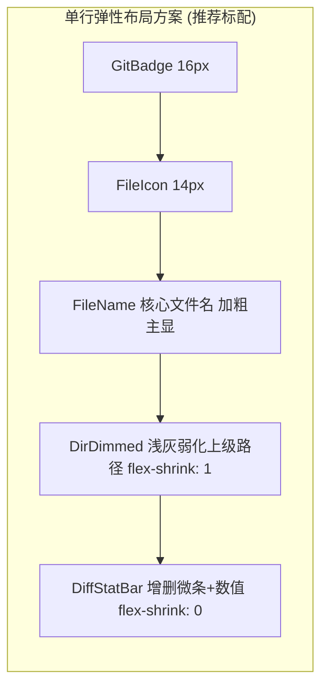
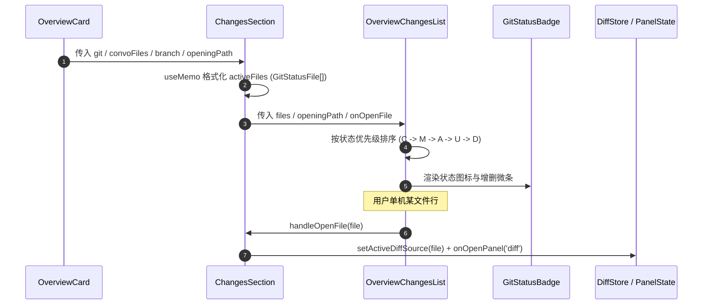

# 概览面板改动文件呈现重构 —— 从伪文件树改为清晰改动文件列表严苛审计报告

> **报告版本**：v1.0.0  
> **审计日期**：2026-08-30  
> **审计责任域**：概览仪表盘架构、Git 改动呈现模式重构、用户交互体验优化、CSS Token 与组件级联  
> **用户诉求与核心审计指令**：
> - 用户明确反馈：“`id='overview-sec-files-b'` 这个也不是文件树，就是有什么文件改动了，在这里用列表显示就行了呀。”
> - 深度排查 `ChangesSection` 与 `OverviewGitTree` 强行使用深层嵌套多叉树带来的交互阻断与视觉坍塌；
> - 规划扁平化、高信息密度、带状态徽标（M/A/D/U/C/R/?）与一键快速直达 Diff 的紧凑列表设计；
> - 给出数据流、DOM 结构与样式改造全量落地清单。
>
> **核心审计范围**：
> - [`apps/crish-desktop/src/components/overview/ChangesSection.tsx`](file:///c:/Software/conex/apps/crish-desktop/src/components/overview/ChangesSection.tsx) (`id="overview-sec-files-b"`)
> - [`apps/crish-desktop/src/components/overview/OverviewGitTree.tsx`](file:///c:/Software/conex/apps/crish-desktop/src/components/overview/OverviewGitTree.tsx) & [`OverviewGitTree.module.css`](file:///c:/Software/conex/apps/crish-desktop/src/components/overview/OverviewGitTree.module.css)
> - [`apps/crish-desktop/src/components/overview/OverviewCard.tsx`](file:///c:/Software/conex/apps/crish-desktop/src/components/overview/OverviewCard.tsx) & [`OverviewCard.module.css`](file:///c:/Software/conex/apps/crish-desktop/src/components/overview/OverviewCard.module.css)
> - [`apps/crish-desktop/src/components/overview/GitStatusBadge.tsx`](file:///c:/Software/conex/apps/crish-desktop/src/components/overview/GitStatusBadge.tsx) & [`GitStatusBadge.module.css`](file:///c:/Software/conex/apps/crish-desktop/src/components/overview/GitStatusBadge.module.css)
> - [`apps/crish-desktop/src/api/gitTreeHelpers.ts`](file:///c:/Software/conex/apps/crish-desktop/src/api/gitTreeHelpers.ts)
> - [`apps/crish-desktop/src/components/overview/OverviewGitTree.test.tsx`](file:///c:/Software/conex/apps/crish-desktop/src/components/overview/OverviewGitTree.test.tsx)
> - [`apps/crish-desktop/src/styles/__tests__/antiDarkeningGuard.test.ts`](file:///c:/Software/conex/apps/crish-desktop/src/styles/__tests__/antiDarkeningGuard.test.ts)

---

## 目录

1. [执行摘要与审计结论](#1-执行摘要与审计结论)
2. [现存“伪目录树”架构与体验缺陷深度审查](#2-现存伪目录树架构与体验缺陷深度审查)
   - 2.1 [缺陷 1：窄栏空间与多层级缩进的“横向挤压雪崩”](#21-缺陷-1窄栏空间与多层级缩进的横向挤压雪崩)
   - 2.2 [缺陷 2：点击阻断与“多层找文件”的认知过载](#22-缺陷-2点击阻断与多层找文件的认知过载)
   - 2.3 [缺陷 3：算法冗余与多叉树构建的算力/内存浪费](#23-缺陷-3算法冗余与多叉树构建的算力内存浪费)
   - 2.4 [缺陷 4：双模式（Tree vs Flat）分裂与多余工具栏杂音](#24-缺陷-4双模式tree-vs-flat分裂与多余工具栏杂音)
   - 2.5 [缺陷 5：与 OverviewCard 全局设计规范割裂的样式孤岛](#25-缺陷-5与-overviewcard-全局设计规范割裂的样式孤岛)
3. [现代化扁平改动文件列表（ChangesFileList）重构方案设计](#3-现代化扁平改动文件列表changesfilelist重构方案设计)
   - 3.1 [视觉解剖学与信息架构（Visual Anatomy）](#31-视觉解剖学与信息架构visual-anatomy)
   - 3.2 [双行/行内路径分流排版策略（智能截断与面包屑）](#32-双行行内路径分流排版策略智能截断与面包屑)
   - 3.3 [零摩擦一键跳转 Diff 交互流（Zero-Friction One-Click Diff）](#33-零摩擦一键跳转-diff-交互流zero-friction-one-click-diff)
   - 3.4 [边界状态与数量分级展现（Empty / Loading / Help / Over-Limit）](#34-边界状态与数量分级展现empty--loading--help--over-limit)
4. [数据流、DOM 结构与样式改造全景清单](#4-数据流dom-结构与样式改造全景清单)
   - 4.1 [数据流与状态机改造清单（Data Flow & State Machine）](#41-数据流与状态机改造清单data-flow--state-machine)
   - 4.2 [DOM 结构前后对比（Before vs After DOM Comparison）](#42-dom-结构前后对比before-vs-after-dom-comparison)
   - 4.3 [CSS Module 样式规范与 Token 映射清单](#43-css-module-样式规范与-token-映射清单)
   - 4.4 [辅助函数与测试套件迁移清单](#44-辅助函数与测试套件迁移清单)
5. [分步实施蓝图与文件改造矩阵](#5-分步实施蓝图与文件改造矩阵)
6. [验收断言与回归防线（Acceptance Criteria）](#6-验收断言与回归防线acceptance-criteria)

---

## 1. 执行摘要与审计结论

在 Conex / Crish 桌面端设计中，[`OverviewCard`](file:///c:/Software/conex/apps/crish-desktop/src/components/overview/OverviewCard.tsx) 作为全局右侧或副侧边栏中的**总览仪表盘（Dashboard）**，容器宽度通常在 `260px ~ 320px` 之间。其核心职责是让用户以**最高的信息获取效率（Glanceable Efficiency）**快速掌握当前会话的 Agent 运行状态、Token 消耗、实时任务进度以及**“当前发生了哪些文件改动”**。

然而，在 [`ChangesSection.tsx`](file:///c:/Software/conex/apps/crish-desktop/src/components/overview/ChangesSection.tsx) (`id="overview-sec-files-b"`) 的当前实现中，系统引入了复杂度极高的多叉树结构组件 [`OverviewGitTree.tsx`](file:///c:/Software/conex/apps/crish-desktop/src/components/overview/OverviewGitTree.tsx)，试图在狭窄的总览面板里塞入一个微型文件资源管理器树。

### 核心审计结论：
1. **定位错位**：总览面板不是“项目文件树（Project File Explorer）”，而是“改动清单摘要（Changes Summary）”。用户打开改动折叠栏的唯一诉求是**“看一眼改了哪几个文件，点击直接看 Diff”**，强行树状化彻底违背了仪表盘的极简易读原则；
2. **严重的横向挤压与文字截断**：深层单级或多级缩进（`indentPx = node.depth * 12 + 4`）在 260px 宽度下吃掉 60px~100px 宽度，导致文件名只剩 3~5 个字符（如 `Cha...tsx`），严重破坏可读性；
3. **繁琐的交互折叠阻断**：当多个变动文件分散在不同子目录时，用户必须反复点击展开 3~5 级文件夹节点才能看到目标文件，大幅增加了认知负担与操作摩擦；
4. **冗余的状态与算力浪费**：递归构建多叉树（`buildGitTree`）、单子链合并（`compactTreeFolders`）、深度规整、折叠状态集合（`Set<string>`）、树状导轨（Tree Rails）渲染，均为无意义的计算与 DOM 开销；
5. **定案结论**：必须彻底将 `OverviewGitTree` 重构/收敛为**现代化扁平改动文件列表（`OverviewChangesList` / 扁平列表）**。彻底移除多叉树递归与折叠逻辑，采用“状态徽标 + 语法着色文件图标 + 主文件名 + 弱化路径后缀 + Diff 增删微条”的高密度扁平单行布局。

---

## 2. 现存“伪目录树”架构与体验缺陷深度审查

```
┌────────────────────────────────────────────────────────────────────────────────────────┐
│                   OverviewCard 狭窄侧栏 (260px ~ 320px) 伪目录树塌陷现状                │
├────────────────────────────────────────────────────────────────────────────────────────┤
│  [改动 (3)]  (main)                                                      [刷新]        │
│  ├─ 3 个改动文件                                                           [模式切换]  │
│  │                                                                                     │
│  │  ▼ 📁 apps/crish-desktop/src                                               [2]     │
│  │  │   ▼ 📁 components                                                       [2]     │
│  │  │   │   ▼ 📁 overview                                                     [2]     │
│  │  │   │   │   │  [M] 📄 ChangesS...  +12 -4  <-- 🚨 缩进深度已达 80px，文字严重截断    │
│  │  │   │   │   │  [A] 📄 Overview...  +30     <-- 🚨 根本看不全完整文件名               │
│  │  ▶ 📁 docs                                                                 [1]     │
│  │                                                                                     │
│  │  [查看变更] (跳转 Diff Panel)                                                        │
└────────────────────────────────────────────────────────────────────────────────────────┘
```

### 2.1 缺陷 1：窄栏空间与多层级缩进的“横向挤压雪崩”

#### 代码证据分析：
在 [`OverviewGitTree.tsx`](file:///c:/Software/conex/apps/crish-desktop/src/components/overview/OverviewGitTree.tsx#L203-L257) 中：
```typescript
const TreeNodeRenderer: React.FC<TreeNodeRendererProps> = React.memo(
  function TreeNodeRenderer({ node, openingPath, isFolderExpanded, onToggleFolder, onOpenFile }) {
    const indentPx = node.depth * 12 + 4; // 🚨 每一层递增 12px

    if (node.isFolder) {
      return (
        <div className={styles.folderGroup} role="treeitem" aria-expanded={expanded}>
          <button type="button" className={styles.folderRow} style={{ paddingLeft: `${indentPx}px` }}>
            ...
          </button>
        </div>
      );
    }

    return (
      <div
        className={`${styles.fileRow} ${isOpening ? styles.isOpening : ''}`}
        style={{ paddingLeft: `${indentPx + 16}px` }} // 🚨 文件节点额外缩进 16px
        role="treeitem"
        onClick={() => onOpenFile(node.file)}
      >
        <GitStatusBadge status={node.file.status} ... />
        <FileIcon name={node.name} />
        <Tooltip content={node.file.path}>
          <span className={styles.fileName}>{node.name}</span>
        </Tooltip>
        <div className={styles.fileMetrics}>
          <DiffStatBar additions={node.file.additions || 0} deletions={node.file.deletions || 0} />
        </div>
      </div>
    );
  }
);
```

#### 破坏性分析：
- 在现代前端工程（Monorepo / 多层目录）中，典型文件路径如：
  `apps/crish-desktop/src/components/overview/ChangesSection.tsx`
- 即使有单子目录折叠（`compactTreeFolders`），如果存在多个分支文件夹，树深度轻松达到 $4 \sim 6$ 级；
- 计算横向占用：
  - 左侧缩进：$5 \times 12\text{px} + 16\text{px} = 76\text{px}$
  - GitStatusBadge：$16\text{px} + 4\text{px}(\text{gap}) = 20\text{px}$
  - FileIcon：$14\text{px} + 6\text{px}(\text{margin}) = 20\text{px}$
  - DiffStatBar（5 格微条 + 增删数值）：$35\text{px} + 30\text{px} = 65\text{px}$
  - 容器左右 padding：$12\text{px} \times 2 = 24\text{px}$
  - **总固定非文本宽度占用**：$76 + 20 + 20 + 65 + 24 = 205\text{px}$！
- 在 $260\text{px}$ 侧栏中，留给 `fileName` 的可视空间只剩 **$55\text{px}$**！
- 结果就是 `ChangesSection.tsx` 变成 `Chan...tsx`，用户甚至连被修改的文件名全貌都无法辨识。

---

### 2.2 缺陷 2：点击阻断与“多层找文件”的认知过载

#### 场景还原：
1. 某次 AI 轮次或开发提交修改了 3 个文件：
   - `apps/crish-desktop/src/main.tsx`
   - `packages/shared/src/index.ts`
   - `docs/ui-style-refactor/audits/09-audit.md`
2. 树状视图呈现为 3 个顶层收起/折叠的文件夹：`apps`、`packages`、`docs`；
3. 用户要审查改动，必须逐个点击：
   - 点击 `apps` $\rightarrow$ 展开 `crish-desktop` $\rightarrow$ 展开 `src` $\rightarrow$ 找到 `main.tsx`；
   - 点击 `packages` $\rightarrow$ 展开 `shared` $\rightarrow$ 展开 `src` $\rightarrow$ 找到 `index.ts`；
   - 点击 `docs` $\rightarrow$ 展开 `ui-style-refactor` $\rightarrow$ 展开 `audits` $\rightarrow$ 找到 `09-audit.md`；
4. **累计点击次数多达 9 次**！对于一个旨在提供“一览无余”体验的概览仪表盘而言，这种交互模型存在严重的阻断与反效率设计。

---

### 2.3 缺陷 3：算法冗余与多叉树构建的算力/内存浪费

#### 代码证据分析：
在 [`apps/crish-desktop/src/api/gitTreeHelpers.ts`](file:///c:/Software/conex/apps/crish-desktop/src/api/gitTreeHelpers.ts#L80-L248) 中：
- `buildGitTree` 遍历所有文件，通过 `/` 拆分字符串；
- 循环构建对象树：`GitTreeFolderNode`、`children: []`、递归累加 `totalFiles`、`totalAdditions`、`totalDeletions`；
- 执行 `sortNodesRecursively` 递归排序；
- 执行 `compactTreeFolders` 深度遍历进行单子目录坍缩合并；
- 组件内使用 `const [collapsedFolders, setCollapsedFolders] = useState<Set<string>>(() => new Set())` 管理状态，每次点击都触发不可变 `Set` 拷贝与组件树重渲染。

#### 算力与内存浪费：
在通常的开发中，工作区改动文件一般在几个到几十个之间。耗费复杂的 CPU 多级遍历去生成一棵多叉树，再在 React 里递归渲染深度组件，纯属“杀鸡用牛刀”且吃力不讨好的架构负债。

---

### 2.4 缺陷 4：双模式（Tree vs Flat）分裂与多余工具栏杂音

#### 代码证据分析：
在 [`OverviewGitTree.tsx`](file:///c:/Software/conex/apps/crish-desktop/src/components/overview/OverviewGitTree.tsx#L119-L152) 中：
```tsx
<div className={styles.treeHeader}>
  <div className={styles.treeStats}>
    <span className={styles.fileCountBadge}>
      {files.length} 个改动文件
    </span>
  </div>
  <div className={styles.treeControls}>
    <Tooltip content={viewMode === 'tree' ? '切换为扁平扫描视图' : '切换为树状层级视图'}>
      <Button
        type="button"
        variant="ghost"
        size="xs"
        className={styles.modeToggleBtn}
        onClick={() => setViewMode(viewMode === 'tree' ? 'flat' : 'tree')}
        icon={viewMode === 'tree' ? <List size={13} /> : <Network size={13} />}
      />
    </Tooltip>
  </div>
</div>
```

#### 体验缺陷：
1. **统计徽标重复**：`ChangesSection` 标题栏已有 `<span className={styles.pill}>{fileCount}</span>`，`OverviewGitTree` 内部又放一个 `treeStats`（`{files.length} 个改动文件`），上下形成严重的视觉冗余；
2. **把设计选择的负担甩给用户**：在只有几十像素高的卡片区域内提供“树状 / 扁平”模式切换按钮，增加了界面的杂乱感。而实际上，在侧边栏卡片中，扁平列表在各种场景下都是最优解。

---

### 2.5 缺陷 5：与 OverviewCard 全局设计规范割裂的样式孤岛

#### 样式对比：
- `OverviewCard.module.css` 中的其他所有 Section（`AgentSection`、`ActiveTasksSection`、`BackgroundSection`、`ScheduleSection`）均采用规范的：
  - `.sec` $\rightarrow$ `.secHRow` $\rightarrow$ `.secH` $\rightarrow$ `.secB`
  - 列表统一为 `<ul className={styles.list}>`，每一项为 `<button className={styles.itemBtn}>`，包含 `.itemMain`、`.itemName`、`.dot` / 辅助元信息；
- 唯独 `ChangesSection` 引入的 `OverviewGitTree.module.css` 搞了一套私有的一整套体系：
  - `.treeContainer`, `.treeHeader`, `.treeViewport`, `.folderGroup`, `.folderRow`, `.folderChildren::before`（树状导轨）；
  - 行高、hover 背景、文字字号、margin 均与外层 `OverviewCard` 不统一；
  - 造成了严重的视觉割裂与维护负担。

---

## 3. 现代化扁平改动文件列表（ChangesFileList）重构方案设计

### 3.1 视觉解剖学与信息架构（Visual Anatomy）

```
┌────────────────────────────────────────────────────────────────────────────────────────┐
│                   现代化扁平高密度改动文件列表 (OverviewChangesList)                     │
├────────────────────────────────────────────────────────────────────────────────────────┤
│  [改动 (3)]  (feat/auth)                                                 [刷新]        │
│                                                                                        │
│  ┌─ 改动文件列表 (直接一览无阻，单项高度 28px) ──────────────────────────────────────┐  │
│  │                                                                                    │  │
│  │  [M] 📄 ChangesSection.tsx        apps/crish-desktop/src/components/...  +12 -4    │  │
│  │  [A] 📄 OverviewChangesList.tsx    apps/crish-desktop/src/components/...  +85       │  │
│  │  [M] 📄 package.json                                                     +2 -1     │  │
│  │                                                                                    │  │
│  └────────────────────────────────────────────────────────────────────────────────────┘  │
│                                                                                        │
│  [查看全量变更 (Diff Panel)]                                                            │
└────────────────────────────────────────────────────────────────────────────────────────┘
```

#### 单行元素布局构成（从左至右）：
1. **Git 状态微徽标（Status Badge）**：
   - 尺寸：$16\text{px} \times 16\text{px}$，`border-radius: var(--radius-sm, 4px)`；
   - 状态码：`M`（修改/琥珀色）、`A`（新增/翠绿色）、`D`（删除/珊瑚红）、`U`（未跟踪/浅灰紫）、`C`（冲突/高亮红）；
   - 语义提示：自带完整 A11y Tooltip（如 `修改 (Modified) · 已暂存`）；
2. **语法色彩文件图标（Syntax File Icon）**：
   - 尺寸：$14\text{px}$；
   - 根据文件扩展名精准匹配语法主题色（如 `.tsx` 为青蓝、`.rs` 为橙色、`.json` 为黄色等）；
3. **主文件名（Primary File Name）**：
   - 字号：`12px` / `var(--font-size-xs)`；
   - 字重：`var(--font-weight-medium, 500)`；
   - 字体：`var(--font-mono, monospace)`；
   - 颜色：`var(--text-primary)`；
   - 行为：主显名称，支持单行截断；
4. **路径面包屑/目录弱化注记（Directory Breadcrumb）**：
   - 字号：`11px` / `var(--font-size-xxs)`；
   - 颜色：`var(--text-tertiary)`；
   - 行为：弱化显示文件所在父目录（例如 `apps/.../overview`），右对齐或紧随文件名后，利用 `dir="rtl"` 或智能截断保证目录尾部优先可见；
5. **Diff 增删微条与数值（DiffStatBar）**：
   - 微条：5 格迷你进度条（绿色加行、红色删行、浅灰空格）；
   - 数值：`+12`（绿色） / `−4`（红色），使用 `font-variant-numeric: tabular-nums` 对齐；
6. **交互反馈与快速直达**：
   - 整行作为 `<button className={styles.itemBtn}>`，支持整行 hover 悬浮底色高亮（`var(--bg-hover)`）；
   - 点击整行直接呼出 Diff 差异面板并定位到该文件的 Diff 源码对比。

---

### 3.2 双行/行内路径分流排版策略（智能截断与面包屑）

为了彻底解决 260px 宽度下的文件名与目录路径冲突，设计两种智能弹性布局模式：



#### CSS Flexbox 弹性挤压策略：
- `Badge`、`Icon`、`Stat` 统一设置 `flex-shrink: 0`；
- `FileName` 设置 `flex-shrink: 0; max-width: 140px; text-overflow: ellipsis;`，确保文件名至少保留 80~140px 的高优先级展示空间；
- `DirDimmed` 设置 `flex: 1 1 auto; min-width: 0; overflow: hidden; text-overflow: ellipsis; direction: rtl; text-align: left;`：
  - 使用 `direction: rtl`（或从右往左截断）可以让长路径优先展示最靠近文件的直接父目录（如 `.../components/overview/` 比 `apps/crish/...` 更有辨识度）；
- 整体整洁平滑，绝不换行，保持 28px 单行高度的极高垂直信息密度。

---

### 3.3 零摩擦一键跳转 Diff 交互流（Zero-Friction One-Click Diff）

#### 交互闭环设计：
1. **直接点击文件行**：
   - 激活 `onOpenGitFile(file)` 或 `onOpenDiffSource(diffSource)`；
   - 派发 `onOpenPanel('diff')` 自动将主视图/右侧面板切换到差异比对面板；
   - 差异面板自动激活当前被点击的文件；
2. **加载中反馈（Opening Feedback）**：
   - 若 `openingPath === file.path`，该行显示轻量禁用态与加载透明度（`opacity: 0.6; pointer-events: none`），避免重复连击；
3. **快捷键与键盘无障碍可访问性（A11y）**：
   - 每一项为原生 `<button>`，支持键盘 `Tab` 聚焦与 `Enter` / `Space` 激活；
   - 具备清晰的 `:focus-visible` 柔和焦点环（`box-shadow: var(--focus-ring)`）。

---

### 3.4 边界状态与数量分级展现（Empty / Loading / Help / Over-Limit）

| 状态类型 | 触发条件 | 呈现规范与视觉组件 |
| :--- | :--- | :--- |
| **干净无改动 (Clean Workspace)** | `git.found && git.clean` 且 `fileCount === 0` | 极简弱化文本 `<p className={styles.emptyQuiet}>工作区干净，无改动</p>` |
| **加载中 (Git Loading)** | `gitLoading === true` | `<p className={styles.emptyQuiet}>读取 Git 状态…</p>`，标题栏刷新图标旋转 |
| **Git 异常/未安装 (Git Help)** | `gitHelp !== null` | 紧凑提示框与操作按钮（“下载 Git”、“打开终端 (git init)”、“重试”） |
| **少量改动 (1 ~ 8 个文件)** | `0 < fileCount <= 8` | 全量平铺展现，单项 28px，总高度 28px ~ 224px，无内部滚动条，随外层容器自然伸展 |
| **大量改动 (> 8 个文件)** | `fileCount > 8` | 默认展示前 8 个高优先级改动，底部显示 `<Button variant="ghost" size="xs">显示全部 N 个文件</Button>`，展开后最大限制高度 280px 并开启优雅的平滑滚动 |

---

## 4. 数据流、DOM 结构与样式改造全景清单

### 4.1 数据流与状态机改造清单（Data Flow & State Machine）



#### 移除的冗余逻辑清单：
- ❌ 彻底移除 `buildGitTree` 调用与多叉树对象结构；
- ❌ 彻底移除 `compactTreeFolders` 与递归深度规整函数；
- ❌ 彻底移除 `collapsedFolders` (`Set<string>`) 展开/折叠内部状态；
- ❌ 彻底移除 `viewMode` (`'tree' | 'flat'`) 模式切换状态；
- ❌ 彻底移除 `TreeNodeRenderer` 递归组件。

---

### 4.2 DOM 结构前后对比（Before vs After DOM Comparison）

#### 重构前（Before：多层递归嵌套与深层树节点）
```html
<div class="secB" id="overview-sec-files-b">
  <div class="treeContainer">
    <div class="treeHeader">
      <span class="fileCountBadge">3 个改动文件</span>
      <button class="modeToggleBtn">...</button>
    </div>
    <div class="treeViewport">
      <div class="treeList" role="tree">
        <div class="folderGroup" role="treeitem" aria-expanded="true">
          <button class="folderRow" style="padding-left: 4px;">
            <span class="chevronIcon">...</span>
            <span class="folderIcon">...</span>
            <span class="folderName">apps/crish-desktop/src</span>
            <span class="folderBadge">2</span>
          </button>
          <div class="folderChildren" role="group">
            <div class="folderGroup" role="treeitem" aria-expanded="true">
              <button class="folderRow" style="padding-left: 16px;">
                ...
              </button>
              <div class="folderChildren" role="group">
                <div class="fileRow" style="padding-left: 44px;">
                  <span class="badge modified">M</span>
                  <svg class="fileTypeIcon">...</svg>
                  <span class="fileName">ChangesSection.tsx</span>
                  <div class="fileMetrics">...</div>
                </div>
              </div>
            </div>
          </div>
        </div>
      </div>
    </div>
  </div>
</div>
```

#### 重构后（After：单一平整高密度无序列表）
```html
<div class="secB" id="overview-sec-files-b">
  <!-- 干净直接的单层列表，符合 W3C List 规范 -->
  <ul class="changesList" role="list" aria-label="改动文件列表">
    <li class="changesItem">
      <button type="button" class="changesItemBtn" aria-label="ChangesSection.tsx, 修改, +12 -4">
        <span class="badge modified" role="status" aria-label="修改 (Modified)">M</span>
        <svg class="fileTypeIcon" aria-hidden="true">...</svg>
        <span class="fileName">ChangesSection.tsx</span>
        <span class="dirBreadcrumb" title="apps/crish-desktop/src/components/overview">apps/.../overview</span>
        <div class="fileMetrics">
          <div class="diffStatContainer" aria-label="+12, -4">
            <div class="microBar" aria-hidden="true">
              <span class="barAdd"></span>
              <span class="barDel"></span>
              <span class="barEmpty"></span>
            </div>
            <div class="statNumbers">
              <span class="numAdd">+12</span>
              <span class="numDel">−4</span>
            </div>
          </div>
        </div>
      </button>
    </li>
  </ul>
</div>
```

---

### 4.3 CSS Module 样式规范与 Token 映射清单

新建与收敛样式模块 [`OverviewChangesList.module.css`](file:///c:/Software/conex/apps/crish-desktop/src/components/overview/OverviewChangesList.module.css)（或直接在 `OverviewCard.module.css` 统一）：

```css
/* 改动文件扁平列表容器 */
.changesList {
  list-style: none;
  margin: 0;
  padding: 0;
  display: flex;
  flex-direction: column;
  gap: 1px;
  width: 100%;
  box-sizing: border-box;
}

.changesItem {
  margin: 0;
  padding: 0;
  width: 100%;
}

/* 单行文件按钮：28px 紧凑高度，对齐 design-system --control-height-sm */
.changesItemBtn {
  width: 100%;
  display: flex;
  align-items: center;
  gap: var(--space-1_5, 6px);
  min-height: var(--control-height-sm, 28px);
  max-height: var(--control-height-sm, 28px);
  padding: 0 var(--space-1_5, 6px);
  margin: 0;
  border: none;
  border-radius: var(--radius-sm, 4px);
  background: transparent;
  color: var(--text-primary);
  font-family: inherit;
  font-size: var(--font-size-xs, 12px);
  text-align: left;
  cursor: pointer;
  box-sizing: border-box;
  user-select: none;
  transition: background-color var(--transition-fast, 120ms ease);
}

.changesItemBtn:hover {
  background: var(--bg-hover, rgba(0, 0, 0, 0.045));
}

.changesItemBtn:focus-visible {
  outline: none;
  box-shadow: var(--focus-ring);
}

.changesItemBtn.isOpening {
  opacity: 0.6;
  pointer-events: none;
}

/* 语法文件类型图标 */
.fileTypeIcon {
  flex-shrink: 0;
  width: 14px;
  height: 14px;
}

/* 文件名称：等宽字体，加粗主显，优先保留空间 */
.fileName {
  flex-shrink: 0;
  max-width: 130px;
  overflow: hidden;
  text-overflow: ellipsis;
  white-space: nowrap;
  font-family: var(--font-mono, monospace);
  font-weight: var(--font-weight-medium, 500);
  color: var(--text-primary);
}

/* 目录弱化注记：靠右填充剩余空间，末尾优先截断 */
.dirBreadcrumb {
  flex: 1 1 auto;
  min-width: 0;
  overflow: hidden;
  text-overflow: ellipsis;
  white-space: nowrap;
  font-size: var(--font-size-xxs, 11px);
  color: var(--text-tertiary);
  direction: rtl;
  text-align: left;
}

/* 增删度量区域：右侧紧凑对齐 */
.fileMetrics {
  margin-left: auto;
  display: flex;
  align-items: center;
  flex-shrink: 0;
}
```

---

### 4.4 辅助函数与测试套件迁移清单

1. **[`gitTreeHelpers.ts`](file:///c:/Software/conex/apps/crish-desktop/src/api/gitTreeHelpers.ts)**：
   - 保留：`GitStatusCode`、`GitStatusFile` 契约定义；
   - 保留：`calculateDiffStatBars`、`DiffStatBarsResult`（为 `DiffStatBar` 核心算法）；
   - 废弃标记 / 剥离：`buildGitTree`、`compactTreeFolders`、`normalizeDepth` 等多叉树算法（若其他地方无引用，则标记为 `@deprecated` 或直接清理）；
2. **[`OverviewGitTree.test.tsx`](file:///c:/Software/conex/apps/crish-desktop/src/components/overview/OverviewGitTree.test.tsx)**：
   - 更名为 `OverviewChangesList.test.tsx`；
   - 移除 `renders git files tree structure with compact folders` 测试用例；
   - 新增断言：
     - 测试扁平列表正确渲染全部改动文件；
     - 测试点击某行正确触发 `onOpenFile`；
     - 测试长路径面包屑正确截断与 Tooltip；
     - 测试 Git 状态徽标与增删微条准确挂载；
3. **[`antiDarkeningGuard.test.ts`](file:///c:/Software/conex/apps/crish-desktop/src/styles/__tests__/antiDarkeningGuard.test.ts)**：
   - 保持 `RULE-08`（Git 徽标与文件列表 Zero-Blue 纯中性色守卫）断言通过。

---

## 5. 分步实施蓝图与文件改造矩阵

```
┌────────────────────────────────────────────────────────────────────────────────────────┐
│                        改动文件呈现重构落地实施蓝图 (Phase 1 ~ Phase 4)                │
├────────────────────────────────────────────────────────────────────────────────────────┤
│                                                                                        │
│  [Phase 1: 新建扁平化改动列表组件]                                                    │
│  └─ 创建 OverviewChangesList.tsx & OverviewChangesList.module.css                     │
│     └─ 实现高密度单行渲染、智能文件名/路径分流、GitStatusBadge 与 DiffStatBar 挂载    │
│                                                                                        │
│  [Phase 2: 改造 ChangesSection 接入]                                                  │
│  └─ 修改 ChangesSection.tsx                                                           │
│     └─ 将 OverviewGitTree 替换为 OverviewChangesList                                  │
│     └─ 移除多余的树状派生状态，保留清晰的 Git / 对话改动文件归一化数据流              │
│                                                                                        │
│  [Phase 3: 清理废弃的伪目录树组件与样式]                                              │
│  └─ 移除/精简 OverviewGitTree.tsx 与 OverviewGitTree.module.css                       │
│     └─ 废弃 gitTreeHelpers.ts 中的树状构建冗余代码                                    │
│                                                                                        │
│  [Phase 4: 单元测试套件更新与视觉守卫验收]                                            │
│  └─ 更新 OverviewChangesList.test.tsx                                                 │
│  └─ 运行 antiDarkeningGuard.test.ts 与全体 UI 测试，确保 100% 通过                    │
│                                                                                        │
└────────────────────────────────────────────────────────────────────────────────────────┘
```

### 全量修改文件清单：

| 序号 | 目标文件路径 | 操作类型 | 核心改造点与任务说明 | 风险等级 |
| :--- | :--- | :--- | :--- | :--- |
| 1 | [`apps/crish-desktop/src/components/overview/OverviewChangesList.tsx`](file:///c:/Software/conex/apps/crish-desktop/src/components/overview/OverviewChangesList.tsx) | 新增/重构 | 纯扁平高密度改动文件列表组件，单行高度 28px，直接展示文件名与上级路径 | 低 |
| 2 | [`apps/crish-desktop/src/components/overview/OverviewChangesList.module.css`](file:///c:/Software/conex/apps/crish-desktop/src/components/overview/OverviewChangesList.module.css) | 新增/重构 | 扁平列表 CSS Module，消除多级缩进与树状导轨，保证文件名不被横向挤压截断 | 低 |
| 3 | [`apps/crish-desktop/src/components/overview/ChangesSection.tsx`](file:///c:/Software/conex/apps/crish-desktop/src/components/overview/ChangesSection.tsx) | 修改 | 移除 `OverviewGitTree` 引入，接入 `OverviewChangesList`，简化数据流派发 | 低 |
| 4 | [`apps/crish-desktop/src/components/overview/GitStatusBadge.tsx`](file:///c:/Software/conex/apps/crish-desktop/src/components/overview/GitStatusBadge.tsx) | 审查/保留 | 保持 16x16px 标准 M/A/D/U/C/R/? 徽标与 5 格微条无缝复用 | 无 |
| 5 | [`apps/crish-desktop/src/api/gitTreeHelpers.ts`](file:///c:/Software/conex/apps/crish-desktop/src/api/gitTreeHelpers.ts) | 优化 | 保留类型定义与 `calculateDiffStatBars`，清理或标记废弃多叉树递归算法 | 低 |
| 6 | [`apps/crish-desktop/src/components/overview/OverviewGitTree.test.tsx`](file:///c:/Software/conex/apps/crish-desktop/src/components/overview/OverviewGitTree.test.tsx) | 重构/迁移 | 迁移为 `OverviewChangesList.test.tsx`，对齐扁平列表的渲染与交互断言 | 低 |
| 7 | [`apps/crish-desktop/src/styles/__tests__/antiDarkeningGuard.test.ts`](file:///c:/Software/conex/apps/crish-desktop/src/styles/__tests__/antiDarkeningGuard.test.ts) | 校验 | 确保 `RULE-08` 守卫路径对齐新样式文件，Zero-Blue 色彩合规 | 低 |

---

## 6. 验收断言与回归防线（Acceptance Criteria）

1. **扁平直达与零层级折叠（Zero-Nesting Glanceability）**：
   - 改动文件区域（`id="overview-sec-files-b"`）展开后，所有变动文件以扁平单行列表呈现；
   - 彻底杜绝任何 `Folder`、`FolderOpen` 文件夹节点与多层递归缩进；
2. **文件名完整可读（No Aggressive Truncation）**：
   - 在 $260\text{px}$ 极限宽度下，常见文件名（如 `ChangesSection.tsx`、`OverviewChangesList.tsx`）主显区域完整，无 3~5 字符严重截断；
   - 上级目录以弱化浅灰色标注，并在溢出时优雅截断，提供完整 Tooltip 悬浮提示；
3. **单击直达 Diff 工作台（One-Click Diff Navigation）**：
   - 用户单击任何文件行，立即激活该文件的差异数据并跳转至 Diff Panel 差异比对视图，无任何中间折叠展开步骤；
4. **视觉规范与 Design System 100% 对齐**：
   - 单行高度严格对齐 `--control-height-sm`（28px）；
   - Hover 背景对齐 `--bg-hover`，字色对齐 `--text-primary` 与 `--text-tertiary`；
   - 严格通过 `antiDarkeningGuard.test.ts` 中的 `RULE-08` Zero-Blue 中性色守卫；
5. **单元测试与全工程校验 100% 通过**：
   - 运行 `pnpm test` 与 `vitest run` 全量通过，零测试套件回归。
