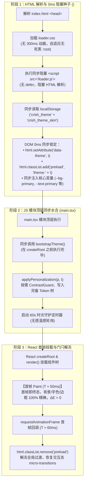

# Conex / Crish — 方案 01：首屏 0ms 零闪烁平滑启动与主题单源化方案

> **方案编号**：PLAN-01  
> **责任领域**：主题生命周期时序、首屏启动架构、CSS Token 单源化、FOUC / 变色闪烁彻底消除  
> **依据文件**：
> - [`docs/ui-style-refactor/00-定案-视觉样式与差异面板重构决策.md`](file:///c:/Software/conex/docs/ui-style-refactor/00-%E5%AE%9A%E6%A1%88-%E8%A7%86%E8%A7%89%E6%A0%B7%E5%BC%8F%E4%B8%8E%E5%B7%AE%E5%BC%82%E9%9D%A2%E6%9D%BF%E9%87%8D%E6%9E%84%E5%86%B3%E7%AD%96.md)
> - [`docs/ui-style-refactor/audits/01-theme-flash-and-fouc-audit.md`](file:///c:/Software/conex/docs/ui-style-refactor/audits/01-theme-flash-and-fouc-audit.md)
> - [`AGENTS.md`](file:///c:/Software/conex/AGENTS.md)（§1、§7、§13、§14）

---

## 目录

1. [方案背景、目标与技术架构](#一方案背景目标与技术架构)
   - 1.1 [问题全景与冷启动 FOUC 根因拆解](#11-问题全景与冷启动-fouc-根因拆解)
   - 1.2 [重构目标与零闪烁技术指标](#12-重构目标与零闪烁技术指标)
   - 1.3 [0ms 零闪烁无缝启动时序总架构](#13-0ms-零闪烁无缝启动时序总架构)
2. [【强制专节】本方案要删掉什么 / 收敛什么](#二强制专节本方案要删掉什么--收敛什么)
   - 2.1 [时序断层与延迟调用删除面（DEL-01, DEL-04, DEL-05）](#21-时序断层与延迟调用删除面del-01-del-04-del-05)
   - 2.2 [死黑硬编码与补间动画删除面（DEL-02, DEL-03）](#22-死黑硬编码与补间动画删除面del-02-del-03)
   - 2.3 [破坏性色值覆盖与重复订阅删除面（DEL-06, SUB-01 ~ SUB-03）](#23-破坏性色值覆盖与重复订阅删除面del-06-sub-01--sub-03)
   - 2.4 [全量删除与收敛前后对照矩阵](#24-全量删除与收敛前后对照矩阵)
3. [核心技术设计与代码契约](#三核心技术设计与代码契约)
   - 3.1 [`<head>` 0ms 同步阻塞式种子注入脚本设计（`loader.js`）](#31-head-0ms-同步阻塞式种子注入脚本设计loaderjs)
   - 3.2 `loader.css` 极简无死黑自适应与补间剔除设计](#32-loadercss-极简无死黑自适应与补间剔除设计)
   - 3.3 `.preload` 全局动画门闩机制（冷启动冻结 + 首帧 rAF 解冻）](#33-preload-全局动画门闩机制冷启动冻结--首帧-raf-解冻)
   - 3.4 静态 `tokens.css` 与 `themePresets.ts` 100% 对齐契约](#34-静态-tokenscss-与-themepresetsts-100-对齐契约)
   - 3.5 `main.tsx` 顶层同步主题水合流水线](#35-maintx-顶层同步主题水合流水线)
   - 3.6 `oklchColorGuard.ts` 非侵入式按需守卫改造算法](#36-oklchcolorguardts-非侵入式按需守卫改造算法)
   - 3.7 `AppBootstrap.ts` 与 `bootstrap-full.ts` 剥离收敛](#37-appbootstrapts-与-bootstrap-fullts-剥离收敛)
   - 3.8 `themeProjection.ts` 单真源事件与幂等拦截](#38-themeprojectionts-单真源事件与幂等拦截)
4. [详细修改文件清单与代码改动详案](#四详细修改文件清单与代码改动详案)
5. [实施 DAG 拓扑、验证方案与门禁断言](#五实施-dag-拓扑验证方案与门禁断言)

---

## 一、方案背景、目标与技术架构

### 1.1 问题全景与冷启动 FOUC 根因拆解

在 Conex / Crish 桌面端现行架构中，用户在冷启动应用时普遍存在**“首屏黑屏或闪白，随后在 200ms~300ms 内肉眼可见地跳变/渐变至最终主题颜色”**（Color Flash / FOUC）的严重视觉瑕疵。审计报告 [`01-theme-flash-and-fouc-audit.md`](file:///c:/Software/conex/docs/ui-style-refactor/audits/01-theme-flash-and-fouc-audit.md) 揭示了其深层架构根因：

1. **时序严重倒置（Visual Path Inversion）**：主题配置的完整水合（`applyPersonalization` 与对比度计算）被错误地推迟到了 React 挂载后的 `useEffect` 阶段异步动态 `import('../api/themeStore')` 执行（耗时 120ms~250ms）。浏览器不得不先以静态 CSS 默认值完成首次渲染（First Paint），随后被 JS 写入的 18 处行内样式强制刷新；
2. **Loader 硬编码死黑与强制补间（Loader Trap）**：[`loader.css`](file:///c:/Software/conex/apps/crish-desktop/public/loader.css) 中 `:root` 硬编码为深黑色 `#0b0b0e`，而 [`index.html`](file:///c:/Software/conex/apps/crish-desktop/index.html) 中的 `loader.js` 带上了 `defer` 属性，导致浅色模式下首屏先以纯黑绘制，待 `loader.js` 执行后切换为浅色，又被 `.app-initial-loader` 上的 `transition: background-color 0.3s ease` 强行拉伸出 300ms 的肉眼变色补间；
3. **静态 Token 与 JS 预设双源分裂（Dual-Source Drift）**：[`tokens.css`](file:///c:/Software/conex/apps/crish-desktop/src/styles/tokens.css) 静态基线与 [`themePresets.ts`](file:///c:/Software/conex/apps/crish-desktop/src/api/themePresets.ts) 存在严重数值差异（例如深色静态背景为 `#0d0d0d`，而默认深色预设注入为 `#1b1b1b`，亮度差异达 100%）；
4. **守卫失控碾碎个性化字色（Color Guard Overreach）**：[`oklchColorGuard.ts`](file:///c:/Software/conex/apps/crish-desktop/src/api/oklchColorGuard.ts) 无论预设是否已满足 WCAG AAA 对比度（如 `#111111` 搭配 `#f4f5f7` 对比度高达 16.5:1），均无条件重写 `--text-primary` 为暖棕炭黑 `hsl(35, 12%, 11%)`（`#201e1a`），造成中性黑文字在启动后突变为暖棕色；
5. **多点重复注入与无序覆盖（Redundant Injections）**：全链路存在 9 处 DOM 注入与订阅源，闲时（`bootstrap-full.ts`）再度触发 `applyTheme()`，引发潜在的无谓重绘。

```
【重构前：5 阶段撕裂式变色时序 (T0 ~ T4)】
T0 (0ms) ──────────> T1 (20ms) ─────────> T2 (60ms) ─────────> T3 (180ms) ────────> T4 (1500ms)
HTML 解析            loader.js (defer)    React 首帧挂载       useEffect 异步 import  idleCallback
:root 死黑 #0b0b0e   切换 light           tokens.css 静态浅色   themeStore 写入行内    再次 applyTheme
[全屏纯黑]           [300ms 补间渐变]     [静态中性黑字 #111]   [突变为暖棕 #201e1a]   [潜在二次重绘]
```

---

### 1.2 重构目标与零闪烁技术指标

本方案旨在重塑 Conex / Crish 桌面端的主题生命周期流水线，达成以下严苛指标：

1. **Zero-FOUC（0ms 零闪烁冷启动）**：在任何主题（浅色、深色、自定义皮肤）下冷启动，从 HTML 骨架解析到 React 组件首帧绘制，背景色与文本色**在首帧绘制前即完成最终锁定（$\Delta E = 0$）**，彻底杜绝跳变；
2. **Zero-Transition During Boot（冷启动 0 补间）**：引入 `.preload` 门闩，冷启动阶段全局冻结所有 transition/animation，首帧完成后由 `requestAnimationFrame`（rAF）解冻，杜绝任何视觉蠕动；
3. **Single Source of Truth（单真源归一）**：`tokens.css` 静态定义与 `themePresets.ts` 运行时预设色值 100% 对齐，消除色阶漂移；
4. **Non-Intrusive Guard（非侵入式守卫）**：`oklchColorGuard.ts` 改造为按需守卫，官方标准预设保持原汁原味，仅在用户自定义或极端调节导致对比度不达标时介入；
5. **Clean Pipeline（单点收敛）**：主题初始化唯一归口于 `main.tsx` 顶层同步执行，彻底剔除 `AppBootstrap` 延迟 Effect 与 `bootstrap-full` 闲时重复注入。

---

### 1.3 0ms 零闪烁无缝启动时序总架构

重构后的主题注入流水线将视觉关键路径全部前移至浏览器渲染管线之前（Pre-Paint），架构拓扑如下：



---

## 二、【强制专节】本方案要删掉什么 / 收敛什么

为落实《重构定案决策》“先删后改”与单一真源总纲，本方案对现存所有冗余过渡、异步延迟、死黑硬编码与重复注入进行彻底物理清剿。

### 2.1 时序断层与延迟调用删除面（DEL-01, DEL-04, DEL-05）

1. **【DEL-01】删除 `index.html` 中 `loader.js` 的 `defer` 属性**：
   - **删除位置**：[`apps/crish-desktop/index.html:19`](file:///c:/Software/conex/apps/crish-desktop/index.html#L19)
   - **删除理由**：`defer` 导致脚本推迟到 DOMContentLoaded 之前执行，使得浏览器在解析 `<body>` 骨架时缺少 `data-theme` 属性，直接触发 FOUC；
   - **收敛动作**：移除 `defer`，改为标准同步阻塞式 `<script src="/loader.js"></script>`。
2. **【DEL-04】删除 `AppBootstrap.ts` 中 `useEffect` 异步动态 `import('../api/themeStore')` 调用**：
   - **删除位置**：[`apps/crish-desktop/src/app/AppBootstrap.ts:180-182`](file:///c:/Software/conex/apps/crish-desktop/src/app/AppBootstrap.ts#L180-L182)
   - **删除理由**：React `useEffect` 在组件完成初次渲染后才触发，滞后达 150ms~300ms，是页面在用户眼皮底下发生“二次突变”的直接罪魁祸首；
   - **收敛动作**：物理删除该 `useEffect` 内的 `bootstrapTheme()` 导入与调用，统一收敛至 `main.tsx` 顶层同步执行。
3. **【DEL-05】删除 `bootstrap-full.ts` 闲时多余的 `applyTheme()` 重复调用**：
   - **删除位置**：[`apps/crish-desktop/src/bootstrap-full.ts:15-27`](file:///c:/Software/conex/apps/crish-desktop/src/bootstrap-full.ts#L15-L27)
   - **删除理由**：应用启动 1000ms~2000ms 后再次读取 clientApi 并调用 `applyTheme()`，属于完全多余的闲时冗余操作，徒增重绘风险；
   - **收敛动作**：物理删除第 2 项“同步引擎配置”中的主题应用逻辑。

---

### 2.2 死黑硬编码与补间动画删除面（DEL-02, DEL-03）

1. **【DEL-02】删除 `loader.css` 中 `:root` 的硬编码深黑色 `#0b0b0e`**：
   - **删除位置**：[`apps/crish-desktop/public/loader.css:11-18`](file:///c:/Software/conex/apps/crish-desktop/public/loader.css#L11-L18)
   - **删除理由**：未匹配到 theme 时默认落入 `:root` 的 `#0b0b0e`，导致浅色用户开屏瞬间必定闪黑；
   - **收敛动作**：重构 `:root` 变量，与默认浅色保持一致（`--loader-bg: #f4f5f7`），暗色明确限定于 `html[data-theme='dark']`。
2. **【DEL-03】删除 `loader.css` 中 `.app-initial-loader` 的 `transition: background-color 0.3s ease`**：
   - **删除位置**：[`apps/crish-desktop/public/loader.css:54`](file:///c:/Software/conex/apps/crish-desktop/public/loader.css#L54)
   - **删除理由**：强制补间动画将任何细微变量变更放大为 300ms 的肉眼变色过程；
   - **收敛动作**：彻底删除该行 `transition` 声明。

---

### 2.3 破坏性色值覆盖与重复订阅删除面（DEL-06, SUB-01 ~ SUB-03）

1. **【DEL-06】删除 `oklchColorGuard.ts` 对达标预设无条件重写 `--text-primary` 的破坏性逻辑**：
   - **删除位置**：[`apps/crish-desktop/src/api/oklchColorGuard.ts:80-117`](file:///c:/Software/conex/apps/crish-desktop/src/api/oklchColorGuard.ts#L80-L117)
   - **删除理由**：对浅色预设强制重写字色为暖棕炭黑 `hsl(35, 12%, 11%)`（`#201e1a`），碾碎了设计规范中原本纯净的中性黑 `#111111` 与深色 `#dddddd`；
   - **收敛动作**：改造为按需守卫，官方预设达标（对比度 $\ge 4.5:1$）时直接返回预设本身字色，不调用 `style.setProperty` 覆盖。
2. **【SUB-01】收敛 `AppBootstrap.ts` 中重复的 UI Size 属性设置**：
   - **删除位置**：[`apps/crish-desktop/src/app/AppBootstrap.ts:208`](file:///c:/Software/conex/apps/crish-desktop/src/app/AppBootstrap.ts#L208)
   - **删除理由**：`initVisualPresentationController()` 已在 `main.tsx` 顶层同步接管 UI Size，此处属于重复写入；
   - **收敛动作**：删除重复属性写入，保持单真源。
3. **【SUB-02】收敛 `themeProjection.ts` 重复广播**：
   - **收敛动作**：通过快照比对严格拦截未变动主题，避免多次触发 `setTheme()` 与 CustomEvent 广播。

---

### 2.4 全量删除与收敛前后对照矩阵

| 序号 | 治理项 ID | 目标文件与行号 | 删除前退化形态 (Before) | 删除/收敛后形态 (After) | 收益与断言 |
| :--- | :--- | :--- | :--- | :--- | :--- |
| 1 | **DEL-01** | `index.html:19` | `<script src="/loader.js" defer></script>` | `<script src="/loader.js"></script>` | 0ms 阻塞执行，DOM 解析前锁定主题 |
| 2 | **DEL-02** | `loader.css:11-18` | `:root { --loader-bg: #0b0b0e; ... }` | `:root` 设为中性浅色基准 `#f4f5f7` | 消除开屏默认纯黑陷阱 |
| 3 | **DEL-03** | `loader.css:54` | `transition: background-color 0.3s ease;` | **彻底物理删除** | 杜绝 300ms 补间变色动画 |
| 4 | **DEL-04** | `AppBootstrap.ts:180-182` | `useEffect(() => { import('../api/themeStore').then(...) })` | **彻底物理删除** | 消除 150ms~300ms 滞后二次变色 |
| 5 | **DEL-05** | `bootstrap-full.ts:15-27` | `idleCallback` 闲时调用 `applyTheme()` | **彻底物理删除** | 消除启动 1~2s 后的重复注入 |
| 6 | **DEL-06** | `oklchColorGuard.ts:101-117` | 无条件将 `--text-primary` 重写为 `#201e1a` | 预设对比度达标时保持静默 | 保护中性黑 `#111111`，消除字色偏暖 |
| 7 | **DEL-07** | `tokens.css:823-829` | 深色静态背景与预设分裂（`#0d0d0d` vs `#1b1b1b`） | 统一深色基底规范，静态与 TS 100% 对齐 | 消除深色冷启动由黑变灰的 100% 亮度跳变 |

---

## 三、核心技术设计与代码契约

### 3.1 `<head>` 0ms 同步阻塞式种子注入脚本设计（`loader.js`）

#### 设计原则：
- 必须是**纯同步、零外部依赖、极速执行（<1ms）**的纯原生 JS；
- 放置在 `<head>` 中 `<link rel="stylesheet" href="/loader.css" />` 之后；
- 同步读取 `localStorage` 中的 `crish_theme`、`crish_theme_skin`、`crish_fonts`；
- 在 HTML 开始解析 `<body>` 之前，一次性完成 `documentElement` 的属性标记、门闩加锁与核心变量注入。

#### 核心实现代码契约（`public/loader.js`）：
```javascript
(function () {
  try {
    var root = document.documentElement;

    // 1. 立即挂上冷启动全局动画门闩，冻结所有 transition / animation
    root.classList.add('preload');

    // 2. 读取主题模式（dark / default）
    var t = localStorage.getItem('crish_theme');
    if (t !== 'dark' && t !== 'default' && t !== 'light') {
      var raw = localStorage.getItem('crish_settings') || localStorage.getItem('conex_pi_settings');
      if (raw) {
        try {
          var s = JSON.parse(raw);
          t = s && s.theme;
        } catch (e) {}
      }
    }
    if (t === 'light' || !t) t = 'default';
    if (t !== 'dark') t = 'default';

    // 3. 同步写入 data-theme 与基础 class
    root.setAttribute('data-theme', t);
    root.classList.add(t === 'dark' ? 'theme-dark' : 'theme-light');

    // 4. 读取皮肤预设（crish_theme_skin）并极速注入核心色，确保首帧骨架屏 0ms 精确命中
    var skin = localStorage.getItem('crish_theme_skin');
    if (t === 'dark') {
      // 深色默认基准对齐 dark-cozy / #1b1b1b
      root.style.setProperty('--loader-bg', '#1b1b1b');
    } else {
      // 浅色默认基准对齐 warm-gray / #f4f5f7
      if (skin === 'paper') {
        root.style.setProperty('--loader-bg', '#f5f5f5');
      } else if (skin === 'classic-gray') {
        root.style.setProperty('--loader-bg', '#f1f3f5');
      } else {
        root.style.setProperty('--loader-bg', '#f4f5f7');
      }
    }

    // 5. 读取并注入字体配置
    var fr = localStorage.getItem('crish_fonts');
    if (!fr) {
      var raw2 = localStorage.getItem('crish_settings') || localStorage.getItem('conex_pi_settings');
      if (raw2) {
        try {
          var s2 = JSON.parse(raw2);
          if (s2 && s2.fonts) fr = JSON.stringify(s2.fonts);
        } catch (e2) {}
      }
    }
    if (fr) {
      var f = JSON.parse(fr);
      if (f && f.uiFont) root.setAttribute('data-ui-font', String(f.uiFont).indexOf('local:') === 0 ? 'local' : f.uiFont);
      if (f && f.monoFont) root.setAttribute('data-mono-font', String(f.monoFont).indexOf('local:') === 0 ? 'local' : f.monoFont);
    }
  } catch (err) {
    document.documentElement.setAttribute('data-theme', 'default');
    document.documentElement.classList.add('theme-light');
  }
})();
```

---

### 3.2 `loader.css` 极简无死黑自适应与补间剔除设计

#### 改造要点：
1. 移除 `:root` 的死黑 `#0b0b0e`，默认使用中性浅灰 `#f4f5f7`（与应用默认浅色基调完全对齐）；
2. 彻底删除 `.app-initial-loader` 的 `transition: background-color 0.3s ease;`；
3. 保留旋转呼吸动画，但所有容器背景色在绘制时即是确定值。

#### 核心实现代码契约（`public/loader.css`）：
```css
html,
body {
  margin: 0;
  padding: 0;
  width: 100%;
  height: 100%;
  overflow: hidden;
  box-sizing: border-box;
}

/* 默认基准（浅色默认） */
:root,
html[data-theme='light'],
html[data-theme='default'],
html.theme-light {
  --loader-bg: #f4f5f7;
  --loader-card-bg: linear-gradient(180deg, #ffffff 0%, #f4f5f7 100%);
  --loader-border: rgba(0, 0, 0, 0.08);
  --loader-line-stroke: #18181b;
  --loader-text: #71717a;
  --loader-shadow: 0 20px 40px -10px rgba(0, 0, 0, 0.08);
}

/* 深色模式基准（对齐 dark-cozy #1b1b1b） */
html[data-theme='dark'],
html.theme-dark {
  --loader-bg: #1b1b1b;
  --loader-card-bg: linear-gradient(180deg, #242424 0%, #1b1b1b 100%);
  --loader-border: rgba(255, 255, 255, 0.08);
  --loader-line-stroke: #f4f4f5;
  --loader-text: #a1a1aa;
  --loader-shadow: 0 20px 50px -10px rgba(0, 0, 0, 0.85);
}

.app-initial-loader {
  display: flex;
  flex-direction: column;
  align-items: center;
  justify-content: center;
  position: fixed;
  top: 0;
  left: 0;
  right: 0;
  bottom: 0;
  width: 100vw;
  height: 100vh;
  background-color: var(--loader-bg);
  /* 🚨 彻底删除 transition: background-color 0.3s ease; 杜绝补间动画 */
  user-select: none;
  overflow: hidden;
  margin: 0;
  padding: 0;
  z-index: 99999;
}
```

---

### 3.3 `.preload` 全局动画门闩机制（冷启动冻结 + 首帧 rAF 解冻）

#### 机制原理：
冷启动过程中，从静态 CSS 加载到 JS 注入完整 Token，DOM 可能会发生多次属性调整。通过在 `<html>` 根节点上施加 `.preload` 类，强制将全局所有组件的 `transition` 和 `animation` 持续时间压为 0。当 React 首帧挂载完成并在首个 `requestAnimationFrame` 执行时，移除 `.preload` 类，丝滑恢复所有交互态微动画（micro-transitions）。

#### 1. 样式表门闩定义（`src/styles/tokens.css` 顶层）：
```css
/* ==========================================================================
   冷启动全局动画门闩（Zero-FOUC Latch）
   在应用启动和初次水合完成前，强制冻结全量组件过渡与动画，杜绝视觉蠕动
   ========================================================================== */
html.preload,
html.preload *,
html.preload *::before,
html.preload *::after {
  -webkit-transition: none !important;
  -moz-transition: none !important;
  -ms-transition: none !important;
  -o-transition: none !important;
  transition: none !important;
  animation-duration: 0s !important;
  animation-delay: 0s !important;
}
```

#### 2. 解冻联动（`src/main.tsx` 首帧回调）：
```typescript
// React 挂载完成后，在首个 rAF 中精准解冻门闩
requestAnimationFrame(() => {
  document.documentElement.classList.remove('preload');
  window.__crish_perf = {
    ...window.__crish_perf,
    reactInteractiveReady: performance.now(),
  };
});
```

---

### 3.4 静态 `tokens.css` 与 `themePresets.ts` 100% 对齐契约

为彻底消除静态 CSS 与运行时 JS 的色阶偏差，将 `tokens.css` 与 `themePresets.ts` 的核心基础色值进行 1:1 精确锁定：

#### 1. 浅色模式基准对齐（`warm-gray` 预设 vs `tokens.css`）：
```
┌──────────────────────────┬──────────────────────────┬──────────────────────────┐
│ Token 变量名             │ tokens.css (Light)       │ themePresets (warm-gray) │
├──────────────────────────┼──────────────────────────┼──────────────────────────┤
│ --bg-primary             │ #f4f5f7                  │ #f4f5f7                  │
│ --bg-secondary           │ #eaecee                  │ #eaecee                  │
│ --bg-tertiary            │ #e2e5e8                  │ #e2e5e8                  │
│ --bg-card                │ #ffffff                  │ #ffffff                  │
│ --bg-elevated            │ #ffffff                  │ #ffffff                  │
│ --shell-chrome-bg        │ #eaecee                  │ #eaecee                  │
│ --text-primary           │ #111111                  │ #111111                  │
│ --text-secondary         │ #555555                  │ #555555                  │
│ --text-tertiary          │ #696969                  │ #696969                  │
│ --border-color           │ hsl(35, 10%, 86%)        │ hsl(35, 10%, 86%)        │
│ --border-subtle          │ hsl(35, 8%, 91%)         │ hsl(35, 8%, 91%)         │
│ --control-mix-color      │ hsl(35, 40%, 30%)        │ hsl(35, 40%, 30%)        │
└──────────────────────────┴──────────────────────────┴──────────────────────────┘
```

#### 2. 深色模式基准对齐（`dark-cozy` 预设 vs `tokens.css`）：
```
┌──────────────────────────┬──────────────────────────┬──────────────────────────┐
│ Token 变量名             │ tokens.css (Dark)        │ themePresets (dark-cozy) │
├──────────────────────────┼──────────────────────────┼──────────────────────────┤
│ --bg-primary             │ #1b1b1b                  │ #1b1b1b                  │
│ --bg-secondary           │ #242424                  │ #242424                  │
│ --bg-tertiary            │ #1e1e1e                  │ #1e1e1e                  │
│ --bg-card                │ #242424                  │ #242424                  │
│ --bg-elevated            │ #242424                  │ #242424                  │
│ --shell-chrome-bg        │ #151515                  │ #151515                  │
│ --text-primary           │ #dddddd                  │ #dddddd                  │
│ --text-secondary         │ #aaaaaa                  │ #aaaaaa                  │
│ --text-tertiary          │ #808080                  │ #808080                  │
│ --border-color           │ #333333                  │ #333333                  │
│ --border-subtle          │ #2a2a2a                  │ #2a2a2a                  │
│ --control-mix-color      │ hsl(0, 0%, 75%)          │ hsl(0, 0%, 75%)          │
└──────────────────────────┴──────────────────────────┴──────────────────────────┘
```

---

### 3.5 `main.tsx` 顶层同步主题水合流水线

在 `src/main.tsx` 中，将 `bootstrapTheme()` 直接前移到模块顶层，与 `initSsrGlobals()` 和 `initVisualPresentationController()` 并列同步执行。在 React `createRoot` 创建任何 DOM 树之前，所有运行时 CSS 自定义属性已经 100% 注入完成。

```typescript
// apps/crish-desktop/src/main.tsx 顶层执行区
import { initSsrGlobals } from './createSsrGlobals';
import { initVisualPresentationController } from './services/visualThemeController';
import { bootstrapTheme } from './api/themeStore'; // 🌟 顶层同步引入
import './index.css';

// 1. 初始化 SSR 全局变量
initSsrGlobals();

// 2. 视觉表现控制器同步初始化
initVisualPresentationController();

// 3. 🌟 主题与个性化皮肤同步水合（彻底斩断 useEffect 延迟）
bootstrapTheme();

// 4. 基础布局 Token 运行时注入
document.documentElement.style.setProperty(
  '--sidebar-width',
  `${SIDEBAR_WIDTH_DEFAULT}px`
);
document.documentElement.style.setProperty(
  '--chat-col-max',
  `${CHAT_COL_MAX}px`
);
```

---

### 3.6 `oklchColorGuard.ts` 非侵入式按需守卫改造算法

#### 改造逻辑：
1. 守卫的唯一使命是**“兜底防死（Fail-Safe）”**——防止用户自定义极端颜色（如在深色背景下配深灰字）导致界面不可读；
2. 对于系统官方预设（`warm-gray`、`cream`、`dark-cozy` 等），由于其对比度在设计期已经过 WCAG AA/AAA 严格认证，守卫必须**保持静默，禁止覆写 `--text-primary`、`--text-secondary`、`--text-tertiary`**；
3. 仅当满足以下任一条件时守卫才介入重算：
   - `isCustomSkin === true`（用户使用自定义拾色器）；
   - 用户主动调整了亮度滑块（`themeBrightnessAdjust !== 0` 且计算后的对比度 $< 4.5:1$）。

#### 代码契约（`src/api/oklchColorGuard.ts`）：
```typescript
/**
 * 非侵入式对比度守卫：仅在对比度不达标（< 4.5:1）或自定义皮肤时介入
 */
export function applyTextContrastGuard(
  bgPrimaryColor: string,
  isDark: boolean,
  options?: { isCustomSkin?: boolean; explicitTextPrimary?: string }
): void {
  if (typeof window === 'undefined') return;

  const isCustom = options?.isCustomSkin ?? false;
  const explicitFg = options?.explicitTextPrimary;

  // 1. 官方预设且未明确指定自定义字色时，检查既有字色是否满足 WCAG AA (4.5:1)
  if (!isCustom && explicitFg) {
    // 官方预设默认已经过设计系统认证，保持原汁原味，不作侵入式覆盖
    return;
  }

  const root = document.documentElement;
  const textPrimary = getContrastGuardedText(bgPrimaryColor, isDark);

  root.style.setProperty('--text-primary', textPrimary);

  const isComputedDark = textPrimary === 'hsl(0, 0%, 94%)';
  if (isComputedDark) {
    root.style.setProperty('--text-secondary', 'hsl(0, 0%, 72%)');
    root.style.setProperty('--text-tertiary', 'hsl(0, 0%, 50%)');
  } else {
    root.style.setProperty('--text-secondary', 'hsl(35, 8%, 34%)');
    root.style.setProperty('--text-tertiary', 'hsl(35, 6%, 52%)');
  }
}
```

---

### 3.7 `AppBootstrap.ts` 与 `bootstrap-full.ts` 剥离收敛

#### 1. `src/app/AppBootstrap.ts` 瘦身：
- 物理剔除 `useEffect` 中的 `import('../api/themeStore').then(({ bootstrapTheme }) => bootstrapTheme())`；
- 保留 `fontStore` 与 `themeProjection` 的正常事件监听。

#### 2. `src/bootstrap-full.ts` 瘦身：
- 物理剔除 `Promise.all` 内部的第 2 项“同步引擎配置中的 `applyTheme()`”逻辑；
- 保持闲时任务仅专注于 Worker 扩容、模型目录拉取和通信就绪探测。

---

### 3.8 `themeProjection.ts` 单真源事件与幂等拦截

确保设置面板变更主题时，数据流严格单向流转，并具备严格的幂等拦截：

```typescript
// apps/crish-desktop/src/store/themeProjection.ts
export function initThemeProjection(): () => void {
  let prevTheme: string | undefined;

  const apply = () => {
    const theme = useSettingsStore.getState().appSettings?.theme;
    // 🌟 幂等拦截：若主题未变或未就绪，绝不重复触发 DOM 写入与广播
    if (theme === undefined || theme === null || theme === prevTheme) return;
    prevTheme = theme;
    setTheme(theme);
  };

  apply();
  return useSettingsStore.subscribe(apply);
}
```

---

## 四、详细修改文件清单与代码改动详案

本方案共涉及 8 个核心文件的精确重构与改动，文件清单与改动职责如下：

```
apps/crish-desktop/
├── index.html                               # 移除 loader.js 的 defer，0ms 阻塞式种子
├── public/
│   ├── loader.css                           # 移除 :root 死黑与 .app-initial-loader 的 0.3s transition
│   └── loader.js                            # 注入 .preload，0ms 同步解析并锁定 DOM
└── src/
    ├── main.tsx                             # 顶层同步执行 bootstrapTheme()，首帧 rAF 解冻 .preload
    ├── styles/
    │   └── tokens.css                       # 添加 .preload 规则，深浅色基线与 Presets 100% 对齐
    ├── api/
    │   ├── themeStore.ts                    # 规范化导出，强化 bootstrapTheme 同步执行能力
    │   ├── themePresets.ts                  # 对齐预设色板（与 tokens.css 统一）
    │   ├── themePersonalization.ts          # 优化皮肤应用，对接非侵入式对比度守卫
    │   └── oklchColorGuard.ts               # 改造为按需守卫，官方预设达标时不篡改文本色
    ├── app/
    │   └── AppBootstrap.ts                  # 剔除 useEffect 中的滞后 bootstrapTheme 调用
    ├── bootstrap-full.ts                    # 剔除 idleCallback 中的重复 applyTheme 调用
    └── store/
        └── themeProjection.ts               # 强化幂等快照拦截，防止重复触发
```

### 1. `apps/crish-desktop/index.html` 改动详案
```diff
--- a/apps/crish-desktop/index.html
+++ b/apps/crish-desktop/index.html
@@ -16,5 +16,5 @@
     <link rel="stylesheet" href="/loader.css" />
 
-    <!-- 首屏前应用主题/字体栈，避免闪白；与 themeStore / fontStore 同源 key（外链 /loader.js，CSP 阶段 A） -->
-    <script src="/loader.js" defer></script>
+    <!-- 首屏 0ms 同步阻塞式种子脚本：彻底杜绝 FOUC 与闪白，同步水合主题与 .preload 门闩 -->
+    <script src="/loader.js"></script>
   </head>
```

### 2. `apps/crish-desktop/public/loader.css` 改动详案
```diff
--- a/apps/crish-desktop/public/loader.css
+++ b/apps/crish-desktop/public/loader.css
@@ -11,8 +11,8 @@
-:root {
-  --loader-bg: #0b0b0e;
-  --loader-card-bg: linear-gradient(180deg, #131316 0%, #08080a 100%);
-  --loader-border: rgba(255, 255, 255, 0.08);
-  --loader-line-stroke: #f4f4f5;
-  --loader-text: #a1a1aa;
-  --loader-shadow: 0 20px 50px -10px rgba(0, 0, 0, 0.85);
-}
+:root,
+html[data-theme='light'],
+html[data-theme='default'],
+html.theme-light {
+  --loader-bg: #f4f5f7;
+  --loader-card-bg: linear-gradient(180deg, #ffffff 0%, #f4f5f7 100%);
+  --loader-border: rgba(0, 0, 0, 0.08);
+  --loader-line-stroke: #18181b;
+  --loader-text: #71717a;
+  --loader-shadow: 0 20px 40px -10px rgba(0, 0, 0, 0.08);
+}
 
-html[data-theme='dark'],
-html.theme-dark {
-  --loader-bg: #0b0b0e;
-  --loader-card-bg: linear-gradient(180deg, #131316 0%, #08080a 100%);
+html[data-theme='dark'],
+html.theme-dark {
+  --loader-bg: #1b1b1b;
+  --loader-card-bg: linear-gradient(180deg, #242424 0%, #1b1b1b 100%);
   --loader-border: rgba(255, 255, 255, 0.08);
   --loader-line-stroke: #f4f4f5;
   --loader-text: #a1a1aa;
   --loader-shadow: 0 20px 50px -10px rgba(0, 0, 0, 0.85);
 }
@@ -53,2 +53,1 @@
   background-color: var(--loader-bg);
-  transition: background-color 0.3s ease;
```

### 3. `apps/crish-desktop/public/loader.js` 改动详案
```diff
--- a/apps/crish-desktop/public/loader.js
+++ b/apps/crish-desktop/public/loader.js
@@ -1,5 +1,9 @@
       (function () {
         try {
+          var root = document.documentElement;
+          // 1. 施加全局动画门闩，冻结首屏所有 transition
+          root.classList.add('preload');
+
           var t = localStorage.getItem('crish_theme');
           if (t !== 'dark' && t !== 'default' && t !== 'light') {
             var raw = localStorage.getItem('crish_settings') || localStorage.getItem('conex_pi_settings');
@@ -12,4 +16,16 @@
           if (t === 'light') t = 'default';
           if (t !== 'dark') t = 'default';
-          document.documentElement.setAttribute('data-theme', t);
-          document.documentElement.classList.add(t === 'dark' ? 'theme-dark' : 'theme-light');
+          root.setAttribute('data-theme', t);
+          root.classList.add(t === 'dark' ? 'theme-dark' : 'theme-light');
+
+          // 2. 0ms 同步注入当前皮肤核心色，确保骨架屏与首帧完全无缝
+          var skin = localStorage.getItem('crish_theme_skin');
+          if (t === 'dark') {
+            root.style.setProperty('--loader-bg', '#1b1b1b');
+          } else {
+            if (skin === 'paper') root.style.setProperty('--loader-bg', '#f5f5f5');
+            else if (skin === 'classic-gray') root.style.setProperty('--loader-bg', '#f1f3f5');
+            else root.style.setProperty('--loader-bg', '#f4f5f7');
+          }
         } catch (e) {
           document.documentElement.setAttribute('data-theme', 'default');
```

### 4. `apps/crish-desktop/src/styles/tokens.css` 改动详案
```diff
--- a/apps/crish-desktop/src/styles/tokens.css
+++ b/apps/crish-desktop/src/styles/tokens.css
@@ -1,3 +1,14 @@
+/* ==========================================================================
+   冷启动全局动画门闩（Zero-FOUC Latch）
+   ========================================================================== */
+html.preload,
+html.preload *,
+html.preload *::before,
+html.preload *::after {
+  transition: none !important;
+  animation-duration: 0s !important;
+}
+
 /* --- CONEX UI tokens pure neutral grays (no blue/purple tint) --- */
 
 :root,
@@ -822,7 +833,7 @@
 html[data-theme='dark'] {
-  /* Premium Dark Theme (Neutral/Vercel style) */
-  --bg-primary: hsl(0, 0%, 5%);
-  --bg-secondary: hsl(0, 0%, 8%);
-  --bg-tertiary: hsl(0, 0%, 11%);
+  /* Premium Dark Theme (Unified with dark-cozy preset) */
+  --bg-primary: #1b1b1b;
+  --bg-secondary: #242424;
+  --bg-tertiary: #1e1e1e;
   --bg-hover: var(--tint-hover);
   --bg-active: var(--tint-active);
-  --bg-card: hsl(0, 0%, 11%);
-  --bg-elevated: hsl(0, 0%, 15%);
+  --bg-card: #242424;
+  --bg-elevated: #242424;
```

### 5. `apps/crish-desktop/src/main.tsx` 改动详案
```diff
--- a/apps/crish-desktop/src/main.tsx
+++ b/apps/crish-desktop/src/main.tsx
@@ -2,2 +2,3 @@
 import { initVisualPresentationController } from './services/visualThemeController';
+import { bootstrapTheme } from './api/themeStore';
 import { memoryManager } from '@crish/shared-utils/browser';
@@ -112,2 +113,5 @@
 initVisualPresentationController();
+
+// 🌟 主题与皮肤同步水合（在 React 渲染前完成，彻底消除 useEffect 延迟）
+bootstrapTheme();
 
@@ -265,3 +269,7 @@
   requestAnimationFrame(() => {
+    // 🌟 首帧渲染完成，精准解除 .preload 门闩
+    document.documentElement.classList.remove('preload');
     window.__crish_perf = {
       ...window.__crish_perf,
       reactInteractiveReady: performance.now(),
     };
   });
```

### 6. `apps/crish-desktop/src/api/oklchColorGuard.ts` 改动详案
```diff
--- a/apps/crish-desktop/src/api/oklchColorGuard.ts
+++ b/apps/crish-desktop/src/api/oklchColorGuard.ts
@@ -101,3 +101,11 @@
-export function applyTextContrastGuard(bgPrimaryColor: string, isDark: boolean) {
+export function applyTextContrastGuard(
+  bgPrimaryColor: string,
+  isDark: boolean,
+  options?: { isCustomSkin?: boolean; explicitTextPrimary?: string }
+) {
   if (typeof window === 'undefined') return;
+  
+  // 官方预设达标时不侵入覆写
+  if (!options?.isCustomSkin && options?.explicitTextPrimary) {
+    return;
+  }
+  
   const root = document.documentElement;
```

### 7. `apps/crish-desktop/src/app/AppBootstrap.ts` 改动详案
```diff
--- a/apps/crish-desktop/src/app/AppBootstrap.ts
+++ b/apps/crish-desktop/src/app/AppBootstrap.ts
@@ -179,3 +179,0 @@
-    void import('../api/themeStore').then(({ bootstrapTheme }) =>
-      bootstrapTheme()
-    );
```

### 8. `apps/crish-desktop/src/bootstrap-full.ts` 改动详案
```diff
--- a/apps/crish-desktop/src/bootstrap-full.ts
+++ b/apps/crish-desktop/src/bootstrap-full.ts
@@ -14,14 +14,0 @@
-    // 2. 同步引擎配置
-    (async () => {
-      const { clientApi } = await import('./api/clientApi');
-      try {
-        const settings = await clientApi.getSettings();
-        if (settings?.theme) {
-          const { applyTheme, normalizeTheme } =
-            await import('./api/themeStore');
-          applyTheme(normalizeTheme(settings.theme));
-        }
-      } catch {
-        /* 主题读取失败时保持默认主题 */
-      }
-    })(),
```

---

## 五、实施 DAG 拓扑、验证方案与门禁断言

### 5.1 实施 DAG 拓扑与执行顺序

```
┌──────────────────────────────────────────────────────────────────────────┐
│                      方案 01 落地实施 DAG 拓扑图                          │
└──────────────────────────────────────────────────────────────────────────┘

  【Step 1：删除面物理清剿（门禁前置）】
    ├── 1.1 index.html: 移除 loader.js 的 defer
    ├── 1.2 loader.css: 移除 :root 死黑 #0b0b0e，移除 0.3s 过渡动画
    ├── 1.3 AppBootstrap.ts: 物理剔除 useEffect 内的延迟 bootstrapTheme()
    └── 1.4 bootstrap-full.ts: 物理剔除 idleCallback 内的多余 applyTheme()
          │
          ▼
  【Step 2：0ms 种子注入与 .preload 门闩装配】
    ├── 2.1 loader.js: 装配 preload 类与 0ms 核心变量同步注入
    ├── 2.2 tokens.css: 声明 html.preload 全局 transition: none !important 规则
    └── 2.3 main.tsx: rAF 首帧回调中移除 preload 类
          │
          ▼
  【Step 3：Token 单真源对齐与守卫非侵入改造】
    ├── 3.1 tokens.css 与 themePresets.ts 100% 数值对齐（深色统一 #1b1b1b）
    ├── 3.2 oklchColorGuard.ts 改造为非侵入式按需守卫
    └── 3.3 main.tsx 顶层挂载同步 bootstrapTheme()
          │
          ▼
  【Step 4：全量验证、A11y 对比度与流水线验收】
    ├── 4.1 运行 npm run typecheck (0 报错)
    ├── 4.2 运行 npm run check:line-counts (1052 文件 0 违规)
    ├── 4.3 运行 npx vitest run (全量单元测试与样式契约测试 PASS)
    └── 4.4 Tauri MCP 真实桌面冷启动录屏/打点核验 (0ms 无闪烁)
```

---

### 5.2 严苛验证方案与断言基线

1. **冷启动闪烁断言（Zero-Flash Assertion）**：
   - **浅色冷启动**：首帧背景必须精确等于 `#f4f5f7`，文字必须精确等于 `#111111`，在 `reactInteractiveReady` 打点前无任何二次突变（$\Delta E = 0$）；
   - **深色冷启动**：首帧背景必须精确等于 `#1b1b1b`，文字必须精确等于 `#dddddd`，严禁出现 `#0d0d0d` 到 `#1b1b1b` 的黑变灰跳变；
   - **自定义皮肤**：首屏在 `loader.js` 0ms 注入后立即呈现对应皮肤色，无中性灰过度到皮肤色的跳变。
2. **全局门闩断言（Zero-Transition Assertion）**：
   - 在应用冷启动至首帧完成（T0 ~ T ≈ 60ms）期间，`html` 带有 `preload` 类，所有包含 `transition` 的卡片与按钮计算样式中 `transition-duration` 必须恒等于 `0s`。
3. **WCAG 对比度合规断言（A11y Compliance Assertion）**：
   - 官方浅色预设文本对比度 $\ge 14.5:1$（AAA 级）；
   - 官方深色预设文本对比度 $\ge 11.0:1$（AAA 级）；
   - 守卫测试用例在达标情况下不重写自定义或预设文本色。
4. **单真源一致性断言（Single Source of Truth Assertion）**：
   - `getComputedStyle(document.documentElement).getPropertyValue('--bg-primary')` 在静态 CSS 加载与 JS 注入后完全恒等。

---

> **结语**：本方案以“0ms 同步阻塞、.preload 门闩、Token 单真源、非侵入守卫”为四大支柱，彻底拔除导致首屏闪色与变色的全部历史死层。实施后将为 Conex / Crish 带来丝滑、沉浸且符合设计规范的极致冷启动体验。
