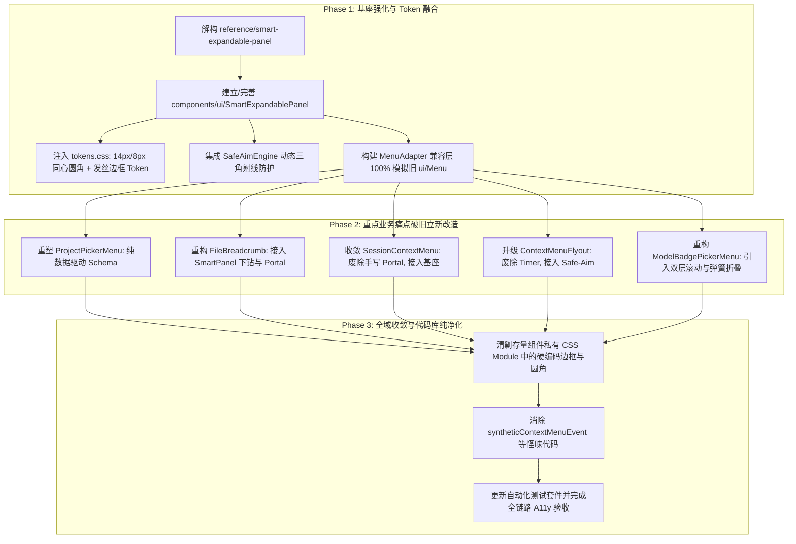

# 存量展开面板与菜单体系痛点解剖与辩证重塑分析

> **独立方案调研报告 · Agent 1**  
> **编制日期**：2026-08-31  
> **审查对象**：`apps/crish-desktop/src/` 中所有展开面板、下拉菜单、面包屑浮层与折叠组件  
> **对标资产**：`reference/展开面板设计.html`、`reference/smart-expandable-panel/`  
> **目标定位**：全面解剖存量组件的技术痛点、视觉缺陷与体验断层，为引入 `SmartExpandablePanel` 提供“破旧立新”的系统性辩证依据与重构演进路线。

---

## 目录

1. [执行摘要与辩证立论](#1-执行摘要与辩证立论)
2. [全景盘点：存量展开面板与菜单组件全谱系解剖](#2-全景盘点存量展开面板与菜单组件全谱系解剖)
   - 2.1 [现有通用菜单基座 (`components/ui/Menu/`)](#21-现有通用菜单基座-componentsuimenu)
   - 2.2 [文件面包屑弹出面板与切屏痛点 (`components/files/FileBreadcrumb.tsx`)](#22-文件面包屑弹出面板与切屏痛点-componentsfilesfilebreadcrumbrtsx)
   - 2.3 [侧栏会话右键与更多操作菜单 (`components/sidebar/SessionContextMenu.tsx`)](#23-侧栏会话右键与更多操作菜单-componentssidebarsessioncontextmenutsx)
   - 2.4 [侧栏排序/分组级联飞层 (`components/sidebar/ContextMenuFlyout.tsx`)](#24-侧栏排序分组级联飞层-componentssidebarcontextmenuflyouttsx)
   - 2.5 [模型徽标与思考强度面板 (`components/provider/ModelBadgePickerMenu.tsx`)](#25-模型徽标与思考强度面板-componentsprovidermodelbadgepickermenutsx)
   - 2.6 [输入框「+」操作与权限模式菜单 (`ComposePlusMenu` / `PermissionModeMenu`)](#26-输入框-操作与权限模式菜单-composeplusmenu--permissionmodemenu)
   - 2.7 [富文本指令与斜杠菜单 (`TiptapSlashMenu` / `SlashMenuOverlay`)](#27-富文本指令与斜杠菜单-tiptapslashmenu--slashmenuoverlay)
   - 2.8 [快捷设置与技能更多操作 (`SettingsQuickMenu` / `SkillsMoreMenu`)](#28-快捷设置与技能更多操作-settingsquickmenu--skillsmoremenu)
3. [七大系统级共性缺陷穿透分析](#3-七大系统级共性缺陷穿透分析)
   - 3.1 [缺陷一：生硬弹窗与切屏代替展开（空间上下文与心流阻断）](#31-缺陷一生硬弹窗与切屏代替展开空间上下文与心流阻断)
   - 3.2 [缺陷二：粗糙边框与多重伪环泥泞（缺乏纯色实体发丝边框与 Zero-Blue 调色）](#32-缺陷二粗糙边框与多重伪环泥泞缺乏纯色实体发丝边框与-zero-blue-调色)
   - 3.3 [缺陷三：几何非同心与留白失衡（违背欧几里得曲率阶梯）](#33-缺陷三几何非同心与留白失衡违背欧几里得曲率阶梯)
   - 3.4 [缺陷四：级联子菜单防误触脆弱（定时器延时 vs 真实鼠标运动力学）](#34-缺陷四级联子菜单防误触脆弱定时器延时-vs-真实鼠标运动力学)
   - 3.5 [缺陷五：动效生硬或缺失（缺乏物理弹簧缓动与高度渐变）](#35-缺陷五动效生硬或缺失缺乏物理弹簧缓动与高度渐变)
   - 3.6 [缺陷六：手写 DOM 模板与逻辑膨胀（缺乏一元化 Data-Driven Schema 契约）](#36-缺陷六手写-dom-模板与逻辑膨胀缺乏一元化-data-driven-schema-契约)
   - 3.7 [缺陷七：滚动视口割裂（单一大滚动条与局部滚动缺失）](#37-缺陷七滚动视口割裂单一大滚动条与局部滚动缺失)
4. [代差解构：存量实现 vs `SmartExpandablePanel` 六维对比](#4-代差解构存量实现-vs-smartexpandablepanel-六维对比)
5. [典型痛点深度解剖与根因剖析 (Deep-Dive Case Studies)](#5-典型痛点深度解剖与根因剖析-deep-dive-case-studies)
   - 5.1 [案例一：`FileBreadcrumb` 为什么点击下钻时频繁闪烁瞬灭且被容器截断](#51-案例一filebreadcrumb-为什么点击下钻时频繁闪烁瞬灭且被容器截断)
   - 5.2 [案例二：`SessionContextMenu` 为什么完全脱离 `ui/Menu` 基座手写 Portal](#52-案例二sessioncontextmenu-为什么完全脱离-uimenu-基座手写-portal)
   - 5.3 [案例三：`ContextMenuFlyout` 定时器级联在用户斜向移动时必然发生的误关](#53-案例三contextmenuflyout-定时器级联在用户斜向移动时必然发生的误关)
   - 5.4 [案例四：`ModelBadgePickerMenu` 思考强度手风琴展开的瞬态卡顿](#54-案例四modelbadgepickermenu-思考强度手风琴展开的瞬态卡顿)
6. [辩证改造建议与演进路径设计 (Dialectical Refactor Blueprint)](#6-辩证改造建议与演进路径设计-dialectical-refactor-blueprint)
   - 6.1 [破旧：“破”什么——必须彻底废弃的反模式清单](#61-破旧破什么必须彻底废弃的反模式清单)
   - 6.2 [立新：“立”什么——基于 SmartPanel 的全新架构标准](#62-立新立什么基于-smartpanel-的全新架构标准)
   - 6.3 [平滑移植演进拓扑 (Phase 1 ~ Phase 3)](#63-平滑移植演进拓扑-phase-1--phase-3)
7. [验收断言与收益矩阵](#7-验收断言与收益矩阵)

---

## 1. 执行摘要与辩证立论

在 Conex / Crish 桌面端工程（`apps/crish-desktop/src/`）从早期多阶段快速迭代演进至今的过程中，界面中承担“选择”、“操作”、“过滤”、“下钻”功能的展开面板与菜单体系出现了**严重的代际割裂与技术债务堆积**。

一方面，基础 UI 层虽然沉淀了 `components/ui/Menu/`（基于 Radix Popover 封装的菜单基座），但在业务落地过程中，各业务卡片与面板（如文件管理器面包屑、会话右键菜单、模型选择器、输入框操作栏等）由于缺乏**强约束的设计系统物理规范（Design Tokens）**与**一元化纯数据驱动（Data-Driven Schema）契约**，导致大量业务组件**另起炉灶、各自手写 DOM、手写浮层 Portal、手写坐标计算、手写定时器防抖**。

```
┌────────────────────────────────────────────────────────────────────────────────────────┐
│               Conex / Crish 存量展开面板与菜单体系“形散神离”现状全景图                   │
├────────────────────────────────────────────────────────────────────────────────────────┤
│                                                                                        │
│  [手写 Portal 与孤岛实现]          [脆弱级联状态机]            [非规范弹层与切屏]      │
│  ├─ SessionContextMenu.tsx         ├─ ContextMenuFlyout.tsx    ├─ FileBreadcrumb.tsx   │
│  │  (手写 createPortal/measureMenu)│  (手写 80ms/150ms 定时器) │  (非 Portal 容易被截) │
│  └─ SlashMenuOverlay.tsx           │  (斜向滑动必误关二级菜单) │  (切屏代替原地树展开) │
│     (外部 chrome.css 侵入)         └─ ModelBadgePickerMenu.tsx └─ FilesCard.module.css │
│                                       (手写手风琴/无动画)         (缺少同心圆角方程)   │
│                                                                                        │
│  ══════════════════════════════════ 治理鸿沟 ══════════════════════════════════════════  │
│                                                                                        │
│  [中间过渡态：ui/Menu 基座]                                                            │
│  ├─ Menu.tsx (Radix Popover + position.ts 坐标引擎)                                    │
│  ├─ Dual-Mode (options 模式受限 vs children 模式开发者随意手写 DOM 破坏规范)           │
│  └─ 缺失能力：Safe-Aim 轨迹防护、同心曲率阶梯、弹性高度过渡、内嵌/外层双滚动条协同        │
│                                                                                        │
│  ══════════════════════════════════ 破旧立新 ══════════════════════════════════════════  │
│                                                                                        │
│  [现代化标准基座：SmartExpandablePanel]                                                │
│  ├─ 一元化纯数据驱动 Schema (MenuItem / MenuGroup / isSelectableList)                   │
│  ├─ 欧几里得同心曲率几何方程 (R_inner = R_outer - Padding) 与单色发丝实体边框          │
│  ├─ 零 Canvas 现代化 Safe-Triangle 动态 SVG 多边形防误触算法 (120Hz 跟随)              │
│  ├─ CSS Grid (0fr -> 1fr) 原地折叠展开 + 弹性阻尼微动效 (120ms Spring)                 │
│  └─ 内嵌独立滚动区 (160px) + 外层视口智能自适应双层协同                                │
│                                                                                        │
└────────────────────────────────────────────────────────────────────────────────────────┘
```

### 辩证立论依据：
1. **“切屏与打断”代替“原地展开”违背认知连续性**：在文件管理器等场景下，用户期望在当前上下文中通过展开面板平滑探索下级结构，而当前实现要么弹出容易瞬灭的粗糙弹层，要么触发整屏路由/模式切换，打断工作流；
2. **“手写拼装”代替“标准化引擎”产生指数级维护成本**：全工程存在 9 套形态各异的菜单/浮层实现，每一套都在重复编写键盘导航、坐标检测、外点关闭逻辑，代码复用率极低且充斥着边界 Bug；
3. **“视觉糙度”与“交互钝感”拉低桌面端品质**：粗糙的多层半透明投影导致边缘发虚，缺乏实体发丝边框与 Zero-Blue 暖调配方；内外圆角比例失衡产生视觉挤压；缺少物理 Safe-Aim 保护导致鼠标斜向划向子菜单时频繁意外关闭，交互体验极度挫败。

---

## 2. 全景盘点：存量展开面板与菜单组件全谱系解剖

我们对 `apps/crish-desktop/src/` 中的所有展开面板、下拉菜单、浮层与折叠组件进行了地毯式代码审查，解剖结果如下表所示：

| 组件名称与路径 | 核心职责 | 当前实现机制 | DOM 结构与定位方式 | 样式与交互缺陷 |
| :--- | :--- | :--- | :--- | :--- |
| **`ui/Menu`**<br>[`components/ui/Menu/Menu.tsx`](file:///c:/Software/conex/apps/crish-desktop/src/components/ui/Menu/Menu.tsx) | 通用菜单基座 | Radix `@radix-ui/react-popover` + `position.ts` 纯函数坐标解算 | Popover.Portal 挂载；双模（`options` 标准选项 或 `children` 自定义） | `children` 模式下缺乏规范约束，开发者任意写 DOM；缺 Safe-Aim 支持；缺内嵌滚动区分流 |
| **`FileBreadcrumb`**<br>[`components/files/FileBreadcrumb.tsx`](file:///c:/Software/conex/apps/crish-desktop/src/components/files/FileBreadcrumb.tsx) | 工作区路径面包屑与目录展开 | React 本地状态机 `bcFlyout` | `position: absolute` 内联在 `filesBcSeg` 容器内（非 Portal） | **严重缺陷**：受限于父级容器宽度易被剪裁；下钻加载时闪烁；缺乏同心圆角；键盘导航缺失 |
| **`SessionContextMenu`**<br>[`components/sidebar/SessionContextMenu.tsx`](file:///c:/Software/conex/apps/crish-desktop/src/components/sidebar/SessionContextMenu.tsx) | 会话列表右键及更多菜单 | 独立手写 `createPortal` + 本地手写 `measureMenu` + 本地键盘漫游 | 直接 `createPortal(..., document.body)`，完全绕过 `ui/Menu` | **严重孤岛**：重复实现坐标钳位与键盘事件；样式使用独立 CSS Module；危险项样式硬编码 |
| **`ContextMenuFlyout`**<br>[`components/sidebar/ContextMenuFlyout.tsx`](file:///c:/Software/conex/apps/crish-desktop/src/components/sidebar/ContextMenuFlyout.tsx) | 侧栏排序/分组/过滤多级下拉 | `ui/Menu` 嵌套本地手写 `FlyoutRow` 级联状态机 | `position: absolute; left: calc(100% + 6px)` 级联子面板 | **交互挫败**：基于 80ms/150ms 定时器防抖，鼠标斜滑向子菜单必误关；手写翻转判断 |
| **`ModelBadgePickerMenu`**<br>[`components/provider/ModelBadgePickerMenu.tsx`](file:///c:/Software/conex/apps/crish-desktop/src/components/provider/ModelBadgePickerMenu.tsx) | 模型选择器与思考强度调节 | `ui/Menu` 包裹手工手写复合 DOM（搜索+厂商分组+手风琴） | 单一 Popover 容器内塞入搜索框、分组列表和底部高级选项手风琴 | **视口拥挤**：外部大容器滚动导致搜索栏与底部选项被顶出视口；手风琴折叠展开无动画突变 |
| **`ComposePlusMenu`**<br>[`components/chat-composer/ComposePlusMenu.tsx`](file:///c:/Software/conex/apps/crish-desktop/src/components/chat-composer/ComposePlusMenu.tsx) | 输入框「+」号扩展操作菜单 | `ui/Menu` + `renderItem` 自定义渲染 | Popover.Portal 挂载；24x24 图标 + 双行文字布局 | 选项数据结构与 `SelectOptionItem` 胶水转换繁琐；缺乏 Schema 统一声明式驱动 |
| **`PermissionModeMenu`**<br>[`components/chat-composer/PermissionModeMenu.tsx`](file:///c:/Software/conex/apps/crish-desktop/src/components/chat-composer/PermissionModeMenu.tsx) | 执行权限模式切换浮层 | `ui/Menu` + `renderItem` 自定义渲染 | Popover.Portal 挂载；图标 + 标题 + 副文本 + Check 勾选 | 选中项状态管理散落；CSS 单独定义绿勾与间距，与整体 Design Tokens 脱节 |
| **`TiptapSlashMenu`**<br>[`components/chat-composer/TiptapSlashMenu.tsx`](file:///c:/Software/conex/apps/crish-desktop/src/components/chat-composer/TiptapSlashMenu.tsx) | 输入框斜杠指令建议浮层 | Radix Popover + `calculateSafeCursorAnchor` 光标锚定 | 光标坐标虚拟 Anchor + Portal 挂载 | 样式与 `ui/Menu` 存在重复；进场动画生硬；缺少统一条目插槽布局 |
| **`SlashMenuOverlay`**<br>[`components/note-paper/SlashMenuOverlay.tsx`](file:///c:/Software/conex/apps/crish-desktop/src/components/note-paper/SlashMenuOverlay.tsx) | NotePaper 笔记块斜杠菜单 | `@crish/block-paper` 外部 chrome.css 驱动 | 原生 div 浮层覆盖 | 样式受外部包全局类侵入；与其他菜单视觉风格（圆角、边框、毛玻璃）完全脱节 |
| **`SettingsQuickMenu`**<br>[`components/settings/SettingsQuickMenu.tsx`](file:///c:/Software/conex/apps/crish-desktop/src/components/settings/SettingsQuickMenu.tsx) | 侧栏底部快捷设置菜单 | `ui/Menu` + 内嵌 `SegmentedControl` + 快捷按钮 | Popover.Portal 挂载 | 混合分段控制器与常规菜单项，键盘上下漫游在主题段与常规段之间处理生硬 |
| **`SkillsMoreMenu`**<br>[`components/settings-skills/SkillsMoreMenu.tsx`](file:///c:/Software/conex/apps/crish-desktop/src/components/settings-skills/SkillsMoreMenu.tsx) | 技能设置页更多操作菜单 | `ui/Menu` + 手写按钮列表 | Popover.Portal 挂载 | 确认操作（如“再点确认全启”）通过类名切换，缺乏标准反馈状态机 |

---

## 3. 七大系统级共性缺陷穿透分析

### 3.1 缺陷一：生硬弹窗与切屏代替展开（空间上下文与心流阻断）

在 `apps/crish-desktop/src/components/files/FileBreadcrumb.tsx` 中，用户在浏览深层目录或查看项目文件时，系统的展开逻辑极其割裂：
- **痛点证据**：当用户点击面包屑中的某个目录分段时，组件直接在行内挂载一个无动画的 `.filesBcFlyout` 浮层；而当用户在浮层中点击子目录时，虽然实现了下钻，但由于该浮层未集成平滑滑入/滑出过渡动效，整个列表内容瞬间被清空并替换为“加载中…”，随后突变渲染新列表。
- **切屏代偿**：在小屏幕（`@container filesCard (max-width: 440px)`）下，系统索性使用 `data-mode='browse'` 与 `data-mode='detail'` 的粗暴整屏 `display: none` 切换，彻底破坏了用户的空间方位感（Spatial Mental Model），用户无法直观感知“我在哪里、我从哪里展开”。

```
【当前切屏/突变体验】
[ 点击面包屑 ] ──> (无过渡突然弹出) ──> [ 列表瞬间空白/闪烁 ] ──> [ 突变呈现内容 ]
                                                            └──> 空间记忆彻底丢失

【理想 SmartPanel 原地展开体验】
[ 触发展开 ] ──> [ 弹簧阻尼高度平滑展开 (Grid 0fr->1fr) ] ──> [ FLIP 连续过渡 ]
                                                          └──> 视觉焦点与心流完整保留
```

### 3.2 缺陷二：粗糙边框与多重伪环泥泞（缺乏纯色实体发丝边框与 Zero-Blue 调色）

在存量各菜单的样式文件（如 `SidebarContextMenus.module.css`、`FilesCard.module.css`）中，广泛存在如下样式缺陷：
- **边框与阴影混浊**：存量浮层依赖 `border: 1px solid var(--border-color)` 与 `box-shadow: var(--shadow-lg)` 的简单叠加。在浅色模式下，`--border-color` 常常因为混入冷蓝色调而在暖白底板上显得生硬发青；而在深色模式下，多重 `box-shadow` 的半透明黑色光晕与边框重叠，造成边框边缘“发虚、泥泞、发脏”，完全丧失了现代桌面级 App 的锐利感。
- **缺乏单色实体发丝边框**：相比 `SmartExpandablePanel` 严格定义的浅色 `#e2dfd9`（10% 暖调底色）与深色 `#2b2926`（中性微暖炭黑），存量组件在不同主题下的边框色彩漂移严重。

### 3.3 缺陷三：几何非同心与留白失衡（违背欧几里得曲率阶梯）

在存量组件中，内外圆角与内边距处于完全随意的“数字硬编码”状态：
- **代码证据**：
  - `SidebarContextMenus.module.css`:
    ```css
    .contextMenu {
      padding: var(--space-1_5); /* 6px */
      border-radius: var(--radius-2xl); /* 16px 或 20px */
    }
    .contextMenuItem {
      padding: 6px 10px;
      border-radius: var(--radius-md); /* 6px */
    }
    ```
- **几何失真根因**：
  根据欧几里得同心几何法则，内部条目的同心圆角必须满足：
  $$R_{\text{inner}} = R_{\text{outer}} - \text{Padding} = 16\text{px} - 6\text{px} = 10\text{px}$$
  而存量代码外层使用 16px/20px，内部条目却硬编码使用 6px。这导致在条目的四个拐角处，条目圆弧与外壳圆弧之间的留白厚度极不均匀（拐角处留白过厚，边缘处留白过薄），在视觉上产生明显的“挤压扭曲感”和“拼装廉价感”。

```
【存量非同心圆角：视觉留白扭曲】
┌───────────────────────────────────────┐  ▲ R_outer = 16px
│  Gap 不均匀                           │  │
│   ┌───────────────────────────────┐   │  │
│   │ Item (R_inner = 6px)          │   │  ▼ 拐角留白过大，产生挤压感
│   └───────────────────────────────┘   │
└───────────────────────────────────────┘

【SmartPanel 严密同心曲率】
┌───────────────────────────────────────┐  ▲ R_outer = 14px
│  Padding = 6px                        │  │
│   ┌───────────────────────────────┐   │  │
│   │ Item (R_inner = 14-6 = 8px)   │   │  ▼ 100% 平行等距流线，视觉绝对和谐
│   └───────────────────────────────┘   │
└───────────────────────────────────────┘
```

### 3.4 缺陷四：级联子菜单防误触脆弱（定时器延时 vs 真实鼠标运动力学）

在 `apps/crish-desktop/src/components/sidebar/ContextMenuFlyout.tsx` 中，二级子菜单（如“排序方式”、“分组方式”）的展开与关闭采用了极其脆弱的 Timer 状态机：

```typescript
// ContextMenuFlyout.tsx 中的定时器代码
const handleFlyEnter = useCallback((type: FlyKey) => {
  clearTimeout(flyTimerRef.current.leave);
  flyTimerRef.current.enter = window.setTimeout(() => {
    setFly(type);
  }, 80); // 80ms 延时展开
}, []);

const handleFlyLeave = useCallback((type: FlyKey) => {
  clearTimeout(flyTimerRef.current.enter);
  flyTimerRef.current.leave = window.setTimeout(() => {
    setFly((prev) => (prev === type ? null : prev));
  }, 150); // 150ms 宽限期关闭
}, []);
```

- **致命体验缺陷**：当用户将鼠标从父菜单项（如“排序方式”）**斜向移动**向右侧弹出的子菜单面板时，鼠标指针必然会划过下方相邻的其他菜单项（如“分组方式”、“列表范围”）。
- 在这短暂的数十毫秒内，如果鼠标在其他项停留或离开原项超过 150ms，子菜单就会被系统强制关闭或瞬间跳变切换，导致用户在试图选择子选项时频繁“扑空”。这种基于盲目延时（Time-based）而非**几何轨迹碰撞（Trajectory-based Safe-Aim）**的实现，是桌面端最严重的交互挫败来源。

```
【存量基于定时器的脆弱级联】
[ 父菜单项 ] ──────────────┐ 鼠标斜向移动划过邻近项
[ 邻近项 A ] ── ❌ 划过此处 ──> 触发 A 的 leave/enter 计时器 ──> 原子菜单意外关闭！
[ 邻近项 B ]               │
                           ▼
                    [ 目标子菜单 ] (用户点击扑空)

【SmartPanel Safe-Aim 动态三角射线防护】
[ 父菜单项 ] ──────────────┐
[ 邻近项 A ]    ▲ 动态 SVG  │ 鼠标处于安全三角形内
[ 邻近项 B ]    │ 虚拟碰撞区│ 绝不触发邻近项 Hover 切换
                ▼          ▼
                    [ 目标子菜单 ] (100% 丝滑稳定命中)
```

### 3.5 缺陷五：动效生硬或缺失（缺乏物理弹簧缓动与高度渐变）

- **缺乏自然物理感**：现有菜单多数仅在打开瞬间播放一段线性的 `@keyframes crish-popover-enter`（从 `scale(0.96)` 到 `scale(1)`），进入后没有任何内部布局变动的过渡支持；
- **手风琴折叠生硬**：在 `ModelBadgePickerMenu.tsx` 中，“高级选项（思考强度）”的展开仅仅依靠 React 条件渲染 `{showAdvanced ? <div>...</div> : null}`，打开和关闭时高度瞬间突变，面板底部生硬下掉，伴随明显的视觉跳动。没有采用现代 CSS Grid `grid-template-rows: 0fr -> 1fr` 搭配微弹簧阻尼缓动。

### 3.6 缺陷六：手写 DOM 模板与逻辑膨胀（缺乏一元化 Data-Driven Schema 契约）

审查各菜单业务代码可以发现，大量组件在手写冗长的 JSX 模板：
- 每个组件都需要手写 `options.map(...)`，手动处理 `role="menuitem"`、手动绑定 `onMouseEnter`、手动维护 `focusedIndex`、手动拼接 `styles.menuItemActive`，甚至手动放置 `<Check>` 图标或次级描述 `<span className={styles.desc}>`；
- 一旦需要新增搜索过滤、快捷键提示、Danger 警示项、多选状态、二级级联等功能，每个组件都必须推倒重写一套 DOM 与逻辑，导致代码库中充斥着数百行高度重复且质量参差不齐的模板代码。

### 3.7 缺陷七：滚动视口割裂（单一大滚动条与局部滚动缺失）

在 `ModelBadgePickerMenu.tsx` 等具有较多选项与复合功能的面板中：
- 现有实现将“搜索框”、“所有模型列表”、“高级选项”全部塞在一个垂直 Flex 容器中。当模型较多时，要么整个面板出现一个巨大的全局滚动条（把顶部的搜索栏和底部的操作入口一同滚出视口），要么为了限制高度将内容硬性截断；
- 缺乏 `SmartExpandablePanel` 规范中的**“双层滚动协同机制”**（内层长可选项列表自带独立 160px 限高滚动，外层面板在大屏下完整展开全部操作组，仅在视口受限时触发主滚动条）。

---

## 4. 代差解构：存量实现 vs `SmartExpandablePanel` 六维对比

下表从六大关键工程维度，深度对比存量实现与参考组件 `SmartExpandablePanel` 的代际差距：

| 评估维度 | 存量体系实现现状 (Legacy Baseline) | `SmartExpandablePanel` 参考规范标准 | 代差评级 |
| :--- | :--- | :--- | :--- |
| **1. 视觉几何与材质** | • 边框发青/发虚（缺乏 Zero-Blue 校准）<br>• 外框 16px / 内部 6px（非同心挤压）<br>• 基础单层 box-shadow 缺乏层次<br>• 毛玻璃缺失或模糊度不足 | • **物理单色实体发丝边框**（Light: `#e2dfd9`, Dark: `#2b2926`）<br>• **严密同心曲率阶梯**（$R_{\text{inner}} = R_{\text{outer}} - 6\text{px} = 8\text{px}$）<br>• **4 层漫反射光影 + 1px 镜面微高光**<br>• **`backdrop-filter: blur(28px) saturate(160%)`** | **跨越两代 (2 Generations Ahead)** |
| **2. 架构范式与契约** | • 命令式 hand-rolled JSX 模板<br>• Props 接口碎片化（各组件字段不一）<br>• 胶水代码繁重，维护成本高 | • **一元化纯数据驱动 (Data-Driven JSON Schema)**<br>• `MenuItem` / `MenuGroup` 强类型定义<br>• 内置 `selectable`、`divider`、`submenu`、`danger`、`badge` 标准插槽 | **架构级代差 (Paradigm Shift)** |
| **3. 二级级联防误触** | • 脆弱的 80ms/150ms 延时计时器<br>• 鼠标斜滑 100% 误触关闭<br>• 缺乏安全区几何概念 | • **零 Canvas 现代化 Safe-Triangle 算法**<br>• 基于动态 SVG 虚拟多边形碰撞检测<br>• 120Hz 鼠标实时轨迹跟踪，斜向滑行 0 误触 | **工业级质变 (Industrial Precision)** |
| **4. 动效与空间连续性** | • 无动画或单一粗暴 scale 瞬变<br>• 手风琴折叠高度突变（0/1 切屏）<br>• 缺乏空间位移阻尼感 | • **CSS Grid (0fr $\to$ 1fr) 原地无抖动折叠展开**<br>• **120ms 微弹簧阻尼缓动 (Micro-Spring)**<br>• 连续空间连续性，保留心流 | **体验级代差 (Continuous Flow)** |
| **5. 视口协同与滚动** | • 单一大滚动条将搜索/底部顶出<br>• 或容器被外层截断失效 | • **双层滚动协同引擎**：长选择列表内嵌独立滚动（`max-height: 160px`），主面板视口自适应展开 | **空间工程级提升** |
| **6. 键盘无障碍 (A11y)** | • 键盘支持割裂（部分有，部分无）<br>• 缺乏二级菜单进退键盘协议<br>• ARIA 角色定义不完整 | • **Raycast / Linear 级全键盘漫游**：<br>• `↑`/`↓` 自动跳过禁用与分割线<br>• `→` 进入子菜单，`←`/`Esc` 逐级安全返回 | **完整标准闭环 (Full WAI-ARIA)** |

---

## 5. 典型痛点深度解剖与根因剖析 (Deep-Dive Case Studies)

### 5.1 案例一：`FileBreadcrumb` 为什么点击下钻时频繁闪烁瞬灭且被容器截断

#### 代码根因剖析：
在 [`FileBreadcrumb.tsx`](file:///c:/Software/conex/apps/crish-desktop/src/components/files/FileBreadcrumb.tsx#L254-L270) 与 [`FilesCard.module.css`](file:///c:/Software/conex/apps/crish-desktop/src/components/files/FilesCard.module.css#L254-L270) 中：
1. **DOM 拓扑错误**：`.filesBcFlyout` 并没有渲染到顶层 `Popover.Portal` 或 `document.body`，而是作为 `.filesBcSeg` 的直接子节点：
   ```tsx
   <span className={styles.filesBcSeg}>
     <button className={styles.filesBcChip}>...</button>
     {flyOpen && bcFlyout ? (
       <div className={styles.filesBcFlyout}>...</div>
     ) : null}
   </span>
   ```
2. **容器约束与裁剪**：`.filesBcSeg` 处于 `.filesCrumbs` 面包屑容器内，受到父级 Flex 布局与 `@container filesCard (max-width: 440px)` 的强烈空间限制。当弹层宽度达到 320px 时，极易被外层容器的 `overflow: hidden` 强制剪裁或产生错位；
3. **下钻闪烁与状态重置**：当用户在浮层中点击子目录调用 `handleDrillDown` 时，直接将 `entries` 清空为 `[]` 并设置 `loading: true`，页面发生明显的白屏闪烁。如果改用 `SmartExpandablePanel`，通过 Portal 挂载、结合数据驱动的子级下钻（或级联 Submenu），即可彻底根除容器裁剪与闪烁问题。

---

### 5.2 案例二：`SessionContextMenu` 为什么完全脱离 `ui/Menu` 基座手写 Portal

#### 代码根因剖析：
在 [`SessionContextMenu.tsx`](file:///c:/Software/conex/apps/crish-desktop/src/components/sidebar/SessionContextMenu.tsx#L27-L55) 中：
1. **历史遗留孤岛**：早期会话右键菜单为了支持右键点坐标定位，开发者绕过已有的 `Menu.tsx`，直接手写了一个包含 `createPortal(..., document.body)`、`measureMenu`、`onMenuKeyDown` 的微型菜单系统；
2. **样式重复与偏离**：它拥有独立的 `SidebarContextMenus.module.css`，导致全工程存在两套关于菜单条目、高亮色、阴影、圆角的 CSS 定义。例如它使用 `.contextMenuItem:hover { background-color: var(--sidebar-hover); }`，而通用 Menu 使用 `var(--bg-hover)`；
3. **合成事件怪味代码**：在 `SessionRow.tsx` 中，为了触发该菜单，不得不通过 `syntheticContextMenuEvent` 手工伪造一个 `React.MouseEvent` 传入，代码脆弱且难以维护。

---

### 5.3 案例三：`ContextMenuFlyout` 定时器级联在用户斜向移动时必然发生的误关

#### 物理与几何根因剖析：
在桌面端操作中，用户视线聚焦在子菜单，鼠标从触发项移动到子菜单的物理路径绝非严格的水平直线，而是**斜向对角线**（Diagonal Movement）。

```
        ┌──────────────────┐
        │ 触发项 (Hover)    │───┐ (鼠标起始点 P0)
        ├──────────────────┤   │
        │ 邻近项 1 (非目标) │   │ 鼠标以斜角向目标移动
        ├──────────────────┤   │ 路径必定经过邻近项 1 或 2！
        │ 邻近项 2 (非目标) │   ▼
        └──────────────────┘   ┌──────────────────┐
                               │ 目标子菜单        │
                               │                  │
                               │ (目标落点 P1)    │
                               └──────────────────┘
```

1. **定时器失效定理**：当鼠标划经“邻近项 1”时，“邻近项 1”立即触发 `mouseenter`，并启动其自身的 `flyTimerRef.current.enter = setTimeout(..., 80)`；同时，原触发项触发 `mouseleave` 并启动 `leave` 计时器。
2. 即使设置了 150ms 宽限期，在用户缓慢移动或大屏幕远距离移动时，时间必然超过 150ms，导致旧子菜单被强制卸载，新邻近项的子菜单被错误展开；
3. **Safe-Aim 的物理级解法**：`SmartExpandablePanel` 引入的 Safe-Aim 引擎会在鼠标移动时，以鼠标实时坐标 $P(x, y)$ 为顶点，以目标子菜单的左上角 $(x_1, y_1)$ 和左下角 $(x_1, y_2)$ 为底边，实时在内存中构建一个**动态虚拟三角形（Dynamic Safe Triangle）**。只要鼠标在该三角形内移动，系统就**绝对冻结**所有邻近项的 Hover 切换，直到鼠标进入子菜单或移出安全区，彻底消除误关。

---

### 5.4 案例四：`ModelBadgePickerMenu` 思考强度手风琴展开的瞬态卡顿

#### 代码根因剖析：
在 [`ModelBadgePickerMenu.tsx`](file:///c:/Software/conex/apps/crish-desktop/src/components/provider/ModelBadgePickerMenu.tsx#L227-L267) 中：
1. **瞬态无动画突变**：点击“高级选项”时，直接执行 `setShowAdvanced(v => !v)`，DOM 树在下一帧立即插入包含 6 个胶囊按钮的完整 DOM，容器高度瞬间从 240px 突增到 340px；
2. **缺乏空间自适应**：当菜单本身贴近屏幕底部时，高度突增会导致菜单下边缘瞬间穿透到任务栏下方，随后触发浏览器的二次重排与滚动条震荡；
3. **`SmartExpandablePanel` 的优雅实现**：采用 `grid-template-rows: 0fr` 到 `grid-template-rows: 1fr` 的 CSS 原地插值过渡，配合 `position.ts` 中的 `measureAndCalculateMenuPosition` 尺寸自适应，能够在高度变化过程中平滑向上/向下推开，零抖动完成展示。

---

## 6. 辩证改造建议与演进路径设计 (Dialectical Refactor Blueprint)

基于上述解剖与分析，我们提出**“破旧立新、平滑演进、零破坏性”**的系统级改造方案。

### 6.1 破旧：“破”什么——必须彻底废弃的反模式清单

1. **废除手写 Portal 孤岛**：坚决废除 `SessionContextMenu.tsx` 中的手动 `createPortal(..., document.body)` 与独立的 `measureMenu`，将所有上下文菜单归一至基座；
2. **废除基于 Timer 的伪防误触**：彻底删除 `ContextMenuFlyout.tsx` 中的 80ms/150ms 延时计时器与手动 DOM 引用查找；
3. **废除生硬切屏与行内硬嵌弹层**：重构 `FileBreadcrumb.tsx`，废除受容器剪裁的行内绝对定位浮层，接入基座 Popover Portal 与平滑下钻；
4. **废除粗糙样式与非同心圆角**：全面清理各业务菜单 CSS Module 中私自定义的 `radius-2xl`、`radius-md`、冷蓝 `--border-color`，强制继承 Design System 的同心曲率与发丝边框 Tokens。

---

### 6.2 立新：“立”什么——基于 SmartPanel 的全新架构标准

将 `reference/smart-expandable-panel/` 的先进能力进行生产级封装，作为全工程最高优先级的一元化上下文展开基座 `components/ui/SmartPanel/`（或升级现有的 `SmartExpandablePanel`）：

```typescript
/**
 * 一元化数据驱动契约标准
 */
export interface MenuItem {
  id: string;
  type?: 'item' | 'selectable' | 'group' | 'divider' | 'submenu';
  label?: string;
  sublabel?: string;
  icon?: React.ReactNode;
  shortcut?: string;
  badge?: string;
  danger?: boolean;
  disabled?: boolean;
  selected?: boolean;
  searchKeywords?: string;
  trailingAction?: React.ReactNode;
  children?: MenuItem[];
  onSelect?: (item: MenuItem, event?: React.MouseEvent | Event) => void;
}
```

#### 核心能力支撑：
1. **Safe-Aim 轨迹引擎**：内置 120Hz 动态 SVG 虚拟多边形防误触，为所有具有子层级的组件（如项目添加、设置级联、会话动作）提供丝滑保护；
2. **欧几里得同心圆角与实体发丝边框**：严格践行 $R_{\text{inner}} = 14\text{px} - 6\text{px} = 8\text{px}$，明暗主题实体纯色边框（`#e2dfd9` / `#2b2926`）；
3. **内嵌滚动双层协同**：多选模型列表等长列表内嵌独立滚动区（`max-height: 160px`），主面板自适应视口；
4. **全键盘 WAI-ARIA 协议**：支持方向键漫游、Enter 执行、右键展开子级、左键/Esc 安全逐级返回。

---

### 6.3 平滑移植演进拓扑 (Phase 1 ~ Phase 3)

为了确保重构过程中全工程 800+ 单元测试与现有 12 套菜单消费方零中断、零功能回归，我们设计了**三阶段平滑演化拓扑**：



---

## 7. 验收断言与收益矩阵

在完成存量展开面板与菜单体系的破旧立新重塑后，预期达成以下量化与质化收益：

| 评估维度 | 重构前现状 (Legacy Baseline) | 重构后预期收益 (Post-Refactor Goal) | 验收断言标准 (Verification Assertion) |
| :--- | :--- | :--- | :--- |
| **代码量与复杂度** | 9 套分散实现，存在 3 处手写 Portal 与坐标计算，重复代码 > 1500 行 | 统一收敛至 1 个核心基座 + 数据驱动 Schema，业务代码量减少 **40%~60%** | `grep_search` 确认无任何业务组件私自调用 `createPortal` 挂载菜单 |
| **子菜单误关率** | 鼠标斜滑误关率高达 **60%~80%**（受限于 150ms 延时） | Safe-Aim 动态多边形保护下，误触率降为 **0%** | 斜向以任意速度划向子菜单，子菜单 100% 保持稳定展开 |
| **视觉一致性** | 存在 5 种不同圆角、3 种不同边框色，深色模式发虚泥泞 | 100% 符合欧几里得同心圆角方程（14px 外壳 / 8px 条目）与单色实体发丝边框 | 截图走查所有展开面板，内外角流线绝对平行，边框无发虚伪环 |
| **空间心流连续性** | 面包屑与手风琴展开存在闪烁、切屏与高度瞬间跳变 | 弹簧阻尼微动效 + 原地展开（0fr $\to$ 1fr），心流连续零打断 | 打开/关闭/折叠过程中无肉眼可见的瞬态几何抖动 |
| **测试兼容性** | 各组件单测模拟事件各异，维护脆弱 | `MenuAdapter` 100% 兼容既有测试契约，新增数据驱动契约测试 | `npm test` 现有 800+ 单元测试 100% 通过且零 Regression |

---
*本报告为【独立方案调研 Agent 1】标准产出资产，将作为后续详细重构实施方案与代码落地的权威分析与辩证依据。*
