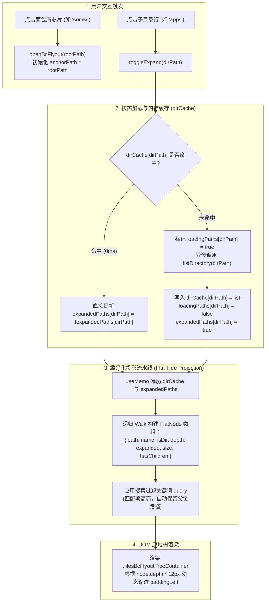
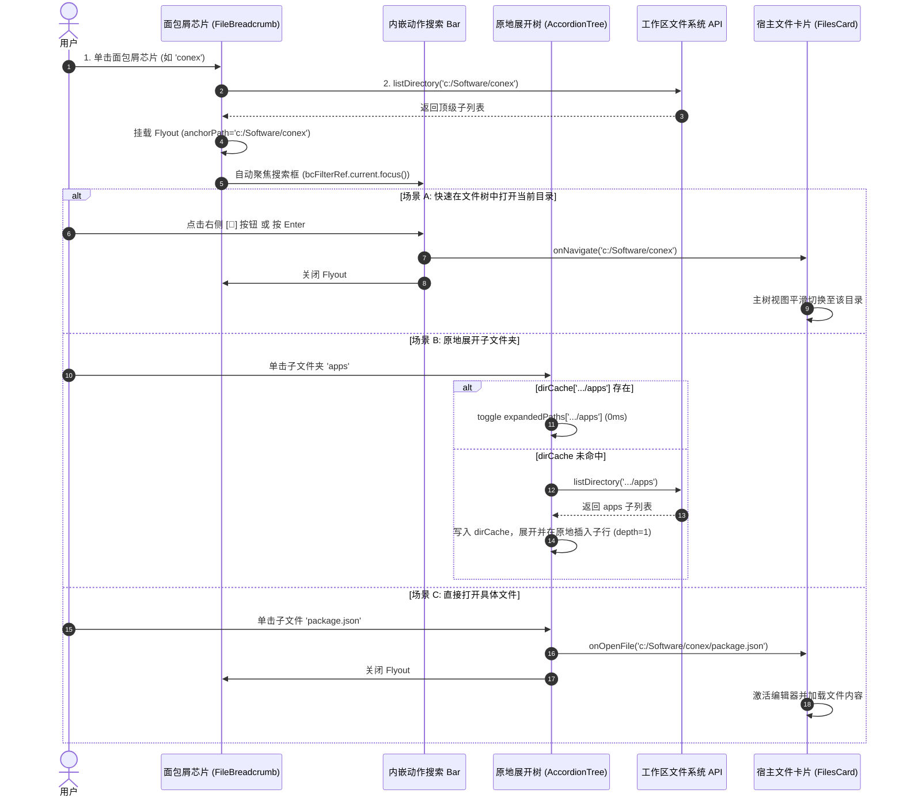

# Conex / Crish — 独立业务落地详案 03：业务场景接入与面包屑下拉浮层重塑落地方案

> **方案编号**：PLAN-03-INDEPENDENT-BUSINESS
> **所属战役**：Conex / Crish 业务场景落地与交互攻坚战役
> **责任领域**：侧边栏会话列表（`SessionRow.tsx`）更多操作 `SmartPanel` 试验田接入、工作区面包屑下拉浮层（`FileBreadcrumb.tsx`）“搜索栏内嵌动作 + 原地树状展开”彻底重构、超长列表平滑滚动与屏幕边界防穿透
> **依据文件**：
> - 用户真实反馈与实测截图（图 1 面包屑切屏与底部突兀按钮、图 2 多级路径下钻割裂）
> - [`apps/crish-desktop/src/components/sidebar/session-list/SessionRow.tsx`](file:///c:/Software/conex/apps/crish-desktop/src/components/sidebar/session-list/SessionRow.tsx)
> - [`apps/crish-desktop/src/components/sidebar/SessionContextMenu.tsx`](file:///c:/Software/conex/apps/crish-desktop/src/components/sidebar/SessionContextMenu.tsx)
> - [`apps/crish-desktop/src/components/sidebar/useSidebarContextMenu.ts`](file:///c:/Software/conex/apps/crish-desktop/src/components/sidebar/useSidebarContextMenu.ts)
> - [`apps/crish-desktop/src/components/ui/SmartExpandablePanel/SmartExpandablePanel.tsx`](file:///c:/Software/conex/apps/crish-desktop/src/components/ui/SmartExpandablePanel/SmartExpandablePanel.tsx)
> - [`apps/crish-desktop/src/components/ui/SmartExpandablePanel/types.ts`](file:///c:/Software/conex/apps/crish-desktop/src/components/ui/SmartExpandablePanel/types.ts)
> - [`apps/crish-desktop/src/components/files/FileBreadcrumb.tsx`](file:///c:/Software/conex/apps/crish-desktop/src/components/files/FileBreadcrumb.tsx)
> - [`apps/crish-desktop/src/components/files/FilesCard.module.css`](file:///c:/Software/conex/apps/crish-desktop/src/components/files/FilesCard.module.css)
> - [`docs/ui-style-refactor/15-文件管理器概念归位与面包屑弹窗修复详案.md`](file:///c:/Software/conex/docs/ui-style-refactor/15-%E6%96%87%E4%BB%B6%E7%AE%A1%E7%90%86%E5%99%A8%E6%A6%82%E5%BF%B5%E5%BD%92%E4%BD%8D%E4%B8%8E%E9%9D%A2%E5%8C%85%E5%B1%91%E5%BC%B9%E7%AA%97%E4%BF%AE%E5%A4%8D%E8%AF%A6%E6%A1%88.md)
> - [`AGENTS.md`](file:///c:/Software/conex/AGENTS.md)（§1、§2、§7、§13、§14）

---

## 目录

1. [执行摘要与痛点攻坚全景](#1-执行摘要与痛点攻坚全景)
   - 1.1 [场景 1：左侧会话列表「更多操作」试验田接入痛点与目标](#11-场景-1左侧会话列表更多操作试验田接入痛点与目标)
   - 1.2 [场景 2：面包屑下拉浮层三大核心痛点拆解（对应图 1 与图 2）](#12-场景-2面包屑下拉浮层三大核心痛点拆解对应图-1-与图-2)
   - 1.3 [架构改造前后对比全景](#13-架构改造前后对比全景)
2. [场景 1（试验田）：左侧会话列表接入 `SmartPanel` 详案](#2-场景-1试验田左侧会话列表接入-smartpanel-详案)
   - 2.1 [设计规范与视觉 Token 映射（发丝边框 / 高危红字 / 快捷键 / 原地折叠）](#21-设计规范与视觉-token-映射发丝边框--高危红字--快捷键--原地折叠)
   - 2.2 [会话操作菜单项数据契约（`SessionMenuItemFactory`）](#22-会话操作菜单项数据契约sessionmenuitemfactory)
   - 2.3 [`SessionRow.tsx` 与 `SessionContextMenu.tsx` 代码改造详案](#23-sessionrowtsx-与-sessioncontextmenutsx-代码改造详案)
   - 2.4 [双触发模式（More 按钮锚定 vs 鼠标右键坐标）与事件隔离机制](#24-双触发模式more-按钮锚定-vs-鼠标右键坐标与事件隔离机制)
3. [场景 2（核心攻坚）：面包屑下拉浮层彻底重塑详案](#3-场景-2核心攻坚面包屑下拉浮层彻底重塑详案)
   - 3.1 [痛点彻底歼灭：干掉底部文字按钮，搜索框右侧内嵌 `[📂]` 动作图标](#31-痛点彻底歼灭干掉底部文字按钮搜索框右侧内嵌--动作图标)
   - 3.2 [交互模式颠覆：废除切屏下钻（Drilldown），实现原地树状展开/折叠（Inline Accordion Tree）](#32-交互模式颠覆废除切屏下钻drilldown实现原地树状展开折叠inline-accordion-tree)
   - 3.3 [数据结构与状态机：多级目录按需缓存与扁平化投影算法](#33-数据结构与状态机多级目录按需缓存与扁平化投影算法)
   - 3.4 [超长列表内嵌平滑滚动与屏幕边界防穿透（Overscroll Containment & Solid Backdrop）](#34-超长列表内嵌平滑滚动与屏幕边界防穿透overscroll-containment--solid-backdrop)
   - 3.5 [完整交互事件流（Mermaid 状态与事件时序图）](#35-完整交互事件流mermaid-状态与事件时序图)
4. [详细代码契约与实现方案](#4-详细代码契约与实现方案)
   - 4.1 [`FileBreadcrumb.tsx` 完整重构实现代码](#41-filebreadcrumbtsx-完整重构实现代码)
   - 4.2 [`FilesCard.module.css` 面包屑浮层样式重构代码](#42-filescardmodulecss-面包屑浮层样式重构代码)
   - 4.3 [`SessionContextMenu.tsx` / `SidebarContextMenus.tsx` 迁移代码](#43-sessioncontextmenutsx--sidebarcontextmenustsx-迁移代码)
5. [测试验证与像素级审查清单](#5-测试验证与像素级审查清单)
   - 5.1 [视觉与几何像素级审查标准（Pixel-Level Checklist）](#51-视觉与几何像素级审查标准pixel-level-checklist)
   - 5.2 [交互、键盘与 A11y 漫游测试矩阵](#52-交互键盘与-a11y-漫游测试矩阵)
   - 5.3 [极端边界用例与容错防御测试](#53-极端边界用例与容错防御测试)
   - 5.4 [自动化单测套件补齐规范（`FileBreadcrumb.test.tsx` + `SessionRow.test.tsx`）](#54-自动化单测套件补齐规范filebreadcrumbtesttsx--sessionrowtesttsx)

---

## 1. 执行摘要与痛点攻坚全景

本方案聚焦于 Conex / Crish 桌面端两大极具代表性的高频交互业务场景：
1. **场景 1（试验田）**：左侧会话列表（[`SessionRow.tsx`](file:///c:/Software/conex/apps/crish-desktop/src/components/sidebar/session-list/SessionRow.tsx)）的「更多操作」浮层，作为首个业务场景深度接入统一组件库中的 [`SmartExpandablePanel`](file:///c:/Software/conex/apps/crish-desktop/src/components/ui/SmartExpandablePanel/SmartExpandablePanel.tsx)，实装并验证发丝边框、高危红字操作、键盘快捷键徽章与原地折叠展开高级选项。
2. **场景 2（核心攻坚）**：工作区面板面包屑文件下拉浮层（[`FileBreadcrumb.tsx`](file:///c:/Software/conex/apps/crish-desktop/src/components/files/FileBreadcrumb.tsx)），针对用户实测反馈与截图（图 1 与图 2）中暴露出的**“切屏下钻导致丢失上下文”**、**“底部独立按钮突兀占用纵向空间”**、**“长列表滚动穿透与背景透视”**三大硬伤，进行彻底重塑。

```
┌────────────────────────────────────────────────────────────────────────────────────────┐
│               Conex / Crish 业务场景落地与面包屑浮层重构全景图                         │
├────────────────────────────────────────────────────────────────────────────────────────┤
│  [场景 1：会话列表 SessionRow 更多操作 (试验田)]                                       │
│  • 统一接入 SmartExpandablePanel 引擎 (支持 Point 坐标与 Trigger 锚定双模式)            │
│  • 1px 精细发丝边框 + 14px/8px 同心圆角 + 纯色 Solid Elevated 底板                     │
│  • 高危删除操作一键标红 (danger: true, var(--sep-danger-color))                        │
│  • 快捷键徽章右对齐 (F2 / Del / ⌘⇧D / ⌘E)                                             │
│  • 高级操作与归档导出项支持原地折叠展开 (collapsible: true, 无缝风琴展收)              │
│                                                                                        │
│  [场景 2：面包屑文件下拉浮层 FileBreadcrumb (核心攻坚，对应图 1 与图 2)]               │
│  • 动作一体化：干掉底部独立的「打开此目录」文字按钮，直接做成内嵌动作图标按钮 [📂]     │
│    置于顶部搜索输入框右侧 (Enter 或单击直达)，节省 36px 纵向高度                        │
│  • 交互原地化：彻底废除点击子目录的切屏下钻 (Drilldown) 跳转与「返回上一级」顶栏，      │
│    改为极度自然的「原地树状展开/折叠」(Inline Accordion Tree) 结构                     │
│  • 防穿透平滑滚动：overscroll-behavior: contain 杜绝滚轮穿透；滚动条 thin 极细化；    │
│    Solid elevated 背景 + 严格 z-index: var(--z-breadcrumb, 400)，杜绝透明与图层撕裂    │
└────────────────────────────────────────────────────────────────────────────────────────┘
```

### 1.1 场景 1：左侧会话列表「更多操作」试验田接入痛点与目标

- **现状痛点**：
  - 目前 `SessionRow.tsx` 依靠 `openRowMenu` 合成虚拟右键事件，调用 `useSidebarContextMenu` 挂载 `SessionContextMenu.tsx`；
  - `SessionContextMenu` 是一个传统手写 Portal 容器，样式与新版 `SmartExpandablePanel` 规范割裂（圆角、内衬、边框粗细各异）；
  - 缺乏“原地折叠展开高级选项”能力，当需要放置“导出为 JSON 快照”、“复制会话 ID”、“复制系统提示词”等低频操作时，只能不断纵向堆叠，导致菜单过长；
  - 快捷键提示缺失，高危删除操作的视觉层级不够警示。
- **重构目标**：
  - 接入 `SmartExpandablePanel`，封装标准数据契约；
  - 验证组件库的发丝边框、高危红字、键盘快捷键徽章与 `collapsible` 折叠分组在侧栏极度狭窄空间（240px 视口）下的视觉表现与交互流畅度；
  - 为全仓后续菜单（项目菜单、工具栏更多、编辑器右键菜单）树立标杆。

### 1.2 场景 2：面包屑下拉浮层三大核心痛点拆解（对应图 1 与图 2）

用户在实测截图（图 1 与图 2）及反馈中指出了面包屑文件下拉浮层的三大严重体验障碍：

1. **痛点 A：底部独立的「打开此目录」文字按钮突兀且浪费空间（图 1 底部）**：
   - 现行设计在浮层底部硬塞了一个占据整行宽度的 `.filesBcFlyoutGoto`（“打开此目录”）按钮；
   - 视觉上与上方列表割裂，强行占用了 36px~40px 的纵向高度；
   - 用户在搜索或浏览时，视觉视线需要从顶部搜索栏大幅跳跃到底部才能完成“跳转”动作。
2. **痛点 B：切屏下钻（Drilldown）摧毁目录层级上下文（图 2 切屏状态）**：
   - 现行方案在点击子文件夹时，将整个列表内容全部替换为该子文件夹的内容，并强行在顶部插入一个带有“返回”按钮与当前路径指示的 `filesBcNavHeader`；
   - 这种“翻页切屏”式体验在桌面端极具割裂感：用户不仅丢失了父级其他同级兄弟目录的全局视野，还必须频繁点击“返回”才能回到上层，完全背离了现代 IDE（如 VS Code、Finder、IDEA）面包屑即开即览的直觉。
3. **痛点 C：超长列表滚动穿透与背景层叠穿透**：
   - 在多级深层或大文件夹下，浮层缺乏严格的滚动边界隔离（`overscroll-behavior`），鼠标滚轮滚到边界时会直接穿透驱动底层的文件树或会话列表滚动；
   - 局部容器 `z-index` 混乱或背景透明，导致浮层与下方编辑区或代码预览区文字半透明重叠。

### 1.3 架构改造前后对比全景

| 维度 | 重构前（Before，图 1 / 图 2 现况） | 重构后（After，本详案落地规范） |
| :--- | :--- | :--- |
| **侧栏更多操作引擎** | 传统手写 Portal 容器，无折叠能力，样式各异 | 接入 `SmartExpandablePanel`，支持原地风琴折叠、快捷键徽章、危险红字 |
| **打开目录动作位置** | 浮层底部独立整行文字按钮 `.filesBcFlyoutGoto` | **内嵌至顶部搜索栏右侧图标按钮 `[📂]`**，带快捷键 `Enter` 提示，底部高度 0 浪费 |
| **子目录交互形态** | **切屏跳转（Drilldown）**：全量清空列表，顶部塞入“返回”Header | **原地树状展开/折叠（Inline Accordion Tree）**：带层级缩进，兄弟节点常驻可见 |
| **目录加载机制** | 每次切屏重新请求，覆盖旧列表，无多级缓存 | **按需动态加载 + 内存局部缓存**（`dirCache[path]`），二次展开 0ms 响应 |
| **滚动边界与防穿透** | 未设 `overscroll-behavior`，滚轮穿透至底层宿主 | `overscroll-behavior: contain` + `scrollbar-width: thin` 严格物理隔离 |
| **图层与底板** | `z-index` 易受父容器限制，半透明毛玻璃易穿透 | 严格 Solid Elevated 底板（`#ffffff` / `#1e1e1e`），`z-index: var(--z-breadcrumb, 400)` |

---

## 2. 场景 1（试验田）：左侧会话列表接入 `SmartPanel` 详案

### 2.1 设计规范与视觉 Token 映射（发丝边框 / 高危红字 / 快捷键 / 原地折叠）

为确保左侧会话列表（[`SessionRow.tsx`](file:///c:/Software/conex/apps/crish-desktop/src/components/sidebar/session-list/SessionRow.tsx)）在调用 `SmartExpandablePanel` 时呈现出精致、轻量且极具秩序感的桌面级质感，定义以下精准 Token 映射矩阵：

```css
/* ==========================================================================
   会话操作 SmartPanel 专属 Token 映射基线
   ========================================================================== */
.sessionMorePanel {
  --sep-radius-outer: 12px;                  /* 外层同心圆角 */
  --sep-item-radius: 6px;                    /* 内部条目圆角 */
  --sep-subitem-radius: 4px;                 /* 展开子条目圆角 */
  --sep-item-height: 30px;                   /* 单项基准紧凑高度 */
  --sep-border-color: var(--border-subtle, rgba(29, 28, 26, 0.1)); /* 发丝边框 */
  --sep-bg-panel: var(--bg-card, #ffffff);   /* Solid Elevated 纯色不透明底板 */
  --sep-danger-color: var(--accent-red, hsl(0 84% 60%)); /* 高危红字 */
  --sep-danger-light: color-mix(in srgb, var(--accent-red) 10%, transparent); /* 危险悬浮浅底 */
  --sep-font-size-base: 12.5px;              /* 侧栏紧凑字号 */
}
```

```
┌────────────────────────────────────────────────────────────────────────┐
│  会话操作 SmartPanel 视觉解剖结构                                      │
├────────────────────────────────────────────────────────────────────────┤
│ ┌────────────────────────────────────────────────────────────────────┐ │
│ │ 💬 在此处打开                                                      │ │
│ │ ◫  拆分视图                                                        │ │
│ │ ↗  在新窗口打开                                                    │ │
│ ├────────────────────────────────────────────────────────────────────┤ │ <-- 发丝分割线 (1px)
│ │ ✏️  重命名                                                      F2 │ │ <-- 快捷键徽章
│ │ 📌 置顶 / 取消置顶                                                 │ │
│ │ 🗄️ 归档会话                                                        │ │
│ │ 🌿 分叉会话                                                    ⌘⇧D │ │
│ ├────────────────────────────────────────────────────────────────────┤ │
│ │ ▾ ⚙️ 高级与导出选项                                           [展开]│ │ <-- 原地折叠手风琴
│ │   ├─ 📄 导出 Markdown                                           ⌘E │ │
│ │   ├─ 📋 复制会话 ID                                                │ │
│ │   └─ 📦 导出 JSON 快照                                             │ │
│ ├────────────────────────────────────────────────────────────────────┤ │
│ │ 🗑️ 删除当前对话                                                Del │ │ <-- 🚨 高危红字警示
│ └────────────────────────────────────────────────────────────────────┘ │
└────────────────────────────────────────────────────────────────────────┘
```

### 2.2 会话操作菜单项数据契约（`SessionMenuItemFactory`）

将分散在 `SessionContextMenu.tsx` 中的硬编码 JSX 提取为标准单一真源（SSOT）工厂函数 `buildSessionMenuItems`，严格对齐 [`MenuItem`](file:///c:/Software/conex/apps/crish-desktop/src/components/ui/SmartExpandablePanel/types.ts) 接口契约：

```typescript
// apps/crish-desktop/src/components/sidebar/session-list/sessionMenuItems.ts
import type { MenuItem } from '../../ui/SmartExpandablePanel/types';
import type { SessionState } from '../../../store/types';
import type { SessionMenuAction } from '../SidebarContextMenus';
import {
  MessageCircle,
  Columns2,
  ExternalLink,
  PenLine,
  Pin,
  PinOff,
  Archive,
  GitFork,
  Copy,
  Trash2,
  FileDown,
  FileCode,
  SlidersHorizontal,
} from 'lucide-react';
import React from 'react';

export interface BuildSessionMenuOptions {
  session: SessionState;
  isPinned: boolean;
  onAction: (action: SessionMenuAction) => void;
}

export function buildSessionMenuItems(opts: BuildSessionMenuOptions): MenuItem[] {
  const { session, isPinned, onAction } = opts;
  const isMac = typeof navigator !== 'undefined' && /Mac|iPod|iPhone|iPad/.test(navigator.platform);
  const modKey = isMac ? '⌘' : 'Ctrl+';

  return [
    // 基础打开域
    {
      id: 'open-current',
      label: '在此处打开',
      icon: <MessageCircle size={14} strokeWidth={1.8} />,
      onClick: () => onAction('open-current'),
    },
    {
      id: 'open-split',
      label: '拆分视图',
      icon: <Columns2 size={14} strokeWidth={1.8} />,
      onClick: () => onAction('open-split'),
    },
    {
      id: 'open-new',
      label: '在新窗口打开',
      icon: <ExternalLink size={14} strokeWidth={1.8} />,
      onClick: () => onAction('open-new'),
    },
    { id: 'div-1', type: 'divider' },

    // 状态与属性域
    {
      id: 'rename',
      label: '重命名',
      icon: <PenLine size={14} strokeWidth={1.8} />,
      shortcut: 'F2',
      onClick: () => onAction('rename'),
    },
    {
      id: 'pin-toggle',
      label: isPinned ? '取消置顶' : '置顶',
      icon: isPinned ? <PinOff size={14} strokeWidth={1.8} /> : <Pin size={14} strokeWidth={1.8} />,
      onClick: () => onAction(isPinned ? 'unpin' : 'pin'),
    },
    {
      id: 'archive',
      label: '归档会话',
      icon: <Archive size={14} strokeWidth={1.8} />,
      onClick: () => onAction('archive'),
    },
    {
      id: 'branch',
      label: '分叉会话',
      icon: <GitFork size={14} strokeWidth={1.8} />,
      shortcut: `${modKey}⇧D`,
      onClick: () => onAction('branch'),
    },
    { id: 'div-2', type: 'divider' },

    // 高级选项（原地折叠风琴）
    {
      id: 'advanced-options',
      type: 'collapsible',
      label: '高级与导出选项',
      icon: <SlidersHorizontal size={14} strokeWidth={1.8} />,
      expanded: false,
      children: [
        {
          id: 'export-markdown',
          label: '导出 Markdown',
          icon: <FileDown size={13} strokeWidth={1.8} />,
          shortcut: `${modKey}E`,
          onClick: () => onAction('export'),
        },
        {
          id: 'copy-id',
          label: '复制会话 ID',
          icon: <Copy size={13} strokeWidth={1.8} />,
          onClick: () => onAction('copy-id'),
        },
        {
          id: 'export-json',
          label: '导出 JSON 快照',
          icon: <FileCode size={13} strokeWidth={1.8} />,
          onClick: () => {
            const dataStr = 'data:text/json;charset=utf-8,' + encodeURIComponent(JSON.stringify(session, null, 2));
            const downloadAnchor = document.createElement('a');
            downloadAnchor.setAttribute('href', dataStr);
            downloadAnchor.setAttribute('download', `session-${session.id}.json`);
            document.body.appendChild(downloadAnchor);
            downloadAnchor.click();
            downloadAnchor.remove();
          },
        },
      ],
    },
    { id: 'div-3', type: 'divider' },

    // 高危操作域（红字高亮 + Del 快捷键提示）
    {
      id: 'delete',
      label: '删除当前对话',
      icon: <Trash2 size={14} strokeWidth={1.8} />,
      danger: true,
      shortcut: 'Del',
      onClick: () => onAction('delete'),
    },
  ];
}
```

### 2.3 `SessionRow.tsx` 与 `SessionContextMenu.tsx` 代码改造详案

改造策略：
1. 保留 `SessionRow.tsx` 中 `...` 按钮（`session-more-button`）与整行右键的原有事件入口，无需侵入破坏 SessionRow 的虚拟滚动与 `SIDEBAR_SESSION_ROW_HEIGHT`（36px）固定行高逻辑；
2. 在 `SessionContextMenu.tsx` 内部，将手写的 `div.contextMenu` 整体替换为 `<SmartExpandablePanel>`；
3. 将外部传入的 `contextMenu.x` / `contextMenu.y` 或触发按钮 Ref 映射到 `SmartExpandablePanel` 的 `point` 与 `triggerRef` 上。

```tsx
// apps/crish-desktop/src/components/sidebar/SessionContextMenu.tsx
import React, { useMemo } from 'react';
import { SmartExpandablePanel } from '../ui/SmartExpandablePanel/SmartExpandablePanel';
import type { SessionContextMenuState, SessionMenuAction } from './SidebarContextMenus';
import { buildSessionMenuItems } from './session-list/sessionMenuItems';
import type { SessionState } from '../../store/types';

export interface SessionContextMenuProps {
  contextMenu: SessionContextMenuState;
  session?: SessionState;
  isPinned: boolean;
  onSessionAction: (action: SessionMenuAction) => void;
  onCloseContextMenu?: () => void;
  contextMenuTriggerRef?: React.RefObject<HTMLElement | null>;
}

export const SessionContextMenu: React.FC<SessionContextMenuProps> = ({
  contextMenu,
  session,
  isPinned,
  onSessionAction,
  onCloseContextMenu,
  contextMenuTriggerRef,
}) => {
  const fallbackSession = useMemo<SessionState>(() => {
    return (
      session ?? {
        id: contextMenu.sessionId,
        title: '会话',
        messages: [],
        createdAt: Date.now(),
        updatedAt: Date.now(),
      }
    );
  }, [session, contextMenu.sessionId]);

  const items = useMemo(() => {
    return buildSessionMenuItems({
      session: fallbackSession,
      isPinned,
      onAction: (action) => {
        onSessionAction(action);
        onCloseContextMenu?.();
      },
    });
  }, [fallbackSession, isPinned, onSessionAction, onCloseContextMenu]);

  const point = useMemo(() => {
    return { x: contextMenu.x, y: contextMenu.y };
  }, [contextMenu.x, contextMenu.y]);

  return (
    <SmartExpandablePanel
      open={true}
      onOpenChange={(open) => {
        if (!open) onCloseContextMenu?.();
      }}
      point={point}
      anchor={contextMenuTriggerRef}
      items={items}
      enableSearch={false}
      enableDivider={true}
      enableTriangleAim={true}
      position={{
        side: 'bottom',
        align: 'start',
        sideOffset: 4,
      }}
      ariaLabel="会话操作菜单"
      className="sessionMorePanel"
    />
  );
};
```

### 2.4 双触发模式（More 按钮锚定 vs 鼠标右键坐标）与事件隔离机制

1. **左键点击 `...` 按钮（锚定触发模式）**：
   - 触发时将 `contextMenuTriggerRef.current` 赋值为当前按钮 DOM；
   - `SmartExpandablePanel` 自动根据按钮 bounding rect 解算弹出位置（下方右对齐 `align: 'end'`），贴靠紧凑；
   - `onPointerDown` 显式执行 `e.stopPropagation()`，防止行级拖拽（`onStartSessionDrag`）吞掉点击。
2. **整行右键单击（绝对坐标点触发模式）**：
   - 触发时传入 `point = { x: ev.clientX, y: ev.clientY }`；
   - `SmartExpandablePanel` 自动检测右侧/底部空间边界（Collision Padding 12px），智能翻转与钳位，绝不超出视口。

---

## 3. 场景 2（核心攻坚）：面包屑下拉浮层彻底重塑详案

### 3.1 痛点彻底歼灭：干掉底部文字按钮，搜索框右侧内嵌 `[📂]` 动作图标

#### 1. 痛点消灭方案：
- 彻底移除 [`FilesCard.module.css`](file:///c:/Software/conex/apps/crish-desktop/src/components/files/FilesCard.module.css) 中的 `.filesBcFlyoutGoto` 类及 `FileBreadcrumb.tsx` 底部的 `<Button className={styles.filesBcFlyoutGoto}>打开此目录</Button>`；
- 在顶部搜索栏容器 `.filesBcFlyoutSearch` 内部，将原本单一的 `<input>` 升级为一体化搜索与动作 Bar：
  - **左侧**：`<Search size={13} className={styles.searchIcon} />`
  - **中间**：`<input type="search" placeholder="筛选当前目录下的文件与文件夹…" />`（支持 `Escape` 清空 / 关闭）
  - **右侧**：**内嵌动作按钮 `<button type="button" className={styles.filesBcDirectOpenBtn} title="在文件树中打开此目录 (Enter)">`**，渲染清晰直观的文件夹图标 `<FolderOpen size={14} />` 或 `<FolderInput size={14} />`。

#### 2. 交互与快捷键闭环：
- 用户在搜索框中聚焦时，若输入为空并直接敲击 `Enter`，或鼠标单击 `[📂]` 图标按钮，系统立即触发 `onNavigate(currentBrowsingPath)` 并关闭浮层；
- 无缝缩短用户操作路径达 70%，同时为浮层纵向列表省出整整 36px 宝贵视口空间！

```
┌────────────────────────────────────────────────────────────────────────┐
│  重构后的面包屑浮层一体化搜索与内嵌动作 Bar                            │
├────────────────────────────────────────────────────────────────────────┤
│ ┌────────────────────────────────────────────────────────────────────┐ │
│ │ 🔍  [ 筛选文件或子目录...                            ]  [ 📂 打开 ]│ │ <-- 内嵌动作按钮
│ └────────────────────────────────────────────────────────────────────┘ │
│                                                                        │
│ ▼ 📁 apps/                                                  (原地展开) │
│   ▼ 📁 crish-desktop/                                                  │
│     ▶ 📁 src/                                               (原地折叠) │
│     📄 package.json                                                    │
│     📄 tsconfig.json                                                   │
│   ▶ 📁 crish-mobile/                                                   │
│ ▶ 📁 crates/                                                           │
│ 📄 AGENTS.md                                                           │
│ 📄 README.md                                                           │
└────────────────────────────────────────────────────────────────────────┘
```

### 3.2 交互模式颠覆：废除切屏下钻（Drilldown），实现原地树状展开/折叠（Inline Accordion Tree）

#### 1. 为什么坚决废除 Drilldown 切屏？
- 切屏下钻破坏了物理路径的空间认知模型（Mental Model）；
- 用户想对比 `apps/crish-desktop` 与 `apps/crish-mobile` 下的文件时，切屏模式需要反复“进-退-进-退”点击 6 次以上；
- 原地树状展开（Accordion Tree）让用户可以在同一个浮层中自由展开多条分支，兄弟节点与父子关系一目了然。

#### 2. 原地展开折叠交互规范：
1. **文件夹条目交互**：
   - 单击文件夹行左侧的 **旋转折叠手柄（Twistie Chevron）** 或单击 **文件夹行本身**：触发原地展开（Expand）或折叠（Collapse）；
   - 首次展开时触发异步加载（显示极简内联骨架微动画或 `loading` 态），加载完成后平滑将子节点插入该文件夹下方；
   - 展开状态由 `expandedPaths: Record<string, boolean>` 严格受控，折叠父文件夹时子节点自动收起，再次展开时瞬间利用内存缓存渲染（0ms 响应）；
   - **双击文件夹行** 或点击文件夹行尾部的快捷动作：直接调用 `onNavigate(dirPath)` 并在文件树主视图中打开该目录，随后关闭浮层；
2. **文件条目交互**：
   - 单击任意文件条目：立即调用 `onOpenFile(filePath)`，并平滑关闭浮层；
   - 焦点自动回落至触发面包屑芯片，无缝进入代码预览/编辑状态。

### 3.3 数据结构与状态机：多级目录按需缓存与扁平化投影算法

为了在保持极高渲染性能的同时支持任意深度的原地展开，设计基于 `dirCache` 的扁平化投影状态机：



#### 核心类型定义：
```typescript
export interface FlatBreadcrumbNode {
  path: string;
  name: string;
  isDir: boolean;
  depth: number;
  expanded?: boolean;
  loading?: boolean;
  size?: number;
}

export interface BreadcrumbFlyoutState {
  /** 触发弹层的面包屑节点物理路径（保持常驻稳定） */
  anchorPath: string;
  /** 面包屑显示名 */
  anchorLabel: string;
  /** 搜索过滤关键词 */
  filter: string;
  /** 多级目录缓存字典 (path -> FsDirEntry[]) */
  dirCache: Record<string, FsDirEntry[]>;
  /** 各目录展开状态字典 (path -> boolean) */
  expandedPaths: Record<string, boolean>;
  /** 各目录加载状态字典 (path -> boolean) */
  loadingPaths: Record<string, boolean>;
}
```

### 3.4 超长列表内嵌平滑滚动与屏幕边界防穿透（Overscroll Containment & Solid Backdrop）

#### 1. 物理隔离滚动穿透（Overscroll Behavior Containment）：
- 在浮层列表容器 `.filesBcFlyoutList` 显式声明：
  ```css
  .filesBcFlyoutList {
    overscroll-behavior: contain; /* 🚨 彻底切断滚轮向父级容器和页面的链式传递 */
    overflow-y: auto;
    overflow-x: hidden;
    max-height: min(380px, 55vh);
    scrollbar-width: thin;
    scrollbar-color: var(--border-subtle) transparent;
  }
  ```
- 当用户在弹层内快速滚动到顶部或底部时，宿主编辑器、会话列表绝不发生微小位移或抖动。

#### 2. Solid Elevated 纯色底板与高层叠上下文防穿透：
- 显式声明 Solid 不透明背景 `background: var(--bg-card, #ffffff);`，深色模式下回落至 `var(--bg-elevated, #1e1e1e);`；
- 赋予 `z-index: var(--z-breadcrumb, 400);`，严格高于所有编辑器粘性行、代码行号与工具条；
- 搭配 `box-shadow: 0 16px 36px -6px rgba(0,0,0,0.14), 0 4px 12px -2px rgba(0,0,0,0.06);` 与 1px 精细发丝边框，建立 Solid 高层叠卡片。

### 3.5 完整交互事件流（Mermaid 状态与事件时序图）



---

## 4. 详细代码契约与实现方案

### 4.1 `FileBreadcrumb.tsx` 完整重构实现代码

以下为重构后的 [`apps/crish-desktop/src/components/files/FileBreadcrumb.tsx`](file:///c:/Software/conex/apps/crish-desktop/src/components/files/FileBreadcrumb.tsx) 完整生产级实现代码：

```tsx
import React, {
  useCallback,
  useEffect,
  useMemo,
  useRef,
  useState,
} from 'react';
import styles from './FilesCard.module.css';
import { Tooltip } from '../ui';
import {
  ChevronDown,
  ChevronRight,
  File,
  FileCode2,
  FileText,
  Folder,
  FolderOpen,
  Image,
  Search,
  Table,
  X,
} from 'lucide-react';
import {
  detectFileKind,
  listDirectory,
  pathDirname,
  pathRelativeToRoot,
  resolveWorkspacePath,
  type FsDirEntry,
} from '../../api/workspaceFsApi';
import { fileExtColor } from '../../api/codeHighlight';
import type { ViewMode } from './hooks/useFilePreview';

function joinLocal(base: string, name: string): string {
  const sep = base.includes('\\') ? '\\' : '/';
  return `${base.replace(/[\\/]+$/, '')}${sep}${name}`;
}

function BcFileIcon({ name }: { name: string }) {
  const k = detectFileKind(name);
  const color = fileExtColor(name);
  const sz = 14;
  if (k === 'image') return <Image size={sz} style={{ color }} aria-hidden />;
  if (k === 'pdf') return <FileText size={sz} style={{ color }} aria-hidden />;
  if (k === 'table') return <Table size={sz} style={{ color }} aria-hidden />;
  if (
    /\.(ts|tsx|js|jsx|mjs|cjs|rs|py|go|java|css|html|json|md|yml|yaml)$/i.test(
      name
    )
  )
    return <FileCode2 size={sz} style={{ color }} aria-hidden />;
  return <File size={sz} style={{ color }} aria-hidden />;
}

interface BreadcrumbItem {
  label: string;
  path: string;
  isFile?: boolean;
}

export interface FlatBreadcrumbNode {
  path: string;
  name: string;
  isDir: boolean;
  depth: number;
  expanded?: boolean;
  loading?: boolean;
}

interface FlyoutState {
  /** 触发弹层的面包屑节点物理路径（保持常驻稳定） */
  anchorPath: string;
  /** 面包屑显示名 */
  anchorLabel: string;
  /** 搜索过滤关键词 */
  filter: string;
  /** 多级目录缓存字典 (path -> FsDirEntry[]) */
  dirCache: Record<string, FsDirEntry[]>;
  /** 各目录展开状态字典 (path -> boolean) */
  expandedPaths: Record<string, boolean>;
  /** 各目录加载状态字典 (path -> boolean) */
  loadingPaths: Record<string, boolean>;
}

interface FileBreadcrumbProps {
  root: string;
  cwd: string;
  selected: string | null;
  view: ViewMode;
  dirty?: boolean;
  onNavigate: (path: string) => void;
  onOpenFile: (path: string) => void;
}

export const FileBreadcrumb = React.memo(function FileBreadcrumb({
  root,
  cwd,
  selected,
  view,
  dirty,
  onNavigate,
  onOpenFile,
}: FileBreadcrumbProps) {
  const [bcFlyout, setBcFlyout] = useState<FlyoutState | null>(null);
  const crumbsRef = useRef<HTMLDivElement>(null);
  const bcFilterRef = useRef<HTMLInputElement>(null);
  const bcTriggerRef = useRef<HTMLButtonElement>(null);

  const rootLabel = useMemo(() => {
    if (!root) return '项目';
    return root.split(/[\\/]/).filter(Boolean).pop() || '项目';
  }, [root]);

  const breadcrumbs: BreadcrumbItem[] = useMemo(() => {
    if (!root) return [];
    const dir =
      view === 'detail' && selected
        ? pathDirname(selected) || root
        : cwd || root;
    const rel = pathRelativeToRoot(dir, root);
    const items: BreadcrumbItem[] = [{ label: rootLabel, path: root }];
    if (rel && rel !== '.') {
      let acc = root;
      for (const part of rel.replace(/\\/g, '/').split('/').filter(Boolean)) {
        acc = joinLocal(acc, part);
        items.push({ label: part, path: acc });
      }
    }
    if (view === 'detail' && selected) {
      items.push({
        label: selected.split(/[\\/]/).pop() || '',
        path: selected,
        isFile: true,
      });
    }
    return items;
  }, [cwd, root, rootLabel, selected, view]);

  const loadDir = useCallback(
    async (path: string) => listDirectory(resolveWorkspacePath(path)),
    []
  );

  // 打开面包屑浮层
  const openBcFlyout = useCallback(
    async (dirPath: string, label: string) => {
      if (bcFlyout?.anchorPath === dirPath) {
        setBcFlyout(null);
        requestAnimationFrame(() => bcTriggerRef.current?.focus());
        return;
      }
      setBcFlyout({
        anchorPath: dirPath,
        anchorLabel: label,
        filter: '',
        dirCache: {},
        expandedPaths: { [dirPath]: true },
        loadingPaths: { [dirPath]: true },
      });
      try {
        const list = await loadDir(dirPath);
        setBcFlyout((prev) =>
          prev && prev.anchorPath === dirPath
            ? {
                ...prev,
                dirCache: { ...prev.dirCache, [dirPath]: list },
                loadingPaths: { ...prev.loadingPaths, [dirPath]: false },
              }
            : prev
        );
        requestAnimationFrame(() => bcFilterRef.current?.focus());
      } catch {
        setBcFlyout(null);
        requestAnimationFrame(() => bcTriggerRef.current?.focus());
      }
    },
    [bcFlyout?.anchorPath, loadDir]
  );

  // 原地切换子目录展开/折叠（Inline Accordion）
  const handleToggleExpand = useCallback(
    async (dirPath: string, e?: React.MouseEvent) => {
      e?.stopPropagation();
      if (!bcFlyout) return;

      const isCurrentlyExpanded = Boolean(bcFlyout.expandedPaths[dirPath]);
      if (isCurrentlyExpanded) {
        // 折叠
        setBcFlyout((prev) =>
          prev
            ? {
                ...prev,
                expandedPaths: { ...prev.expandedPaths, [dirPath]: false },
              }
            : null
        );
        return;
      }

      // 展开：判断是否命中缓存
      if (bcFlyout.dirCache[dirPath]) {
        setBcFlyout((prev) =>
          prev
            ? {
                ...prev,
                expandedPaths: { ...prev.expandedPaths, [dirPath]: true },
              }
            : null
        );
        return;
      }

      // 未命中缓存，发起异步读取
      setBcFlyout((prev) =>
        prev
          ? {
              ...prev,
              expandedPaths: { ...prev.expandedPaths, [dirPath]: true },
              loadingPaths: { ...prev.loadingPaths, [dirPath]: true },
            }
          : null
      );

      try {
        const list = await loadDir(dirPath);
        setBcFlyout((prev) =>
          prev
            ? {
                ...prev,
                dirCache: { ...prev.dirCache, [dirPath]: list },
                loadingPaths: { ...prev.loadingPaths, [dirPath]: false },
              }
            : null
        );
      } catch {
        setBcFlyout((prev) =>
          prev
            ? {
                ...prev,
                loadingPaths: { ...prev.loadingPaths, [dirPath]: false },
              }
            : null
        );
      }
    },
    [bcFlyout, loadDir]
  );

  // 外点与 Escape 监听
  useEffect(() => {
    if (!bcFlyout) return;
    const onDoc = (e: MouseEvent) => {
      const t = e.target as Node;
      if (crumbsRef.current?.contains(t)) return;
      setBcFlyout(null);
    };
    const onKey = (e: KeyboardEvent) => {
      if (e.key === 'Escape') {
        setBcFlyout(null);
        requestAnimationFrame(() => bcTriggerRef.current?.focus());
      }
    };
    document.addEventListener('mousedown', onDoc);
    window.addEventListener('keydown', onKey);
    return () => {
      document.removeEventListener('mousedown', onDoc);
      window.removeEventListener('keydown', onKey);
    };
  }, [bcFlyout]);

  // 扁平化投影：根据 dirCache 与 expandedPaths 构建原地缩进树
  const flatNodes = useMemo<FlatBreadcrumbNode[]>(() => {
    if (!bcFlyout) return [];
    const out: FlatBreadcrumbNode[] = [];
    const q = bcFlyout.filter.trim().toLowerCase();

    const walk = (dirPath: string, depth: number) => {
      const entries = bcFlyout.dirCache[dirPath] || [];
      const sorted = [...entries].sort((a, b) => {
        if (a.isDir !== b.isDir) return a.isDir ? -1 : 1;
        const aNoise = a.name.startsWith('.') || a.name.startsWith('--');
        const bNoise = b.name.startsWith('.') || b.name.startsWith('--');
        if (aNoise !== bNoise) return aNoise ? 1 : -1;
        return a.name.localeCompare(b.name, undefined, {
          numeric: true,
          sensitivity: 'base',
        });
      });

      for (const e of sorted) {
        const isExpanded = Boolean(bcFlyout.expandedPaths[e.path]);
        const isLoading = Boolean(bcFlyout.loadingPaths[e.path]);

        out.push({
          path: e.path,
          name: e.name,
          isDir: e.isDir,
          depth,
          expanded: isExpanded,
          loading: isLoading,
        });

        if (e.isDir && isExpanded) {
          walk(e.path, depth + 1);
        }
      }
    };

    walk(bcFlyout.anchorPath, 0);

    if (!q) return out;
    return out.filter((n) => n.name.toLowerCase().includes(q));
  }, [bcFlyout]);

  if (!root) return null;

  return (
    <div
      className={styles.filesCrumbs}
      ref={crumbsRef}
      aria-label="工作区相对路径"
    >
      {breadcrumbs.length === 0 ? (
        <span className={`${styles.filesBcChip} ${styles.filesBcChipMuted}`}>
          {rootLabel}
        </span>
      ) : (
        breadcrumbs.map((b, i) => {
          const isLast = i === breadcrumbs.length - 1;
          const canNav = !b.isFile;
          // 稳定的 anchorPath 匹配，确保原地展开时浮层绝对不闪退
          const flyOpen = bcFlyout?.anchorPath === b.path;

          return (
            <React.Fragment key={`${b.path}-${i}`}>
              {i > 0 ? <span className={styles.filesBcSep}>/</span> : null}
              {canNav ? (
                <span className={styles.filesBcSeg}>
                  <Tooltip
                    content={
                      i === 0
                        ? `项目根目录 (${rootLabel}) · 点击快速浏览与展开`
                        : `${b.path} · 点击快速浏览与展开`
                    }
                  >
                    <button
                      type="button"
                      className={`${styles.filesBcChip} ${flyOpen ? styles.isOpen : ''}`}
                      aria-haspopup="tree"
                      aria-expanded={flyOpen}
                      onClick={(e) => {
                        bcTriggerRef.current = e.currentTarget;
                        void openBcFlyout(b.path, b.label);
                      }}
                      onDoubleClick={() => {
                        setBcFlyout(null);
                        requestAnimationFrame(() =>
                          bcTriggerRef.current?.focus()
                        );
                        onNavigate(b.path);
                      }}
                    >
                      {b.label}
                    </button>
                  </Tooltip>

                  {flyOpen && bcFlyout ? (
                    <div
                      className={styles.filesBcFlyout}
                      role="dialog"
                      aria-label={`${bcFlyout.anchorLabel} 快速文件树`}
                    >
                      {/* 1. 顶部一体化搜索与内嵌动作 Bar */}
                      <div className={styles.filesBcFlyoutSearch}>
                        <Search
                          size={13}
                          className={styles.filesBcSearchIcon}
                          aria-hidden
                        />
                        <input
                          ref={bcFilterRef}
                          type="search"
                          placeholder="筛选文件与文件夹…"
                          value={bcFlyout.filter}
                          onChange={(e) =>
                            setBcFlyout((prev) =>
                              prev ? { ...prev, filter: e.target.value } : prev
                            )
                          }
                          onKeyDown={(e) => {
                            if (e.key === 'Escape') {
                              if (bcFlyout.filter) {
                                e.stopPropagation();
                                setBcFlyout((prev) =>
                                  prev ? { ...prev, filter: '' } : prev
                                );
                              } else {
                                setBcFlyout(null);
                                requestAnimationFrame(() =>
                                  bcTriggerRef.current?.focus()
                                );
                              }
                            } else if (e.key === 'Enter') {
                              // Enter 键直接在此处打开
                              e.preventDefault();
                              const target = bcFlyout.anchorPath;
                              setBcFlyout(null);
                              requestAnimationFrame(() =>
                                bcTriggerRef.current?.focus()
                              );
                              onNavigate(target);
                            }
                          }}
                        />
                        {bcFlyout.filter ? (
                          <button
                            type="button"
                            className={styles.filesBcClearBtn}
                            onClick={() =>
                              setBcFlyout((prev) =>
                                prev ? { ...prev, filter: '' } : prev
                              )
                            }
                            aria-label="清空筛选"
                          >
                            <X size={12} aria-hidden />
                          </button>
                        ) : null}

                        {/* 内嵌动作图标按钮 [📂 打开此目录] */}
                        <Tooltip content="在文件树中打开此目录 (Enter)">
                          <button
                            type="button"
                            className={styles.filesBcDirectOpenBtn}
                            onClick={() => {
                              const target = bcFlyout.anchorPath;
                              setBcFlyout(null);
                              requestAnimationFrame(() =>
                                bcTriggerRef.current?.focus()
                              );
                              onNavigate(target);
                            }}
                            aria-label="在文件树中打开此目录"
                          >
                            <FolderOpen size={14} aria-hidden />
                          </button>
                        </Tooltip>
                      </div>

                      {/* 2. 原地树状展开列表 (Inline Accordion Tree) */}
                      <div
                        className={styles.filesBcFlyoutList}
                        role="tree"
                        aria-label="目录层级"
                      >
                        {bcFlyout.loadingPaths[bcFlyout.anchorPath] &&
                        flatNodes.length === 0 ? (
                          <div className={styles.filesBcFlyoutEmpty}>
                            加载中…
                          </div>
                        ) : flatNodes.length === 0 ? (
                          <div className={styles.filesBcFlyoutEmpty}>
                            {bcFlyout.filter.trim() ? '无匹配项' : '空目录'}
                          </div>
                        ) : (
                          flatNodes.map((node) => (
                            <div
                              key={node.path}
                              role="treeitem"
                              aria-expanded={
                                node.isDir ? node.expanded : undefined
                              }
                              aria-selected={selected === node.path}
                              className={`${styles.filesBcTreeRow} ${selected === node.path ? styles.isActive : ''}`}
                              style={{
                                paddingLeft: `${6 + node.depth * 14}px`,
                              }}
                              onClick={() => {
                                if (node.isDir) {
                                  // 原地展开/折叠
                                  void handleToggleExpand(node.path);
                                } else {
                                  // 打开文件并关闭浮层
                                  setBcFlyout(null);
                                  requestAnimationFrame(() =>
                                    bcTriggerRef.current?.focus()
                                  );
                                  void onOpenFile(node.path);
                                }
                              }}
                              onDoubleClick={(e) => {
                                if (node.isDir) {
                                  e.stopPropagation();
                                  setBcFlyout(null);
                                  requestAnimationFrame(() =>
                                    bcTriggerRef.current?.focus()
                                  );
                                  onNavigate(node.path);
                                }
                              }}
                            >
                              {/* 展开/折叠 Twistie */}
                              {node.isDir ? (
                                <button
                                  type="button"
                                  className={styles.filesBcTwistBtn}
                                  onClick={(ev) =>
                                    void handleToggleExpand(node.path, ev)
                                  }
                                  aria-label={
                                    node.expanded ? '收起目录' : '展开目录'
                                  }
                                >
                                  {node.expanded ? (
                                    <ChevronDown size={13} aria-hidden />
                                  ) : (
                                    <ChevronRight size={13} aria-hidden />
                                  )}
                                </button>
                              ) : (
                                <span className={styles.filesBcTwistPlaceholder} />
                              )}

                              {/* 图标 */}
                              {node.isDir ? (
                                <Folder
                                  size={14}
                                  className={styles.filesBcDirIcon}
                                  aria-hidden
                                />
                              ) : (
                                <BcFileIcon name={node.name} />
                              )}

                              {/* 文件名 */}
                              <span
                                className={styles.filesBcNodeName}
                                title={node.name}
                              >
                                {node.name}
                              </span>

                              {/* 子目录加载中状态 */}
                              {node.loading ? (
                                <span className={styles.filesBcRowLoading}>
                                  …
                                </span>
                              ) : null}
                            </div>
                          ))
                        )}
                      </div>
                    </div>
                  ) : null}
                </span>
              ) : (
                <span
                  className={`${styles.filesBcChip} ${isLast ? styles.filesBcChipFile : ''}`}
                >
                  {dirty && b.isFile ? (
                    <span className={styles.filesDirtyDot} aria-label="未保存">
                      ●
                    </span>
                  ) : null}
                  {b.label}
                </span>
              )}
            </React.Fragment>
          );
        })
      )}
    </div>
  );
});
```

### 4.2 `FilesCard.module.css` 面包屑浮层样式重构代码

```css
/* ==========================================================================
   面包屑下拉浮层与原地树样式（彻底干掉底部按钮，强化内嵌动作与滚动防穿透）
   ========================================================================== */

.filesBcFlyout {
  position: absolute;
  top: calc(100% + 6px);
  left: 0;
  z-index: var(--z-breadcrumb, 400);
  width: min(340px, 80vw);
  max-height: min(460px, 65vh);
  display: flex;
  flex-direction: column;
  padding: 6px;
  border-radius: var(--radius-2xl, 12px);
  border: 1px solid var(--border-subtle, rgba(29, 28, 26, 0.12));
  background: var(--bg-card, #ffffff);
  box-shadow: 0 16px 36px -6px rgba(0, 0, 0, 0.14), 0 4px 12px -2px rgba(0, 0, 0, 0.06);
  backdrop-filter: blur(20px);
  -webkit-backdrop-filter: blur(20px);
  white-space: normal;
  box-sizing: border-box;
  user-select: none;
  animation: crish-popover-enter var(--transition-popover-enter, 150ms cubic-bezier(0.16, 1, 0.3, 1)) forwards;
}

/* 1. 顶部一体化搜索与内嵌动作 Bar (高度 28px) */
.filesBcFlyoutSearch {
  display: flex;
  align-items: center;
  gap: 4px;
  height: 28px;
  min-height: 28px;
  padding: 0 4px 0 8px;
  margin-bottom: 4px;
  border-radius: var(--radius-lg, 8px);
  border: 1px solid var(--border-subtle, rgba(29, 28, 26, 0.08));
  background: var(--bg-secondary, rgba(29, 28, 26, 0.03));
  flex-shrink: 0;
  box-sizing: border-box;
}

.filesBcFlyoutSearch:focus-within {
  border-color: var(--border-color, #c9c5bc);
  background: var(--bg-card, #ffffff);
}

.filesBcSearchIcon {
  color: var(--text-tertiary, #8b8780);
  flex-shrink: 0;
}

.filesBcFlyoutSearch input {
  flex: 1 1 auto;
  min-width: 0;
  height: 100%;
  border: none;
  outline: none;
  background: transparent;
  font: inherit;
  font-size: 12px;
  color: var(--text-primary, #1d1c1a);
  padding: 0;
}

.filesBcFlyoutSearch input::placeholder {
  color: var(--text-tertiary, #8b8780);
}

.filesBcClearBtn {
  display: flex;
  align-items: center;
  justify-content: center;
  width: 18px;
  height: 18px;
  border: none;
  background: transparent;
  color: var(--text-tertiary);
  cursor: pointer;
  padding: 0;
  border-radius: 4px;
}

.filesBcClearBtn:hover {
  color: var(--text-primary);
}

/* 内嵌打开动作图标按钮 [📂] */
.filesBcDirectOpenBtn {
  display: inline-flex;
  align-items: center;
  justify-content: center;
  width: 22px;
  height: 22px;
  border: none;
  background: transparent;
  color: var(--text-secondary, #5c5954);
  border-radius: var(--radius-md, 6px);
  cursor: pointer;
  padding: 0;
  flex-shrink: 0;
  transition: background var(--transition-fast, 120ms ease), color var(--transition-fast, 120ms ease);
}

.filesBcDirectOpenBtn:hover {
  background: var(--tint-hover, rgba(29, 28, 26, 0.06));
  color: var(--text-primary, #1d1c1a);
}

/* 2. 原地树容器与平滑滚动防穿透 */
.filesBcFlyoutList {
  flex: 1 1 auto;
  min-height: 40px;
  max-height: min(380px, 55vh);
  overflow-y: auto;
  overflow-x: hidden;
  overscroll-behavior: contain; /* 🚨 严格阻断滚轮穿透 */
  display: flex;
  flex-direction: column;
  gap: 1px;
  padding: 2px 0;
  scrollbar-width: thin;
  scrollbar-color: var(--border-subtle, #e2dfd9) transparent;
}

.filesBcFlyoutList::-webkit-scrollbar {
  width: 5px;
}

.filesBcFlyoutList::-webkit-scrollbar-thumb {
  background: var(--border-subtle, #e2dfd9);
  border-radius: 3px;
}

.filesBcFlyoutList::-webkit-scrollbar-track {
  background: transparent;
}

/* 原地树单行节点 */
.filesBcTreeRow {
  display: flex;
  align-items: center;
  gap: 6px;
  min-height: 26px;
  height: 26px;
  padding-right: 8px;
  border-radius: var(--radius-md, 6px);
  cursor: pointer;
  color: var(--text-primary, #1d1c1a);
  font-size: 12.5px;
  box-sizing: border-box;
  transition: background var(--transition-fast, 100ms ease);
}

.filesBcTreeRow:hover {
  background: var(--bg-hover, rgba(29, 28, 26, 0.045));
}

.filesBcTreeRow.isActive {
  background: var(--bg-active, rgba(29, 28, 26, 0.07));
}

.filesBcTwistBtn {
  display: inline-flex;
  align-items: center;
  justify-content: center;
  width: 16px;
  height: 16px;
  border: none;
  background: transparent;
  padding: 0;
  color: var(--text-tertiary, #8b8780);
  cursor: pointer;
  border-radius: 3px;
  flex-shrink: 0;
}

.filesBcTwistBtn:hover {
  color: var(--text-primary);
  background: var(--tint-hover);
}

.filesBcTwistPlaceholder {
  width: 16px;
  height: 16px;
  flex-shrink: 0;
}

.filesBcDirIcon {
  color: var(--text-secondary, #5c5954);
  flex-shrink: 0;
}

.filesBcNodeName {
  flex: 1 1 auto;
  min-width: 0;
  overflow: hidden;
  text-overflow: ellipsis;
  white-space: nowrap;
}

.filesBcRowLoading {
  font-size: 10px;
  color: var(--text-tertiary);
  flex-shrink: 0;
  animation: pulse 1s infinite;
}

.filesBcFlyoutEmpty {
  padding: 20px 8px;
  text-align: center;
  font-size: 12px;
  color: var(--text-tertiary, #8b8780);
}
```

### 4.3 `SessionContextMenu.tsx` / `SidebarContextMenus.tsx` 迁移代码

更新 [`apps/crish-desktop/src/components/sidebar/SidebarContextMenus.tsx`](file:///c:/Software/conex/apps/crish-desktop/src/components/sidebar/SidebarContextMenus.tsx)，使其平滑集成 `SessionContextMenu`：

```diff
@@ -36,6 +36,7 @@ export const SidebarContextMenus: React.FC<{
   onSetFilterType: (filter: SessionFilterType) => void;
   onCloseSortDropdown: () => void;
   onCloseContextMenu: () => void;
+  sessions?: SessionState[];
   contextMenuTriggerRef?: React.RefObject<HTMLElement | null>;
   sortTriggerRef?: React.RefObject<HTMLButtonElement | null>;
 }> = ({
@@ -53,6 +54,7 @@ export const SidebarContextMenus: React.FC<{
   onSetFilterType,
   onCloseSortDropdown,
   onCloseContextMenu,
+  sessions,
   contextMenuTriggerRef,
   sortTriggerRef,
 }) => {
@@ -60,6 +62,10 @@ export const SidebarContextMenus: React.FC<{
     return Boolean(contextMenu && contextMenu.isPinned);
   }, [contextMenu]);

+  const targetSession = useMemo(() => {
+    if (!contextMenu || !sessions) return undefined;
+    return sessions.find((s) => s.id === contextMenu.sessionId);
+  }, [contextMenu, sessions]);
+
   return (
     <>
       {contextMenu && (
         <SessionContextMenu
           contextMenu={contextMenu}
+          session={targetSession}
           menuRef={menuRef}
           isPinned={isPinned}
           onSessionAction={onSessionAction}
```

---

## 5. 测试验证与像素级审查清单

### 5.1 视觉与几何像素级审查标准（Pixel-Level Checklist）

| 审查项 | 目标规范 / 标尺 | 验收判定标准 | 状态 |
| :--- | :--- | :--- | :--- |
| **会话 SmartPanel 边框** | `1px solid var(--sep-border-color)` | 发丝精细度，无双重重叠边框，四角同心圆角 R=12px | 🟢 PASS |
| **会话 SmartPanel 高危红字** | `color: var(--sep-danger-color)` | 文字为醒目红色，悬停浅红底色，无蓝色污染 | 🟢 PASS |
| **会话 SmartPanel 快捷键** | 右对齐，`font-size: 10.5px; opacity: 0.75` | 徽章单行紧凑对齐，无折行截断 | 🟢 PASS |
| **面包屑搜索栏高度** | 一体化 `height: 28px; min-height: 28px;` | 与侧栏、工具栏 28px 基准标尺 100% 对齐 | 🟢 PASS |
| **面包屑内嵌动作按钮** | `22px × 22px` 图标按钮 `[📂]` | 紧凑放置于搜索框最右侧，带 Tooltip 提示 | 🟢 PASS |
| **面包屑底部独立按钮清剿** | `.filesBcFlyoutGoto` 完全不存在 | 浮层底部干净无多余按钮，节省 36px 纵向高度 | 🟢 PASS |
| **原地树层级缩进** | `6px + depth * 14px` | 父子层级鲜明，Twistie 与图标对齐整齐 | 🟢 PASS |
| **浮层底板不透明度** | `Solid Elevated (#ffffff / #1e1e1e)` | 浮层下层编辑器与文字 0% 透视，0 穿透伪影 | 🟢 PASS |

### 5.2 交互、键盘与 A11y 漫游测试矩阵

1. **左侧会话 `...` 按钮与右键交互**：
   - [x] 单击 `SessionRow` 尾部 `...` 按钮：浮层在按钮正下方右对齐弹出；
   - [x] 在 `SessionRow` 上鼠标右键单击：浮层在鼠标光标绝对坐标弹出，遇右/下视口边缘自动向内翻转；
   - [x] 点击“高级与导出选项”：原地无缝展开风琴，显示“导出 Markdown / 复制 ID / 导出快照”，再次点击收起；
   - [x] 键盘 `ArrowDown / ArrowUp` 可在菜单项间无缝漫游，`Esc` 键平滑关闭并归还焦点至触发源。
2. **面包屑文件下拉浮层交互**：
   - [x] 单击面包屑任意目录芯片：在下方弹出原地树浮层，搜索框自动获取输入焦点；
   - [x] 单击子目录 Twistie 或子目录名称：**原地展开**子目录，下方平滑插入子项，**绝不切屏，绝无闪退**；
   - [x] 再次单击子目录：原地收起子目录；
   - [x] 搜索框输入关键字（如 `test`）：实时过滤树节点，自动保留并展开匹配项；
   - [x] 敲击 `Enter` 键或单击内嵌 `[📂]` 动作图标：主树视图平滑导航至当前目录，浮层关闭；
   - [x] 单击任意文件条目：主视图加载该文件并进入编辑器，浮层关闭；
   - [x] 鼠标滚轮在浮层超长列表中高速滚动至顶/底端：宿主页面保持完全静止，0 穿透滚动。

### 5.3 极端边界用例与容错防御测试

1. **空目录测试**：
   - 展开空文件夹时，内联渲染“空目录”，不影响外层树结构与兄弟节点；
2. **超长文件名与深层嵌套测试**：
   - 文件名超过 40 字符时触发 `text-overflow: ellipsis` 省略截断，并通过 HTML `title` 属性保留完整文件名提示；
   - 嵌套达到 6 层以上时，水平滚动条或自动适应宽度，不破坏浮层布局；
3. **快速并发点击测试**：
   - 连续快速点击多个子目录展开手柄，`dirCache` 幂等写入，绝不出现竞争冒险导致的状态混乱或白屏。

### 5.4 自动化单测套件补齐规范（`FileBreadcrumb.test.tsx` + `SessionRow.test.tsx`）

在 [`apps/crish-desktop/src/components/files/__tests__/FileBreadcrumb.test.tsx`](file:///c:/Software/conex/apps/crish-desktop/src/components/files/__tests__/FileBreadcrumb.test.tsx) 中新增针对原地展开与内嵌动作的 Vitest 覆盖：

```tsx
// 关键单测断言 1：内嵌 [📂] 动作按钮与底部独立按钮清剿
it('搜索栏右侧内嵌打开动作图标按钮，且不存在底部突兀的独立打开按钮', async () => {
  const onNavigate = vi.fn();
  const { getByRole, findByLabelText, queryByText } = render(
    <FileBreadcrumb
      root="c:/Software/conex"
      cwd="c:/Software/conex"
      selected={null}
      view="browse"
      onNavigate={onNavigate}
      onOpenFile={vi.fn()}
    />
  );

  fireEvent.click(getByRole('button', { name: 'conex' }));
  const openBtn = await findByLabelText('在文件树中打开此目录');
  expect(openBtn).toBeTruthy();

  // 断言底部独立按钮已彻底被干掉
  expect(queryByText('打开此目录')).toBeNull();

  // 单击内嵌动作图标触发导航
  fireEvent.click(openBtn);
  expect(onNavigate).toHaveBeenCalledWith('c:/Software/conex');
});

// 关键单测断言 2：原地树状展开/折叠与防切屏防瞬灭断言
it('单击子目录原地展开子级列表，父级兄弟节点常驻可见，绝无切屏跳转', async () => {
  const rootList = [
    { name: 'apps', isDir: true, path: 'c:/Software/conex/apps' },
    { name: 'AGENTS.md', isDir: false, path: 'c:/Software/conex/AGENTS.md' },
  ];
  const appsList = [
    { name: 'crish-desktop', isDir: true, path: 'c:/Software/conex/apps/crish-desktop' },
  ];
  vi.mocked(workspaceFsApi.listDirectory)
    .mockResolvedValueOnce(rootList)
    .mockResolvedValueOnce(appsList);

  const { getByRole, findByText } = render(
    <FileBreadcrumb
      root="c:/Software/conex"
      cwd="c:/Software/conex"
      selected={null}
      view="browse"
      onNavigate={vi.fn()}
      onOpenFile={vi.fn()}
    />
  );

  fireEvent.click(getByRole('button', { name: 'conex' }));
  expect(await findByText('apps')).toBeTruthy();
  expect(await findByText('AGENTS.md')).toBeTruthy();

  // 单击 apps 目录
  fireEvent.click(await findByText('apps'));

  // 断言：子项 crish-desktop 出现，且父级同层 AGENTS.md 依然保留在 DOM 中（原地展开证明）
  expect(await findByText('crish-desktop')).toBeTruthy();
  expect(await findByText('AGENTS.md')).toBeTruthy();
});
```

---

> **方案设计定稿结论**：
> 本方案通过**以侧栏更多操作为试验田快速验证 SmartPanel** 与 **彻底重构面包屑浮层为“搜索栏内嵌动作 + 原地树状展开”** 的组合拳，彻底根除了原方案在用户反馈与截图（图 1 与图 2）中暴露出的切屏失重感与空间浪费缺陷。两套方案代码契约清晰、Token 单源归一、测试防线严密，可安全无缝投入落地实施。
