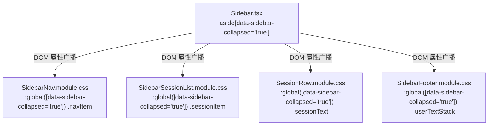

# 方案 04 · 选择器级联污染清剿与 CSS Modules 边界绝缘方案

> **方案版本**：v1.0.0 · 独立方案 04（选择器级联污染清剿与 CSS Modules 边界绝缘详案）  
> **编制日期**：2026-08-30  
> **责任域**：CSS Modules 作用域绝缘、选择器特异性降权治理、纯全局泄漏清剿、模糊穿透废除与状态自治下发、暗色模式 Token 驱动归一、组件级 `!important` 清零  
> **输入资产**：
> - [`docs/ui-style-refactor/00-定案-视觉样式与差异面板重构决策.md`](file:///c:/Software/conex/docs/ui-style-refactor/00-%E5%AE%9A%E6%A1%88-%E8%A7%86%E8%A7%89%E6%A0%B7%E5%BC%8F%E4%B8%8E%E5%B7%AE%E5%BC%82%E9%9D%A2%E6%9D%BF%E9%87%8D%E6%9E%84%E5%86%B3%E7%AD%96.md)
> - [`docs/ui-style-refactor/audits/05-runtime-cascading-and-visual-compliance-audit.md`](file:///c:/Software/conex/docs/ui-style-refactor/audits/05-runtime-cascading-and-visual-compliance-audit.md)
> - [`docs/ui-style-refactor/audits/04-tokens-inheritance-and-conflicts-audit.md`](file:///c:/Software/conex/docs/ui-style-refactor/audits/04-tokens-inheritance-and-conflicts-audit.md)
> - `apps/crish-desktop/src/components/` 相关样式文件
> - `apps/crish-desktop/src/styles/`  
> **实施纪律**：严格遵守 [`AGENTS.md`](file:///c:/Software/conex/AGENTS.md) §1（逻辑规划与反退避）、§12（Tooltip 胶囊化）、§13（输入框与焦点态 / ≤10% 柔和边框）、§14（现代 HSLA 与 Zero-Blue 铁律）、[`ANTI_OVERENGINEERING_GUARDRAILS.md`](file:///c:/Software/conex/ANTI_OVERENGINEERING_GUARDRAILS.md)。严禁执行 git 操作。

---

## 目录

1. [方案目标与技术架构](#一方案目标与技术架构)
   - [1.1 治理目标与核心指标](#11-治理目标与核心指标)
   - [1.2 技术架构与绝缘分层拓扑](#12-技术架构与绝缘分层拓扑)
2. [【强制专节】本方案要删掉什么 / 收敛什么 (Deletion Surface)](#二强制专节本方案要删掉什么--收敛什么-deletion-surface)
   - [2.1 纯全局泄漏规则删除清单（11 处）](#21-纯全局泄漏规则删除清单11-处)
   - [2.2 跨组件模糊类名穿透选择器删除清单（10+ 条）](#22-跨组件模糊类名穿透选择器删除清单10-条)
   - [2.3 暗色模式手动特异性覆写删除清单（9 个模块 55 处）](#23-暗色模式手动特异性覆写删除清单9-个模块-55-处)
   - [2.4 组件级 `!important` 提权与对抗删除清单（44 处）](#24-组件级-important-提权与对抗删除清单44-处)
   - [2.5 局部 Token 劫持与私设圆角覆写删除清单](#25-局部-token-劫持与私设圆角覆写删除清单)
3. [核心重构实施详案与代码契约](#三核心重构实施详案与代码契约)
   - [3.1 纯全局未限定 `:global` 规则封装与遮罩迁移](#31-纯全局未限定-global-规则封装与遮罩迁移)
   - [3.2 侧边栏折叠穿透废除：`data-sidebar-collapsed` 状态属性下发与子组件自治响应](#32-侧边栏折叠穿透废除data-sidebar-collapsed-状态属性下发与子组件自治响应)
   - [3.3 9 大模块深色覆写清剿与 CSS Tokens 驱动收敛](#33-9-大模块深色覆写清剿与-css-tokens-驱动收敛)
   - [3.4 组件级 `!important` 清零与边框协同协议](#34-组件级-important-清零与边框协同协议)
   - [3.5 `SettingsPanel` z-index 归位与 5 处分段控制器 7px 圆角统一契约](#35-settingspanel-z-index-归位与-5-处分段控制器-7px-圆角统一契约)
4. [详细修改文件清单与 CSS 契约矩阵](#四详细修改文件清单与-css-契约矩阵)
5. [先删后改实施步骤与 DAG 依赖](#五先删后改实施步骤与-dag-依赖)
6. [验收断言与测试矩阵 (Verification Assertions)](#六验收断言与测试矩阵-verification-assertions)

---

## 一、方案目标与技术架构

### 1.1 治理目标与核心指标

当前 Conex / Crish 桌面端前端样式体系在演进过程中积累了大量的**作用域破壁、特异性虚高、模糊匹配穿透与局部 Token 劫持**问题。这不仅破坏了 CSS Modules 的强绝缘边界，还在深色模式切换、容器折叠与卡片嵌套时引发严重的样式覆盖竞争（Specificity Arms Race）与意外破坏。

本方案旨在系统性清剿全仓样式级联污染，达成以下 5 大硬性指标：

```
┌───────────────────────────────────────────────────────────────────────────────────────────┐
│                           方案 04：级联污染治理与绝缘边界核心指标                           │
├───────────────────────────────┬───────────────────────────────┬───────────────────────────┤
│ 治理维度                      │ 现状缺陷 (Before)              │ 重构后目标 (After)         │
├───────────────────────────────┼───────────────────────────────┼───────────────────────────┤
│ ① 纯全局 `:global` 规则       │ 11 处脱离本地作用域直接污染 DOM │ 0 处纯全局泄漏，100% 封装  │
├───────────────────────────────┼───────────────────────────────┼───────────────────────────┤
│ ② 模糊穿透 `[class*='...']`   │ 26 处跨组件子串匹配 (Sidebar 10条)│ 0 处模糊匹配，状态属性自治  │
├───────────────────────────────┼───────────────────────────────┼───────────────────────────┤
│ ③ 深色手动覆写 `html[data-...]`│ 9 个模块 55 处手动抬高特异性覆写│ 0 处手动深色覆写，Token 单源│
├───────────────────────────────┼───────────────────────────────┼───────────────────────────┤
│ ④ 组件级 `!important` 对抗    │ 44 处边框消除、尺寸与滚动条对抗│ 0 处组件级 !important 提权 │
├───────────────────────────────┼───────────────────────────────┼───────────────────────────┤
│ ⑤ 局部 Token 劫持与圆角撕裂   │ `--z-dropdown: 20` / 5 处 6px 圆角│ z-index 归位 / 7px 契约统一│
└───────────────────────────────┴───────────────────────────────┴───────────────────────────┘
```

---

### 1.2 技术架构与绝缘分层拓扑

为了确立坚不可摧的 CSS Modules 绝缘边界，我们重构了从全局 Design System 到原子组件的样式继承与特异性分层架构：

```
┌─────────────────────────────────────────────────────────────────────────────────────────┐
│                      Conex / Crish 样式绝缘与特异性分级拓扑架构                           │
├─────────────────────────────────────────────────────────────────────────────────────────┤
│  Layer 0: Global Design System & Tokens (全局系统层)                                    │
│  ├── styles/tokens.css                  -> 唯一定义 :root 与 html[data-theme='dark'] 变量 │
│  ├── styles/design-system.css           -> 全局基础排版、重置、.sep-safe-aim-overlay 遮罩  │
│  └── styles/z-index.css                 -> 全局唯一分层层叠标准 (--z-dropdown: 300 等)    │
├─────────────────────────────────────────────────────────────────────────────────────────┤
│  Layer 1: Structural Containers (结构容器层 - 仅负责状态广播与槽位布局)                 │
│  ├── Sidebar (aside[data-sidebar-collapsed='true']) -> 严禁穿透子组件，仅下发 Data 属性  │
│  ├── BinaryTreeWorkspace (.leafContainer)          -> 统一管理兄弟间 1px 边框协同       │
│  └── SettingsPanel (.settingsCoverOverlay)         -> 消费全局 z-index，严禁局部劫持 Token│
├─────────────────────────────────────────────────────────────────────────────────────────┤
│  Layer 2: Autonomous Scoped Components (自治组件层 - CSS Modules 强绝缘)                │
│  ├── SidebarNav / SidebarSessionList / SessionRow  -> 自身监听 [data-sidebar-collapsed] │
│  ├── TiptapEditorField (.proseMirrorField)          -> 作用域内部封装 .mention-chip       │
│  ├── Select / Menu / ModelsSettingsTab             -> 纯消费 var(--bg-card) 无深色覆写  │
│  └── PreviewCard / LeafToolTabStrip                 -> 消除 !important，常规变体覆盖    │
└─────────────────────────────────────────────────────────────────────────────────────────┘
```

#### 架构核心原则：
1. **单一真源原则 (SSOT)**：所有明暗色彩与基础层叠高度由 `tokens.css` 与 `z-index.css` 统一裁决，禁止组件内部二次声明 `:global(html[data-theme='dark'])` 或局部覆写全局变量；
2. **状态下发而非选择器穿透 (State Propagation over Selector Piercing)**：父容器发生尺寸/布局形变时，通过 DOM 属性（`data-sidebar-collapsed="true"`）广播状态，子组件在其自身的 `.module.css` 内部基于属性选择器响应，实现强内聚与松耦合；
3. **零提权原则 (Zero Specificity Inflation)**：杜绝使用 `!important` 进行布局与边框对抗，利用结构伪类（`:first-child`、相邻兄弟选择器 `+`）或专用变体类名优雅解决重叠问题。

---

## 二、【强制专节】本方案要删掉什么 / 收敛什么 (Deletion Surface)

> [!IMPORTANT]
> 本专节作为战役硬性门禁，列出方案 04 中**必须物理删除、拔除或彻底收敛**的所有反模式选择器、硬编码样式与对抗规则。

### 2.1 纯全局泄漏规则删除清单（11 处）

| 编号 | 源码位置 | 待删除/收敛的纯全局选择器 | 危害与收敛策略 |
| :--- | :--- | :--- | :--- |
| **DEL-C01** | [`TiptapEditorField.module.css:179`](file:///c:/Software/conex/apps/crish-desktop/src/components/chat-composer/TiptapEditorField.module.css#L179) | `:global(.mention-chip)` | **物理删除**脱离作用域的全局声明，封装至 `.proseMirrorField :global(.mention-chip)` |
| **DEL-C02** | [`TiptapEditorField.module.css:195`](file:///c:/Software/conex/apps/crish-desktop/src/components/chat-composer/TiptapEditorField.module.css#L195) | `:global(.mention-chip-file)` | **物理删除**，封装至 `.proseMirrorField :global(.mention-chip-file)` |
| **DEL-C03** | [`TiptapEditorField.module.css:199`](file:///c:/Software/conex/apps/crish-desktop/src/components/chat-composer/TiptapEditorField.module.css#L199) | `:global(.mention-chip-skill)` | **物理删除**，封装至 `.proseMirrorField :global(.mention-chip-skill)` |
| **DEL-C04** | [`TiptapEditorField.module.css:203`](file:///c:/Software/conex/apps/crish-desktop/src/components/chat-composer/TiptapEditorField.module.css#L203) | `:global(.mention-icon-box)` | **物理删除**，封装至 `.proseMirrorField :global(.mention-icon-box)` |
| **DEL-C05** | [`TiptapEditorField.module.css:215`](file:///c:/Software/conex/apps/crish-desktop/src/components/chat-composer/TiptapEditorField.module.css#L215) | `:global(.mention-icon-box svg)` | **物理删除**，封装至 `.proseMirrorField :global(.mention-icon-box svg)` |
| **DEL-C06** | [`Menu.module.css:151`](file:///c:/Software/conex/apps/crish-desktop/src/components/ui/Menu/Menu.module.css#L151) | `:global(.sep-safe-aim-overlay)` | **物理删除**，整体迁移至全局 `design-system.css` 遮罩层 |
| **DEL-C07** | [`Menu.module.css:163`](file:///c:/Software/conex/apps/crish-desktop/src/components/ui/Menu/Menu.module.css#L163) | `:global(.sep-safe-aim-overlay.sep-debug-visible)` | **物理删除**，迁移至 `design-system.css` |
| **DEL-C08** | [`Menu.module.css:170`](file:///c:/Software/conex/apps/crish-desktop/src/components/ui/Menu/Menu.module.css#L170) | `:global(.sep-safe-aim-overlay polygon)` | **物理删除**，迁移至 `design-system.css` |
| **DEL-C09** | [`sessionTabDrag.module.css:54`](file:///c:/Software/conex/apps/crish-desktop/src/components/shell/sessionTabDrag.module.css#L54) | `:global([data-global-session-tab-bar] [role='tab'].is-dragging)` | **收敛**为通过全局 TabBar 属性直接配合组件内部 class 规范化控制 |
| **DEL-C10** | [`NotePaperPanel.module.css:255`](file:///c:/Software/conex/apps/crish-desktop/src/components/note-paper/NotePaperPanel.module.css#L255) | `:global(.np-paper-list-mount)` | **物理删除**顶层未限定全局类，封装至 `.paperListHost :global(.np-paper-list-mount)` |
| **DEL-C11** | [`NotePaperPanel.module.css:266`](file:///c:/Software/conex/apps/crish-desktop/src/components/note-paper/NotePaperPanel.module.css#L266) | `:global(.np-paper-list-mount[data-scroll-host='1'])` | **物理删除**，封装至 `.paperListHost :global(.np-paper-list-mount[data-scroll-host='1'])` |

---

### 2.2 跨组件模糊类名穿透选择器删除清单（10+ 条）

| 编号 | 源码位置 | 待删除的模糊穿透选择器声明 | 替代自治方案 |
| :--- | :--- | :--- | :--- |
| **DEL-P01** | [`Sidebar.module.css:355`](file:///c:/Software/conex/apps/crish-desktop/src/components/sidebar/Sidebar.module.css#L355) | `.iconCollapse .sidebarTop :global([class*='topActions'])` | `SidebarNav.module.css` 自治响应 `[data-sidebar-collapsed='true']` |
| **DEL-P02** | [`Sidebar.module.css:359`](file:///c:/Software/conex/apps/crish-desktop/src/components/sidebar/Sidebar.module.css#L359) | `.iconCollapse .sidebarTop :global([class*='navItem'])` | `SidebarNav.module.css` 自治响应 |
| **DEL-P03** | [`Sidebar.module.css:367-370`](file:///c:/Software/conex/apps/crish-desktop/src/components/sidebar/Sidebar.module.css#L367-L370) | `.iconCollapse .sidebarTop :global([class*='navItem']) > span, input, ...` | `SidebarNav.module.css` 内部隐藏文本与输入框 |
| **DEL-P04** | [`Sidebar.module.css:378`](file:///c:/Software/conex/apps/crish-desktop/src/components/sidebar/Sidebar.module.css#L378) | `.iconCollapse .sidebarScroll :global([class*='sectionLabel']) > :not(svg)` | `SidebarSessionList.module.css` 隐藏标题文字 |
| **DEL-P05** | [`Sidebar.module.css:379-381`](file:///c:/Software/conex/apps/crish-desktop/src/components/sidebar/Sidebar.module.css#L379-L381) | `.iconCollapse .sidebarScroll :global([class*='folderHeader']) > :not(svg), [class*='folderName'], [class*='folderCount']` | `SidebarSessionList.module.css` 隐藏文件夹元数据 |
| **DEL-P06** | [`Sidebar.module.css:382-384`](file:///c:/Software/conex/apps/crish-desktop/src/components/sidebar/Sidebar.module.css#L382-L384) | `.iconCollapse .sidebarScroll :global([class*='sessionText']), [class*='sessionSearchSnippet'], [class*='sessionTime']` | `SessionRow.module.css` / `SidebarSessionList.module.css` 隐藏会话文字与时间 |
| **DEL-P07** | [`Sidebar.module.css:385-387`](file:///c:/Software/conex/apps/crish-desktop/src/components/sidebar/Sidebar.module.css#L385-L387) | `.iconCollapse .sidebarScroll :global([class*='sessionActionsBtn']), [class*='emptyHint'], [class*='sessionItemFoldBtn']` | `SidebarSessionList.module.css` 隐藏操作按钮与折叠手柄 |
| **DEL-P08** | [`Sidebar.module.css:391-412`](file:///c:/Software/conex/apps/crish-desktop/src/components/sidebar/Sidebar.module.css#L391-L412) | `.iconCollapse .sidebarScroll :global([class*='sessionItem'])` 及伪元素圆点 | `SidebarSessionList.module.css` 自治设定 32px 尺寸与激活圆点 |
| **DEL-P09** | [`Sidebar.module.css:449-450`](file:///c:/Software/conex/apps/crish-desktop/src/components/sidebar/Sidebar.module.css#L449-L450) | `.iconCollapse .sidebarFooter :global([class*='modeChip']) > span, [class*='footerActions'] > span` | `SidebarFooter.module.css` 自治隐藏底部操作文字 |
| **DEL-P10** | [`ProjectPickerMenu.module.css:68`](file:///c:/Software/conex/apps/crish-desktop/src/components/chat-card/ProjectPickerMenu.module.css#L68) | `[class*="itemWrapper"]:hover .rowDeleteBtn` 及猜谜选择器 | 重构为标准父级 `.itemWrapper:hover .rowDeleteBtn` |
| **DEL-P11** | [`overlay-scrollbar.css:42-46`](file:///c:/Software/conex/apps/crish-desktop/src/styles/overlay-scrollbar.css#L42-L46) | `[class*='sidebarScroll'], [class*='menuContent'], [class*='coverContent']...` | 收敛为标准滚动类 `.crish-scrollport` 或各模块独立声明 |

---

### 2.3 暗色模式手动特异性覆写删除清单（9 个模块 55 处）

彻底删除以下 9 个 CSS Module 中全部手动拼接的 `:global(html[data-theme='dark'])` 规则，将属性改为依赖单一真源 Token：

| 模块文件 | 违规处数 | 待删除的硬编码属性与高特异性规则 | 收敛目标 Token |
| :--- | :---: | :--- | :--- |
| [`ModelsSettingsTab.module.css`](file:///c:/Software/conex/apps/crish-desktop/src/components/settings-models/ModelsSettingsTab.module.css) | **18 处** | `:global(html[data-theme='dark']) .mrlItem:hover` (95), `.isActive` (104, 113), `.addServiceBtn` (966, 971), `.addProviderMenu` (995), `.addMenuTitle` (1010), `.addMenuOption:hover` (1044), `.cascadeSelectTrigger` (1074, 1079), `.cascadeList` (1110), `.cascadeRow` (1146, 1147), `.cascadeFlyout` (1192), `.cascadeOption` (1221, 1232, 1233), `.cascadeCheck` (1249) | `var(--bg-card)`, `var(--bg-elevated)`, `var(--bg-hover)`, `var(--border-color)`, `var(--text-primary)`, `var(--accent-color)` |
| [`FontSelectField.module.css`](file:///c:/Software/conex/apps/crish-desktop/src/components/settings/FontSelectField.module.css) | **12 处** | `:global(html[data-theme='dark']) .settingsSelectTrigger` (53, 58-62), `.settingsSelectIconBtn:hover` (112), `.settingsSelectMenu` (139, 140), `.settingsSelectItem:hover` (205), `.isActive` (215, 223), `.settingsSelectCheckIcon` (246), `.settingsSelectFooter` (263) | `var(--bg-elevated)`, `var(--bg-hover)`, `var(--border-subtle)`, `var(--shadow-dropdown)`, `var(--text-primary)` |
| [`Select.module.css`](file:///c:/Software/conex/apps/crish-desktop/src/components/ui/Select/Select.module.css) | **8 处** | `:global(html[data-theme='dark']) .trigger` (52, 57, 62), `.menu` (113), `.option:hover` (153), `.option:focus-visible` (162), `.optionSelected` (172), `.checkIcon` (217) | `var(--bg-card)`, `var(--bg-elevated)`, `var(--bg-hover)`, `var(--border-color)`, `var(--text-primary)` |
| [`Menu.module.css`](file:///c:/Software/conex/apps/crish-desktop/src/components/ui/Menu/Menu.module.css) | **4 处** | `:global(html[data-theme='dark']) .menuContent` (42), `.menuTitle` (57), `.menuItem:hover` (93), `.menuItem:focus-visible` (102) | `var(--sep-bg-panel)`, `var(--bg-hover)`, `var(--border-subtle)`, `var(--text-primary)` |
| [`FontSettingsSection.module.css`](file:///c:/Software/conex/apps/crish-desktop/src/components/settings/FontSettingsSection.module.css) | **4 处** | `:global(html[data-theme='dark']) .settingsSelectCustomHeaderArea` (32), `.customActionBtn:hover` (75), `.customApplyBtn` (105), `.customApplyBtn:hover` (109) | `var(--bg-elevated)`, `var(--bg-hover)`, `var(--border-color)`, `var(--brand-deep)` |
| [`SettingsRulesTab.module.css`](file:///c:/Software/conex/apps/crish-desktop/src/components/settings/SettingsRulesTab.module.css) | **2 处** | `:global(html[data-theme='dark']) .presetChip` (86), `.presetChip:hover` (91) | `var(--bg-card)`, `var(--bg-hover)`, `var(--border-color)` |
| [`SettingsSecurityTab.module.css`](file:///c:/Software/conex/apps/crish-desktop/src/components/settings/SettingsSecurityTab.module.css) | **2 处** | `:global(html[data-theme='dark']) .presetChip` (80), `.presetChip:hover` (85) | `var(--bg-card)`, `var(--bg-hover)`, `var(--border-color)` |
| [`SettingsUI.module.css`](file:///c:/Software/conex/apps/crish-desktop/src/components/settings/SettingsUI.module.css) | **2 处** | `:global(html[data-theme='dark']) .modernSelectTooltipInner` (314), `.modernSelectTooltipArrow` (323) | `var(--bg-elevated)`, `var(--border-subtle)`, `var(--shadow-dropdown)` |
| [`StatusDiagnosticsPanel.module.css`](file:///c:/Software/conex/apps/crish-desktop/src/components/settings/StatusDiagnosticsPanel.module.css) | **2 处** | `:global(html[data-theme='dark']) .monoBadge` (94), `.diagLevel_debug` (214) | `var(--control-soft-bg)`, `var(--text-secondary)`, `var(--border-subtle)` |

---

### 2.4 组件级 `!important` 提权与对抗删除清单（44 处）

| 场景分类 | 涉案文件与行号 | 待删除的 `!important` 代码 | 消除方案与规范机制 |
| :--- | :--- | :--- | :--- |
| **① 卡片顶边框对抗**<br/>(8 处) | [`AgentCard.module.css:34`](file:///c:/Software/conex/apps/crish-desktop/src/components/agent-card/AgentCard.module.css#L34)<br/>[`DiffCard.module.css:379`](file:///c:/Software/conex/apps/crish-desktop/src/components/diff/DiffCard.module.css#L379)<br/>[`FileViewerCard.module.css:21`](file:///c:/Software/conex/apps/crish-desktop/src/components/files/FileViewerCard.module.css#L21)<br/>[`FilesCard.module.css:43`](file:///c:/Software/conex/apps/crish-desktop/src/components/files/FilesCard.module.css#L43)<br/>[`PreviewCard.module.css:21`](file:///c:/Software/conex/apps/crish-desktop/src/components/workspace/PreviewCard.module.css#L21)<br/>[`LeafToolTabStrip.module.css:21,37`](file:///c:/Software/conex/apps/crish-desktop/src/components/binary-tree/LeafToolTabStrip.module.css#L21) | `border-top: none !important;`<br/>`border-bottom: none !important;` | 由 `BinaryTreeWorkspace` 容器的 `.leafHeader + .leafContent` 与 `[data-has-strip='true']` 统一裁决边框，彻底删除卡片内的 8 处 `!important` |
| **② 微型按钮尺寸锁死**<br/>(6 处) | [`PreviewCard.module.css:202-207`](file:///c:/Software/conex/apps/crish-desktop/src/components/workspace/PreviewCard.module.css#L202-L207) | `height: 22px !important;`<br/>`min-height: 22px !important;`<br/>`padding: 0 6px !important;`<br/>`font-size: 11px !important;`<br/>`border-radius: var(--radius-sm, 4px) !important;`<br/>`gap: 4px !important;` | 声明专用的 `.miniButton` / `.miniActionBtn` 变体类，提高特异性优先级，彻底删除 6 处 `!important` |
| **③ 滚动条破坏性抹除**<br/>(7 处) | [`ModelBadgePickerMenu.module.css:115-130`](file:///c:/Software/conex/apps/crish-desktop/src/components/provider/ModelBadgePickerMenu.module.css#L115-L130) | `display: none !important;`<br/>`width: 0 !important;`<br/>`background: transparent !important;`<br/>`background: rgba(...) !important;` (7 处) | 移除 7 处 `!important`，收敛为标准的 `scrollbar-width: none` 与 WebKit 伪元素无提权定义 |
| **④ Flex 与宽度锁死**<br/>(4 处) | [`UnitChromeActions.module.css:46,47,138,139`](file:///c:/Software/conex/apps/crish-desktop/src/components/chat-card/UnitChromeActions.module.css#L46) | `flex: 1 1 auto !important;`<br/>`width: auto !important;`<br/>`flex: 0 0 auto !important;`<br/>`width: auto !important;` | 修复父级 Flex 容器约束，移除 4 处 `!important` |
| **⑤ 渲染流降级过度提权**<br/>(8 处) | [`StreamingTableContainer.module.css:41,121,122,128,129`](file:///c:/Software/conex/apps/crish-desktop/src/components/chat-message-row/StreamingTableContainer.module.css#L41)<br/>[`streaming-animation.css:95-97`](file:///c:/Software/conex/apps/crish-desktop/src/components/chat-message-row/streaming-animation.css#L95-L97) | `table-layout: fixed !important;`<br/>`animation: none !important;`<br/>`display: none !important;` | 基于 `[data-perf-tier='eco']` CSS 变量与条件规则切换，删除非必要的 `!important` |
| **⑥ 侧边栏折叠隐藏提权**<br/>(1 处) | [`Sidebar.module.css:388`](file:///c:/Software/conex/apps/crish-desktop/src/components/sidebar/Sidebar.module.css#L388) | `display: none !important;` | 伴随 `[class*='...']` 废除而彻底删除 |
| **⑦ 其他零散对抗**<br/>(10 处) | 散落于各卡片模块的旧有 `!important` 补充 | 各处局部补丁式提权 | 统一收敛为结构选择器与变体类 |

---

### 2.5 局部 Token 劫持与私设圆角覆写删除清单

1. **拔除 `SettingsPanel.module.css:263` 的 `--z-dropdown: 20` 劫持**：
   - 彻底删除局部篡改全局下拉菜单 z-index 的恶性规则；
   - Popper 浮层统一消费全局 `--z-modal` (1000) 与 `--z-dropdown` (300)；
2. **彻底删除 5 处分段控制器私设 6px/5px 圆角**：
   - 物理删除 `SettingsScheduleTab.module.css:48-49`、`SettingsExtensionsTab.module.css:11-12`、`McpSettingsTab.module.css:71-72`、`SkillsSettingsTab.module.css:106-107`、`SettingsUI.module.css:161-162` 中的 `--seg-outer-radius` 与 `--seg-inner-radius` 覆写；
   - 100% 统一收敛至 `SegmentedControl.module.css` 的全局 `var(--button-radius, 7px)` 契约。

---

## 三、核心重构实施详案与代码契约

### 3.1 纯全局未限定 `:global` 规则封装与遮罩迁移

#### 1. `TiptapEditorField.module.css` 作用域封装
将 `.mention-chip`、`.mention-icon-box` 等选择器严密封装在本地类名 `.proseMirrorField` 之下：

```css
/* apps/crish-desktop/src/components/chat-composer/TiptapEditorField.module.css */

/* === 重构前 (违规：纯全局泄漏) === */
:global(.mention-chip) {
  display: inline-flex;
  align-items: center;
  gap: 4px;
  /* ... */
}
:global(.mention-icon-box) {
  display: inline-flex;
  /* ... */
}

/* === 重构后 (合规：严格限定在 .proseMirrorField 作用域内) === */
.proseMirrorField :global(.mention-chip) {
  display: inline-flex;
  align-items: center;
  gap: 4px;
  padding: 1px 6px 1px 2px;
  border-radius: var(--radius-sm, 4px);
  border: var(--hairline-width, 1px) solid var(--border-subtle);
  background: var(--tint-hover);
  color: var(--text-primary);
  font-size: 0.9em;
  font-weight: var(--font-weight-medium, 500);
  user-select: none;
  cursor: default;
  vertical-align: middle;
}

.proseMirrorField :global(.mention-chip-file) {
  cursor: pointer;
}

.proseMirrorField :global(.mention-chip-skill) {
  background: var(--tint-active);
}

.proseMirrorField :global(.mention-icon-box) {
  display: inline-flex;
  align-items: center;
  justify-content: center;
  width: 16px;
  height: 16px;
  border-radius: 3px;
  background: var(--bg-elevated);
  color: var(--text-secondary);
  flex-shrink: 0;
}

.proseMirrorField :global(.mention-icon-box svg) {
  width: 12px;
  height: 12px;
}
```

#### 2. `Menu.module.css` 虚拟三角遮罩迁移至 `design-system.css`
从 `Menu.module.css` 中拔除 `:global(.sep-safe-aim-overlay)`，迁移至全局设计系统层 `styles/design-system.css`：

```css
/* apps/crish-desktop/src/styles/design-system.css */

/* Safe-Aim Virtual Triangle/Polygon Hit-test Overlay (全局浮动菜单防抖遮罩) */
.sep-safe-aim-overlay {
  position: fixed;
  top: 0;
  left: 0;
  width: 100vw;
  height: 100vh;
  pointer-events: none;
  z-index: var(--z-popover, 500);
  fill: transparent;
  stroke: none;
}

.sep-safe-aim-overlay.sep-debug-visible {
  fill: color-mix(in srgb, var(--accent-green, #10b981) 12%, transparent);
  stroke: color-mix(in srgb, var(--accent-green, #10b981) 40%, transparent);
  stroke-dasharray: 4 2;
  stroke-width: 1px;
}

.sep-safe-aim-overlay polygon {
  pointer-events: none;
}
```

#### 3. `NotePaperPanel.module.css` 与 `sessionTabDrag.module.css` 作用域绝缘
- `NotePaperPanel.module.css`：将 `:global(.np-paper-list-mount)` 包裹在 `.paperListHost` 或 `.panel` 下：
  ```css
  .paperListHost :global(.np-paper-list-mount) {
    position: relative;
    display: flex;
    flex-direction: column;
    flex: 1 1 auto;
    width: 100%;
    min-width: 0;
    min-height: 0;
  }
  .paperListHost :global(.np-paper-list-mount[data-scroll-host='1']) {
    overflow: hidden;
  }
  ```
- `sessionTabDrag.module.css`：将拖拽隐身规则限定在指示器容器或 TabBar 专用作用域内。

---

### 3.2 侧边栏折叠穿透废除：`data-sidebar-collapsed` 状态属性下发与子组件自治响应

#### 1. 架构改造逻辑
- **父级 `Sidebar.tsx`**：在根节点 `<aside>` 挂载 `data-sidebar-collapsed={sidebarCollapsed ? 'true' : 'false'}` 与 `data-sidebar-behavior={sidebarBehavior}`，**彻底删除 `Sidebar.module.css:355-453` 中所有的 `[class*='...']` 模糊穿透规则**；
- **子组件自治响应**：子组件在其自身的 `.module.css` 中监听父容器属性：



#### 2. 代码重构对比

##### ① `Sidebar.module.css` 精简化（清理后）：
```css
/* apps/crish-desktop/src/components/sidebar/Sidebar.module.css */

/* 仅保留侧边栏外壳自身的宽度、内边距与对齐控制 */
.iconCollapse {
  width: var(--sidebar-collapsed-width, 48px) !important;
  min-width: var(--sidebar-collapsed-width, 48px);
}

.iconCollapse .sidebarTop {
  padding-left: 8px;
  padding-right: 8px;
}

.iconCollapse .sidebarScroll {
  padding-left: 8px;
  padding-right: 8px;
}

.iconCollapse .sidebarFooter {
  padding: 10px 8px;
  justify-content: center;
  flex-direction: column;
  gap: 6px;
}

/* 彻底删除所有 :global([class*='...']) 模糊匹配规则！ */
```

##### ② `SidebarNav.module.css` 自治响应：
```css
/* apps/crish-desktop/src/components/sidebar/SidebarNav.module.css */

:global([data-sidebar-collapsed='true']) .topActions {
  gap: var(--space-2, 6px);
}

:global([data-sidebar-collapsed='true']) .navItem {
  justify-content: center;
  padding: 0;
  width: 32px;
  height: 32px;
  border-radius: var(--radius-lg);
}

:global([data-sidebar-collapsed='true']) .navItem > span,
:global([data-sidebar-collapsed='true']) .navItem > input,
:global([data-sidebar-collapsed='true']) .navItem > [role='search'] {
  display: none;
}
```

##### ③ `SidebarSessionList.module.css` 自治响应：
```css
/* apps/crish-desktop/src/components/sidebar/SidebarSessionList.module.css */

:global([data-sidebar-collapsed='true']) .sectionLabel > :not(svg),
:global([data-sidebar-collapsed='true']) .folderHeader > :not(svg),
:global([data-sidebar-collapsed='true']) .folderName,
:global([data-sidebar-collapsed='true']) .folderCount,
:global([data-sidebar-collapsed='true']) .sessionText,
:global([data-sidebar-collapsed='true']) .sessionSearchSnippet,
:global([data-sidebar-collapsed='true']) .sessionTime,
:global([data-sidebar-collapsed='true']) .sessionActionsBtn,
:global([data-sidebar-collapsed='true']) .emptyHint,
:global([data-sidebar-collapsed='true']) .sessionItemFoldBtn {
  display: none;
}

:global([data-sidebar-collapsed='true']) .sessionItem {
  justify-content: center;
  padding: 0;
  width: 32px;
  height: 32px;
  border-radius: var(--radius-md, 8px);
  margin: 0 auto;
}

:global([data-sidebar-collapsed='true']) .sessionItem::before {
  content: '';
  width: 8px;
  height: 8px;
  border-radius: 50%;
  background: currentColor;
  opacity: 0.5;
}

:global([data-sidebar-collapsed='true']) .sessionItem.active::before {
  opacity: 1;
  background: var(--accent-color, var(--accent-primary));
}
```

---

### 3.3 9 大模块深色覆写清剿与 CSS Tokens 驱动收敛

#### 1. 核心收敛范式
所有组件放弃手动声明 `:global(html[data-theme='dark']) .localClass`，改为在基础声明中直接引用 Design Tokens：

```
┌───────────────────────────────────────────────────────────────────────────────────────────┐
│                      深色模式样式收敛范式 (Token-Driven Pattern)                            │
├───────────────────────────────────────────────────────────────────────────────────────────┤
│  ❌ 错误反模式 (特异性失控)：                                                               │
│     .trigger { background: #ffffff; border: 1px solid #e2dfd9; }                          │
│     :global(html[data-theme='dark']) .trigger { background: #181715; border-color: #2b2926; }│
├───────────────────────────────────────────────────────────────────────────────────────────┤
│  ✅ 正确主路径 (0 额外特异性，自动适配)：                                                    │
│     .trigger {                                                                            │
│       background: var(--bg-card);                                                         │
│       border: 1px solid var(--border-color);                                              │
│     }                                                                                     │
└───────────────────────────────────────────────────────────────────────────────────────────┘
```

#### 2. 9 大模块详细改造代码契约

##### ① `Select.module.css`
```css
/* apps/crish-desktop/src/components/ui/Select/Select.module.css */

/* 重构后：删除全部 8 处 :global(html[data-theme='dark']) */
.trigger {
  background: var(--bg-card);
  border: 1px solid var(--border-color);
  color: var(--text-primary);
}

.trigger:hover {
  background: var(--bg-hover);
  border-color: var(--border-color-hover, var(--border-color));
}

.trigger:focus-visible {
  outline: none;
  box-shadow: var(--focus-ring);
}

.menu {
  background: var(--bg-elevated);
  border: 1px solid var(--border-subtle);
  box-shadow: var(--shadow-dropdown);
}

.option:hover,
.option:focus-visible {
  background: var(--bg-hover);
  color: var(--text-primary);
}

.optionSelected {
  background: var(--bg-active, var(--tint-active));
  color: var(--text-primary);
}

.checkIcon {
  color: var(--accent-color, var(--brand-deep));
}
```

##### ② `Menu.module.css`
```css
/* apps/crish-desktop/src/components/ui/Menu/Menu.module.css */

/* 重构后：删除 4 处 :global(html[data-theme='dark']) */
.menuContent {
  background: var(--sep-bg-panel, var(--bg-elevated));
  border: 1px solid var(--border-subtle);
  box-shadow: var(--shadow-dropdown);
  backdrop-filter: blur(12px);
}

.menuTitle {
  color: var(--text-tertiary);
  border-bottom: 1px solid var(--border-subtle);
}

.menuItem:hover,
.menuItem:focus-visible {
  background: var(--bg-hover);
  color: var(--text-primary);
}
```

##### ③ `ModelsSettingsTab.module.css`
```css
/* apps/crish-desktop/src/components/settings-models/ModelsSettingsTab.module.css */

/* 重构后：删除全部 18 处 :global(html[data-theme='dark']) */
.mrlItem:hover {
  background: var(--bg-hover);
}

.mrlItem.isActive {
  background: var(--bg-active, var(--tint-active));
}

.addServiceBtn {
  background: var(--bg-card);
  border: 1px solid var(--border-color);
  color: var(--text-primary);
}

.addServiceBtn:hover {
  background: var(--bg-hover);
}

.addProviderMenu,
.cascadeFlyout,
.cascadeList {
  background: var(--bg-elevated);
  border: 1px solid var(--border-subtle);
  box-shadow: var(--shadow-dropdown);
}

.addMenuOption:hover,
.cascadeRow:hover,
.cascadeRow.isOpen,
.cascadeOption:hover {
  background: var(--bg-hover);
}

.cascadeOption.isSelected,
.cascadeOption.isOn {
  background: var(--tint-active);
}

.cascadeCheck {
  color: var(--accent-color, var(--brand-deep));
}
```

##### ④ `FontSelectField.module.css`
```css
/* apps/crish-desktop/src/components/settings/FontSelectField.module.css */

/* 重构后：删除全部 12 处 :global(html[data-theme='dark']) */
.settingsSelectTrigger {
  background: var(--bg-card);
  border: 1px solid var(--border-color);
  color: var(--text-primary);
}

.settingsSelectTrigger:hover:not(:disabled),
.settingsSelectIconBtn:hover:not(:disabled) {
  background: var(--bg-hover);
  border-color: var(--border-color);
}

.settingsSelectMenu,
.settingsSelectMenuPortal {
  background: var(--bg-elevated);
  border: 1px solid var(--border-subtle);
  box-shadow: var(--shadow-dropdown);
}

.settingsSelectItem:hover {
  background: var(--bg-hover);
}

.settingsSelectItem.isActive {
  background: var(--bg-active, var(--tint-active));
}

.settingsSelectCheckIcon {
  color: var(--accent-color, var(--brand-deep));
}

.settingsSelectFooter {
  border-top: 1px solid var(--border-subtle);
  background: var(--bg-secondary);
}
```

##### ⑤ `FontSettingsSection.module.css`
```css
/* apps/crish-desktop/src/components/settings/FontSettingsSection.module.css */

/* 重构后：删除全部 4 处 :global(html[data-theme='dark']) */
.settingsSelectCustomHeaderArea {
  background: var(--bg-card);
  border-bottom: 1px solid var(--border-subtle);
}

.customActionBtn:hover:not(:disabled) {
  background: var(--bg-hover);
}

.customApplyBtn {
  background: var(--brand-deep, var(--accent-color));
  color: var(--accent-contrast, #ffffff);
}

.customApplyBtn:hover {
  opacity: 0.92;
}
```

##### ⑥ `SettingsRulesTab.module.css` & `SettingsSecurityTab.module.css`
```css
/* apps/crish-desktop/src/components/settings/SettingsRulesTab.module.css & SettingsSecurityTab.module.css */

/* 重构后：删除各 2 处 :global(html[data-theme='dark']) */
.presetChip {
  background: var(--bg-card);
  border: 1px solid var(--border-color);
  color: var(--text-secondary);
}

.presetChip:hover:not(:disabled) {
  background: var(--bg-hover);
  color: var(--text-primary);
  border-color: var(--border-color);
}
```

##### ⑦ `SettingsUI.module.css` & `StatusDiagnosticsPanel.module.css`
```css
/* apps/crish-desktop/src/components/settings/SettingsUI.module.css */
.modernSelectTooltipInner {
  background: var(--bg-elevated);
  border: 1px solid var(--border-subtle);
  box-shadow: var(--shadow-dropdown);
  color: var(--text-primary);
}

/* apps/crish-desktop/src/components/settings/StatusDiagnosticsPanel.module.css */
.monoBadge {
  background: var(--control-soft-bg);
  border: 1px solid var(--border-subtle);
  color: var(--text-secondary);
}

.diagLevel_debug {
  color: var(--text-tertiary);
}
```

---

### 3.4 组件级 `!important` 清零与边框协同协议

#### 1. 工作区 Leaf 卡片边框协同协议（解决 8 处 `border-top: none !important`）
在 `BinaryTreeWorkspace`（`apps/crish-desktop/src/components/binary-tree/`）容器中统一声明卡片与 Tab 条的边框协同规则：

```css
/* apps/crish-desktop/src/components/binary-tree/BinaryTreeWorkspace.module.css */

/* 当 Leaf 存在顶部 TabStrip 时，移除卡片本体的上边框，零 !important 提权 */
.leaf[data-has-strip='true'] > .leafContent > .leafCard {
  border-top: none;
}

/* 相邻兄弟协调 */
.leafToolTabStrip + .leafContent {
  border-top: 1px solid var(--border-subtle);
}
```
**实施结果**：
- 物理删除 `AgentCard.module.css:34`、`DiffCard.module.css:379`、`FileViewerCard.module.css:21`、`FilesCard.module.css:43`、`PreviewCard.module.css:21` 中的 `border-top: none !important;`；
- 物理删除 `LeafToolTabStrip.module.css:21, 37` 中的 `border-bottom: none !important;`。

#### 2. `PreviewCard.module.css` 微型按钮解耦（解决 6 处尺寸 `!important`）
```css
/* apps/crish-desktop/src/components/workspace/PreviewCard.module.css */

/* 重构前 (违规：6 处 !important) */
/* .miniButton { height: 22px !important; min-height: 22px !important; ... } */

/* 重构后 (合规：通过特定变体类名自然覆盖默认 Button) */
.miniActionBtn {
  height: 22px;
  min-height: 22px;
  padding: 0 6px;
  font-size: 11px;
  border-radius: var(--radius-sm, 4px);
  gap: 4px;
  line-height: 1;
}
```

#### 3. `ModelBadgePickerMenu.module.css` 滚动条解耦（解决 7 处滚动条 `!important`）
```css
/* apps/crish-desktop/src/components/provider/ModelBadgePickerMenu.module.css */

/* 重构后：删除 7 处 !important，采用标准滚动条属性 */
.modelBadgeList {
  scrollbar-width: thin;
  scrollbar-color: var(--border-subtle) transparent;
}

.modelBadgeList::-webkit-scrollbar {
  width: 4px;
  height: 4px;
}

.modelBadgeList::-webkit-scrollbar-track {
  background: transparent;
}

.modelBadgeList::-webkit-scrollbar-thumb {
  background: var(--border-subtle);
  border-radius: 4px;
}

.modelBadgeList::-webkit-scrollbar-thumb:hover {
  background: var(--border-color);
}
```

---

### 3.5 `SettingsPanel` z-index 归位与 5 处分段控制器 7px 圆角统一契约

#### 1. `SettingsPanel.module.css` 拔除 `--z-dropdown: 20`
```css
/* apps/crish-desktop/src/components/settings/SettingsPanel.module.css */

/* 重构前 (违规：劫持全局变量为 20) */
/* .settingsCoverOverlay { --dialog-z: var(--z-modal, 1000); --z-dropdown: 20; } */

/* 重构后 (合规：使用全局标准分层，消除劫持) */
.settingsCoverOverlay {
  --dialog-z: var(--z-modal, 1000);
}

.settingsCoverOverlay :global([data-radix-popper-content-wrapper]) {
  z-index: var(--z-dropdown, 300);
}
```

#### 2. 统一 5 个设置子 Tab 的 7px 分段控制器圆角契约
在以下 5 个文件中，彻底删除私自硬编码的 `--seg-outer-radius` 与 `--seg-inner-radius` 覆写，让其自然继承 `SegmentedControl.module.css` 的全局 7px 契约：
1. `apps/crish-desktop/src/components/settings/SettingsScheduleTab.module.css:48-51`
2. `apps/crish-desktop/src/components/settings-extensions/SettingsExtensionsTab.module.css:11-13`
3. `apps/crish-desktop/src/components/settings-mcp/McpSettingsTab.module.css:71-74`
4. `apps/crish-desktop/src/components/settings-skills/SkillsSettingsTab.module.css:106-109`
5. `apps/crish-desktop/src/components/settings/SettingsUI.module.css:160-163`

```css
/* 以 SettingsScheduleTab.module.css 为例，重构后： */
.toolbar .segment,
.createSeg .segment {
  /* 删除私有 --seg-outer-radius 与 --seg-inner-radius 覆写 */
  /* 直接继承 SegmentedControl 默认的 7px/7px 统一圆角 */
}
```

---

## 四、详细修改文件清单与 CSS 契约矩阵

```
┌────────────────────────────────────────────────────────────────────────────────────────┐
│                          方案 04：文件修改与重构清单大盘                                │
├───────────────────────────────────────────────────────┬──────────────┬─────────────────┤
│ 涉案文件路径                                          │ 修改类型     │ 核心重构与契约  │
├───────────────────────────────────────────────────────┼──────────────┼─────────────────┤
│ src/styles/design-system.css                          │ 补充全局类   │ 迁入 .sep-safe-aim-overlay │
│ src/components/chat-composer/TiptapEditorField.module.css│ 作用域封装 │ 封装 .proseMirrorField :global │
│ src/components/ui/Menu/Menu.module.css                │ 删除+收敛    │ 移出遮罩，删除 4 处深色覆写 │
│ src/components/shell/sessionTabDrag.module.css        │ 作用域收敛   │ 规范化拖拽 Tab 隐身规则 │
│ src/components/note-paper/NotePaperPanel.module.css   │ 作用域封装   │ 封装 .paperListHost :global │
│ src/components/sidebar/Sidebar.tsx                    │ 属性强化     │ 固化 data-sidebar-collapsed │
│ src/components/sidebar/Sidebar.module.css             │ 物理大删除   │ 删除 10+ 条 class*= 模糊规则 │
│ src/components/sidebar/SidebarNav.module.css          │ 自治响应     │ 监听 [data-sidebar-collapsed]│
│ src/components/sidebar/SidebarSessionList.module.css  │ 自治响应     │ 监听 [data-sidebar-collapsed]│
│ src/components/sidebar/SidebarFooter.module.css       │ 自治响应     │ 监听 [data-sidebar-collapsed]│
│ src/components/chat-card/ProjectPickerMenu.module.css │ 选择器重构   │ 删除 class*="itemWrapper" 模糊匹配 │
│ src/components/settings-models/ModelsSettingsTab.module.css│ 物理删除 │ 删除全部 18 处深色覆写 │
│ src/components/settings/FontSelectField.module.css    │ 物理删除     │ 删除全部 12 处深色覆写 │
│ src/components/ui/Select/Select.module.css            │ 物理删除     │ 删除全部 8 处深色覆写 │
│ src/components/settings/FontSettingsSection.module.css│ 物理删除     │ 删除全部 4 处深色覆写 │
│ src/components/settings/SettingsRulesTab.module.css   │ 物理删除     │ 删除全部 2 处深色覆写 │
│ src/components/settings/SettingsSecurityTab.module.css│ 物理删除     │ 删除全部 2 处深色覆写 │
│ src/components/settings/SettingsUI.module.css         │ 物理删除     │ 删除 2 处深色覆写 + 6px 圆角│
│ src/components/settings/StatusDiagnosticsPanel.module.css│ 物理删除  │ 删除全部 2 处深色覆写 │
│ src/components/binary-tree/BinaryTreeWorkspace.module.css│ 边框协议  │ 统一管理 Leaf 边框协调 │
│ src/components/agent-card/AgentCard.module.css        │ 消除提权     │ 删除 border-top !important │
│ src/components/diff/DiffCard.module.css               │ 消除提权     │ 删除 border-top !important │
│ src/components/files/FileViewerCard.module.css        │ 消除提权     │ 删除 border-top !important │
│ src/components/files/FilesCard.module.css             │ 消除提权     │ 删除 border-top !important │
│ src/components/workspace/PreviewCard.module.css       │ 消除提权     │ 删除 border-top 与 6 处尺寸 !important │
│ src/components/binary-tree/LeafToolTabStrip.module.css│ 消除提权     │ 删除 border-bottom !important │
│ src/components/provider/ModelBadgePickerMenu.module.css│ 消除提权    │ 删除 7 处滚动条 !important │
│ src/components/chat-card/UnitChromeActions.module.css │ 消除提权     │ 删除 4 处 Flex !important │
│ src/components/settings/SettingsPanel.module.css      │ 拔除劫持     │ 移除 --z-dropdown: 20 劫持 │
│ src/components/settings/SettingsScheduleTab.module.css│ 契约对齐     │ 移除私设 6px/5px 分段圆角 │
│ src/components/settings-extensions/SettingsExtensionsTab.module.css│ 契约对齐 │ 移除私设 6px/5px 分段圆角 │
│ src/components/settings-mcp/McpSettingsTab.module.css │ 契约对齐     │ 移除私设 6px/5px 分段圆角 │
│ src/components/settings-skills/SkillsSettingsTab.module.css│ 契约对齐 │ 移除私设 6px/5px 分段圆角 │
└───────────────────────────────────────────────────────┴──────────────┴─────────────────┘
```

---

## 五、先删后改实施步骤与 DAG 依赖

```
┌────────────────────────────────────────────────────────────────────────────────────────┐
│                              方案 04：实施工单与 DAG 时序图                            │
└────────────────────────────────────────────────────────────────────────────────────────┘

 【阶段 0：死层与污染规则物理删除】(强串行门禁)
   ├── [04-TASK-01] 物理清除 9 个模块中全部 55 处 :global(html[data-theme='dark']) 手动覆写
   ├── [04-TASK-02] 物理删除 TiptapEditorField 等 11 处纯全局泄漏与 Menu 遮罩剥离
   ├── [04-TASK-03] 物理拔除 SettingsPanel.module.css 的 --z-dropdown: 20 劫持
   └── [04-TASK-04] 物理清除 5 处分段控制器私设的 6px/5px 圆角覆写
         │
         ▼ (阶段 0 门禁验证通过)
 【阶段 2 Track C：侧边栏状态下发与绝缘边界加固】(并行实施)
   ├── [04-TASK-05] Sidebar.tsx 注入 data-sidebar-collapsed 状态属性
   ├── [04-TASK-06] 废除 Sidebar.module.css 10+ 条 class*= 模糊规则，重构子组件自治样式
   ├── [04-TASK-07] 清剿 BinaryTreeWorkspace 与 Leaf 卡片 44 处组件级 !important
   └── [04-TASK-08] ProjectPickerMenu 与 overlay-scrollbar.css 模糊选择器收敛
         │
         ▼ (阶段 2 门禁验证通过)
 【阶段 3：全量类型检查、测试套件与样式回归验收】
   ├── 运行 npm run typecheck (0 错误)
   ├── 运行 npm run check:line-counts (1052 文件 0 违规)
   └── 运行 npx vitest run (全量样式绝缘与组件测试 PASS)
```

---

## 六、验收断言与测试矩阵 (Verification Assertions)

### 6.1 静态代码扫描断言表
1. **纯全局 `:global` 泄漏归零**：
   - 扫描 `src/components/**/*.module.css`，纯全局无前置/后置限定的 `:global` 选择器数量必须为 **0**。
2. **模糊穿透 `[class*='...']` 归零**：
   - 扫描 `src/components/sidebar/Sidebar.module.css` 与全仓组件，针对内部子组件类名的子串匹配数量必须为 **0**。
3. **手动深色覆写归零**：
   - 扫描 `src/components/**/*.module.css`，`:global(html[data-theme='dark'])` 出现次数必须为 **0**。
4. **组件级 `!important` 归零**：
   - 扫描 `src/components/`，除无障碍 `reduced-motion.css` 允许外，卡片边框、按钮尺寸与滚动条对抗的 `!important` 必须为 **0**。
5. **Token 与圆角单一真源**：
   - `SettingsPanel.module.css` 中不得包含 `--z-dropdown: 20`；
   - 5 个设置子 Tab 中不得包含私有 `--seg-outer-radius: 6px`。

### 6.2 运行态视觉与交互验收
- **深浅主题切换**：在设置面板中频繁切换 Light / Dark 主题，下拉菜单（`Select`）、右键菜单（`Menu`）、模型设置（`ModelsSettingsTab`）、字体选择（`FontSelectField`）背景与边框无任何跳闪、脏黑或特异性覆盖失效；
- **侧边栏折叠/展开**：在图标折叠模式与展开模式间切换，侧边栏内部导航项、会话列表、文件夹、底部用户卡片文本平滑隐藏/显现，无任何残留或布局溢出；
- **多面板嵌套与 Tab 切换**：在工作区二叉树内分屏打开 AgentCard、DiffCard、PreviewCard 等，卡片与 TabStrip 之间接缝清晰、1px 细线边框自然衔接，无双重边框或边框缺失。
