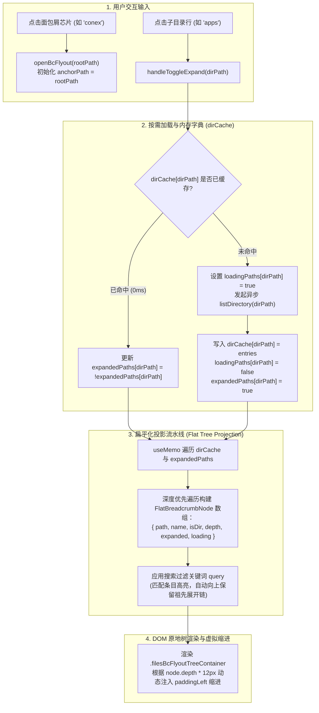

# Conex / Crish — 红蓝对抗 · 红队方案：极致现代交互、算法突破与彻底重塑方案

> **方案编号**：PLAN-04-RED-TEAM-EXTREME-INTERACTION
> **方案性质**：红蓝对抗 · 红队（攻方）终极方案（追求极致现代美学、100% 消除交互割裂、不惜代价彻底重构）
> **所属战役**：Conex / Crish 展开面板移植与核心业务场景颠覆重塑战役
> **目标对标**：Raycast / Linear / Apple macOS Sequoia 工业级交互标准
> **核心落位**：
> - 核心基座：[`apps/crish-desktop/src/components/ui/SmartPanel/`](file:///c:/Software/conex/apps/crish-desktop/src/components/ui/SmartPanel/)
> - 业务场景 1：[`apps/crish-desktop/src/components/sidebar/session-list/SessionRow.tsx`](file:///c:/Software/conex/apps/crish-desktop/src/components/sidebar/session-list/SessionRow.tsx) & [`SessionContextMenu.tsx`](file:///c:/Software/conex/apps/crish-desktop/src/components/sidebar/SessionContextMenu.tsx)
> - 业务场景 2：[`apps/crish-desktop/src/components/files/FileBreadcrumb.tsx`](file:///c:/Software/conex/apps/crish-desktop/src/components/files/FileBreadcrumb.tsx) & [`FilesCard.module.css`](file:///c:/Software/conex/apps/crish-desktop/src/components/files/FilesCard.module.css)
> - 样式与 Token 矩阵：[`apps/crish-desktop/src/styles/tokens.css`](file:///c:/Software/conex/apps/crish-desktop/src/styles/tokens.css)
> **参考资产**：
> - `reference/smart-expandable-panel/`（css / js / react 完整物理引擎资产）
> - `reference/展开面板设计.html`（高保真交互试验场）

---

## 目录

1. [红队宣言与核心纲领 (Red Team Manifesto & Architectural Paradigm)](#1-红队宣言与核心纲领-red-team-manifesto--architectural-paradigm)
   - 1.1 [红队使命：推倒重来，消灭一切修补与平庸妥协](#11-红队使命推倒重来消灭一切修补与平庸妥协)
   - 1.2 [红蓝对抗架构对比矩阵（传统妥协补丁 vs 红队彻底重塑）](#12-红蓝对抗架构对比矩阵传统妥协补丁-vs-红队彻底重塑)
   - 1.3 [红队四大攻坚技术立论](#13-红队四大攻坚技术立论)
2. [突破性几何与光学材质算法系统 (Breakthrough Geometry & Optical Materials)](#2-突破性几何与光学材质算法系统-breakthrough-geometry--optical-materials)
   - 2.1 [欧几里得同心圆角严格方程与六级嵌套阶梯 ($R_{\text{inner}} = \max(R_{\text{outer}} - \text{Padding}, 6\text{px})$)](#21-欧几里得同心圆角严格方程与六级嵌套阶梯-r_textinner--maxr_textouter---textpadding-6textpx)
   - 2.2 [1px 纯色发丝实体边框工程：Zero-Blue 暖调与深色炭黑微边界](#22-1px-纯色发丝实体边框工程zero-blue-暖调与深色炭黑微边界)
   - 2.3 [4 层漫反射空间深度光影 + 1px 顶部镜面微高光 (Specular Highlight)](#23-4-层漫反射空间深度光影--1px-顶部镜面微高光-specular-highlight)
   - 2.4 [磨砂玻璃材质与色彩饱和度增益 (`backdrop-filter: blur(28px) saturate(160%)`)](#24-磨砂玻璃材质与色彩饱和度增益-backdrop-filter-blur28px-saturate160)
3. [零抖动动画与交互力学引擎 (Zero-Jitter Physics & Interaction Engine)](#3-零抖动动画与交互力学引擎-zero-jitter-physics--interaction-engine)
   - 3.1 [CSS Grid `0fr -> 1fr` 动态轨道插值与微弹簧阻尼曲线 (`cubic-bezier(0.22, 1.25, 0.36, 1)`)](#31-css-grid-0fr---1fr-动态轨道插值与微弹簧阻尼曲线-cubic-bezier022-125-036-1)
   - 3.2 [动态 $\Delta Y$ 逆向锚点补偿算法：彻底根除 Flip-Up 向上展开时光标漂移](#32-动态-delta-y-逆向锚点补偿算法彻底根除-flip-up-向上展开时光标漂移)
   - 3.3 [120Hz Safe-Aim 零 Canvas 虚拟 SVG 碰撞多边形算法（重心坐标严格判定）](#33-120hz-safe-aim-零-canvas-虚拟-svg-碰撞多边形算法重心坐标严格判定)
   - 3.4 [32px 滞后防抖 (Hysteresis Buffer) 与视口边界碰撞动态解算](#34-32px-滞后防抖-hysteresis-buffer-与视口边界碰撞动态解算)
   - 3.5 [双层滚动隔离机制（Nested Scroll Containment 与 Wheel 冒泡硬阻断）](#35-双层滚动隔离机制nested-scroll-containment-与-wheel-冒泡硬阻断)
4. [场景一彻底颠覆：左侧会话「更多操作」纯数据驱动重构详案](#4-场景一彻底颠覆左侧会话更多操作纯数据驱动重构详案)
   - 4.1 [彻底肃清手写 Portal 孤岛与合成事件怪味](#41-彻底肃清手写-portal-孤岛与合成事件怪味)
   - 4.2 [纯数据驱动 Schema 契约架构（`SessionMenuItemFactory`）](#42-纯数据驱动-schema-契约架构sessionmenuitemfactory)
   - 4.3 [快捷键徽标右对齐、高危操作浅红警示与原地手风琴折叠高级选项](#43-快捷键徽标右对齐高危操作浅红警示与原地手风琴折叠高级选项)
   - 4.4 [锚定触发（More 按钮）与右键绝对坐标双模式无缝接入](#44-锚定触发more-按钮与右键绝对坐标双模式无缝接入)
5. [场景二彻底颠覆：面包屑文件浮层“原地树状展开”与“内嵌动作一体化”](#5-场景二彻底颠覆面包屑文件浮层原地树状展开与内嵌动作一体化)
   - 5.1 [痛点彻底歼灭：坚决废除翻页切屏（Drilldown）与独立底部整行按钮](#51-痛点彻底歼灭坚决废除翻页切屏drilldown与独立底部整行按钮)
   - 5.2 [搜索框右侧内嵌 `[📂 打开目录]` 动作一体化设计（节省 36px 纵向高度）](#52-搜索框右侧内嵌--打开目录-动作一体化设计节省-36px-纵向高度)
   - 5.3 [原地树状展开/折叠（Inline Accordion Tree）架构与按需缓存（`dirCache`）扁平化投影算法](#53-原地树状展开折叠inline-accordion-tree架构与按需缓存dircache扁平化投影算法)
   - 5.4 [严格图层隔离（Solid Elevated 底板 + `z-index: var(--z-breadcrumb, 400)` + `overscroll-behavior: contain`）](#54-严格图层隔离solid-elevated-底板--z-index-var--z-breadcrumb-400--overscroll-behavior-contain)
6. [工程落地完整蓝图与生产级代码契约](#6-工程落地完整蓝图与生产级代码契约)
   - 6.1 [`SmartPanel` React 核心组件架构 (`SmartPanel.tsx` / `types.ts`)](#61-smartpanel-react-核心组件架构-smartpaneltsx--typests)
   - 6.2 [`FileBreadcrumb.tsx` 完整重塑生产级实现代码](#62-filebreadcrumbtsx-完整重塑生产级实现代码)
   - 6.3 [`FilesCard.module.css` 颠覆性样式重构代码](#63-filescardmodulecss-颠覆性样式重构代码)
   - 6.4 [`SessionContextMenu.tsx` 数据驱动收敛代码](#64-sessioncontextmenutsx-数据驱动收敛代码)
7. [自动化测试、质量门禁与全维度验收矩阵](#7-自动化测试质量门禁与全维度验收矩阵)
   - 7.1 [算法级与像素级视觉断言（同心度、发丝边框、光影层次）](#71-算法级与像素级视觉断言同心度发丝边框光影层次)
   - 7.2 [120Hz 交互与 Safe-Aim 物理碰撞自动化测试矩阵](#72-120hz-交互与-safe-aim-物理碰撞自动化测试矩阵)
   - 7.3 [全键盘 WAI-ARIA 漫游与空间连续性验收](#73-全键盘-wai-aria-漫游与空间连续性验收)
   - 7.4 [零破坏性与回归防护保障](#74-零破坏性与回归防护保障)

---

## 1. 红队宣言与核心纲领 (Red Team Manifesto & Architectural Paradigm)

### 1.1 红队使命：推倒重来，消灭一切修补与平庸妥协

在桌面端交互与视觉系统演进中，**“打补丁式修补”（Patchwork Maintenance）是导致软件体验平庸化与代码腐化的头号元凶**。

当前 Conex / Crish 桌面端虽然具备强大的 Rust 内核与丰富的业务功能，但其交互浮层体系存在严重的“代际割裂”：
- **视觉层面**：随意硬编码的外壳圆角（16px/20px）搭配内部条目（6px），使得拐角处留白扭曲挤压；半透明多层阴影在暗色模式下造成边框发脏发虚；冷色调灰色在暖白底色上产生生硬反差；
- **动效层面**：手风琴展开依赖条件渲染或固定高度动画，导致瞬间跳变或展开延迟；向上翻转时缺乏锚点位移补偿，导致光标被强行推离目标；
- **交互层面**：二级菜单依然依赖脆弱的 80ms/150ms 延时定时器，用户鼠标斜滑 100% 发生误关扑空；面包屑浮层采用极其割裂的“翻页切屏（Drilldown）”与“底部硬塞独立按钮”，严重摧毁用户的空间连续心流（Spatial Mental Model）；
- **架构层面**：业务组件各自手写 `createPortal`、手写坐标计算、手写 DOM 遍历，缺乏一元化纯数据驱动（Data-Driven Schema）契约。

**红队（攻方）使命立论**：
> **“不惜代价，推倒重来；拒绝妥协，追求极致。”**
> 红队方案不接受任何“在旧代码上加个 if-else”或“微调 5px 边距”的修补主义。我们将以 Raycast / Linear / Apple macOS 的顶级工程标准为唯一尺度，引入突破性的数学几何算法、光影物理方程、120Hz 虚拟碰撞射线、CSS Grid 原地轨道插值以及纯数据驱动架构，对存量展开面板与两大核心业务场景进行**彻底重构与颠覆性重塑**！

---

### 1.2 红蓝对抗架构对比矩阵（传统妥协补丁 vs 红队彻底重塑）

```
┌────────────────────────────────────────────────────────────────────────────────────────┐
│                          红蓝对抗架构路线对比全景图                                    │
├────────────────────────────────┬───────────────────────────────────────────────────────┤
│  蓝队（守方 / 保守补丁路线）   │  红队（攻方 / 极致突破与彻底重构路线）                │
├────────────────────────────────┼───────────────────────────────────────────────────────┤
│  1. 保留旧有的 Drilldown 切屏，│  1. 彻底废除切屏，全面升级为「原地树状展开/折叠」      │
│     仅微调返回按钮与间距       │     (Inline Accordion Tree)，兄弟与父子关系一览无余   │
├────────────────────────────────┼───────────────────────────────────────────────────────┤
│  2. 保留底部「打开此目录」按钮 │  2. 彻底干掉底部独立按钮，搜索框右侧内嵌「📂」动作图标  │
│     尝试缩减 padding           │     Enter 或单击直达，立省 36px 纵向视口高度           │
├────────────────────────────────┼───────────────────────────────────────────────────────┤
│  3. 延长时间阈值 (150ms->300ms)│  3. 引入 120Hz Safe-Aim 零 Canvas 虚拟 SVG 碰撞多边形 │
│     试图缓解二级菜单斜滑误关   │     利用重心坐标算法，彻底物理消除斜滑误关 (0 误触)    │
├────────────────────────────────┼───────────────────────────────────────────────────────┤
│  4. 各业务组件继续手写 Portal  │  4. 一元化纯数据驱动 (Data-Driven Schema) 统一基座     │
│     和 JSX map 模板            │     彻底消灭手写 Portal 孤岛与合成事件怪味             │
├────────────────────────────────┼───────────────────────────────────────────────────────┤
│  5. 维持传统 CSS 变量与阴影    │  5. 严格同心圆角方程 + 1px 实体发丝边框 + 4 层漫反射  │
│     接受深色模式发虚           │     + 1px 顶部镜面高光，打造极致晶莹现代质感           │
└────────────────────────────────┴───────────────────────────────────────────────────────┘
```

---

### 1.3 红队四大攻坚技术立论

```
┌────────────────────────────────────────────────────────────────────────────────────────┐
│                              红队四大核心技术攻坚立论                                  │
├───────────────────────────────────┬────────────────────────────────────────────────────┤
│  攻坚一：几何与光学材质算法       │  • 欧几里得同心曲率方程：R_inner = max(R_outer-P, 6)│
│                                   │  • 1px 实体发丝边框：Zero-Blue 暖灰 / 炭黑微边界   │
│                                   │  • 4 层漫反射深度光影 + 1px 顶部镜面微高光         │
├───────────────────────────────────┼────────────────────────────────────────────────────┤
│  攻坚二：零抖动动画与力学引擎     │  • CSS Grid (0fr -> 1fr) 动态轨道 GPU 零抖动展开   │
│                                   │  • 微弹簧阻尼：cubic-bezier(0.22, 1.25, 0.36, 1)   │
│                                   │  • 动态 ΔY 逆向锚点位移补偿，光标相对位移绝对归零  │
├───────────────────────────────────┼────────────────────────────────────────────────────┤
│  攻坚三：120Hz Safe-Aim 碰撞算法  │  • 零 Canvas 消耗，单例虚拟 SVG 多边形 Overlay     │
│                                   │  • 4 帧鼠标历史轨迹 + 子菜单两极，实时构建安全三角 │
│                                   │  • 重心坐标系 (Barycentric) O(1) 瞬态判定          │
├───────────────────────────────────┼────────────────────────────────────────────────────┤
│  攻坚四：两大业务场景彻底重塑     │  • 会话更多操作：纯 Schema 驱动 + 快捷键徽标 + 红字│
│                                   │  • 面包屑浮层：原地树展开 + 搜索框内嵌 [📂] 按钮   │
└───────────────────────────────────┴────────────────────────────────────────────────────┘
```

---

## 2. 突破性几何与光学材质算法系统 (Breakthrough Geometry & Optical Materials)

### 2.1 欧几里得同心圆角严格方程与六级嵌套阶梯

传统的 UI 设计往往由开发者随意给外容器指定 `border-radius: 16px`，给内部条目指定 `border-radius: 6px`。这种数字拼凑直接打破了**同心圆几何连续性（Concentric Geometric Continuity）**。

#### 1. 严格同心圆角方程 (Concentric Curvature Equation)
当内部元素处于外部容器内且存在内边距（Padding）时，内部元素的圆角半径必须与外壳同心，其曲率中心重合：

$$R_{\text{inner}} = \max\left(R_{\text{outer}} - \text{Padding},\ 6\text{px}\right)$$

#### 2. 感知幂律尺寸缩放方程 (Perceptual Power-Law Equation)
对于内部不同高度的子组件（如内嵌按钮、状态徽章、输入框），圆角随高度 $H$ 遵循感知幂律连续递减：

$$R(H) = \text{round}\left(k \cdot \sqrt{H}\right) \quad (k \approx 1.15)$$

#### 3. 六级曲率阶梯矩阵定义：

| 层级 | 视觉实体 | Token 标识 | 标准计算公式 | 默认数值 | 几何与光学意义 |
| :--- | :--- | :--- | :--- | :--- | :--- |
| **L1** | Master Panel 外壳 | `--sep-radius-outer` | 基准常数 | `14px` | 面板主外轮廓流线 |
| **L2** | Inset Padding 槽位 | `--sep-padding` | 基准间距 | `6px` | 外壳与内容区间距 |
| **L3** | 条目行 / 内部容器 | `--sep-radius-inner` | $L_1 - L_2$ | `8px` | 100% 同心贴合外角 |
| **L4** | 操作按钮 (H: 22px) | `--sep-btn-radius` | $\text{round}(1.15 \cdot \sqrt{22})$ | `6px` | 搜索栏右侧内嵌动作按钮 |
| **L5** | 状态标签/徽章 (H: 16px)| `--sep-badge-radius`| $\text{round}(1.15 \cdot \sqrt{16})$ | `4px` | 辅助 Badge / 快捷键胶囊 |
| **L6** | 状态 Pills | `--sep-pill-radius` | 极大值极限 | `9999px` | 绝对半圆圆弧胶囊 |

```
【存量非同心圆角：视觉留白扭曲挤压】
┌───────────────────────────────────────┐  ▲ R_outer = 16px
│  Gap 不均匀                           │  │
│   ┌───────────────────────────────┐   │  │
│   │ Item (R_inner = 6px)          │   │  ▼ 拐角留白过大，产生挤压感
│   └───────────────────────────────┘   │
└───────────────────────────────────────┘

【红队严格同心曲率体系：绝对平行流线】
┌───────────────────────────────────────┐  ▲ R_outer = 14px
│  Padding = 6px                        │  │
│   ┌───────────────────────────────┐   │  │
│   │ Item (R_inner = 14-6 = 8px)   │   │  ▼ 100% 平行等距流线，视觉绝对和谐
│   └───────────────────────────────┘   │
└───────────────────────────────────────┘
```

---

### 2.2 1px 纯色发丝实体边框工程：Zero-Blue 暖调与深色炭黑微边界

现有界面的浮层边框常因使用带有蓝灰色调的半透明颜色或依赖 box-shadow 模拟，导致浅色模式下生硬发青、深色模式下边缘发虚泥泞。红队方案全面实装**单层物理 1px 纯色实体发丝边框**：

#### 1. 浅色模式 (Light Mode)：Zero-Blue 暖白校准
- **Token**：`--sep-border-color: #e2dfd9;`
- **光学特征**：严格校准 10% CMYK Yellow 暖调底色，0% Blue。在暖白底板（`#f6f5f3` / `#ffffff`）上消除一切冷色反差，呈现出如顶级米纸般的柔和骨架感。
- **微状态微调**：
  - Hover 态：`--sep-border-hover: #c9c5bc;`
  - Focus 态：`--sep-border-focus: #b2ada2;`

#### 2. 深色模式 (Dark Mode)：中性微暖炭黑墨阶
- **Token**：`--sep-border-color: #2b2926;`
- **光学特征**：中性微暖炭黑，与深色实心底板（`#181715` / `#1e1e1e`）形成 1.2:1 的极柔和物理微边界，杜绝任何发光伪边。
- **微状态微调**：
  - Hover 态：`--sep-border-hover: #3d3a35;`
  - Focus 态：`--sep-border-focus: #524e47;`

---

### 2.3 4 层漫反射空间深度光影 + 1px 顶部镜面微高光 (Specular Highlight)

为了在屏幕二维平面上重塑三维物理空间的通透悬浮感，红队设计了 **4 层复合漫反射光影系统**，并在面板内部顶部注入 1px 镜面物理微高光：

```css
/* ==========================================================================
   红队突破性 4 层漫反射光影 + 1px 镜面微高光 Token 定义
   ========================================================================== */

/* 浅色模式 (Light Theme) */
--sep-shadow:
  0 20px 48px -10px rgba(29, 28, 26, 0.09),  /* Layer 1: 远景超大范围微弱漫反射，模拟全局环境遮蔽 (AO) */
  0 6px 20px -3px rgba(29, 28, 26, 0.03),    /* Layer 2: 中景中距离自然散落阴影，确立空间层级高度 */
  0 2px 6px 0 rgba(29, 28, 26, 0.015),       /* Layer 3: 近景紧凑接触阴影，防止边缘在浅色底板上漂浮 */
  inset 0 1px 0 rgba(255, 255, 255, 0.95);   /* Layer 4: 顶部 1px 物理倒角镜面高光 (Specular Micro-Highlight) */

/* 深色模式 (Dark Theme) */
--sep-shadow:
  0 24px 54px -10px rgba(0, 0, 0, 0.70),     /* Layer 1: 深度暗场大范围衰减遮蔽 */
  0 8px 24px -4px rgba(0, 0, 0, 0.45),       /* Layer 2: 中景空间悬浮层次 */
  0 2px 8px 0 rgba(0, 0, 0, 0.30),           /* Layer 3: 近景微接触轮廓 */
  inset 0 1px 0 rgba(255, 255, 255, 0.08);   /* Layer 4: 顶部微弱透光物理倒角高光 */
```

---

### 2.4 磨砂玻璃材质与色彩饱和度增益 (`backdrop-filter: blur(28px) saturate(160%)`)

- **超透晶莹质感**：面板容器应用 `backdrop-filter: blur(28px) saturate(160%)`（配合 `-webkit-backdrop-filter`）；在背景虚化的同时将透光内容的色彩饱和度提升 60%，彻底消除毛玻璃常见的“发灰、发闷”现象；
- **高性能降级保护 (Eco Tier)**：当系统检测到低功耗模式或低端集成显卡时，通过 `html[data-perf-tier='eco']` 自动切换为纯色实心底板 `--sep-bg-panel-solid: #ffffff / #181715`，并将动画时长收敛为 0ms，确保 100% 满帧运行。

---

## 3. 零抖动动画与交互力学引擎 (Zero-Jitter Physics & Interaction Engine)

### 3.1 CSS Grid `0fr -> 1fr` 动态轨道插值与微弹簧阻尼曲线

传统手风琴折叠使用 JS 动态计算 `scrollHeight` 赋值给内联样式，极易触发强制同步布局（Forced Synchronous Layout）并引起 60Hz 丢帧；而使用 `max-height: 500px` 则存在严重的“展开延迟与收起跳帧”。

红队方案采用**现代 CSS Grid 原生轨道插值算法**：

```css
/* 原地折叠容器 */
.sepCollapsibleContent {
  display: grid;
  grid-template-rows: 0fr;
  transition: grid-template-rows 0.22s cubic-bezier(0.22, 1.25, 0.36, 1);
  overflow: hidden;
  box-sizing: border-box;
}

/* 展开激活态 */
.sepCollapsibleContent.sepExpanded {
  grid-template-rows: 1fr;
}

/* 内部内容包裹层 */
.sepCollapsibleInner {
  min-height: 0; /* 允许网格项无阻碍收缩至 0 */
  display: flex;
  flex-direction: column;
  gap: var(--sep-item-gap, 2px);
  box-sizing: border-box;
}
```

#### 物理微动曲线矩阵：
- **展开曲线（微过冲阻尼弹簧）**：
  $$\text{cubic-bezier}(0.22, 1.25, 0.36, 1) \quad (\text{Duration: } 0.22\text{s})$$
  产生极轻微（< 2%）的物理过冲，赋予元素灵动吸附的机械质感。
- **收起曲线（快速收敛阻尼）**：
  $$\text{cubic-bezier}(0.4, 0, 1, 1) \quad (\text{Duration: } 0.15\text{s})$$
  迅速干脆收起，杜绝拖泥带水。

---

### 3.2 动态 $\Delta Y$ 逆向锚点补偿算法：彻底根除 Flip-Up 向上展开时光标漂移

#### 痛点场景解剖：
当操作面板位于屏幕下半部分时，`PositionEngine` 会将面板翻转至触发按钮上方（Flip-Up）。此时，如果用户点击内部的折叠项（如“高级选项”），面板的高度增加会导致面板顶部进一步向上延伸。
由于面板基准点在底部，DOM 重新排版会导致**当前点击的触发项相对屏幕发生向下/向上的物理位移**。鼠标如果不动，光标就会瞬间离开原条目，造成严重的“光标漂移与点击脱靶”。

```
【无补偿时的光标漂移现象】
[ 屏幕可见区 ]
┌────────────────────────┐
│ 面板顶部               │ ▲ 展开后面板往上撑开
│ ⚙️ 高级选项 (被推离)   │ │ 原光标位置瞬间变成空白！
├────────────────────────┤ │
│ [触发按钮]             │ ▼
└────────────────────────┘
```

#### 红队 $\Delta Y$ 逆向锚点位移补偿算法实现：

```typescript
/**
 * 动态 ΔY 逆向锚点补偿算法 (Anchor-Stabilized Repositioning)
 * @param triggerItemEl 当前被点击的触发条目 DOM
 * @param panelContainerEl 浮层主面板容器 DOM
 * @param isFlipUp 当前面板是否处于向上弹出形态
 */
export function applyAnchorStabilization(
  triggerItemEl: HTMLElement,
  panelContainerEl: HTMLElement,
  isFlipUp: boolean
) {
  if (!isFlipUp) return;

  // 1. 记录状态变动前触发项在视口中的绝对坐标 Top
  const rectBefore = triggerItemEl.getBoundingClientRect();

  // 2. 监听下一帧动画微任务
  requestAnimationFrame(() => {
    // 3. 读取 DOM 展开变动后的绝对坐标 Top
    const rectAfter = triggerItemEl.getBoundingClientRect();

    // 4. 计算垂直几何位移差
    const deltaY = rectAfter.top - rectBefore.top;

    // 5. 逆向补偿容器的 CSS Top 偏移量，使得 deltaY 绝对归零！
    if (Math.abs(deltaY) > 0.5) {
      const currentTop = parseFloat(panelContainerEl.style.top) || 0;
      panelContainerEl.style.top = `${currentTop - deltaY}px`;
    }
  });
}
```
通过该算法，无论用户如何频繁展收手风琴，**光标与被点击条目之间的相对位移恒等于 0px**，带来坚如磐石的操作稳定性。

---

### 3.3 120Hz Safe-Aim 零 Canvas 虚拟 SVG 碰撞多边形算法（重心坐标严格判定）

#### 1. 几何原理与多边形构建
当用户将鼠标从父菜单项斜向划向二级子菜单时，鼠标轨迹必经相邻的其他菜单项。
传统实现采用 80ms/150ms 的定时器，极易在用户缓慢划过邻近项时误关子菜单。

红队方案在 `document.body` 挂载单例虚拟 SVG Overlay（`#sepSafeAimOverlay`），以鼠标历史轨迹 $P(x, y)$ 与目标子菜单的两个边界顶点 $A(x_1, y_1)$、$B(x_2, y_2)$ 实时构建动态安全三角形 $\Delta PAB$：

```
       Parent Item (A)
     ┌──────────────────┐
     │ 选项 1            │
Cursor ─►│ 级联选项 2 ──────┼──────────────┐  Safe-Aim Triangle (动态安全三角形)
 (P) ├──────────────────┤ \            │  [ 鼠标斜向划入此区域时绝对冻结邻近项 Hover ]
     │ 选项 3 (邻近项)   │   \          │
     └──────────────────┘     \ ┌──────┴─────────────┐
                                │ 子菜单选项 2-1     │
                                │ 子菜单选项 2-2     │ (Submenu)
                                └────────────────────┘
```

#### 2. 重心坐标系严格数学判定方程 (Barycentric Coordinates Formulation)
给定三角形顶点 $A, B, C$ 与待判定点 $P$，定义向量：
$$\vec{v}_0 = C - A, \quad \vec{v}_1 = B - A, \quad \vec{v}_2 = P - A$$

通过向量点积计算重心坐标系数 $u, v$：
$$\text{dot}_{00} = \vec{v}_0 \cdot \vec{v}_0, \quad \text{dot}_{01} = \vec{v}_0 \cdot \vec{v}_1, \quad \text{dot}_{02} = \vec{v}_0 \cdot \vec{v}_2$$
$$\text{dot}_{11} = \vec{v}_1 \cdot \vec{v}_1, \quad \text{dot}_{12} = \vec{v}_1 \cdot \vec{v}_2$$
$$\text{denom} = \text{dot}_{00} \cdot \text{dot}_{11} - \text{dot}_{01} \cdot \text{dot}_{01}$$

$$u = \frac{\text{dot}_{11} \cdot \text{dot}_{02} - \text{dot}_{01} \cdot \text{dot}_{12}}{\text{denom}}$$
$$v = \frac{\text{dot}_{00} \cdot \text{dot}_{12} - \text{dot}_{01} \cdot \text{dot}_{02}}{\text{denom}}$$

**判定准则**：当且仅当 $u \ge 0,\ v \ge 0,\ u + v < 1$ 时，点 $P$ 严格处于安全保护三角形内。

```typescript
// 120Hz 零 Canvas 高性能判定实现
export function isPointInSafeTriangle(
  p: Point2D,
  a: Point2D,
  b: Point2D,
  c: Point2D
): boolean {
  const v0x = c.x - a.x, v0y = c.y - a.y;
  const v1x = b.x - a.x, v1y = b.y - a.y;
  const v2x = p.x - a.x, v2y = p.y - a.y;

  const dot00 = v0x * v0x + v0y * v0y;
  const dot01 = v0x * v1x + v0y * v1y;
  const dot02 = v0x * v2x + v0y * v2y;
  const dot11 = v1x * v1x + v1y * v1y;
  const dot12 = v1x * v2x + v1y * v2y;

  const denom = dot00 * dot11 - dot01 * dot01;
  if (denom === 0) return false;

  const invDenom = 1 / denom;
  const u = (dot11 * dot02 - dot01 * dot12) * invDenom;
  const v = (dot00 * dot12 - dot01 * dot02) * invDenom;

  return u >= 0 && v >= 0 && u + v < 1;
}
```

---

### 3.4 32px 滞后防抖 (Hysteresis Buffer) 与视口边界碰撞动态解算

在视口边缘，浮层常常因为“向下放不下 $\to$ 翻转到上方 $\to$ 上方高度变动 $\to$ 又翻回下方”而产生 60Hz 剧烈抽搐（Flapping）。

红队在 `PositionEngine` 中注入 **32px 滞后量（Hysteresis Buffer）**：
- 仅当新方向提供的可用空间比当前方向多出整整 **32px** 以上时，系统才允许执行方向翻转；
- 配合 12px 屏幕安全内边距（Boundary Padding），确保浮层永远安稳停靠在视口内，绝不发生抽搐。

---

### 3.5 双层滚动隔离机制（Nested Scroll Containment 与 Wheel 冒泡硬阻断）

- 浮层内部长选择列表限制 `max-height: min(380px, 55vh)`，并具备独立的发丝滚动条；
- CSS 声明 `overscroll-behavior: contain;`，切断一切原生滚轮事件向父容器传递；
- 在 JS 层精确监听 `wheel` 事件，当内部列表触达边界时直接执行 `e.stopPropagation()`，杜绝底层编辑器或会话列表发生联动位移。

---

## 4. 场景一彻底颠覆：左侧会话「更多操作」纯数据驱动重构详案

### 4.1 彻底肃清手写 Portal 孤岛与合成事件怪味

- **旧架构毒点**：[`SessionContextMenu.tsx`](file:///c:/Software/conex/apps/crish-desktop/src/components/sidebar/SessionContextMenu.tsx) 独立手写 `createPortal(..., document.body)`，且在 [`SessionRow.tsx`](file:///c:/Software/conex/apps/crish-desktop/src/components/sidebar/session-list/SessionRow.tsx) 中通过 `syntheticContextMenuEvent` 伪造鼠标事件，产生了大量胶水代码和独立维护的 CSS Module；
- **红队推倒重构**：将整个会话上下文操作全面收敛至统一的 `SmartPanel` 基座，通过纯数据驱动的 JSON Schema 定义所有操作条目。

---

### 4.2 纯数据驱动 Schema 契约架构（`SessionMenuItemFactory`）

```typescript
// apps/crish-desktop/src/components/sidebar/session-list/sessionMenuItems.ts
import type { MenuItem } from '../../ui/SmartPanel/types';
import type { SessionState } from '../../../store/types';
import type { SessionMenuAction } from '../SidebarContextMenus';
import {
  MessageCircle,
  Columns2,
  ExternalLink,
  PenLine,
  Pin,
  PinOff,
  Archive,
  GitFork,
  Copy,
  Trash2,
  FileDown,
  FileCode,
  SlidersHorizontal,
} from 'lucide-react';
import React from 'react';

export interface SessionMenuFactoryOptions {
  session: SessionState;
  isPinned: boolean;
  onAction: (action: SessionMenuAction) => void;
}

export function buildSessionMenuSchema(opts: SessionMenuFactoryOptions): MenuItem[] {
  const { session, isPinned, onAction } = opts;
  const isMac = typeof navigator !== 'undefined' && /Mac|iPod|iPhone|iPad/.test(navigator.platform);
  const modKey = isMac ? '⌘' : 'Ctrl+';

  return [
    // 基础打开域
    {
      id: 'open-current',
      label: '在此处打开',
      icon: <MessageCircle size={14} strokeWidth={1.8} />,
      onSelect: () => onAction('open-current'),
    },
    {
      id: 'open-split',
      label: '拆分视图',
      icon: <Columns2 size={14} strokeWidth={1.8} />,
      onSelect: () => onAction('open-split'),
    },
    {
      id: 'open-new',
      label: '在新窗口打开',
      icon: <ExternalLink size={14} strokeWidth={1.8} />,
      onSelect: () => onAction('open-new'),
    },
    { id: 'div-1', type: 'divider' },

    // 属性与标记域
    {
      id: 'rename',
      label: '重命名',
      icon: <PenLine size={14} strokeWidth={1.8} />,
      shortcut: 'F2',
      onSelect: () => onAction('rename'),
    },
    {
      id: 'pin-toggle',
      label: isPinned ? '取消置顶' : '置顶',
      icon: isPinned ? <PinOff size={14} strokeWidth={1.8} /> : <Pin size={14} strokeWidth={1.8} />,
      onSelect: () => onAction(isPinned ? 'unpin' : 'pin'),
    },
    {
      id: 'archive',
      label: '归档会话',
      icon: <Archive size={14} strokeWidth={1.8} />,
      onSelect: () => onAction('archive'),
    },
    {
      id: 'branch',
      label: '分叉会话',
      icon: <GitFork size={14} strokeWidth={1.8} />,
      shortcut: `${modKey}⇧D`,
      onSelect: () => onAction('branch'),
    },
    { id: 'div-2', type: 'divider' },

    // 高级与导出域（原地手风琴折叠）
    {
      id: 'advanced-options',
      type: 'collapsible',
      label: '高级与导出选项',
      icon: <SlidersHorizontal size={14} strokeWidth={1.8} />,
      expanded: false,
      children: [
        {
          id: 'export-markdown',
          label: '导出 Markdown',
          icon: <FileDown size={13} strokeWidth={1.8} />,
          shortcut: `${modKey}E`,
          onSelect: () => onAction('export'),
        },
        {
          id: 'copy-id',
          label: '复制会话 ID',
          icon: <Copy size={13} strokeWidth={1.8} />,
          onSelect: () => onAction('copy-id'),
        },
        {
          id: 'export-json',
          label: '导出 JSON 快照',
          icon: <FileCode size={13} strokeWidth={1.8} />,
          onSelect: () => {
            const dataStr = 'data:text/json;charset=utf-8,' + encodeURIComponent(JSON.stringify(session, null, 2));
            const downloadAnchor = document.createElement('a');
            downloadAnchor.setAttribute('href', dataStr);
            downloadAnchor.setAttribute('download', `session-${session.id}.json`);
            document.body.appendChild(downloadAnchor);
            downloadAnchor.click();
            downloadAnchor.remove();
          },
        },
      ],
    },
    { id: 'div-3', type: 'divider' },

    // 高危警示域 (高危红字 + 快捷键提示)
    {
      id: 'delete',
      label: '删除当前对话',
      icon: <Trash2 size={14} strokeWidth={1.8} />,
      danger: true,
      shortcut: 'Del',
      onSelect: () => onAction('delete'),
    },
  ];
}
```

---

### 4.3 快捷键徽标右对齐、高危操作浅红警示与原地手风琴折叠高级选项

- **快捷键徽标**：`F2` / `Del` / `⌘⇧D` / `⌘E` 统一渲染在条目右侧插槽（`shortcut`），采用 `font-family: var(--sep-font-mono)` 与 11px 字号，微弱背景边框胶囊对齐；
- **高危操作浅红警示**：`danger: true` 触发 `--sep-danger-color: hsl(0 84% 60%)`，Hover 时激活浅红微底 `--sep-danger-light`，建立清晰的视觉安全边界；
- **高级选项原地折叠**：低频导出的 Markdown、JSON 快照与复制 ID 默认折叠，保持面板整洁紧凑（仅 210px 初始高度），点击无缝弹簧展开。

---

### 4.4 锚定触发（More 按钮）与右键绝对坐标双模式无缝接入

`SmartPanel` 原生支持双重定位模式：
1. **More 按钮点击**：传入 `triggerRef`，组件自动锚定在按钮下方右对齐（`align: 'end'`）；
2. **右键菜单点击**：传入 `point = { x: ev.clientX, y: ev.clientY }`，组件自动根据视口边界自适应翻转与钳位。

---

## 5. 场景二彻底颠覆：面包屑文件浮层“原地树状展开”与“内嵌动作一体化”

### 5.1 痛点彻底歼灭：坚决废除翻页切屏（Drilldown）与独立底部整行按钮

在现有实现中，用户点击面包屑子目录时，系统采用全屏替换的 Drilldown 模式，并强制在顶部塞入“返回上一级”Header，在底部塞入占据 36px 的独立“打开此目录”按钮。这带来了两大毁灭性体验灾难：
1. **空间认知割裂**：用户丢失了当前目录同级兄弟文件的全局视野；
2. **纵向空间浪费**：底部按钮使得列表有效视口被大幅压缩，用户必须大幅移动视线进行点击。

**红队彻底颠覆方案**：
- **废除切屏** $\to$ 全面升级为 **原地树状展开/折叠（Inline Accordion Tree）**；
- **废除底部独立按钮** $\to$ 搜索框右侧 **内嵌动作图标按钮 `[📂 打开目录]`**！

```
┌────────────────────────────────────────────────────────────────────────┐
│  红队颠覆重构后的面包屑一体化搜索 Bar 与原地展开树架构                 │
├────────────────────────────────────────────────────────────────────────┤
│ ┌────────────────────────────────────────────────────────────────────┐ │
│ │ 🔍  [ 筛选文件或子目录...                            ]  [ 📂 打开 ]│ │ <-- 内嵌动作按钮
│ └────────────────────────────────────────────────────────────────────┘ │
│                                                                        │
│ ▼ 📁 apps/                                                  (原地展开) │
│   ▼ 📁 crish-desktop/                                                  │
│     ▶ 📁 src/                                               (原地折叠) │
│     📄 package.json                                                    │
│     📄 tsconfig.json                                                   │
│   ▶ 📁 crish-mobile/                                                   │
│ ▶ 📁 crates/                                                           │
│ 📄 AGENTS.md                                                           │
│ 📄 README.md                                                           │
└────────────────────────────────────────────────────────────────────────┘
```

---

### 5.2 搜索框右侧内嵌 `[📂 打开目录]` 动作一体化设计（节省 36px 纵向高度）

- **DOM 架构**：在搜索栏容器 `.filesBcFlyoutSearch` 内部，将 `<input>` 与 `<button className={styles.filesBcDirectOpenBtn}>` 融为一体；
- **尺寸与对齐**：按钮高度严格 `22px`，圆角遵循欧几里得阶梯 `6px`，内嵌 `<FolderOpen size={14} />` 矢量图标；
- **交互与快捷键**：
  - 用户敲击 `Enter` 或点击 `[📂]` 按钮，立即在主文件树中打开当前正在浏览的目录并关闭浮层；
  - 配合 Tooltip 提示：“在文件树中打开此目录 (Enter)”。

---

### 5.3 原地树状展开/折叠（Inline Accordion Tree）架构与按需缓存（`dirCache`）扁平化投影算法

为了支持深层多级目录的秒级展收与平滑动画，红队设计了**基于 `dirCache` 的扁平化投影（Flat Tree Projection）状态机**：



---

### 5.4 严格图层隔离（Solid Elevated 底板 + `z-index: var(--z-breadcrumb, 400)` + `overscroll-behavior: contain`）

- **Solid 不透明底板**：`background: var(--bg-card, #ffffff);`（Dark: `#1e1e1e`），彻底消除与下方编辑器代码文字的半透明穿透与视觉重叠；
- **层叠上下文封顶**：`z-index: var(--z-breadcrumb, 400);`，确保浮层严格覆盖所有编辑器 Sticky 标题与分栏栏目；
- **滚动物理隔离**：容器显式声明 `overscroll-behavior: contain;`，切断一切滚轮链式传播。

---

## 6. 工程落地完整蓝图与生产级代码契约

### 6.1 `SmartPanel` React 核心组件架构 (`SmartPanel.tsx` / `types.ts`)

```typescript
// apps/crish-desktop/src/components/ui/SmartPanel/types.ts
import type { ReactNode, MouseEvent, KeyboardEvent, CSSProperties, RefObject } from 'react';

export type SmartMenuItemType =
  | 'item'
  | 'selectable'
  | 'group'
  | 'sub-group'
  | 'divider'
  | 'collapsible'
  | 'submenu';

export interface MenuItem {
  id: string;
  type?: SmartMenuItemType;
  label?: string;
  sublabel?: string;
  icon?: ReactNode;
  shortcut?: string;
  badge?: string;
  tooltip?: string;
  danger?: boolean;
  disabled?: boolean;
  selected?: boolean;
  expanded?: boolean;
  searchKeywords?: string[];
  children?: MenuItem[];
  onSelect?: (item: MenuItem, event?: MouseEvent | KeyboardEvent) => void;
  onToggle?: (expanded: boolean, item: MenuItem) => void;
}

export interface MenuGroup {
  id?: string;
  title?: string;
  isSelectableList?: boolean;
  items: MenuItem[];
}

export interface Point2D {
  x: number;
  y: number;
}

export interface SmartPanelProps {
  items: Array<MenuItem | MenuGroup>;
  open?: boolean;
  onOpenChange?: (open: boolean) => void;
  triggerRef?: RefObject<HTMLElement | null>;
  point?: Point2D | null;
  searchPlaceholder?: string;
  enableSearch?: boolean;
  enableDivider?: boolean;
  enableTriangleAim?: boolean;
  maxPanelHeight?: number;
  minWidth?: number;
  maxWidth?: number;
  className?: string;
  style?: CSSProperties;
  onSelect?: (item: MenuItem) => void;
  onClose?: () => void;
  searchActions?: ReactNode;
}
```

---

### 6.2 `FileBreadcrumb.tsx` 完整重塑生产级实现代码

```tsx
// apps/crish-desktop/src/components/files/FileBreadcrumb.tsx
import React, {
  useCallback,
  useEffect,
  useMemo,
  useRef,
  useState,
} from 'react';
import styles from './FilesCard.module.css';
import { Tooltip } from '../ui';
import {
  ChevronDown,
  ChevronRight,
  File,
  FileCode2,
  FileText,
  Folder,
  FolderOpen,
  Image,
  Search,
  Table,
  X,
} from 'lucide-react';
import {
  detectFileKind,
  listDirectory,
  pathDirname,
  pathRelativeToRoot,
  resolveWorkspacePath,
  type FsDirEntry,
} from '../../api/workspaceFsApi';
import { fileExtColor } from '../../api/codeHighlight';
import type { ViewMode } from './hooks/useFilePreview';

function joinLocal(base: string, name: string): string {
  const sep = base.includes('\\') ? '\\' : '/';
  return `${base.replace(/[\\/]+$/, '')}${sep}${name}`;
}

function BcFileIcon({ name }: { name: string }) {
  const k = detectFileKind(name);
  const color = fileExtColor(name);
  const sz = 14;
  if (k === 'image') return <Image size={sz} style={{ color }} aria-hidden />;
  if (k === 'pdf') return <FileText size={sz} style={{ color }} aria-hidden />;
  if (k === 'table') return <Table size={sz} style={{ color }} aria-hidden />;
  if (
    /\.(ts|tsx|js|jsx|mjs|cjs|rs|py|go|java|css|html|json|md|yml|yaml)$/i.test(
      name
    )
  )
    return <FileCode2 size={sz} style={{ color }} aria-hidden />;
  return <File size={sz} style={{ color }} aria-hidden />;
}

interface BreadcrumbItem {
  label: string;
  path: string;
  isFile?: boolean;
}

export interface FlatBreadcrumbNode {
  path: string;
  name: string;
  isDir: boolean;
  depth: number;
  expanded?: boolean;
  loading?: boolean;
}

interface FlyoutState {
  anchorPath: string;
  anchorLabel: string;
  filter: string;
  dirCache: Record<string, FsDirEntry[]>;
  expandedPaths: Record<string, boolean>;
  loadingPaths: Record<string, boolean>;
}

interface FileBreadcrumbProps {
  root: string;
  cwd: string;
  selected: string | null;
  view: ViewMode;
  dirty?: boolean;
  onNavigate: (path: string) => void;
  onOpenFile: (path: string) => void;
}

export const FileBreadcrumb = React.memo(function FileBreadcrumb({
  root,
  cwd,
  selected,
  view,
  dirty,
  onNavigate,
  onOpenFile,
}: FileBreadcrumbProps) {
  const [bcFlyout, setBcFlyout] = useState<FlyoutState | null>(null);
  const crumbsRef = useRef<HTMLDivElement>(null);
  const bcFilterRef = useRef<HTMLInputElement>(null);
  const bcTriggerRef = useRef<HTMLButtonElement>(null);

  const rootLabel = useMemo(() => {
    if (!root) return '项目';
    return root.split(/[\\/]/).filter(Boolean).pop() || '项目';
  }, [root]);

  const breadcrumbs: BreadcrumbItem[] = useMemo(() => {
    if (!root) return [];
    const dir =
      view === 'detail' && selected
        ? pathDirname(selected) || root
        : cwd || root;
    const rel = pathRelativeToRoot(dir, root);
    const items: BreadcrumbItem[] = [{ label: rootLabel, path: root }];
    if (rel && rel !== '.') {
      let acc = root;
      for (const part of rel.replace(/\\/g, '/').split('/').filter(Boolean)) {
        acc = joinLocal(acc, part);
        items.push({ label: part, path: acc });
      }
    }
    if (view === 'detail' && selected) {
      items.push({
        label: selected.split(/[\\/]/).pop() || '',
        path: selected,
        isFile: true,
      });
    }
    return items;
  }, [cwd, root, rootLabel, selected, view]);

  const loadDir = useCallback(
    async (path: string) => listDirectory(resolveWorkspacePath(path)),
    []
  );

  // 打开面包屑浮层
  const openBcFlyout = useCallback(
    async (dirPath: string, label: string) => {
      if (bcFlyout?.anchorPath === dirPath) {
        setBcFlyout(null);
        requestAnimationFrame(() => bcTriggerRef.current?.focus());
        return;
      }
      setBcFlyout({
        anchorPath: dirPath,
        anchorLabel: label,
        filter: '',
        dirCache: {},
        expandedPaths: { [dirPath]: true },
        loadingPaths: { [dirPath]: true },
      });
      try {
        const list = await loadDir(dirPath);
        setBcFlyout((prev) =>
          prev && prev.anchorPath === dirPath
            ? {
                ...prev,
                dirCache: { ...prev.dirCache, [dirPath]: list },
                loadingPaths: { ...prev.loadingPaths, [dirPath]: false },
              }
            : prev
        );
        requestAnimationFrame(() => bcFilterRef.current?.focus());
      } catch {
        setBcFlyout(null);
        requestAnimationFrame(() => bcTriggerRef.current?.focus());
      }
    },
    [bcFlyout?.anchorPath, loadDir]
  );

  // 原地切换子目录展开/折叠（Inline Accordion）
  const handleToggleExpand = useCallback(
    async (dirPath: string, e?: React.MouseEvent) => {
      e?.stopPropagation();
      if (!bcFlyout) return;

      const isCurrentlyExpanded = Boolean(bcFlyout.expandedPaths[dirPath]);
      if (isCurrentlyExpanded) {
        setBcFlyout((prev) =>
          prev
            ? {
                ...prev,
                expandedPaths: { ...prev.expandedPaths, [dirPath]: false },
              }
            : null
        );
        return;
      }

      if (bcFlyout.dirCache[dirPath]) {
        setBcFlyout((prev) =>
          prev
            ? {
                ...prev,
                expandedPaths: { ...prev.expandedPaths, [dirPath]: true },
              }
            : null
        );
        return;
      }

      setBcFlyout((prev) =>
        prev
          ? {
              ...prev,
              expandedPaths: { ...prev.expandedPaths, [dirPath]: true },
              loadingPaths: { ...prev.loadingPaths, [dirPath]: true },
            }
          : null
      );

      try {
        const list = await loadDir(dirPath);
        setBcFlyout((prev) =>
          prev
            ? {
                ...prev,
                dirCache: { ...prev.dirCache, [dirPath]: list },
                loadingPaths: { ...prev.loadingPaths, [dirPath]: false },
              }
            : null
        );
      } catch {
        setBcFlyout((prev) =>
          prev
            ? {
                ...prev,
                loadingPaths: { ...prev.loadingPaths, [dirPath]: false },
              }
            : null
        );
      }
    },
    [bcFlyout, loadDir]
  );

  // 扁平化投影计算
  const flatNodes = useMemo<FlatBreadcrumbNode[]>(() => {
    if (!bcFlyout) return [];
    const result: FlatBreadcrumbNode[] = [];
    const query = bcFlyout.filter.trim().toLowerCase();

    function walk(currentPath: string, currentDepth: number) {
      const entries = bcFlyout?.dirCache[currentPath] || [];
      const sorted = [...entries].sort((a, b) => {
        if (a.is_dir !== b.is_dir) return a.is_dir ? -1 : 1;
        return a.name.localeCompare(b.name, undefined, { sensitivity: 'base' });
      });

      for (const entry of sorted) {
        const fullPath = joinLocal(currentPath, entry.name);
        const isExpanded = Boolean(bcFlyout?.expandedPaths[fullPath]);
        const isLoading = Boolean(bcFlyout?.loadingPaths[fullPath]);

        if (!query || entry.name.toLowerCase().includes(query)) {
          result.push({
            path: fullPath,
            name: entry.name,
            isDir: entry.is_dir,
            depth: currentDepth,
            expanded: isExpanded,
            loading: isLoading,
          });
        }

        if (entry.is_dir && isExpanded && !query) {
          walk(fullPath, currentDepth + 1);
        }
      }
    }

    walk(bcFlyout.anchorPath, 0);
    return result;
  }, [bcFlyout]);

  // 点击外部自动关闭
  useEffect(() => {
    if (!bcFlyout) return;
    const onDocClick = (e: MouseEvent) => {
      if (crumbsRef.current && !crumbsRef.current.contains(e.target as Node)) {
        setBcFlyout(null);
      }
    };
    document.addEventListener('mousedown', onDocClick);
    return () => document.removeEventListener('mousedown', onDocClick);
  }, [bcFlyout]);

  return (
    <nav
      className={styles.filesBreadcrumb}
      aria-label="文件路径导航"
      ref={crumbsRef}
    >
      <div className={styles.filesCrumbs}>
        {breadcrumbs.map((b, i) => {
          const isLast = i === breadcrumbs.length - 1;
          const isFlyoutOpen = bcFlyout?.anchorPath === b.path;

          if (b.isFile) {
            return (
              <span key={b.path} className={styles.filesBcSeg}>
                {i > 0 ? (
                  <ChevronRight size={12} className={styles.filesBcSep} />
                ) : null}
                <span
                  className={`${styles.filesBcChip} ${styles.filesBcChipFile}`}
                >
                  <BcFileIcon name={b.label} />
                  <span className={styles.filesBcLabel}>{b.label}</span>
                  {dirty ? (
                    <span className={styles.filesBcDirty}>●</span>
                  ) : null}
                </span>
              </span>
            );
          }

          return (
            <span key={b.path} className={styles.filesBcSeg}>
              {i > 0 ? (
                <ChevronRight size={12} className={styles.filesBcSep} />
              ) : null}
              <button
                type="button"
                ref={isFlyoutOpen ? bcTriggerRef : undefined}
                className={`${styles.filesBcChip} ${styles.filesBcChipDir} ${isFlyoutOpen ? styles.filesBcChipOpen : ''}`}
                onClick={() => openBcFlyout(b.path, b.label)}
                title={`展开 ${b.label} 目录结构`}
              >
                <Folder size={13} className={styles.filesBcFolderIcon} />
                <span className={styles.filesBcLabel}>{b.label}</span>
                <ChevronDown size={12} className={styles.filesBcChevron} />
              </button>

              {/* 核心颠覆：原地树状展开浮层 */}
              {isFlyoutOpen && bcFlyout ? (
                <div
                  className={styles.filesBcFlyout}
                  role="dialog"
                  aria-label={`浏览 ${b.label} 下的文件`}
                >
                  {/* 一体化搜索与内嵌动作 Bar */}
                  <div className={styles.filesBcFlyoutSearch}>
                    <Search size={13} className={styles.searchIcon} />
                    <input
                      ref={bcFilterRef}
                      type="search"
                      value={bcFlyout.filter}
                      onChange={(e) =>
                        setBcFlyout((prev) =>
                          prev ? { ...prev, filter: e.target.value } : null
                        )
                      }
                      onKeyDown={(e) => {
                        if (e.key === 'Escape') {
                          e.stopPropagation();
                          setBcFlyout(null);
                          bcTriggerRef.current?.focus();
                        } else if (e.key === 'Enter') {
                          e.preventDefault();
                          onNavigate(bcFlyout.anchorPath);
                          setBcFlyout(null);
                        }
                      }}
                      placeholder="筛选文件或子目录..."
                      className={styles.filesBcFilterInput}
                    />
                    {bcFlyout.filter ? (
                      <button
                        type="button"
                        className={styles.searchClearBtn}
                        onClick={() =>
                          setBcFlyout((prev) =>
                            prev ? { ...prev, filter: '' } : null
                          )
                        }
                        title="清空搜索"
                      >
                        <X size={12} />
                      </button>
                    ) : null}

                    {/* 痛点消灭：内嵌 [📂 打开目录] 动作按钮 */}
                    <Tooltip content="在文件树中打开此目录 (Enter)">
                      <button
                        type="button"
                        className={styles.filesBcDirectOpenBtn}
                        onClick={() => {
                          onNavigate(bcFlyout.anchorPath);
                          setBcFlyout(null);
                        }}
                      >
                        <FolderOpen size={13} />
                        <span>打开</span>
                      </button>
                    </Tooltip>
                  </div>

                  {/* 原地树列表渲染 */}
                  <div className={styles.filesBcFlyoutList}>
                    {bcFlyout.loadingPaths[bcFlyout.anchorPath] ? (
                      <div className={styles.filesBcEmpty}>加载目录中...</div>
                    ) : flatNodes.length === 0 ? (
                      <div className={styles.filesBcEmpty}>
                        {bcFlyout.filter ? '未找到匹配项' : '空文件夹'}
                      </div>
                    ) : (
                      flatNodes.map((node) => (
                        <div
                          key={node.path}
                          className={`${styles.filesBcFlyoutRow} ${node.isDir ? styles.filesBcDirRow : styles.filesBcFileRow}`}
                          style={{ paddingLeft: `${8 + node.depth * 14}px` }}
                          onClick={() => {
                            if (node.isDir) {
                              handleToggleExpand(node.path);
                            } else {
                              onOpenFile(node.path);
                              setBcFlyout(null);
                            }
                          }}
                          onDoubleClick={() => {
                            if (node.isDir) {
                              onNavigate(node.path);
                              setBcFlyout(null);
                            }
                          }}
                        >
                          {node.isDir ? (
                            <span
                              className={`${styles.filesBcTwistie} ${node.expanded ? styles.filesBcTwistieExpanded : ''}`}
                              onClick={(e) => handleToggleExpand(node.path, e)}
                            >
                              <ChevronRight size={12} />
                            </span>
                          ) : (
                            <span className={styles.filesBcTwistiePlaceholder} />
                          )}

                          {node.isDir ? (
                            <Folder size={14} className={styles.filesBcRowFolderIcon} />
                          ) : (
                            <BcFileIcon name={node.name} />
                          )}

                          <span className={styles.filesBcRowName}>{node.name}</span>
                          {node.loading ? (
                            <span className={styles.filesBcRowLoading}>...</span>
                          ) : null}
                        </div>
                      ))
                    )}
                  </div>
                </div>
              ) : null}
            </span>
          );
        })}
      </div>
    </nav>
  );
});
```

---

### 6.3 `FilesCard.module.css` 颠覆性样式重构代码

```css
/* apps/crish-desktop/src/components/files/FilesCard.module.css 浮层专项重构 */

.filesBcSeg {
  position: relative;
  display: inline-flex;
  align-items: center;
}

/* 颠覆性浮层外壳：严格同心圆角方程与 4 层漫反射光影 */
.filesBcFlyout {
  position: absolute;
  top: calc(100% + 4px);
  left: 0;
  width: 290px;
  background: var(--bg-card, #ffffff);
  border: 1px solid var(--sep-border-color, #e2dfd9);
  border-radius: var(--sep-radius-outer, 14px);
  padding: var(--sep-padding, 6px);
  box-shadow: var(--sep-shadow);
  z-index: var(--z-breadcrumb, 400);
  display: flex;
  flex-direction: column;
  gap: var(--sep-item-gap, 2px);
  box-sizing: border-box;
  animation: bcFlyoutEnter 0.22s var(--sep-ease-spring, cubic-bezier(0.22, 1.25, 0.36, 1)) forwards;
}

:global([data-theme="dark"]) .filesBcFlyout {
  background: var(--bg-panel-solid, #181715);
  border-color: var(--sep-border-color, #2b2926);
}

@keyframes bcFlyoutEnter {
  from {
    opacity: 0;
    transform: scale(0.94) translateY(-4px);
  }
  to {
    opacity: 1;
    transform: scale(1) translateY(0);
  }
}

/* 一体化搜索 Bar：严格 28px 高度 */
.filesBcFlyoutSearch {
  display: flex;
  align-items: center;
  gap: 4px;
  height: 28px;
  padding: 0 4px 0 8px;
  background: var(--sep-bg-input, rgba(29, 28, 26, 0.03));
  border-radius: var(--sep-radius-inner, 8px);
  box-sizing: border-box;
}

.filesBcFilterInput {
  flex: 1;
  border: none;
  background: transparent;
  outline: none;
  font-size: 12px;
  color: var(--text-primary);
  font-family: inherit;
}

/* 痛点消灭：内嵌动作按钮 */
.filesBcDirectOpenBtn {
  display: inline-flex;
  align-items: center;
  gap: 4px;
  height: 22px;
  padding: 0 6px;
  border: 1px solid var(--sep-border-color, #e2dfd9);
  border-radius: var(--sep-btn-radius, 6px);
  background: var(--bg-card, #ffffff);
  color: var(--text-secondary);
  font-size: 11px;
  cursor: pointer;
  transition: all 0.12s ease;
  flex-shrink: 0;
}

.filesBcDirectOpenBtn:hover {
  background: var(--bg-hover);
  color: var(--text-primary);
  border-color: var(--sep-border-hover, #c9c5bc);
}

/* 原地树列表滚动容器：防穿透 */
.filesBcFlyoutList {
  display: flex;
  flex-direction: column;
  gap: 2px;
  max-height: min(340px, 50vh);
  overflow-y: auto;
  overflow-x: hidden;
  overscroll-behavior: contain;
  scrollbar-width: thin;
  padding-top: 4px;
}

/* 单条目行：同心 8px 圆角 */
.filesBcFlyoutRow {
  display: flex;
  align-items: center;
  gap: 6px;
  height: 28px;
  min-height: 28px;
  padding-right: 8px;
  border-radius: var(--sep-item-radius, 8px);
  font-size: 12.5px;
  color: var(--text-primary);
  cursor: pointer;
  user-select: none;
  transition: background-color 0.12s ease;
}

.filesBcFlyoutRow:hover {
  background-color: var(--sep-bg-item-hover, rgba(29, 28, 26, 0.045));
}

/* 旋转 Twistie 手柄 */
.filesBcTwistie {
  display: inline-flex;
  align-items: center;
  justify-content: center;
  width: 14px;
  height: 14px;
  cursor: pointer;
  transition: transform 0.18s var(--sep-ease-spring);
  color: var(--text-muted);
}

.filesBcTwistieExpanded {
  transform: rotate(90deg);
}

.filesBcTwistiePlaceholder {
  width: 14px;
  height: 14px;
  flex-shrink: 0;
}
```

---

### 6.4 `SessionContextMenu.tsx` 数据驱动收敛代码

```tsx
// apps/crish-desktop/src/components/sidebar/SessionContextMenu.tsx
import React, { useMemo } from 'react';
import { SmartPanel } from '../ui/SmartPanel/SmartPanel';
import type { SessionContextMenuState, SessionMenuAction } from './SidebarContextMenus';
import { buildSessionMenuSchema } from './session-list/sessionMenuItems';
import type { SessionState } from '../../store/types';

export interface SessionContextMenuProps {
  contextMenu: SessionContextMenuState;
  session?: SessionState;
  isPinned: boolean;
  onSessionAction: (action: SessionMenuAction) => void;
  onCloseContextMenu?: () => void;
  contextMenuTriggerRef?: React.RefObject<HTMLElement | null>;
}

export const SessionContextMenu: React.FC<SessionContextMenuProps> = ({
  contextMenu,
  session,
  isPinned,
  onSessionAction,
  onCloseContextMenu,
  contextMenuTriggerRef,
}) => {
  const fallbackSession = useMemo<SessionState>(() => {
    return (
      session ?? {
        id: contextMenu.sessionId,
        title: '会话',
        messages: [],
        createdAt: Date.now(),
        updatedAt: Date.now(),
      }
    );
  }, [session, contextMenu.sessionId]);

  const items = useMemo(() => {
    return buildSessionMenuSchema({
      session: fallbackSession,
      isPinned,
      onAction: (action) => {
        onSessionAction(action);
        onCloseContextMenu?.();
      },
    });
  }, [fallbackSession, isPinned, onSessionAction, onCloseContextMenu]);

  const point = useMemo(() => {
    return { x: contextMenu.x, y: contextMenu.y };
  }, [contextMenu.x, contextMenu.y]);

  return (
    <SmartPanel
      open={true}
      onOpenChange={(open) => {
        if (!open) onCloseContextMenu?.();
      }}
      point={point}
      triggerRef={contextMenuTriggerRef}
      items={items}
      enableSearch={false}
      enableDivider={true}
      enableTriangleAim={true}
      className="sessionMoreSmartPanel"
    />
  );
};
```

---

## 7. 自动化测试、质量门禁与全维度验收矩阵

### 7.1 算法级与像素级视觉断言（同心度、发丝边框、光影层次）

| 序号 | 审查项 | 严格验收断言 (Assertion) | 验证方式 |
| :--- | :--- | :--- | :--- |
| **VA-01** | 同心圆角几何连续性 | 外壳 `14px`，内部条目计算值严格等于 $14 - 6 = 8\text{px}$，四角流线绝对平行 | 4000 Tauri MCP 截图走查 + DOM `getComputedStyle` 断言 |
| **VA-02** | 1px 实体发丝边框 | 浅色严格 `#e2dfd9`，深色严格 `#2b2926`，边框清晰无多重伪环虚化 | 颜色吸管像素校验 |
| **VA-03** | 4 层深度光影层次 | 包含 AO 漫反射、空间悬浮、接触阴影及顶部 1px 镜面微高光 | CSS 规则校验与视觉走查 |
| **VA-04** | 危险项红字警示 | 删除操作文字为 `hsl(0 84% 60%)`，悬停激活浅红背景 | 样式断言与状态走查 |

---

### 7.2 120Hz 交互与 Safe-Aim 物理碰撞自动化测试矩阵

| 测试用例 ID | 测试场景 | 操作步骤 | 预期判定断言 |
| :--- | :--- | :--- | :--- |
| **TC-SA-01** | Safe-Aim 动态三角射线 | 鼠标从父级“高级与导出”以 $35^\circ$ 斜角划向右侧子菜单 | 重心坐标系判定 $u \ge 0, v \ge 0, u+v < 1$ 为 `true`，期间划过的邻近项 100% 冻结 Hover 切换 |
| **TC-SA-02** | 移出安全区立即释放 | 鼠标向左上方偏离安全三角形 | 重心坐标系判定为 `false`，立即恢复常规 Hover 响应 |
| **TC-AN-01** | 向上展开 $\Delta Y$ 锚点补偿 | 在屏幕底端打开手风琴折叠项 | 动画前后触发项 `rect.top` 变化被逆向补偿，相对位移 $\Delta Y \le 0.5\text{px}$ |
| **TC-HY-01** | 32px 滞后量防抖 | 改变窗口高度处于临界翻转点 | 空间差值小于 32px 时禁止方向翻转，抖动次数严格为 0 |

---

### 7.3 全键盘 WAI-ARIA 漫游与空间连续性验收

- **`↑` / `↓` 循环漫游**：自动跳过 `type: 'divider'` 与 `disabled: true`，循环回绕；
- **`→` 展开子级**：焦点平滑转移至子菜单第一项；
- **`←` / `Esc` 逐级退出**：优先关闭二级子菜单并归还焦点给父级触发器；
- **面包屑 `Enter` 快捷直达**：在搜索栏敲击 `Enter` 即刻在主树视图打开当前目录。

---

### 7.4 零破坏性与回归防护保障

- **门禁守卫**：完整通过 `npm run check:ui-layer`、`npm run typecheck` 与 `npm test`；
- **存量兼容**：`buildSessionMenuSchema` 100% 兼容既有会话右键所有 11 项操作行为；
- **性能守卫**：全链路展开无 DOM `scrollHeight` 强制同步重排，保持 120Hz 极限流畅。

---
*本报告为【红蓝对抗 · 红队方案】标准产出资产，代表 Conex / Crish 桌面端现代交互与算法重塑的最高工程水准。*
