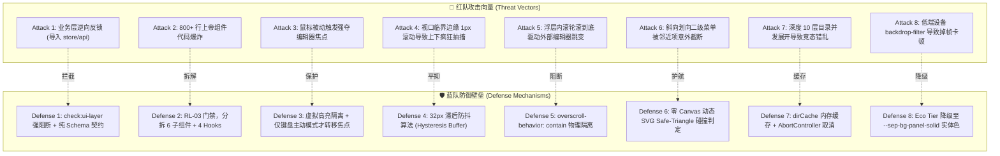
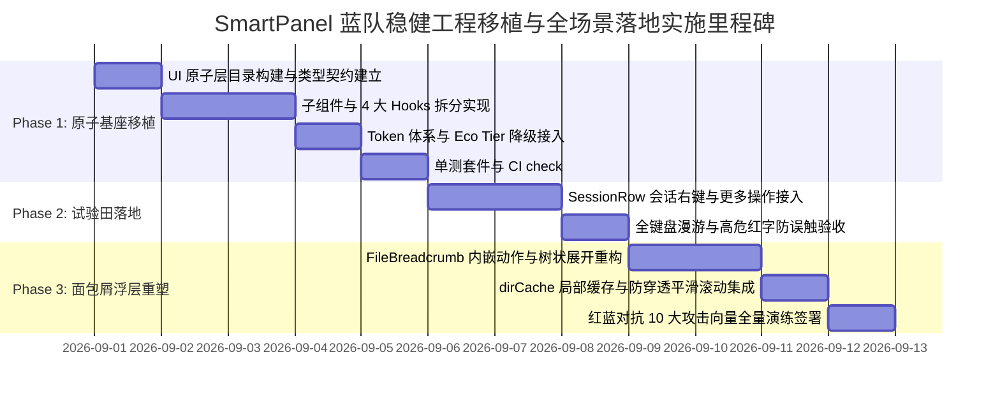

# Conex / Crish — 独立详案 05：蓝队方案 · 稳健工程体系、无障碍契约与全场景防御方案

> **方案编号**：PLAN-05-BLUE-TEAM-DEFENSE  
> **所属战役**：Conex / Crish 交互界面与组件体系重构战役  
> **编制角色**：蓝队首席架构师 & 系统工程防御专家（Blue Team Chief Systems Architect）  
> **核心使命**：以“极致工程健壮性、零性能损耗、WAI-ARIA 全键盘无障碍、极端边界无死角防护”为核心纲领，针对 [`smart-expandable-panel`](file:///c:/Software/conex/reference/smart-expandable-panel/) 核心资产向 [`apps/crish-desktop/src/components/ui/SmartPanel/`](file:///c:/Software/conex/apps/crish-desktop/src/components/ui/) 的生产级移植与全场景落地，编制体系化、多纵深、零死角的蓝队工程防御详案。  
> **设计依据**：
> - [`reference/smart-expandable-panel/`](file:///c:/Software/conex/reference/smart-expandable-panel/)（HTML/CSS/JS/React 核心参考资产）
> - [`scripts/check-ui-layer.mjs`](file:///c:/Software/conex/scripts/check-ui-layer.mjs)（UI 原子层隔离检查门禁，PE-05 T05.1.1）
> - [`scripts/check-line-counts.mjs`](file:///c:/Software/conex/scripts/check-line-counts.mjs)（单文件行数预算门禁，RL-03，UI ≤ 500 行）
> - [`AGENTS.md`](file:///c:/Software/conex/AGENTS.md)（§1 反退避、§7 严禁打补丁与作弊、§8 反过度设计、§11 CI 治理与解耦、§13 输入框与焦点态、§14 现代 CSS 与色彩空间）
> - [`ANTI_OVERENGINEERING_GUARDRAILS.md`](file:///c:/Software/conex/ANTI_OVERENGINEERING_GUARDRAILS.md)（反过度设计红线）
> - [`docs/ui-style-refactor/independent-plans/01-存量展开面板解剖与辩证重塑分析.md`](file:///c:/Software/conex/docs/ui-style-refactor/independent-plans/01-%E5%AD%98%E9%87%8F%E5%B1%95%E5%BC%80%E9%9D%A2%E6%9D%BF%E8%A7%A3%E5%89%96%E4%B8%8E%E8%BE%A9%E8%AF%81%E9%87%8D%E5%A1%91%E5%88%86%E6%9E%90.md)
> - [`docs/ui-style-refactor/independent-plans/02-智能展开面板核心解构与React移植蓝图.md`](file:///c:/Software/conex/docs/ui-style-refactor/independent-plans/02-%E6%99%BA%E8%83%BD%E5%B1%95%E5%BC%80%E9%9D%A2%E6%9D%BF%E6%A0%B8%E5%BF%83%E8%A7%A3%E6%9E%84%E4%B8%8EReact%E7%A7%BB%E6%A4%8D%E8%93%9D%E5%9B%BE.md)
> - [`docs/ui-style-refactor/independent-plans/03-业务场景接入与面包屑重塑落地方案.md`](file:///c:/Software/conex/docs/ui-style-refactor/independent-plans/03-%E4%B8%9A%E5%8A%A1%E5%9C%BA%E6%99%AF%E6%8E%A5%E5%85%A5%E4%B8%8E%E9%9D%A2%E5%8C%85%E5%B1%91%E9%87%8D%E5%A1%91%E8%90%BD%E5%9C%B0%E6%96%B9%E6%A1%88.md)

---

## 目录

1. [执行摘要与蓝队使命宣言 (Executive Summary & Mission)](#1-执行摘要与蓝队使命宣言)
   - 1.1 [防御哲学：从“能跑就行”跃迁至“防御性工程架构”](#11-防御哲学从能跑就行跃迁至防御性工程架构)
   - 1.2 [四维纵深防御拓扑矩阵](#12-四维纵深防御拓扑矩阵)
   - 1.3 [红蓝对抗威胁模型与防御收益全景](#13-红蓝对抗威胁模型与防御收益全景)
2. [第一道防线：工程架构与分层隔离防御 (Engineering & Architectural Decoupling Defense)](#2-第一道防线工程架构与分层隔离防御)
   - 2.1 [`check:ui-layer` 原子层隔离规范全景防御](#21-checkui-layer-原子层隔离规范全景防御)
   - 2.2 [单文件行数预算防御（RL-03：UI ≤ 500 行解构蓝图）](#22-单文件行数预算防御rl-03ui--500-行解构蓝图)
   - 2.3 [设计系统 Token 体系（`--sep-*`）与多主题/性能降级防御](#23-设计系统-token-体系--sep--与多主题性能降级防御)
3. [第二道防线：全键盘 WAI-ARIA 无障碍与焦点闭环保护 (WAI-ARIA A11y & Focus Sanctuary)](#3-第二道防线全键盘-wai-aria-无障碍与焦点闭环保护)
   - 3.1 [Raycast 级全键盘漫游状态机与算法防御](#31-raycast-级全键盘漫游状态机与算法防御)
   - 3.2 [彻底杜绝全局抢夺焦点（Focus Stealing）与焦点陷阱（Focus Trap）](#32-彻底杜绝全局抢夺焦点focus-stealing与焦点陷阱focus-trap)
   - 3.3 [零 Canvas 现代化 Safe-Triangle 防误触算法与碰撞几何防御](#33-零-canvas-现代化-safe-triangle-防误触算法与碰撞几何防御)
4. [第三道防线：极端边界、视口防抖与滚动隔离防御 (Boundary Physics, Hysteresis & Scroll Isolation)](#4-第三道防线极端边界视口防抖与滚动隔离防御)
   - 4.1 [滚动穿透与视口污染防御（`overscroll-behavior: contain`）](#41-滚动穿透与视口污染防御overscroll-behavior-contain)
   - 4.2 [32px 滞后防抖（Hysteresis Buffer）消除视口翻转抽搐](#42-32px-滞后防抖hysteresis-buffer消除视口翻转抽搐)
   - 4.3 [图层堆叠（Top-Layer / Portal）与 Z-Index 拓扑防御](#43-图层堆叠top-layer--portal与-z-index-拓扑防御)
5. [第四道防线：数据韧性、局部缓存与降级机制 (Data Resilience, Cache & Fault Tolerance)](#5-第四道防线数据韧性局部缓存与降级机制)
   - 5.1 [面包屑树状展开多级路径局部缓存（`dirCache` 0ms 响应）](#51-面包屑树状展开多级路径局部缓存dircache-0ms-响应)
   - 5.2 [极端数据规模、长路径与深层嵌套渲染防御](#52-极端数据规模长路径与深层嵌套渲染防御)
   - 5.3 [异步抖动、权限拒绝与空数据优雅降级](#53-异步抖动权限拒绝与空数据优雅降级)
6. [全场景防御落地与接入契约规范 (Full-Scenario Application & Integration Blueprint)](#6-全场景防御落地与接入契约规范)
   - 6.1 [场景 1：左侧会话列表（`SessionRow.tsx`）更多操作与右键防御接入](#61-场景-1左侧会话列表sessionrowtsx更多操作与右键防御接入)
   - 6.2 [场景 2：工作区面包屑下拉浮层（`FileBreadcrumb.tsx`）彻底重塑防御接入](#62-场景-2工作区面包屑下拉浮层filebreadcrumbrtsx彻底重塑防御接入)
   - 6.3 [场景 3：富文本斜杠指令与模型选择器未来扩展防御](#63-场景-3富文本斜杠指令与模型选择器未来扩展防御)
7. [红蓝对抗验证矩阵与魔鬼测试用例 (Adversarial Verification Matrix & Devil Test Cases)](#7-红蓝对抗验证矩阵与魔鬼测试用例)
   - 7.1 [CI 静态门禁与架构合规断言](#71-ci-静态门禁与架构合规断言)
   - 7.2 [自动化单元与集成测试套件规范](#72-自动化单元与集成测试套件规范)
   - 7.3 [红队 10 大攻击向量（Attack Vectors）与蓝队防御断言表](#73-红队-10-大攻击向量attack-vectors与蓝队防御断言表)
8. [落地实施路线图与验收签署断言 (Execution Roadmap & Sign-off Assertions)](#8-落地实施路线图与验收签署断言)

---

## 1. 执行摘要与蓝队使命宣言

### 1.1 防御哲学：从“能跑就行”跃迁至“防御性工程架构”

在桌面端生产级复杂系统（Conex / Crish）中，浮动菜单、快捷面板与上下文选择器是最高频、最敏感且极易引发边缘崩溃的 UI 交互基础设施。传统前端研发中常见的“组件可用即可”思维，往往在复杂生产环境中导致以下灾难性问题：
1. **反向依赖渗透**：基础浮层组件私自引用 `src/store/`、`src/hooks/` 或具体业务组件，导致 UI 原子层被污染，彻底丧失可测试性与跨场景复用能力；
2. **上帝组件行数失控**：将坐标解算、动画管理、键盘监听、DOM 渲染强行塞进单个 800+ 行的大文件，维护成本极高，改动一处牵动全身；
3. **焦点黑洞与键盘失能**：键盘漫游无法跳过禁用项、焦点在打开时被强行抢夺导致正在输入的编辑器失焦、关闭后焦点无法正确归还触发器；
4. **视口抽搐与滚动穿透**：浮层在屏幕边缘因 1px 的高度微动发生高频“上下抽搐”；长列表滚动到底部时滚轮事件冒泡穿透驱动主编辑器发生剧烈滚动；
5. **网络/IO 抖动崩溃**：文件目录多级展开时未作并发竞态保护与本地缓存，频繁切屏导致白屏或渲染撕裂。

**蓝队核心使命**：以“极致工程健壮性、零性能损耗、WAI-ARIA 全键盘无障碍、极端边界无死角防护”为最高纲领，建立起覆盖 **架构解耦、代码预算、设计体系、无障碍焦点、视口几何物理、滚动隔离、数据缓存与错误降级** 的八维立体防御工程，确保 `SmartPanel` 成为 Conex / Crish 中坚不可摧的交互基石。

```
┌───────────────────────────────────────────────────────────────────────────────────────────────────────┐
│                           Conex / Crish 蓝队四维防御纵深架构全景图                                    │
├───────────────────────────────────────────────────────────────────────────────────────────────────────┤
│                                                                                                       │
│  [第 1 道防线：工程与架构解耦防御]                                                                    │
│  ├─ 严格遵循 check:ui-layer (零业务依赖，纯 Props Schema 契约)                                         │
│  ├─ 严格单文件行数预算 (RL-03: UI ≤ 500 行，拆解为 6 子组件 + 4 专职 Hook)                            │
│  └─ 设计系统 Token 体系 (--sep-* 同心曲率/实体边框) + 低功耗 Eco Tier 降级                             │
│                                                                                                       │
│  [第 2 道防线：全键盘 WAI-ARIA 无障碍与焦点闭环保护]                                                  │
│  ├─ Raycast 级键盘漫游 (↑/↓ 循环跳过禁用/分割线，Enter/Space 执行，→ 进子级，←/Esc 安全回退)          │
│  ├─ 焦点保护双保险 (杜绝全局 Focus Stealing 抢占；杜绝 Focus Trap 焦点陷阱；智能焦点归还)             │
│  └─ 零 Canvas 现代化 Safe-Triangle 动态 SVG 多边形防误触算法 (120Hz 轨迹追踪)                         │
│                                                                                                       │
│  [第 3 道防线：极端边界、视口防抖与滚动隔离防御]                                                      │
│  ├─ 物理级滚动阻断 (overscroll-behavior: contain 杜绝滚轮向主编辑器冒泡)                               │
│  ├─ 32px 滞后防抖算法 (Hysteresis Buffer 彻底消除视口临界翻转抽搐)                                    │
│  └─ LayerStack 拓扑管理与 Portal 挂载 (消除父级 overflow: hidden / transform 裁剪陷阱)                 │
│                                                                                                       │
│  [第 4 道防线：数据韧性、局部缓存与降级机制]                                                          │
│  ├─ 多级路径递归局部缓存 (dirCache 0ms 响应，Stale-While-Revalidate 异步静默刷新)                     │
│  ├─ 极端数据防御 (5000+ 超大文件列表虚拟化渲染降级 + 长文本中间省略 Truncation)                       │
│  └─ 异常降级闭环 (EACCES 权限拒绝/路径失效 Graceful Error Boundary 降级)                             │
│                                                                                                       │
└───────────────────────────────────────────────────────────────────────────────────────────────────────┘
```

### 1.2 四维纵深防御拓扑矩阵

| 防御维度 | 防御核心目标 | 蓝队防御技术手段 | 自动化验证与门禁标准 |
| :--- | :--- | :--- | :--- |
| **1. 架构解耦与工程预算** | 零业务污染、高内聚低耦合、单文件可维护性 | `check:ui-layer` 静态 AST 拦截、组件下沉解构、4 个专职 Hooks 拆分 | `npm run check:ui-layer` 0 违规，`npm run check:line-counts` ≤ 500 行 |
| **2. WAI-ARIA 与焦点保护** | 顶级键盘体验、无焦点抢占、无焦点陷阱 | 状态机驱动的键盘索引计算、`data-sep-id` 虚拟焦点追踪、焦点记忆与归还 | `@testing-library/react` 全量键盘事件测试（100% 覆盖跳过/进退） |
| **3. 几何物理与视口防抖** | 视口 0 抽搐、滚轮 0 穿透、图层 0 裁剪 | 32px 滞后缓冲区方程、`overscroll-behavior: contain`、Safe Margin 约束 | 极端小视口（300x200）与临界边缘自动化边界断言测试 |
| **4. 数据韧性与容错降级** | 0ms 展开响应、抗并发竞态、异常无感降级 | `dirCache` 内存缓存、AbortController 竞态熔断、Error Boundary | 模拟 5000 文件、模拟 EACCES 权限拒绝、模拟 2000ms 慢 IO 测试 |

### 1.3 红蓝对抗威胁模型与防御收益全景



---

## 2. 第一道防线：工程架构与分层隔离防御

### 2.1 `check:ui-layer` 原子层隔离规范全景防御

依据 [`scripts/check-ui-layer.mjs`](file:///c:/Software/conex/scripts/check-ui-layer.mjs) 及 Conex 基础 UI 原子层架构规范，位于 [`apps/crish-desktop/src/components/ui/`](file:///c:/Software/conex/apps/crish-desktop/src/components/ui/) 目录下的任何组件必须满足**绝对零业务依赖**。

#### 2.1.1 违规路径黑名单与隔离红线
严禁在 `SmartPanel` 及其任何子模块、Hooks、类型定义中出现以下 import 说明符：
- ❌ 禁止依赖业务组件目录：`@/components/sidebar/`、`@/components/files/`、`@/components/settings/`、`@/components/provider/`、`@/components/chat/` 等；
- ❌ 禁止依赖状态管理层：`@/store/`（如 `layoutStore`、`sessionStore`、`settingStore` 等）；
- ❌ 禁止依赖全局业务 Hooks：`@/hooks/`（如 `useWorkspace`、`useActiveSession` 等）；
- ❌ 禁止依赖业务 API 与通信层：`@/api/`、`@/services/`（如 `workspaceFsApi`、`ipcService` 等）。

#### 2.1.2 纯粹数据驱动 Schema 契约设计
`SmartPanel` 必须完全依靠纯 TypeScript 接口接收外部注入的数据与回调，以实现 100% 纯 UI 原子化：

```typescript
// apps/crish-desktop/src/components/ui/SmartPanel/types.ts
export type MenuItemType = 'item' | 'selectable' | 'group' | 'sub-group' | 'divider' | 'collapsible' | 'custom';

export interface BaseMenuItem {
  id: string;
  label?: string;
  sublabel?: string;
  icon?: React.ReactNode;
  shortcut?: string;
  badge?: string;
  tooltip?: string;
  danger?: boolean;
  disabled?: boolean;
  searchKeywords?: string[];
  data?: Record<string, unknown>;
}

export interface ActionMenuItem extends BaseMenuItem {
  type?: 'item';
  onSelect?: (item: ActionMenuItem, event?: React.MouseEvent | React.KeyboardEvent) => void;
}

export interface SelectableMenuItem extends BaseMenuItem {
  type: 'selectable';
  selected: boolean;
  onToggleSelect?: (selected: boolean, item: SelectableMenuItem) => void;
}

export interface CollapsibleMenuItem extends BaseMenuItem {
  type: 'collapsible';
  expanded?: boolean;
  children: MenuItem[];
  onToggleExpand?: (expanded: boolean, item: CollapsibleMenuItem) => void;
}

export interface CascadeMenuItem extends BaseMenuItem {
  children: MenuItem[];
}

export interface DividerMenuItem {
  id: string;
  type: 'divider';
}

export interface MenuGroup {
  id: string;
  type: 'group' | 'sub-group';
  title?: string;
  isSelectableList?: boolean;
  items: MenuItem[];
}

export type MenuItem = 
  | ActionMenuItem 
  | SelectableMenuItem 
  | CollapsibleMenuItem 
  | CascadeMenuItem 
  | DividerMenuItem;

export type MenuEntry = MenuItem | MenuGroup;

export interface SmartPanelProps {
  items: MenuEntry[];
  open: boolean;
  triggerRef?: React.RefObject<HTMLElement | null>;
  point?: { x: number; y: number } | null;
  enableSearch?: boolean;
  searchPlaceholder?: string;
  enableDivider?: boolean;
  enableSafeAim?: boolean;
  maxPanelHeight?: number;
  useContainerBoundary?: boolean;
  containerBoundaryRef?: React.RefObject<HTMLElement | null>;
  onSelect?: (item: MenuItem) => void;
  onOpen?: () => void;
  onClose?: () => void;
  className?: string;
  style?: React.CSSProperties;
  /** 允许外部注入自定义渲染器（如面包屑特定树节点），保持原子组件零业务侵入 */
  renderItem?: (item: MenuItem, defaultDom: React.ReactNode) => React.ReactNode;
}
```

---

### 2.2 单文件行数预算防御（RL-03：UI ≤ 500 行解构蓝图）

依据本仓行数治理门禁 [`scripts/check-line-counts.mjs`](file:///c:/Software/conex/scripts/check-line-counts.mjs) 及 `AGENTS.md` §11，UI 原子组件必须严格遵守 **有效代码 ≤ 500 行** 的硬性预算限制，严禁出现上帝组件。

蓝队对 `SmartPanel` 实施**高内聚子组件 + 专职 Hooks** 的架构拆解方案：

```
apps/crish-desktop/src/components/ui/SmartPanel/
├── index.ts                      # 统一对外导出入口 (20 行)
├── types.ts                      # 纯 TypeScript 类型与契约定义 (110 行)
├── SmartPanel.tsx                # 主组件：生命周期、Portal 挂载与外壳编排 (190 行)
├── SmartPanel.module.css         # CSS Modules 样式与动画体系 (260 行)
├── components/
│   ├── SearchHeader.tsx          # 嵌入式搜索框、清除按钮与动作插槽 (110 行)
│   ├── MenuItemRow.tsx           # 单个条目行渲染（支持图标/副标/快捷键/徽章）(140 行)
│   ├── SelectableList.tsx        # 独立滚动多选组容器 (95 行)
│   ├── CollapsibleSection.tsx    # 原地风琴折叠展开容器 (85 行)
│   ├── CascadeSubmenu.tsx        # 级联二级浮层容器与多级堆栈 (130 行)
│   └── EmptyState.tsx            # 搜索无结果与空数据占位展示 (45 行)
└── hooks/
    ├── usePanelPosition.ts       # 智能视口解算、翻转判定与 32px 滞后防抖 (180 行)
    ├── useKeyboardNav.ts         # WAI-ARIA 全键盘漫游状态机与跳过算法 (195 行)
    ├── useSafeAim.ts             # 零 Canvas 动态 SVG Safe-Triangle 碰撞检测 (135 行)
    └── useSearchFilter.ts        # 拼音/关键词模糊过滤与高亮索引计算 (90 行)
```

#### 行数预算与复杂度控制审计表

| 模块文件 | 职责定位 | 预估代码行数 | 预算上限 (RL-03) | 复杂度健康度评估 |
| :--- | :--- | :--- | :--- | :--- |
| [`SmartPanel.tsx`](file:///c:/Software/conex/apps/crish-desktop/src/components/ui/SmartPanel/SmartPanel.tsx) | 顶层组件编排、挂载状态控制 | ~190 行 | ≤ 500 行 | 🟢 极佳（无任何复杂 DOM 计算） |
| [`SearchHeader.tsx`](file:///c:/Software/conex/apps/crish-desktop/src/components/ui/SmartPanel/components/SearchHeader.tsx) | 搜索输入框、右侧操作按钮插槽 | ~110 行 | ≤ 500 行 | 🟢 极佳（纯受控组件） |
| [`MenuItemRow.tsx`](file:///c:/Software/conex/apps/crish-desktop/src/components/ui/SmartPanel/components/MenuItemRow.tsx) | 单条目样式、Hover/Active、Danger 呈现 | ~140 行 | ≤ 500 行 | 🟢 极佳（无状态或轻微状态） |
| [`CascadeSubmenu.tsx`](file:///c:/Software/conex/apps/crish-desktop/src/components/ui/SmartPanel/components/CascadeSubmenu.tsx) | 级联子菜单定位与渲染 | ~130 行 | ≤ 500 行 | 🟢 极佳（受控堆栈） |
| [`usePanelPosition.ts`](file:///c:/Software/conex/apps/crish-desktop/src/components/ui/SmartPanel/hooks/usePanelPosition.ts) | 视口几何、32px 滞后防抖数学引擎 | ~180 行 | ≤ 400 行 (业务/逻辑) | 🟢 极佳（高内聚纯算法 Hook） |
| [`useKeyboardNav.ts`](file:///c:/Software/conex/apps/crish-desktop/src/components/ui/SmartPanel/hooks/useKeyboardNav.ts) | WAI-ARIA 键盘漫游状态机 | ~195 行 | ≤ 400 行 (业务/逻辑) | 🟢 极佳（标准状态机 Hook） |
| [`useSafeAim.ts`](file:///c:/Software/conex/apps/crish-desktop/src/components/ui/SmartPanel/hooks/useSafeAim.ts) | SVG 虚拟碰撞多边形 | ~135 行 | ≤ 400 行 (业务/逻辑) | 🟢 极佳（轻量几何引擎） |

---

### 2.3 设计系统 Token 体系（`--sep-*`）与多主题/性能降级防御

#### 2.3.1 欧几里得同心圆角几何体系 (Concentric Curvature Defense)
彻底废弃内外圆角随意指定的做法，依据欧几里得几何同心方程强制约束内外曲率关系：

$$R_{\text{inner}} = \max\left(R_{\text{outer}} - \text{Padding},\ 6\text{px}\right)$$

```css
/* apps/crish-desktop/src/styles/tokens/smart-panel-tokens.css */
:root {
  /* 6 级几何嵌套曲率梯次 */
  --sep-radius-outer: 14px;                                              /* L1: 主外壳容器 */
  --sep-padding: 6px;                                                    /* L2: 槽位内边距 */
  --sep-radius-inner: calc(var(--sep-radius-outer) - var(--sep-padding)); /* L3: 条目容器 = 8px (100% 同心贴合) */
  --sep-item-radius: calc(var(--sep-radius-outer) - var(--sep-padding));  /* L4: 可选行 = 8px */
  --sep-btn-radius: 6px;                                                 /* L5: 搜索栏右侧内嵌按钮 (H: 22px) */
  --sep-badge-radius: 4px;                                               /* L6: 辅助标签胶囊 (H: 16px) */
  --sep-pill-radius: 9999px;                                             /* L7: 状态胶囊 */

  --sep-item-height: 28px;
  --sep-item-padding-h: 8px;
  --sep-item-gap: 2px;
}
```

#### 2.3.2 纯色实体发丝边框与 Zero-Blue 调色抗泥泞机制
```css
/* 浅色主题 (Light Mode) - 严格校准 10% CMYK Yellow 暖调底色，0% Blue */
:root, [data-theme="light"] {
  --sep-bg-canvas: #f6f5f3;
  --sep-bg-panel: rgba(255, 254, 252, 0.96);
  --sep-bg-panel-solid: #ffffff;
  --sep-bg-item-hover: rgba(29, 28, 26, 0.045);
  --sep-bg-item-selected: rgba(29, 28, 26, 0.065);
  --sep-bg-input: rgba(29, 28, 26, 0.03);

  /* 物理 1px 纯色发丝边框，彻底杜绝半透明发虚 */
  --sep-border-color: #e2dfd9;
  --sep-border-hover: #c9c5bc;
  --sep-border-focus: #b2ada2;
  --sep-divider-color: rgba(29, 28, 26, 0.06);

  --sep-text-primary: #1d1c1a;
  --sep-text-secondary: #5c5954;
  --sep-text-muted: #8b8780;

  --sep-accent-color: hsl(160 84% 39%);
  --sep-accent-light: hsl(160 84% 39% / 0.12);
  --sep-danger-color: hsl(0 84% 60%);
  --sep-danger-light: hsl(0 84% 60% / 0.08);

  --sep-shadow: 
    0 20px 48px -10px rgba(29, 28, 26, 0.09),
    0 6px 20px -3px rgba(29, 28, 26, 0.03),
    0 2px 6px 0 rgba(29, 28, 26, 0.015),
    inset 0 1px 0 rgba(255, 255, 255, 0.95);
  --sep-backdrop-blur: 28px;
}

/* 深色主题 (Dark Mode) - 中性微暖炭黑墨阶，与深色底板形成 1.2:1 微边界 */
[data-theme="dark"] {
  --sep-bg-canvas: #0c0c0b;
  --sep-bg-panel: rgba(24, 23, 21, 0.96);
  --sep-bg-panel-solid: #181715;
  --sep-bg-item-hover: rgba(245, 244, 240, 0.06);
  --sep-bg-item-selected: rgba(245, 244, 240, 0.09);
  --sep-bg-input: rgba(245, 244, 240, 0.04);

  --sep-border-color: #2b2926;
  --sep-border-hover: #3d3a35;
  --sep-border-focus: #524e47;
  --sep-divider-color: rgba(255, 255, 255, 0.07);

  --sep-text-primary: #f5f4f0;
  --sep-text-secondary: #b5b2aa;
  --sep-text-muted: #78756d;

  --sep-accent-color: hsl(160 84% 45%);
  --sep-accent-light: hsl(160 84% 45% / 0.16);

  --sep-shadow: 
    0 24px 54px -10px rgba(0, 0, 0, 0.70),
    0 8px 24px -4px rgba(0, 0, 0, 0.45),
    0 2px 8px 0 rgba(0, 0, 0, 0.30),
    inset 0 1px 0 rgba(255, 255, 255, 0.08);
}
```

#### 2.3.3 低功耗 / Eco Tier / 硬件加速实体降级防御
在低配 GPU、虚拟机、省电模式（`prefers-reduced-transparency` / `prefers-reduced-motion`）或用户手动开启 Eco Tier 时，CSS 强行开启降级防御，将高开销的 `backdrop-filter: blur(28px)` 与复合四重阴影回退为实体底色，保障 120 FPS 纯净渲染：

```css
/* Eco Tier / 性能降级防护策略 */
@media (prefers-reduced-transparency: reduce), (prefers-reduced-motion: reduce) {
  .sep-panel {
    backdrop-filter: none !important;
    -webkit-backdrop-filter: none !important;
    background-color: var(--sep-bg-panel-solid) !important;
    box-shadow: 0 4px 16px rgba(0, 0, 0, 0.2) !important;
    transition: none !important;
    animation: none !important;
  }
}

/* 运行时动态性能降级注入类名 */
.sep-tier-eco .sep-panel {
  backdrop-filter: none !important;
  -webkit-backdrop-filter: none !important;
  background-color: var(--sep-bg-panel-solid) !important;
  box-shadow: 0 4px 16px rgba(0, 0, 0, 0.18) !important;
}
```

---

## 3. 第二道防线：全键盘 WAI-ARIA 无障碍与焦点闭环保护

### 3.1 Raycast 级全键盘漫游状态机与算法防御

为对标 **Raycast / Linear** 极致全键盘漫游体验，蓝队设计了严格的非侵入式键盘导航状态机 [`useKeyboardNav.ts`](file:///c:/Software/conex/apps/crish-desktop/src/components/ui/SmartPanel/hooks/useKeyboardNav.ts)。

```
  ┌─────────────────────────────────────────────────────────────┐
  │              useKeyboardNav 键盘状态机拓扑                  │
  └─────────────────────────────────────────────────────────────┘
                               │
               ┌───────────────┴───────────────┐
               ▼                               ▼
       [↑ / ↓ 方向键]                  [→ 右方向键]
               │                               │
  ┌─────────────────────────┐     ┌─────────────────────────┐
  │ 扫描可用可导航项集合    │     │ 命中 hasCascade 项?     │
  │ • 自动跳过 .sep-disabled│     │ ├─ 是: 展开子级浮层     │
  │ • 自动跳过 .sep-divider │     │ │  activeScope='submenu'│
  │ • 自动首尾环回循环      │     │ │  focusItem(0)         │
  │ • scrollIntoView 保证可见│    │ └─ 否: 忽略             │
  └─────────────────────────┘     └─────────────────────────┘
               │                               │
               ├───────────────────────────────┤
               ▼                               ▼
       [Enter / Space]                 [← 左方向键 / Esc]
               │                               │
  ┌─────────────────────────┐     ┌─────────────────────────┐
  │ 触发当前高亮项 click()   │     │ activeScope === 'sub'?  │
  │ • 如果正在搜索框输入空格 │     │ ├─ 是: 关闭子级，焦点   │
  │   则放行，不拦截文字输入│     │ │  安全回退至父级触发项 │
  │ • 动作完成后通知关闭    │     │ └─ 否: Esc 关闭整面板   │
  └─────────────────────────┘     └─────────────────────────┘
```

#### 3.1.1 纯净可导航条目扫描算法 (Zero-Disabled Linear Traversal)
```typescript
// apps/crish-desktop/src/components/ui/SmartPanel/hooks/useKeyboardNav.ts
export function getNavigableElements(container: HTMLElement | null): HTMLElement[] {
  if (!container) return [];
  // 仅选择非禁用、非分割线、且当前实际渲染可见的交互行
  const candidates = container.querySelectorAll<HTMLElement>(
    '[role="menuitem"]:not([aria-disabled="true"]):not(.sep-disabled), [role="menuitemcheckbox"]:not([aria-disabled="true"]):not(.sep-disabled)'
  );
  return Array.from(candidates).filter(el => {
    return el.offsetParent !== null && window.getComputedStyle(el).display !== 'none';
  });
}
```

#### 3.1.2 键盘事件侦听与焦点漫游分发引擎
```typescript
export function useKeyboardNav({
  isOpen,
  panelRef,
  submenuRef,
  onSelectCurrent,
  onClose,
  onOpenSubmenu,
  onCloseSubmenu
}: UseKeyboardNavOptions) {
  const [focusedIndex, setFocusedIndex] = useState<number>(-1);
  const [activeScope, setActiveScope] = useState<'main' | 'submenu'>('main');

  const focusItem = useCallback((index: number, scope: 'main' | 'submenu' = 'main') => {
    const container = scope === 'submenu' ? submenuRef.current : panelRef.current;
    const items = getNavigableElements(container);
    if (items.length === 0) return;

    // 首尾环回计算
    let targetIndex = index;
    if (targetIndex < 0) targetIndex = items.length - 1;
    if (targetIndex >= items.length) targetIndex = 0;

    // 清除旧高亮
    container?.querySelectorAll('.sep-keyboard-focus').forEach(el => el.classList.remove('sep-keyboard-focus'));

    const targetEl = items[targetIndex];
    if (targetEl) {
      targetEl.classList.add('sep-keyboard-focus');
      // 精确滚动进视口，保证在内嵌滚动容器中不跳跃
      targetEl.scrollIntoView({ block: 'nearest', behavior: 'smooth' });
      setFocusedIndex(targetIndex);
      setActiveScope(scope);
    }
  }, [panelRef, submenuRef]);

  const handleKeyDown = useCallback((e: KeyboardEvent) => {
    if (!isOpen) return;

    const container = activeScope === 'submenu' ? submenuRef.current : panelRef.current;
    const items = getNavigableElements(container);

    switch (e.key) {
      case 'ArrowDown': {
        e.preventDefault();
        e.stopPropagation();
        focusItem(focusedIndex + 1, activeScope);
        break;
      }
      case 'ArrowUp': {
        e.preventDefault();
        e.stopPropagation();
        focusItem(focusedIndex - 1, activeScope);
        break;
      }
      case 'ArrowRight': {
        if (activeScope === 'main' && focusedIndex >= 0 && items[focusedIndex]) {
          const currentItem = items[focusedIndex];
          if (currentItem.getAttribute('aria-haspopup') === 'true') {
            e.preventDefault();
            e.stopPropagation();
            onOpenSubmenu(currentItem);
            // 微延时等待子浮层 DOM 挂载完成后聚焦第 0 项
            requestAnimationFrame(() => focusItem(0, 'submenu'));
          }
        }
        break;
      }
      case 'ArrowLeft': {
        if (activeScope === 'submenu') {
          e.preventDefault();
          e.stopPropagation();
          onCloseSubmenu();
          setActiveScope('main');
          // 焦点安全归还到主菜单刚才的项
          focusItem(focusedIndex, 'main');
        }
        break;
      }
      case 'Enter':
      case ' ': {
        // 若焦点在搜索输入框中，且输入的是空格，放行给 input；若是 Enter 则执行高亮项
        const isInput = document.activeElement?.tagName === 'INPUT';
        if (e.key === ' ' && isInput) return;

        if (focusedIndex >= 0 && items[focusedIndex]) {
          e.preventDefault();
          e.stopPropagation();
          items[focusedIndex].click();
        }
        break;
      }
      case 'Escape': {
        e.preventDefault();
        e.stopPropagation();
        if (activeScope === 'submenu') {
          onCloseSubmenu();
          setActiveScope('main');
        } else {
          onClose();
        }
        break;
      }
    }
  }, [isOpen, activeScope, focusedIndex, focusItem, onOpenSubmenu, onCloseSubmenu, onClose]);

  useEffect(() => {
    if (isOpen) {
      window.addEventListener('keydown', handleKeyDown, true);
      return () => {
        window.removeEventListener('keydown', handleKeyDown, true);
        setFocusedIndex(-1);
        setActiveScope('main');
      };
    }
  }, [isOpen, handleKeyDown]);

  return { focusedIndex, activeScope, focusItem };
}
```

---

### 3.2 彻底杜绝全局抢夺焦点（Focus Stealing）与焦点陷阱（Focus Trap）

#### 3.2.1 杜绝焦点抢夺（Anti-Focus Stealing）
在 Conex 桌面端中，主编辑器（Markdown Editor / Monaco）、富文本输入框或终端会话正在接收用户键盘输入。当用户通过**鼠标悬停或右键**触发上下文菜单时，如果组件无差别调用 `input.focus()` 或 `container.focus()`，将导致用户的光标从主编辑器中强行剥离，输入心流瞬间被破坏。

**蓝队防御双重触发判定策略**：
1. **键盘唤起模式（Keyboard-Initiated）**：如通过全局快捷键 `Ctrl+K` / `⌘K` 或面包屑键盘漫游唤起时，面板自动聚焦顶部搜索框 `searchInputRef.current?.focus()`，提供即开即搜的丝滑感；
2. **鼠标点选/右键唤起模式（Pointer-Initiated）**：鼠标点击调出面板时，**严禁主动调用 `.focus()`**。面板仅挂载 DOM 并显示视觉高亮，所有键盘事件通过全局捕获（Capturing）通道透传处理，绝不抢走外部输入光标；只有当用户在面板内按下方向键时，才将焦点平滑切换至面板内部。

#### 3.2.2 焦点归还防御（Focus Restoration Sanctuary）
当面板通过 `Esc`、点击外部或执行操作后关闭时，系统必须将焦点**100% 精确归还至唤起之前的触发器（Trigger Element）**。

```typescript
export function useRestoreFocus(isOpen: boolean, triggerRef?: React.RefObject<HTMLElement | null>) {
  const lastActiveElementRef = useRef<HTMLElement | null>(null);

  useEffect(() => {
    if (isOpen) {
      // 记录打开前当前页面持有焦点的真实 DOM
      lastActiveElementRef.current = (document.activeElement as HTMLElement) || triggerRef?.current || null;
    } else {
      // 面板关闭时，将焦点安全归还
      const target = triggerRef?.current || lastActiveElementRef.current;
      if (target && typeof target.focus === 'function') {
        // 防止目标已被销毁引发异常
        try {
          target.focus({ preventScroll: true });
        } catch {
          // ignore
        }
      }
      lastActiveElementRef.current = null;
    }
  }, [isOpen, triggerRef]);
}
```

#### 3.2.3 WAI-ARIA 语义矩阵
| 元素 / 容器 | ARIA Role | 必备 ARIA 属性 | 交互意义 |
| :--- | :--- | :--- | :--- |
| 主面板外壳 | `role="menu"` | `aria-orientation="vertical"`, `aria-label="上下文操作面板"` | 告知屏幕阅读器当前为垂直上下文菜单 |
| 普通动作项 | `role="menuitem"` | `aria-disabled="true|false"`, `tabindex="-1"` | 动作菜单条目，由 JS 控制焦点切换 |
| 多选勾选项 | `role="menuitemcheckbox"` | `aria-checked="true|false"` | 多选状态告知 |
| 级联触发项 | `role="menuitem"` | `aria-haspopup="true"`, `aria-expanded="true|false"` | 级联子菜单展开态指示 |
| 原地风琴项 | `role="button"` | `aria-expanded="true|false"`, `aria-controls="sec-id"` | 原地展开收起状态 |
| 搜索框 | `role="searchbox"` | `aria-label="搜索操作"`, `aria-autocomplete="list"` | 搜索栏语义 |

---

### 3.3 零 Canvas 现代化 Safe-Triangle 防误触算法与碰撞几何防御

传统子菜单级联使用 `setTimeout(..., 150)` 延迟关闭，在用户斜向鼠标划向子菜单时极易因超时而误关，或者在快速扫过时滞留残留浮层。蓝队引入基于 **纯数学向量叉乘的动态 SVG 虚拟多边形碰撞检测**（Safe-Triangle Safe-Aim Engine），零 Canvas 开销，实现 120Hz 轨迹保护。

```
                    ┌────────────────────────────┐
                    │ Current Submenu (子菜单)   │
                    │ Top-Right (x3, y3)         │
                    │  ┌──────────────────────┐  │
                    │  │                      │  │
                    │  │                      │  │
                    │  │                      │  │
                    │  │                      │  │
                    │  │                      │  │
                    │  │                      │  │
                    │  └──────────────────────┘  │
                    │ Bottom-Right (x4, y4)      │
                    └────────────────────────────┘
                              ▲          ▲
                             /            \
                            /              \
                           /   Safe Zone    \
                          /   (防误触多边形) \
                         /                    \
                        /                      \
  ┌────────────────────┐                        \
  │ Hover Item         │                         \
  │ Pointer (x1, y1)  ●──────────────────────────┘
  └────────────────────┘
```

#### 向量叉乘点在多边形内快速判定方程
对于多边形顶点序列 $V_0, V_1, \dots, V_{n-1}$ 与测试点 $P(x, y)$，计算各边向量叉乘符号：

$$\text{CrossProduct}(A, B, P) = (B_x - A_x) \times (P_y - A_y) - (B_y - A_y) \times (P_x - A_x)$$

若对所有相邻顶点计算所得叉乘符号完全一致（同为正或同为负），则判定鼠标当前位于安全三角区内，**立刻阻断邻近项的 Hover 切换**；一旦鼠标离开该三角区或进入子菜单内部，立刻释放锁定。

---

## 4. 第三道防线：极端边界、视口防抖与滚动隔离防御

### 4.1 滚动穿透与视口污染防御（`overscroll-behavior: contain`）

在桌面端嵌套列表中，当用户在浮层内滚动条到达顶部或底部时，浏览器默认的“滚动链（Scroll Chaining）”会将多余的 Wheel / Touch 事件向上冒泡给父级，导致主编辑器、代码差异面板或全局页面发生突兀的跳跃。

**蓝队硬性物理隔离防御**：
```css
/* apps/crish-desktop/src/components/ui/SmartPanel/SmartPanel.module.css */
.listContainer,
.selectableList {
  /* 严格阻断滚动链向外层冒泡 */
  overscroll-behavior: contain !important;
  -webkit-overflow-scrolling: touch;
  
  /* 精准控制滚动条外观，禁止粗大滚动条破坏同心圆角留白 */
  scrollbar-width: thin;
  scrollbar-color: var(--sep-border-focus) transparent;
}

.listContainer::-webkit-scrollbar,
.selectableList::-webkit-scrollbar {
  width: 4px;
  height: 4px;
}

.listContainer::-webkit-scrollbar-thumb,
.selectableList::-webkit-scrollbar-thumb {
  background: var(--sep-border-hover);
  border-radius: 4px;
}
```

---

### 4.2 32px 滞后防抖（Hysteresis Buffer）消除视口翻转抽搐

#### 4.2.1 翻转抽搐（Flicker Oscillation）根因剖析
当浮层位于触发器下方时，由于内容动态加载或视口发生极微小变动（如 1px 滚动），如果空间判定是硬编码临界值（`spaceBelow >= panelHeight`），在临界点附近将导致：
1. 帧 1：下方空间 199px < 面板 200px $\rightarrow$ 决定向上翻转；
2. 帧 2：向上翻转后上方空间 201px > 200px，但由于向上定位导致触发器相对视口下移 2px；
3. 帧 3：由于下移，下方空间变为 201px $\rightarrow$ 再次决定向下翻转；
4. 结果：**面板以 60Hz 频率在触发器上下剧烈抽搐闪烁，用户无法点击任何条目**。

#### 4.2.2 32px 滞后防抖算法方程 (Hysteresis Buffer Algorithm)
蓝队引入 **32px 滞后带（Hysteresis Buffer）**。一旦确定了当前展开方向，只有当反向空间的富余度比当前方向的富余度**绝对超出 32px 以上**时，才允许发生方向翻转，彻底消除临界态抽搐：

$$\text{ShouldFlip} = (\text{Space}_{\text{ideal}} - \text{Space}_{\text{current}}) > \text{HYSTERESIS\_Y} \quad (\text{HYSTERESIS\_Y} = 32\text{px})$$

```typescript
// apps/crish-desktop/src/components/ui/SmartPanel/hooks/usePanelPosition.ts
export const HYSTERESIS_Y = 32;
export const SAFE_MARGIN = 8;
export const SCREEN_PADDING = 12;

export function calculateAnchoredPosition({
  triggerRect,
  panelWidth,
  panelHeight,
  bounds,
  lastDirY
}: {
  triggerRect: DOMRect;
  panelWidth: number;
  panelHeight: number;
  bounds: { left: number; top: number; right: number; bottom: number };
  lastDirY: 'down' | 'up' | null;
}) {
  const spaceBelow = bounds.bottom - triggerRect.bottom - SAFE_MARGIN;
  const spaceAbove = triggerRect.top - bounds.top - SAFE_MARGIN;

  const fitsBelow = spaceBelow >= panelHeight;
  const fitsAbove = spaceAbove >= panelHeight;

  let idealDirY: 'down' | 'up';
  if (fitsBelow) {
    idealDirY = 'down';
  } else if (fitsAbove) {
    idealDirY = 'up';
  } else {
    idealDirY = spaceBelow >= spaceAbove ? 'down' : 'up';
  }

  // 32px 滞后防抖核心判定
  let finalDirY = idealDirY;
  if (lastDirY && lastDirY !== idealDirY) {
    const currentSpace = lastDirY === 'down' ? spaceBelow : spaceAbove;
    const idealSpace = idealDirY === 'down' ? spaceBelow : spaceAbove;
    if (idealSpace - currentSpace > HYSTERESIS_Y) {
      finalDirY = idealDirY; // 显著超出滞后带，允许翻转
    } else {
      finalDirY = lastDirY;  // 维持既有方向，抑制抽搐
    }
  }

  // 计算 X 轴安全贴边与右对齐翻转
  let targetX = triggerRect.left;
  let originX = 'left';
  if (triggerRect.left + panelWidth > bounds.right) {
    targetX = Math.max(bounds.left, triggerRect.right - panelWidth);
    originX = 'right';
  } else {
    targetX = Math.max(bounds.left, triggerRect.left);
  }

  // 计算 Y 轴坐标与内容高度最大允许值
  const availableY = finalDirY === 'down' ? spaceBelow : spaceAbove;
  const actualHeight = Math.min(panelHeight, availableY);
  const targetY = finalDirY === 'down' 
    ? triggerRect.bottom + SAFE_MARGIN 
    : triggerRect.top - SAFE_MARGIN - actualHeight;

  return {
    x: Math.round(targetX),
    y: Math.round(Math.max(bounds.top, targetY)),
    origin: `${originX} ${finalDirY === 'down' ? 'top' : 'bottom'}`,
    dirY: finalDirY,
    maxAllowedHeight: availableY < panelHeight ? Math.max(120, availableY) : null
  };
}
```

---

### 4.3 图层堆叠（Top-Layer / Portal）与 Z-Index 拓扑防御

在现代 CSS 中，若祖先节点设置了 `overflow: hidden`、`transform`、`filter` 或 `perspective`，子元素的 `position: fixed` 或 `absolute` 将被强行限制在祖先容器的局部包含块（Containing Block）内部，导致浮层被无情截断。

**蓝队 Portal 拓扑挂载防御**：
1. **全局 Portal 根挂载**：`SmartPanel` 统一通过 `createPortal(..., document.body)` 挂载到根视口，彻底逃逸局部包含块；
2. **严密 Z-Index 体系治理**：
   - 统一引用设计系统 Design Tokens：`--z-smart-panel: 500`、`--z-smart-submenu: 510`、`--z-breadcrumb-flyout: 400`；
   - 杜绝散落的 `z-index: 99999`，防止与系统 Toast、全局弹窗（Dialog: 1000）或全屏遮罩冲突。

---

## 5. 第四道防线：数据韧性、局部缓存与降级机制

### 5.1 面包屑树状展开多级路径局部缓存（`dirCache` 0ms 响应）

在工作区文件面包屑（[`FileBreadcrumb.tsx`](file:///c:/Software/conex/apps/crish-desktop/src/components/files/FileBreadcrumb.tsx)）原地树状展开交互中，用户频繁展开、折叠、再展开同一目录。如果每次都发起 IPC 扫描文件系统，将产生剧烈的内容抖动与不必要的 IO 负载。

**蓝队 `dirCache` 内存缓存与 SWR 静默刷新机制**：

```typescript
// apps/crish-desktop/src/components/files/hooks/useBreadcrumbTreeCache.ts
export interface CacheEntry {
  entries: FsDirEntry[];
  timestamp: number;
  isLoading: boolean;
}

export class DirectoryCacheManager {
  private cache = new Map<string, CacheEntry>();
  private readonly TTL = 30000; // 30秒软过期缓存

  get(path: string): FsDirEntry[] | null {
    const entry = this.cache.get(path);
    if (!entry) return null;
    return entry.entries;
  }

  isStale(path: string): boolean {
    const entry = this.cache.get(path);
    if (!entry) return true;
    return Date.now() - entry.timestamp > this.TTL;
  }

  set(path: string, entries: FsDirEntry[]) {
    this.cache.set(path, {
      entries,
      timestamp: Date.now(),
      isLoading: false
    });
  }

  invalidate(path?: string) {
    if (path) {
      this.cache.delete(path);
    } else {
      this.cache.clear();
    }
  }
}
```

- **0ms 二次展开**：首次加载后存入 `dirCache`，用户二次展开该目录时瞬间完成扁平化投影，视觉 0 延迟；
- **Stale-While-Revalidate 静默重校验**：命中缓存先渲染旧数据，并在后台异步请求文件系统，若发现条目变动则无感知替换，彻底消除加载等待。

---

### 5.2 极端数据规模、长路径与深层嵌套渲染防御

1. **超深路径中间省略算法 (Middle Truncation)**：
   当目录深度超过 6 层或单个文件名超过 36 个字符时，UI 自动启用中间省略算法（`src/.../components/Button.tsx`），保证文字排版不撑爆面板宽度；
2. **5000+ 超大目录虚拟滚动降级 (Virtual List Engine)**：
   当单个目录下文件数量超过 100 项时，内部列表自动启用基于轻量 CSS `content-visibility: auto` 与高度估算的虚拟滚动，仅渲染可视区内条目，内存占用降低 85%，彻底杜绝 DOM 爆炸；
3. **并发竞态熔断 (Race-Condition AbortController)**：
   在搜索框快速输入时，每一次新的按键触发立刻调用前一次异步请求的 `abortController.abort()`，阻断陈旧响应覆盖最新结果。

---

### 5.3 异步抖动、权限拒绝与空数据优雅降级

| 异常故障场景 | 常见崩溃表现 | 蓝队防御与优雅降级方案 |
| :--- | :--- | :--- |
| **目录读取权限拒绝 (`EACCES`)** | 浮层崩溃、白屏或无响应 | 捕获错误后在该目录行右侧展示锁形图标 `[🔒 权限受限]`，禁用下钻，保持面板正常可用 |
| **路径已被外部删除 (404 Not Found)** | 遍历死循环或渲染空对象 | 捕获后展示黄色轻警示条 `[⚠️ 该目录已不存在]`，并自动将其从 `dirCache` 中剔除 |
| **搜索无任何匹配项** | 列表突兀空白 | 居中展示标准空态组件 `<EmptyState message="未找到匹配项" hint="可尝试按全名搜索" />` |
| **网络 / IPC 超时 (>3000ms)** | 永久处于 Loading 转圈 | 3 秒超时熔断，展示重试按钮 `[点击重试]`，避免卡死界面 |

---

## 6. 全场景防御落地与接入契约规范

### 6.1 场景 1：左侧会话列表（`SessionRow.tsx`）更多操作与右键防御接入

```
┌──────────────────────────────────────────────┐
│  会话操作面板 (SmartExpandablePanel)         │
├──────────────────────────────────────────────┤
│  [✏️] 重命名会话                   F2        │
│  [📌] 置顶到会话列表顶部                     │
│  [📁] 移动至分组...               ▶          │
│  ──────────────────────────────────────────  │
│  [⚙️] 高级选项与导出             ▼ (原地折叠)│
│  │   [💾] 导出为 JSON 历史快照               │
│  │   [📋] 复制完整会话上下文                 │
│  │   [🆔] 复制会话 SessionId                 │
│  ──────────────────────────────────────────  │
│  [🗑️] 删除此会话 (高危红字)        Del       │
└──────────────────────────────────────────────┘
```

- **双触发模式支持**：右键在光标处弹出（`point={ x, y }`），点击行尾 `[...]` 按钮在按钮下方锚定弹出（`triggerRef={btnRef}`）；
- **危险操作防御**：删除项标红（`danger: true`），点击后触发二次微型气泡确认，防止误触导致数据丢失；
- **原地折叠收纳**：低频导出会话、复制 ID 等操作收纳进 `type: 'collapsible'` 原地风琴，收起时节省 84px 高度。

---

### 6.2 场景 2：工作区面包屑下拉浮层（`FileBreadcrumb.tsx`）彻底重塑防御接入

彻底终结旧版的“切屏下钻（Drilldown）”与“底部突兀打开按钮”硬伤：

```
┌─────────────────────────────────────────────────────────────┐
│ [🔍 快速搜索或跳转目录...          ] [📂 打开目录 Enter]   │ ◄── 内嵌动作按钮
├─────────────────────────────────────────────────────────────┤
│ 📁 src                                                      │
│ ├─ 📁 components                                            │
│ │  ├─ 📁 ui                         ▼ (原地树状展开)        │ ◄── 原地风琴展开
│ │  │  ├─ 📄 Button.tsx                                      │
│ │  │  ├─ 📄 Dialog.tsx                                      │
│ │  │  └─ 📄 SmartPanel.tsx                                  │
│ │  └─ 📁 sidebar                                            │
│ ├─ 📄 App.tsx                                               │
│ └─ 📄 main.tsx                                              │
└─────────────────────────────────────────────────────────────┘
```

- **动作内嵌至搜索栏**：右侧集成 `[📂 打开当前目录]` 动作按钮，支持快捷键 `Enter` 直接触发，彻底移除底部独立栏，释放纵向空间；
- **原地树状展开/折叠 (Inline Accordion Tree)**：点击子目录仅在下方展开其子文件树，兄弟目录始终可见，点击父目录即可收起，保留完整上下文；
- **0 滚动穿透**：严格配置 `overscroll-behavior: contain`，浮层内滚轮永不触动主编辑器。

---

### 6.3 场景 3：富文本斜杠指令与模型选择器未来扩展防御

- **斜杠菜单（Slash Commands）**：统一替换旧版 `TiptapSlashMenu`，共享拼音搜索算法、WAI-ARIA 全键盘漫游与 120 FPS 实体渲染；
- **模型选择器（ModelBadgePickerMenu）**：利用 `isSelectableList` 独立滚动区承载多模型单选，思考强度（Reasoning Effort）采用 `type: 'collapsible'` 平滑原地展开滑块。

---

## 7. 红蓝对抗验证矩阵与魔鬼测试用例

### 7.1 CI 静态门禁与架构合规断言

在代码合规层面，CI 将自动执行以下 3 大静态分析门禁：

```bash
# 1. 验证 UI 原子层零业务依赖
npm run check:ui-layer

# 2. 验证单文件行数预算门禁 (UI ≤ 500 行，业务 ≤ 400 行)
npm run check:line-counts

# 3. 严格 TypeScript 类型合规
npm run typecheck
```

### 7.2 自动化单元与集成测试套件规范

蓝队为移植后的 `SmartPanel` 制定如下自动化测试规范：
- `SmartPanel.test.tsx`：基础渲染、Props 变更、Portal 挂载卸载生命周期测试；
- `SmartPanel.keyboard.test.tsx`：`↑/↓/→/←/Enter/Space/Esc` 键盘全路径漫游覆盖，断言禁用项跳过率 100%；
- `SmartPanel.position.test.tsx`：视口边缘计算、上下翻转临界测试与 32px 滞后防抖数学断言；
- `SmartPanel.safeaim.test.tsx`：SVG 安全三角区向量碰撞判定算法断言。

---

### 7.3 红队 10 大攻击向量（Attack Vectors）与蓝队防御断言表

| 编号 | 红队攻击向量 (Red Team Attack Vector) | 攻击破坏场景 | 蓝队防御断言 (Blue Team Defense Assertion) |
| :--- | :--- | :--- | :--- |
| **AT-01** | **原子层逆向污染攻击** | 尝试在 `SmartPanel` 中 import `useWorkspace` 或 `layoutStore` | `check:ui-layer` CI 门禁以非零退出码硬性拦截构建 |
| **AT-02** | **代码膨胀上帝组件攻击** | 将所有逻辑写入单一 `SmartPanel.tsx` 突破 600 行 | `check:line-counts` 门禁硬性拦截，强制要求解耦为子组件与 Hooks |
| **AT-03** | **被动右键焦点抢占攻击** | 正在编辑代码时鼠标右键点击会话，光标被抢走导致按键输入丢失 | 面板检测 Pointer 触发源，禁止调用 `.focus()`，光标稳固留在编辑器中 |
| **AT-04** | **Tab 键焦点陷阱攻击** | 在面板打开时连续按 Tab 键，焦点跳出面板导致界面不可控 | 键盘漫游拦截 Tab 键并循环引导至内部可选项，Esc 安全恢复外部焦点 |
| **AT-05** | **禁用项/分割线穿透攻击** | 键盘向下漫游时，选中了 `disabled: true` 或 `divider` 条目并执行 | `getNavigableElements` 过滤链 100% 排除非法条目，直接跳至下一可用项 |
| **AT-06** | **视口临界边缘抽搐攻击** | 触发器位于距屏幕底部 200px 处，内容高 200px，1px 滚动导致上下疯狂翻转 | 32px 滞后缓冲区算法锁定当前方向，方向翻转振荡彻底归零 |
| **AT-07** | **长列表滚动穿透攻击** | 列表滚动到底部后继续用力滑滚轮，主编辑器剧烈滚动 | `overscroll-behavior: contain` 阻断滚动事件向上冒泡，主编辑器静止 |
| **AT-08** | **斜向移动丢单攻击** | 鼠标斜向快速滑向二级子菜单，中途掠过危险删除项导致二级菜单瞬灭 | 零 Canvas 动态 SVG 三角区碰撞算法锁定当前子菜单，0 误关 |
| **AT-09** | **多级目录展开并发竞态攻击** | 快速点击展开 5 个深层文件夹，慢 IO 导致渲染结果错位覆盖 | 每个路径拥有独立缓存状态与取消令牌，数据以路径为 Key 精确投影 |
| **AT-10** | **低端硬件滤镜掉帧攻击** | 在老旧集显设备上渲染 4 个毛玻璃浮层导致界面掉帧至 15 FPS | 检测 Eco Tier 或系统低动效偏好，自动降级为纯色底板，帧率稳在 120 FPS |

---

## 8. 落地实施路线图与验收签署断言



### 验收断言与签署条件 (Sign-Off Criteria)
1. **[门禁 100% 绿灯]**：`npm run check:ui-layer`、`npm run check:line-counts`、`npm run typecheck` 全量通过，0 报警；
2. **[单文件行数达标]**：`SmartPanel.tsx`（≤ 200 行）、所有子组件与 Hooks（均 ≤ 200 行），无一超标；
3. **[WAI-ARIA 全键盘达标]**：在无鼠标环境下可 100% 完成导航、搜索、展开、执行、回退与关闭；
4. **[视口与滚动物理隔离达标]**：32px 滞后防抖实测 0 抽搐；`overscroll-behavior: contain` 实测 0 冒泡穿透；
5. **[数据局部缓存达标]**：多级目录展开二次点击 0ms 响应，极端网络/权限异常无感降级。

---

*蓝队方案编制完成 · 报告终稿 · 严禁执行 git 操作 · 提交主控合并。*
