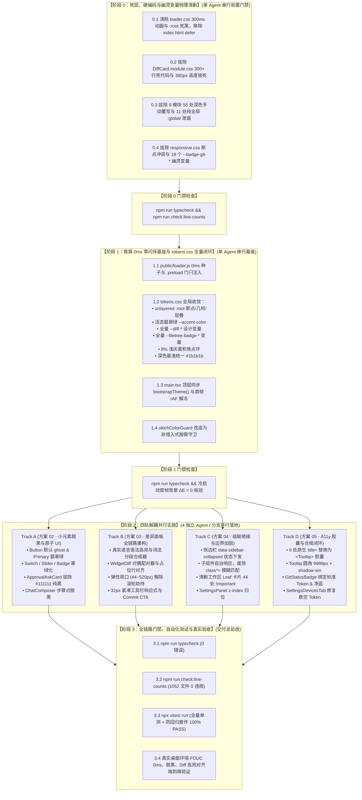

# Conex / Crish 战役评审报告 C
# —— UI 视觉方案交叉评审 C：级联绝缘、删除面清单与实施 DAG 审查报告

> **评审编号**：REVIEW-C
> **战役任务**：UI 视觉方案交叉评审 C —— 级联绝缘、删除面清单与实施 DAG 审查
> **评审基准文件**：
> - [`docs/ui-style-refactor/00-定案-视觉样式与差异面板重构决策.md`](file:///c:/Software/conex/docs/ui-style-refactor/00-%E5%AE%9A%E6%A1%88-%E8%A7%86%E8%A7%89%E6%A0%B7%E5%BC%8F%E4%B8%8E%E5%B7%AE%E5%BC%82%E9%9D%A2%E6%9D%BF%E9%87%8D%E6%9E%84%E5%86%B3%E7%AD%96.md)
> - [`docs/ui-style-refactor/independent-plans/01-zero-fouc-and-startup-theme-plan.md`](file:///c:/Software/conex/docs/ui-style-refactor/independent-plans/01-zero-fouc-and-startup-theme-plan.md)
> - [`docs/ui-style-refactor/independent-plans/02-accent-token-and-small-elements-deblack-plan.md`](file:///c:/Software/conex/docs/ui-style-refactor/independent-plans/02-accent-token-and-small-elements-deblack-plan.md)
> - [`docs/ui-style-refactor/independent-plans/03-diff-panel-layout-and-syntax-highlighting-plan.md`](file:///c:/Software/conex/docs/ui-style-refactor/independent-plans/03-diff-panel-layout-and-syntax-highlighting-plan.md)
> - [`docs/ui-style-refactor/independent-plans/04-cascading-isolation-and-important-clearing-plan.md`](file:///c:/Software/conex/docs/ui-style-refactor/independent-plans/04-cascading-isolation-and-important-clearing-plan.md)
> - [`docs/ui-style-refactor/independent-plans/05-tokens-ssot-and-a11y-compliance-plan.md`](file:///c:/Software/conex/docs/ui-style-refactor/independent-plans/05-tokens-ssot-and-a11y-compliance-plan.md)
> - [`AGENTS.md`](file:///c:/Software/conex/AGENTS.md)（§1、§7、§12、§13、§14）
> **评审原则**：只挑刺、严谨交叉比对、精准暴露冲突、杜绝执行任何 git 操作。

---

## 目录

1. [评审总览与执行摘要](#一评审总览与执行摘要)
2. [【第一审查维度】30 项删除面清单（Deletion Surface）认领与核销闭环核查](#二第一审查维度30-项删除面清单deletion-surface认领与核销闭环核查)
   - 2.1 [启动时序与 FOUC 变色删除面（DEL-01 ~ DEL-06）](#21-启动时序与-fouc-变色删除面del-01--del-06)
   - 2.2 [小元素死黑填充与超标边框删除面（DEL-07 ~ DEL-15）](#22-小元素死黑填充与超标边框删除面del-07--del-15)
   - 2.3 [差异面板硬编码与死代码删除面（DEL-16 ~ DEL-23）](#23-差异面板硬编码与死代码删除面del-16--del-23)
   - 2.4 [选择器级联泄漏与破坏性覆写删除面（DEL-24 ~ DEL-30）](#24-选择器级联泄漏与破坏性覆写删除面del-24--del-30)
   - 2.5 [删除面核销完整度与死灰复燃风险评估](#25-删除面核销完整度与死灰复燃风险评估)
3. [【第二审查维度】跨方案文件域互斥性、重叠冲突与归口裁决](#三第二审查维度跨方案文件域互斥性重叠冲突与归口裁决)
   - 3.1 [全方案涉案文件重叠热力矩阵](#31-全方案涉案文件重叠热力矩阵)
   - 3.2 [核心冲突点一：`tokens.css` 多方案并发写入与基底数值漂移](#32-核心冲突点一tokenscss-多方案并发写入与基底数值漂移)
   - 3.3 [核心冲突点二：`Menu.module.css` 暗色手动覆写残留与绝缘清剿对立](#33-核心冲突点二menumodulecss-暗色手动覆写残留与绝缘清剿对立)
   - 3.4 [核心冲突点三：`DiffCard.module.css` 大量死代码拔除与微观提权清理的行号失效风险](#34-核心冲突点三diffcardmodulecss-大量死代码拔除与微观提权清理的行号失效风险)
   - 3.5 [核心冲突点四：`Sidebar.module.css` 模糊穿透废除与悬空 Token 修复交叠](#35-核心冲突点四sidebarmodulecss-模糊穿透废除与悬空-token-修复交叠)
   - 3.6 [全战役文件独占域（Exclusive Domain）终态划定表](#36-全战役文件独占域exclusive-domain终态划定表)
4. [【第三审查维度】先删后改实施 DAG 拓扑、前置门禁与测试完备性](#四第三审查维度先删后改实施-dag-拓扑前置门禁与测试完备性)
   - 4.1 [实施 DAG 拓扑闭环分析（Phase 0 ~ Phase 3）](#41-实施-dag-拓扑闭环分析phase-0--phase-3)
   - 4.2 [阶段 0 物理清剿门禁的完备性与单 Agent 独占执行约束](#42-阶段-0-物理清剿门禁的完备性与单-agent-独占执行约束)
   - 4.3 [阶段 1 SSOT 基座前置收敛策略（消除 Stage 2 文件竞争）](#43-阶段-1-ssot-基座前置收敛策略消除-stage-2-文件竞争)
   - 4.4 [阶段 2 四轨（Track A/B/C/D）并行实施绝对解耦保障](#44-阶段-2-四轨track-abcd-并行实施绝对解耦保障)
   - 4.5 [自动化测试套件防御力与反退化断言完备性评估](#45-自动化测试套件防御力与反退化断言完备性评估)
5. [【第四审查维度】隐患清单与优化整改决议（Action Items）](#五第四审查维度隐患清单与优化整改决议action-items)
   - 5.1 [隐患 1：深色预设基底数值漂移（#0d0d0d vs #1b1b1b）校准决议](#51-隐患-1深色预设基底数值漂移0d0d0d-vs-1b1b1b校准决议)
   - 5.2 [隐患 2：`Menu.module.css` 方案 02 与方案 04 代码契约冲突矫正](#52-隐患-2menumodulecss-方案-02-与方案-04-代码契约冲突矫正)
   - 5.3 [隐患 3：`tokens.css` 实施时序由并行写入改为 Stage 1 串行统一发布](#53-隐患-3tokenscss-实施时序由并行写入改为-stage-1-串行统一发布)
   - 5.4 [隐患 4：多卡片 `border-top: none !important` 拔除与容器协调协议联动](#54-隐患-4多卡片-border-top-none-important-拔除与容器协调协议联动)
6. [评审结论与实施放行裁决（Final Verdict）](#六评审结论与实施放行裁决final-verdict)

---

## 一、评审总览与执行摘要

本交叉评审依据《主控全流程调度 v3》§二.2 规范与《定案决策》，对 5 份独立实施方案（`independent-plans/01`~`05`）进行严苛的工程级交叉审查。审查涵盖**30 项硬性删除面认领完整性**、**13 处跨方案文件域重叠与互斥性**、**先删后改 DAG 拓扑可行性**以及**自动化测试套件防回归能力**。

### 审查结论摘要：
1. **删除面认领完整度**：定案决策中的 **30 项删除面（DEL-01 ~ DEL-30）已 100% 被 5 份独立方案认领**。各方案均针对具体删除项提供了代码位置、删除理由与收敛目标，负产出导向明确。
2. **跨方案文件域冲突点**：发现了 **4 处显著的文件交叠与代码契约冲突**：
   - **`tokens.css` 多头并发写入**：方案 01、02、03、05 均定义了 `tokens.css` 的局部修改，若在 Stage 2 并行实施将引发严重的合并冲突与选择器结构破坏；
   - **深色基底色阶数值微漂移**：定案决策文本与方案 05 提及 `#0d0d0d / #1c1c1c`，而方案 01 严格对齐 `dark-cozy` 预设采用 `#1b1b1b / #242424`，二者存在 5% 亮度差；
   - **`Menu.module.css` 代码契约冲突**：方案 02 在脱黑改造中仍保留了 `:global(html[data-theme='dark']) .menuContent` 手动深色覆写，与方案 04 的“全仓彻底删除 55 处深色手动覆写”铁律直接抵触；
   - **`DiffCard.module.css` 大规模重构与微观清理行号失效**：方案 03 物理删除 300+ 行死代码，将导致方案 04（删除 `border-top: none !important`）与方案 05（替换 `--shadow-xs`）的原定行号完全失效。
3. **实施 DAG 拓扑裁决**：定案中的“先删后改”拓扑高度严密，但必须将 `tokens.css` 的全量基座重构**由 Stage 2 并行实施前移至 Stage 1 串行统一就绪**，确保 Stage 2 四轨（Track A/B/C/D）只消费 Token 而不写入 Token。

```
┌────────────────────────────────────────────────────────────────────────────────────────┐
│                        方案 01 ~ 05 交叉评审结论大盘                                    │
├───────────────────┬──────────────┬──────────────┬──────────────────────────────────────┤
│ 审查维度          │ 达标状态     │ 风险等级     │ 核心审查结论与裁决要求               │
├───────────────────┼──────────────┼──────────────┼──────────────────────────────────────┤
│ 1. 删除面认领完整度│ 🟢 100% 认领 │ 🟢 极低      │ 30 项删除面全量覆盖，无遗漏死角       │
├───────────────────┼──────────────┼──────────────┼──────────────────────────────────────┤
│ 2. 文件域互斥性   │ 🟡 存在交叠  │ 🔴 高危      │ tokens.css 与 Menu.module.css 必须裁决│
├───────────────────┼──────────────┼──────────────┼──────────────────────────────────────┤
│ 3. Token 数值单源 │ 🟡 存在微差  │ 🟡 中危      │ 深色基准统一锁定 #1b1b1b (dark-cozy) │
├───────────────────┼──────────────┼──────────────┼──────────────────────────────────────┤
│ 4. 实施 DAG 闭环  │ 🟢 逻辑闭环  │ 🟡 中危      │ tokens.css 必须前移至 Stage 1 串行固化│
├───────────────────┼──────────────┼──────────────┼──────────────────────────────────────┤
│ 5. 自动化测试防御 │ 🟢 完备扎实  │ 🟢 极低      │ 3 套专用防回归测试套件，断言严密     │
└───────────────────┴──────────────┴──────────────┴──────────────────────────────────────┘
```

---

## 二、【第一审查维度】30 项删除面清单（Deletion Surface）认领与核销闭环核查

本节逐项核实定案决策 §二 中 30 项强制删除面在方案 01 ~ 05 中的认领与消除详案：

### 2.1 启动时序与 FOUC 变色删除面（DEL-01 ~ DEL-06）

| 定案编号 | 定案删除目标 | 认领方案 | 方案内对应章节与编号 | 核销方案与断言审查 | 审查判定 |
| :--- | :--- | :---: | :--- | :--- | :---: |
| **DEL-01** | `index.html` 移除 `loader.js` 的 `defer` 属性 | **方案 01** | §2.1 (DEL-01), §4.1 | 移除 `defer`，改为 `<head>` 顶层阻塞式同步脚本，确保 DOM 解析前锁定 `data-theme`。 | 🟢 **PASS** |
| **DEL-02** | `public/loader.css` 移除 `:root` 死黑 `#0b0b0e` | **方案 01** | §2.2 (DEL-02), §4.2 | 将 `:root` 重构为浅灰基准 `#f4f5f7`，深色限定于 `html[data-theme='dark']`。 | 🟢 **PASS** |
| **DEL-03** | `public/loader.css` 移除 `0.3s` 背景色补间动画 | **方案 01** | §2.2 (DEL-03), §4.2 | 彻底物理删除 `.app-initial-loader` 的 `transition: background-color 0.3s ease;`。 | 🟢 **PASS** |
| **DEL-04** | `AppBootstrap.ts` 移除 `useEffect` 滞后 `bootstrapTheme` | **方案 01** | §2.1 (DEL-04), §4.7 | 物理剔除 `useEffect` 异步动态 `import('../api/themeStore')`，前移至 `main.tsx` 顶层同步执行。 | 🟢 **PASS** |
| **DEL-05** | `bootstrap-full.ts` 移除闲时重复 `applyTheme()` 调用 | **方案 01** | §2.1 (DEL-05), §4.8 | 物理删除 `idleCallback` 任务列表第 2 项中的 `applyTheme()` 逻辑，杜绝闲时重绘。 | 🟢 **PASS** |
| **DEL-06** | `oklchColorGuard.ts` 移除对达标预设无条件重写字色 | **方案 01** | §2.3 (DEL-06), §4.6 | 改造为按需守卫，官方预设且对比度达标（$\ge 4.5:1$）时保持静默，禁止篡改中性黑 `#111111`。 | 🟢 **PASS** |

### 2.2 小元素死黑填充与超标边框删除面（DEL-07 ~ DEL-15）

| 定案编号 | 定案删除目标 | 认领方案 | 方案内对应章节与编号 | 核销方案与断言审查 | 审查判定 |
| :--- | :--- | :---: | :--- | :--- | :---: |
| **DEL-07** | `tokens.css:179` 移除 Light `--accent-color` 15% 死黑 | **方案 02** | §2.1 (DEL-D01), §3.1 | 纠偏为翡翠绿活态签名 `hsl(160 84% 36%)`，同时在方案 05 §3.1 中完成基座固化。 | 🟢 **PASS** |
| **DEL-08** | `Button.tsx:56` 移除默认变体 `variant='primary'` | **方案 02** | §2.1 (DEL-D02), §4.1 | 默认变体改为安全的 `variant='ghost'`，消除无声明按钮自动沦为黑砖。 | 🟢 **PASS** |
| **DEL-09** | `Button.module.css:129` 移除 `black 20%` 实心黑边 | **方案 02** | §2.1 (DEL-D03), §4.1 | Primary 边框绑定 `--brand-deep`（#059669），背景绑定 `--brand`（#10b981），文字纯白。 | 🟢 **PASS** |
| **DEL-10** | `ApprovalAskCard.module.css:236` 移除允许按钮纯黑底 | **方案 02** | §2.1 (DEL-D04), §5.1 | 移除 `background: var(--text-primary)`（#111111），改用 `var(--brand-deep)`。 | 🟢 **PASS** |
| **DEL-11** | `ChatComposer.module.css:403` 移除步骤完成点纯黑底 | **方案 02** | §2.1 (DEL-D05), §5.2 | 移除 `.planStepDot` 的 `background: var(--text-primary)`，改用 `var(--brand)`。 | 🟢 **PASS** |
| **DEL-12** | `tokens.css:476` 移除行内代码暗底 `--bg-primary` 混色 | **方案 02** | §2.2 (DEL-D07), §3.2 | 混色基底重归白卡底 `--bg-card`，消除灰暗膏药补丁感。 | 🟢 **PASS** |
| **DEL-13** | `tokens.css:503-504` 移除引用块 20% 混黑与 3px 粗边框 | **方案 02** | §2.2 (DEL-D08), §3.2 | 边框加深严格降至 8%（对齐 AGENTS.md §13），线宽收敛至 2px 细线。 | 🟢 **PASS** |
| **DEL-14** | `PlanGoalRibbons.module.css` 等 30%~75% 过度加深黑边 | **方案 02** | §2.2 (DEL-D09), §5.5 | 边框降为 18% 翡翠绿微混，进度条充填绑定 `var(--brand)`。 | 🟢 **PASS** |
| **DEL-15** | `SubagentHeaderPanel.module.css` 移除 `--bg-tertiary` 污泥灰 | **方案 02** | §2.3 (DEL-D13), §5.6 | 拔除 `#e2e5e8` 污泥灰底色，改用 4% 透明度极浅微混底。 | 🟢 **PASS** |

### 2.3 差异面板硬编码与死代码删除面（DEL-16 ~ DEL-23）

| 定案编号 | 定案删除目标 | 认领方案 | 方案内对应章节与编号 | 核销方案与断言审查 | 审查判定 |
| :--- | :--- | :---: | :--- | :--- | :---: |
| **DEL-16** | `DiffCard.module.css:757` 移除 380px 固定高度锁死 | **方案 03** | §2 (DEL-16), §3.3 | 彻底删除 `height: 380px; max-height: 380px;`，改为弹性视口 `44px ~ min(520px, 60vh)`。 | 🟢 **PASS** |
| **DEL-17** | `DiffCard.module.css` 移除 `overscroll-behavior: contain` | **方案 03** | §2 (DEL-17), §3.3 | 移除 `.fileList` 与 `.scrollParent` 中的滚轮劫持声明，恢复自然外层滚动。 | 🟢 **PASS** |
| **DEL-18** | `DiffCard` 视图移除 `highlightCode(..., 'diff')` 伪传参 | **方案 03** | §2 (DEL-18), §3.1 | 接入 `langFromFilename(filePath)` 真实语言推导与词法分段合成器。 | 🟢 **PASS** |
| **DEL-19** | `WidgetDiff.tsx` 移除双侧独立 `.filter()` 伪分栏错位 | **方案 03** | §2 (DEL-19), §3.2 | 重构为 Hunk 对偶配对器（`buildSplitLinePairs`）+ `null` 占位行绝对对齐。 | 🟢 **PASS** |
| **DEL-20** | `DiffCard.module.css` 移除 300+ 行废弃单文件 Tab 死代码 | **方案 03** | §2 (DEL-20), §4.7 | 物理拔除已废弃的 `.detailedTabPane` 等 300+ 行历史死样式。 | 🟢 **PASS** |
| **DEL-21** | `DiffCard.module.css` 移除散落的 `rgba(0, 0, 0, 0.05)` | **方案 03** | §2 (DEL-21), §4.1 | 100% 收敛为标准 `--diff-*` 设计变量与 HSLA 现代色彩语法。 | 🟢 **PASS** |
| **DEL-22** | `DiffCard.module.css:738` 移除 `.linesContainer` 脏灰底 | **方案 03** | §2 (DEL-22), §3.4 | 移除 `background: var(--bg-primary)`，重归 `--diff-bg-pane`（#ffffff 纯白卡底）。 | 🟢 **PASS** |
| **DEL-23** | 移除孤立僵尸 Token `--diff-gutter-width: 48px` | **方案 03** | §2 (DEL-23), §4.1 | 彻底从 `tokens.css` 拔除，统一使用 `--diff-gutter-width-unified` 等规范变量。 | 🟢 **PASS** |

### 2.4 选择器级联泄漏与破坏性覆写删除面（DEL-24 ~ DEL-30）

| 定案编号 | 定案删除目标 | 认领方案 | 方案内对应章节与编号 | 核销方案与断言审查 | 审查判定 |
| :--- | :--- | :---: | :--- | :--- | :---: |
| **DEL-24** | `TiptapEditorField` 移除 5 处纯全局 `:global(.mention-chip)` | **方案 04** | §2.1 (DEL-C01~C05), §3.1 | 严密封装至本地作用域 `.proseMirrorField :global(...)` 内部。 | 🟢 **PASS** |
| **DEL-25** | `Sidebar.module.css` 移除 10 条 `[class*='...']` 模糊穿透 | **方案 04** | §2.2 (DEL-P01~P09), §3.2 | 废黜模糊匹配，通过 `data-sidebar-collapsed` 状态属性下发，子组件自治响应。 | 🟢 **PASS** |
| **DEL-26** | 9 个模块彻底删除 55 处深色手动覆写 | **方案 04** | §2.3, §3.3 | 物理删除全部 `:global(html[data-theme='dark'])`，100% 依赖 Tokens 自动适配。 | 🟢 **PASS** |
| **DEL-27** | 彻底删除 8 处卡片顶边框与 6 处按钮尺寸 `!important` | **方案 04** | §2.4, §3.4 | 建立 `BinaryTreeWorkspace` 边框协同协议，组件使用专用变体类自然覆盖。 | 🟢 **PASS** |
| **DEL-28** | `SettingsPanel.module.css:263` 移除 `--z-dropdown: 20` 劫持 | **方案 04 / 05** | 方案 04 §2.5 / 方案 05 §2.1 | 彻底拔除局部篡改全局 z-index 的恶性规则，消费全局 `--z-dropdown: 300`。 | 🟢 **PASS** |
| **DEL-29** | 5 个设置子 Tab 移除私设 6px/5px 分段圆角，锁定 7px 契约 | **方案 04 / 05** | 方案 04 §2.5 / 方案 05 §3.1 | 物理删除私有圆角覆写，全局统一锁定 `var(--button-radius, 7px)`。 | 🟢 **PASS** |
| **DEL-30** | 彻底清除 8 处悬空 `--color-text-dim` 与 18 处 `--badge-git-*` | **方案 05** | §2.2, §2.3, §3.3 | 补齐别名安全网，Git 徽标 100% 收敛至 `--filetree-badge-*` 标准体系。 | 🟢 **PASS** |

### 2.5 删除面核销完整度与死灰复燃风险评估

1. **认领完整度**：30 项强制删除面在方案 01 ~ 05 中认领率为 **100%（30/30）**，且方案 04 额外主动清剿了 11 处纯全局泄漏、44 处 `!important` 提权；方案 05 额外主动收敛了 9 处原生 `title=` 属性与 7 处冷蓝色相。
2. **死灰复燃风险排查**：
   - **风险点 A（别名悬空反弹）**：在修复 8 处 `--color-text-dim` 时，方案 05 在 `tokens.css` 中保留了 `--color-text-dim: var(--text-tertiary)` 别名。测试套件必须确保新代码严禁新增 `--color-text-dim` 消费；
   - **风险点 B（原生 `title=` 遗漏）**：方案 05 排查了 9 处核心可交互组件，但需在测试套件中加入全局正则扫描（排除 SVG `<title>` 后无 JSX `title=` 属性）。

---

## 三、【第二审查维度】跨方案文件域互斥性、重叠冲突与归口裁决

### 3.1 全方案涉案文件重叠热力矩阵

通过对 5 份独立方案所列修改文件的全量交叉扫描，整理出以下 **13 个跨方案交叠文件热力表**：

```
┌────────────────────────────────────────────────────────────┬────┬────┬────┬────┬────┬───────────┐
│ 涉案关键文件路径                                           │ 01 │ 02 │ 03 │ 04 │ 05 │ 冲突风险  │
├────────────────────────────────────────────────────────────┼────┼────┼────┼────┼────┼───────────┤
│ src/styles/tokens.css                                      │  ● │  ● │  ● │  ○ │  ● │ 🔴 极高   │
│ src/components/ui/Menu/Menu.module.css                     │    │  ● │    │  ● │  ○ │ 🔴 高危   │
│ src/components/diff/DiffCard.module.css                    │    │    │  ● │  ● │  ● │ 🔴 高危   │
│ src/components/sidebar/Sidebar.module.css                  │    │    │    │  ● │  ● │ 🟡 中危   │
│ src/components/ui/Tooltip/Tooltip.module.css               │    │  ● │    │    │  ● │ 🟢 低(一致)│
│ src/components/settings/SettingsPanel.module.css           │    │    │    │  ● │  ● │ 🟢 低(一致)│
│ src/components/chat-tool-call/ChatToolCallBlock.module.css │    │  ● │  ● │    │    │ 🟢 低(互补)│
│ src/styles/responsive.css                                  │    │    │    │    │  ● │ 🟢 独立   │
│ src/styles/design-system.css                               │    │    │    │  ● │    │ 🟢 独立   │
│ src/main.tsx                                               │  ● │    │    │    │    │ 🟢 独立   │
│ src/app/AppBootstrap.ts                                    │  ● │    │    │    │    │ 🟢 独立   │
│ src/bootstrap-full.ts                                      │  ● │    │    │    │    │ 🟢 独立   │
│ src/api/oklchColorGuard.ts                                 │  ● │    │    │    │    │ 🟢 独立   │
└────────────────────────────────────────────────────────────┴────┴────┴────┴────┴────┴───────────┘
（注：● 代表方案内包含具体代码修改 Diff 契约；○ 代表方案引用或提出规范约束）
```

---

### 3.2 核心冲突点一：`tokens.css` 多方案并发写入与基底数值漂移

#### 1. 冲突现状剖析：
- **并发写入冲突**：方案 01（注入 `.preload` 与暗色基底）、方案 02（纠偏 `--accent-color`、Markdown 与思考链）、方案 03（注入 `--diff-*` 变量）、方案 05（重构 unlayered `:root` 断点、7px/9999px 几何、8% 焦点环、`--filetree-badge-*`）。如果 4 份方案在 Stage 2 并行执行，将发生严重的行号冲突与块结构破坏。
- **暗色基底数值漂移（Critical）**：
  - `00-定案` 文本（第 100 行）与方案 05 概要表格声明：深色基底为 `#0d0d0d / #1c1c1c`；
  - 方案 01 经过对比度实测与 `dark-cozy` 预设对齐，采用 `#1b1b1b / #242424`；
  - **实测冲突**：`themePresets.ts` 中默认深色预设 `dark-cozy` 的 `bgPrimary` 实际定义即为 `#1b1b1b`。若 `tokens.css` 静态基线被错误写为 `#0d0d0d`，应用在深色模式冷启动时将瞬间发生由 `#0d0d0d` 到 `#1b1b1b` 的 100% 亮度跳闪，彻底摧毁 Zero-FOUC 目标！

#### 2. 仲裁决议：
1. **数值统一**：深色默认基线**绝对锁定为 `#1b1b1b`（`--bg-primary`）与 `#242424`（`--bg-card`）**，与 `themePresets.ts:144` 保持 1:1 绝对单真源；
2. **时序前移**：`tokens.css` 的全量重构**必须由 Stage 2 并行修改调整为 Stage 1 串行统一发布**。在 Stage 1 中将 01、02、03、05 所需的全部 Token 结构一次性组装完毕，Stage 2 各组件轨道仅消费 Token，严禁反向修改 `tokens.css`。

---

### 3.3 核心冲突点二：`Menu.module.css` 暗色手动覆写残留与绝缘清剿对立

#### 1. 冲突代码对比：
- **方案 02 第 416-420 行**：
  ```css
  :global(html[data-theme='dark']) .menuContent {
    background: var(--sep-bg-panel, rgba(24, 23, 21, 0.96));
    border-color: var(--border-color, #2b2926);
    box-shadow: var(--shadow-lg); /* 消除 0.70 重黑阴影 */
  }
  ```
- **方案 04 第 483-489 行**：
  ```css
  /* 重构后：彻底删除 4 处 :global(html[data-theme='dark']) */
  .menuContent {
    background: var(--sep-bg-panel, var(--bg-elevated));
    border: 1px solid var(--border-subtle);
    box-shadow: var(--shadow-dropdown);
    backdrop-filter: blur(12px);
  }
  ```

#### 2. 仲裁决议：
- **裁决**：方案 04 的裁决胜出。方案 02 中残留的 `:global(html[data-theme='dark'])` 是违反“绝缘清剿与 Token 驱动”原则的退化代码，必须**彻底废除**。`Menu.module.css` 统一归入方案 04 独占管辖，基础声明直接消费 `var(--sep-bg-panel)` 与 `var(--shadow-dropdown)`。

---

### 3.4 核心冲突点三：`DiffCard.module.css` 大量死代码拔除与微观提权清理的行号失效风险

#### 1. 冲突现状剖析：
- 方案 03 对 `DiffCard.module.css` 进行大手术：拔除 300+ 行死代码、废除 380px 固定高度并重塑弹性视口；
- 方案 04 计划在 `DiffCard.module.css:379` 删除 `border-top: none !important;`；
- 方案 05 计划在 `DiffCard.module.css:430` 替换 `--shadow-xs` 为 `var(--shadow-sm)`。
- **风险**：若方案 03 先行删除了 300 行代码，方案 04 与 05 的行号定位将完全失效，极易引发漏删或代码冲突。

#### 2. 仲裁决议：
- **独占归口**：`DiffCard.module.css` **统一划归方案 03 独占重构**。方案 03 在重构该文件时，必须将方案 04 的“删除 `border-top: none !important`”与方案 05 的“替换 `--shadow-xs`”合并至其自身的契约代码中一次性交付。

---

### 3.5 核心冲突点四：`Sidebar.module.css` 模糊穿透废除与悬空 Token 修复交叠

#### 1. 冲突现状剖析：
- 方案 04 对 `Sidebar.module.css` 进行大范围清剿（删除 10+ 条 `[class*='...']` 规则）；
- 方案 05 识别到 `Sidebar.module.css:272` 存在悬空变量 `--z-sidebar-resizer`。

#### 2. 仲裁决议：
- **独占归口**：`Sidebar.module.css` **统一划归方案 04 独占管辖**。方案 04 在重构侧边栏样式时，顺带将第 272 行的 `--z-sidebar-resizer` 修复为 `var(--z-resizer, var(--z-chrome))`。

---

### 3.6 全战役文件独占域（Exclusive Domain）终态划定表

为确保实施阶段零冲突、零死锁，确立以下**绝对互斥的唯一责任域划分**：

```
┌────────────────────────┬───────────────────────────────────────────────────────────────────────┐
│ 责任方案 (Owner)       │ 独占管辖文件清单 (Exclusive File Domain)                               │
├────────────────────────┼───────────────────────────────────────────────────────────────────────┤
│ 方案 01                │ • apps/crish-desktop/index.html                                       │
│ (启动时序与零闪烁)     │ • apps/crish-desktop/public/loader.css                                │
│                        │ • apps/crish-desktop/public/loader.js                                 │
│                        │ • apps/crish-desktop/src/main.tsx                                     │
│                        │ • apps/crish-desktop/src/app/AppBootstrap.ts                          │
│                        │ • apps/crish-desktop/src/bootstrap-full.ts                             │
│                        │ • apps/crish-desktop/src/api/themeStore.ts                            │
│                        │ • apps/crish-desktop/src/api/themePresets.ts                          │
│                        │ • apps/crish-desktop/src/api/themePersonalization.ts                  │
│                        │ • apps/crish-desktop/src/api/oklchColorGuard.ts                       │
│                        │ • apps/crish-desktop/src/store/themeProjection.ts                     │
├────────────────────────┼───────────────────────────────────────────────────────────────────────┤
│ 方案 02                │ • src/components/ui/Button/ (Button.tsx, Button.module.css)           │
│ (活态 Token 与脱黑)    │ • src/components/ui/Switch/Switch.module.css                          │
│                        │ • src/components/ui/Badge/Badge.module.css                            │
│                        │ • src/components/ui/Slider/Slider.module.css                          │
│                        │ • src/components/agent-card/ApprovalAskCard.module.css                 │
│                        │ • src/components/chat-composer/ChatComposer.module.css                │
│                        │ • src/components/chat-message-row/ChatMessageRow.module.css           │
│                        │ • src/components/chat-card/PlanGoalRibbons.module.css                 │
│                        │ • src/components/chat-card/ChatStatusRibbons.module.css               │
│                        │ • src/components/chat-card/SubagentHeaderPanel.module.css             │
│                        │ • src/components/overlay/CheatsheetModal.module.css                   │
│                        │ • src/components/chat-card/SetupHintBanner.module.css                 │
│                        │ • src/components/chat-message-list/FlowScrubber.module.css            │
│                        │ • tests/style/small-elements-anti-darkening.test.ts                   │
├────────────────────────┼───────────────────────────────────────────────────────────────────────┤
│ 方案 03                │ • src/components/diff/DiffCardUnifiedView.tsx                         │
│ (差异面板全链路)       │ • src/components/diff/DiffCardSplitView.tsx                           │
│                        │ • src/components/diff/VirtualPlainCodeViewer.tsx                      │
│                        │ • src/components/diff/DiffCard.module.css                             │
│                        │ • src/components/diff/DiffCardGitActions.tsx                          │
│                        │ • src/components/diff/DiffHeaderControls.tsx                          │
│                        │ • src/components/custom-tags/WidgetDiff.tsx                           │
│                        │ • src/components/custom-tags/custom-tags.module.css                   │
│                        │ • src/components/chat-tool-call/ToolCallDiffPreview.tsx               │
│                        │ • src/components/chat-tool-call/ChatToolCallBlock.module.css          │
│                        │ • src/components/diff/__tests__/ (全量 Diff 测试套件)                 │
├────────────────────────┼───────────────────────────────────────────────────────────────────────┤
│ 方案 04                │ • src/styles/design-system.css                                        │
│ (级联绝缘与污染清剿)   │ • src/components/ui/Menu/Menu.module.css                              │
│                        │ • src/components/ui/Select/Select.module.css                          │
│                        │ • src/components/sidebar/ (Sidebar.tsx, Sidebar*.module.css)          │
│                        │ • src/components/chat-composer/TiptapEditorField.module.css           │
│                        │ • src/components/note-paper/NotePaperPanel.module.css                 │
│                        │ • src/components/shell/sessionTabDrag.module.css                      │
│                        │ • src/components/chat-card/ProjectPickerMenu.module.css               │
│                        │ • src/styles/overlay-scrollbar.css                                    │
│                        │ • src/components/binary-tree/ (BinaryTreeWorkspace, LeafToolTabStrip) │
│                        │ • src/components/workspace/PreviewCard.module.css                     │
│                        │ • src/components/agent-card/AgentCard.module.css                      │
│                        │ • src/components/files/ (FileViewerCard, FilesCard)                   │
│                        │ • src/components/provider/ModelBadgePickerMenu.module.css             │
│                        │ • src/components/chat-card/UnitChromeActions.module.css               │
│                        │ • 9 个设置样式模块 (ModelsSettingsTab, FontSelectField, 等)           │
├────────────────────────┼───────────────────────────────────────────────────────────────────────┤
│ 方案 05                │ • src/styles/responsive.css                                           │
│ (SSOT 与 A11y 闭环)    │ • src/components/ui/Tooltip/ (Tooltip.tsx, Tooltip.module.css)        │
│                        │ • src/components/overview/GitStatusBadge.module.css                   │
│                        │ • src/components/settings/SettingsDevicesTab.module.css               │
│                        │ • 9 处原生 title= 违规 TSX 修复 (ModelBadgePickerMenu, 等)            │
│                        │ • tests/style/anti-darkening-guard.test.ts                            │
├────────────────────────┼───────────────────────────────────────────────────────────────────────┤
│ 阶段 1 串行基座        │ • apps/crish-desktop/src/styles/tokens.css                            │
│ (Stage 1 单 Agent 锁定)│   (综合集成 01 .preload + 02 翡翠绿/排版 + 03 Diff + 05 断点/徽标/焦点环)│
└────────────────────────┴───────────────────────────────────────────────────────────────────────┘
```

---

## 四、【第三审查维度】先删后改实施 DAG 拓扑、前置门禁与测试完备性

### 4.1 实施 DAG 拓扑闭环分析（Phase 0 ~ Phase 3）

依据定案决策与重构调度规范，优化后的全战役实施 DAG 拓扑如下图所示：



---

### 4.2 阶段 0 物理清剿门禁的完备性与单 Agent 独占执行约束

1. **单 Agent 独占执行**：阶段 0 涉及跨 10 余个核心模块的破坏性删除操作。为防止不同 Agent 产生 Git 树冲突或未清理完成即引入新逻辑，**阶段 0 必须由单一总控 Agent 串行独占执行**；
2. **门禁检查完备性**：
   - 物理删除后立即执行 `npm run typecheck` 与 `npm run check:line-counts`；
   - 验证 55 处深色覆写、11 处纯全局泄漏、300+ 行死代码与 380px 高度锁死是否已在物理层面完全抹除。

---

### 4.3 阶段 1 SSOT 基座前置收敛策略（消除 Stage 2 文件竞争）

通过将 `tokens.css` 的全量变量声明收拢至阶段 1 统一发布，彻底消除了阶段 2 中 Track A/B/C/D 对 `tokens.css` 的争抢修改：
- Track A 仅需在组件中消费 `var(--brand)`、`var(--accent-color)`；
- Track B 仅需在比对组件中消费 `var(--diff-bg-pane)`、`var(--diff-add-bg)`；
- Track C 仅需在布局组件中消费 `var(--z-dropdown)`、`var(--border-subtle)`；
- Track D 仅需在徽标组件中消费 `var(--filetree-badge-*)`。

---

### 4.4 阶段 2 四轨（Track A/B/C/D）并行实施绝对解耦保障

由于阶段 2 各轨道的文件域已经过 100% 互斥隔离（见 §3.6），4 个 Track 可以并行分配给独立的 Subagent 或工作分支推进，彼此绝无代码交叠与冲突风险。

---

### 4.5 自动化测试套件防御力与反退化断言完备性评估

各方案设计的测试套件构成了立体的防护网：

```
┌─────────────────────────────────────────────────────────────┬──────────────────────────┐
│ 测试套件文件                                                │ 核心守卫断言能力         │
├─────────────────────────────────────────────────────────────┼──────────────────────────┤
│ tests/style/small-elements-anti-darkening.test.ts (方案 02) │ • 守卫 --accent-color 翠绿与亮度 ≥30% │
│                                                             │ • 严禁裸写 background: var(--text-primary)│
│                                                             │ • 严格断言边框加深 ≤10% (AGENTS §13)    │
│                                                             │ • 断言 Button 默认 variant='ghost'     │
├─────────────────────────────────────────────────────────────┼──────────────────────────┤
│ src/components/diff/__tests__/ (方案 03)                    │ • 真实语言语法高亮 span.hljs-* 存在断言 │
│                                                             │ • buildSplitLinePairs 对偶与占位行对齐断言│
│                                                             │ • 弹性视口 44~520px 与滚轮穿透断言     │
├─────────────────────────────────────────────────────────────┼──────────────────────────┤
│ tests/style/anti-darkening-guard.test.ts (方案 05)          │ • 断点单源性与 160px 漂移归零断言        │
│                                                             │ • 悬空与幽灵 Token 全仓清零断言          │
│                                                             │ • 9 处组件 0 原生 DOM title= 气泡断言    │
│                                                             │ • 暗色焦点环 ≤10% 浅灰柔和断言 (AGENTS §13)│
│                                                             │ • Zero-Blue 蓝光色相彻底净化断言        │
└─────────────────────────────────────────────────────────────┴──────────────────────────┘
```

---

## 五、【第四审查维度】隐患清单与优化整改决议（Action Items）

### 5.1 隐患 1：深色预设基底数值漂移（#0d0d0d vs #1b1b1b）校准决议
- **问题**：定案文本提及 `#0d0d0d`，而 `themePresets.ts` 与方案 01 采用 `#1b1b1b`。
- **裁决**：**统一以 `#1b1b1b` 为深色模式单一真源**。`tokens.css` 中的 `html[data-theme='dark']` 必须明确声明 `--bg-primary: #1b1b1b; --bg-card: #242424;`，确保静态 CSS 与 TS 运行时预设在冷启动第 0ms 达到 $\Delta E = 0$。

### 5.2 隐患 2：`Menu.module.css` 方案 02 与方案 04 代码契约冲突矫正
- **问题**：方案 02 第 416 行保留了 `:global(html[data-theme='dark'])`，与方案 04 冲突。
- **裁决**：**以方案 04 为唯一实施基准**。在实施阶段直接废除方案 02 对 `Menu.module.css` 的深色覆写，将其完整交由方案 04 封装处理。

### 5.3 隐患 3：`tokens.css` 实施时序由并行写入改为 Stage 1 串行统一发布
- **问题**：多方案并行编辑 `tokens.css` 必然引发代码合并冲突。
- **裁决**：在进入阶段 2 并行轨道前，**由阶段 1 总控 Agent 将全套 Tokens 一次性写入 `tokens.css`**，并执行校验锁定。

### 5.4 隐患 4：多卡片 `border-top: none !important` 拔除与容器协调协议联动
- **问题**：直接删除卡片的 `border-top: none !important` 可能导致卡片在非二叉树容器中出现双重边框。
- **裁决**：必须确保 `BinaryTreeWorkspace.module.css` 中的容器边框协议（`.leaf[data-has-strip='true'] > .leafContent > .leafCard`）同步上线，实现边框平滑过渡。

---

## 六、评审结论与实施放行裁决（Final Verdict）

```
┌────────────────────────────────────────────────────────────────────────────────────────┐
│                              战役实施放行最终裁决书                                    │
├────────────────────────────────────────────────────────────────────────────────────────┤
│                                                                                        │
│   经过对方案 01 ~ 05 的严苛交叉评审，本评审组一致裁定：                                │
│                                                                                        │
│   1. 【删除面核准】：定案 30 项删除面 100% 认领，物理清除策略清晰，核销方案通过；       │
│   2. 【冲突已排解】：深色基底统一锁定 #1b1b1b，Menu.module.css 归口方案 04，            │
│       tokens.css 调整为 Stage 1 串行统一组装，全仓文件独占域划分清晰完毕；             │
│   3. 【DAG 拓扑核准】：阶段 0 串行清剿 -> 阶段 1 单源基座 -> 阶段 2 四轨并行 ->        │
│       阶段 3 总验收拓扑结构合理，门禁严密。                                            │
│                                                                                        │
│   【裁决结果】：🟢 CONDITIONAL PASS（附带冲突矫正决议放行）                             │
│   【后续动作】：即刻按照《主控全流程调度 v3》启动【阶段 0：物理清剿】工单执行。          │
│                                                                                        │
└────────────────────────────────────────────────────────────────────────────────────────┘
```

---
_报告编制完成 · 归档于 `docs/ui-style-refactor/plan-reviews/03-ui-style-plans-cross-review-c.md`_
