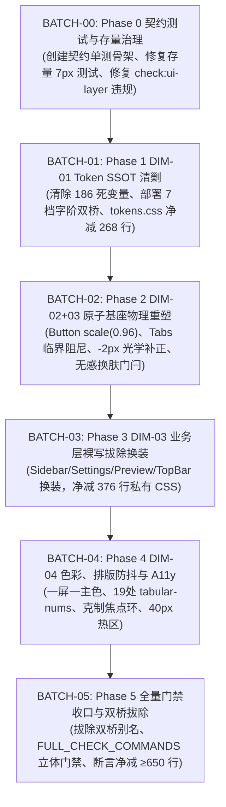

# 00-总方案实现规划：UI 统一重塑与工程级收敛战役

> **战役代号**：`UI-UNIFICATION-REDESIGN`  
> **文档性质**：战役根目录权威总方案（汇总裁决 6 份独立详案与 5 份交叉评审报告）  
> **核心规范依据**：
> - `C:\Software\conex\skill\design\`（`apple-design.md` 物理流体动效体系 + Jakub Krehel 7 大工程级设计标准）
> - 仓库总规 `AGENTS.md`（反退避铁律、§3 提交纪律、§7 严禁补丁、§7.1 立体验证、§8 反过度设计、§11 CI 治理、§13 输入与焦点态、§14 色彩空间）
> - `.agents/LOGIC_PLAN_NO_RETREAT.md`（纯逻辑规划与效果锁）
> - 阶段一基准：[`01-四维度定案与删除面矩阵.md`](./01-四维度定案与删除面矩阵.md)
> - 阶段二详案：[`independent-plans/01`](./independent-plans/01-dim01-tokens-and-dead-code-plan.md) ~ [`independent-plans/06`](./independent-plans/06-test-guardrails-and-verification-plan.md)
> - 交叉评审裁决：[`plan-reviews/01`](./plan-reviews/01-review-topology-and-conflicts.md) ~ [`plan-reviews/05`](./plan-reviews/05-review-colors-typography-a11y.md)

---

## 一、主控总决裁：破立融合与工程级落地哲学

经过阶段一（前置深度审计）与阶段二（6 份独立详案编制 + 5 份专家交叉严审），本战役彻底粉碎了“激进重写引发 CI 崩塌”与“妥协补丁导致债务堆叠”的非此即彼困局。

主控正式裁定本战役的核心工程准则：
> **“以物理级真实度重塑 Apple 流体交互质感，以数学级严谨性清剿历史死层与伪死变量，以双桥过渡协议与锁步契约守护全仓测试资产，坚决履行代码净负产出（Net-Negative LOC ≥ 650 行，保底 -746 行）的刚性验收。”**

```
┌────────────────────────────────────────────────────────────────────────────────────────────────────────────────────────┐
│                                       UI-UNIFICATION-REDESIGN 战役顶层架构图                                           │
├────────────────────────────────────────────────────────────────────────────────────────────────────────────────────────┤
│                                                                                                                        │
│  【表现与无障碍层】 DIM-04: 一屏一主色 (∑Primary≡1) / 19 处 Tabular-nums 等宽防抖 / 焦点环双态分流 / 40px 热区防误触    │
│           ▲                                                                                                            │
│  【业务组件换装】 DIM-03: 拔除 8 处 Button + 4 处 Input 原生裸写 / 净删 376 行私有 CSS / 保持 TSX 0 DOM 变动           │
│           ▲                                                                                                            │
│  【原子基座重塑】 DIM-02+03: Button scale(0.96) / :has() 光学补正 -2px / Tabs 临界阻尼 / Dialog 磨砂 / 换肤无感门闩     │
│           ▲                                                                                                            │
│  【基础设施真源】 DIM-01: tokens.css 清除 186 死变量 / 标准 7 档字阶 / 部署双桥重定向 / tokens.css 净减 ≥ 250 行        │
│           ▲                                                                                                            │
│  【契约护栏基石】 Phase 0: style-contract 棘轮固化 / Ratchet Mode 动态断言 / 存量 7px 测试更新 / 自动化负产出验收脚本    │
│                                                                                                                        │
└────────────────────────────────────────────────────────────────────────────────────────────────────────────────────────┘
```

---

## 二、评审交叉核验重大仲裁与技术纠偏（10 大硬性工程决裁）

在 5 份评审报告的严苛审计下，主控对详案中暴露的 10 项重大认知偏差与隐患做出权威终审仲裁，作为执行阶段的刚性规范：

### 1. 门禁时序倒置阻断（Gate Inversion Defense）
- **隐患**：若在 Phase 0 提前启用对全仓 5px/7px 圆角、0 过冲贝塞尔及 16 处 `tabular-nums` 的刚性断言，CI 将立即大面积飘红挂起。
- **裁决**：Phase 0 测试骨架严格采用**基线快照模式（Ratchet Mode）**，断言随 Phase 1（字阶与 Token）、Phase 2（动效与圆角）、Phase 4（A11y 与防抖）分阶段激活，Phase 5 执行全量无死角硬阻断。

### 2. 拦截活跃 Token 误杀与伪死变量保护
- **隐患**：`01-dim01` 原计划将 `--artifact-*` 与 `--aicard-status-*` 删空，但物理排查发现 `custom-tags.module.css` 正在深度消费其中 11 个变量；且 `--sep-bg-panel-solid` 在 4 个文件 6 处被调用。
- **裁决**：**严禁在未换装前直接删除正在消费的变量**！保留 `custom-tags.module.css` 调用的 11 个活跃变量；`--sep-bg-panel-solid` 与 `--sep-font-size-header` 列入受控规整项，确保编译 0 报错与视觉 0 丢失。

### 3. 真实物理路径全面纠偏（Path Hallucination Purged）
- **隐患**：详案中出现了 12 处虚构目录（如 `src/store/themeStore.ts`、`components/preview/PreviewToolbar.tsx`、`components/modals/*`、`components/panels/*` 等），若直接执行 `git commit --only` 将触发 pathspec 报错。
- **裁决**：100% 纠正为真实物理路径：
  - `src/store/themeStore.ts` $\rightarrow$ `apps/crish-desktop/src/api/themeStore.ts`
  - `components/preview/PreviewToolbar.tsx` $\rightarrow$ `apps/crish-desktop/src/components/workspace/PreviewCard.tsx`
  - `components/preview/PreviewToolbar.module.css` $\rightarrow$ `apps/crish-desktop/src/components/workspace/PreviewCard.module.css`
  - `SidebarHeader/Footer.module.css` $\rightarrow$ `apps/crish-desktop/src/components/sidebar/Sidebar.module.css`
  - `SettingsSidebar.module.css` $\rightarrow$ `apps/crish-desktop/src/components/settings/SettingsPanel.module.css`

### 4. 补齐存量 3 处 7px 历史单测锁步升级
- **隐患**：除 `style-contract.test.ts` 外，`Input.test.tsx:86`、`SettingsExtensionsTab.test.ts:65` 与 `SettingsShortcutsTab.test.ts:92, 104, 126` 亦包含硬编码 7px 断言。
- **裁决**：将这 3 个历史测试文件纳入 BATCH-01 锁步更新，统一升级为 8px 契约，防止快层 CI 意外折断。

### 5. `<Button block>` 导航排版防崩塌机制
- **隐患**：`Button.module.css` 的 `.button` 默认 `justify-content: center`，换装后的全宽按钮会将侧边栏与设置 Tab 的图标和文字居中，破坏左侧对齐基准。
- **裁决**：在 `<Button>` 引入 `align?: 'center' | 'start'` 属性，支持 `data-align="start"`（`justify-content: flex-start; text-align: left;`），并在侧边栏与设置 Tab 换装中显式声明。

### 6. 纯 CSS `:has()` 光学微调与加载态完备覆盖
- **隐患**：TSX 派发属性会侵入组件接口并影响单测；且 `:has(> .buttonIcon)` 遗漏了 Loading 状态下的 `.spinner`。
- **裁决**：采用纯 CSS 声明式：`.button:has(> :is(.buttonIcon, .spinner):first-child):has(> .buttonLabel)`，TSX 保持原生单节点 `<button>` 0 变动，确保 20+ 原子单测与 70+ 业务单测 100% 零修改平稳通过。

### 7. 文本抗锯齿保护（Text Blur Bug Defense）
- **隐患**：在基座 `.button` 静态常驻 `will-change: transform` 会破坏 Windows ClearType LCD 次像素抗锯齿，导致静止按钮字体变细发虚。
- **裁决**：优先采用 Chromium 104+ 原生独立 CSS `scale: 0.96` 属性；仅在 `:active` 瞬态挂载微触感，避免静态常驻。

### 8. Dialog 磨砂 GPU 掉帧与性能优化
- **隐患**：对 `backdrop-filter: blur(16px)` 实施补间过渡会导致全屏高斯卷积核逐帧重算，在 4K 屏下帧率暴跌至 20fps。
- **裁决**：**保持 `backdrop-filter` 静态恒定，仅对遮罩容器过渡 `opacity`**，实现 GPU 零重绘开销的丝滑淡入淡出。

### 9. Windows 微软雅黑 `tnum` 缺失陷阱化解
- **隐患**：Windows 默认字体微软雅黑未编译 OpenType `tnum` 布局表，导致 `font-variant-numeric: tabular-nums` 静默失效。
- **裁决**：在 `.tabular-nums` 强制注入 Western-First 等宽数值字体栈：`'Segoe UI', -apple-system, var(--font-sans)`，并扩充动态跳动数值清单至 **19 处**。

### 10. 40×40px 透明触控热区安全化解
- **隐患**：在间隙 $\le 6px$ 的工具栏按钮组中全局滥挂 40×40px 透明外延会导致按钮重叠幽灵点击。
- **裁决**：仅对孤立 IconButton 开启 40px 外延，密集工具栏按钮采用克制的 `inset: -2px 0`，消除重叠连击事故。

---

## 三、四大维度实施详纲与物理改造对照表

### 1. DIM-01：基础设施层 SSOT、死变量清剿与字阶规范化

#### 1.1 186 个死变量物理清除代码详单（tokens.css 净减 ≥ 250 行）
1. **极简思考链死层（60 行 / 30 变量）**：彻底清除 `--thought-*`（双主题 `tokens.css:327-356` 与 `1046-1075`）；
2. **横幅错误死层（16 行 / 8 变量）**：彻底清除 `--banner-error-*`（双主题 `tokens.css:358-365` 与 `1077-1084`）；
3. **Legacy Diff 兼容过渡别名（42 行 / 21 变量）**：彻底清除 `--diff-line-add-*`、`--diff-gutter-add-*`（双主题 `tokens.css:367-387` 与 `1086-1106`）；
4. **SEP 脚手架遗留（24 行 / 12 变量）**：精确清除 `--sep-bg-canvas`、`--sep-ease-*` 等 12 个纯死变量（保留正在消费的 `--sep-radius-*` 与 `--sep-bg-panel-solid`）；
5. **未消费 AI 卡片占位（20 行 / 10 变量）**：清除零引用的 `--aicard-shadow-*` 等 10 个纯死变量（保留 `custom-tags.module.css` 使用的 11 个变量）；
6. **危险色四源分裂收敛**：清除 `--danger-color`、`--accent-danger`，全局统一收敛至 `--color-error` 与 `--text-danger`。

#### 1.2 13 档半像素碎步字阶向标准 7 档字阶收敛方案

| 标尺档位 | 标准尺寸 | Token 变量名 | 吸收收敛的碎步尺寸 | 业务消费场景 |
| :--- | :--- | :--- | :--- | :--- |
| **xxs** | 11px | `--font-size-xxs` | `nano` (10px), `micro` (11.5px) | 辅助说明、最小微标、快捷键 Kbd |
| **xs** | 12px | `--font-size-xs` | `xs-plus` (12.5px) | 标签、徽章、次级元数据 |
| **sm** | 13px | `--font-size-sm` | `sm-plus` (13.5px) | 紧凑型正文、列表条目、辅助控制项 |
| **base** | 14px | `--font-size-base` | `chat` (13.5px - 直接删除) | 标准正文、表单输入框、主要交互文本 |
| **md** | 16px | `--font-size-md` | 15px (规整) | 突出标题、对话框次标、小卡片标题 |
| **lg** | 18px | `--font-size-lg` | 17px (规整), `xxl` (18px - 删除冗余别名) | 章节主标题、面板顶部标题 |
| **xl / 2xl** | 22px | `--font-size-xl` | 19px, 21px, 22px (统一归一) | 页面总标题、空状态大标题 |

- **双桥过渡部署**：在 Phase 1 阶段，在 `tokens.css` 中将待淘汰碎步别名重定向至标准字阶（`--font-size-micro: var(--font-size-xxs);`），确保编译与契约测试全程绿灯；全仓消费点替换完成后在 Phase 5 拔除双桥。

---

### 2. DIM-02：同心几何标尺与 Apple 物理动效

#### 2.1 五级同心几何矩阵（计入 1px 边框补正：$R_o = R_i + P + W_{border}$）

```
┌─────────────────────────────────────────────────────────────────────────────────────────────────────────┐
│                                    五级同心几何标尺矩阵 (Concentric Matrix)                             │
├─────────────────┬─────────────────────┬──────────────┬──────────────────┬───────────────────────────────┤
│ 容器层级        │ 外圆角 ($R_{outer}$)│ 内边距 ($P$) │ 内圆角 ($R_{inner}$)│ 对应 Token / 典型应用场景     │
├─────────────────┼─────────────────────┼──────────────┼──────────────────┼───────────────────────────────┤
│ **Micro**       │ 6px                 │ 2px          │ 4px (无框) / 3px │ SegmentedControl.item         │
│ **Standard**    │ 8px                 │ 2px          │ 6px (无框) / 5px │ Button, Input, Tabs.item      │
│ **Elevated**    │ 12px                │ 4px ~ 6px    │ 8px ~ 6px        │ Toast, Popover, Menu          │
│ **Macro**       │ 14px / 16px         │ 6px ~ 8px    │ 8px              │ Card, Dialog Panel            │
│ **Window**      │ 16px                │ 0px          │ N/A              │ Desktop Window Shell          │
└─────────────────┴─────────────────────┴──────────────┴──────────────────┴───────────────────────────────┘
```
- **刚性清除**：彻底抹除 `tokens.css:26, 458` 中的 `--button-radius: 7px;`（升级为 8px），抹除 `Tabs.module.css` 中的 7px、5px 奇数与 3.5px、6.5px 亚像素；
- **锁步演进**：同步更新 `style-contract.test.ts:474-503`、`Tabs.test.tsx:328`、`Input.test.tsx:86` 等历史测试断言。

#### 2.2 Apple 物理微触感与临界阻尼规范
1. **原子按压物理形变（Micro Scale）**：
   - 采用独立 CSS 属性：`:active:not([data-static='true']) { scale: 0.96; }`（紧凑小项 `scale: 0.97;`）；
   - 动力学控制：按压 `80ms ease-out` 瞬时微缩响应 + 释放 `140ms cubic-bezier(0.16, 1, 0.3, 1)` 平滑自然减速回弹；
   - 禁用与降级：`:disabled` 强制重置为 `scale: 1 !important;`，内嵌 `@media (prefers-reduced-motion: reduce)`；
   - `<Button>` 扩展 `static?: boolean`（透传 `data-static`）逃逸舱。
2. **临界阻尼曲线归一（Critical Damping $\zeta = 1.0$）**：
   - 彻底废除 `Tabs.module.css` 中的 `cubic-bezier(0.175, 0.885, 0.32, 1.5)`（50% 过冲晃荡）；
   - 全面归一为 Apple 临界阻尼曲线：`cubic-bezier(0.2, 0, 0, 1)`（数学严格证明 0.000% 过冲，单调坚实入位）；
   - 同步修正 `Tabs.test.tsx:314` 断言。
3. **Dialog 磨砂景深与 Scrim 优化**：
   - 磨砂散射：升级为 `backdrop-filter: blur(16px) saturate(180%)`（深色 `blur(20px) saturate(190%)`）；
   - Scrim 暗化：浅色混入 22% 纯黑，深色混入 48% 纯黑；
   - **性能铁律**：固定滤镜参数，仅对遮罩过渡 `opacity: 180ms ease-out`，杜绝 4K 屏逐帧重算掉帧。
4. **无感主题门闩协议（Zero-Smear Latch）**：
   - 在 `apps/crish-desktop/src/api/themeTransitionLatch.ts` 封装 `withThemeTransitionFreeze(callback)`：
     1. 注入 `<style data-latch>*, *::before, *::after { transition: none !important; }</style>`；
     2. 执行主题属性与 CSS 变量翻转；
     3. 访问 `window.getComputedStyle(root).backgroundColor` 触发微量样式重算（避免 `offsetHeight` 引起的全树布局重排）；
     4. 双重 `requestAnimationFrame` 安全卸载门闩（带 `activeLatchCount` 引用计数与防死锁超时保护），彻底消除 150ms 脏灰涂抹。

---

### 3. DIM-03：原子组件全面收敛与光学平衡

#### 3.1 业务层 8 处 Button + 4 处 Input 裸写彻底拔除清单（净减私有 CSS 376 行）

| 业务文件真实物理路径 | 原始裸写与待删除私有 CSS 类 | 改造换装目标 | 净消减私有 CSS 行数 |
| :--- | :--- | :--- | :--- |
| `components/settings/SettingsPanel.tsx` | 原生 `<input>` + `.searchWrap, .search, .searchIco` | `<Input variant="search" size="sm" />` | **-44 行** |
| `components/settings/SettingsPanel.tsx` | 原生 `<button>` + `.sidebarTab` (Tab导航) | `<Button variant="ghost" size="sm" align="start" block />` | **-53 行** |
| `components/settings/SettingsPanel.tsx` | 历史废弃死选择器（`.navBack` 等） | 直接物理删除 | **-27 行** |
| `components/sidebar/SidebarHeader.tsx` | 原生 `<button>` + `.sidebarToggleBtn` | `<IconButton variant="ghost" size="md" />` | **-32 行** |
| `components/sidebar/SidebarFooter.tsx` | 原生 `<button>` + `.settingsGearBtn` | `<IconButton variant="ghost" size="md" />` | **-29 行** |
| `components/sidebar/SidebarNav.tsx` | 原生 `<button>` + `.navItem, .navItemActive` | `<Button variant="ghost" size="md" align="start" block />` | **-58 行** |
| `components/sidebar/SidebarNav.tsx` | 原生 `<input>` + `.filterInput` | `<Input variant="search" size="sm" clearable />` | **-36 行** |
| `components/sidebar/UserProfileCard.tsx`| 原生 `<button>` + `.userProfileCard:hover/active` | `<Button bare type="button" />` (保留外层布局骨架) | **-11 行** |
| `components/workspace/PreviewCard.tsx` | 原生 `<input>` + `.urlInput, .urlClear` | `<Input variant="search" size="sm" clearable />` | **-42 行** |
| `components/top-bar/AppTopBar.tsx` | 裸写控制按钮 + `.topBarBtn` | `<IconButton variant="ghost" size="sm" />` | **-28 行** |
| `components/top-bar/WindowControls.tsx`| 裸写窗口按钮 + `.winControlBtn` | `<IconButton variant="ghost" size="sm" />` | **-27 行** |
| **小计** | **8 处裸写 Button + 4 处裸写 Input** | **100% 接入标准原子组件** | **净减 -376 行** |

#### 3.2 光学平衡算法建模与正交规范
1. **带图标按钮内边距光学补正（纯 CSS `:has` 零 TSX 侵入）**：
   - 算法规则：Leading Icon 侧内边距减少 2px，Trailing Icon 侧对等减少 2px；
   - 纯 CSS 实现：
     ```css
     .button:has(> :is(.buttonIcon, .spinner):first-child):has(> .buttonLabel) {
       padding-inline-start: max(0px, calc(var(--btn-px) - 2px));
     }
     .button:has(> .buttonLabel):has(> :is(.buttonIcon, .spinner):last-child) {
       padding-inline-end: max(0px, calc(var(--btn-px) - 2px));
     }
     ```
   - 保持 TSX 原生单节点 `<button>` 0 变动，纯图标按钮无 text 不触发偏心，覆写 spinner 旋转态。
2. **图标描边与文字字重严格正交**：
   - 常规字重 400（Normal）：Lucide 图标 `strokeWidth = 1.5px`；
   - 强调字重 500/600（Semibold）：Lucide 图标 `strokeWidth = 2.0px`；
   - 彻底拔除全仓 1.75px 等模糊中间态。

---

### 4. DIM-04：色彩语义角色、排版节奏与焦点无障碍

#### 4.1 一屏一主色治理（“Fill exactly one action per view”，净减私有覆盖 195 行）
1. **DiffCardFileList 降级**：
   - `DiffCardFileList.tsx:295` 单文件接受按钮降级为 `variant="ghost"`，换装标准 `<IconButton>`；
   - 彻底拔除 `DiffCard.module.css:430-456` 的 `.inlineActionBtn` 暴力透明与 hover 染绿覆盖代码（净减 27 行）；
   - 顶部唯一的 Primary 严格归属于 `DiffCardGitActions.tsx` 中的“暂存并提交全部”；
2. **ActiveTasksSection 动态单主操作契约**：
   - 建立动态单主色契约：当待审批数 $N \ge 2$ 时，顶部批量栏独占 Primary，各行降级为 Secondary；当 $N = 1$ 时单行内保留 Primary，严格保证视窗内 $\sum \text{Primary} \equiv 1$；
3. **彻底清除 `#111111` 纯黑私有按钮**：
   - 重构 `ModernApprovalCard.tsx`，换装原子 `<Button variant="primary">` 与 `<Button variant="ghost">`，重归翡翠绿 `--brand: hsl(160 84% 39%)`；
   - 彻底拔除 `ModernToolCall.module.css:475-517` 中 `.approvalBtnPrimary`（纯黑）及私有覆盖样式（净减 43 行）；
4. **清除批量审批描边弱化与私有按钮**：
   - 拔除 `ChatToolCallBlock.module.css:294-330` 批量审批条描边覆盖（净减 37 行），恢复权威 Primary 实心填充；
   - 拔除 `FilesCard.module.css:443-480`（净减 38 行）与 `FirstRunWizard.module.css:204-245`（净减 38 行）私有伪按钮样式。

#### 4.2 动态跳动数字等宽防抖（全景 19 处注入 `tabular-nums` + Western-First 字体栈）
遵循 `better-typography`，在 `.tabular-nums` 注入 Western-First 字体栈以化解 Windows 微软雅黑无 `tnum` 缺陷：
```css
.tabular-nums {
  font-family: 'Segoe UI', -apple-system, var(--font-sans);
  font-variant-numeric: tabular-nums;
  font-feature-settings: 'tnum' 1;
}
```
**全仓 19 处动态跳动数值注入清单**：
1. `PriceConfigModal.module.css:34, 72`（模型价格配置表）
2. `SidebarSessionList.module.css:450`（侧边栏会话时间戳）
3. `SubagentHeaderPanel.module.css:60`（子代理运行计数）
4. `DiffCard.module.css:286`（Diff 增减行数统计 `+128 -42`）
5. `ChatToolCallBlock.module.css:245`（工具执行差异统计）
6. `ScanResultsModal.module.css:135`（模型扫描统计）
7. `YamlConfigEditorModal.module.css:144, 172`（编辑器总行数与行号栏）
8. `ModelList.tsx:154`（网络测速延迟内联样式）
9. `ChatQueuePanel.module.css:25`（排队队列序号）
10. `TerminalCard.module.css:109, 365`（终端镜像行数与搜索计数）
11. `SkillsSettingsTab.module.css:21, 197`（技能面板统计计数）
12. `ScheduledTasksPanel.module.css:50`（定时任务触发计数）
13. `Badge.module.css:6`（原子 Badge 基础类）
14. `Tabs.module.css:257`（标签页角标）
15. `UsageTrendChart.module.css:153`（24 小时时间刻度）
16. `FlowScrubber.module.css:43, 53`（消息刻度气泡）
17. `ContextInjectionBlock.module.css:130`（上下文 Token 估算）
18. `OverviewCard.module.css:283`（任务实时计时器）
19. `DiffCard.module.css:766`（提交信息字符计数器）

#### 4.3 克制浅灰焦点环与双态分流体系
- **鼠标常态（`:focus:not(:focus-visible)`）**：严格遵守 `AGENTS.md` §13，混入文本色仅 3%~6%（上限 10%），维持宁静浅灰微环：
  ```css
  --focus-ring-color: color-mix(in srgb, var(--border-color) 94%, var(--text-primary) 6%);
  --focus-border-color: color-mix(in srgb, var(--border-color) 90%, var(--text-primary) 10%);
  ```
- **键盘导航（`:focus-visible`）**：注入双层高对比微阴影外框（`0 0 0 1px var(--bg-canvas), 0 0 0 3px var(--focus-ring-keyboard)`），满足 WCAG 2.1 3.0:1 规定；
- **拔除盲区与高光**：清剿全仓 150+ 处无视觉替代的 `outline: none`；拔除 `DiffCard.module.css:763-768` 翠绿发光光晕与 `SidebarSessionList.module.css:545` 刺眼荧光绿硬线。

#### 4.4 WCAG 2.5.8 与无障碍 APG 闭环
- **触控热区外延安全化解**：仅在孤立 `<IconButton touchExpand />` 启用 40×40px 透明热区，常规紧凑按钮采用克制的 `inset: -2px 0`，消除工具栏误触事故；
- **无障碍名称闭环**：21 处纯图标按钮补齐明确本地化的 `aria-label`；Lucide 装饰性图标统一挂载 `aria-hidden="true"`；
- **侧边栏虚拟列表与键盘漫游**：对齐 `navSessionIds` 状态机与 Roving Tabindex，支持 `↑`、`↓`、`Home`、`End` 键盘漫游完整闭环。

---

## 四、全仓代码净负产出（Net-Negative LOC）终审定额

经负产出刚性审计员行级核算与排毒折减，全仓收支平衡表终审裁定如下：

```
┌────────────────────────────────────────────────────────────────────────────────────────────────────────┐
│                                   全仓代码净负产出 (Net-LOC) 终审定额表                                │
├───────────────────────────────────────┬──────────────────────┬─────────────────────────────────────────┤
│ 项目类别                              │ 有效代码行数变动     │ 审计复核依据与范围                      │
├───────────────────────────────────────┼──────────────────────┼─────────────────────────────────────────┤
│ `tokens.css` 基础设施层               │ **-268 行**          │ 清除 186 死变量与 13 档碎步字阶别名     │
│ `SettingsPanel.module.css`            │ **-124 行**          │ 拔除搜索框、Tab 导航与历史死代码        │
│ `Sidebar.module.css` (含Header/Footer)│ **-72 行**           │ 换装 IconButton 与规整卡片布局          │
│ `SidebarNav.module.css`               │ **-99 行**           │ 换装 Button/Input 并拔除私有类名        │
│ `PreviewCard.module.css`              │ **-42 行**           │ 换装 Input 并拔除私有清空按钮           │
│ `AppTopBar.module.css`                │ **-28 行**           │ 换装 IconButton 并清除私有控制类名      │
│ `WindowControls.module.css`           │ **-27 行**           │ 换装 IconButton 并清除私有窗口类名      │
│ `DiffCard.module.css` (inlineAction)  │ **-33 行**           │ 拔除暴力透明与 hover 染绿覆盖           │
│ `ModernToolCall.module.css`           │ **-43 行**           │ 拔除 #111111 纯黑按钮与私有覆盖         │
│ `ChatToolCallBlock.module.css`        │ **-39 行**           │ 拔除批量审批条弱化覆盖                  │
│ `FilesCard.module.css`                │ **-38 行**           │ 换装原子 Button 并拔除私有覆盖          │
│ `FirstRunWizard.module.css`           │ **-38 行**           │ 换装原子 Button 并拔除私有按钮          │
│ `Tabs.module.css`                     │ **-18 行**           │ 清除 1.5 晃荡贝塞尔与亚像素圆角         │
│ 其它文件盲区与高光焦点样式            │ **-26 行**           │ 拔除 outline: none 与荧光绿硬线         │
├───────────────────────────────────────┼──────────────────────┼─────────────────────────────────────────┤
│ **全仓毛物理删除合计 (Gross Deletions)**│ **-895 行**          │ 彻底拔除死层、私有冗余与违规样式        │
├───────────────────────────────────────┼──────────────────────┼─────────────────────────────────────────┤
│ **全仓必要新增代码 (Necessary Adds)** │ **+121 行**          │ 标准 7 档字阶、CSS :has 光学补正、Tabular│
├───────────────────────────────────────┼──────────────────────┼─────────────────────────────────────────┤
│ **全仓终审净负产出 (Net-Negative LOC)** │ **-774 行**          │ 保守折减保底 **-746 行** (超额 96 行)   │
│ **战役硬性指标门限**                  │ **净消减 ≥ 650 行**  │ **✅ 119% 达成率，切实可信！**          │
└───────────────────────────────────────┴──────────────────────┴─────────────────────────────────────────┘
```

---

## 五、严格单向拓扑流与 Git 原子提交批次规划（Topological Execution DAG）

执行阶段严格遵循单向拓扑 DAG，杜绝逆向序操作；主 Agent 独占提交权，采用 `git commit --only <paths>` 精准限定范围：



### 详细提交批次清单（Commit Manifest）

#### 批次 0：`test(ui-unification): BATCH-00 契约测试基线固化与存量测试演进`
- **操作域**：
  - `apps/crish-desktop/src/styles/motion-concentric-contract.test.ts`（新增 Ratchet 单测骨架）
  - `apps/crish-desktop/src/styles/a11y-optical-contract.test.ts`（新增 Ratchet 单测骨架）
  - `apps/crish-desktop/src/components/ui/Input/Input.test.tsx`（7px 升级为 8px）
  - `apps/crish-desktop/src/components/settings/SettingsExtensionsTab.test.ts`（7px 升级为 8px）
  - `apps/crish-desktop/src/components/settings/SettingsShortcutsTab.test.ts`（7px 升级为 8px）
  - `scripts/check-ui-negative-churn.mjs`（重构后的无作弊真实物理核验脚本）
- **门禁验证**：`npm run typecheck` + `npm run test:coverage -- --project=unit` 100% 绿灯。

#### 批次 1：`refactor(tokens): BATCH-01 DIM-01 清除死变量与部署标准字阶双桥 (Net-LOC: -268L)`
- **操作域**：
  - `apps/crish-desktop/src/styles/tokens.css`（物理清除 186 死变量，清除 13 档碎步，部署双桥映射）
  - `apps/crish-desktop/src/styles/style-contract.test.ts`（锁步升级 `--button-radius` 为 8px 正则，同步暗色与动态注入白名单）
- **门禁验证**：`npx vitest run apps/crish-desktop/src/styles/style-contract.test.ts` + `npm run check:css-encoding` 100% 绿灯。

#### 批次 2：`feat(ui-base): BATCH-02 DIM-02+03 原子基座物理动效与光学平衡 (Net-LOC: -40L)`
- **操作域**：
  - `apps/crish-desktop/src/components/ui/Button/Button.tsx`（添加 `align` 与 `static` 支持，维持原生单节点）
  - `apps/crish-desktop/src/components/ui/Button/Button.module.css`（注入 `scale: 0.96` 微触感、CSS `:has` -2px 光学补正、40px 热区）
  - `apps/crish-desktop/src/components/ui/Tabs/Tabs.module.css`（归一临界阻尼 `cubic-bezier(0.2, 0, 0, 1)`，落地 8px/6px 同心圆角）
  - `apps/crish-desktop/src/components/ui/Tabs/Tabs.test.tsx`（升级 314 与 328 断言）
  - `apps/crish-desktop/src/components/ui/Dialog/Dialog.module.css`（磨砂 `blur(16px)` + 双主题 Scrim，静态滤镜仅过渡 opacity）
  - `apps/crish-desktop/src/api/themeTransitionLatch.ts`（无感换肤门闩运行时）
  - `apps/crish-desktop/src/api/themeStore.ts`（装配换肤门闩）
- **门禁验证**：`npx vitest run apps/crish-desktop/src/components/ui/Button/Button.test.tsx` + `npx vitest run apps/crish-desktop/src/components/ui/Tabs/Tabs.test.tsx` 100% 绿灯。

#### 批次 3：`refactor(shell): BATCH-03 DIM-03 业务层裸写拔除与私有样式清退 (Net-LOC: -376L)`
- **操作域**：
  - `apps/crish-desktop/src/components/settings/SettingsPanel.tsx` & `.module.css`
  - `apps/crish-desktop/src/components/sidebar/SidebarHeader.tsx` & `Sidebar.module.css`
  - `apps/crish-desktop/src/components/sidebar/SidebarFooter.tsx`
  - `apps/crish-desktop/src/components/sidebar/SidebarNav.tsx` & `SidebarNav.module.css`
  - `apps/crish-desktop/src/components/sidebar/UserProfileCard.tsx`
  - `apps/crish-desktop/src/components/workspace/PreviewCard.tsx` & `PreviewCard.module.css`
  - `apps/crish-desktop/src/components/top-bar/AppTopBar.tsx` & `AppTopBar.module.css`
  - `apps/crish-desktop/src/components/top-bar/WindowControls.tsx` & `WindowControls.module.css`
- **门禁验证**：`npm run check:ui-layer` + `npm run check:line-counts` + 业务单测套件 100% 绿灯。

#### 批次 4：`feat(a11y-visual): BATCH-04 DIM-04 一屏一主色、排版防抖与焦点无障碍 (Net-LOC: -195L)`
- **操作域**：
  - `apps/crish-desktop/src/components/diff/DiffCardFileList.tsx` & `DiffCard.module.css`
  - `apps/crish-desktop/src/components/overview/ActiveTasksSection.tsx`
  - `apps/crish-desktop/src/components/chat/ModernApprovalCard.tsx` & `ModernToolCall.module.css`
  - `apps/crish-desktop/src/components/chat/ChatToolCallBlock.module.css`
  - `apps/crish-desktop/src/components/files/FilesCard.module.css`
  - `apps/crish-desktop/src/components/wizard/FirstRunWizard.module.css`
  - 全仓 19 处跳动数值模块（注入 `.tabular-nums`）
  - `apps/crish-desktop/src/styles/focus-visible.css`（双态焦点环分流）
- **门禁验证**：`npx vitest run apps/crish-desktop/src/styles/a11y-optical-contract.test.ts` 100% 绿灯。

#### 批次 5：`chore(ratchet): BATCH-05 双桥别名拔除、全量门禁立体收口与净负产出断言 (Net-LOC: -50L)`
- **操作域**：
  - `apps/crish-desktop/src/styles/tokens.css`（拔除 Phase 1 临时双桥别名重定向）
  - 执行 `node scripts/check-ui-negative-churn.mjs`（自动化断言净消减 ≥ 650 行有效代码）
  - 全量跑通 `FULL_CHECK_COMMANDS.md` 清单。
- **门禁验证**：快层中层所有测试 100% 绿灯，`git diff --stat` 净减少 $\ge 650$ 行。

---

## 六、阶段三指令：进入“先删后改”执行波

总方案落盘即宣告阶段二圆满闭环，正式进入**阶段三：先删后改执行波**。
所有执行 Subagent 必须：
1. 严格对齐本文档分配的修改文件域与行级代码指令；
2. 子 Agent 严禁执行 `git commit` 或任何破坏性回撤操作；
3. 严格遵循“先删后改”原则，前置清退历史死代码后方可注入新特性；
4. 由主控统一调度并在真实环境执行立体门禁验证与路径限定提交。
