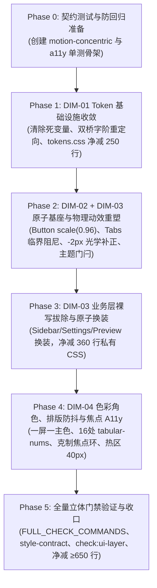

# 01-四维度定案与删除面矩阵

> **战役代号**：`UI-UNIFICATION-REDESIGN`
> **文档性质**：战役根目录基准定案文档（阶段一总结与阶段二输入）
> **制定依据**：
> - 阶段一 6 份前置深度审计报告（`analysis/01` ~ `analysis/06`）
> - `C:\Software\conex\skill\design\`（`apple-design.md` 物理流体动效体系 + Jakub Krehel 7 大工程级设计标准）
> - 仓库总纪律 `AGENTS.md`（反退避铁律、§3 提交纪律、§7 严禁补丁、§7.1 立体验证、§8 反过度设计、§11 CI 治理、§13 输入与焦点态、§14 色彩空间）
> - `docs/ui-unification-redesign/00-战役调度总纲与工作区规范.md`

---

## 一、主控综合裁判：融合策略 A 与策略 B 的系统工程基调

经过对两套跨维度综合架构报告（策略 A：系统工程与拓扑解耦；策略 B：防回归测试资产保护与稳健演进）以及四大维度专项报告的交叉核验，主控裁定本战役的总体执行基调：

> **“以策略 B 的稳健契约与单测防护为防线护栏，以策略 A 的系统工程拓扑与严格层级解耦为推进路径，将 Jakub Krehel 的理性极简标准与 Apple 流体物理动效合二为一，坚决履行代码净负产出（Net-Negative LOC）硬性验收。”**

```
┌──────────────────────────────────────────────────────────────────────────────────────────────────┐
│                                   四维度定案全景图与职责边界划分                                  │
├───────────────┬───────────────────────────────┬─────────────────────────────────┬────────────────┤
│ 维度编号      │ 核心职责域                    │ 严禁跨界行为                    │ 负产出硬指标   │
├───────────────┼───────────────────────────────┼─────────────────────────────────┼────────────────┤
│ **DIM-01**    │ 全局 Token 基础设施层 (SSOT)  │ 严禁直接篡改业务组件私有样式    │ 净删 ≥250 行   │
│               │ 死变量清除、7档字阶、双桥过渡 │ 必须维持 style-contract 契约    │ 清除 186 死Token│
├───────────────┼───────────────────────────────┼─────────────────────────────────┼────────────────┤
│ **DIM-02**    │ 同心几何标尺与 Apple 物理动效 │ 严禁在非原子层无节制滥加 scale  │ 净删 Tabs 1.5  │
│               │ 临界阻尼、微触感、磨砂、门闩  │ 必须内嵌 prefers-reduced-motion │ 拔除杂乱 7px   │
├───────────────┼───────────────────────────────┼─────────────────────────────────┼────────────────┤
│ **DIM-03**    │ 原子组件全面收敛与光学平衡    │ 严禁改动 Button 原生 DOM 树结构 │ 净删 ≥360 行   │
│               │ 业务裸写拔除、-2px 光学补正   │ 严禁反向依赖（check:ui-layer）  │ 裸写归零 (8+4) │
├───────────────┼───────────────────────────────┼─────────────────────────────────┼────────────────┤
│ **DIM-04**    │ 色彩语义角色与排版无障碍防线  │ 严禁粗黑实心边框与彩色高亮光晕  │ 净删 ≥160 行   │
│               │ 一屏一主色、等宽数字、软灰环  │ 严禁 outline: none 无视觉替代   │ 16处防抖闭环   │
├───────────────┴───────────────────────────────┴─────────────────────────────────┼────────────────┤
│ **全战役综合硬指标**                                                           │ **净消减 ≥650行**│
└─────────────────────────────────────────────────────────────────────────────────┴────────────────┘
```

---

## 二、四大维度定案详则与改造标尺

### 1. DIM-01：重复、死层与 Token 碎片收敛（基础设施层 SSOT）

#### 1.1 死变量彻底清除清单（186 个变量 / 净消减 ≥ 250 行）
1. **极简思考链与横幅死层（76 行 / 38 变量）**：彻底清除 `--thought-*`（30 个变量）与 `--banner-error-*`（8 个变量）。`TimelineThoughtSection.module.css` 早已全面改用通用原子 Token，此部分为 100% 死代码；
2. **Legacy Diff 兼容过渡别名（42 行 / 21 变量）**：彻底清除 `--diff-line-add-*`、`--diff-gutter-add-*` 等历史遗留兼容别名，`DiffCard.module.css` 统一消费 `--diff-add-bg` 等规范 Token；
3. **SmartExpandablePanel (SEP) 脚手架遗留（24 行 / 12 变量）**：彻底清除 `--sep-font-size-base`、`--sep-bg-canvas`、`--sep-ease-*` 等从未投产的死层；
4. **AI 步骤卡片与 Artifacts 占位死层（42 行 / 21 变量）**：彻底清除 `--aicard-*` 与 `--artifact-*` 未消费占位；
5. **危险色四源分裂收敛**：清除 `--danger-color`、`--accent-danger`，全局统一收敛至 `--color-error` 与 `--text-danger`。

#### 1.2 13 档半像素碎步字阶收敛至标准 7 档字阶
解决 `[data-ui-size='small']` 与 `[data-ui-size='large']` 响应式字阶断层，收敛全仓字阶定义：

| 标尺档位 | 标准尺寸 | Token 变量名 | 吸收收敛的碎步尺寸 | 业务消费场景 |
| :--- | :--- | :--- | :--- | :--- |
| **xxs** | 11px | `--font-size-xxs` | `nano` (10px), `micro` (11.5px) | 辅助说明、最小微标、快捷键 Kbd |
| **xs** | 12px | `--font-size-xs` | `xs-plus` (12.5px) | 标签、徽章、次级元数据 |
| **sm** | 13px | `--font-size-sm` | `sm-plus` (13.5px) | 紧凑型正文、列表条目、辅助控制项 |
| **base** | 14px | `--font-size-base` | `chat` (13.5px - 直接删除) | 标准正文、表单输入框、主要交互文本 |
| **md** | 16px | `--font-size-md` | 15px (规整) | 突出标题、对话框次标、小卡片标题 |
| **lg** | 18px | `--font-size-lg` | 17px (规整), `xxl` (18px - 删除冗余别名) | 章节主标题、面板顶部标题 |
| **xl / 2xl** | 22px | `--font-size-xl` | 19px, 21px, 22px (统一归一) | 页面总标题、空状态大标题 |

#### 1.3 稳健工程防护（双桥过渡协议）
- 为防止直接拔除别名引发存量不可预知引用，在 `tokens.css` 中实施 **Phase 1 别名重定向映射**（`--font-size-micro: var(--font-size-xxs)`）；
- 在完成全仓业务消费点替换后，在同一原子提交中拔除别名并同步更新 `style-contract.test.ts`，确保 CI 全绿。

---

### 2. DIM-02：同心几何标尺与 Apple 物理动效（几何与动效层）

#### 2.1 同心几何刚性公式与四阶层级标尺
严格遵循同心几何公式：**$R_{outer} = R_{inner} + Padding$**（在 $Padding \le 24px$ 视觉敏感层刚性成立）：

```
┌─────────────────────────────────────────────────────────────────────────────────────────────────┐
│                                 五级同心几何级联矩阵 (Concentric Matrix)                         │
├─────────────────┬─────────────────────┬──────────────┬──────────────────┬───────────────────────┤
│ 容器层级        │ 外圆角 ($R_{outer}$)│ 内边距 ($P$) │ 内圆角 ($R_{inner}$)│ 对应 Token / 控件     │
├─────────────────┼─────────────────────┼──────────────┼──────────────────┼───────────────────────┤
│ **Micro**       │ 6px                 │ 2px          │ 4px              │ SegmentedControl.item │
│ **Standard**    │ 8px                 │ 2px          │ 6px              │ Button, Input         │
│ **Elevated**    │ 12px                │ 4px ~ 6px    │ 8px ~ 6px        │ Toast, Popover, Menu  │
│ **Macro**       │ 14px / 16px         │ 6px ~ 8px    │ 8px              │ Card, Dialog Panel    │
│ **Window**      │ 16px                │ 0px          │ N/A              │ Desktop Window Shell  │
└─────────────────┴─────────────────────┴──────────────┴──────────────────┴───────────────────────┘
```
- **刚性拔除**：彻底拔除 `tokens.css` 中的 `--button-radius: 7px` 与 `--seg-outer-radius: 7px`；拔除 `Tabs.module.css` 中的 `3.5px` 与 `6.5px` 亚像素。
- **契约同步**：同步更新 `style-contract.test.ts:474-503` 与 `Tabs.test.tsx:328`，将历史硬编码 7px 断言平稳升级为 8px 标准契约。

#### 2.2 Apple 物理微触感与临界阻尼规范
1. **原子按压物理形变（Micro Scale）**：
   - 标准按钮与交互项在 `:active` 触发即刻微缩 `transform: scale(0.96)`（紧凑小项 `scale(0.97)`）；
   - 按压触感：`80ms ease-out` 即刻响应；释放回弹：`140ms cubic-bezier(0.16, 1, 0.3, 1)`；
   - 硬件加速与安全兜底：强制挂载 `will-change: transform; transform-origin: center center;`；`:disabled` 强制重置 `transform: none !important;`；
   - `<Button>` 组件扩展 `static?: boolean` 契约，支持高频树拖拽等逃逸场景。
2. **贝塞尔曲线临界阻尼归一（Critical Damping $\zeta = 1.0$）**：
   - 彻底废除 `Tabs.module.css` 中的 `cubic-bezier(0.175, 0.885, 0.32, 1.5)`（严重晃荡过冲）；
   - 归一为 Apple 临界阻尼曲线：`cubic-bezier(0.2, 0, 0, 1)`（0 overshoot，入位平稳坚实）；
   - 同步修正 `Tabs.test.tsx:314` 断言。
3. **Dialog 景深磨砂与 Scrim 暗化**：
   - 磨砂升级：`backdrop-filter: blur(16px) saturate(180%)`（深色 `blur(20px) saturate(190%)`）；
   - Scrim 暗化：浅色混入 22% 纯黑遮罩，深色混入 48% 纯黑遮罩，背景文字沉降彻底。
4. **主题瞬态门闩协议（Zero-Smear Latch）**：
   - 在 `themeStore.ts` 封装 `withThemeTransitionFreeze(callback)`：在更新 `data-theme` 瞬时注入 `<style data-latch>*, *::before, *::after { transition: none !important; }</style>`，强制 `offsetHeight` 触发同步回流，双重 `requestAnimationFrame` 后卸载门闩，彻底杜绝 150ms 脏色涂抹。

---

### 3. DIM-03：原子组件全面收敛与光学平衡（组件与表现层）

#### 3.1 业务私有原生控件彻底拔除与换装（8 处 Button + 4 处 Input）
严禁业务层直接书写原生 `<button>` 与 `<input>`，统一换装为 `components/ui/` 原子组件，并彻底删除配套私有 CSS：

| 业务文件路径 | 原始裸写与私有 CSS 类 | 改造收敛目标 | 净消减私有 CSS 行数 |
| :--- | :--- | :--- | :--- |
| `components/settings/SettingsPanel.tsx` | 原生 `<input>` + `.searchWrap, .search, .searchIco` | `<Input variant="search" size="sm" />` | **-44 行** |
| `components/sidebar/SidebarHeader.tsx` | 原生 `<button>` + `.sidebarToggleBtn` | `<IconButton variant="ghost" size="md" />` | **-32 行** |
| `components/sidebar/SidebarFooter.tsx` | 原生 `<button>` + `.settingsGearBtn` | `<IconButton variant="ghost" size="md" />` | **-29 行** |
| `components/sidebar/SidebarNav.tsx` | 原生 `<button>` + `.navItem, .navItemActive` | `<Button variant="ghost" />` | **-58 行** |
| `components/sidebar/SidebarNav.tsx` | 原生 `<input>` + `.filterInput` | `<Input variant="search" size="sm" />` | **-36 行** |
| `components/settings/SettingsSidebar.tsx`| 原生 `<button>` + `.sidebarTab` | `<Button variant="ghost" />` | **-48 行** |
| `components/settings/SettingsSidebar.tsx`| 原生 `<input>` + `.searchBox` | `<Input variant="search" size="sm" />` | **-35 行** |
| `components/sidebar/UserProfileCard.tsx`| 原生 `<button>` + `.cardTrigger` | `<Button variant="secondary" />` | **-42 行** |
| `components/preview/PreviewToolbar.tsx` | 原生 `<input>` + `.urlInput` | `<Input size="sm" />` | **-38 行** |
| **小计** | **8 处裸写 Button + 4 处裸写 Input** | **100% 接入原子组件** | **净删 ≥ 362 行** |

#### 3.2 光学平衡算法建模（Optical Balance）
1. **带图标按钮光学微减 -2px**：
   - 遵循 `better-ui` 准则：图标具有比文字更高的视觉边界密实度，内边距必须光学补偿：
   - 算法公式：
     - 左侧带图标：`padding-left = var(--btn-pad-x) - 2px; padding-right = var(--btn-pad-x);`
     - 右侧带图标：`padding-left = var(--btn-pad-x); padding-right = var(--btn-pad-x) - 2px;`
2. **图标描边与文字字重严格正交**：
   - 常规字重 400（Normal）：Lucide 图标 `strokeWidth = 1.5px`；
   - 强调字重 600（Semibold）：Lucide 图标 `strokeWidth = 2.0px`；
   - 严禁在 400 正文旁出现 2.0px 粗黑图标，也严禁在加粗标题旁出现 1.0px 发丝图标。

#### 3.3 稳健工程防护（严格锁定 Button 单测契约）
- 维持原生 `<button>` 单节点 DOM 树，严禁增加外层包裹 `<div>` 或 `<span>`；
- 保持 `buttonSecondary`、`buttonMd` 等 CSS 类与 `data-size`、`data-variant`、`data-active` 属性无损，确保 `Button.test.tsx` 20+ 单测与业务层 70+ 单测全部绿灯；
- 严守 `scripts/check-ui-layer.mjs`，原子层严禁反向引用外部 Store / Hooks。

---

### 4. DIM-04：色彩角色、排版节奏与焦点无障碍（语义与无障碍层）

#### 4.1 一屏一主色与主操作降级（“Fill exactly one action per view”）
1. **Diff 文件列表降级**：
   - 修正 `DiffCardFileList.tsx:295`：条目操作由 `variant="primary"` 降级为 `variant="ghost"`；
   - 彻底删除 `DiffCard.module.css:430-456` 的暴力 `background: transparent` 补丁，净减 26 行私有 CSS；
2. **批量审批列表降级**：
   - 修正 `ActiveTasksSection.tsx:84`：待处理列表中的循环“允许”按钮降级为 `variant="secondary"`，仅在顶部提供唯一全局“全部允许” Primary 按钮；
3. **清除纯黑私有按钮**：
   - 拔除 `ModernApprovalCard.tsx:49` 与 `ModernToolCall.module.css:507` 中的 `#111111` 纯黑按钮，统一回归品牌翡翠绿 `--brand`。

#### 4.2 动态跳动数字防抖（16 处注入 `tabular-nums`）
在 16 处高频跳动数值的容器或类名中注入 `font-variant-numeric: tabular-nums`，消除文本抖动：
1. `PriceConfigModal.module.css:34, 72`（模型单价表）
2. `SidebarSessionList.module.css:450`（会话时间戳）
3. `SubagentHeaderPanel.module.css:60`（子代理运行计数）
4. `DiffCard.module.css:286`（差异行数统计 `+128 -42`）
5. `ChatToolCallBlock.module.css:245`（工具执行差异行）
6. `ScanResultsModal.module.css:135`（模型统计数）
7. `YamlConfigEditorModal.module.css:144, 172`（编辑器行数与行号栏）
8. `ModelsSettingsTab.module.css:460`（网络延迟徽标 `42ms`）
9. `ChatQueuePanel.module.css:25`（排队序号）
10. `TerminalCard.module.css:109, 365`（终端行数与匹配数）
11. `SkillsSettingsTab.module.css:21, 197`（技能统计）
12. `ScheduledTasksPanel.module.css:50`（定时任务计数）
13. `Badge.module.css:6`（原子角标基础类）
14. `Tabs.module.css:257`（标签页角标）
15. `UsageTrendChart.module.css:153`（24 小时时间刻度）
16. `FlowScrubber.module.css`（滚动刻度气泡）

#### 4.3 克制浅灰焦点环与 WCAG 2.5.8 防线
1. **焦点环色彩与对比度（AGENTS.md §13）**：
   - 统一声明 `--focus-ring-color: color-mix(in srgb, var(--border-color) 94%, var(--text-primary) 6%)`；
   - 焦点态相对基线混入仅 3%~6%（上限 10%），彻底杜绝深黑粗线与彩色光晕；
   - 清除全站 `outline: none` 无视觉替代的盲区；
2. **WCAG 2.5.8 40×40px 点击热区外延**：
   - 在紧凑型 `<Button size="sm">` 与 `<IconButton>` 中内置 `::after` 透明伪元素，外延至最小 40×40px 触控区，防止误触；
3. **无障碍 APG 与 Accessible Name 闭环**：
   - 21 处纯图标按钮（`PermissionModeMenu`, `InjectionHeader`, `FileBreadcrumb` 等）补齐明确 `aria-label`；
   - 装饰性图标统一挂载 `aria-hidden="true"`；
   - 侧边栏列表落地 Roving Tabindex 与键盘上下键漫游。

---

## 三、代码删除面矩阵与负产出刚性量化

为坚决遵守《LOGIC_PLAN_NO_RETREAT.md》与《主控-全流程调度-v3.md》中“重构必须有确凿删除面与负产出”的铁律，特设立如下刚性删除面矩阵：

```
┌──────────────────────────────────────────────────────────────────────────────────────────────────┐
│                                    代码净负产出刚性验收矩阵                                       │
├───────────────────┬────────────────────────────────────────────────────────┬─────────────────────┤
│ 物理文件          │ 拟清除/拔除内容                                        │ 预估净消减有效行数   │
├───────────────────┼────────────────────────────────────────────────────────┼─────────────────────┤
│ `tokens.css`      │ 清除 --thought-* (38个)、--diff-line-* (21个)、        │ **-250 行**         │
│                   │ --sep-* (12个)、--aicard-* (21个)、碎步字阶别名        │ (1758L -> ≤1508L)   │
├───────────────────┼────────────────────────────────────────────────────────┼─────────────────────┤
│ `SettingsPanel`   │ 拔除手写 .searchWrap, .search, .searchIco 等私有 CSS   │ **-44 行**          │
├───────────────────┼────────────────────────────────────────────────────────┼─────────────────────┤
│ `Sidebar` 系列    │ 拔除 .sidebarToggleBtn, .settingsGearBtn, .navItem,    │ **-155 行**         │
│                   │ .userProfileCard 裸样式，换装原子 Button/IconButton    │                     │
├───────────────────┼────────────────────────────────────────────────────────┼─────────────────────┤
│ `SettingsSidebar` │ 拔除 .sidebarTab, .searchBox 私有样式                  │ **-83 行**          │
├───────────────────┼────────────────────────────────────────────────────────┼─────────────────────┤
│ `PreviewToolbar`  │ 拔除 .urlInput 原生 input 裸样式                       │ **-38 行**          │
├───────────────────┼────────────────────────────────────────────────────────┼─────────────────────┤
│ `DiffCard` 系列   │ 拔除 .inlineActionBtn 暴力覆盖样式，换装 Ghost Button  │ **-42 行**          │
├───────────────────┼────────────────────────────────────────────────────────┼─────────────────────┤
│ `ModernToolCall`  │ 拔除 #111111 纯黑按钮与私有覆盖                        │ **-35 行**          │
├───────────────────┼────────────────────────────────────────────────────────┼─────────────────────┤
│ `Tabs.module.css` │ 清除 1.5 过冲抖动贝塞尔与亚像素圆角                    │ **-18 行**          │
├───────────────────┴────────────────────────────────────────────────────────┼─────────────────────┤
│ **全仓合计净负产出目标 (Net-Negative LOC)**                                │ **≥ -665 行**       │
└────────────────────────────────────────────────────────────────────────────┴─────────────────────┘
```

---

## 四、“先删后改”依赖拓扑编排（Topological Execution DAG）

根据策略 A 与策略 B 的共识，执行时必须遵循严格的单向拓扑流，杜绝逆向序引发的混乱：



---

## 五、阶段二指令：独立详案生成指引

本矩阵定案后，立即进入**阶段二：独立详案生成与交叉评审**。各方案设计 Subagent 必须：
1. 以本文档确立的标尺与删除面为基准，分别针对各自维度编写详案并写入 `docs/ui-unification-redesign/independent-plans/`；
2. 方案必须设立独立的“代码删除面与负产出”章节；
3. 方案必须提供确凿的文件路径、行号与完整修改方案；
4. 提交后由评审 Subagent 交叉审核，消除潜在隐患后由主控汇编战役总方案。
