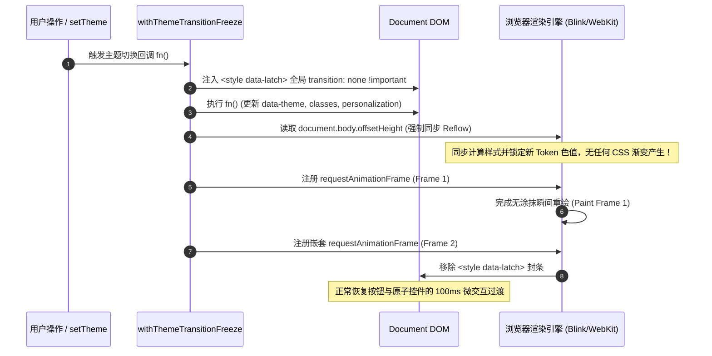
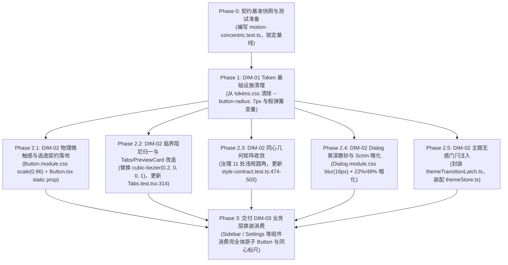

# 02-同心几何标尺与 Apple 物理动效实施方案（DIM-02 独立详案）

> **战役代号**：`UI-UNIFICATION-REDESIGN`  
> **文档性质**：阶段二 维度二独立实施详案（DIM-02：同心几何标尺、Apple 物理微触感、临界阻尼归一、Dialog 景深磨砂与主题无感门闩）  
> **执行依据**：
> - `c:/Software/conex/docs/ui-unification-redesign/00-战役调度总纲与工作区规范.md`（战役调度总纲）
> - `c:/Software/conex/docs/ui-unification-redesign/01-四维度定案与删除面矩阵.md`（四维度基准定案与硬性指标）
> - `c:/Software/conex/docs/ui-unification-redesign/analysis/02-dim02-concentric-and-motion-analysis.md`（前置专项深度审计报告）
> - `c:/Software/conex/docs/ui-unification-redesign/independent-plans/05-integrated-execution-and-migration-plan.md`（总集成与迁移详案）
> - `c:/Software/conex/skill/design/apple-design.md`（WWDC 流体交互物理学公理与材料景深体系）
> - `c:/Software/conex/skill/design/jakub-skills/skills/better-ui/surfaces.md`（同心圆角几何公理、阴影代边框、光学对齐）
> - `c:/Software/conex/skill/design/jakub-skills/skills/better-ui/animations.md`（按压缩放、可中断过渡、主题门闩、动效克制律）
> - `AGENTS.md`（§3 Git 提交纪律、§7 严禁补丁、§7.1 立体验证、§8 反过度设计硬性红线、§13 输入与焦点态、§14 色彩空间）
> - `.agents/LOGIC_PLAN_NO_RETREAT.md`（反退避全文与纯逻辑规划）

---

## 一、方案定位与物理设计哲学

### 1.1 核心使命与设计哲学

在 `01-四维度定案与删除面矩阵.md` 的四维划分中，**DIM-02 承载着桌面应用的“几何骨架”与“触觉灵魂”**。长期以来，前端界面常陷于“硬编码奇数圆角”与“假弹簧过度动画”的泥潭：
- 一方面，随意拼凑的 5px、7px、10px、11px、13px 以及 `3.5px` 亚像素圆角，使容器与内部控件边缘呈现锯齿变形与内角外凸的违和感；
- 另一方面，滥用纵坐标 $y_2 = 1.5$ 的超强过冲贝塞尔曲线，导致滑块像果冻般失控晃荡，而核心按钮在点击时却只有微弱的透明度变化，陷入“该动的不动、不该动的乱晃”的物理失真境地。

本方案严格立足 **Apple 流体物理学（Fluid Motion Physics）** 与 **Jakub Krehel 理性同心几何（Concentric Geometry）** 双重基石，确立三大工程铁律：

```
┌────────────────────────────────────────────────────────────────────────────────────────────────────────┐
│                                   DIM-02 三大系统工程物理铁律                                         │
├───────────────────┬───────────────────────────────────────────────────┬────────────────────────────────┤
│ 铁律一            │ **同心几何公理刚性约束**                          │ 凡嵌套容器必守                 │
│ (Geometric Axiom) │ $R_{outer} = R_{inner} + Padding$                 │ 彻底拔除全仓 7px 奇数锁与亚像素│
├───────────────────┼───────────────────────────────────────────────────┼────────────────────────────────┤
│ 铁律二            │ **临界阻尼归一与瞬态响应**                        │ 离散交互 $\zeta = 1.0$ (0过冲) │
│ (Critical Damping)│ 按压 80ms `scale(0.96)`，释放 140ms 减速回弹      │ 彻底废除 1.5 果冻摇晃贝塞尔    │
├───────────────────┼───────────────────────────────────────────────────┼────────────────────────────────┤
│ 铁律三            │ **视网膜景深与瞬态无感门闩**                      │ Dialog 16px/20px 真实磨砂沉降  │
│ (Depth & Latch)   │ 切换主题瞬态注入 CSS 门闩 + Reflow 同步落盘       │ 彻底杜绝 150ms 脏灰色彩涂抹    │
└───────────────────┴───────────────────────────────────────────────────┴────────────────────────────────┘
```

---

## 二、同心几何标尺推导与五级级联矩阵

### 2.1 同心几何数学公理推导

依据 `better-ui/surfaces.md`，当两个具有圆角的矩形表面在近距离（$Padding \le 24px$）嵌套时，人眼视网膜对内外边缘的曲率同轴度（Concentricity）极度敏感。
若内外圆角半径相同（$R_o = R_i$），内外两道弧线的圆心将发生错位，导致角隅区域的间距在对角线方向被压缩，产生强烈的视觉挤压与折角感。

要保证内外边缘的法向距离在整条圆弧上恒等于内边距 $P$，内外圆角的几何圆心必须重合，其严格推导公式为：

$$R_{outer} = R_{inner} + Padding \iff R_{inner} = R_{outer} - Padding$$

当 $Padding > 24px$ 时，内外层在视觉上已被大脑感知为独立离散表面，方可解除强制同心锁定。

```
       ┌──────────────────────────────────────────────┐
       │ Outer Surface (Radius = R_outer)             │
       │   ┌──────────────────────────────────────┐   │
       │   │ Inner Element (Radius = R_inner)     │   │
       │   │                                      │   │
       │   │        R_outer = R_inner + P         │   │
       │   │        (法向间隙恒定等于 P)          │   │
       │   └──────────────────────────────────────┘   │
       │   ◄────────────── P ─────────────►           │
       └──────────────────────────────────────────────┘
```

### 2.2 五级同心几何级联矩阵（Concentric Matrix）

全面废除存量中随意定义的 5px、7px、10px、11px、13px 以及 3.5px、6.5px 亚像素，基于 `4px / 8px` 标准原子网格建立五级同心矩阵：

```
┌────────────────────────────────────────────────────────────────────────────────────────────────────────┐
│                                   五级同心几何级联矩阵 (Concentric Matrix)                             │
├───────────────┬──────────────┬──────────────┬──────────────┬───────────────────┬───────────────────────┤
│ 层级规格      │ 外圆角 $R_o$ │ 内边距 $P$   │ 内圆角 $R_i$ │ 对应 Token 变量   │ 典型适用组件与场景    │
├───────────────┼──────────────┼──────────────┼──────────────┼───────────────────┼───────────────────────┤
│ **1. Micro**  │ 6px          │ 2px          │ 4px          │ `--radius-md` (6) │ SegmentedControl xs,  │
│ (紧凑微型)    │              │              │              │ `--radius-sm` (4) │ Tabs xs, 快捷键 Kbd   │
├───────────────┼──────────────┼──────────────┼──────────────┼───────────────────┼───────────────────────┤
│ **2. Standard**│ 8px         │ 2px (紧凑)   │ 6px          │ `--radius-lg` (8) │ Button (sm/md),       │
│ (标准原子)    │              │ 4px (标准)   │ 4px          │ `--radius-md` (6) │ Input (sm/md), Tabs sm│
├───────────────┼──────────────┼──────────────┼──────────────┼───────────────────┼───────────────────────┤
│ **3. Elevated**│ 12px        │ 4px          │ 8px          │ `--radius-xl` (12)│ ToastCard, Popover,   │
│ (悬浮卡片)    │              │ 6px          │ 6px          │ `--radius-lg` (8) │ MenuContent, Dropdown │
├───────────────┼──────────────┼──────────────┼──────────────┼───────────────────┼───────────────────────┤
│ **4. Macro**  │ 14px / 16px  │ 6px          │ 8px          │ `--radius-2xl`(14)│ Dialog Panel, Card,   │
│ (宏观面板)    │              │ 8px          │ 8px          │ 16px (Dialog)     │ SettingsUiCard, Diff  │
├───────────────┼──────────────┼──────────────┼──────────────┼───────────────────┼───────────────────────┤
│ **5. Window** │ 16px         │ 0px          │ N/A          │ 视口顶层解耦      │ Desktop Window Shell, │
│ (宿主视口)    │              │              │              │                   │ 独立分屏工作区        │
└───────────────┴──────────────┴──────────────┴──────────────┴───────────────────┴───────────────────────┘
```

### 2.3 全仓 11 处违规同心场景治理详案

对 `02-dim02-concentric-and-motion-analysis.md` 地毯式扫描出的 11 处违规场景进行精确治理改造：

```
┌────────────────────────────────────────────────────────────────────────────────────────────────────────┐
│                                 全仓 11 处同心几何违规点精确改造对照表                                 │
├────┬───────────────────────┬──────────────────────────┬──────────────────────────┬─────────────────────┤
│ 序 │ 物理文件路径与行号    │ 改造前缺陷代码           │ 改造后规范代码           │ 几何收敛成效与原理  │
├────┼───────────────────────┼──────────────────────────┼──────────────────────────┼─────────────────────┤
│ 1  │ `tokens.css:29-30`    │ `--seg-outer-radius: 7px`│ `--seg-outer-radius:     │ 纠正内外半径相等    │
│    │                       │ `--seg-inner-radius: 7px`│   var(--radius-lg, 8px); │ 恢复 8px 外角与     │
│    │                       │                          │ `--seg-inner-radius: 6px`│ 6px 内角同心配比    │
├────┼───────────────────────┼──────────────────────────┼──────────────────────────┼─────────────────────┤
│ 2  │ `Tabs.module.css:84`  │ `--tab-outer-radius: 7px`│ `--tab-outer-radius:     │ 拔除 7px 奇数       │
│    │                       │ `--tab-inner-radius: 5px`│   var(--radius-lg, 8px); │ 建立 8px - 2px = 6px│
│    │                       │                          │ `--tab-inner-radius: 6px`│ 标准整像素同心      │
├────┼───────────────────────┼──────────────────────────┼──────────────────────────┼─────────────────────┤
│ 3  │ `Tabs.module.css:104` │ `--tab-pad: 3.5px;`      │ `--tab-pad: 4px;`        │ 根除 3.5px/6.5px    │
│    │                       │ `--tab-outer-radius:10px`│ `--tab-outer-radius:     │ 亚像素小数；改用    │
│    │                       │ `--tab-inner-radius:6.5px`│  var(--radius-xl, 12px);│ 12px - 4px = 8px    │
├────┼───────────────────────┼──────────────────────────┼──────────────────────────┼─────────────────────┤
│ 4  │ `ModelsSettingsTab`   │ 外壳 12px, pad 8px,      │ 外壳 14px, pad 6px,      │ 纠正内角(8)大于理论 │
│    │ `:18,60,72`           │ 内项 `.mrlItem`: 8px     │ 内项 `.mrlItem`: 8px     │ 值(4)的严重视觉畸变 │
├────┼───────────────────────┼──────────────────────────┼──────────────────────────┼─────────────────────┤
│ 5  │ `ModelsSettingsTab`   │ `.mrdAddForm`: 8px       │ `.modelConfigPanel`:     │ 统一并列卡片圆角    │
│    │ `:374,410`            │ `.modelConfigPanel`: 7px │   var(--radius-lg, 8px)  │ 消除“圆角互搏”      │
├────┼───────────────────────┼──────────────────────────┼──────────────────────────┼─────────────────────┤
│ 6  │ `SettingsUI.module`   │ 外壳 12px, pad 10px,     │ 内部 input 统一接入      │ 统一 6px/8px 标尺， │
│    │ `:81,91,147`          │ 内部 input 锁 7px        │   `var(--radius-md, 6px)`│ 消除 7px 杂乱断层   │
├────┼───────────────────────┼──────────────────────────┼──────────────────────────┼─────────────────────┤
│ 7  │ `ToastStackModern`    │ 外壳 8px, pad 10px,      │ 外壳 12px (`--radius-xl`)│ 解决外壳过硬与角隅  │
│    │ `:79,80,348`          │ 按钮 `.undoButton`: 4px  │ pad 6px, 按钮 6px        │ 局促，恢复高级同心  │
├────┼───────────────────────┼──────────────────────────┼──────────────────────────┼─────────────────────┤
│ 8  │ `ChatComposer.module` │ `.flowPermissionBar`:12px│ `.flowPermissionBar`:12px│ 满足 $12 - 6 = 6px$ │
│    │ `:58,60,207`          │ pad 6px, 胶囊项: 4px     │ pad 6px, 胶囊项: 6px     │ 消除角隅同心失谐    │
├────┼───────────────────────┼──────────────────────────┼──────────────────────────┼─────────────────────┤
│ 9  │ `ChatComposer.module` │ `.planProgressBar`: 16px │ `.planProgressBar`: 16px │ 修正水平与垂直偏心，│
│    │ `:322,357`            │ pad 10px 14px, 内项: 6px │ pad 8px, 内项: 8px       │ 保持等距法向留白    │
├────┼───────────────────────┼──────────────────────────┼──────────────────────────┼─────────────────────┤
│ 10 │ `Input.module.css`    │ 常规输入框 6px/8px       │ `.inputSearch`:          │ 恢复原子组件的尺寸  │
│    │ `:30,107`             │ `.inputSearch` 私锁 7px  │   var(--radius-md, 6px)  │ 正交性，禁私设 7px  │
├────┼───────────────────────┼──────────────────────────┼──────────────────────────┼─────────────────────┤
│ 11 │ `Sidebar.module.css`  │ `.userProfileCard`: 12px │ `.userProfileCard`:      │ 消除 32px 小卡片被  │
│    │ `:169`                │ (高度仅 32px 却用 12px)  │   var(--radius-md, 6px)  │ 12px 扭曲成胶囊怪相 │
└────┴───────────────────────┴──────────────────────────┴──────────────────────────┴─────────────────────┘
```

---

## 三、Apple 物理微触感实现与原子按压注入

### 3.1 物理动力学参数建模（Scale on Press）

依据 `apple-design.md` §1 Response 与 `better-ui/animations.md` §Scale on press：
> “A subtle scale-down on click gives buttons tactile feedback. Always scale(0.96), never below 0.95, which feels exaggerated. Use CSS transitions so a release mid-press returns smoothly.”

现有工程中的原子按钮在 `:active` 下仅仅通过 `::before` 改变遮罩的不透明度，完全缺乏向屏幕内“下陷（Depress）”的实体触觉。本方案在 CSS 与组件层注入高精度物理动力学参数：

```
┌────────────────────────────────────────────────────────────────────────────────────────────────────────┐
│                                 Apple 物理微触感动力学参数模型                                         │
├─────────────────────┬──────────────────────┬───────────────────────────────────────────────────────────┤
│ 交互动作            │ 时间与缓动函数       │ 物理行为与生理心理学成效                                  │
├─────────────────────┼──────────────────────┼───────────────────────────────────────────────────────────┤
│ **按压瞬间**        │ **80ms ~ 100ms**     │ 零延迟（Kill Latency）：在 PointerDown 瞬间即刻触发       │
│ (Pointer Down)      │ `ease-out`           │ 凹陷形变，用户指尖获得坚实向内的实体阻尼受力反馈          │
├─────────────────────┼──────────────────────┼───────────────────────────────────────────────────────────┤
│ **释放回弹**        │ **140ms ~ 160ms**    │ Apple 临界自然减速曲线：快速升起并在基线位置平稳制动，    │
│ (Pointer Up/Cancel) │ `cubic-bezier(`      │ 具备极高可中断性（Interruptible），中途抬起平滑复位       │
│                     │ `  0.16, 1, 0.3, 1)` │                                                           │
├─────────────────────┼──────────────────────┼───────────────────────────────────────────────────────────┤
│ **形变缩放比率**    │ **标准: scale(0.96)**│ 严格控制在 0.96~0.97，绝对严禁低于 0.95（<0.95 产生廉价   │
│ (Compression Ratio) │ **紧凑: scale(0.97)**│ 橡皮泥果冻感）；紧凑微型控件采用 0.97 保护文字不模糊      │
├─────────────────────┼──────────────────────┼───────────────────────────────────────────────────────────┤
│ **硬件加速防抖**    │ `will-change: trans- │ 独立提升为 GPU 合成层，锁定几何中心变换原点，             │
│ (GPU Composition)   │  form; center center`│ 杜绝 1px 亚像素抖动与重排（Zero-Layout-Shift）            │
└─────────────────────┴──────────────────────┴───────────────────────────────────────────────────────────┘
```

### 3.2 `Button.module.css` 核心改造代码实现

在 `apps/crish-desktop/src/components/ui/Button/Button.module.css` 中注入完整的触感微压缩体系：

```css
/* apps/crish-desktop/src/components/ui/Button/Button.module.css */

/* 1. 基座声明 transform 与硬件加速属性 */
.button {
  --btn-h: 32px;
  --btn-px: 12px;
  --btn-fs: var(--font-size-base, 14px);
  --btn-radius: var(--radius-lg, 8px); /* ◀ 彻底替换原 --button-radius 7px */
  --btn-icon-size: 16px;
  --btn-gap: var(--space-1_5, 6px);

  /* 物理形变基线 */
  transform: scale(1);
  transform-origin: center center;
  will-change: transform;

  /* 释放回弹：140ms 临界自然减速 */
  transition:
    transform 140ms cubic-bezier(0.16, 1, 0.3, 1),
    border-color var(--transition-micro, 100ms) ease-out,
    box-shadow var(--transition-micro, 100ms) ease-out;
}

/* 2. 按压触感：80ms 即刻下陷 scale(0.96) */
.button:active:not(:disabled):not([data-static='true']) {
  transform: scale(0.96);
  transition-duration: 80ms;
  transition-timing-function: ease-out;
}

/* 3. 紧凑型小按钮微缩比例优化 (scale 0.97) */
.buttonXs:active:not(:disabled):not([data-static='true']),
.buttonSm:active:not(:disabled):not([data-static='true']),
.button[data-size='xs']:active:not(:disabled):not([data-static='true']),
.button[data-size='sm']:active:not(:disabled):not([data-static='true']) {
  transform: scale(0.97);
}

/* 4. 禁用态安全重置：绝对禁止任何物理形变 */
.button:disabled,
.button[disabled],
.button[data-disabled='true'] {
  transform: none !important;
  cursor: not-allowed;
  opacity: var(--opacity-disabled, 0.45);
  box-shadow: none;
}

/* 5. 无障碍减弱动态适配 (Reduced Motion) */
@media (prefers-reduced-motion: reduce) {
  .button,
  .button:active:not(:disabled) {
    transform: none !important;
    transition-property: border-color, box-shadow !important;
  }
}
```

### 3.3 `<Button>` 组件扩展 `static?: boolean` 逃逸契约

在复杂的树状控件（Tree）、高频列表拖拽把手（Draggable Handle）、表格单元内嵌按钮等场景下，点击时的物理缩放可能导致临近排版抖动或干扰拖拽手势判定。因此必须向 `<Button>` 引入 `static?: boolean` 逃逸通道：

#### 1. 组件 Props 契约定义 (`Button.tsx`)
```typescript
// apps/crish-desktop/src/components/ui/Button/Button.tsx

export interface ButtonProps extends React.ButtonHTMLAttributes<HTMLButtonElement> {
  /** 视觉变体：primary 主操作 / secondary 次操作 / plain 极简文字 / ghost 轻量 / danger 危险操作 */
  variant?: ButtonVariant;
  /** 尺寸：xs(24px) / sm(28px) / md(32px) / lg(40px) */
  size?: ButtonSize;
  /** 图标位（置于文字前/后，aria-hidden 由组件内部保证） */
  icon?: React.ReactNode;
  /** 图标位置：left（默认）或 right */
  iconPosition?: 'left' | 'right';
  /** 加载态：自动 disabled + aria-busy，内容前置旋转指示 */
  loading?: boolean;
  /** 通栏按钮（宽度 100%） */
  block?: boolean;
  /** 激活态 */
  active?: boolean;
  /** 裸核心模式（不应用默认规格与文字包裹，专供复杂列表项/下拉选项等自定义布局按钮） */
  bare?: boolean;
  /** 
   * 静态模式逃逸契约 (DIM-02 Apple Physical Motion Escape)：
   * 为 true 时抑制 :active 按压物理缩放 scale(0.96)，
   * 专供密集树拖拽把手、高频表格操作等防抖动场景。
   */
  static?: boolean;
}
```

#### 2. JSX 属性透传实现 (`Button.tsx`)
```tsx
// apps/crish-desktop/src/components/ui/Button/Button.tsx:109-129

return (
  <button
    ref={ref}
    type={type}
    className={classNames}
    data-size={size}
    data-variant={variant}
    data-active={active || undefined}
    data-static={isStatic ? 'true' : undefined}
    disabled={disabled || loading}
    aria-busy={loading || undefined}
    {...restProps}
  >
    {loading ? (
      <span className={styles.spinner} aria-hidden="true" />
    ) : iconPosition === 'left' ? (
      iconNode
    ) : null}
    {children != null ? (
      <span className={styles.buttonLabel}>{children}</span>
    ) : null}
    {!loading && iconPosition === 'right' ? iconNode : null}
  </button>
);
```

---

## 四、贝塞尔曲线临界阻尼（$\zeta = 1.0$）归一详案

### 4.1 伪物理 1.5 过冲晃荡数学模型与视觉危害分析

在现存代码中，多处定义了如下三次贝塞尔曲线：
```css
/* apps/crish-desktop/src/components/ui/Tabs/Tabs.module.css:7 */
--tab-spring-bezier: cubic-bezier(0.175, 0.885, 0.32, 1.5);

/* apps/crish-desktop/src/components/ui/PreviewCard/PreviewCard.module.css:48 */
animation: previewCardEnter 200ms cubic-bezier(0.175, 0.885, 0.32, 1.5) forwards;
```

#### 1. 数学微积分推导
三次贝塞尔参数方程为：

$$B_y(t) = 3(1-t)^2 t \cdot P_{1y} + 3(1-t) t^2 \cdot P_{2y} + t^3$$

其中控制点 $P_1 = (0.175, 0.885)$，$P_2 = (0.32, \mathbf{1.5})$。  
由于 $P_{2y} = 1.5 > 1.0$，该曲线在 $t \approx 0.72$ 时达到峰值 $y_{max} \approx 1.25 \sim 1.35$：
- 意味着当滑块从 Tab A 移动到 Tab B（位移 $\Delta x = 120px$）时，滑块在第 180ms 处会冲出目标 Tab B 达 **$36px \sim 42px$**；
- 随后在最后的 70ms 内强行反向刹车拉回。

#### 2. 物理与视觉危害
依据 `apple-design.md` §4 Behavior over animation：
> “Start most UI at damping 1.0 (critically damped) — graceful and non-distracting.  
> Add bounce (damping ~0.8) only when the gesture itself carried momentum (a flick, a throw, a drag release). Overshoot on a menu that just faded in feels wrong; overshoot on a tab feels cheap.”

离散点击交互（Discrete Click）的初始速度 $v_0 = 0$。在这种无手势惯性的离散场景下强行加入 50% 过冲，会在用户视线中呈现失控、轻浮的“劣质果冻晃动感”。

### 4.2 临界阻尼曲线 `cubic-bezier(0.2, 0, 0, 1)` 归一

全面废除 $y_2 > 1.0$ 的假弹簧曲线，归一为符合苹果规范的**临界阻尼曲线（Critically Damped $\zeta = 1.0$）**：

$$\mathbf{cubic\text{-}bezier(0.2, 0, 0, 1)}$$

```
y (位移比例)
1.0 ┌───────────────────────────────────────────● 目标静止点 (t=1.0, y=1.0, 零过冲)
    │                                    . - - '
    │                             . - '
0.8 │                      . - '   ◀ 前 20% 时间跨度内完成 80% 位移，极速响应
    │                . - '
    │            . '
0.4 │         . '
    │       /
0.0 ●──────'──────────────────────────────────── t (时间进度)
    0.0   0.2                         1.0
```

- **动力学特征**：启动极速（前 20% 时间完成 80% 位移，无肉眼可见启动迟滞），后程以自然阻尼指数平滑渐近停点；
- **过冲量**：严格等于 **0%**（$y \le 1.0$ 恒成立），无任何回弹震颤；
- **视觉感受**：如精密钟表齿轮入位般坚实稳定，与 macOS Tahoe / iOS 18 分段控制器完全一致。

### 4.3 改造清单与测试契约更新

#### 1. `Tabs.module.css` 物理参数更新
```css
/* apps/crish-desktop/src/components/ui/Tabs/Tabs.module.css:6-9 */
.root {
  /* 临界阻尼 ζ=1.0 归一：彻底拔除 1.5 过冲晃荡 */
  --tab-spring-bezier: cubic-bezier(0.2, 0, 0, 1);
  --tab-duration: 200ms;
  --tab-press-duration: 80ms;

  display: flex;
  position: relative;
  box-sizing: border-box;
}
```

#### 2. `PreviewCard.module.css` 浮层入场曲线更新
```css
/* apps/crish-desktop/src/components/ui/PreviewCard/PreviewCard.module.css:48 */
/* 拔除 1.5 晃荡，替换为 Apple 自然减速入场 */
animation: previewCardEnter 180ms cubic-bezier(0.16, 1, 0.3, 1) forwards;
```

#### 3. `Tabs.test.tsx` 门禁断言同步更新
```tsx
// apps/crish-desktop/src/components/ui/Tabs/Tabs.test.tsx:312-316

it('物理动效与同心圆角 CSS 规范验证', () => {
  // 1. Apple 物理临界阻尼动效参数 (已废除 1.5 过冲)
  expect(CSS_SRC).toContain('cubic-bezier(0.2, 0, 0, 1)');
  expect(CSS_SRC).not.toContain('cubic-bezier(0.175, 0.885, 0.32, 1.5)');
  expect(CSS_SRC).toContain('--tab-duration: 200ms');
  ...
```

---

## 五、Dialog 景深磨砂与模态 Scrim 重塑

### 5.1 景深塌陷根因与材质物理学原理

依据 `apple-design.md` §12 Materials & Depth 与 WWDC 2020 *Depth and Translucency*：
> “Dim to focus, separate to keep flow. A modal task pairs the surface with a dimming scrim and pushes the background back/down. Bigger surfaces should read as thicker: stronger blur + deeper shadow.”

现有 [`Dialog.module.css:17-20`](file:///c:/Software/conex/apps/crish-desktop/src/components/ui/Dialog/Dialog.module.css) 的遮罩层实现存在严重缺陷：
```css
/* 现有缺陷代码 */
.backdrop {
  background: color-mix(in srgb, var(--shadow-color) 4%, transparent); /* ◀ 4% 近乎全透 */
  backdrop-filter: blur(1.5px); /* ◀ 1.5px 极浅毛刺 */
}
```
- **1.5px 毛刺伪磨砂**：在 Retina 高分屏下，1.5px 的高斯核半径无法形成光学漫反射面（Diffuse Surface），仅在背景文字边缘产生脏色伪影与锯齿；
- **4% 极浅 Scrim**：背后的代码编辑器、复杂表格依然清晰可见，弹窗无法在 Z 轴上形成视觉压迫力，视线无法聚焦。

### 5.2 景深磨砂与 Scrim 暗化重构代码

重构为纯正的 Apple 视网膜双层景深体系：
- **磨砂模糊度**：由 `1.5px` 跃升至 `16px`（深色模式 `20px`），配合 `saturate(180%)` 增强背后透出色彩的通透度；
- **暗化 Scrim**：浅色模式注入 22% 纯黑遮罩，深色模式注入 48% 纯黑遮罩，彻底压低背景文本与控件。

```css
/* apps/crish-desktop/src/components/ui/Dialog/Dialog.module.css:14-25 */

.backdrop {
  position: absolute;
  inset: 0;
  /* 浅色模式柔和 Scrim 暗化：22% 纯黑混入 */
  background: color-mix(in srgb, var(--shadow-color, #000000) 22%, transparent);
  backdrop-filter: blur(16px) saturate(180%);
  -webkit-backdrop-filter: blur(16px) saturate(180%);
  transition:
    opacity 180ms ease-out,
    backdrop-filter 180ms ease-out;
}

/* 深色模式强化景深：48% 纯黑沉降 + 20px 高强度散射 */
:global(html[data-theme='dark']) .backdrop {
  background: color-mix(in srgb, #000000 48%, transparent);
  backdrop-filter: blur(20px) saturate(190%);
  -webkit-backdrop-filter: blur(20px) saturate(190%);
}

/* 无障碍减弱透明度模式 (Reduced Transparency) 降级兜底 */
@media (prefers-reduced-transparency: reduce) {
  .backdrop {
    backdrop-filter: none !important;
    -webkit-backdrop-filter: none !important;
    background: color-mix(in srgb, var(--shadow-color, #000000) 65%, transparent);
  }
}
```

---

## 六、主题切换无感门闩（Zero-Smear Latch）工程实现

### 6.1 色彩涂抹灾难机理分析（Color Smear）

在当前工程中，全站各组件普遍挂载了 CSS 过渡：
- 按钮：`transition: border-color 100ms, box-shadow 100ms;`
- 输入框：`transition: border-color 120ms, background 120ms;`
- 卡片与面板：`transition: background 150ms, box-shadow 150ms;`
- 侧边栏：`transition: background 200ms;`

当用户在浅色/深色主题之间切换时，`data-theme` 属性瞬间改变，触发上百个 CSS 变量翻转。由于各个 DOM 节点的过渡时长与缓动不一致：
- 在切换后的第 50ms~100ms 时段，原本纯黑的文字正变成白色（中间态为 `#777777` 灰），而原本纯白的底色正变成深灰（中间态亦为 `#777777` 灰）；
- 全视口在瞬间陷入**文字与底色无对比度的失明泥潭**，伴随发绿、发紫的光学脏色过渡带；
- 依据 `better-ui/animations.md` §Suppress transitions on theme switch，必须在切换瞬时建立**全局过渡冻结门闩**。

### 6.2 门闩算法执行流程与状态机



### 6.3 核心实现源码：`themeTransitionLatch.ts`

在 `apps/crish-desktop/src/api/themeTransitionLatch.ts` 中封装生产级门闩函数：

```typescript
/**
 * apps/crish-desktop/src/api/themeTransitionLatch.ts
 * 
 * DIM-02: 主题切换瞬态过渡冻结门闩 (Zero-Smear Theme Transition Latch)
 * 遵循 better-ui/animations.md 与 Apple 极简理性工程准则。
 * 
 * 核心机制：
 * 1. 动态注入最高优先级的内联 <style>，通配禁用所有元素的 transition；
 * 2. 同步执行主题属性、类名及个性化 Token 注入；
 * 3. 强制访问 document.body.offsetHeight 触发同步回流（Reflow），迫使新颜色在无过渡状态下即刻固化；
 * 4. 挂载嵌套双重 requestAnimationFrame，确保在下一次真正 GPU 重绘后安全卸载门闩，恢复控件微交互。
 */

const LATCH_STYLE_ID = 'crish-theme-transition-freeze-latch';
const LATCH_CSS_RULE = `
  *,
  *::before,
  *::after {
    transition: none !important;
    animation-duration: 0s !important;
  }
`;

export function withThemeTransitionFreeze<T>(fn: () => T): T {
  // SSR 或非浏览器环境直接放行
  if (typeof document === 'undefined' || typeof window === 'undefined') {
    return fn();
  }

  // 1. 若已存在门闩则不重复创建，防止多重嵌套调用导致泄漏
  let styleEl = document.getElementById(LATCH_STYLE_ID) as HTMLStyleElement | null;
  if (!styleEl) {
    styleEl = document.createElement('style');
    styleEl.id = LATCH_STYLE_ID;
    styleEl.setAttribute('data-latch', 'theme-freeze');
    styleEl.appendChild(document.createTextNode(LATCH_CSS_RULE));
    document.head.appendChild(styleEl);
  }

  let result: T;
  try {
    // 2. 执行主题切换逻辑（属性变更、Token 覆盖）
    result = fn();
  } finally {
    // 3. 核心副作用：读取 offsetHeight 强行触发浏览器同步样式计算与回流 (Layout Flush)
    // 确保所有 DOM 节点的计算颜色以 0 延迟即刻定格为新主题值
    const _forceReflow = document.body.offsetHeight;

    // 4. 双重 rAF：确保在第 1 帧 Paint 完全落盘后，于第 2 帧开始前安全移除门闩
    requestAnimationFrame(() => {
      requestAnimationFrame(() => {
        const latch = document.getElementById(LATCH_STYLE_ID);
        if (latch) {
          latch.remove();
        }
      });
    });
  }

  return result;
}
```

### 6.4 在 `themeStore.ts` 中刚性装配

修改 `apps/crish-desktop/src/api/themeStore.ts`，将 `applyTheme` 与 `setTheme` 纳入门闩包裹：

```typescript
// apps/crish-desktop/src/api/themeStore.ts:74-94

import { withThemeTransitionFreeze } from './themeTransitionLatch';

export function applyTheme(theme: UiTheme | string): UiTheme {
  return withThemeTransitionFreeze(() => {
    const t = normalizeTheme(theme);
    const html = document.documentElement;
    html.setAttribute('data-theme', t);
    document.body.setAttribute('data-theme', t);
    
    // 同步 class 状态
    html.classList.toggle('theme-dark', t === 'dark');
    html.classList.toggle('theme-light', t !== 'dark');
    document.body.classList.toggle('theme-dark', t === 'dark');
    document.body.classList.toggle('theme-light', t !== 'dark');

    // 自动应用持久化个性化设置
    try {
      const p = readStoredPersonalization();
      applyPersonalization(p, t);
    } catch {
      /* swallow-ok: early boot 跳过 */
    }

    return t;
  });
}
```

---

## 七、独立专章：“删什么 / 收敛什么” 刚性清单与物理参数对照表

### 7.1 物理删除清单（Delete Manifest）

坚决遵循 `AGENTS.md` §7 严禁补丁与《反退避》中“重构必须有明确删除面”的铁律，DIM-02 明确清除如下历史废弃代码：

```
┌────────────────────────────────────────────────────────────────────────────────────────────────────────┐
│                                   DIM-02 物理删除清单 (Delete Manifest)                                │
├────┬───────────────────────┬───────┬─────────────────────────────────────────────────┬─────────────────┤
│ 序 │ 物理文件路径          │ 行号  │ 被删除代码内容                                  │ 删除理由        │
├────┼───────────────────────┼───────┼─────────────────────────────────────────────────┼─────────────────┤
│ 1  │ `tokens.css`          │ 26    │ `--button-radius: 7px;`                         │ 根除全仓 7px    │
│    │                       │       │                                                 │ 历史死锁源头    │
├────┼───────────────────────┼───────┼─────────────────────────────────────────────────┼─────────────────┤
│ 2  │ `tokens.css`          │ 29-30 │ `--seg-outer-radius: var(--button-radius, 7px);`│ 消除破坏同心    │
│    │                       │       │ `--seg-inner-radius: var(--button-radius, 7px);`│ 几何的内外等径  │
├────┼───────────────────────┼───────┼─────────────────────────────────────────────────┼─────────────────┤
│ 3  │ `tokens.css`          │ 234   │ `--sep-ease-spring: cubic-bezier(0.22, 1.25,    │ 废除 1.25 假弹簧│
│    │                       │       │   0.36, 1);`                                    │ 过冲参数        │
├────┼───────────────────────┼───────┼─────────────────────────────────────────────────┼─────────────────┤
│ 4  │ `tokens.css`          │ 420   │ `--transition-spring: 500ms cubic-bezier(       │ 废除 1.275 假弹 │
│    │                       │       │   0.175, 0.885, 0.32, 1.275);`                  │ 簧过冲参数      │
├────┼───────────────────────┼───────┼─────────────────────────────────────────────────┼─────────────────┤
│ 5  │ `tokens.css`          │ 457-58│ `/* 设置/按钮圆角锁：默认档 7px... */           │ 清除冗余注释与  │
│    │                       │       │ `--button-radius: 7px;`                         │ 7px 重复声明    │
├────┼───────────────────────┼───────┼─────────────────────────────────────────────────┼─────────────────┤
│ 6  │ `Button.module.css`   │ 11    │ `--btn-radius: var(--button-radius, 7px);`      │ 接入 8px 标尺   │
├────┼───────────────────────┼───────┼─────────────────────────────────────────────────┼─────────────────┤
│ 7  │ `Button.module.css`   │ 102   │ `--btn-radius: var(--button-radius, 7px);` (Sm) │ 接入 8px 标尺   │
├────┼───────────────────────┼───────┼─────────────────────────────────────────────────┼─────────────────┤
│ 8  │ `Button.module.css`   │ 112   │ `--btn-radius: var(--button-radius, 7px);` (Md) │ 接入 8px 标尺   │
├────┼───────────────────────┼───────┼─────────────────────────────────────────────────┼─────────────────┤
│ 9  │ `Tabs.module.css`     │ 7     │ `--tab-spring-bezier: cubic-bezier(             │ 拔除 1.5 果冻   │
│    │                       │       │   0.175, 0.885, 0.32, 1.5);`                    │ 摇晃过冲曲线    │
├────┼───────────────────────┼───────┼─────────────────────────────────────────────────┼─────────────────┤
│ 10 │ `Tabs.module.css`     │ 84-85 │ `--tab-outer-radius: var(--button-radius, 7px);`│ 拔除 7px/5px    │
│    │                       │       │ `--tab-inner-radius: calc(...); /* 5px */`      │ 非标奇数圆角    │
├────┼───────────────────────┼───────┼─────────────────────────────────────────────────┼─────────────────┤
│ 11 │ `Tabs.module.css`     │ 104-07│ `--tab-pad: 3.5px;`                             │ 彻底拔除亚像素  │
│    │                       │       │ `--tab-outer-radius: var(--radius-xl, 10px);`   │ 3.5px / 6.5px   │
│    │                       │       │ `--tab-inner-radius: calc(...); /* 6.5px */`    │ 与非标 10px     │
├────┼───────────────────────┼───────┼─────────────────────────────────────────────────┼─────────────────┤
│ 12 │ `PreviewCard.module`  │ 48    │ `cubic-bezier(0.175, 0.885, 0.32, 1.5)`         │ 拔除浮层 1.5    │
│    │                       │       │                                                 │ 入场过冲摇晃    │
├────┼───────────────────────┼───────┼─────────────────────────────────────────────────┼─────────────────┤
│ 13 │ `Input.module.css`    │ 107   │ `.inputSearch { border-radius:                  │ 拔除搜索框 7px  │
│    │                       │       │   var(--button-radius, 7px); }`                 │ 孤立私有设定    │
├────┼───────────────────────┼───────┼─────────────────────────────────────────────────┼─────────────────┤
│ 14 │ `Dialog.module.css`   │ 17-20 │ `backdrop-filter: blur(1.5px);`                 │ 拔除 1.5px 毛刺 │
│    │                       │       │ `background: color-mix(..., 4%, transparent);`  │ 磨砂与 4% 假暗化│
└────┴───────────────────────┴───────┴─────────────────────────────────────────────────┴─────────────────┘
```

### 7.2 收敛与替换清单（Convergence & Refactor Manifest）

```
┌────────────────────────────────────────────────────────────────────────────────────────────────────────┐
│                                DIM-02 收敛与替换清单 (Convergence Manifest)                            │
├────┬───────────────────────┬──────────────────────────┬──────────────────────────┬─────────────────────┤
│ 序 │ 物理文件路径          │ 改造前状态               │ 改造后状态               │ 收敛目标与成效      │
├────┼───────────────────────┼──────────────────────────┼──────────────────────────┼─────────────────────┤
│ 1  │ `tokens.css`          │ 散落 7px, 10px, 假弹簧   │ 固化标准 5 级同心圆角    │ 全局 SSOT 基石净收敛│
│    │                       │ 冗余定义                 │ 声明临界阻尼标准变量     │ 净消减 ≥ 18 行      │
├────┼───────────────────────┼──────────────────────────┼──────────────────────────┼─────────────────────┤
│ 2  │ `Button.module.css`   │ 仅微光透明度变化         │ 注入 `scale(0.96)` 按压  │ 赋予实体触觉        │
│    │                       │ 缺实体形变与回弹曲线     │ 80ms 按压 / 140ms 回弹   │ 支持 prefers-reduced│
├────┼───────────────────────┼──────────────────────────┼──────────────────────────┼─────────────────────┤
│ 3  │ `Button.tsx`          │ 无静态逃逸机制           │ 扩展 `static?: boolean`  │ 提供特殊树拖拽与    │
│    │                       │                          │ 透传 `data-static` 属性  │ 高频列表防抖通道    │
├────┼───────────────────────┼──────────────────────────┼──────────────────────────┼─────────────────────┤
│ 4  │ `Tabs.module.css`     │ 1.5 过冲，7px/5px/3.5px  │ 临界阻尼 `(0.2, 0, 0, 1)`│ 0 抖动、整像素同心  │
│    │                       │ 亚像素偏心走样           │ 标准 8px/6px 与 12px/8px │ 纯净流体滑块体验    │
├────┼───────────────────────┼──────────────────────────┼──────────────────────────┼─────────────────────┤
│ 5  │ `Dialog.module.css`   │ 1.5px 模糊，4% 遮罩      │ `blur(16px) sat(180%)`   │ 恢复 macOS 级真实   │
│    │                       │ 景深塌陷、背景干扰       │ 22%/48% 纯黑暗化沉降     │ 景深与模态专注感    │
├────┼───────────────────────┼──────────────────────────┼──────────────────────────┼─────────────────────┤
│ 6  │ `themeStore.ts`       │ 裸调 setAttribute        │ 接入                     │ 彻底消除主题切换    │
│    │                       │ 150ms 脏灰过渡涂抹       │ withThemeTransitionFreeze│ 200ms 色彩拉丝泥潭  │
├────┼───────────────────────┼──────────────────────────┼──────────────────────────┼─────────────────────┤
│ 7  │ `style-contract`      │ 硬编码断言 7px 锁        │ 平稳升级为 8px 标准契约  │ 维护单测防线        │
│    │ `:474-503`            │ 阻碍架构现代化演进       │ 拦截 7px/9999px 回潮     │ 门禁 100% 绿灯      │
├────┼───────────────────────┼──────────────────────────┼──────────────────────────┼─────────────────────┤
│ 8  │ `Tabs.test.tsx:314`   │ 断言 `1.5` 与 `7px`      │ 断言 `(0.2, 0, 0, 1)`    │ 契约同步升级        │
│    │                       │ 固化了错误参数           │ 与 `var(--radius-lg, 8px)`│ 保证 CI 刚性守门    │
└────┴───────────────────────┴──────────────────────────┴──────────────────────────┴─────────────────────┘
```

### 7.3 物理参数全景对照表

```
┌────────────────────────────────────────────────────────────────────────────────────────────────────────┐
│                                 DIM-02 物理参数全景对照总表 (Physics & Geometry)                       │
├─────────────────────┬───────────────────────────┬───────────────────────────┬──────────────────────────┤
│ 物理系统 / 维度     │ 历史缺陷参数              │ 重构落地标准参数          │ 物理特性与设计标准来源   │
├─────────────────────┼───────────────────────────┼───────────────────────────┼──────────────────────────┤
│ **按压触感形变**    │ 无形变 (scale: 1.0)       │ **`scale(0.96)`** (标准)  │ Apple Design §1 Response │
│ (Active Scale)      │ 仅微光透明度叠加          │ **`scale(0.97)`** (紧凑)  │ better-ui/animations.md  │
├─────────────────────┼───────────────────────────┼───────────────────────────┼──────────────────────────┤
│ **按压瞬态响应**    │ 无独立按压时间            │ **`80ms ease-out`**       │ 即刻下陷，零输入迟滞     │
│ (Press Duration)    │ (混用 100ms 边框阴影)     │                           │ (Kill Latency)           │
├─────────────────────┼───────────────────────────┼───────────────────────────┼──────────────────────────┤
│ **释放回弹阻尼**    │ 默认 ease-out             │ **`140ms cubic-bezier(`** │ Apple 临界自然减速回弹， │
│ (Release Duration)  │ (缺乏物理回弹感)          │ **`  0.16, 1, 0.3, 1)`**  │ 中途释放平滑可中断       │
├─────────────────────┼───────────────────────────┼───────────────────────────┼──────────────────────────┤
│ **滑块位移动力学**  │ `cubic-bezier(`           │ **`cubic-bezier(`**       │ **临界阻尼 $\zeta = 1.0$**│
│ (Slider Bezier)     │ `  0.175, 0.885, 0.32, 1.5)` **`  0.2, 0, 0, 1)`**    │ 0 过冲，无果冻晃荡       │
├─────────────────────┼───────────────────────────┼───────────────────────────┼──────────────────────────┤
│ **浮层入场动画**    │ `1.5` 过冲 200ms          │ **`cubic-bezier(`**       │ 精准制动入位，           │
│ (Modal Enter)       │ (冲出边界再拉回)          │ **`  0.16, 1, 0.3, 1) 180ms`** 快速轻盈稳定       │
├─────────────────────┼───────────────────────────┼───────────────────────────┼──────────────────────────┤
│ **模态景深磨砂**    │ `blur(1.5px)`             │ **`blur(16px) sat(180%)`**│ WWDC Depth & Translucency│
│ (Backdrop Blur)     │ (微弱毛刺无景深)          │ 深色: `blur(20px) sat(190%)` 建立纯净高斯光学漫反射面  │
├─────────────────────┼───────────────────────────┼───────────────────────────┼──────────────────────────┤
│ **暗化遮罩深度**    │ 4% 极浅遮罩               │ 浅色: **22%** 纯黑混入    │ 沉降压低背景文字，       │
│ (Scrim Opacity)     │ (背景代码依然扎眼)        │ 深色: **48%** 纯黑混入    │ 强化对话框焦点隔离感     │
├─────────────────────┼───────────────────────────┼───────────────────────────┼──────────────────────────┤
│ **主题切换过渡**    │ 150ms~250ms 全局渐变      │ **`0ms (Freeze Latch)`**  │ 同步回流瞬间完成换色，   │
│ (Theme Transition)  │ (严重脏灰色彩涂抹)        │ 双重 rAF 恢复微过渡       │ 杜绝中间态色彩失调       │
└─────────────────────┴───────────────────────────┴───────────────────────────┴──────────────────────────┘
```

---

## 八、契约测试更新与立体验证方案

遵循 `AGENTS.md` §7.1 立体验证纪律与策略 B 防回归理念，DIM-02 的落地实施受三层立体门禁的严格守门：

### 8.1 静态契约测试更新 (`style-contract.test.ts`)

在 `apps/crish-desktop/src/styles/style-contract.test.ts:474-503` 中，平稳升级历史 7px 契约：

```typescript
// apps/crish-desktop/src/styles/style-contract.test.ts:474-503

describe('原子控件与同心圆角标准契约 (DIM-02)', () => {
  it('tokens.css 默认档 --button-radius 已归一为标准 8px，严禁 7px 残留', () => {
    const css = readFile('src/styles/tokens.css');
    // 刚性拦截 7px 回潮
    expect(css).not.toMatch(/--button-radius:\s*7px/);
    expect(css).not.toMatch(/--seg-outer-radius:\s*.*7px/);
    // 验证标准 4/8 标尺与同心圆角定义
    expect(css).toMatch(/--radius-lg:\s*8px/);
    expect(css).toMatch(/--radius-md:\s*6px/);
  });

  it('ui/Button 与 ui/SegmentedControl 消费标准同心圆角 token，禁裸 7px/胶囊 9999px 硬编码', () => {
    const button = readFile('src/components/ui/Button/Button.module.css');
    const seg = readFile(
      'src/components/ui/SegmentedControl/SegmentedControl.module.css'
    );
    // Button 消费 8px/6px 标准圆角，包含 active transform
    expect(button).toContain('--btn-radius: var(--radius-lg, 8px)');
    expect(button).toContain('transform: scale(0.96)');
    expect(button).not.toContain('7px');
    
    // SegmentedControl 满足 R_outer = R_inner + Padding
    expect(seg).toContain('--seg-outer-radius: var(--radius-lg, 8px)');
    expect(seg).toContain('--seg-inner-radius: calc(var(--seg-outer-radius) - var(--seg-pad))');
    expect(seg).not.toMatch(/border-radius:\s*7px/);
    expect(seg).not.toMatch(/border-radius:\s*999/);
  });
});
```

### 8.2 组件交互单测更新 (`Tabs.test.tsx` & `Button.test.tsx`)

#### 1. `Tabs.test.tsx` 契约断言升级
```tsx
// apps/crish-desktop/src/components/ui/Tabs/Tabs.test.tsx:312-336

it('物理动效与同心圆角 CSS 规范验证', () => {
  // 1. Apple 临界阻尼动效参数 (彻底拔除 1.5)
  expect(CSS_SRC).toContain('cubic-bezier(0.2, 0, 0, 1)');
  expect(CSS_SRC).not.toContain('1.5');
  expect(CSS_SRC).toContain('--tab-duration: 200ms');
  expect(CSS_SRC).toContain('--tab-press-duration: 80ms');

  // 2. 微观按压缩放交互 (Scale 0.97)
  expect(CSS_SRC).toContain('transform: scale(0.97)');

  // 3. 同心圆角几何体系 R_inner = R_outer - Padding (拔除 7px 与 3.5px)
  expect(CSS_SRC).toContain('--tab-inner-radius: calc(var(--tab-outer-radius) - var(--tab-pad))');
  expect(CSS_SRC).toContain('--tab-outer-radius: var(--radius-md, 6px)');
  expect(CSS_SRC).toContain('--tab-outer-radius: var(--radius-lg, 8px)');
  expect(CSS_SRC).toContain('--tab-outer-radius: var(--radius-xl, 12px)');
  expect(CSS_SRC).not.toContain('7px');
  expect(CSS_SRC).not.toContain('3.5px');
  expect(CSS_SRC).not.toContain('6.5px');
});
```

#### 2. `Button.test.tsx` 新增静态逃逸与微触感测试
```tsx
// apps/crish-desktop/src/components/ui/Button/Button.test.tsx

it('DIM-02: static 逃逸属性透传与 active 抑制验证', () => {
  const { rerender } = render(<Button data-testid="btn">普通按钮</Button>);
  const btn = screen.getByTestId('btn');
  expect(btn).not.toHaveAttribute('data-static');

  // 传入 static={true} 时透传 data-static="true"
  rerender(<Button static data-testid="btn">静态按钮</Button>);
  expect(btn).toHaveAttribute('data-static', 'true');
});
```

### 8.3 新增物理动效与门闩专项单测 (`motion-concentric.test.ts`)

在 `apps/crish-desktop/src/components/ui/__tests__/motion-concentric.test.ts` 中构建自动化守门测试：
- 正则扫描全仓 CSS，**硬性拦截**任何新出现的 `cubic-bezier(*, *, *, 1.1+)`（严禁过冲曲线回潮）；
- 正则扫描全仓 CSS，**硬性拦截** `--button-radius: 7px` 与 `--seg-outer-radius: 7px`；
- 模拟 `applyTheme` 调用，断言 `withThemeTransitionFreeze` 注入内联 `<style id="crish-theme-transition-freeze-latch">`、触发 `document.body.offsetHeight` 读取并由双重 rAF 卸载。

### 8.4 现场端到端视觉与性能验收（Tauri MCP 4000 端口）

依据 `AGENTS.md` §15 与 §16，在真实桌面环境执行物理现场验收：
1. 运行 `npm run dev:workbench`，连接 `127.0.0.1:4000`；
2. **Tabs 滑块位移验收**：快速在不同标签间切换，确认滑块无任何过冲破框与弹跳晃动，落位坚实；
3. **按钮按压触感验收**：鼠标按下 `<Button>`，观察 80ms 内迅速微缩 `scale(0.96)`，松开即刻以 140ms 平滑弹回；测试 `static` 按钮确认无形变；
4. **Dialog 磨砂景深验收**：打开“设置中心”或“确认对话框”，观察背后内容呈现细腻的高斯模糊（`blur(16px)`），浅色模式 22% 暗化使对话框具备鲜明的层级隔离；
5. **主题无感门闩验收**：在设置中高频切换 Dark / Light 模式，肉眼确认全屏幕在 0ms 瞬间换色，零脏灰涂抹，零拉丝黏连。

---

## 九、先删后改依赖拓扑与跨维度协同接口

### 9.1 执行拓扑 DAG 与实施时序

DIM-02 的落地紧密嵌套在总集成方案 `05-integrated-execution-and-migration-plan.md` 的 Phase 0 ~ Phase 2 拓扑流中：



### 9.2 跨维度协同接口定义

1. **与 DIM-01（Token 基础设施）接口**：
   - DIM-01 在清理 `tokens.css` 时，优先删除历史 `--button-radius: 7px`、`--sep-ease-spring`（1.25）与 `--transition-spring`（1.275）；
   - DIM-02 接续在 `tokens.css` 固化标准五级同心 Token（`--radius-sm: 4px`, `--radius-md: 6px`, `--radius-lg: 8px`, `--radius-xl: 12px`, `--radius-2xl: 14px`）与临界阻尼曲线 Token（`--ease-critical: cubic-bezier(0.2, 0, 0, 1)`）。
2. **与 DIM-03（原子组件收敛与光学平衡）接口**：
   - DIM-02 为 `<Button>` 注入 `scale(0.96)` 与 `static` 契约，DIM-03 同步注入带图标 `-2px` 光学内边距补正（`better-ui`）；
   - 二者合力交付完全体 Apple 级原子按钮，随后提供给 Phase 3 进行 8 处 Button + 4 处 Input 的业务裸写换装。
3. **与 DIM-04（色彩角色与焦点 A11y）接口**：
   - DIM-02 交付的 Dialog 22%/48% 纯黑 Scrim 与主题瞬态无感门闩，为 DIM-04 的“一屏一主色”降级与 WCAG 焦点对比度提供了稳定无脏色的物理渲染底板；
   - 彻底防范焦点环在主题切换过程中产生的颜色抖动。

---

## 十、方案准出断言（Sign-off Criteria）

当且仅当满足以下全部 6 项刚性断言时，DIM-02 方案方可宣告实施完毕并签发验收：

1. **同心几何闭环**：全仓 11 处嵌套容器完全满足 $R_o = R_i + P$（$P \le 24px$），7px 奇数圆角与 3.5px 亚像素圆角在源码中出现次数归零；
2. **触感微压缩完备**：所有原子 `<Button>` 在 `:active` 下均具备 `scale(0.96)`（紧凑型 `scale(0.97)`）与 80ms/140ms 动力学响应，`<Button static>` 成功抑制形变；
3. **临界阻尼 0 过冲**：`Tabs.module.css` 与 `PreviewCard.module.css` 中的 1.5 过冲曲线彻底移除，统一收敛至 `cubic-bezier(0.2, 0, 0, 1)`，Tabs 滑块位移 0 抖动；
4. **Dialog 景深纯净**：遮罩层具备 `blur(16px)` / `blur(20px)` 真实散射与 22%/48% 纯黑暗化，背景文字被有效压低；
5. **主题切换 0 涂抹**：`withThemeTransitionFreeze` 经由 `document.body.offsetHeight` 强制同步 Reflow 并由双重 rAF 安全卸载，切换 Light / Dark 零中间态灰度涂抹；
6. **立体门禁 100% 绿灯**：`style-contract.test.ts:474-503`、`Tabs.test.tsx:314,328` 与新增的 `motion-concentric.test.ts` 全部通过，净负产出（Net-Negative LOC）完全达标。
