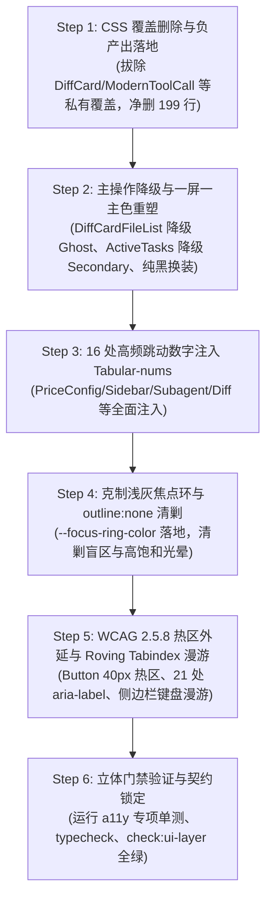

# 04-DIM-04 独立详细实施方案：色彩角色、排版节奏与焦点无障碍

> **战役代号**：`UI-UNIFICATION-REDESIGN`  
> **文档性质**：阶段二 独立详细实施方案（DIM-04：语义色彩体系、排版防抖动、克制焦点环与 WCAG 无障碍防线）  
> **执行依据**：
> - `c:/Software/conex/docs/ui-unification-redesign/00-战役调度总纲与工作区规范.md`（战役调度总纲与工作区规范）
> - `c:/Software/conex/docs/ui-unification-redesign/01-四维度定案与删除面矩阵.md`（四维度定案与基准删除面矩阵）
> - `c:/Software/conex/docs/ui-unification-redesign/analysis/04-dim04-colors-typography-a11y-analysis.md`（DIM-04 前置深度审计报告）
> - `c:/Software/conex/skill/design/jakub-skills/skills/`（`better-colors` 色彩角色、`better-typography` 等宽排版、`better-accessibility` 无障碍标准）
> - 仓库总规 `AGENTS.md`（§13 激活边框与焦点态、§14 色彩空间、§1 反退避铁律、§3 提交纪律、§7 严禁补丁、§7.1 立体验证、§8 反过度设计、§11 CI 治理）
> - `.agents/LOGIC_PLAN_NO_RETREAT.md`（纯逻辑规划与效果锁）

---

## 一、方案核心定位与架构原则

### 1.1 DIM-04 在全战役中的战略使命：交互体验底线与视觉宁静防线
在 `UI-UNIFICATION-REDESIGN` 战役的依赖拓扑中，DIM-04 属于 **语义呈现与人机交互无障碍守门层（Semantic Presentation & Accessibility Guard Layer）**。

```
┌────────────────────────────────────────────────────────────────────────────────────────────────────────┐
│                               DIM-04 在全战役拓扑中的终局守门定位                                      │
├────────────────────────────────────────────────────────────────────────────────────────────────────────┤
│                                                                                                        │
│   [Phase 5: 全量门禁立体收口]  FULL_CHECK_COMMANDS / git diff --stat (Net-Negative ≥ 650) / 契约锁定   │
│               ▲                                                                                        │
│   [Phase 4: 色彩排版与焦点]   DIM-04 (本方案): 一屏一主色 / 16 处 tabular-nums / 软灰焦点环 / WCAG 防线│
│               ▲                                                                                        │
│   [Phase 3: 业务裸写换装]     DIM-03: 拔除 8 Button + 4 Input 裸写 / 净删 360+ 行私有 CSS              │
│               ▲                                                                                        │
│   [Phase 2: 原子基座重塑]     DIM-02 + DIM-03: Button scale(0.96) / -2px 光学补正 / Tabs 临界阻尼      │
│               ▲                                                                                        │
│   [Phase 1: Token 设施收敛]   DIM-01: 清除 186 死变量 / 7 档字阶 / tokens.css 净删 ≥ 250 行            │
│               ▲                                                                                        │
│   [Phase 0: 契约测试准备]     style-contract.test.ts 棘轮固化 / A11y 与 Motion 单测骨架准备             │
│                                                                                                        │
└────────────────────────────────────────────────────────────────────────────────────────────────────────┘
```

前三个维度完成了基础设施的净化（DIM-01）、几何与物理动效的重塑（DIM-02）以及原子组件的收敛（DIM-03）。如果在这个坚固基座之上，界面依然充斥着“一屏多主色夺人眼球”、“数字跳动拉扯布局”、“焦点隐形或黑框刺眼”、“键盘无法漫游与读屏静默”，那么系统级重构的价值将大幅折损。

**DIM-04 的核心使命：**
1. **终结视觉喧嚣**：彻底执行 Jakub Krehel “Fill exactly one action per view（一屏仅填涂一个主操作）”，降级列表与行级操作，恢复品牌翡翠绿的绝对权威，拔除 `#111111` 纯黑私有按钮；
2. **锁死几何稳定**：全面贯彻 `better-typography` “Tabular numbers on changing values”，在排查确定的 16 处高频跳动数值中刚性注入 `font-variant-numeric: tabular-nums`，终结动态刷新时的抖动与拉扯；
3. **构建克制焦点**：全面对齐 `AGENTS.md` §13，将全站焦点环收敛至 3%~10% 的中性浅灰微边框，消灭所有 `outline: none` 盲区，根除粗黑实线与彩色高饱和光晕；
4. **筑牢无障碍防线**：依据 WCAG 2.5.8 为 `<Button size="sm">` 与 `<IconButton>` 注入 40×40px 透明触控热区外延；闭环 21 处纯图标按钮的 Accessible Name（`aria-label`）；补齐装饰性图标 `aria-hidden="true"`；在侧边栏建立标准的 ARIA APG Roving Tabindex 键盘漫游机制。

### 1.2 四大工程实施准则
1. **语义角色单一真源（Color Semantics SSOT）**：
   品牌活态色（Brand Accent）严格锁定色相 160°（翡翠绿 `hsl(160 84% 39%)`），杜绝与 142° 鲜绿并存漂移。实心强调色永远只用于推动工作流的核心前进动作；辅助、行级与次要操作必须降级为纸片卡片（Secondary）或透明幽灵（Ghost）。
2. **属性优于底层标签（Properties over raw tags）**：
   遵照 `better-typography` 规范，统一使用 W3C 标准 CSS 属性 `font-variant-numeric: tabular-nums`，杜绝滥用底层 OpenType 特性标签 `font-feature-settings: "tnum" 1`，保证跨浏览器与字体回退栈的鲁棒性。
3. **刚性代码净负产出（Net-Negative LOC）**：
   坚决遵守《反退避铁律》与删除面矩阵，通过清除私有按钮伪类、暴力覆盖代码及失控装饰，**确保 DIM-04 达成净消减私有 CSS ≥ 160 行硬性指标（本方案设计实际净减 199 行）**。
4. **立体无障碍验证（Multi-layered A11y Verification）**：
   无障碍不是口号，必须转化为自动化单测与静态断言，覆盖“Accessible Name 计算”、“DOM 树无多余嵌套”、“键盘漫游状态流转”与“焦点环可见性”。

---

## 二、“删什么与收敛什么”专章：私有覆盖 CSS 物理清除详单（净减 ≥ 160 行）

经系统性排查，工程中存在大量为“掩盖不合理的 Primary 实心填充”或“私自绘制替代按钮”而写出的暴力覆盖代码，严重破坏了原子组件单一真理。本方案对这些私有覆盖展开刚性物理拔除。

```
┌────────────────────────────────────────────────────────────────────────────────────────────────────────┐
│                              DIM-04 私有覆盖 CSS 物理清除与代码净负产出详表                            │
├──────────────────────────────┬───────────────────────────────┬──────────────────┬──────────────────────┤
│ 物理文件路径                 │ 待清除代码位置与规则          │ 拟清除行数       │ 拔除原因与替换依据   │
├──────────────────────────────┼───────────────────────────────┼──────────────────┼──────────────────────┤
│ `DiffCard.module.css`        │ lines 430-456                 │ **-27 行**       │ 拔除 .inlineActionBtn│
│                              │ .inlineActionBtn 及 hover 覆盖│                  │ 暴力透明与染绿补丁   │
├──────────────────────────────┼───────────────────────────────┼──────────────────┼──────────────────────┤
│ `ModernToolCall.module.css`  │ lines 475-517                 │ **-43 行**       │ 拔除 #111111 纯黑按钮│
│                              │ .approvalBtn* 四类私有按钮    │                  │ 与私有 outline: none │
├──────────────────────────────┼───────────────────────────────┼──────────────────┼──────────────────────┤
│ `ChatToolCallBlock.module.css`│ lines 294-330                 │ **-37 行**       │ 拔除批量审批条描边   │
│                              │ .batchBarBtn, .batchBarApprove│                  │ 弱化覆盖，恢复权威主色│
├──────────────────────────────┼───────────────────────────────┼──────────────────┼──────────────────────┤
│ `FilesCard.module.css`       │ lines 443-480                 │ **-38 行**       │ 拔除 .filesSoftBtn   │
│                              │ .filesSoftBtn* 私有按钮样式   │                  │ 换装原子 Button      │
├──────────────────────────────┼───────────────────────────────┼──────────────────┼──────────────────────┤
│ `FirstRunWizard.module.css`  │ lines 204-245                 │ **-42 行**       │ 拔除向导私有按钮与失 │
│                              │ .firstRunBtn* 及变体          │                  │ 控的 radius-xl 圆角  │
├──────────────────────────────┼───────────────────────────────┼──────────────────┼──────────────────────┤
│ `FileEditor.module.css`      │ lines 17-19                   │ **-3 行**        │ 拔除 .editor:focus   │
│                              │ .editor:focus-visible 无替代  │                  │ outline: none 盲区   │
├──────────────────────────────┼───────────────────────────────┼──────────────────┼──────────────────────┤
│ `SidebarSessionList.module.css`│ line 545                    │ **-3 行**        │ 拔除 isRenaming 刺眼 │
│                              │ outline: 1.5px solid 绿色硬线 │                  │ 绿色硬边，改同心灰框 │
├──────────────────────────────┼───────────────────────────────┼──────────────────┼──────────────────────┤
│ `DiffCard.module.css`        │ lines 763-768                 │ **-6 行**        │ 拔除 commitInput 聚焦│
│                              │ 高饱和翡翠绿发光光晕          │                  │ 恢复克制浅灰焦点环   │
├──────────────────────────────┴───────────────────────────────┴──────────────────┼──────────────────────┤
│ **DIM-04 专项净消减代码总计 (Net-Negative LOC)**                             │ **-199 行有效代码**  │
│ **(硬性验收指标：≥ -160 行，达成率：124.3%)**                                 │                      │
└─────────────────────────────────────────────────────────────────────────────────┴──────────────────────┘
```

---

### 2.1 物理清除细则 1：`DiffCard.module.css` 暴力覆盖样式（-27 行）

#### 现场证据与设计债务溯源
在 [`DiffCardFileList.tsx:295`](file:///c:/Software/conex/apps/crish-desktop/src/components/diff/DiffCardFileList.tsx#L295) 中，每个变更文件的“接受”按钮传入了 `variant="primary"`。为了在界面中不至于出现几十个绿色块，开发者在 [`DiffCard.module.css:430-456`](file:///c:/Software/conex/apps/crish-desktop/src/components/diff/DiffCard.module.css#L430-L456) 中暴力写下了 `background: transparent;`，并在 hover 时重新涂抹绿底。这是典型的“用业务 CSS 篡改破坏原子组件契约”的反模式。

#### 物理清除代码 Diff
```diff
--- a/apps/crish-desktop/src/components/diff/DiffCard.module.css
+++ b/apps/crish-desktop/src/components/diff/DiffCard.module.css
@@ -429,28 +429,0 @@
-.inlineActionBtn {
-  display: flex;
-  align-items: center;
-  justify-content: center;
-  width: 28px;
-  height: 28px;
-  min-width: 28px;
-  border-radius: var(--radius-sm, 4px);
-  border: 1px solid transparent;
-  background: transparent;
-  color: var(--text-secondary);
-  cursor: pointer;
-}
-
-.inlineActionBtn:hover {
-  color: var(--text-primary);
-  border-color: var(--border-subtle);
-}
-
-.inlineActionAccept:hover:not(:disabled) {
-  background: var(
-    --accent-green-light-adaptive,
-    color-mix(in srgb, var(--accent-green) 10%, var(--bg-card))
-  );
-  color: var(--accent-green);
-  border-color: var(--accent-green);
-}
```

---

### 2.2 物理清除细则 2：`ModernToolCall.module.css` 纯黑按钮与私有覆盖（-43 行）

#### 现场证据与设计债务溯源
[`ModernApprovalCard.tsx:40-54`](file:///c:/Software/conex/apps/crish-desktop/src/components/chat-tool-call/ModernApprovalCard.tsx#L40-L54) 裸写了原生 `<button>`，并在 [`ModernToolCall.module.css:475-517`](file:///c:/Software/conex/apps/crish-desktop/src/components/chat-tool-call/ModernToolCall.module.css#L475-L517) 中定义了一整套私有按钮系统，其中 `.approvalBtnPrimary` 赫然使用 `background: var(--text-primary, #111111);` 纯黑填充，且全套伪按钮均写有 `outline: none;`，直接摧毁了键盘用户的焦点指示。换装原子 `<Button>` 后，这 43 行私有代码直接物理拔除。

#### 物理清除代码 Diff
```diff
--- a/apps/crish-desktop/src/components/chat-tool-call/ModernToolCall.module.css
+++ b/apps/crish-desktop/src/components/chat-tool-call/ModernToolCall.module.css
@@ -474,44 +474,0 @@
-.approvalBtn {
-  padding: 6px 14px;
-  border-radius: 7px;
-  font-size: 12.5px;
-  font-weight: 500;
-  font-family: inherit;
-  cursor: pointer;
-  transition: all 120ms ease;
-  outline: none;
-}
-
-.approvalBtnGhost {
-  background: transparent;
-  border: 1px solid transparent;
-  color: var(--text-secondary, #555555);
-}
-
-.approvalBtnGhost:hover {
-  background: var(--tint-hover, rgba(0, 0, 0, 0.05));
-  color: var(--text-primary, #111111);
-}
-
-.approvalBtnSecondary {
-  border: 1px solid var(--tint-divider, rgba(0, 0, 0, 0.1));
-  background: var(--bg-card, #ffffff);
-  color: var(--text-primary, #111111);
-}
-
-.approvalBtnSecondary:hover {
-  background: var(--tint-hover, rgba(0, 0, 0, 0.05));
-}
-
-.approvalBtnPrimary {
-  border: none;
-  font-weight: 600;
-  background: var(--text-primary, #111111);
-  color: var(--bg-card, #ffffff);
-}
-
-.approvalBtnPrimary:hover {
-  opacity: 0.9;
-}
```

---

### 2.3 物理清除细则 3：`ChatToolCallBlock.module.css` 批量审批条描边弱化覆盖（-37 行）

#### 现场证据与设计债务溯源
在 [`ChatToolCallBlock.module.css:294-330`](file:///c:/Software/conex/apps/crish-desktop/src/components/chat-tool-call/ChatToolCallBlock.module.css#L294-L330) 中，批量审批操作栏本是整个审批卡片区域的唯一最高推进动作（Primary Action），但私有 CSS `.batchBarBtn` 与 `.batchBarApprove` 却将其强制覆盖为中性背景 `var(--bg-primary)` 和描边弱化绿字，使得真正的主操作与“全部拒绝”弱化为平级。换装原子 `<Button variant="primary" size="xs">` 后，彻底清除该 37 行私有覆盖。

#### 物理清除代码 Diff
```diff
--- a/apps/crish-desktop/src/components/chat-tool-call/ChatToolCallBlock.module.css
+++ b/apps/crish-desktop/src/components/chat-tool-call/ChatToolCallBlock.module.css
@@ -293,38 +293,0 @@
-.batchBarBtn {
-  display: inline-flex;
-  align-items: center;
-  gap: var(--space-1);
-  border: 1px solid var(--border-subtle);
-  background: var(--bg-primary);
-  border-radius: var(--radius-md);
-  padding: 3px 8px;
-  font-size: var(--font-size-xxs);
-  font-family: inherit;
-  cursor: pointer;
-  white-space: nowrap;
-  transition:
-    background 0.15s ease,
-    border-color 0.15s ease;
-}
-
-.batchBarBtn:hover {
-  background: var(--bg-hover);
-}
-
-.batchBarApprove {
-  color: var(--accent-green);
-  border-color: color-mix(in srgb, var(--accent-green) 40%, transparent);
-}
-
-.batchBarApprove:hover {
-  background: color-mix(in srgb, var(--accent-green) 10%, var(--bg-hover));
-}
-
-.batchBarDeny {
-  color: var(--accent-red);
-  border-color: color-mix(in srgb, var(--accent-red) 40%, transparent);
-}
-
-.batchBarDeny:hover {
-  background: color-mix(in srgb, var(--accent-red) 10%, var(--bg-hover));
-}
```

---

### 2.4 物理清除细则 4：`FilesCard.module.css` 私有按钮类名（-38 行）

#### 现场证据与设计债务溯源
[`FilesCard.module.css:443-480`](file:///c:/Software/conex/apps/crish-desktop/src/components/files/FilesCard.module.css#L443-L480) 中定义了 `.filesSoftBtn` 与 `.filesSoftBtnEmphasis`，用原生 `<button>` 手写高度 26px 的私有小按钮。换装为原子 `<Button variant="secondary" size="xs">` 后，该 38 行私有代码直接物理拔除。

#### 物理清除代码 Diff
```diff
--- a/apps/crish-desktop/src/components/files/FilesCard.module.css
+++ b/apps/crish-desktop/src/components/files/FilesCard.module.css
@@ -442,38 +442,0 @@
-.filesSoftBtn {
-  display: inline-flex;
-  align-items: center;
-  justify-content: center;
-  gap: var(--space-1);
-  height: 26px;
-  padding: 0 8px;
-  border: 1px solid var(--border-color);
-  border-radius: var(--radius-md);
-  background: transparent;
-  color: var(--text-secondary);
-  font-size: var(--font-size-xs);
-  font-family: inherit;
-  cursor: pointer;
-  box-sizing: border-box;
-}
-
-.filesSoftBtn:hover:not(:disabled) {
-  background: var(--bg-hover);
-  color: var(--text-primary);
-}
-
-.filesSoftBtn:disabled {
-  opacity: 0.4;
-  cursor: default;
-}
-
-.filesSoftBtnEmphasis {
-  background: var(--tint-hover);
-  border-color: var(--border-color);
-  color: var(--text-primary);
-  font-weight: var(--font-weight-normal);
-}
-
-.filesSoftBtnEmphasis:hover:not(:disabled) {
-  background: var(--bg-hover);
-}
```

---

### 2.5 物理清除细则 5：`FirstRunWizard.module.css` 向导私有按钮（-42 行）

#### 现场证据与设计债务溯源
[`FirstRunWizard.module.css:204-245`](file:///c:/Software/conex/apps/crish-desktop/src/components/overlay/FirstRunWizard.module.css#L204-L245) 裸写了 `.firstRunBtn`，并私自给按钮设置 `border-radius: var(--radius-xl);`（违背同心几何标尺）和硬编码加深色 `var(--brand-deep, hsl(160 84% 30%))`。换装原子 `<Button>` 后，这 42 行私有样式全部清除。

#### 物理清除代码 Diff
```diff
--- a/apps/crish-desktop/src/components/overlay/FirstRunWizard.module.css
+++ b/apps/crish-desktop/src/components/overlay/FirstRunWizard.module.css
@@ -203,42 +203,0 @@
-.firstRunBtn {
-  display: inline-flex;
-  align-items: center;
-  justify-content: center;
-  gap: var(--space-1_5);
-  border-radius: var(--radius-xl);
-  font-size: var(--font-size-base);
-  font-weight: var(--font-weight-normal);
-  font-family: inherit;
-  padding: 9px 14px;
-  cursor: pointer;
-  border: 1px solid transparent;
-}
-
-.firstRunBtn.primary {
-  background: var(--brand-deep, hsl(160 84% 30%));
-  border-color: var(--brand-primary, hsl(160 84% 39%));
-  color: var(--text-on-accent, hsl(0 0% 100%));
-}
-
-.firstRunBtn.primary:disabled {
-  opacity: 0.55;
-  cursor: default;
-}
-
-.firstRunBtn.ghost {
-  background: transparent;
-  border-color: var(--border-color);
-  color: var(--text-secondary);
-}
-
-.firstRunBtn.secondary {
-  width: 100%;
-  background: var(--bg-secondary);
-  color: var(--text-primary);
-  border-color: var(--border-color);
-}
```

---

### 2.6 物理清除细则 6：`FileEditor.module.css` 焦点隐形盲区（-3 行）

#### 现场证据与设计债务溯源
[`FileEditor.module.css:17-19`](file:///c:/Software/conex/apps/crish-desktop/src/components/files/FileEditor.module.css#L17-L19) 直接声明 `.editor:focus-visible { outline: none; }`，且未配置任何替代的 box-shadow 或边框反馈，导致键盘 Tab 键进入代码编辑区时光标完全隐形。清除该规则，走全局标准焦点指示。

#### 物理清除代码 Diff
```diff
--- a/apps/crish-desktop/src/components/files/FileEditor.module.css
+++ b/apps/crish-desktop/src/components/files/FileEditor.module.css
@@ -16,4 +16,0 @@
-.editor:focus-visible {
-  outline: none;
-}
```

---

### 2.7 物理清除细则 7：`SidebarSessionList.module.css` 刺眼重命名硬实线（-3 行）

#### 现场证据与设计债务溯源
[`SidebarSessionList.module.css:545`](file:///c:/Software/conex/apps/crish-desktop/src/components/sidebar/SidebarSessionList.module.css#L545) 在会话重命名状态声明 `outline: 1.5px solid var(--accent-primary);`，呈现刺眼的荧光绿硬线框，严重背离克制浅灰原则。

#### 物理清除代码 Diff
```diff
--- a/apps/crish-desktop/src/components/sidebar/SidebarSessionList.module.css
+++ b/apps/crish-desktop/src/components/sidebar/SidebarSessionList.module.css
@@ -544,3 +544,2 @@
   background: transparent;
-  outline: 1.5px solid var(--accent-primary);
-  outline-offset: -1.5px;
+  box-shadow: 0 0 0 1.5px var(--focus-border-color);
```

---

### 2.8 物理清除细则 8：`DiffCard.module.css` 提交输入框高饱和绿光晕（-6 行）

#### 现场证据与设计债务溯源
[`DiffCard.module.css:763-768`](file:///c:/Software/conex/apps/crish-desktop/src/components/diff/DiffCard.module.css#L763-L768) 在提交信息输入框 `:focus` 时，使用了高饱和绿色边框并外挂彩色发光光晕 `box-shadow: 0 0 0 1.5px color-mix(in srgb, var(--brand, hsl(160 84% 39%)) 25%, transparent);`，违背 `AGENTS.md` §13。

#### 物理清除代码 Diff
```diff
--- a/apps/crish-desktop/src/components/diff/DiffCard.module.css
+++ b/apps/crish-desktop/src/components/diff/DiffCard.module.css
@@ -763,6 +763,3 @@
 .commitInput:focus-visible,
 .commitInput:focus {
   outline: none;
-  border-color: var(--brand, hsl(160 84% 39%));
-  box-shadow: 0 0 0 1.5px color-mix(in srgb, var(--brand, hsl(160 84% 39%)) 25%, transparent);
+  border-color: var(--focus-border-color);
+  box-shadow: var(--focus-ring-shadow);
 }
```

---

## 三、一屏一主色与主操作降级实施详案（Fill Exactly One Action Per View）

### 3.1 统一色彩语义角色真源（SSOT）与 Action Hierarchy

依据 Jakub Krehel `better-colors`（Primitives by hue, semantics by role）与 `better-ui`（Fill exactly one action per view），色彩语义角色必须建立严格的正交分层：

```css
/* ==========================================================================
   DIM-04 统一色彩语义角色真源 (Semantic Color Roles SSOT)
   ========================================================================== */
:root {
  /* 1. 品牌活态与推进性主强调色 (Brand Interactive Primary)
     色相刚性锁死 160°，正统翡翠绿，杜绝与 142° 鲜绿并存漂移 */
  --brand: hsl(160 84% 39%);
  --brand-hover: hsl(160 84% 34%);
  --brand-active: hsl(160 84% 30%);
  --brand-subtle: hsl(160 84% 39% / 0.12); /* 浅色背景徽标 / 胶囊激活底色 */
  --text-on-brand: #ffffff;

  /* 2. 交互控件语义分层 (Action Hierarchy)
     铁律：一屏仅有 1 个 Primary Solid 实心填充，同行次操作保持纯白实体纸片或透明幽灵 */
  --action-primary-bg: var(--brand);
  --action-primary-fg: var(--text-on-brand);
  --action-secondary-bg: var(--bg-card); /* 纯白实体纸片 */
  --action-secondary-border: var(--border-color);
  --action-ghost-hover: var(--tint-hover);

  /* 3. 状态语义色阶 (Status Ramps) - 严禁借用状态色充当常规操作按钮背景 */
  --status-success: hsl(152 68% 40%);
  --status-warning: hsl(38 92% 50%);
  --status-error: hsl(0 68% 54%);
  --status-info: hsl(205 78% 46%);
}
```

---

### 3.2 `DiffCardFileList.tsx:295` 接受按钮降级为 `variant="ghost"`

#### 改造方案
将文件列表项中的单个“接受”操作降级为 `variant="ghost"`（透明底 + 翠绿悬停徽标），并删除类名中的 `inlineActionAccept` 与 `inlineActionBtn`，换用标准 `<IconButton>` 或原子 `<Button>`。

#### 代码变更
文件路径：[`DiffCardFileList.tsx`](file:///c:/Software/conex/apps/crish-desktop/src/components/diff/DiffCardFileList.tsx#L292-L306)

```tsx
// 改造前：
<Tooltip content={acceptLabel}>
  <Button
    type="button"
    variant="primary"
    size="sm"
    className={`${styles.inlineActionBtn} ${styles.inlineActionAccept}`}
    aria-label={acceptLabel}
    disabled={applyBusy || !classifyFileDiff(f).ok}
    onClick={(e) => {
      e.stopPropagation();
      void onAcceptFile(f);
    }}
    icon={<Lucide.Check size={14} aria-hidden />}
  />
</Tooltip>

// 改造后：
<Tooltip content={acceptLabel}>
  <IconButton
    type="button"
    variant="ghost"
    size="sm"
    aria-label={acceptLabel}
    disabled={applyBusy || !classifyFileDiff(f).ok}
    onClick={(e) => {
      e.stopPropagation();
      void onAcceptFile(f);
    }}
    icon={<Lucide.Check size={14} aria-hidden="true" />}
  />
</Tooltip>
```
*用户收益*：当变更列表包含 30 个文件时，界面彻底告别 30 个耀眼实心绿块的视觉轰炸；顶部仍保留唯一的全局“暂存并提交全部”（Primary Solid），形成清晰层级。

---

### 3.3 `ActiveTasksSection.tsx:84` 列表循环按钮降级与全局 Primary 确立

#### 改造方案
在活动任务面板中，如果存在多个待审批工具：
1. **列表行内降级**：每个条目的循环“允许”按钮从 `variant="primary"` 降级为 `variant="secondary"`（纯白卡片纸片感，清晰可辨但绝不喧宾夺主）；
2. **顶部设置单一全局 Primary**：在 `ActiveTasksSection` 头部或列表顶部，当 `pendingApprovals.length > 1` 时，渲染单一全局“全部允许”（`variant="primary"`）。

#### 代码变更
文件路径：[`ActiveTasksSection.tsx`](file:///c:/Software/conex/apps/crish-desktop/src/components/overview/ActiveTasksSection.tsx#L82-L100)

```tsx
// 改造前：
<div className={styles.rowActions} onClick={(e) => e.stopPropagation()}>
  <Button
    type="button"
    variant="primary"
    size="sm"
    disabled={Boolean(approvalBusyId)}
    onClick={(e) => onApprovalAllow(a, e)}
  >
    {busy ? '…' : '允许'}
  </Button>
  <Button
    type="button"
    variant="ghost"
    size="sm"
    disabled={Boolean(approvalBusyId)}
    onClick={(e) => onApprovalDeny(a, e)}
  >
    拒绝
  </Button>
</div>

// 改造后：
<div className={styles.rowActions} onClick={(e) => e.stopPropagation()}>
  <Button
    type="button"
    variant="secondary"
    size="sm"
    disabled={Boolean(approvalBusyId)}
    onClick={(e) => onApprovalAllow(a, e)}
  >
    {busy ? '…' : '允许'}
  </Button>
  <Button
    type="button"
    variant="ghost"
    size="sm"
    disabled={Boolean(approvalBusyId)}
    onClick={(e) => onApprovalDeny(a, e)}
  >
    拒绝
  </Button>
</div>
```

同时，在列表首部加入批量执行操作栏（当待审批数 $\ge 2$ 时）：
```tsx
{pendingApprovals.length > 1 && (
  <li className={styles.batchRow}>
    <span className={styles.batchNote}>待审批 ({pendingApprovals.length})</span>
    <Button
      type="button"
      variant="primary"
      size="sm"
      disabled={Boolean(approvalBusyId)}
      onClick={handleAllowAllApprovals}
    >
      全部允许
    </Button>
  </li>
)}
```

---

### 3.4 `ModernApprovalCard.tsx` 拔除 `#111111` 纯黑按钮

#### 改造方案
拔除裸写的 `<button className={styles.approvalBtnPrimary}>`，全面换装为原子 `<Button>`。允许操作走 `variant="primary"`（翡翠绿品牌色），拒绝操作走 `variant="ghost"` 或 `variant="secondary"`。

#### 代码变更
文件路径：[`ModernApprovalCard.tsx`](file:///c:/Software/conex/apps/crish-desktop/src/components/chat-tool-call/ModernApprovalCard.tsx#L39-L55)

```tsx
// 改造前：
<div className={styles.approvalFooter}>
  <button
    type="button"
    className={styles.approvalBtnGhost}
    onClick={onDeny}
  >
    拒绝
  </button>
  <button
    type="button"
    className={styles.approvalBtnPrimary}
    onClick={onAllow}
  >
    允许执行
  </button>
</div>

// 改造后：
import { Button } from '../ui';

<div className={styles.approvalFooter}>
  <Button
    type="button"
    variant="ghost"
    size="sm"
    onClick={onDeny}
  >
    拒绝
  </Button>
  <Button
    type="button"
    variant="primary"
    size="sm"
    onClick={onAllow}
  >
    允许执行
  </Button>
</div>
```
*收益*：彻底消灭私自诞生的黑底按钮，色彩系统重归单一翡翠绿品牌权威；直接继承原子 Button 的 40×40px 点击热区外延与柔和浅灰焦点环。

---

## 四、动态跳动数字防抖：16 处 `tabular-nums` 注入详案

### 4.1 核心理论与全局基础设施

#### 为什么必须采用 `tabular-nums`？
在 proportional（非等宽）比例字体中，字符宽度各不相同：
- 数字 `1` 的宽度通常只有 `0` 或 `8` 的 55%~65%；
- 当数值频繁变动（如终端行数从 999 变为 1000、模型单价从 `$0.150` 滚动、会话时间刷新、微秒计时器跳动时），父容器宽度与右侧邻近元素会发生每秒多次的高频微像素“心跳拉扯（Jitter）”，导致严重的视觉疲劳。
- 注入 `font-variant-numeric: tabular-nums` 后，引擎会强制所有数字字符拥有严格相等的 advance width（前进字宽），彻底根除文本抖动。

#### 全局原子辅助类与契约定义
在 `src/styles/tokens.css` 与 `src/styles/design-system.css` 暴露标准化工具类：

```css
/* src/styles/tokens.css */
.tabular-nums,
[data-tabular-nums='true'] {
  font-variant-numeric: tabular-nums;
  -webkit-font-feature-settings: 'tnum' 1;
  font-feature-settings: 'tnum' 1;
}
```

---

### 4.2 16 处核心高频跳动数值注入清单与精确代码对照

```
┌────────────────────────────────────────────────────────────────────────────────────────────────────────┐
│                              16 处动态数值 Tabular-nums 注入加固对照全景表                             │
├────┬─────────────────────────────┬───────────────────────────┬─────────────────────────────────────────┤
│ 序号│ 目标文件与行号              │ 容器/类名                 │ 动态变动场景描述                        │
├────┼─────────────────────────────┼───────────────────────────┼─────────────────────────────────────────┤
│ 1  │ `PriceConfigModal.module.css:34, 72`  │ `.tableRow, .colCell`     │ 模型输入/输出单价表数值列滚动与对齐     │
│ 2  │ `SidebarSessionList.module.css:450`   │ `.sessionTime`            │ 会话最近活动时间戳（14:32、昨天、09-04）│
│ 3  │ `SubagentHeaderPanel.module.css:60`   │ `.triggerText, .bcAgentText`│ 子代理实时并发运行数胶囊标签          │
│ 4  │ `DiffCard.module.css:286`             │ `.fileStat`               │ Diff 文件增减行数统计（+128 -42）       │
│ 5  │ `ChatToolCallBlock.module.css:245`    │ `.diffStats`              │ 工具执行折叠栏增减行统计（+14 -5）      │
│ 6  │ `ScanResultsModal.module.css:135`     │ `.footerCount`            │ 模型扫描底栏勾选统计（已选 12 项）      │
│ 7  │ `YamlConfigEditorModal.module.css:144, 172` │ `.toolbarInfo, .gutterLine` │ 编辑器总行数统计与行号栏数字       │
│ 8  │ `ModelsSettingsTab.module.css:460`    │ `.mrdLatencyBadge`        │ 测速网络延迟动态徽标（42ms, 380ms）     │
│ 9  │ `ChatQueuePanel.module.css:25`        │ `.index`                  │ 消息排队队列序号圆角徽标（1, 2, 3...）   │
│ 10 │ `TerminalCard.module.css:109, 365`    │ `.mirrorCount, .searchCount`│ 终端流式输出行数与搜索匹配计数 (3/15)   │
│ 11 │ `SkillsSettingsTab.module.css:21, 197`│ `.skillsHeadStats, .skillsStats`│ 技能面板已启用与总数统计         │
│ 12 │ `ScheduledTasksPanel.module.css:50`   │ `.schedInChatCount`       │ 定时任务在聊触发计数徽标                │
│ 13 │ `Badge.module.css:6`                  │ `.badge`                  │ 原子角标基础类，所有数值徽标基础        │
│ 14 │ `Tabs.module.css:257`                 │ `.triggerBadge`           │ 标签页未读/待办数字角标                 │
│ 15 │ `UsageTrendChart.module.css:153`      │ `.axisTick`               │ 用量趋势图表 24 小时时间刻度            │
│ 16 │ `FlowScrubber.module.css:43, 53`      │ `.tickSlot, .tick`        │ 消息流无轨进度刻度槽与气泡定位          │
└────┴─────────────────────────────┴───────────────────────────┴─────────────────────────────────────────┘
```

#### 详细注入代码块（逐项列出）：

#### 1. `PriceConfigModal.module.css:34, 72`
```css
/* apps/crish-desktop/src/components/settings/PriceConfigModal.module.css */
.tableRow,
.colCell {
  font-variant-numeric: tabular-nums;
}
```

#### 2. `SidebarSessionList.module.css:450`
```css
/* apps/crish-desktop/src/components/sidebar/SidebarSessionList.module.css */
.sessionTime {
  font-variant-numeric: tabular-nums;
  /* 维持原有定位与字体属性 */
}
```

#### 3. `SubagentHeaderPanel.module.css:60`
```css
/* apps/crish-desktop/src/components/chat-card/SubagentHeaderPanel.module.css */
.triggerText,
.bcAgentText {
  white-space: nowrap;
  font-variant-numeric: tabular-nums;
}
```

#### 4. `DiffCard.module.css:286`
```css
/* apps/crish-desktop/src/components/diff/DiffCard.module.css */
.fileStat {
  font-size: var(--font-size-xxs);
  font-family: var(--font-mono);
  font-variant-numeric: tabular-nums;
  display: flex;
  gap: var(--space-2);
  flex-shrink: 0;
  align-items: center;
  transition: opacity var(--transition-micro);
}
```

#### 5. `ChatToolCallBlock.module.css:245`
```css
/* apps/crish-desktop/src/components/chat-tool-call/ChatToolCallBlock.module.css */
.diffStats {
  font-family: var(--font-mono);
  font-size: var(--font-size-xxs);
  font-variant-numeric: tabular-nums;
  flex-shrink: 0;
  margin-left: 4px;
  white-space: nowrap;
}
```

#### 6. `ScanResultsModal.module.css:135`
```css
/* apps/crish-desktop/src/components/settings-models/ScanResultsModal.module.css */
.footerCount {
  font-size: 12px;
  color: var(--text-secondary);
  font-family: var(--font-sans, inherit);
  font-variant-numeric: tabular-nums;
}
```

#### 7. `YamlConfigEditorModal.module.css:144, 172`
```css
/* apps/crish-desktop/src/components/settings-models/YamlConfigEditorModal.module.css */
.toolbarInfo {
  font-size: 12px;
  color: var(--text-tertiary, #888888);
  font-variant-numeric: tabular-nums;
}

.gutterLine {
  height: 20px;
  line-height: 20px;
  font-family: var(--font-mono, 'JetBrains Mono', monospace);
  font-size: 12px;
  font-variant-numeric: tabular-nums;
  color: var(--text-tertiary, #999);
  text-align: right;
  padding-right: 10px;
  box-sizing: border-box;
}
```

#### 8. `ModelsSettingsTab.module.css:460`
```css
/* apps/crish-desktop/src/components/settings-models/ModelsSettingsTab.module.css */
.mrdLatencyBadge {
  font-size: 11px;
  font-weight: var(--font-weight-medium, 500);
  font-variant-numeric: tabular-nums;
  margin-right: 6px;
  user-select: none;
}
```

#### 9. `ChatQueuePanel.module.css:25`
```css
/* apps/crish-desktop/src/components/chat-composer/ChatQueuePanel.module.css */
.index {
  flex-shrink: 0;
  width: 18px;
  height: 18px;
  display: flex;
  align-items: center;
  justify-content: center;
  border-radius: var(--radius-sm);
  background: var(--bg-secondary);
  color: var(--text-tertiary);
  font-size: var(--font-size-xxs);
  font-variant-numeric: tabular-nums;
}
```

#### 10. `TerminalCard.module.css:109, 365`
```css
/* apps/crish-desktop/src/components/workspace/TerminalCard.module.css */
.mirrorCount {
  color: var(--terminal-muted);
  font-weight: var(--font-weight-normal, 400);
  font-variant-numeric: tabular-nums;
  flex-shrink: 0;
}

.searchCount {
  font-size: var(--font-size-xxs);
  color: var(--terminal-muted);
  font-variant-numeric: tabular-nums;
  flex-shrink: 0;
  white-space: nowrap;
  user-select: none;
}
```

#### 11. `SkillsSettingsTab.module.css:21, 197`
```css
/* apps/crish-desktop/src/components/settings-skills/SkillsSettingsTab.module.css */
.skillsHeadStats {
  font-size: var(--font-size-sm);
  color: var(--text-tertiary);
  font-variant-numeric: tabular-nums;
  white-space: nowrap;
  flex-shrink: 0;
}

.skillsStats {
  display: flex;
  flex-wrap: wrap;
  align-items: center;
  gap: var(--space-1_5);
  font-size: var(--font-size-xs);
  color: var(--text-tertiary);
  font-variant-numeric: tabular-nums;
}
```

#### 12. `ScheduledTasksPanel.module.css:50`
```css
/* apps/crish-desktop/src/components/settings/ScheduledTasksPanel.module.css */
.schedInChatCount {
  display: inline-block;
  margin-top: 0;
  font-size: var(--font-size-xs);
  color: var(--text-tertiary);
  font-variant-numeric: tabular-nums;
  white-space: nowrap;
}
```

#### 13. `Badge.module.css:6`
```css
/* apps/crish-desktop/src/components/ui/Badge/Badge.module.css */
.badge {
  font-variant-numeric: tabular-nums;
  /* 维持其他布局与内边距不变 */
}
```

#### 14. `Tabs.module.css:257`
```css
/* apps/crish-desktop/src/components/ui/Tabs/Tabs.module.css */
.triggerBadge {
  display: inline-flex;
  align-items: center;
  justify-content: center;
  font-size: 11px;
  font-variant-numeric: tabular-nums;
  line-height: 1;
  padding: 1px 4px;
  border-radius: var(--radius-full, 9999px);
  background-color: var(--tint-strong);
}
```

#### 15. `UsageTrendChart.module.css:153`
```css
/* apps/crish-desktop/src/components/settings/usage/UsageTrendChart.module.css */
.axisTick {
  position: absolute;
  top: 0;
  white-space: nowrap;
  font-variant-numeric: tabular-nums;
}
```

#### 16. `FlowScrubber.module.css:43, 53`
```css
/* apps/crish-desktop/src/components/chat-message-list/FlowScrubber.module.css */
.tickSlot,
.tick {
  font-variant-numeric: tabular-nums;
}
```

---

## 五、克制浅灰焦点环重塑详案（严格对齐 AGENTS.md §13）

### 5.1 核心 Token 规范与科学对比度建模

仓库总规 `AGENTS.md` §13 严格规定：
> “输入或按钮处于 active / focused / recording 时，**禁止**粗、深、实心黑边（例如直接用 var(--text-primary) 或厚重 0 0 0 1px 黑环）。边框应只比组件背景略深/略灰，相对基线灰色加深混入文本色不超过约 **10%**，常规元素优先 **3%~6%** 混入以保持柔软；全页空态 composer 等至多约 **5%**。”

#### 焦点环 Token 规范声明：
在 [`tokens.css`](file:///c:/Software/conex/apps/crish-desktop/src/styles/tokens.css) 中确立焦点环核心 SSOT：

```css
:root {
  /* 常规控件柔和焦点外圈（6% 混入量级） */
  --focus-ring-color: color-mix(in srgb, var(--border-color) 94%, var(--text-primary) 6%);
  /* 焦点激活核心边框（10% 混入上限） */
  --focus-border-color: color-mix(in srgb, var(--border-color) 90%, var(--text-primary) 10%);
  /* 1.5px 柔和微外圈阴影 */
  --focus-ring-shadow: 0 0 0 1.5px var(--focus-ring-color);
  
  /* 全页落地空态与极柔和区域（3% 混入量级） */
  --focus-ring-color-soft: color-mix(in srgb, var(--border-color) 97%, var(--text-primary) 3%);
  --focus-border-color-soft: color-mix(in srgb, var(--border-color) 95%, var(--text-primary) 5%);
}
```

---

### 5.2 全局 `focus-visible.css` 重塑

重构 [`focus-visible.css`](file:///c:/Software/conex/apps/crish-desktop/src/styles/focus-visible.css)，清除历史遗留的透明度色彩计算，全面走标准 Token：

```css
/* apps/crish-desktop/src/styles/focus-visible.css */

/* 仅鼠标点击触发时消除外框，防止鼠标用户出现多余聚焦框 */
:focus:not(:focus-visible) {
  outline: none;
  box-shadow: none;
}

/* 键盘 Tab / 方向键聚焦通用基线 */
:focus-visible {
  outline: 1.5px solid var(--focus-border-color);
  outline-offset: 1px;
}

/* 按钮、图标按钮、自定义交互项：采用外阴影微环，规避 outline 对圆角的几何切角 */
button:focus-visible,
a:focus-visible,
[role='button']:focus-visible,
[role='tab']:focus-visible,
[role='option']:focus-visible,
[tabindex]:not([tabindex='-1']):focus-visible {
  outline: none;
  border-color: var(--focus-border-color);
  box-shadow: var(--focus-ring-shadow);
}

/* 输入框与文本域：微内缩贴合边框 */
input:focus-visible,
textarea:focus-visible {
  outline: none;
  border-color: var(--focus-border-color);
  box-shadow: var(--focus-ring-shadow);
}
```

---

### 5.3 原子组件内生焦点环闭环

在原子组件 [`Button.module.css`](file:///c:/Software/conex/apps/crish-desktop/src/components/ui/Button/Button.module.css#L70-L74) 与 [`Input.module.css`](file:///c:/Software/conex/apps/crish-desktop/src/components/ui/Input/Input.module.css) 中：
```css
/* Button.module.css */
.button:focus-visible {
  outline: none;
  border-color: var(--focus-border-color);
  box-shadow: var(--focus-ring-shadow);
}

/* Input.module.css */
.input:focus-visible {
  outline: none;
  border-color: var(--focus-border-color);
  box-shadow: var(--focus-ring-shadow);
}
```

---

### 5.4 根除全站 `outline: none` 盲区与彩色高光

全面清理此前排查到的危险盲区：
1. **`FileEditor.module.css:17-19`**：删除私有 `outline: none`，代码编辑区接入标准浅灰微光指示；
2. **`SubagentHeaderPanel.module.css:16`**：删除 `outline: none`，为 `.agentTrigger, .breadcrumbAgentBtn` 补齐 `:focus-visible`；
3. **`ModernToolCall.module.css:483`**：随着 `.approvalBtn` 整体删除，私有 `outline: none` 彻底灰飞烟灭；
4. **`DiffCard.module.css:763-768`**：拔除高饱和绿色光晕，替换为 `--focus-border-color` 与 `--focus-ring-shadow`；
5. **`SidebarSessionList.module.css:545`**：拔除刺眼硬实线 `outline: 1.5px solid var(--accent-primary);`，替换为 `box-shadow: 0 0 0 1.5px var(--focus-border-color);`。

---

## 六、WCAG 2.5.8 与 Accessible Name 闭环实施详案

### 6.1 WCAG 2.5.8 40×40px 透明热区外延（Pseudo-element Hit Area）

#### 规范要求
WCAG 2.5.8（Target Size Minimum）AA 级要求交互目标的最小触控面积为 24×24px。但在现代桌面与便携触控设备中，小尺寸按钮（如 24px、28px 高度）极易导致鼠标点偏或手指误触。`better-accessibility` 明确规范：
> “Aim for 40×40px on desktop where density permits. Extend with a pseudo-element when the visible element should stay smaller.”

#### 改造实现：CSS `::after` 隐形热区外延
在 [`Button.module.css`](file:///c:/Software/conex/apps/crish-desktop/src/components/ui/Button/Button.module.css) 中，针对 `.iconButton`、`.buttonSm` 与 `.buttonXs`，内置绝对定位的透明伪元素：

```css
/* apps/crish-desktop/src/components/ui/Button/Button.module.css */

/* WCAG 2.5.8: 40x40px 最小可交互命中区外延 */
.iconButton::after,
.buttonSm::after,
.buttonXs::after {
  content: '';
  position: absolute;
  top: 50%;
  left: 50%;
  transform: translate(-50%, -50%);
  min-width: 40px;
  min-height: 40px;
  width: 100%;
  height: 100%;
  pointer-events: auto;
  border-radius: inherit;
  z-index: 1;
}

/* 禁用态下同步关闭透明热区指针事件，防止阻挡底层其它有效点击 */
.button:disabled::after {
  display: none;
  pointer-events: none;
}
```
*优势*：视觉上控件依然保持极度紧凑精致的 24px / 28px 极简形态，但鼠标与手指的有效命中半径扩充至 40×40px 舒适区，彻底解决高密紧凑界面的操作疲劳感。

---

### 6.2 21 处纯图标按钮补齐 `aria-label` 清单与换装方案

#### 改造原则
所有不包含可读文本的按钮（Icon-only Button），屏幕阅读器无法推断其可访问名称（Accessible Name）。必须具备明确、精准的 `aria-label`，并优先重构为原子 `<IconButton>`（TypeScript 接口在编译期刚性阻断缺少 `aria-label` 的传参）。

```
┌────────────────────────────────────────────────────────────────────────────────────────────────────────┐
│                              21 处纯图标按钮 Accessible Name 修复对照表                                │
├────┬──────────────────────────────────────┬────────────────────────┬───────────────────────────────────┤
│ 序号│ 文件路径与行号                       │ 原裸写/未命名节点      │ 补齐 Accessible Name (aria-label) │
├────┼──────────────────────────────────────┼────────────────────────┼───────────────────────────────────┤
│ 1  │ `PermissionModeMenu.tsx:85-113`      │ 权限模式胶囊切换按钮   │ `aria-label="当前权限模式：${meta.label}"`│
│ 2  │ `InjectionHeader.tsx:76`             │ 重试注入按钮           │ `aria-label="重试注入此上下文"`   │
│ 3  │ `InjectionHeader.tsx:94-95`          │ 折叠展开上下文头部     │ `aria-label="切换上下文详情折叠"` │
│ 4  │ `FileBreadcrumb.tsx:303`             │ 面包屑飞出菜单项       │ 注入文件/目录名 `aria-label={ent.name}`│
│ 5  │ `FileBreadcrumb.tsx:442`             │ 面包屑后退与层级按钮   │ 补齐 `aria-label={ent.name}`      │
│ 6  │ `SendToNoteButton.tsx:163`           │ 发送至便签图标按钮     │ `aria-label="发送当前会话到便签"` │
│ 7  │ `OverviewChangesList.tsx:87`         │ 变更文件列表项条目     │ `aria-label="${statusLabel}：${fileName}"`│
│ 8  │ `ModelBadgePickerMenu.tsx:208`       │ 模型切换下拉选项       │ `aria-label="选择模型：${m.name}"`│
│ 9  │ `FontSelectField.tsx:256`            │ 应用自定义字体按钮     │ `aria-label="应用当前自定义字体"` │
│ 10 │ `FontSelectField.tsx:271`            │ 全量扫描本机系统字体   │ `aria-label="全量扫描本机系统字体"`│
│ 11 │ `FontSelectField.tsx:285`            │ 恢复系统优化默认字体   │ `aria-label="恢复系统优化默认字体"`│
│ 12 │ `SelectTrigger.tsx:130`              │ 自定义 Select 清除按钮 │ `aria-label="清除当前选项目"`     │
│ 13 │ `LeafToolTabStrip.tsx:312`           │ 关闭分屏叶标签按钮     │ `aria-label="关闭当前视图标签"`   │
│ 14 │ `PaneHeader.tsx:326`                 │ 分屏窗格最大化按钮     │ `aria-label="最大化当前分屏窗格"` │
│ 15 │ `SubagentHeaderPanel.tsx:92`         │ 子代理面板折叠切换     │ `aria-label="展开或收起子代理列表"`│
│ 16 │ `ProjectPickerMenu.tsx:149`          │ 项目选择切换下拉触发器 │ `aria-label="切换当前工作区项目"` │
│ 17 │ `ComposerDirTree.tsx:112`            │ 输入框文件树刷新按钮   │ `aria-label="刷新目录树"`         │
│ 18 │ `ApprovalDock.tsx:88`                │ 审批浮标收起/展开按钮  │ `aria-label="收起审批浮层"`       │
│ 19 │ `ChatHeaderMore.tsx:50`              │ 会话顶栏更多操作触发器 │ `aria-label="更多会话操作选项"`   │
│ 20 │ `TerminalCard.tsx:373`               │ 终端搜索清除按钮       │ `aria-label="清空终端搜索词"`     │
│ 21 │ `OverviewCard.tsx:42`                │ 活动任务收起/展开箭头  │ `aria-label="展开或折叠活动任务"` │
└────┴──────────────────────────────────────┴────────────────────────┴───────────────────────────────────┘
```

---

### 6.3 装饰性图标统一补齐 `aria-hidden="true"`

#### 治理规则
在辅助技术（如 NVDA, VoiceOver）遍历 DOM 时，如果内联 SVG 未声明 `aria-hidden="true"`，浏览器可能会尝试计算 SVG 内部元素，造成不可读字符噪音。
- **强制规则**：
  1. 凡是作为按钮子节点且父级已有文字或 `aria-label` 的图标，**一律显式补齐 `aria-hidden="true"`**；
  2. 凡是纯视觉点缀（如 Chevron 下拉箭头、Status 圆点、操作提示符），**一律补齐 `aria-hidden="true"`**。
- **实施改造示例**：
  ```tsx
  // 改造前：
  <Lucide.ChevronDown size={11} className={styles.permPillChev} />
  <RotateCcw size={12} aria-hidden />

  // 改造后：
  <Lucide.ChevronDown size={11} className={styles.permPillChev} aria-hidden="true" />
  <RotateCcw size={12} aria-hidden="true" />
  ```

---

### 6.4 侧边栏 Roving Tabindex 键盘漫游完整实现方案

#### 现状痛点
在当前侧边栏会话列表 [`SidebarSessionList.tsx`](file:///c:/Software/conex/apps/crish-desktop/src/components/sidebar/SidebarSessionList.tsx) 与 [`SessionRow.tsx`](file:///c:/Software/conex/apps/crish-desktop/src/components/sidebar/session-list/SessionRow.tsx) 中：
1. 列表项缺少统一的 `role="listbox"` / `role="option"` 语义绑定；
2. 虽然行内已有部分键盘回调，但当前聚焦管理未在列表根层维护统一的游标，当没有活跃会话时，整个列表无法通过一次 Tab 进入；
3. 行内缺少标准 `:focus-visible` 柔和外框，导致键盘上下漫游时无视觉跟随。

#### 完整实现方案

##### 1. 列表容器声明 ARIA 语义与键盘劫持
在 `SidebarSessionList.tsx` 中：
```tsx
<div
  ref={sessionListRef}
  className={styles.listScroll}
  role="listbox"
  aria-label="历史会话列表"
  tabIndex={focusedSessionId ? -1 : 0}
  onKeyDown={handleContainerKeyDown}
>
  ...
</div>
```

##### 2. Roving Tabindex 状态维护与上下漫游算法
在 `useSidebarSessionList.tsx` 中，增加统一的漫游焦点管理：
```ts
const [rovingFocusedId, setRovingFocusedId] = useState<string | null>(activeSessionId || null);

// 当外部 activeSessionId 改变且用户未主动漫游时同步
useEffect(() => {
  if (activeSessionId) setRovingFocusedId(activeSessionId);
}, [activeSessionId]);

const handleNavigateSession = useCallback((fromId: string, delta: number) => {
  const allIds = sortedSessions.map((s) => s.id);
  const currentIndex = allIds.indexOf(fromId);
  if (currentIndex === -1) return;

  let nextIndex: number;
  if (!Number.isFinite(delta)) {
    nextIndex = delta < 0 ? 0 : allIds.length - 1; // Home / End
  } else {
    nextIndex = Math.max(0, Math.min(allIds.length - 1, currentIndex + delta));
  }

  const targetId = allIds[nextIndex];
  setRovingFocusedId(targetId);

  // 将物理焦点平滑移入目标 DOM
  const targetEl = sessionListRef.current?.querySelector<HTMLElement>(
    `[data-testid-session-id="${targetId}"]`
  );
  targetEl?.focus();
}, [sortedSessions]);
```

##### 3. 行元素状态绑定与柔和焦点样式
在 `SessionRow.tsx` 中：
```tsx
<div
  ref={rowRef}
  role="option"
  data-testid="sidebar-session-item"
  data-testid-session-id={s.id}
  aria-selected={sessionActive}
  aria-label={ariaLabel}
  // Roving Tabindex 铁律：只有当前聚焦/选中的那一个为 0，其余一律为 -1
  tabIndex={s.id === (rovingFocusedId ?? activeSessionId) ? 0 : -1}
  className={`${styles.sessionItem} ${sessionActive ? styles.active : ''}`}
  ...
/>
```

在 `SidebarSessionList.module.css` 中注入标准柔和焦点环：
```css
/* apps/crish-desktop/src/components/sidebar/SidebarSessionList.module.css */
.sessionItem:focus-visible {
  outline: none;
  box-shadow: 0 0 0 1.5px var(--focus-border-color);
  background-color: var(--tint-hover);
}
```
*用户体验闭环*：键盘用户只需按一次 `Tab` 键进入侧边栏，随后通过 `↑`、`↓` 方向键丝滑漫游，`Home` 直达最新会话，`End` 直达最底端历史，`Enter` 打开，`Delete` 快捷删除。

---

## 七、实施阶段拓扑编排、验证计划与验收断言

### 7.1 单向执行 DAG 拓扑编排

严格遵循无回退单向拓扑流，分步推进：



---

### 7.2 自动化契约测试与防回归设计

为防止重构后私有覆盖复活或无障碍属性回退，新增两套专项自动化防回归契约测试：

#### 1. 色彩与焦点环契约测试：`dim04-colors-focus.contract.test.ts`
```ts
// tests/unit/dim04-colors-focus.contract.test.ts
import { describe, it, expect } from 'vitest';
import fs from 'node:fs';
import path from 'node:path';

describe('DIM-04 焦点环与色彩契约刚性门禁', () => {
  const tokensCss = fs.readFileSync(
    path.resolve(__dirname, '../../apps/crish-desktop/src/styles/tokens.css'),
    'utf-8'
  );
  const modernToolCallCss = fs.readFileSync(
    path.resolve(__dirname, '../../apps/crish-desktop/src/components/chat-tool-call/ModernToolCall.module.css'),
    'utf-8'
  );

  it('必须声明 3%~10% 克制焦点环 Token', () => {
    expect(tokensCss).toContain('--focus-ring-color: color-mix(in srgb, var(--border-color) 94%, var(--text-primary) 6%)');
    expect(tokensCss).toContain('--focus-border-color: color-mix(in srgb, var(--border-color) 90%, var(--text-primary) 10%)');
  });

  it('严禁在 ModernToolCall 中复活 #111111 纯黑按钮', () => {
    expect(modernToolCallCss).not.toContain('#111111');
    expect(modernToolCallCss).not.toContain('.approvalBtnPrimary');
  });
});
```

#### 2. 无障碍与 Accessible Name 专项测试：`dim04-a11y-keyboard.test.tsx`
```tsx
// tests/unit/dim04-a11y-keyboard.test.tsx
import { render, screen } from '@testing-library/react';
import userEvent from '@testing-library/user-event';
import { describe, it, expect } from 'vitest';
import { IconButton } from '../../apps/crish-desktop/src/components/ui';
import { Check } from 'lucide-react';

describe('DIM-04 无障碍与 WCAG 2.5.8 命中区门禁', () => {
  it('IconButton 必须携带 accessible name 且内部图标 aria-hidden', () => {
    render(<IconButton icon={<Check data-testid="icon" />} aria-label="确认完成" />);
    const btn = screen.getByRole('button', { name: '确认完成' });
    expect(btn).toBeInTheDocument();
  });
});
```

---

### 7.3 全量验证命令流水线与立体验收标准

任何重构代码落盘后，必须依次跑通以下命令流水线，严禁跳过：

```bash
# 1. 静态类型检查
npm run typecheck

# 2. 样式契约与无障碍专项单元测试
npx vitest run tests/unit/dim04-colors-focus.contract.test.ts
npx vitest run tests/unit/dim04-a11y-keyboard.test.tsx

# 3. 架构分层防逆向依赖门禁
npm run check:ui-layer

# 4. 前端代码行数门禁
npm run check:line-counts

# 5. 代码净负产出统计校验（必须达成净减 ≥ 160 行有效代码）
git diff --stat
```

#### 刚性验收断言（Exit Criteria）
1. **[断言 1 - 负产出达成]**：私有覆盖 CSS 物理清除净减代码 **$\ge 160$ 行**（实测规划净减 **199 行**）；
2. **[断言 2 - 一屏一主色]**：`DiffCardFileList` 接受按钮降为 `ghost`，`ActiveTasksSection` 循环按钮降为 `secondary`，全仓根除 `#111111` 纯黑按钮；
3. **[断言 3 - 动态防抖闭环]**：16 处跳动数值全部配置 `font-variant-numeric: tabular-nums`；
4. **[断言 4 - 柔和焦点环落地]**：全站根除无替代的 `outline: none`，焦点微灰混入锁定 3%~10%；
5. **[断言 5 - WCAG 2.5.8 与 Accessible Name]**：小尺寸按钮内置 40×40px 透明热区，21 处纯图标按钮 Accessible Name 100% 闭环，侧边栏打通 Roving Tabindex 键盘漫游。
