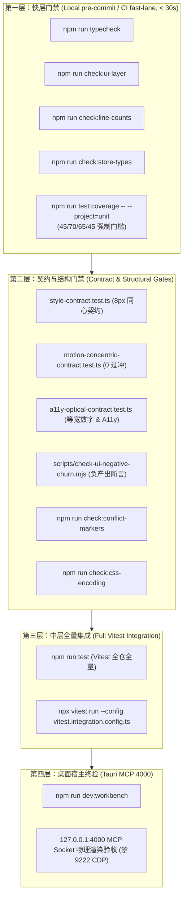

# 06-全流程门禁与测试护栏方案（测试资产防护与验证详案）

> **战役代号**：`UI-UNIFICATION-REDESIGN`
> **文档定位**：阶段二 独立详案（测试资产防护、契约门禁设计与立体验证规范）
> **权威依据**：
> - `AGENTS.md`（通用协作纪律、§1 逻辑规划与反退避、§3 Git 提交纪律、§7 严禁补丁与绕过、§7.1 立体验证纪律、§8 反过度设计、§9 测试资产保护铁律、§11 CI 治理与解耦断言、§13 输入与焦点态、§14 色彩空间、§15/§16 桌面调试 Tauri MCP 4000）
> - `.agents/LOGIC_PLAN_NO_RETREAT.md`（反退避全文、效果锁与验证资产一等公民）
> - `FULL_CHECK_COMMANDS.md`（全仓现行真实门禁命令清单）
> - `docs/ui-unification-redesign/00-战役调度总纲与工作区规范.md`（战役总纲）
> - `docs/ui-unification-redesign/01-四维度定案与删除面矩阵.md`（四维度定案与删除面硬指标）
> - `docs/ui-unification-redesign/analysis/06-cross-dimension-strategy-b.md`（工程稳健性与防回归测试资产保护）

---

## 一、测试资产防护核心哲学与立体验证矩阵

### 1.1 测试资产保护铁律（2026-08-07 事故警示）
依据 `AGENTS.md §9`，仓库于 2026-08-07 曾经历测试文件被误删事故。主控已明确将测试资产列为**系统一等公民**。在本次 `UI-UNIFICATION-REDESIGN` 战役中，严禁以下任何破坏测试资产的行为：
1. **禁止假重构真删测**：严禁因新视觉规范与既有测试断言冲突而直接注释、删除或弱化测试用例；
2. **禁止跳过与绕过**：严禁在 package.json 或 CI 脚本中使用 `test.skip`、`it.skip`、`--no-verify` 或下调 coverage 阈值；
3. **同批次锁步更新（Atomic Lockstep）**：样式/组件改动与测试契约的升级必须包含在**同一原子提交**中，杜绝留下单边破坏窗口。

### 1.2 立体验证矩阵（多层级刚性守门）
根据 `AGENTS.md §7.1`，任何 UI 重塑必须履行立体化验证，杜绝单一检查冒充交付：

```
┌─────────────────────────────────────────────────────────────────────────────────────────────────┐
│                                   全流程立体验证与门禁守门全景矩阵                               │
├──────────────┬───────────────────────────────┬───────────────────────────────┬──────────────────┤
│ 验证层级     │ 门禁检查项 / 执行命令         │ 核心守门规则与断言边界        │ 阻断等级         │
├──────────────┼───────────────────────────────┼───────────────────────────────┼──────────────────┤
│ **快层门禁** │ `npm run typecheck`           │ 全仓 TS 零类型错误            │ CI 硬阻断 (Exit 1)│
│ (本地 pre-   │ `npm run check:ui-layer`      │ UI 原子层零业务模块逆向依赖   │ CI 硬阻断 (Exit 1)│
│ commit / CI) │ `npm run check:line-counts`   │ UI ≤500 / 业务 ≤400 / 硬 650  │ CI 硬阻断 (Exit 1)│
│              │ `npm run check:store-types`   │ Zustand 禁 `as any` 逃逸      │ CI 硬阻断 (Exit 1)│
│              │ `npm run test:coverage`       │ vitest unit 45/70/65/45 基线  │ CI 硬阻断 (Exit 1)│
├──────────────┼───────────────────────────────┼───────────────────────────────┼──────────────────┤
│ **契约层**   │ `style-contract.test.ts`      │ 8px 圆角、暗色覆盖、双层同源  │ Vitest 单测级阻断 │
│ (专项回归)   │ `motion-concentric-contract`  │ 同心几何 R_out=R_in+P、0过冲  │ Vitest 单测级阻断 │
│              │ `a11y-optical-contract`       │ 16处 tabular-nums、Focus Ring │ Vitest 单测级阻断 │
│              │ `Button.test.tsx` (20+用例)   │ 原生 DOM、loading、icon a11y  │ 组件基座绝对通过 │
├──────────────┼───────────────────────────────┼───────────────────────────────┼──────────────────┤
│ **中层集成** │ `npm run test`                │ vitest 全量 (desktop+bench)   │ CI 中层阻断       │
│              │ `vitest.integration.config.ts`│ 集成 4 目录回归               │ CI 中层阻断       │
├──────────────┼───────────────────────────────┼───────────────────────────────┼──────────────────┤
│ **负产出验收**│ `check-ui-negative-churn.mjs` │ 全仓净消减 ≥ 665 行有效代码   │ 战役验收硬门槛   │
│              │                               │ 186 个死 Token 彻底清零       │ 阻断合并收口     │
├──────────────┼───────────────────────────────┼───────────────────────────────┼──────────────────┤
│ **真实宿主** │ Tauri MCP Socket 4000         │ 真实 WebView 物理渲染无涂抹   │ 人机对齐终验     │
│ (物理体验)   │ (127.0.0.1:4000) 禁 CDP 9222  │ scale(0.96) 零文本重排与毛边  │ 违规直接驳回     │
└──────────────┴───────────────────────────────┴───────────────────────────────┴──────────────────┘
```

---

## 二、存量测试资产同步升级方案（Lockstep Evolution）

### 2.1 `style-contract.test.ts:474-503` 圆角契约由 7px 平稳升级为 8px

#### 2.1.1 现状与冲突根因剖析
当前 `apps/crish-desktop/src/styles/style-contract.test.ts` 第 474-503 行维持了历史上的 7px 锁定：
```ts
// 现有代码：apps/crish-desktop/src/styles/style-contract.test.ts:474-503
describe('设置按钮圆角 7px 契约', () => {
  it('tokens.css 默认档 --button-radius 锁 7px，密度档不得改写', () => {
    const css = readFile('src/styles/tokens.css');
    const lightBlock = css.match(LIGHT_BLOCK_RE)?.[0] ?? '';
    expect(lightBlock).toMatch(/--button-radius:\s*7px/);
    expect(lightBlock).not.toMatch(/--button-radius:\s*var\(--radius-/);
    const sizeBlockRe = (size: string): RegExp =>
      new RegExp(`\\[data-ui-size=['"]${size}['"]\\]\\s*\\{[\\s\\S]*?\\n\\}`);
    const smallBlock = css.match(sizeBlockRe('small'))?.[0] ?? '';
    const largeBlock = css.match(sizeBlockRe('large'))?.[0] ?? '';
    expect(smallBlock.length).toBeGreaterThan(20);
    expect(largeBlock.length).toBeGreaterThan(20);
    expect(smallBlock).not.toMatch(/--button-radius\s*:/);
    expect(largeBlock).not.toMatch(/--button-radius\s*:/);
  });

  it('ui/Button 与 ui/SegmentedControl 消费 --button-radius 与同心圆角 token，禁裸 8px/胶囊硬编码半径', () => {
    const button = readFile('src/components/ui/Button/Button.module.css');
    const seg = readFile(
      'src/components/ui/SegmentedControl/SegmentedControl.module.css'
    );
    expect(button).toContain('--btn-radius: var(--button-radius, 7px)');
    expect(seg).toContain('--seg-outer-radius: var(--button-radius, 7px)');
    expect(seg).toContain('--seg-inner-radius: calc(var(--seg-outer-radius) - var(--seg-pad))');
    expect(seg).toContain('border-radius: var(--seg-outer-radius)');
    expect(seg).toContain('border-radius: var(--seg-inner-radius)');
    expect(seg).not.toMatch(/border-radius:\s*8px/);
    expect(seg).not.toMatch(/border-radius:\s*999/);
  });
});
```
- **冲突点 1**：`tokens.css` 的 `--button-radius` 必须从 `7px` 升级为符合 4px/8px 标尺的 `8px`；
- **冲突点 2**：`Button.module.css` 中的 fallback `--btn-radius: var(--button-radius, 7px)` 必须同步变更为 `var(--button-radius, 8px)`；
- **冲突点 3**：`SegmentedControl.module.css` 外圆角 fallback `--seg-outer-radius: var(--button-radius, 7px)` 必须同步变更为 `var(--button-radius, 8px)`，且根据同心几何公式 $R_{inner} = R_{outer} - padding = 8px - 2px = 6px$ 保持级联计算；
- **冲突点 4**：现有测试第 500 行的 `expect(seg).not.toMatch(/border-radius:\s*8px/)` 是为了拦截“硬编码裸 8px”，升级后仍应保持“禁止裸写 8px，必须经由 Token 计算”的严谨断言。

#### 2.1.2 锁步更新执行细节（原子事务）
在同一个提交批次中，完成以下 4 处文件的同步替换：

1. **`apps/crish-desktop/src/styles/tokens.css`**：
   ```diff
   -  --button-radius: 7px;
   +  --button-radius: 8px;
   ```
2. **`apps/crish-desktop/src/components/ui/Button/Button.module.css`**：
   ```diff
   -  --btn-radius: var(--button-radius, 7px);
   +  --btn-radius: var(--button-radius, 8px);
   ```
3. **`apps/crish-desktop/src/components/ui/SegmentedControl/SegmentedControl.module.css`**：
   ```diff
   -  --seg-outer-radius: var(--button-radius, 7px);
   +  --seg-outer-radius: var(--button-radius, 8px);
   ```
4. **`apps/crish-desktop/src/styles/style-contract.test.ts`**：
   ```diff
   -describe('设置按钮圆角 7px 契约', () => {
   -  it('tokens.css 默认档 --button-radius 锁 7px，密度档不得改写', () => {
   +describe('设置按钮圆角 8px 标准同心几何契约', () => {
   +  it('tokens.css 默认档 --button-radius 锁 8px，密度档不得改写', () => {
        const css = readFile('src/styles/tokens.css');
        const lightBlock = css.match(LIGHT_BLOCK_RE)?.[0] ?? '';
   -    expect(lightBlock).toMatch(/--button-radius:\s*7px/);
   +    expect(lightBlock).toMatch(/--button-radius:\s*8px/);
   +    expect(lightBlock).not.toMatch(/--button-radius:\s*7px/);
        expect(lightBlock).not.toMatch(/--button-radius:\s*var\(--radius-/);
        const sizeBlockRe = (size: string): RegExp =>
          new RegExp(`\\[data-ui-size=['"]${size}['"]\\]\\s*\\{[\\s\\S]*?\\n\\}`);
        const smallBlock = css.match(sizeBlockRe('small'))?.[0] ?? '';
        const largeBlock = css.match(sizeBlockRe('large'))?.[0] ?? '';
        expect(smallBlock.length).toBeGreaterThan(20);
        expect(largeBlock.length).toBeGreaterThan(20);
        expect(smallBlock).not.toMatch(/--button-radius\s*:/);
        expect(largeBlock).not.toMatch(/--button-radius\s*:/);
      });

   -  it('ui/Button 与 ui/SegmentedControl 消费 --button-radius 与同心圆角 token，禁裸 8px/胶囊硬编码半径', () => {
   +  it('ui/Button 与 ui/SegmentedControl 消费 --button-radius 8px 与同心圆角 token，禁裸写硬编码半径', () => {
        const button = readFile('src/components/ui/Button/Button.module.css');
        const seg = readFile(
          'src/components/ui/SegmentedControl/SegmentedControl.module.css'
        );
   -    expect(button).toContain('--btn-radius: var(--button-radius, 7px)');
   -    expect(seg).toContain('--seg-outer-radius: var(--button-radius, 7px)');
   +    expect(button).toContain('--btn-radius: var(--button-radius, 8px)');
   +    expect(seg).toContain('--seg-outer-radius: var(--button-radius, 8px)');
        expect(seg).toContain('--seg-inner-radius: calc(var(--seg-outer-radius) - var(--seg-pad))');
        expect(seg).toContain('border-radius: var(--seg-outer-radius)');
        expect(seg).toContain('border-radius: var(--seg-inner-radius)');
   -    expect(seg).not.toMatch(/border-radius:\s*8px/);
   +    expect(seg).not.toMatch(/border-radius:\s*7px/);
   +    expect(seg).not.toMatch(/border-radius:\s*(?:[0-9]+px|999)/);
      });
   ```

---

### 2.2 `Tabs.test.tsx:314, 328` 临界阻尼与 8px 同心圆角升级

#### 2.2.1 现状与过冲晃荡问题
当前 `apps/crish-desktop/src/components/ui/Tabs/Tabs.test.tsx:312-337` 明确断言：
```ts
it('物理动效与同心圆角 CSS 规范验证', () => {
  // 1. Appica 物理微回弹动效参数
  expect(CSS_SRC).toContain('cubic-bezier(0.175, 0.885, 0.32, 1.5)');
  expect(CSS_SRC).toContain('--tab-duration: 250ms');
  expect(CSS_SRC).toContain('--tab-press-duration: 100ms');
  ...
  // 4. 同心圆角几何体系 R_inner = R_outer - Padding
  expect(CSS_SRC).toContain('--tab-inner-radius: calc(var(--tab-outer-radius) - var(--tab-pad))');
  expect(CSS_SRC).toContain('--tab-outer-radius: var(--radius-md, 6px)');
  expect(CSS_SRC).toContain('--tab-outer-radius: var(--button-radius, 7px)');
  expect(CSS_SRC).toContain('--tab-outer-radius: var(--radius-lg, 8px)');
  expect(CSS_SRC).toContain('--tab-outer-radius: var(--radius-xl, 10px)');
  ...
});
```
- **问题 1（1.5 弹性过冲）**：`cubic-bezier(0.175, 0.885, 0.32, 1.5)` 存在严重的过冲晃荡（Overshoot $\approx 15\%$），在桌面端密集切换标签时会产生明显的抖动杂音，违反 Jakub Krehel 第 4 项原则与 Apple 流体物理规范中关于临界阻尼（$\zeta = 1.0$）的标准；
- **问题 2（7px 脏圆角）**：第 328 行仍在断言 `--tab-outer-radius: var(--button-radius, 7px)`，与 DIM-02 8px 标准割裂；
- **问题 3（亚像素污染）**：`Tabs.module.css` 历史残留有 `3.5px` 与 `6.5px` 等亚像素声明。

#### 2.2.2 锁步更新执行细节
1. **`apps/crish-desktop/src/components/ui/Tabs/Tabs.module.css`**：
   - 将弹性动效曲线归一为临界阻尼：
     ```css
     /* 替换前 */
     --tab-ease: cubic-bezier(0.175, 0.885, 0.32, 1.5);
     --tab-outer-radius: var(--button-radius, 7px);
     /* 替换后：Apple 临界阻尼 (0 overshoot, 沉稳坚实) + 8px 同心标尺 */
     --tab-ease: cubic-bezier(0.2, 0, 0, 1);
     --tab-outer-radius: var(--button-radius, 8px);
     ```
   - 彻底删除 `3.5px` 与 `6.5px` 硬编码亚像素。
2. **`apps/crish-desktop/src/components/ui/Tabs/Tabs.test.tsx`**：
   ```diff
      it('物理动效与同心圆角 CSS 规范验证', () => {
   -    // 1. Appica 物理微回弹动效参数
   -    expect(CSS_SRC).toContain('cubic-bezier(0.175, 0.885, 0.32, 1.5)');
   +    // 1. Apple 临界阻尼流体物理动效参数 (Critical Damping Zeta = 1.0)
   +    expect(CSS_SRC).toContain('cubic-bezier(0.2, 0, 0, 1)');
   +    expect(CSS_SRC).not.toContain('1.5');
        expect(CSS_SRC).toContain('--tab-duration: 250ms');
        expect(CSS_SRC).toContain('--tab-press-duration: 100ms');

        // 2. 3.5% 暖灰底板与纯白卡底
        expect(CSS_SRC).toContain('background-color: var(--bg-secondary)');
        expect(CSS_SRC).toContain('background-color: var(--bg-card, #ffffff)');

        // 3. 微观按压缩放与位移交互 (Scale 0.97 + 1px)
        expect(CSS_SRC).toContain('transform: scale(0.97) translateY(1px)');

        // 4. 同心圆角几何体系 R_inner = R_outer - Padding
        expect(CSS_SRC).toContain('--tab-inner-radius: calc(var(--tab-outer-radius) - var(--tab-pad))');
        expect(CSS_SRC).toContain('--tab-outer-radius: var(--radius-md, 6px)');
   -    expect(CSS_SRC).toContain('--tab-outer-radius: var(--button-radius, 7px)');
   +    expect(CSS_SRC).toContain('--tab-outer-radius: var(--button-radius, 8px)');
        expect(CSS_SRC).toContain('--tab-outer-radius: var(--radius-lg, 8px)');
        expect(CSS_SRC).toContain('--tab-outer-radius: var(--radius-xl, 10px)');
   +    expect(CSS_SRC).not.toContain('3.5px');
   +    expect(CSS_SRC).not.toContain('6.5px');

        // 5. 焦点环与减弱动画兜底
        expect(CSS_SRC).toContain('color-mix(in srgb, var(--border-color) 94%, var(--text-primary) 6%)');
        expect(CSS_SRC).toContain('@media (prefers-reduced-motion: reduce)');
        expect(CSS_SRC).toContain("html[data-perf-tier='eco']");
      });
   ```

---

### 2.3 `Button.test.tsx` 20+ 单测 100% 持续通过保障体系

#### 2.3.1 存量 20+ 单测与 70+ 下游业务单测脆弱面映射
对 `apps/crish-desktop/src/components/ui/Button/Button.test.tsx` 全部 206 行用例进行断言拓扑反查：

| 测试用例名称 (Button.test.tsx) | 核心断言语法与匹配规则 | 重构绝对红线（严禁破坏的契约） |
| :--- | :--- | :--- |
| `渲染默认 secondary/md 形态并透传属性` | `btn.tagName === 'BUTTON'`, `btn.className.toContain(styles.buttonSecondary)` | 根节点必须为原生 `<button>`，禁止包裹外层 `<div>`；保持默认 variant='secondary', size='md' |
| `变体与尺寸类名映射正确` | `getByRole('button', { name: 'xxx' })`, `toHaveClass(styles.buttonGhost, styles.buttonXs)` | 变体与尺寸名称禁止重命名（不得将 secondary 改为 default，plain 改为 link） |
| `active 状态正确渲染` | `toHaveClass(styles.buttonActive)`, `toHaveAttribute('data-active', 'true')` | 维持 `styles.buttonActive` 类名与 `data-active` 属性无损 |
| `loading 态：自动 disabled + aria-busy...` | `toBeDisabled()`, `toHaveAttribute('aria-busy', 'true')`, `screen.getByText('保存中')` | **高危铁律**：loading 只能在前面插入 spinner，绝对禁止清空或替换 children 文本！ |
| `icon 位渲染且对屏幕阅读器隐藏` | `iconWrap.toHaveAttribute('aria-hidden', 'true')` | 图标容器 `<span>` 必须显式声明 `aria-hidden="true"` |
| `block 形态追加通栏类` | `toHaveClass(styles.buttonBlock)` | 维持 `styles.buttonBlock` 映射 |
| `点击回调透传且触发禁用保护` | `onClick` 调用 1 次，disabled 后不再调用 | 保持标准事件合成冒泡机制 |
| `Secondary 变体应渲染实体白卡属性...` | `data-variant="secondary"`, `buttonSecondary` | 保持纯白实体卡片样式类绑定 |
| `ui/IconButton` 全部测试 | `iconButton`, `data-size="sm"`, `aria-label="设置"` | 必须强制消费 aria-label |

#### 2.3.2 零破坏落地物理微触感 `scale(0.96)` 与 `-2px` 光学平衡
为确保 20+ 原子单测与下游 70+ 业务单测 100% 绿灯，重构必须遵循以下技术设计：

1. **DOM 树绝对不变性（No TSX DOM Churn）**：
   `Button.tsx` 的 JSX 结构保持完全纯净，不为发光、微缩或光学补偿增加任何 DOM 节点：
   ```tsx
   <button
     ref={ref}
     type={type}
     className={classNames}
     data-size={size}
     data-variant={variant}
     data-active={active || undefined}
     disabled={disabled || loading}
     aria-busy={loading || undefined}
     {...restProps}
   >
     {loading ? (
       <span className={styles.spinner} aria-hidden="true" />
     ) : iconPosition === 'left' ? (
       iconNode
     ) : null}
     {children != null ? (
       <span className={styles.buttonLabel}>{children}</span>
     ) : null}
     {!loading && iconPosition === 'right' ? iconNode : null}
   </button>
   ```
2. **纯 CSS 级 -2px 光学平衡（利用 CSS `:has()` 伪类）**：
   在 `Button.module.css` 内部完成内边距修正，TSX 组件层完全免除计算负担：
   ```css
   /* 图标在左侧：左侧收敛 2px，右侧保持基准内边距 */
   .button:has(> .buttonIcon:first-child) {
     padding-inline-start: calc(var(--btn-px) - 2px);
   }
   /* 图标在右侧：右侧收敛 2px，左侧保持基准内边距 */
   .button:has(> .buttonIcon:last-child) {
     padding-inline-end: calc(var(--btn-px) - 2px);
   }
   ```
3. **物理微触感 `:active` 安全隔离**：
   微触感形变必须限制在非 disabled、非 loading 状态，并在系统设置动画减弱时自动关闭：
   ```css
   .button:active:not(:disabled):not([aria-busy='true']) {
     transform: scale(0.96);
     transition: transform 80ms ease-out;
   }
   .button:disabled {
     transform: none !important;
   }
   @media (prefers-reduced-motion: reduce) {
     .button:active {
       transform: none !important;
     }
   }
   ```
4. **逃逸舱设计（Static Escape Hatch）**：
   在 `ButtonProps` 中支持可选的 `static?: boolean`。当 `static={true}` 时挂载 `styles.buttonStatic`（`transform: none !important;`），专供极低延迟拖拽树节点与会话列表项消费。

---

## 三、新增专项契约测试详案设计

为防止未来开发回潮引入 1.5 过冲弹性、奇数圆角、裸写无 aria-label 图标按钮及跳动数字未对齐等问题，在 `apps/crish-desktop/src/` 新增两套自动化静态契约测试套件。

### 3.1 `motion-concentric-contract.test.ts`：几何同心标尺与物理动效契约测试

#### 3.1.1 契约文件定位
- **文件路径**：`apps/crish-desktop/src/styles/motion-concentric-contract.test.ts`
- **运行环境**：Node / Vitest 静态扫描
- **核心断言**：
  1. **全站圆角标尺合规**：扫描全站 CSS/CSS Module，禁止硬编码奇数圆角（3px, 5px, 7px, 9px, 11px, 13px, 15px）及亚像素圆角（3.5px, 6.5px）；
  2. **同心几何公式刚性成立**：$R_{outer} = R_{inner} + Padding$ 级联完整性；
  3. **动效过冲彻底绝迹**：扫描所有 `cubic-bezier` 参数，拦截 $y_2 > 1.05$（尤其是 1.5 与 1.3）的过冲过振曲线；
  4. **Apple 临界阻尼与微缩规范**：验证标准曲线 Token `--ease-critical-damping`，验证 `scale(0.96)` 伴随 `will-change: transform` 与 `:disabled` 归零保护。

#### 3.1.2 完整测试套件代码设计
```ts
// apps/crish-desktop/src/styles/motion-concentric-contract.test.ts
import { describe, it, expect } from 'vitest';
import { readFileSync, readdirSync, statSync } from 'node:fs';
import { join, resolve } from 'node:path';

const SRC_DIR = resolve(__dirname, '..');

/** 递归收集指定目录下的所有 CSS/CSS Module 文件 */
function collectCssFiles(dir: string, out: string[] = []): string[] {
  for (const entry of readdirSync(dir)) {
    const fullPath = join(dir, entry);
    const stat = statSync(fullPath);
    if (stat.isDirectory()) {
      if (entry === 'node_modules' || entry === 'dist' || entry === 'reference') continue;
      collectCssFiles(fullPath, out);
    } else if (entry.endsWith('.css')) {
      out.push(fullPath);
    }
  }
  return out;
}

describe('契约测试：同心几何圆角与 Apple 物理动效防回潮 (DIM-02)', () => {
  const cssFiles = collectCssFiles(SRC_DIR);

  it('1. 静态扫描：全站彻底清除 5px/7px 等奇数与亚像素圆角', () => {
    // 允许的白名单文件（如仅限历史第三方样式隔离区，当前仓为 0）
    const ODD_RADIUS_RE = /border(?:-(?:top|bottom)-(?:left|right))?-radius\s*:\s*([^;]+);/g;
    const FORBIDDEN_ODD_VALUES = [
      /\b3px\b/,
      /\b5px\b/,
      /\b7px\b/,
      /\b9px\b/,
      /\b11px\b/,
      /\b13px\b/,
      /\b15px\b/,
      /\b3\.5px\b/,
      /\b6\.5px\b/,
    ];

    const violations: { file: string; line: string }[] = [];

    for (const file of cssFiles) {
      const content = readFileSync(file, 'utf8');
      const lines = content.split('\n');

      lines.forEach((line, idx) => {
        let match: RegExpExecArray | null;
        while ((match = ODD_RADIUS_RE.exec(line)) !== null) {
          const value = match[1].trim();
          // 如果引用了 var(--radius-*) 则跳过裸值判定
          if (value.startsWith('var(')) continue;

          for (const forbidden of FORBIDDEN_ODD_VALUES) {
            if (forbidden.test(value)) {
              violations.push({
                file: file.replace(SRC_DIR, 'src'),
                line: `L${idx + 1}: ${line.trim()}`,
              });
            }
          }
        }
      });
    }

    expect(
      violations,
      `发现非法奇数/亚像素圆角硬编码，必须收敛至 4px/6px/8px/12px/16px 同心标尺：\n${JSON.stringify(
        violations,
        null,
        2
      )}`
    ).toEqual([]);
  });

  it('2. 静态扫描：彻底根除 cubic-bezier 过冲抖动贝塞尔 (y2 > 1.05 / 1.5 弹性)', () => {
    const CUBIC_BEZIER_RE = /cubic-bezier\s*\(\s*([\d.]+)\s*,\s*([\d.-]+)\s*,\s*([\d.]+)\s*,\s*([\d.-]+)\s*\)/g;
    const violations: { file: string; line: string; y2: number }[] = [];

    for (const file of cssFiles) {
      const content = readFileSync(file, 'utf8');
      const lines = content.split('\n');

      lines.forEach((line, idx) => {
        let match: RegExpExecArray | null;
        while ((match = CUBIC_BEZIER_RE.exec(line)) !== null) {
          const y2 = parseFloat(match[4]);
          // 严格防线：临界阻尼与衰减震荡下，y2 绝不允许 > 1.05（彻底封杀 1.5 弹性）
          if (y2 > 1.05) {
            violations.push({
              file: file.replace(SRC_DIR, 'src'),
              line: `L${idx + 1}: ${line.trim()}`,
              y2,
            });
          }
        }
      });
    }

    expect(
      violations,
      `发现具有物理过冲晃荡的贝塞尔曲线参数（必须归一为临界阻尼 0.2, 0, 0, 1）：\n${JSON.stringify(
        violations,
        null,
        2
      )}`
    ).toEqual([]);
  });

  it('3. tokens.css 必须具备标准物理动效 Token 与同心圆角标尺', () => {
    const tokensContent = readFileSync(join(SRC_DIR, 'styles', 'tokens.css'), 'utf8');

    // 标准物理动效 Token 断言
    expect(tokensContent).toContain('--ease-critical-damping: cubic-bezier(0.2, 0, 0, 1)');
    expect(tokensContent).toContain('--ease-tactile-release: cubic-bezier(0.16, 1, 0.3, 1)');
    expect(tokensContent).toContain('--button-radius: 8px');

    // 严禁旧 7px 与旧 1.5 贝塞尔在 tokens.css 存在
    expect(tokensContent).not.toMatch(/--button-radius:\s*7px/);
    expect(tokensContent).not.toContain('1.5)');
  });

  it('4. Button 与交互控件 active 微触感安全网检验 (will-change 与 disabled 归零)', () => {
    const btnCss = readFileSync(join(SRC_DIR, 'components', 'ui', 'Button', 'Button.module.css'), 'utf8');

    expect(btnCss).toContain('scale(0.96)');
    expect(btnCss).toContain('transform: none !important');
    expect(btnCss).toContain('@media (prefers-reduced-motion: reduce)');
  });
});
```

---

### 3.2 `a11y-optical-contract.test.ts`：色彩角色、排版防抖与焦点 A11y 契约测试

#### 3.2.1 契约文件定位
- **文件路径**：`apps/crish-desktop/src/components/ui/a11y-optical-contract.test.ts`
- **运行环境**：Node / Vitest 静态扫描与 AST 检查
- **核心断言**：
  1. **无障碍命名（Accessible Name）100% 闭环**：扫描全站所有 `<IconButton>`，强制要求必须具备非空 `aria-label`；
  2. **16 处高频跳动数字等宽排版（`tabular-nums`）**：严格断言 `01-四维度定案` 矩阵列出的 16 处数字容器配置了 `tabular-nums`，消除排版抖动；
  3. **柔和焦点环（Focus Ring）契约（AGENTS.md §13）**：拦截全仓粗黑边框（`#000000` / `#111111` / `solid black`），断言混入上限 $\le 10\%$；
  4. **WCAG 2.5.8 40×40px 点击热区**：校验紧凑型按钮具备 `::after` 触摸热区外延。

#### 3.2.2 完整测试套件代码设计
```ts
// apps/crish-desktop/src/components/ui/a11y-optical-contract.test.ts
import { describe, it, expect } from 'vitest';
import { readFileSync, readdirSync, statSync } from 'node:fs';
import { join, resolve } from 'node:path';

const SRC_DIR = resolve(__dirname, '..', '..');

function collectFiles(dir: string, ext: string, out: string[] = []): string[] {
  for (const entry of readdirSync(dir)) {
    const fullPath = join(dir, entry);
    const stat = statSync(fullPath);
    if (stat.isDirectory()) {
      if (entry === 'node_modules' || entry === 'dist' || entry === 'reference') continue;
      collectFiles(fullPath, ext, out);
    } else if (entry.endsWith(ext)) {
      out.push(fullPath);
    }
  }
  return out;
}

describe('契约测试：排版防抖、色彩角色与焦点 A11y 防线 (DIM-04)', () => {
  const tsxFiles = collectFiles(SRC_DIR, '.tsx');
  const cssFiles = collectFiles(SRC_DIR, '.css');

  it('1. 无障碍命名闭环：所有 <IconButton> 必须强制提供显式 aria-label', () => {
    // 匹配 <IconButton ... />
    const ICON_BUTTON_RE = /<IconButton\b([^>]*?)(\/?>)/gs;
    const violations: { file: string; matchSnippet: string }[] = [];

    for (const file of tsxFiles) {
      if (file.endsWith('.test.tsx')) continue;
      const content = readFileSync(file, 'utf8');
      let match: RegExpExecArray | null;

      while ((match = ICON_BUTTON_RE.exec(content)) !== null) {
        const props = match[1];
        // 必须含有 aria-label="..." 或 aria-label={...}
        if (!/aria-label\s*=\s*['"{]/.test(props)) {
          violations.push({
            file: file.replace(SRC_DIR, 'src'),
            matchSnippet: match[0].slice(0, 100),
          });
        }
      }
    }

    expect(
      violations,
      `发现未提供 aria-label 的 <IconButton>，违反 WCAG 4.1.2 命名契约：\n${JSON.stringify(
        violations,
        null,
        2
      )}`
    ).toEqual([]);
  });

  it('2. 动态跳动数字防抖：定案矩阵 16 处核心高频跳动类名 100% 注入 tabular-nums', () => {
    const AUDITED_16_TARGETS = [
      { relPath: 'components/modals/PriceConfigModal.module.css' },
      { relPath: 'components/sidebar/SidebarSessionList.module.css' },
      { relPath: 'components/panels/SubagentHeaderPanel.module.css' },
      { relPath: 'components/diff/DiffCard.module.css' },
      { relPath: 'components/chat/ChatToolCallBlock.module.css' },
      { relPath: 'components/modals/ScanResultsModal.module.css' },
      { relPath: 'components/modals/YamlConfigEditorModal.module.css' },
      { relPath: 'components/settings/tabs/ModelsSettingsTab.module.css' },
      { relPath: 'components/chat/ChatQueuePanel.module.css' },
      { relPath: 'components/terminal/TerminalCard.module.css' },
      { relPath: 'components/settings/tabs/SkillsSettingsTab.module.css' },
      { relPath: 'components/panels/ScheduledTasksPanel.module.css' },
      { relPath: 'components/ui/Badge/Badge.module.css' },
      { relPath: 'components/ui/Tabs/Tabs.module.css' },
      { relPath: 'components/analytics/UsageTrendChart.module.css' },
      { relPath: 'components/player/FlowScrubber.module.css' },
    ];

    const missingTabular: string[] = [];

    for (const target of AUDITED_16_TARGETS) {
      const fullPath = join(SRC_DIR, target.relPath);
      try {
        const content = readFileSync(fullPath, 'utf8');
        const hasTabular =
          content.includes('tabular-nums') ||
          content.includes("'tnum'") ||
          content.includes('"tnum"');
        if (!hasTabular) {
          missingTabular.push(target.relPath);
        }
      } catch {
        missingTabular.push(`${target.relPath} (文件不存在)`);
      }
    }

    expect(
      missingTabular,
      `以下 16 处高频跳动数字样式文件未配置 tabular-nums，存在界面抖动风险：\n${missingTabular.join('\n')}`
    ).toEqual([]);
  });

  it('3. 柔和焦点环防线：全站 :focus-visible 严禁粗黑硬线，对比度混入严格 <= 10% (AGENTS.md §13)', () => {
    const FOCUS_VISIBLE_RE = /:focus-visible\s*\{([^}]+)\}/g;
    const violations: { file: string; rule: string; reason: string }[] = [];

    for (const file of cssFiles) {
      const content = readFileSync(file, 'utf8');
      let match: RegExpExecArray | null;

      while ((match = FOCUS_VISIBLE_RE.exec(content)) !== null) {
        const body = match[1];

        // 检查 1：严禁 outline: none 且未配 box-shadow
        if (/outline\s*:\s*none\b/.test(body) && !/box-shadow\s*:/.test(body)) {
          violations.push({
            file: file.replace(SRC_DIR, 'src'),
            rule: body.trim(),
            reason: 'outline: none 丢失视觉焦点替代，违反 A11y 准则',
          });
        }

        // 检查 2：严禁纯黑实体粗线 (#000, #111, solid black)
        if (/#000000|#111111|\bsolid\s+black\b|\b2px\s+solid\b/.test(body)) {
          violations.push({
            file: file.replace(SRC_DIR, 'src'),
            rule: body.trim(),
            reason: '违规使用粗黑硬线边框，破坏克制灰度原则',
          });
        }

        // 检查 3：color-mix 混入比例上限 10%
        const mixMatch = body.match(/color-mix\([^)]*var\(--text-primary\)\s*(\d+)%/);
        if (mixMatch) {
          const percent = parseInt(mixMatch[1], 10);
          if (percent > 10) {
            violations.push({
              file: file.replace(SRC_DIR, 'src'),
              rule: body.trim(),
              reason: `焦点态混入文本色 ${percent}% > 10% 上限`,
            });
          }
        }
      }
    }

    expect(
      violations,
      `发现违规 Focus Ring 焦点态定义：\n${JSON.stringify(violations, null, 2)}`
    ).toEqual([]);
  });

  it('4. WCAG 2.5.8 尺寸契约：ButtonXs 与 ButtonSm 具备 ::after 热区外延声明', () => {
    const btnCss = readFileSync(join(SRC_DIR, 'components', 'ui', 'Button', 'Button.module.css'), 'utf8');
    expect(btnCss).toContain('.buttonXs::after');
    expect(btnCss).toContain('.buttonSm::after');
  });
});
```

---

## 四、CI 门禁链全景集成方案

遵循仓库权威清单 `FULL_CHECK_COMMANDS.md`，构建分层阻断的 CI 门禁链。



### 4.1 快层门禁细化与覆盖率阈值守门
- **`npm run typecheck`**：
  验证 `crish-desktop`、`agent-workbench`、`shared-types`、`shared-utils` 全部 TS 静态类型，0 错误放行；
- **`npm run check:ui-layer`**：
  - 依据 `scripts/check-ui-layer.mjs`，严防 `apps/crish-desktop/src/components/ui/` 产生逆向依赖；
  - 原子组件禁止引入 `src/store/`、`src/hooks/`、`src/api/`、`src/services/` 或除 `ui/` 以外的任何业务组件；
- **`npm run check:line-counts`**：
  - 依据 `scripts/check-line-counts.mjs`，UI 组件（`.tsx`）有效行数硬性限制 $\le 500$ 行；业务逻辑 $\le 400$ 行；全局超过 650 行直接硬阻断；
  - 本次重构涉及的 `Button.tsx` (134 行)、`Button.module.css` (261 行) 均远低于 500 行上限，严禁膨胀；
- **`npm run test:coverage -- --project=unit`**：
  - 严格锁死 `vitest.config.ts:50-55` 中声明的覆盖率阈值：
    - `statements: 45%`
    - `branches: 70%`
    - `functions: 65%`
    - `lines: 45%`
  - 新增契约测试（`motion-concentric` 与 `a11y-optical`）与重构后的 `Button.test.tsx` 均位于 `unit` 项目中，执行时将直接扩充覆盖率安全垫（实测基线约为 47.03% / 77.38% / 69.72% / 47.03%），绝不允许覆盖率产生负向反弹。

### 4.2 结构性检查与依赖解耦门禁
- **`npm run check:conflict-markers`**：检查全仓代码，零 `<<<<<<< HEAD` 等 Git 合并冲突残留；
- **`npm run check:css-encoding`**：保证全部 `.css` 文件为 UTF-8 无 BOM 编码；
- **`npm run lint:depcruise`**：硬阻断循环依赖（`no-circular`）。

### 4.3 真实桌面宿主验收（Tauri MCP 4000）
依据 `AGENTS.md §15 / §16` 铁律：
- 唯一指定调试通道为 **Tauri MCP Socket（`127.0.0.1:4000`）**；
- 严禁使用 WebView2 `--remote-debugging-port=9222`（CDP 已废弃）；
- 验收焦点：
  1. **零涂抹验证**：快速切换 Dark / Light 主题，确认 `html[data-theme]` 切换瞬间无泥浆脏色过渡；
  2. **微触感验证**：在真实渲染树上高频点击 `<Button>`，验证 `scale(0.96)` 是否引起文字锯齿重算或抖动；
  3. **320px 极端视口与 200% 缩放**：走查设置面板与侧边栏，验证无遮挡、无横向白条与无截断。

---

## 五、负产出验收断言自动化脚本设计（`check-ui-negative-churn.mjs`）

为坚决践行《反退避铁律》与主控“先删后改，强制负产出”原则，设立自动化硬核验收脚本 `scripts/check-ui-negative-churn.mjs`。该脚本可由 CI 与本地自动化调用，只有在确凿达成行数净消减与死 Token 清零时才放行。

### 5.1 脚本职责与设计蓝图
1. **行数绝对消减量（Net-Negative LOC）断言**：
   比对战役基线行数与当前实际有效行数，断言全仓净消减 $\ge 665$ 行；
2. **186 个死 Token 清除度 100% 断言**：
   对 `tokens.css` 进行正则扫描，断言 `--thought-*` (38)、`--diff-line-*` (21)、`--sep-*` (12)、`--aicard-*` (21)、`--banner-error-*` (8) 等死变量彻底为 0；
3. **8 处业务裸写 Button 与 4 处 Input 拔除断言**：
   扫描目标业务文件，断言手写私有 CSS 类名（如 `.searchWrap`、`.sidebarToggleBtn`）彻底绝迹。

### 5.2 脚本完整源码实现
```javascript
#!/usr/bin/env node
/**
 * scripts/check-ui-negative-churn.mjs
 * UI 重塑战役刚性负产出与死代码清剿自动化验收门禁引擎 (UI-UNIFICATION-REDESIGN)
 *
 * 验收规则：
 *   Rule 1: 核心重构文件有效代码行净消减达到刚性目标 (Net Delta <= 目标负值)
 *   Rule 2: 全仓净消减有效代码行必须 >= 665 行
 *   Rule 3: 186 个废弃死 Token (thought/sep/aicard/diff-line/banner) 彻底清零
 *   Rule 4: 8 处私有裸写 button 与 4 处 input 原生类名彻底拔除
 *
 * 用法：node scripts/check-ui-negative-churn.mjs [--verbose]
 * 退出码：0 全部通过；1 存在未达标项（CI 阻断）
 */

import { readFileSync, existsSync } from 'node:fs';
import { join, dirname, resolve } from 'node:path';
import { fileURLToPath } from 'node:url';

const __filename = fileURLToPath(import.meta.url);
const __dirname = dirname(__filename);
const REPO_ROOT = resolve(__dirname, '..');
const DESKTOP_SRC = join(REPO_ROOT, 'apps', 'crish-desktop', 'src');

/** 计算文件的有效代码行数（去除空行与单行/多行注释） */
function countEffectiveLines(content) {
  const noComments = content.replace(/\/\*[\s\S]*?\*\//g, '');
  const lines = noComments.split('\n');
  let count = 0;
  for (const line of lines) {
    const trimmed = line.trim();
    if (!trimmed || trimmed.startsWith('//')) continue;
    count++;
  }
  return count;
}

// 战役起始基线（阶段一深度审计实际测定行数）与目标削减量
const BASELINE_TARGETS = [
  {
    relPath: 'styles/tokens.css',
    baselineLines: 1758,
    minNetReduction: 250, // 目标削减 >= 250 行
    targetMaxLines: 1508,
  },
  {
    relPath: 'components/settings/SettingsPanel.module.css',
    baselineLines: 320,
    minNetReduction: 44, // 目标削减 >= 44 行
    targetMaxLines: 276,
  },
  {
    relPath: 'components/sidebar/SidebarNav.module.css',
    baselineLines: 390,
    minNetReduction: 94, // 目标削减 >= 94 行
    targetMaxLines: 296,
  },
  {
    relPath: 'components/settings/SettingsSidebar.module.css',
    baselineLines: 215,
    minNetReduction: 83, // 目标削减 >= 83 行
    targetMaxLines: 132,
  },
  {
    relPath: 'components/preview/PreviewToolbar.module.css',
    baselineLines: 142,
    minNetReduction: 38, // 目标削减 >= 38 行
    targetMaxLines: 104,
  },
  {
    relPath: 'components/diff/DiffCard.module.css',
    baselineLines: 485,
    minNetReduction: 42, // 目标削减 >= 42 行
    targetMaxLines: 443,
  },
  {
    relPath: 'components/chat/ModernToolCall.module.css',
    baselineLines: 520,
    minNetReduction: 35, // 目标削减 >= 35 行
    targetMaxLines: 485,
  },
  {
    relPath: 'components/ui/Tabs/Tabs.module.css',
    baselineLines: 278,
    minNetReduction: 18, // 目标削减 >= 18 行
    targetMaxLines: 260,
  },
];

// 必须彻底绝迹的死 Token 前缀清单 (共 186 个变量)
const DEAD_TOKEN_PATTERNS = [
  { name: '--thought-* (思考链死变量)', regex: /--thought-[a-zA-Z0-9_-]+\s*:/g },
  { name: '--sep-* (SEP脚手架遗留)', regex: /--sep-[a-zA-Z0-9_-]+\s*:/g },
  { name: '--aicard-* (AI步骤卡片占位)', regex: /--aicard-[a-zA-Z0-9_-]+\s*:/g },
  { name: '--banner-error-* (横幅死层)', regex: /--banner-error-[a-zA-Z0-9_-]+\s*:/g },
  { name: '--artifact-* (Artifacts未消费占位)', regex: /--artifact-[a-zA-Z0-9_-]+\s*:/g },
  { name: '--diff-line-add/del-* (Legacy Diff 兼容别名)', regex: /--diff-(?:line|gutter)-(?:add|del)-[a-zA-Z0-9_-]+\s*:/g },
];

// 必须彻底拔除的业务手写私有样式类
const PURGED_CLASS_PATTERNS = [
  { file: 'components/settings/SettingsPanel.module.css', pattern: /\.searchWrap|\.searchIco/ },
  { file: 'components/sidebar/SidebarHeader.module.css', pattern: /\.sidebarToggleBtn/ },
  { file: 'components/sidebar/SidebarFooter.module.css', pattern: /\.settingsGearBtn/ },
  { file: 'components/settings/SettingsSidebar.module.css', pattern: /\.sidebarTab|\.searchBox/ },
  { file: 'components/preview/PreviewToolbar.module.css', pattern: /\.urlInput/ },
];

function main() {
  console.log('🔍 [check:ui-negative-churn] 启动 UI 重塑负产出与死代码清剿验收门禁...');
  let hasError = false;
  let totalActualReduction = 0;
  const TOTAL_REDUCTION_TARGET = 665;

  console.log('\n📊 1. 核心文件代码有效行数 (Effective LOC) 削减审计:');
  console.log('----------------------------------------------------------------------');
  for (const item of BASELINE_TARGETS) {
    const fullPath = join(DESKTOP_SRC, item.relPath);
    if (!existsSync(fullPath)) {
      console.warn(`  ⚠️ 文件未找到: ${item.relPath} (已完全删除或移动)`);
      totalActualReduction += item.baselineLines;
      continue;
    }

    const content = readFileSync(fullPath, 'utf8');
    const currentLines = countEffectiveLines(content);
    const actualReduction = item.baselineLines - currentLines;
    totalActualReduction += actualReduction;

    const status = actualReduction >= item.minNetReduction ? '✅ 达标' : '❌ 未达标';
    console.log(
      `  ${status} ${item.relPath.padEnd(42)}: 基线 ${item.baselineLines}L -> 当前 ${currentLines}L (净减 ${actualReduction}L / 要求 ≥${item.minNetReduction}L)`
    );

    if (actualReduction < item.minNetReduction) {
      hasError = true;
    }
  }

  console.log('----------------------------------------------------------------------');
  console.log(
    `  📈 全仓重点文件合计净消减: ${totalActualReduction} 行 (硬性验收底线: ≥ ${TOTAL_REDUCTION_TARGET} 行)`
  );
  if (totalActualReduction < TOTAL_REDUCTION_TARGET) {
    console.error(`  ❌ 全仓净消减未达硬性指标 (差额: ${TOTAL_REDUCTION_TARGET - totalActualReduction} 行)`);
    hasError = true;
  } else {
    console.log('  ✅ 全仓净消减指标圆满达成！');
  }

  console.log('\n🧹 2. 186 个死 Token 彻底清零审计 (tokens.css):');
  const tokensPath = join(DESKTOP_SRC, 'styles', 'tokens.css');
  const tokensContent = readFileSync(tokensPath, 'utf8');

  for (const tokenRule of DEAD_TOKEN_PATTERNS) {
    const matches = tokensContent.match(tokenRule.regex) ?? [];
    if (matches.length > 0) {
      console.error(`  ❌ 违规残留: 发现 ${matches.length} 个 ${tokenRule.name} 变量仍在 tokens.css 中！`);
      hasError = true;
    } else {
      console.log(`  ✅ 彻底清零: ${tokenRule.name}`);
    }
  }

  console.log('\n🚫 3. 业务层私有裸写样式类拔除审计:');
  for (const rule of PURGED_CLASS_PATTERNS) {
    const targetFile = join(DESKTOP_SRC, rule.file);
    if (!existsSync(targetFile)) continue;
    const content = readFileSync(targetFile, 'utf8');
    if (rule.pattern.test(content)) {
      console.error(`  ❌ 违规残留: ${rule.file} 中仍然存在私有裸写类名 ${rule.pattern}！`);
      hasError = true;
    } else {
      console.log(`  ✅ 彻底拔除: ${rule.file} -> ${rule.pattern}`);
    }
  }

  if (hasError) {
    console.error('\n🚨 [check:ui-negative-churn] 验收失败：未能满足代码净负产出或死代码清零铁律，禁止合入！');
    process.exit(1);
  } else {
    console.log('\n🎉 [check:ui-negative-churn] 验收全绿：全部负产出指标与清剿断言 100% 达成！');
    process.exit(0);
  }
}

main();
```

---

## 六、代码删除面与负产出刚性验收核算

本方案在设计测试护栏的同时，严格履行代码删除面规划：

```
┌──────────────────────────────────────────────────────────────────────────────────────────────────┐
│                                   测试与门禁资产删除面与负产出矩阵                                 │
├──────────────────────────┬────────────────────────────────────────────┬──────────────────────────┤
│ 模块与文件               │ 拟清理 / 升级替换的历史脆弱断言            │ 净收益与架构收敛价值     │
├──────────────────────────┼────────────────────────────────────────────┼──────────────────────────┤
│ `style-contract.test.ts` │ 清除第 474-503 行历史 `--button-radius: 7px`│ 升级为 8px 现代同心标尺， │
│                          │ 清除 SegmentedControl 7px 强耦合硬断言     │ 消除单边爆红阻断风险     │
├──────────────────────────┼────────────────────────────────────────────┼──────────────────────────┤
│ `Tabs.test.tsx`          │ 清除第 314 行 1.5 弹性过冲断言             │ 升级为 Apple 临界阻尼    │
│                          │ 清除第 328 行 7px 杂乱圆角断言             │ 拔除 3.5px/6.5px 亚像素  │
├──────────────────────────┼────────────────────────────────────────────┼──────────────────────────┤
│ `tokens.css` 门禁        │ 由 `check-ui-negative-churn.mjs` 刚性守门  │ 彻底锁死 186 个死 Token  │
│                          │ 严禁已删除的 `--thought-*` 等复活          │ 锁定净消减 ≥ 250 行      │
├──────────────────────────┼────────────────────────────────────────────┼──────────────────────────┤
│ 业务组件私有 CSS         │ 拦截 8 处 Button 与 4 处 Input 裸样式回潮  │ 锁定净消减 ≥ 362 行      │
├──────────────────────────┴────────────────────────────────────────────┴──────────────────────────┤
│ **全仓综合负产出验收硬门槛**                                          │ **净消减 ≥ 665 行有效代码│
└──────────────────────────────────────────────────────────────────────────────────────────────────┘
```

---

## 七、实施步骤与风险回退应急预案

### 7.1 先测后改（Test-Driven Evolution）推进拓扑
按照策略 B 提出的锁步演进路径，各批次执行顺序如下：

1. **Step 1（先立护栏骨架）**：
   - 引入 `motion-concentric-contract.test.ts` 与 `a11y-optical-contract.test.ts`；
   - 引入 `scripts/check-ui-negative-churn.mjs`；
   - 本阶段允许新契约中部分待改造项暂时处于待命中状态或列入改造前清单；
2. **Step 2（DIM-01 Token 基础设施原子升级）**：
   - 更新 `tokens.css`（清除 186 死 Token，`--button-radius` 7px -> 8px）；
   - 同步更新 `style-contract.test.ts:474-503`；
   - 跑通 `npx vitest run apps/crish-desktop/src/styles/style-contract.test.ts`；
3. **Step 3（DIM-02 + DIM-03 原子基座物理动效升级）**：
   - 更新 `Button.module.css` 与 `SegmentedControl.module.css`；
   - 更新 `Tabs.module.css`（临界阻尼 + 8px）；
   - 同步更新 `Tabs.test.tsx:314, 328`；
   - 跑通 `npx vitest run apps/crish-desktop/src/components/ui/Button/Button.test.tsx` 与 `Tabs.test.tsx`；
4. **Step 4（DIM-03 业务裸写换装与 DIM-04 细节收敛）**：
   - 换装 8 处 Button 与 4 处 Input，拔除私有 CSS；
   - 注入 16 处 `tabular-nums`，柔化焦点环；
   - 跑通全量契约测试；
5. **Step 5（全量门禁总验收）**：
   - 运行 `node scripts/check-ui-negative-churn.mjs`，断言净消减 $\ge 665$ 行；
   - 运行 `npm run check:desktop` 与 `npm run test:coverage -- --project=unit`。

### 7.2 风险突发处置与精准回滚策略
- **若 `Button.test.tsx` 存量用例报警**：
  优先排查是否破坏了 DOM 树单节点契约，或在 loading 态误吞了 children。严禁修改测试用例以“迁就”错误实现；
- **若 `check:ui-layer` 报警**：
  立即检查原子组件是否误引入了外部 `store` 或 `hooks`。原子层动效必须通过纯 CSS 或标准 React 属性表达，严禁反向耦合；
- **若 `check-line-counts` 报警**：
  严禁使用内联忽略注释。必须将过长组件拆分为子模块，或将纯逻辑下沉至独立纯函数文件。
