# 01-全域拓扑与逻辑依赖冲突审查报告（审查结论与仲裁详案）

> **战役代号**：`UI-UNIFICATION-REDESIGN`  
> **文档性质**：阶段二 交叉评审报告（方案评审 01：全域系统工程拓扑、逻辑依赖倒置、双桥闭环漏洞与选择器权重冲突审查）  
> **评审对象**：`docs/ui-unification-redesign/independent-plans/` 下全部 6 份独立详案（01 至 06）  
> **审查基准**：
> - `c:/Software/conex/docs/ui-unification-redesign/00-战役调度总纲与工作区规范.md`
> - `c:/Software/conex/docs/ui-unification-redesign/01-四维度定案与删除面矩阵.md`
> - `AGENTS.md`（§1 反退避、§3 Git 提交纪律、§7 严禁补丁、§7.1 立体验证、§8 反过度设计、§9 测试资产保护、§11 CI 治理、§13 输入与焦点态、§14 色彩空间、§15/§16 Tauri MCP 调试通道）
> - `.agents/LOGIC_PLAN_NO_RETREAT.md`（纯逻辑规划、效果锁与零退避）
> - `FULL_CHECK_COMMANDS.md`（现行刚性门禁基线）

---

## 一、审查结论与架构综合裁决（Executive Summary）

本审查 Subagent 对 `independent-plans/` 目录下全部 6 份独立详案（`01-dim01`、`02-dim02`、`03-dim03`、`04-dim04`、`05-integrated`、`06-test-guardrails`）以及关联的桌面端物理源码（`apps/crish-desktop/src/`）展开了地毯式拓扑交叉审查与静态符号推演。

### 1.1 核心审查结论

> **【总体判定：有条件通过，必须在主控排期中执行 10 项刚性拓扑仲裁修正】**  
> 
> 六份独立方案在工业级设计规范（Jakub Krehel 理性体系与 Apple 流体微触感）、代码净负产出（目标 $\ge 650$ 行）、原子组件解耦与多层级测试资产防护方面展现了极高的系统工程水准。  
> 然而，**在跨阶段时序编排、门禁测试激活时机、Token 存量消费面认定、CSS Specificity（权重覆盖）、盒模型对齐以及真实物理文件路径等关键系统工程细节上，存在 10 处足以直接阻断 CI 流水线或导致视觉严重崩塌的断层与竞态漏洞**。若不加仲裁直接进入代码实施，将引发大面积编译阻断与回归事故。

```
┌────────────────────────────────────────────────────────────────────────────────────────────────────────┐
│                                全域拓扑与逻辑依赖交叉审查诊断全景图                                    │
├────────────────────────────────┬──────────────────────┬──────────────┬─────────────────────────────────┤
│ 审查维度                       │ 严重等级             │ 涉及方案     │ 诊断结论                        │
├────────────────────────────────┼──────────────────────┼──────────────┼─────────────────────────────────┤
│ **1. 单向拓扑流与时序倒置**    │ 🔴 致命阻断 (Blocker) │ 05, 06       │ Phase 0 契约门禁过早激活，测试  │
│                                │                      │              │ 门禁严重倒置，引发 CI 立即爆破 │
├────────────────────────────────┼──────────────────────┼──────────────┼─────────────────────────────────┤
│ **2. Token 清剿与存量消费时间差**│ 🔴 致命阻断 (Blocker) │ 01, 06       │ `custom-tags` 活跃消费未识别，  │
│                                │                      │              │ `--artifact-*`/`--aicard-*`误杀 │
├────────────────────────────────┼──────────────────────┼──────────────┼─────────────────────────────────┤
│ **3. 守门正则贪婪误杀**        │ 🔴 致命阻断 (Blocker) │ 01, 06       │ `--sep-*` 全局正则误杀存量有效  │
│                                │                      │              │ 变量，阻断 `check-ui-churn`     │
├────────────────────────────────┼──────────────────────┼──────────────┼─────────────────────────────────┤
│ **4. 物理文件路径漂移与幻觉**  │ 🔴 致命阻断 (Blocker) │ 04, 05, 06   │ 12 处组件路径纯属幻觉，Git 批次 │
│                                │                      │              │ `commit --only` 无法命中路径    │
├────────────────────────────────┼──────────────────────┼──────────────┼─────────────────────────────────┤
│ **5. 圆角契约与多单测脱节**    │ 🟠 严重隐患 (Critical)│ 01, 02, 05, 06│ 遗漏 `Input.test.tsx` 等 3 测试，│
│                                │                      │              │ 单边改 8px 导致历史单测大面积爆红│
├────────────────────────────────┼──────────────────────┼──────────────┼─────────────────────────────────┤
│ **6. Block 按钮居中导致排版崩塌**│ 🟠 严重隐患 (Critical)│ 03           │ `Button block` 居中特性使侧栏与 │
│                                │                      │              │ 设置 Tab 导航文字被迫居中偏心   │
├────────────────────────────────┼──────────────────────┼──────────────┼─────────────────────────────────┤
│ **7. 光学补偿实现路径分裂**    │ 🟡 中度冲突 (Major)   │ 03, 05, 06   │ TSX Props 派发与 CSS `:has()` 冲 │
│                                │                      │              │ 突，且未覆盖 Loading Spinner    │
├────────────────────────────────┼──────────────────────┼──────────────┼─────────────────────────────────┤
│ **8. Active 微缩触感权重覆盖** │ 🟡 中度冲突 (Major)   │ 02, 03       │ (0,4,0) 超高权重压制业务自定义   │
│                                │                      │              │ transform，缺乏清晰逃逸声明     │
├────────────────────────────────┼──────────────────────┼──────────────┼─────────────────────────────────┤
│ **9. 主题门闩架构实现分叉**    │ 🟡 中度冲突 (Major)   │ 02, 05       │ 动态 `<style>` 与静态类分叉，    │
│                                │                      │              │ Git 批次路径遗漏新文件          │
├────────────────────────────────┼──────────────────────┼──────────────┼─────────────────────────────────┤
│ **10. WCAG 热区密集布局穿透**  │ 🟡 中度冲突 (Major)   │ 04, 05, 06   │ 40px 伪元素在紧凑工具栏与分屏   │
│                                │                      │              │ 标签中发生热区重叠误触          │
└────────────────────────────────┴──────────────────────┴──────────────┴─────────────────────────────────┘
```

---

## 二、Phase 0 到 Phase 5 单向拓扑流与依赖倒置审查

### 2.1 缺陷诊断 1：Phase 0 门禁过早生效（Test-Before-Implementation Gate Inversion）

#### 现象与代码证据
在 [`05-integrated-execution-and-migration-plan.md:86-115`](file:///c:/Software/conex/docs/ui-unification-redesign/independent-plans/05-integrated-execution-and-migration-plan.md#L86-L115) 中，Phase 0 被定义为：
> “准入条件：`npm run check:desktop` 与 `npm run typecheck` 100% 绿灯；  
> 详细步骤：新建 `motion-concentric.test.ts` 与契约准备；运行全量单测基线确认，执行 `npm run test` 确保通过；  
> BATCH-00 提交 `motion-concentric.test.ts` 与 `style-contract.test.ts`。”

然而，查看 [`06-test-guardrails-and-verification-plan.md:351-458`](file:///c:/Software/conex/docs/ui-unification-redesign/independent-plans/06-test-guardrails-and-verification-plan.md#L351-L458)：
- `motion-concentric-contract.test.ts` 第 354 行断言：**“静态扫描：全站彻底清除 5px/7px 等奇数与亚像素圆角”**；
- 第 404 行断言：**“静态扫描：彻底根除 cubic-bezier 过冲抖动贝塞尔 (y2 > 1.05 / 1.5 弹性)”**；
- 第 438 行断言：**“tokens.css 必须具备标准物理动效 Token，严禁旧 7px”**；
- [`06-test-guardrails:533-575`](file:///c:/Software/conex/docs/ui-unification-redesign/independent-plans/06-test-guardrails-and-verification-plan.md#L533-L575) 的 `a11y-optical-contract.test.ts` 第 533 行断言：**“定案矩阵 16 处核心高频跳动类名 100% 注入 tabular-nums”**。

#### 逻辑倒置与阻断机理
在 Phase 0 执行时：
1. `tokens.css` 中的 7px 尚未修改（需等到 Phase 1）；
2. 全仓 11 处奇数圆角与 Tabs 1.5 贝塞尔尚未改造（需等到 Phase 2）；
3. 16 处 `tabular-nums` 尚未注入（需等到 Phase 4）。

**若在 Phase 0（BATCH-00）就将这两个包含刚性零容忍断言的测试套件提交入库并接入 `npm run test`，CI 会在 BATCH-00 提交时立即爆出上百处错误，导致整个研发流水线瞬态猝死！**

---

### 2.2 缺陷诊断 2：`--button-radius` 7px $\to$ 8px 演进时序断裂与跨批次文件依赖

#### 现象与代码证据
- [`01-dim01:169`](file:///c:/Software/conex/docs/ui-unification-redesign/independent-plans/01-dim01-tokens-and-dead-code-plan.md#L169)：宣称在 Phase 1（BATCH-01）将 `tokens.css` 的 `--button-radius: 7px` 更新为 `8px`，并同步更新 `style-contract.test.ts:474-503`；
- [`05-integrated:489-494`](file:///c:/Software/conex/docs/ui-unification-redesign/independent-plans/05-integrated-execution-and-migration-plan.md#L489-L494)：明确规定 **BATCH-01 独占提交路径仅限**：
  `apps/crish-desktop/src/styles/tokens.css`、`style-contract.test.ts`、`a11y-contrast.test.ts`；
- 查看现有代码库中 [`style-contract.test.ts:491-496`](file:///c:/Software/conex/apps/crish-desktop/src/styles/style-contract.test.ts#L491-L496)：
  ```ts
  const button = readFile('src/components/ui/Button/Button.module.css');
  const seg = readFile('src/components/ui/SegmentedControl/SegmentedControl.module.css');
  expect(button).toContain('--btn-radius: var(--button-radius, 7px)');
  expect(seg).toContain('--seg-outer-radius: var(--button-radius, 7px)');
  ```

#### 逻辑断裂
如果 Phase 1 将 `style-contract.test.ts` 的断言更新为期望 `8px`，但 `Button.module.css` 与 `SegmentedControl.module.css` 的改造被规划在 **Phase 2（BATCH-02）**：
- 在 BATCH-01 执行验证时，工作区或提交中的 `Button.module.css` 依旧是 `var(--button-radius, 7px)`；
- `style-contract.test.ts` 在 Phase 1 运行时必定直接断言失败：
  `AssertionError: expected '--btn-radius: var(--button-radius, 7px)' to contain '8px'`。
- **结论**：将 Token 基础设施与其首要消费契约（原子 Button/SegmentedControl）拆分在两个独立批次，破坏了“单一原子提交内测试全绿”的刚性前提。

---

## 三、DIM-01 Token 基础设施清除与存量消费时间差漏洞（双桥防御闭环审查）

### 3.1 致命漏洞：`custom-tags.module.css` 对 `--artifact-*` 与 `--aicard-status-*` 的存量活跃消费被误杀

#### 现场证据
[`01-dim01:302-308`](file:///c:/Software/conex/docs/ui-unification-redesign/independent-plans/01-dim01-tokens-and-dead-code-plan.md#L302-L308) 明确声称：
> “AI 步骤卡片、Artifacts 占位与废弃表格变量（21 个变量 · 净消减 46 行）：  
> `--aicard-bg`, `--aicard-border`... 卡片容器已全面收敛至统一原子 Card 容器，上述 5 个变量全工程 0 次引用；  
> `--artifact-card-shadow`, `--artifact-header-fg`... 均属于早期手写 Artifacts 浮层时的未消费占位，彻底清除。”

同时，[`06-test-guardrails:815-817`](file:///c:/Software/conex/docs/ui-unification-redesign/independent-plans/06-test-guardrails-and-verification-plan.md#L815-L817) 设置了刚性阻断正则：
```js
{ name: '--aicard-* (AI步骤卡片占位)', regex: /--aicard-[a-zA-Z0-9_-]+\s*:/g },
{ name: '--artifact-* (Artifacts未消费占位)', regex: /--artifact-[a-zA-Z0-9_-]+\s*:/g },
```

#### 真实源码打脸证据
然而，真实物理文件 [`apps/crish-desktop/src/components/custom-tags/custom-tags.module.css`](file:///c:/Software/conex/apps/crish-desktop/src/components/custom-tags/custom-tags.module.css) 正在**高度活跃地消费**这些 Token：
- `custom-tags.module.css:38-40`：
  ```css
  border-radius: var(--artifact-card-radius, 8px);
  border: 1px solid var(--artifact-card-border);
  background: var(--artifact-card-bg);
  ```
- `custom-tags.module.css:55-56`：
  ```css
  background: var(--artifact-header-bg);
  border-bottom: 1px solid var(--artifact-header-border);
  ```
- `custom-tags.module.css:89-100`：
  ```css
  border: 1px solid var(--artifact-btn-border);
  background: var(--artifact-btn-bg);
  /* hover/active 系列状态 */
  ```
- `custom-tags.module.css:404-434`：
  ```css
  background: var(--aicard-status-running);
  background: var(--aicard-status-success);
  background: var(--aicard-status-warning);
  background: var(--aicard-status-error);
  background: var(--aicard-badge-bg);
  border: 1px solid var(--aicard-badge-border, var(--border-subtle));
  ```

#### 破坏后果分析
1. **全方案遗漏**：在 DIM-01、DIM-02、DIM-03、DIM-04、DIM-05 的全部实施清单中，**没有任何一份方案将 `custom-tags.module.css` 列入换装或修改文件域**；
2. **运行时裸奔**：若在 Phase 1 依计划从 `tokens.css` 删空上述变量，富文本自定义标签、Artifacts 交互卡片与步骤状态指示器的背景色、边框、按钮颜色将全部丢失（退化为透明或黑色），在生产环境中呈现严重的视觉破碎！
3. **双桥并未覆盖**：DIM-01 提出的 Phase 1 双桥映射层（`01-dim01:754-762`）**只桥接了 6 档字阶与 2 个危险色，完全没有对 `--artifact-*` 与 `--aicard-status-*` 建立任何桥接映射**！

---

### 3.2 致命漏洞：`check-ui-negative-churn.mjs` 中 `--sep-*` 贪婪正则误杀存量有效 Token

#### 现场证据
[`01-dim01:253-298`](file:///c:/Software/conex/docs/ui-unification-redesign/independent-plans/01-dim01-tokens-and-dead-code-plan.md#L253-L298) 准确地定位了 12 个无引用的 SEP 变量进行删除（如 `--sep-bg-canvas`, `--sep-ease-spring` 等），并**正确保留了正在消费的同心圆角与结构 Token**：
- `--sep-radius-outer`, `--sep-radius-inner`, `--sep-padding`, `--sep-item-radius`, `--sep-shadow`, `--sep-border-color`。
上述保留变量正在被 `design-system.css:168-184`、`ModelsSettingsTab.module.css:496`、`PermissionModeMenu.module.css:118`、`ComposePlusMenu.module.css:11` 稳定消费。

#### 检查引擎的严重设计缺陷
然而，[`06-test-guardrails:814`](file:///c:/Software/conex/docs/ui-unification-redesign/independent-plans/06-test-guardrails-and-verification-plan.md#L814) 在编写验收门禁脚本时，居然写下了如下贪婪全匹配正则：
```javascript
{ name: '--sep-* (SEP脚手架遗留)', regex: /--sep-[a-zA-Z0-9_-]+\s*:/g }
```
- 该正则会无差别匹配任何以 `--sep-` 开头的 Token；
- 只要 `tokens.css` 中保留了合法的 `--sep-radius-outer` 等变量，`check-ui-negative-churn.mjs` 就会立即报告：
  `❌ 违规残留: 发现 12 个 --sep-* (SEP脚手架遗留) 变量仍在 tokens.css 中！`
  并直接 `process.exit(1)` 拦截 CI 构建！

---

### 3.3 缺陷诊断 3：危险色别名 `--danger-color` 收敛的时序与提交脱节

#### 现象与代码证据
- `01-dim01:371-456` 指出全仓 6 个业务组件（`ApprovalAskCard` 等）消费了 `--danger-color` 与 `--accent-danger`，并给出了替换代码；
- 但在 `05-integrated:489-494` 中，Phase 1（BATCH-01）仅提交 `tokens.css`；
- 这 6 个业务组件被拖延到 Phase 3（BATCH-03，`refactor(shell)`）才提交；
- 更严重的是，在 `05-integrated:432-435` 的 Phase 5 拔除清单中，**只列出了拔除 7 档字阶别名，完全遗漏了 `--danger-color` 与 `--accent-danger` 的最终拔除**！这导致所谓“临时双桥”在危险色维度彻底沦为死代码残留，违背净收敛原则。

---

## 四、DIM-02 与 DIM-03 选择器权重（Specificity）与布局冲突审查

### 4.1 冲突诊断 1：`<Button:active>` (0, 4, 0) 超高权重压制业务自定义动效

#### 样式规则与权重推演
在 [`02-dim02:206-219`](file:///c:/Software/conex/docs/ui-unification-redesign/independent-plans/02-dim02-geometry-and-motion-plan.md#L206-L219) 中，原子 Button 注入了微缩触感：
```css
/* Specificity: (0, 4, 0) -> 1 class + 2 pseudo-classes + 1 attribute */
.button:active:not(:disabled):not([data-static='true']) {
  transform: scale(0.96);
  transition-duration: 80ms;
}
```
当业务组件（如 `LeafToolTabStrip.module.css:181`、`PaneHeader.module.css:217`、`ChatMessageRow.module.css:675`）试图换装或组合 `<Button>` 时：
- 业务 CSS 声明通常为类选择器与常规伪类，例如 `.tabCloseBtn:active { transform: scale(0.85); }`（权重为 `(0, 2, 0)`）；
- **原子层 `(0, 4, 0)` 的超高权重将无条件强行覆盖业务层的按压形变**；
- 若业务按钮原本依靠 `transform` 进行居中（如 `transform: translateY(-50%)`），在 `:active` 瞬间其 `translateY(-50%)` 将被直接冲刷为纯 `scale(0.96)`，引发控件在点击瞬间发生数十像素的跳跃移位！

#### 仲裁判定
严禁在原子层使用多层 `:not()` 堆叠出过高权重。微触感形变必须与消费层达成严格的解耦与逃逸机制，且必须利用 CSS Transform 组合或明确属性解构。

---

### 4.2 冲突诊断 2：`<Button block>` 居中对齐导致侧边栏与设置 Tab 导航排版严重崩塌

#### 现场证据
在 [`03-dim03:288-332`](file:///c:/Software/conex/docs/ui-unification-redesign/independent-plans/03-dim03-atomic-components-plan.md#L288-L332) 中，DIM-03 将以下导航项全部换装为 `<Button block>`：
1. `SidebarNav.tsx:24`（新对话按钮）：换装为 `<Button variant="ghost" size="md" block>`；
2. `SidebarNav.tsx:47`（定时任务按钮）：换装为 `<Button variant="ghost" size="md" block>`；
3. `SettingsSidebar.tsx:149`（设置分类 Tab 列表）：换装为 `<Button variant="ghost" size="sm" block>`；
4. 同时清除了原本负责靠左排版的 `.navItem`（`-69 行`）与 `.sidebarTab`（`-53 行`）。

#### 破坏后果
查看原子组件 [`Button.module.css:23-25, 210-212`](file:///c:/Software/conex/apps/crish-desktop/src/components/ui/Button/Button.module.css#L23-L25)：
```css
.button {
  display: inline-flex;
  align-items: center;
  justify-content: center; /* ◀ 全局默认强行居中！ */
  box-sizing: border-box;
}

.buttonBlock {
  width: 100%; /* ◀ 仅设置了 100% 宽度，没有重置 justify-content！ */
}
```
- 换装后，在宽度为 240px 的侧边栏或设置导航栏中，**“新对话”与“定时任务”的图标和文字将全部被弹到按钮正中央居中对齐**！
- 原本整齐靠左排列的侧边栏导航与设置分类 Tab 列表瞬间失控，呈现左右摇摆的滑稽居中态，造成严重的宏观视觉事故！

---

### 4.3 冲突诊断 3：WCAG 2.5.8 40×40px 伪元素在紧凑工具栏中的热区层叠重叠与误触

#### 现场证据
[`04-dim04:1009-1034`](file:///c:/Software/conex/docs/ui-unification-redesign/independent-plans/04-dim04-colors-typography-a11y-plan.md#L1009-L1034) 为满足触控标准，在 `Button.module.css` 注入：
```css
.iconButton::after,
.buttonSm::after,
.buttonXs::after {
  content: '';
  position: absolute;
  top: 50%; left: 50%;
  transform: translate(-50%, -50%);
  min-width: 40px; min-height: 40px;
  width: 100%; height: 100%;
  pointer-events: auto;
  z-index: 1;
}
```

#### 破坏后果
在紧凑型密集布局场景（如 `PreviewToolbar` 28px 高度的前进/后退/刷新紧凑图标组、`LeafToolTabStrip` 间距仅 2px 的标签关闭按钮组、`DiffCard` 24px 操作栏）：
- 一个 24×24px 的按钮，其 40×40px 的隐形 `::after` 会在上下左右各外延 **8px**；
- 当相邻按钮间距小于 16px 时，**前一个按钮的透明热区会直接遮盖覆盖在后一个按钮的实体表面之上**！
- 用户在点击按钮 B 的左边缘时，事件会被按钮 A 的隐形 `::after` 拦截触发，产生灾难性的“误触串联”。

---

### 4.4 冲突诊断 4：-2px 光学平衡方案在 TSX 属性与 CSS `:has()` 之间的架构分叉

#### 方案矛盾
- [`03-dim03:118-157`](file:///c:/Software/conex/docs/ui-unification-redesign/independent-plans/03-dim03-atomic-components-plan.md#L118-L157)：主张修改 `Button.tsx` 的 Props 契约，计算并向 DOM 派发 `data-icon-pos="left"`；
- [`05-integrated:220-225`](file:///c:/Software/conex/docs/ui-unification-redesign/independent-plans/05-integrated-execution-and-migration-plan.md#L220-L225) 与 [`06-test-guardrails:283-290`](file:///c:/Software/conex/docs/ui-unification-redesign/independent-plans/06-test-guardrails-and-verification-plan.md#L283-L290)：主张**“零 TSX DOM 变动”**，改用纯 CSS `.button:has(> .buttonIcon:first-child)`；
- **盲区发现**：当按钮处于 `loading={true}` 时，`Button.tsx:121` 渲染的是 `<span className={styles.spinner} />`，根本不包含 `.buttonIcon` 类名！
  若采用 `:has(> .buttonIcon:first-child)`，带 Loading 旋转指示器的按钮将丢失光学补正，出现跳动偏移。

---

## 五、全域十大逻辑冲突点与竞态风险全景清单

```
┌─────────────────────────────────────────────────────────────────────────────────────────────────────────────────┐
│                                 全域系统工程冲突清单与精准定位 (Conflict Matrix)                                 │
├────┬─────────────────────────────┬────────────────────────────────┬───────────────────────┬────────────────────┤
│ 编号│ 冲突现象 / 风险点           │ 涉及文件与行号                 │ 冲突根因与机理        │ 阻断/危害等级      │
├────┼─────────────────────────────┼────────────────────────────────┼───────────────────────┼────────────────────┤
│ C01│ Phase 0 门禁提前阻断 CI     │ `05-integrated:86-115, 484-488`│ 零容忍契约测试在实现  │ 🔴 致命阻断        │
│    │ (Gate Inversion)            │ `06-test-guardrails:354, 533`  │ 完成前被挂入全量验证  │ (CI 立即爆红)      │
├────┼─────────────────────────────┼────────────────────────────────┼───────────────────────┼────────────────────┤
│ C02│ Artifacts/AICard Token 误删 │ `01-dim01:302-364`             │ `custom-tags` 存量 12 │ 🔴 致命阻断        │
│    │ (Active Token Purged)       │ `custom-tags.module.css:38-434`│ 处消费未纳入迁移计划  │ (卡片背景边框丢失) │
├────┼─────────────────────────────┼────────────────────────────────┼───────────────────────┼────────────────────┤
│ C03│ SEP 验收正则贪婪全匹配      │ `06-test-guardrails:814`       │ `/--sep-.*:/` 误杀存量│ 🔴 致命阻断        │
│    │ (Regex False Positive)      │ `tokens.css:186-202`           │ 正在使用的有效同心Token│ (验收脚本强制退出1)│
├────┼─────────────────────────────┼────────────────────────────────┼───────────────────────┼────────────────────┤
│ C04│ 12 处虚假物理文件路径漂移   │ `05-integrated:321, 410-412`   │ 方案将真实路径改造成虚│ 🔴 致命阻断        │
│    │ (Path Hallucination)        │ `06-test-guardrails:534-551`   │ 构目录(modals/panels) │ (`commit --only`错)│
├────┼─────────────────────────────┼────────────────────────────────┼───────────────────────┼────────────────────┤
│ C05│ 遗漏 3 个 7px 历史单测更新  │ `Input.test.tsx:86`            │ 仅更新了 style-contract│ 🟠 严重隐患        │
│    │ (Missing Test Ratchets)     │ `SettingsShortcutsTab.test:92` │ 遗漏了另外 3 个包含   │ (npm run test 失败)│
│    │                             │ `SettingsExtensionsTab.test:65`│ 硬编码 7px 断言的文件  │                    │
├────┼─────────────────────────────┼────────────────────────────────┼───────────────────────┼────────────────────┤
│ C06│ Block 按钮居中致排版崩塌    │ `03-dim03:288-332`             │ `.button` 默认居中，  │ 🟠 严重隐患        │
│    │ (Block Alignment Collapse)  │ `Button.module.css:25, 210`    │ 换装后侧栏/设置导航项 │ (全站核心导航偏心) │
├────┼─────────────────────────────┼────────────────────────────────┼───────────────────────┼────────────────────┤
│ C07│ 光学补正 TSX 与 CSS 分叉    │ `03-dim03:118` vs `06:283`     │ 方案 03 改 TSX，06 禁 │ 🟡 中度冲突        │
│    │ (Optics Contract Fork)      │ `Button.tsx:121` (Spinner)     │ 改 TSX；且遗漏 Spinner│ (契约打架/动效丢失)│
├────┼─────────────────────────────┼────────────────────────────────┼───────────────────────┼────────────────────┤
│ C08│ Active 微缩触感权重过高     │ `02-dim02:206-219`             │ (0,4,0) 压制消费层    │ 🟡 中度冲突        │
│    │ (Transform Specificity War) │ `LeafToolTabStrip.module:181`  │ 自定义 transform      │ (点击发生剧烈跳跃) │
├────┼─────────────────────────────┼────────────────────────────────┼───────────────────────┼────────────────────┤
│ C09│ 主题门闩实现与路径分歧      │ `02-dim02:498` vs `05:253`     │ 动态 `<style>` vs 静态│ 🟡 中度冲突        │
│    │ (Theme Latch Divergence)    │ `05-integrated:499` (store错)  │ class，且批次路径写错 │ (未纳入批次提交)   │
├────┼─────────────────────────────┼────────────────────────────────┼───────────────────────┼────────────────────┤
│ C10│ WCAG 40px 热区越界穿透      │ `04-dim04:1009-1034`           │ 伪元素绝对定位超界    │ 🟡 中度冲突        │
│    │ (Hit Area Overlap)          │ `Button.module.css:1012`       │ 在密集工具栏导致误触  │ (相邻按钮不可点击) │
└────┴─────────────────────────────┴────────────────────────────────┴───────────────────────┴────────────────────┘
```

---

## 六、权威仲裁决策与精确修复建议

针对上述十大冲突，本评审 Subagent 正式下达**工程级仲裁裁决（Arbitration Rulings）**：

### 6.1 仲裁裁决 1：Phase 0 门禁实行“渐进式棘轮基线机制（Ratchet Guard）”
- **裁决**：严禁在 Phase 0 将包含全站强校验的 `motion-concentric-contract.test.ts` 与 `a11y-optical-contract.test.ts` 设为硬阻断。
- **修复方案**：
  1. Phase 0 引入的测试文件必须拆解为**“存量基线快照”**模式，断言只针对 Phase 0 已通过项生效；
  2. `motion-concentric-contract` 在 Phase 2（BATCH-02 原子基座重塑）实施完成后正式解开全站扫描断言；
  3. `a11y-optical-contract` 在 Phase 4（BATCH-04 宏观与 A11y）实施完成后解开 16 处 `tabular-nums` 断言；
  4. Phase 5 作为总收口，执行全量零容忍扫描。

---

### 6.2 仲裁裁决 2：`custom-tags.module.css` 纳入 Phase 3 治理，纠正误杀范围
- **裁决**：严禁直接从 `tokens.css` 删空 `custom-tags.module.css` 正在使用的 11 个有效 Token；
- **修复方案**：
  1. **保留活跃 Token**：在 `tokens.css` 中保留 `--artifact-card-bg`、`--artifact-card-border`、`--artifact-card-radius`、`--artifact-header-bg`、`--artifact-header-border`、`--artifact-btn-*` 以及 `--aicard-status-*` 等 11 个活跃变量；
  2. **精确删除真正的死变量**：仅删除零引用的 `--artifact-card-shadow`、`--artifact-header-fg`、`--artifact-header-height`、`--artifact-action-btn-*`、`--artifact-portal-*`、`--artifact-output-max-h`；
  3. **修正门禁正则**：将 `check-ui-negative-churn.mjs` 中的检查正则收敛为明确的死变量名清单，严禁使用 `/--artifact-.*/` 贪婪前缀匹配。

---

### 6.3 仲裁裁决 3：收窄 `check-ui-negative-churn.mjs` 中的 `--sep-*` 检查正则
- **裁决**：禁止使用 `/--sep-[a-zA-Z0-9_-]+\s*:/g` 粗暴扫描；
- **修复方案**：
  将 `check-ui-negative-churn.mjs` 第 814 行修改为：
  ```javascript
  { 
    name: '--sep-* (已清剿的 12 个脚手架死变量)', 
    regex: /--sep-(?:font-size-(?:base|sm|header)|bg-(?:canvas|panel-solid|item-selected)|border-hover|accent-(?:color|light)|ease-(?:spring|shrink)|duration-(?:open|close))\s*:/g 
  }
  ```
  精准守门 12 个真正清剿的目标，放行正在生产使用的 6 个同心几何 Token。

---

### 6.4 仲裁裁决 4：全面纠正 12 处虚假物理路径与 Git 提交域
- **裁决**：废除所有基于脑补产生的假路径，全面回归真实物理目录；
- **修正对照表**：
  1. `apps/crish-desktop/src/store/themeStore.ts` $\to$ **`apps/crish-desktop/src/api/themeStore.ts`**
  2. `components/preview/PreviewToolbar.tsx` $\to$ **`components/workspace/PreviewToolbar.tsx`**
  3. `components/preview/PreviewToolbar.module.css` $\to$ **`components/workspace/PreviewCard.module.css`**
  4. `components/approval/ModernApprovalCard.tsx` $\to$ **`components/chat-tool-call/ModernApprovalCard.tsx`**
  5. `components/tools/ModernToolCall.module.css` $\to$ **`components/chat-tool-call/ModernToolCall.module.css`**
  6. `components/tasks/ActiveTasksSection.tsx` $\to$ **`components/overview/ActiveTasksSection.tsx`**
  7. 16 处 `tabular-nums` 路径按本报告 §四 与 `04-dim04:675-890` 的真实路径 100% 纠正。

---

### 6.5 仲裁裁决 5：锁步升级 `--button-radius: 8px` 并同步补齐 3 个遗漏单测
- **裁决**：`--button-radius: 8px` 必须与消费它的原子组件及所有存量测试同频演进；
- **修复方案**：
  在同一个批次中，必须同时修改以下 7 处文件：
  1. `apps/crish-desktop/src/styles/tokens.css`（`--button-radius: 8px`）
  2. `apps/crish-desktop/src/components/ui/Button/Button.module.css`（`var(--button-radius, 8px)`）
  3. `apps/crish-desktop/src/components/ui/SegmentedControl/SegmentedControl.module.css`（`var(--button-radius, 8px)`）
  4. `apps/crish-desktop/src/styles/style-contract.test.ts`（更新断言为 8px）
  5. `apps/crish-desktop/src/components/ui/Input/Input.test.tsx:86`（将 7px 断言更新为 8px）
  6. `apps/crish-desktop/src/components/settings-extensions/SettingsExtensionsTab.test.ts:65`（将 7px 断言更新为 8px）
  7. `apps/crish-desktop/src/components/settings/SettingsShortcutsTab.test.ts:92, 104, 126`（将 7px 断言更新为 8px）

---

### 6.6 仲裁裁决 6：原子 `<Button>` 引入 `align` 对齐属性与靠左支持
- **裁决**：坚决拦截侧边栏与设置 Tab 导航文字被迫居中的严重视觉回归；
- **修复方案**：
  在 `Button.tsx` 与 `Button.module.css` 中扩展标准排版对齐控制：
  ```tsx
  // Button.tsx: 扩展 align 属性
  export interface ButtonProps extends React.ButtonHTMLAttributes<HTMLButtonElement> {
    ...
    align?: 'center' | 'start' | 'end';
  }
  
  // 派发 data-align
  <button data-align={align !== 'center' ? align : undefined} ...>
  ```
  ```css
  /* Button.module.css: 靠左对齐与文本伸展 */
  .button[data-align='start'] {
    justify-content: flex-start;
    text-align: left;
  }
  .button[data-align='start'] .buttonLabel {
    flex: 1 1 auto;
  }
  ```
  在换装 `SidebarNav.tsx` 与 `SettingsSidebar.tsx` 时，统一传入 `<Button block align="start" ...>`，完美保持导航条目的靠左秩序！

---

### 6.7 仲裁裁决 7：采用纯 CSS `:is(.buttonIcon, .spinner)` 闭环光学平衡
- **裁决**：采纳策略 B / DIM-06 的“零 TSX DOM 变动”原则，同时修复 Loading 旋转指示器的光学偏心遗漏；
- **修复方案**：
  保持 `Button.tsx` 零代码改动，在 `Button.module.css` 声明式定义：
  ```css
  /* 前置图标或前置 Spinner：左侧光学缩进 2px */
  .button:has(> :is(.buttonIcon, .spinner):first-child) {
    padding-inline-start: max(0px, calc(var(--btn-px) - 2px));
  }
  /* 后置图标：右侧光学缩进 2px */
  .button:has(> .buttonIcon:last-child) {
    padding-inline-end: max(0px, calc(var(--btn-px) - 2px));
  }
  ```
  纯 CSS 方案零开销、零 Layout Thrashing、100% 兼容存量 TSX 测试！

---

### 6.8 仲裁裁决 8：克制按压缩放选择器权重并支持 `static` 属性
- **裁决**：将 `:active` 缩放选择器控制在合理权重，避免阻断消费层合法样式；
- **修复方案**：
  ```css
  /* 降权为 (0, 2, 0)，便于业务精准覆盖或逃逸 */
  .button:not([data-static='true']):active {
    transform: scale(0.96);
    transition-duration: 80ms;
  }
  .buttonXs:not([data-static='true']):active,
  .buttonSm:not([data-static='true']):active {
    transform: scale(0.97);
  }
  ```
  为所有拖拽句柄、高频树节点显式透传 `static={true}`。

---

### 6.9 仲裁裁决 9：采纳动态 `<style>` 主题门闩并校正批次文件域
- **裁决**：采纳 `02-dim02` 封装的 `apps/crish-desktop/src/api/themeTransitionLatch.ts` 动态内联 `<style>` 方案（具备强制 Reflow 刚性能力且不污染全局 class）；
- **修复方案**：
  在 `05-integrated` 的 BATCH-02 独占提交路径域中，正式补齐：
  - `apps/crish-desktop/src/api/themeTransitionLatch.ts`
  - `apps/crish-desktop/src/api/themeStore.ts`（纠正原 store 错路径）。

---

### 6.10 仲裁裁决 10：约束 WCAG 40px 透明热区，避免密集布局穿透
- **裁决**：禁止对所有小按钮无条件添加 40×40px 外延；
- **修复方案**：
  在 `Button.module.css` 中将热区外延限制在独立浮动或有足够边距的控件：
  ```css
  /* 仅针对独立 IconButton 启用 40x40 触控扩展，普通小按钮采用克制的 -2px 外延 */
  .iconButton:not([data-compact='true'])::after {
    content: '';
    position: absolute;
    inset: -6px;
    pointer-events: auto;
  }
  .buttonXs::after,
  .buttonSm::after {
    content: '';
    position: absolute;
    inset: -2px 0;
    pointer-events: auto;
  }
  ```
  杜绝密集工具栏中透明伪元素发生碰撞穿透。

---

## 七、修正后的全生命周期拓扑时序表与 Git 原子提交批次清单

综合上述 10 项仲裁修复，全战役的时序推进拓扑图（DAG）修正如下：

```mermaid
graph TD
  P0["Phase 0: 契约测试基线固化 (BATCH-00)<br/>• 快照 style-contract 基线<br/>• 引入 motion-concentric 与 a11y-optical 骨架(基线模式，不阻断存量)<br/>• 验证现行 CI 100% 全绿"]

  P1["Phase 1: Token 设施收敛与 8px 基准确立 (BATCH-01)<br/>• tokens.css 物理清除 171 个纯死变量<br/>• 部署 7 档字阶 + 危险色双桥别名<br/>• 同步更新 tokens.css --button-radius: 8px<br/>• 同步更新 style-contract / Input.test / ShortcutsTab.test 7px->8px<br/>• 同步更新 Button / SegmentedControl / Input 核心 radius 声明"]

  P2["Phase 2: 原子基座物理动效与光学平衡 (BATCH-02)<br/>• Button 注入 scale(0.96) + :has() -2px 光学补正 + align 靠左支持<br/>• Tabs / PreviewCard 临界阻尼 cubic-bezier(0.2, 0, 0, 1) 归一<br/>• 注入 themeTransitionLatch.ts 并装配 api/themeStore.ts<br/>• 解锁 motion-concentric-contract 契约断言全量绿灯"]

  P3["Phase 3: 业务裸写换装与私有样式清退 (BATCH-03)<br/>• 拔除 Sidebar / Settings / Preview 8 处 Button + 4 处 Input 裸写<br/>• 换装使用 Button align='start'，保持导航靠左秩序<br/>• 连根删除 .navItem, .sidebarTab, .searchWrap 等 407 行私有 CSS<br/>• 斩断 SettingsSidebar 对 SidebarNav 的跨域逆向 import"]

  P4["Phase 4: 色彩角色、排版防抖与 A11y 闭环 (BATCH-04)<br/>• Diff / ActiveTasks 一屏一主色降级，拔除 #111111 纯黑按钮<br/>• 16 处高频跳动数值真实物理路径注入 tabular-nums<br/>• 柔化 Focus Ring (3%~6% 混入)，消除 outline: none 盲区<br/>• 补齐 21 处纯图标 Accessible Name 与 aria-hidden='true'<br/>• 解锁 a11y-optical-contract 契约断言全量绿灯"]

  P5["Phase 5: 双桥彻底拔除、全量立体收口与硬性负产出核验 (BATCH-05)<br/>• 拔除 tokens.css 临时双桥别名 (字阶 7 个 + 危险色 2 个)<br/>• 运行修正后的 scripts/check-ui-negative-churn.mjs 断言净消减 >= 650 行<br/>• 执行 FULL_CHECK_COMMANDS (typecheck / unit coverage / integration)"]

  P0 --> P1
  P1 --> P2
  P2 --> P3
  P3 --> P4
  P4 --> P5
```



---

### 修正后的 Git 原子提交批次规划表（Strict Main Agent Exclusive Commits）

```
┌────────────────────────────────────────────────────────────────────────────────────────────────────────────────┐
│                           修正后的 Git 原子提交批次规划表 (BATCH-00 ~ BATCH-05)                                │
├──────────┬─────────────────────────────────────────────────┬───────────────────────────────────────────────────┤
│ 批次号   │ 提交信息规范 (Git Commit Message)               │ 纠偏后的独占提交路径域 (git commit --only <paths>)│
├──────────┼─────────────────────────────────────────────────┼───────────────────────────────────────────────────┤
│ BATCH-00 │ `test(ui-unification): BATCH-00 契约测试与防回  │ `apps/crish-desktop/src/styles/`                  │
│          │ 归基线固化`                                     │ `style-contract.test.ts`                          │
│          │                                                 │ `motion-concentric-contract.test.ts` (骨架)       │
│          │                                                 │ `apps/crish-desktop/src/components/ui/`           │
│          │                                                 │ `a11y-optical-contract.test.ts` (骨架)            │
├──────────┼─────────────────────────────────────────────────┼───────────────────────────────────────────────────┤
│ BATCH-01 │ `refactor(tokens): BATCH-01 DIM-01 清除死变量、 │ `apps/crish-desktop/src/styles/tokens.css`        │
│          │ 8px 基准确立与双桥部署 (Net-Negative -300L)`    │ `apps/crish-desktop/src/styles/`                  │
│          │                                                 │ `style-contract.test.ts`                          │
│          │                                                 │ `a11y-contrast.test.ts`                           │
│          │                                                 │ `apps/crish-desktop/src/components/ui/`           │
│          │                                                 │ `Button/Button.module.css` (8px fallback)         │
│          │                                                 │ `SegmentedControl/SegmentedControl.module.css`    │
│          │                                                 │ `Input/Input.module.css` (8px fallback)           │
│          │                                                 │ `Input/Input.test.tsx` (8px 断言)                 │
│          │                                                 │ `apps/crish-desktop/src/components/settings/`     │
│          │                                                 │ `SettingsShortcutsTab.test.ts` (8px 断言)         │
│          │                                                 │ `apps/crish-desktop/src/components/`              │
│          │                                                 │ `settings-extensions/SettingsExtensionsTab.test.ts`│
├──────────┼─────────────────────────────────────────────────┼───────────────────────────────────────────────────┤
│ BATCH-02 │ `feat(ui-base): BATCH-02 DIM-02+03 原子基座物理 │ `apps/crish-desktop/src/components/ui/`           │
│          │ 动效、光学平衡与主题门闩 (Net-Negative -40L)`   │ `Button/Button.tsx` (align 扩展)                  │
│          │                                                 │ `Button/Button.module.css` (scale & :has optics)  │
│          │                                                 │ `Tabs/Tabs.module.css` (0.2,0,0,1 临界阻尼)       │
│          │                                                 │ `Tabs/Tabs.test.tsx`                              │
│          │                                                 │ `PreviewCard/PreviewCard.module.css` (入场曲线)   │
│          │                                                 │ `Dialog/Dialog.module.css` (16px 磨砂景深)        │
│          │                                                 │ `apps/crish-desktop/src/api/`                     │
│          │                                                 │ `themeTransitionLatch.ts` (新门闩实现)            │
│          │                                                 │ `themeStore.ts` (纠偏后的真实路径)                │
│          │                                                 │ `apps/crish-desktop/src/styles/`                  │
│          │                                                 │ `motion-concentric-contract.test.ts` (全量激活)   │
├──────────┼─────────────────────────────────────────────────┼───────────────────────────────────────────────────┤
│ BATCH-03 │ `refactor(shell): BATCH-03 DIM-03 业务层裸写拔  │ `apps/crish-desktop/src/components/sidebar/`      │
│          │ 除与私有样式清退 (Net-Negative -370L)`          │ `SidebarHeader.tsx` `Sidebar.module.css`          │
│          │                                                 │ `SidebarNav.tsx` `SidebarNav.module.css`          │
│          │                                                 │ `SidebarFooter.tsx` `UserProfileCard.tsx`         │
│          │                                                 │ `apps/crish-desktop/src/components/settings/`     │
│          │                                                 │ `SettingsPanel.tsx` `SettingsPanel.module.css`    │
│          │                                                 │ `SettingsSidebar.tsx` (斩断跨模块逆向 import)     │
│          │                                                 │ `apps/crish-desktop/src/components/workspace/`    │
│          │                                                 │ `PreviewToolbar.tsx` `PreviewCard.module.css`     │
│          │                                                 │ `apps/crish-desktop/src/components/`              │
│          │                                                 │ `agent-card/ApprovalAskCard.module.css`           │
│          │                                                 │ `agent-card/InlineAgentPanel.module.css`          │
│          │                                                 │ `chat-card/SetupHintBanner.module.css`            │
│          │                                                 │ `chat-card/PlanGoalRibbons.module.css`            │
│          │                                                 │ `settings-models/YamlConfigEditorModal.module.css`│
│          │                                                 │ `settings/SettingsProfileTab.module.css`          │
├──────────┼─────────────────────────────────────────────────┼───────────────────────────────────────────────────┤
│ BATCH-04 │ `feat(a11y-visual): BATCH-04 DIM-04 一屏一主色  │ `apps/crish-desktop/src/components/diff/`         │
│          │ 降级、排版防抖与焦点无障碍 (Net-Negative -110L)`│ `DiffCardFileList.tsx` `DiffCard.module.css`      │
│          │                                                 │ `apps/crish-desktop/src/components/overview/`     │
│          │                                                 │ `ActiveTasksSection.tsx` (纠偏后的真实路径)       │
│          │                                                 │ `apps/crish-desktop/src/components/chat-tool-call/`│
│          │                                                 │ `ModernApprovalCard.tsx` (纠偏后的真实路径)       │
│          │                                                 │ `ModernToolCall.module.css` (纠偏后的真实路径)    │
│          │                                                 │ `ChatToolCallBlock.module.css`                    │
│          │                                                 │ `apps/crish-desktop/src/styles/`                  │
│          │                                                 │ `tokens.css` (焦点环变量) `focus-visible.css`     │
│          │                                                 │ 16 处纠偏后的真实动态数值 CSS 模块                │
│          │                                                 │ `apps/crish-desktop/src/components/ui/`           │
│          │                                                 │ `a11y-optical-contract.test.ts` (全量激活)        │
├──────────┼─────────────────────────────────────────────────┼───────────────────────────────────────────────────┤
│ BATCH-05 │ `chore(ratchet): BATCH-05 双桥别名拔除、全量立  │ `apps/crish-desktop/src/styles/tokens.css`        │
│          │ 体收口与净负产出硬性断言 (Net-Negative -50L)`   │ `apps/crish-desktop/src/styles/`                  │
│          │                                                 │ `style-contract.test.ts`                          │
│          │                                                 │ `scripts/check-ui-negative-churn.mjs` (纠偏脚本)  │
└──────────┴─────────────────────────────────────────────────┴───────────────────────────────────────────────────┘
```

---

## 八、审查结论呈报与主控交接签发

本审查报告已全面穿透 6 份独立详案的系统工程边界，精准锁定 10 处拓扑倒置、时序断层、存量误杀与路径漂移隐患，并给出了具备完全数学与物理闭环的仲裁修复方案。

主控 Agent 在启动实施流水线前，**应以本评审报告的仲裁决策为准绳**：
1. 立即采纳修正后的 BATCH-00 ~ BATCH-05 提交域与拓扑时序；
2. 纠正所有实施脚本中的虚假物理路径；
3. 保留并保护 `custom-tags.module.css` 正在使用的有效 Token；
4. 为 `<Button block>` 注入 `align="start"` 属性以保全侧边栏与设置导航布局；
5. 在确凿的立体化测试保障与主 Agent 独占提交纪律下，向着 **$\ge 650$ 行代码净负产出** 的战役终极目标稳步迈进！
