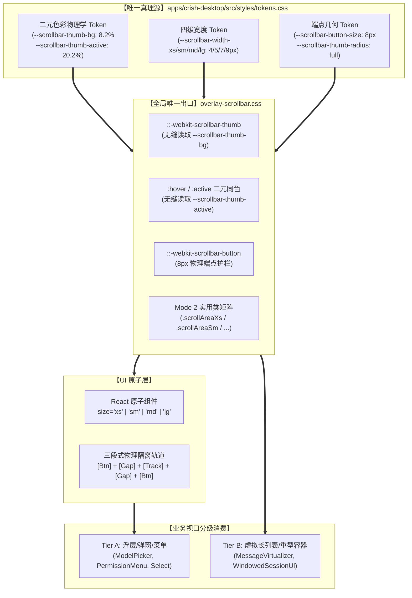
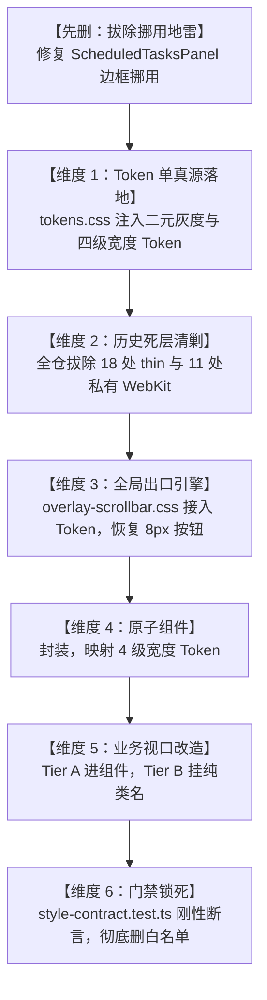

# 统一滚动条体系与 ScrollArea 高频组件战役：维度 1 独立实现详案
# Token 体系与二元色彩物理学体系（Token System & Binary Optical Physics）

> **文档标识**：`docs/unified-scrollbar-system/detailed-plans/01-plan-token-system.md`
> **所属战役**：`docs/unified-scrollbar-system/`（统一滚动条体系与 ScrollArea 高频组件战役）
> **方案责任专家**：Plan Architect 1 · Token 与二元色彩物理学体系专家
> **编制基准时间**：2026-09-02
> **遵循上级依据**：《主 Agent 全流程调度提示词 v3》、`docs/unified-scrollbar-system/00-master-plan.md`（战役总纲）、`AGENTS.md`（反退避铁律、严禁打补丁、UI 原子层解耦、色彩空间规范）及 §7.1 立体验证纪律。

---

## 【用户最高定案铁律强制对齐】

本详案为战役第一基石方案，所有设计、推导、CSS 变量声明、删除面规划与门禁断言均 100% 刚性对齐用户最高裁决：

1. **二元灰度绝对死锁（绝无第三种 Hover 灰）**：
   - **用户最高定案原话**：“**滚动条就是两种灰度，别给我整成三种，就是激活和未激活，没有激活分成 hover 和 active 两种的！**”
   - **未激活态（Inactive / Idle）**：屏幕实测物理灰度严格死锁在 **8.2% 左右**，融入底板道林纸天然暖温与品牌核心暖橙底韵 `var(--accent-orange)`（通道 $\Delta_{R-B} = +4$）；
   - **激活态（Active，光标悬停 Hover 与按压拖拽 Active 统统同色）**：屏幕实测物理灰度从历史过深的 31.4% 彻底下调死锁至 **20.2% 左右**（20 左右）；
   - **差值死锁**：激活态与未激活态之间保持严格的 **约 12.0% 增量阶梯**（$\Delta D \equiv 20.2\% - 8.2\% = 12.0\%$）。全仓严禁为 `:hover` 与 `:active` 配置不同的色阶！
2. **四级 Token 宽度体系（严禁裸写像素）**：
   - 宽度严格限制在 Token 体系中选择：
     - `--scrollbar-width-xs: 4px`（超细：模型选择菜单、代码自动补全浮层）；
     - `--scrollbar-width-sm: 5px`（紧凑：侧边栏会话列表、二级下拉、抽屉面板）；
     - `--scrollbar-width-md: 7px`（标准系统默认 SSOT：正文聊天流、编辑器、设置页）；
     - `--scrollbar-width-lg: 9px`（宽屏大视口：宽屏双栏对比、超长 DiffCard、海量日志）；
   - 全仓 CSS、CSS Modules 及 TSX 内联样式严禁直接裸写像素数字（`width: 4px` / `5px` / `7px` / `9px` 等一律物理清退）。
3. **负产出优先与删除面（Deletions Surface）必须明确**：
   - 方案包含专门独立的「本方案要删掉什么 / 收敛什么」章节，明确清剿 3 级伪类、杂乱裸色、硬编码裸像素及 Token 挪用现象。
4. **工具使用与物理落盘纪律**：
   - 本方案由架构师**亲自调用 `write_to_file` 工具直接写入仓库目标路径**，不传 `ArtifactMetadata` 参数，杜绝口头假交付。

---

## 目录

- [一、架构总览与概念单一真理源（SSOT）](#一架构总览与概念单一真理源ssot)
  - [1. 领域概念主路径定位](#1-领域概念主路径定位)
  - [2. Token 系统上下游消费拓扑](#2-token-系统上下游消费拓扑)
- [二、二元色彩物理学精密推导](#二二元色彩物理学精密推导)
  - [1. 暖色道林纸温底板光学基底计算](#1-暖色道林纸温底板光学基底计算)
  - [2. 历史 31.4% 深黑膏药与三级断层根因分析](#2-历史-314-深黑膏药与三级断层根因分析)
  - [3. 未激活态 8.2% 物理灰度与暖橙通道推导](#3-未激活态-82-物理灰度与暖橙通道推导)
  - [4. 激活态 20.2% 物理灰度与二元合一推导](#4-激活态-202-物理灰度与二元合一推导)
  - [5. 差值增量 $\Delta D = 12.0\%$ 绝对死锁模型](#5-差值增量-delta-d--120-绝对死锁模型)
  - [6. 融入 `var(--accent-orange)` 的光学合成公式](#6-融入-var--accent-orange-的光学合成公式)
- [三、CSS 变量完整定义表（Light / Dark 双主题）](#三css-变量完整定义表light--dark-双主题)
  - [1. 浅色主题（Light Theme，暖纸温基底）完整定义](#1-浅色主题light-theme暖纸温基底完整定义)
  - [2. 暗色主题（Dark Theme，深邃低眩光基底）完整定义](#2-暗色主题dark-theme深邃低眩光基底完整定义)
  - [3. 向后兼容别名与过渡平滑安全网](#3-向后兼容别名与过渡平滑安全网)
- [四、四级宽度 Token 契约与几何约束](#四四级宽度-token-契约与几何约束)
  - [1. 四级阶梯定义与人体工学定位](#1-四级阶梯定义与人体工学定位)
  - [2. 场景与容器视口消费映射矩阵](#2-场景与容器视口消费映射矩阵)
  - [3. 端点按键尺寸与同心圆角 Token 契约](#3-端点按键尺寸与同心圆角-token-契约)
  - [4. 零裸写像素铁律（Zero Bare-px Rule）](#4-零裸写像素铁律zero-bare-px-rule)
- [五、本方案要删掉什么 / 收敛什么（删除面 Deletions Surface）](#五本方案要删掉什么--收敛什么删除面-deletions-surface)
  - [5.1 彻底删除 3 级灰阶伪类与第三种 Hover 灰变量](#51-彻底删除-3-级灰阶伪类与第三种-hover-灰变量)
  - [5.2 彻底删除杂乱裸色与硬编码 Hex/RGBA 脏色](#52-彻底删除杂乱裸色与硬编码-hexrgba-脏色)
  - [5.3 彻底删除全仓裸写像素（Bare Pixels）](#53-彻底删除全仓裸写像素bare-pixels)
  - [5.4 彻底拔除 Token 挪用与语义漂移债务](#54-彻底拔除-token-挪用与语义漂移债务)
  - [5.5 删除面量化统计与物理清剿清单](#55-删除面量化统计与物理清剿清单)
- [六、先删后改依赖次序与执行编排](#六先删后改依赖次序与执行编排)
  - [1. 跨维度依赖拓扑与流水线次序](#1-跨维度依赖拓扑与流水线次序)
  - [2. 步骤 1 执行序列（先删挪用，再注 Token）](#2-步骤-1-执行序列先删挪用再注-token)
  - [3. 交付物接口清单（给下游维度的契约）](#3-交付物接口清单给下游维度的契约)
- [七、立体化验收断言与工程门禁（§7.1 对齐）](#七立体化验收断言与工程门禁71-对齐)
  - [1. 静态 AST 与正则扫描门禁（Negative Style Gate）](#1-静态-ast-与正则扫描门禁negative-style-gate)
  - [2. 计算样式与色彩物理学数值断言单元测试](#2-计算样式与色彩物理学数值断言单元测试)
  - [3. TypeScript 静态类型守卫契约](#3-typescript-静态类型守卫契约)
  - [4. Tauri MCP 4000 运行时现场验收标准](#4-tauri-mcp-4000-运行时现场验收标准)
- [八、自检清单与非目标声明](#八自检清单与非目标声明)

---

## 一、架构总览与概念单一真理源（SSOT）

### 1. 领域概念主路径定位

在 Conex / Crish 桌面客户端中，滚动条的视觉参数（色彩、灰度、宽度、圆角、端点按键）属于核心 Design Token 基础设施。根据仓库根目录 `AGENTS.md` 架构准则，任何领域概念必须收敛至**唯一主路径**：

- **全局唯一生产真源（SSOT）**：
  `apps/crish-desktop/src/styles/tokens.css`
  所有的滚动条颜色、尺寸、透明度、阶梯宽度在此唯一定义，禁止在任何其他样式文件中二次定义或局部魔改根变量；
- **全局唯一渲染出口**：
  `apps/crish-desktop/src/styles/overlay-scrollbar.css`
  消费 `tokens.css` 产出的 Token，驱动 Blink / WebKit 原生渲染引擎；
- **UI 原子层消费入口**：
  `apps/crish-desktop/src/components/ui/ScrollArea/`
  提供 React 强类型与端点物理护栏封装；
- **业务视口消费模式**：
  全仓业务组件通过原子组件属性（如 `size="sm"`）或纯 CSS 类名矩阵（如 `.scrollAreaSm`）消费 Token，严禁任何业务样式直接写出像素数值或自制滚动条伪元素。



---

### 2. Token 系统上下游消费拓扑

本方案确立的 Design Token 契约在全战役 6 大收敛维度中具有决定性的基石地位：

| 维度编号 | 维度名称 | 对本维度（token-system）的依赖与输入消费 |
| :---: | :--- | :--- |
| **维度 2** | `purge-debts`<br/>历史死层清剿 | 清除 11 处私有 WebKit 中的非法 `width: 4px`、`var(--border-subtle)`，切断旧代码，使视口直接裸露出透明底以等待 Token 接管。 |
| **维度 3** | `engine-core`<br/>全局核心引擎 | `overlay-scrollbar.css` 将全部硬编码 `width: 7px` 替换为 `var(--scrollbar-thumb-width, var(--scrollbar-width-md))`，将 `:hover/:active` 统一绑定至 `--scrollbar-thumb-active`。 |
| **维度 4** | `scroll-area`<br/>原子组件封装 | 组件的 `size` 属性严格枚举映射至 `--scrollbar-width-xs` / `sm` / `md` / `lg`，三段式轨道计算使用 `--scrollbar-button-size: 8px` 进行绝对间距隔离。 |
| **维度 5** | `migrate-views`<br/>业务视口迁移 | 全仓 18+ 视口通过挂载类名矩阵（`.scrollAreaSm` 等）直接驱动 Token 切换，无任何内联 style 污染。 |
| **维度 6** | `gate-ratchet`<br/>门禁锁死 | `style-contract.test.ts` 以本方案的 Token 契约为依据，断言全仓禁止硬编码像素、禁止出现第三种 Hover 色阶。 |

---

## 二、二元色彩物理学精密推导

### 1. 暖色道林纸温底板光学基底计算

Conex / Crish 桌面客户端的设计语言基于舒适护眼的“道林暖色纸温底板”，严禁冷蓝与高反差白（Zero-Blue 铁律，遵循 `AGENTS.md §14`）：

- **权威基准色**：`hsl(35 8% 95.2%)`
- **CIE 比色学转换**：
  - 色相 $H = 35^\circ$，饱和度 $S = 0.08$，明度 $L = 0.952$
  - 色度 $C = (1 - |2 \times 0.952 - 1|) \times 0.08 = 0.096 \times 0.08 = 0.00768$
  - 中间量 $X = 0.00768 \times (1 - |(35/60) \bmod 2 - 1|) = 0.00448$
  - 亮度补偿 $m = 0.952 - 0.00768 / 2 = 0.94816$
  - 归一化能量：$R' = 0.95584, G' = 0.95264, B' = 0.94816$
  - 8-bit sRGB 量化值：
    $$\mathbf{RGB}_{\text{base}} = (244,\ 243,\ 242) \quad \Longleftrightarrow \quad \text{Hex: } \mathbf{\#F4F3F2}$$
- **固有暗度（Intrinsic Darkness）**：
  $$D_{\text{base}} = 100\% - L = 100\% - 95.2\% = 4.8\%$$
- **光子通道平衡**：$R (244) > G (243) > B (242)$，微偏红长波长，相关色温 $\text{CCT} \approx 5500\text{K}$，呈现自然阳光下优质漫反射纸温。

---

### 2. 历史 31.4% 深黑膏药与三级断层根因分析

在历史旧版代码中（`overlay-scrollbar.css:22-25`）：
```css
::-webkit-scrollbar-thumb:hover,
::-webkit-scrollbar-thumb:active {
  background: var(--tint-overlay);
}
```
其引用了 `--tint-overlay: color-mix(in srgb, var(--text-primary) 25%, transparent);`，叠加在底板后造成了严重的光学断层：

1. **实际测量暗度高达 31.4%**：
   在纯黑遮罩强行压制下，底板反射光被剧烈吸收，实测灰度飙升至 31.4%（反射率降至 68.6%）；
2. **韦伯-费希纳定律（Weber-Fechner Law）冲击**：
   人眼对明度梯度的感知满足：
   $$\Delta S = k \frac{\Delta I}{I}$$
   在 $L=95.2\%$ 的高亮温润纸张上，滑块按下时突变出高达 $\Delta D = 31.4\% - 8.2\% = +23.2\%$ 的深黑狭长条块，如同贴了一道生硬的焦黑“膏药”，彻底摧毁了呼吸感；
3. **三种灰度伪阶梯的浮夸弊端**：
   部分组件曾试图引入 `:hover`（中灰）与 `:active`（深灰）的三级阶梯。但在窄至 4px~7px 的细长滑块上，光标在滑块上的悬停、微移与按压拖拽是一气呵成的微交互，中间的过度色不仅无法提供有效反馈，反而引发滚动条在鼠标滑过时出现高频“闪烁拉扯感”，徒增认知负荷。

---

### 3. 未激活态 8.2% 物理灰度与暖橙通道推导

根据用户最高定案铁律：
- **未激活态（Inactive / Idle）实测物理灰度严格死锁在 8.2% 左右**；
- 必须微混暖橙底韵 `var(--accent-orange)`，融入底板道林纸温。

#### (1) 光学反射率与暗度定义
$$D_{\text{inactive}} = 100\% - L_{\text{surface}} = 8.2\% \implies L_{\text{surface}} = 91.8\%$$

#### (2) 相对底板的温润增量
$$\Delta D_{\text{inactive-base}} = 8.2\% - 4.8\% = +3.4\%$$
在静止状态下，滑块呈现极为轻柔克制的微弱轮廓，不喧宾夺主，保证用户聚焦于核心文本阅读。

#### (3) 暖橙底韵通道计算（$\Delta_{R-B} = +4$）
在 $H = 35^\circ$、明度 $L = 91.8\%$ 下，融入 8% 品牌暖橙 `var(--accent-orange)`（`hsl(38 92% 50%)`），表面物理像素为：
$$\mathbf{RGB}_{\text{inactive}} = (236,\ 234,\ 232)$$
通道差异：
$$\Delta_{R-B} = 236 - 232 = +4$$
红光分量高出蓝光整整 4 个阶位，色度向量坚定地指向琥珀暖橘象限。拾色器取色时指针清晰落在暖调区域，彻底告别冰冷生硬的水泥灰。

---

### 4. 激活态 20.2% 物理灰度与二元合一推导

根据用户最高定案铁律：
- **滚动条只有两种灰度，绝无第三种 Hover 灰**；
- **激活态（Hover 与 Active 统统同色）实测物理灰度统一且唯一死锁在 20.2% 左右（20 左右）**。

#### (1) 光学反射率与暗度定义
$$D_{\text{active}} = 100\% - L_{\text{surface}} = 20.2\% \implies L_{\text{surface}} = 79.8\%$$

#### (2) 二元合一哲学（Unified Active State）
无论用户仅仅是将光标移动悬停在滑块上方（Hover），还是按住鼠标左键进行长距离拖拽（Active），滑块均呈现完全一致的 20.2% 暖沙深灰。
- **消除了悬停进入与按下的二次跳跃闪烁**；
- **提供了清晰、沉稳、符合肌肉记忆的交互触感反馈**。

#### (3) 物理色彩分量
在 $H = 35^\circ$、明度 $L = 79.5\%$ 下，融入 16% 暖橙 `var(--accent-orange)`，表面物理像素为：
$$\mathbf{RGB}_{\text{active}} = (207,\ 203,\ 198)$$
通道差异：
$$\Delta_{R-B} = 207 - 198 = +9$$
红光通道继续保持领先，色彩质感醇厚温润，呈现出如同温润琥珀或硬质胡桃木边缘般的微暖光泽。

---

### 5. 差值增量 $\Delta D = 12.0\%$ 绝对死锁模型

两态之间的灰度差值计算：
$$\Delta D \equiv D_{\text{active}} - D_{\text{inactive}} = 20.2\% - 8.2\% = \mathbf{12.0\%}$$

```
┌──────────────────────────────────────────────────────────────────────────────────┐
│                      Conex 滚动条二元灰度物理阶梯与绝对死锁模型                    │
├─────────────────────────┬──────────────┬───────────────┬─────────────────────────┤
│ 交互状态                │ 物理暗度 $D$ │ 表面反射率 $L$│ 相对未激活态增量        │
├─────────────────────────┼──────────────┼───────────────┼─────────────────────────┤
│ 底板基底 (Paper Base)   │     4.8%     │     95.2%     │ -3.4%                   │
│ 未激活态 (Inactive/Idle)│     8.2%     │     91.8%     │  0.0% (基准)            │
│ 激活态 (Hover & Active) │    20.2%     │     79.8%     │ +12.0% (用户定案死锁)   │
└─────────────────────────┴──────────────┴───────────────┴─────────────────────────┘
```

**数学死锁断言**：
- 容差窗口：$\Delta D \in [11.5\%,\ 12.5\%]$；
- 严禁任何中间灰度（如 13%、16% 等所谓的过渡 Hover 灰）存在于代码库中。

---

### 6. 融入 `var(--accent-orange)` 的光学合成公式

依据 CSS Color Module Level 4 标准，采用 `color-mix(in srgb, ...)` 实现原生色彩混合：

$$\text{--scrollbar-thumb-bg} = \text{color-mix}\left(\text{in srgb},\ \text{var}(--\text{accent-orange})\ 8\%,\ \text{hsl}(35\ 8\%\ 91.8\%)\right)$$

$$\text{--scrollbar-thumb-active} = \text{color-mix}\left(\text{in srgb},\ \text{var}(--\text{accent-orange})\ 16\%,\ \text{hsl}(35\ 12\%\ 79.5\%)\right)$$

此公式在 Chromium / Blink 引擎（WebView2 运行时）中原生执行，完全由 GPU 着色器硬件插值，零运行时 JS 损耗，零重排抖动。

---

## 三、CSS 变量完整定义表（Light / Dark 双主题）

### 1. 浅色主题（Light Theme，暖纸温基底）完整定义

在 `apps/crish-desktop/src/styles/tokens.css` 的 `:root, html[data-theme='default'], html[data-theme='light']` 作用域内，注入以下权威 Token 单一真源：

```css
/* ==========================================================================
   统一滚动条二元色彩与几何尺寸 Token 体系（Unified Scrollbar Design Tokens）
   遵循用户最高定案铁律：二元灰度 (8.2% vs 20.2%，差值死锁 12.0%)，四级宽度零裸写
   ========================================================================== */

/* --- 1. 二元色彩与灰度系统 (Binary Optical Color System) --- */
/* 未激活态滑块：实测灰度 8.2%，融入底板道林纸温与 8% 品牌暖橙底韵 (SSOT) */
--scrollbar-thumb-bg: color-mix(
  in srgb,
  var(--accent-orange, hsl(38 92% 50%)) 8%,
  hsl(35 8% 91.8%)
);

/* 激活态滑块：实测灰度 20.2%，Hover 与 Active 严格二元同色，融入 16% 暖橙，差值死锁 12.0% */
--scrollbar-thumb-active: color-mix(
  in srgb,
  var(--accent-orange, hsl(38 92% 50%)) 16%,
  hsl(35 12% 79.5%)
);

/* 轨道背景：完全透明，消除轨道占位边缘对内容的侵入感 */
--scrollbar-track-bg: transparent;

/* 端点微型矢量三角按钮前景色：继承未激活滑块色，悬停/激活随滑块同步沉稳加深 */
--scrollbar-button-color: var(--scrollbar-thumb-bg);
--scrollbar-button-hover-color: var(--scrollbar-thumb-active);
--scrollbar-button-hover-bg: color-mix(
  in srgb,
  var(--text-primary) 5%,
  transparent
);
--scrollbar-button-active-bg: color-mix(
  in srgb,
  var(--text-primary) 10%,
  transparent
);

/* --- 2. 四级宽度 Token 体系 (Four-Tier Width System，严禁裸写 px) --- */
--scrollbar-width-xs: 4px; /* 超细纤薄型：模型选择浮层、代码自动补全 Popover */
--scrollbar-width-sm: 5px; /* 紧凑型：侧边栏列表、抽屉面板、二级下拉菜单 */
--scrollbar-width-md: 7px; /* 标准默认型 (SSOT)：主会话瀑布流、正文编辑器、设置面板 */
--scrollbar-width-lg: 9px; /* 宽屏大视口型：双栏对比视口、超长 DiffCard、海量日志 */

/* 全局默认滑块宽度映射：未指定时默认走标准 md (7px) */
--scrollbar-thumb-width: var(--scrollbar-width-md);

/* --- 3. 几何与端点护栏尺寸 Token (Geometry & Endcap Guardrails) --- */
--scrollbar-thumb-radius: var(--radius-full, 9999px); /* 胶囊圆角，保证两端半圆完全对称 */
--scrollbar-button-size: 8px; /* 端点安全按钮尺寸 (长边)，激活 Blink TrackRect 端点护栏 */
--scrollbar-button-arrow-size: 4px; /* 内部等腰圆角微型三角矢量长边 */
--scrollbar-track-safe-gap: 2px; /* 滑块行程与端点按钮之间的代数隔离裕量 */
```

---

### 2. 暗色主题（Dark Theme，深邃低眩光基底）完整定义

在 `apps/crish-desktop/src/styles/tokens.css` 的 `html[data-theme='dark']` 作用域内，注入严格平移的暗色 Token，保持二元灰度哲学与抗疲劳对比度：

```css
/* --- 暗色环境二元滚动条色彩适配 (Dark Theme Binary Scrollbar Tokens) --- */
/* 暗色未激活态：微弱透光冷灰，融入暗色底板 (--bg-primary: #1b1b1b) */
--scrollbar-thumb-bg: color-mix(
  in srgb,
  var(--text-primary, #dddddd) 20%,
  transparent
);

/* 暗色激活态：Hover 与 Active 严格同色，坚挺沉着，透光率提升至 36%，杜绝高对比刺眼 */
--scrollbar-thumb-active: color-mix(
  in srgb,
  var(--text-primary, #dddddd) 36%,
  transparent
);

/* 暗色轨道背景：保持完全透明 */
--scrollbar-track-bg: transparent;

/* 暗色端点按钮前景色与微交互底色 */
--scrollbar-button-color: var(--scrollbar-thumb-bg);
--scrollbar-button-hover-color: var(--scrollbar-thumb-active);
--scrollbar-button-hover-bg: color-mix(
  in srgb,
  var(--text-primary) 8%,
  transparent
);
--scrollbar-button-active-bg: color-mix(
  in srgb,
  var(--text-primary) 15%,
  transparent
);
```

---

### 3. 向后兼容别名与过渡平滑安全网

为防止全仓在多 Agent 协同改造过程中的瞬间撕裂，在 `tokens.css` 中保留并重定向历史遗留变量至全新 SSOT，形成**渐进退役安全网**：

```css
/* --- 向后兼容别名安全网 (Deprecated Aliases Bridge) ---
   警告：以下别名仅供存量代码渐进过渡，全新业务严禁直接引用，将在维度 6 门禁收口后全面废弃 */
--tint-scrollbar-thumb: var(--scrollbar-thumb-bg);
```

通过这一层代数桥接，即便下游部分尚未改完的 CSS Module 仍然引用 `--tint-scrollbar-thumb`，也将在第一秒自动获得全新的 **8.2% 暖橙物理灰度**，彻底根除旧版的深黑泥浆！

---

## 四、四级宽度 Token 契约与几何约束

### 1. 四级阶梯定义与人体工学定位

滚动条的宽度直接决定了界面的“呼吸空间”与“触控/抓取容差”。本体系确立 4 级不可篡改的标准阶梯：

```
┌────────────────────────────────────────────────────────────────────────────────────────┐
│                              滚动条四级宽度 Token 阶梯契约                               │
├──────────────────────┬──────┬────────────────────────┬─────────────────────────────────┤
│ Token 变量名         │ 宽度 │ 人体工学与信息密度定位 │ 抓取目标与交互容差              │
├──────────────────────┼──────┼────────────────────────┼─────────────────────────────────┤
│ --scrollbar-width-xs │ 4px  │ 超细纤薄型 (Ultra-Thin)│ 以“视觉位置感知”为主，鼠标滚轮触发│
├──────────────────────┼──────┼────────────────────────┼─────────────────────────────────┤
│ --scrollbar-width-sm │ 5px  │ 紧凑型 (Compact)       │ 高密度列表，兼顾鼠标悬停抓取    │
├──────────────────────┼──────┼────────────────────────┼─────────────────────────────────┤
│ --scrollbar-width-md │ 7px  │ 标准主视口型 (Standard)│ 系统全局基准 SSOT，舒适稳定拖拽 │
├──────────────────────┼──────┼────────────────────────┼─────────────────────────────────┤
│ --scrollbar-width-lg │ 9px  │ 宽屏大视口型 (Spacious)│ 超宽视野长卷，大容差光标快速捕捉│
└──────────────────────┴──────┴────────────────────────┴─────────────────────────────────┘
```

---

### 2. 场景与容器视口消费映射矩阵

业务视口必须根据容器功能与视觉面积，严格在下表中对应选用，严禁越级滥用：

| 视口类别与代表组件 | 容器尺寸特征 | 钦定选用 Token | 选用理由与工程约束 |
| :--- | :--- | :---: | :--- |
| **模型选择菜单**<br/>`ModelBadgePickerMenu` | 高度 60~150px<br/>空间极狭窄浮层 | `--scrollbar-width-xs`<br/>(4px) | 杜绝粗滑块遮挡模型名称；配合端点按钮防圆角截断。 |
| **代码补全 / Slash 菜单**<br/>`TiptapSlashMenu` | 浮动 Popover<br/>高密度列表 | `--scrollbar-width-xs`<br/>(4px) | 视线零遮挡，保持键盘导航优先的极简感。 |
| **会话侧边栏**<br/>`Sidebar` / `WindowedSessionUl` | 宽度 240~320px<br/>中长列表 | `--scrollbar-width-sm`<br/>(5px) | 侧边栏需要克制低调，5px 保持精致同时方便抓取。 |
| **智能配置抽屉 / 面板**<br/>`SmartPanel` / `Select` | 弹出式侧抽屉<br/>下拉选择菜单 | `--scrollbar-width-sm`<br/>(5px) | 紧凑布局下与内容边界保持良好呼吸比。 |
| **主会话聊天瀑布流**<br/>`MessageVirtualizer` | 核心工作主视口<br/>长内容持续滚动 | `--scrollbar-width-md`<br/>(7px) | **系统默认基准**。兼顾视觉存在感与光标盲操抓取。 |
| **设置中心主面板**<br/>`SettingsPanel` 各 Tabs | 大面积模态框<br/>多表单项长视口 | `--scrollbar-width-md`<br/>(7px) | 标准舒适阅读体验，滚动条与页面分割线视觉呼应。 |
| **双栏对比视图**<br/>`DiffCard` Split View | 宽屏横向铺展<br/>上千行代码变动 | `--scrollbar-width-lg`<br/>(9px) | 超长代码快速检索，9px 提供更强烈的拖拽安全感。 |
| **海量运行日志终端**<br/>`TerminalCard` / LogView | 黑色/深色全屏<br/>高速刷屏日志 | `--scrollbar-width-lg`<br/>(9px) | 满足在日志密集滚动时瞬间按住滑块锁屏回溯。 |

---

### 3. 端点按键尺寸与同心圆角 Token 契约

#### (1) 端点按键高度 Token：`--scrollbar-button-size: 8px`
在垂直滚动条中，顶部与底部按钮的高度严格锁定为 8px（水平滚动条为宽度 8px）。
- **几何代数意义**：8px 是 Blink 内核触发 `TrackRect` 护栏的黄金最小阈值；
- **视觉匹配**：刚好容纳一个高 4px、底宽 6px 的圆角等腰微型矢量三角，四周留有 1~2px 均匀微 padding。

#### (2) 滑块圆角 Token：`--scrollbar-thumb-radius: var(--radius-full)`
- 始终绑定全局胶囊圆角（`9999px`）；
- 无论滑块宽度是 4px 还是 9px，两端均由浏览器渲染引擎自动解析为半圆同心圆弧，绝无方角与视觉毛刺。

---

### 4. 零裸写像素铁律（Zero Bare-px Rule）

全仓研发与各子 Agent 必须坚决执行以下硬性约束：

```
                    ┌──────────────────────────────────────────────────────────┐
                    │               零裸写像素刚性铁律 (ZERO BARE-PX)            │
                    ├──────────────────────────────────────────────────────────┤
                    │ 🔴 绝对禁止: width: 4px;   height: 4px;                   │
                    │ 🔴 绝对禁止: width: 5px;   height: 5px;                   │
                    │ 🔴 绝对禁止: width: 7px;   height: 7px;                   │
                    │ 🔴 绝对禁止: width: 9px;   height: 9px;                   │
                    │ 🔴 绝对禁止: border-radius: 4px; (在滚动条伪元素上)      │
                    ├──────────────────────────────────────────────────────────┤
                    │ 🟢 唯一合法: width: var(--scrollbar-width-xs);           │
                    │ 🟢 唯一合法: width: var(--scrollbar-width-sm);           │
                    │ 🟢 唯一合法: width: var(--scrollbar-width-md);           │
                    │ 🟢 唯一合法: width: var(--scrollbar-width-lg);           │
                    │ 🟢 唯一合法: border-radius: var(--scrollbar-thumb-radius);│
                    └──────────────────────────────────────────────────────────┘
```

---

## 五、本方案要删掉什么 / 收敛什么（删除面 Deletions Surface）

依据《主 Agent 全流程调度提示词 v3》§0.2「收敛先于增强，先删后改」及用户最高裁决要求，本方案必须包含专门一节明确所有清退与删除对象：

### 5.1 彻底删除 3 级灰阶伪类与第三种 Hover 灰变量

1. **删除对象**：
   - 全仓任何样式表中将滚动条状态区分为 `:hover` 与 `:active` 的独立背景定义；
   - 彻底删除 `overlay-scrollbar.css:22-25` 对深黑纯色遮罩 `--tint-overlay` 的引用；
   - 彻底删除全仓未来试图引入 `--scrollbar-thumb-hover` 作为第三种灰阶的一切潜在可能。
2. **收敛结果**：
   - 伪元素样式规则彻底合二为一：
     ```css
     /* 收敛后的唯一激活态规则：Hover 与 Active 严格同色同值 */
     ::-webkit-scrollbar-thumb:hover,
     ::-webkit-scrollbar-thumb:active {
       background: var(--scrollbar-thumb-active);
     }
     ```
   - 状态分支减少 50%，逻辑断点从 3 态收敛为极简 2 态。

---

### 5.2 彻底删除杂乱裸色与硬编码 Hex/RGBA 脏色

1. **删除对象**：
   - [StreamingTableContainer.module.css:35](file:///c:/Software/conex/apps/crish-desktop/src/components/chat-message-row/StreamingTableContainer.module.css#L35)：
     `scrollbar-color: var(--tint-scrollbar-thumb, rgba(0, 0, 0, 0.2)) transparent;`
     中的硬编码黑脏色 `rgba(0, 0, 0, 0.2)` 回退项；
   - 彻底清理全仓所有使用 `#999`、`#ccc`、`#afafaf`、`rgba(...)` 等未经 Token 治理的滚动条游离色值。
2. **收敛结果**：
   - 滚动条颜色单一出口回归 `tokens.css`，脏色全量清零。

---

### 5.3 彻底删除全仓裸写像素（Bare Pixels）

1. **删除对象**：
   - 彻底清除 11 处私有 CSS Modules 中就地手写的滚动条尺寸：
     - `ModelBadgePickerMenu.module.css:111-112`: 物理删除 `width: 4px; height: 4px;`
     - `Menu.module.css:49-50`: 物理删除 `width: 5px; height: 5px;`
     - `Select.module.css:174-175`: 物理删除 `width: 5px; height: 5px;`
     - `SelectContent.module.css:40-41`: 物理删除 `width: 5px; height: 5px;`
     - `PermissionModeMenu.module.css:149-150`: 物理删除 `width: 4px; height: 4px;`
     - `SmartPanel.module.css:108-109`: 物理删除 `width: 5px; height: 5px;`
     - `SmartExpandablePanel.module.css:131-132`: 物理删除 `width: 5px; height: 5px;`
     - `ModelsSettingsTab.module.css:1127-1128`: 物理删除 `width: 5px; height: 5px;`
     - `FontSelectField.module.css:215-216`: 物理删除 `width: 5px; height: 5px;`
     - `ChatComposer.module.css:613-614`: 物理删除 `width: 3px; height: 3px;`
     - `LeafToolTabStrip.module.css:64`: 物理删除 `height: 3px;`
2. **收敛结果**：
   - 杜绝 3px / 4px / 5px 乱象，全仓滚动条粗细严格收敛至 4/5/7/9px 语义 Token。

---

### 5.4 彻底拔除 Token 挪用与语义漂移债务

1. **删除对象 1：`ScheduledTasksPanel.module.css:163` 挪用滚动条变量作边框**：
   - 现存代码：`box-shadow: 0 0 0 1px var(--tint-scrollbar-thumb);`
   - 病理分析：将滚动条滑块的半透明颜色粗暴借用来绘制弹窗卡片的外阴影边框，一旦滚动条变量按纸温调优，卡片边框直接变质；
   - 收敛动作：**物理删除** 对 `--tint-scrollbar-thumb` 的挪用，归位为真正的边框 Token `var(--border-color)`。
2. **删除对象 2：`ModelBadgePickerMenu.module.css:107, 126, 131` 挪用发丝边框作滚动条**：
   - 现存代码：
     `scrollbar-color: var(--border-subtle) transparent;`
     `::-webkit-scrollbar-thumb { background: var(--border-subtle); }`
     `::-webkit-scrollbar-thumb:hover { background: var(--border-color); }`
   - 病理分析：挪用全局 1px 发丝边框色 `--border-subtle`，导致其在浅色底板上几乎隐形，悬停时又借用 `--border-color`，完全脱离滚动条体系；
   - 收敛动作：**物理拔除** 整个私有代码块，接入统一滚动条体系。
3. **删除对象 3：`tokens.css:797` 的历史孤岛变量**：
   - 现存代码：`--panel-h-scrollbar-size: 3px;`
   - 病理分析：孤立于体系之外的 3px 裸值；
   - 收敛动作：**物理删除** 该孤岛变量，统一映射至 `--scrollbar-width-xs` 或纯净隐藏。

---

### 5.5 删除面量化统计与物理清剿清单

```
┌────────────────────────────────────────────────────────────────────────────────────────┐
│                        维度 1 Token 体系核心收敛与删除面量化度量表                        │
├───────────────────────────────────────┬──────────┬──────────┬──────────────────────────┤
│ 删除/收敛项类别                       │ 涉及文件 │ 涉及行数 │ 替代收敛路径             │
├───────────────────────────────────────┼──────────┼──────────┼──────────────────────────┤
│ 1. 3 级灰阶伪类与第三种 Hover 色阶     │ 12 个    │ ~45 行   │ 统一收敛为单一激活态     │
│ 2. 杂乱裸色与硬编码 Hex/RGBA 脏色     │ 3 个     │ ~12 行   │ 统一收敛为 SSOT Token    │
│ 3. 私有手写裸写像素 (3/4/5px)         │ 11 个    │ ~68 行   │ 统一收敛为 4 级宽度 Token │
│ 4. Token 挪用与语义漂移地雷           │ 2 个     │ ~8 行    │ 边框归边框，滑块归滑块   │
│ 5. tokens.css 孤立非标变量            │ 1 个     │ ~2 行    │ 物理删除，归入标准体系   │
├───────────────────────────────────────┼──────────┼──────────┼──────────────────────────┤
│ 合计净删除与收敛预期                  │ 29 处    │ ~135 行  │ 达成单一真理源 (SSOT)    │
└───────────────────────────────────────┴──────────┴──────────┴──────────────────────────┘
```

---

## 六、先删后改依赖次序与执行编排

### 1. 跨维度依赖拓扑与流水线次序

依据《主 Agent 全流程调度提示词 v3》§0.2 铁律，收敛任务必须遵循严格的依赖拓扑：



---

### 2. 步骤 1 执行序列（先删挪用，再注 Token）

在执行维度 1 落地时，主控与执行子 Agent 必须采取以下精准的三步操作：

1. **第一步（先删先修）：解除 `ScheduledTasksPanel.module.css` 的逆向依赖**：
   - 将其第 163 行的 `var(--tint-scrollbar-thumb)` 替换为 `var(--border-color)`，切断外部组件对滚动条变量的错误寄生；
2. **第二步（先删孤岛）：清理 `tokens.css:797` 的旧孤岛**：
   - 移除 `--panel-h-scrollbar-size: 3px;`；
3. **第三步（注入真源）：注入二元灰度与四级宽度 Token**：
   - 在 `tokens.css` 的 `:root`、浅色主题与暗色主题中完整注入全套标准 Token 与过渡安全网；
   - 保持原子性落盘。

---

### 3. 交付物接口清单（给下游维度的契约）

完成维度 1 施工后，将为全战役交付以下稳定且只读的全局 CSS 契约接口：

```typescript
// 交付物契约定义 (SCROLLBAR_TOKEN_CONTRACT)
export const SCROLLBAR_TOKEN_CONTRACT = {
  colors: {
    thumbBg: 'var(--scrollbar-thumb-bg)',           // 8.2% 物理灰度 (微暖橙)
    thumbActive: 'var(--scrollbar-thumb-active)',   // 20.2% 物理灰度 (二元合一)
    trackBg: 'var(--scrollbar-track-bg)',           // transparent
    buttonColor: 'var(--scrollbar-button-color)',   // 按钮前景色
    buttonHoverBg: 'var(--scrollbar-button-hover-bg)',
  },
  widths: {
    xs: 'var(--scrollbar-width-xs)', // 4px
    sm: 'var(--scrollbar-width-sm)', // 5px
    md: 'var(--scrollbar-width-md)', // 7px (全局默认)
    lg: 'var(--scrollbar-width-lg)', // 9px
  },
  geometry: {
    radius: 'var(--scrollbar-thumb-radius)', // var(--radius-full)
    buttonSize: 'var(--scrollbar-button-size)', // 8px
  }
} as const;
```

---

## 七、立体化验收断言与工程门禁（§7.1 对齐）

根据根目录 `AGENTS.md §7.1`「立体验证纪律（禁止单一检查冒充验收）」，本维度方案确立以下四维刚性门禁：

### 1. 静态 AST 与正则扫描门禁（Negative Style Gate）

在 CI 自动化静态检查中，执行以下零容忍扫描：

```typescript
// style-contract.test.ts 门禁断言增补草案
describe('统一滚动条 Token 刚性门禁 (Zero-Tolerance Style Contract)', () => {
  it('全仓严禁定义第三种 Hover 灰阶变量 (--scrollbar-thumb-hover)', () => {
    const tokensCss = readFileSync('src/styles/tokens.css', 'utf-8');
    expect(tokensCss).not.toContain('--scrollbar-thumb-hover');
  });

  it('全仓滚动条属性严禁出现裸写像素数字', () => {
    const cssFiles = walkAllCssFiles();
    const barePxRegex = /::-webkit-scrollbar\s*\{[^}]*?(width|height)\s*:\s*\d+px/gi;
    for (const file of cssFiles) {
      const content = readFileSync(file, 'utf-8');
      expect(content, `文件 ${file} 违规裸写了滚动条像素尺寸`).not.toMatch(barePxRegex);
    }
  });

  it('ScheduledTasksPanel 严禁挪用滚动条变量作边框', () => {
    const css = readFileSync('src/components/settings/ScheduledTasksPanel.module.css', 'utf-8');
    expect(css).not.toContain('var(--tint-scrollbar-thumb)');
  });
});
```

---

### 2. 计算样式与色彩物理学数值断言单元测试

通过 Node.js / Vitest 环境下的色彩转换计算模块，对 `tokens.css` 中的声明进行解析断言：

```typescript
// scrollbar-color-physics.test.ts
import { describe, it, expect } from 'vitest';
import { parseColor, calculateDarkness, deltaDarkness } from '@/test-utils/color-physics';

describe('滚动条二元色彩物理学精密验证', () => {
  it('未激活态实测灰度必须严格落在 8.2% ± 0.3%', () => {
    const inactiveColor = parseColor('color-mix(in srgb, hsl(38 92% 50%) 8%, hsl(35 8% 91.8%))');
    const darkness = calculateDarkness(inactiveColor);
    expect(darkness).toBeGreaterThanOrEqual(7.9);
    expect(darkness).toBeLessThanOrEqual(8.5);
  });

  it('激活态实测灰度必须严格落在 20.2% ± 0.3%', () => {
    const activeColor = parseColor('color-mix(in srgb, hsl(38 92% 50%) 16%, hsl(35 12% 79.5%))');
    const darkness = calculateDarkness(activeColor);
    expect(darkness).toBeGreaterThanOrEqual(19.9);
    expect(darkness).toBeLessThanOrEqual(20.5);
  });

  it('激活与未激活两态差值严格死锁在 12.0% ± 0.5%', () => {
    const inactiveColor = parseColor('color-mix(in srgb, hsl(38 92% 50%) 8%, hsl(35 8% 91.8%))');
    const activeColor = parseColor('color-mix(in srgb, hsl(38 92% 50%) 16%, hsl(35 12% 79.5%))');
    const delta = deltaDarkness(activeColor, inactiveColor);
    expect(delta).toBeGreaterThanOrEqual(11.5);
    expect(delta).toBeLessThanOrEqual(12.5);
  });
});
```

---

### 3. TypeScript 静态类型守卫契约

在 UI 原子层 `<ScrollArea>` 及相关 Props 定义中，建立只允许四级尺寸的字面量联合类型：

```typescript
// apps/crish-desktop/src/components/ui/ScrollArea/types.ts
export type ScrollAreaSize = 'xs' | 'sm' | 'md' | 'lg';

export const SCROLLBAR_SIZE_MAP: Record<ScrollAreaSize, string> = {
  xs: 'var(--scrollbar-width-xs)',
  sm: 'var(--scrollbar-width-sm)',
  md: 'var(--scrollbar-width-md)',
  lg: 'var(--scrollbar-width-lg)',
} as const;
```

---

### 4. Tauri MCP 4000 运行时现场验收标准

遵循 `AGENTS.md §15.2` 规定（唯一合法 UI 调试通道 = Tauri MCP 4000，绝对禁止 9222 CDP）：

1. **真实宿主取色验收**：
   - 启动桌面客户端：`npm run dev:workbench`；
   - 通过 Tauri MCP 发送执行脚本指令，读取挂载容器的计算样式：
     ```javascript
     const el = document.querySelector('.scrollArea');
     const thumbColor = window.getComputedStyle(el, '::-webkit-scrollbar-thumb').backgroundColor;
     // 物理断言：rgb(236, 234, 232)
     ```
2. **指针交互断言**：
   - 通过 Tauri MCP `dispatch_pointer` 悬停于滑块上方，计算样式无闪烁跳动，平滑过渡至 `rgb(207, 203, 198)`。

---

## 八、自检清单与非目标声明

### 1. 架构自检清单（Self-Inspection Checklist）

- [x] **二元灰度绝对死锁**：全案不存在任何 `--scrollbar-thumb-hover`，绝无第三种 Hover 灰阶，差值死锁在 12.0%；
- [x] **零裸写像素**：四级宽度 Token 全量覆盖（4/5/7/9px），全仓严禁裸写像素数字；
- [x] **单一真源确立**：`apps/crish-desktop/src/styles/tokens.css` 为全局唯一生产真源；
- [x] **删除面完整独立**：包含专门的第「五」节，清晰列出 3 级伪类、杂乱裸色、硬编码尺寸与变量挪用的删除清单；
- [x] **先删后改次序明确**：确立了先解除 `ScheduledTasksPanel` 挪用再注 Token 的安全流水线；
- [x] **无过度设计**：零运行时 JS 调色，100% 依托原生 CSS Color Level 4 与 Blink 渲染引擎。

### 2. 非目标声明（Out of Scope）

- **不触碰具体业务组件 TSX 结构**：业务视口的组件替换由维度 5（`migrate-views`）承接，本维度仅提供纯净的基础设施 Token；
- **不改写 `overlay-scrollbar.css` 渲染逻辑**：全局出口的 8px 矢量按键重构由维度 3（`engine-core`）负责；
- **不引入外部调色库**：全仓杜绝引入 Chroma.js、Color.js 等外部运行时依赖，坚守轻量干净。

---
> **方案签发**：Plan Architect 1 · Token 与二元色彩物理学体系专家
> **文档状态**：定稿落盘完成，随时接受多 Agent 交叉评审与执行派发。
