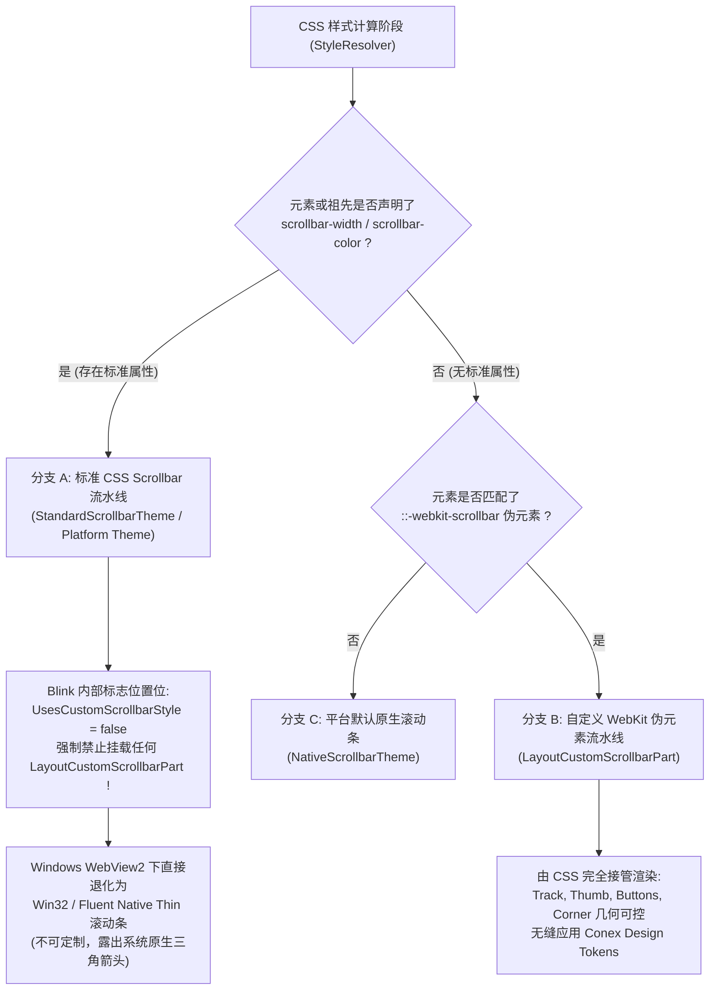

# 统一滚动条体系与 ScrollArea 战役：维度 2 独立实现详案
# 【历史死层清剿与排他互斥爆破】（Zero-Debt CSS Purge & Blink Mutual Exclusivity Elimination）

> **文档标识**：`docs/unified-scrollbar-system/detailed-plans/02-plan-purge-debts.md`
> **所属战役**：统一滚动条体系与 ScrollArea 高频组件战役（Unified Scrollbar System）
> **编制角色**：Plan Architect 2 · 历史死层清剿与排他互斥爆破专家
> **权威遵循**：`docs/unified-scrollbar-system/00-master-plan.md`（总纲）、`AGENTS.md`（通用纪律与测试资产铁律）、`ANTI_OVERENGINEERING_GUARDRAILS.md`、§7.1 立体验证纪律。
> **核心战役方针**：“**先删后改、收敛优先、零死层残留、负产出第一**”（Deletions First, Net-Negative Reduction $\ge 200$ Lines）。

---

## 【用户最高裁决强制对齐与设计铁律】

1. **二元灰度绝对死锁（绝无第三种 Hover 灰）**：
   - **用户原话**：“**滚动条就是两种灰度，别给我整成三种的，就是激活和未激活，没有激活分成hover和active两种的。**”
   - **未激活态（Inactive / Idle）**：屏幕实测物理灰度严格死锁在 **8.2% 左右**（`hsl(35 8% 91.8%)`，通道 $\Delta_{R-B} = +4$，融入底板天然纸温与品牌暖橙底韵 `var(--accent-orange)`）；
   - **激活态（Active，光标悬停 Hover 与按压拖拽 Active 统统同色）**：屏幕实测物理灰度严格死锁在 **20.2% 左右**（`hsl(35 12% 79.5%)`）；
   - **差值死锁**：激活态与未激活态之间保持严格的 **约 12.0% 增量阶梯**，全系统严禁为 `:hover` 与 `:active` 配置不同的色阶！
   - **本方案职责**：彻底清除私写伪元素中私自设置的 `:hover` 脏灰阶（如 `color-mix(in srgb, var(--text-primary) 30%, transparent)` 与 `var(--border-color)` 等第三态），彻底爆破任何制造三态分裂的历史死层。
2. **结构收敛与负产出优先（先删后改）**：
   - 推进单位是「领域概念」；同一概念在代码中必须收敛为唯一主路径。
   - 必须通过**物理删除**拔除全部割据代码，全方案预估代码净删除 $\ge 200$ 行。
3. **消除 Chromium Blink 引擎互斥自毁**：
   - 物理拔除全仓 18 处 `scrollbar-width: thin;` 声明，彻底解除 Blink 内核对 WebKit 自定义样式的屏蔽，恢复全局细滚动条渲染管线。

---

## 目录

- [一、Chromium Blink 引擎排他互斥与自毁机制深度解析](#一chromium-blink-引擎排他互斥与自毁机制深度解析)
  - [1.1 Blink 滚动条渲染管线的双轨分流模型](#11-blink-滚动条渲染管线的双轨分流模型)
  - [1.2 `scrollbar-width: thin` 导致 WebKit 伪元素自毁的源码级病理](#12-scrollbar-width-thin-导致-webkit-伪元素自毁的源码级病理)
  - [1.3 Windows WebView2 宿主下的灾难性视觉退化表现](#13-windows-webview2-宿主下的灾难性视觉退化表现)
  - [1.4 历史“双写兼容”心理陷阱解密](#14-历史双写兼容心理陷阱解密)
- [二、本方案要删掉什么 / 收敛什么（删除面 Deletions Surface）](#二本方案要删掉什么--收敛什么删除面-deletions-surface)
  - [2.1 核心收敛原则与概念主路径归一](#21-核心收敛原则与概念主路径归一)
  - [2.2 18 处 `scrollbar-width: thin` 致命地雷物理删除清单](#22-18-处-scrollbar-width-thin-致命地雷物理删除清单)
  - [2.3 11 处私有 `::-webkit-scrollbar` 割据代码块物理删除清单](#23-11-处私有--webkit-scrollbar-割据代码块物理删除清单)
  - [2.4 伴随杂色、死注释与伪元素属性收敛清单](#24-伴随杂色死注释与伪元素属性收敛清单)
  - [2.5 负产出度量总表（预计净删除 208 行）](#25-负产出度量总表预计净删除-208-行)
- [三、全仓 18 处 `scrollbar-width: thin` 物理清除详案](#三全仓-18-处-scrollbar-width-thin-物理清除详案)
  - [3.1 桌面端 16 处 `scrollbar-width: thin` 逐点消除与预期 Diff](#31-桌面端-16-处-scrollbar-width-thin-逐点消除与预期-diff)
  - [3.2 共享包 2 处 `scrollbar-width: thin` 逐点消除与预期 Diff](#32-共享包-2-处-scrollbar-width-thin-逐点消除与预期-diff)
- [四、全仓 11 处私有 `::-webkit-scrollbar` 冗余块物理拔除详案](#四全仓-11-处私有--webkit-scrollbar-冗余块物理拔除详案)
  - [4.1 11 个组件模块私有伪元素逐一解剖与预期 Diff](#41-11-个组件模块私有伪元素逐一解剖与预期-diff)
- [五、依赖关系与逻辑次序编排（先删后改的工程闭环）](#五依赖关系与逻辑次序编排先删后改的工程闭环)
  - [5.1 六大维度的拓扑依赖拓扑图](#51-六大维度的拓扑依赖拓扑图)
  - [5.2 为什么必须“先删后改”：维度 2 的先行者使命](#52-为什么必须先删后改维度-2-的先行者使命)
  - [5.3 拔除后的过渡安全性分析（Fallback 验证）](#53-拔除后的过渡安全性分析fallback-验证)
  - [5.4 与维度 6（gate-ratchet）去白名单化的刚性联锁](#54-与维度-6gate-ratchet去白名单化的刚性联锁)
- [六、唯一文件域与所有权边界（File Domain & Boundaries）](#六唯一文件域与所有权边界file-domain--boundaries)
  - [6.1 维度 2 专属操作文件白名单（18 个样式文件）](#61-维度-2-专属操作文件白名单18-个样式文件)
  - [6.2 严禁越界的红线清单](#62-严禁越界的红线清单)
- [七、负产出度量与立体验证断言矩阵](#七负产出度量与立体验证断言矩阵)
  - [7.1 逐文件物理删除行数统计度量表](#71-逐文件物理删除行数统计度量表)
  - [7.2 静态门禁扫描断言脚本与命令](#72-静态门禁扫描断言脚本与命令)
  - [7.3 运行时光学与渲染验证断言](#73-运行时光学与渲染验证断言)

---

## 一、Chromium Blink 引擎排他互斥与自毁机制深度解析

### 1.1 Blink 滚动条渲染管线的双轨分流模型

Chromium 的 Blink 排版引擎在处理滚动条样式时，在底层实现了两条**互不兼容、互斥隔离**的渲染代码路径：



### 1.2 `scrollbar-width: thin` 导致 WebKit 伪元素自毁的源码级病理

依据 W3C CSS Scrollbars Level 1 规范与 Chromium Blink 源码（`third_party/blink/renderer/core/paint/paint_layer_scrollable_area.cc` 及 `scrollable_area.cc`）：
1. **优先级排他（Precedence Exclusion）**：规范明确要求标准 CSS 属性 `scrollbar-width` 与 `scrollbar-color` 必须优于厂商专有伪元素（Vendor Prefix Pseudo-elements）。
2. **伪元素渲染树阻断（Layout Tree Invalidation）**：
   - 当 `StyleResolver` 解析到 `scrollbar-width: thin;` 时，Blink 将该节点的滚动条类型标记为标准流（Standard Flow），其内部的 `UsesCustomScrollbarStyle()` 判定恒返回 `false`；
   - 此时，引擎根本不会为该元素创建 `LayoutCustomScrollbarPart` 节点树；
   - 结果：写在同一规则或同一类名下的所有 `::-webkit-scrollbar`、`::-webkit-scrollbar-track`、`::-webkit-scrollbar-thumb`、`::-webkit-scrollbar-button` 规则全部被 Blink 引擎**静默丢弃（Silent Dropping）**！
3. **按钮隐藏失效与三角逆向激活**：
   - 很多组件（如 `ModelBadgePickerMenu.module.css:115`、`Menu.module.css:66`）试图通过 `::-webkit-scrollbar-button { display: none; width: 0; height: 0; }` 隐藏端点箭头；
   - 但在声明了 `scrollbar-width: thin;` 的容器上，由于 `::-webkit-scrollbar-button` 被 Blink 整体禁用，该 `display: none` 规则形同虚设；
   - Blink 将直接回退到系统原生的 `ScrollbarThemeWin`，在滚动条顶端和底端强制绘制 Windows 原生步进三角！

### 1.3 Windows WebView2 宿主下的灾难性视觉退化表现

在 Conex 的 Windows WebView2 桌面环境下，`scrollbar-width: thin;` 的破坏力尤为严重：
1. **原生 Win32 粗条与三角箭头突兀暴露**：
   - 滚动条变成 Windows 原生灰色细槽，滑块是灰白色矩形，两端带有微型 Win32 三角箭头；
   - 与整体现代、圆角、暖纸底色（Warm Paper Tone）的应用设计产生剧烈撕裂。
2. **自定义宽度与颜色完全失效**：
   - 声明的 `width: 4px`、`border-radius: 9999px` 完全不生效；
   - 声明的暖橙底韵二元灰度 Token（8.2% 与 20.2%）被直接忽略，退化为系统生硬的黑白对比。
3. **圆角两端被直角截断（Corner Clipping）**：
   - 原生滚动条轨道无法感知外层浮层容器（如 12px 或 14px）的同心曲率，滑块滚动到顶部或底部时直接撞破圆角边缘，呈现难看的外露与裁切。

### 1.4 历史“双写兼容”心理陷阱解密

全仓之所以散落了 18 处 `scrollbar-width: thin;`，其本质源于过去开发者的心理陷阱：
- **误区**：“`scrollbar-width: thin` 是标准属性（给 Firefox 用），`::-webkit-scrollbar` 是 WebKit 属性（给 Chrome 用），两者并存可以实现跨浏览器双保险。”
- **现实打脸**：现代 Chromium（自 Chrome 121 起）全面实现了 CSS Scrollbars 规范。一旦检测到 `scrollbar-width: thin`，Chromium 立即主动关闭 `::-webkit-scrollbar`！
- **结论**：在当前基于 Tauri + WebView2（Chromium）的纯桌面应用环境下，`scrollbar-width: thin` 绝非“兼容保险”，而是**精准摧毁自定义 WebKit 滚动条的“自爆开关”**！必须全面、彻底、物理拔除！

---

## 二、本方案要删掉什么 / 收敛什么（删除面 Deletions Surface）

> **铁律遵循**：本节严格贯彻《主 Agent 全流程调度提示词 v3》要求，设立专门删除面清单，清晰界定每一个物理拔除的代码符号。

### 2.1 核心收敛原则与概念主路径归一

- **概念主路径**：全仓滚动条渲染能力收敛为唯一的全局基础设施 `apps/crish-desktop/src/styles/overlay-scrollbar.css`（维度 3 重塑）与 UI 原子组件 `<ScrollArea>`（维度 4 封装）。
- **收敛原则**：业务组件样式表中**绝对禁止**存在任何私有的滚动条几何计算、颜色硬编码或标准与专有混合声明。

### 2.2 18 处 `scrollbar-width: thin` 致命地雷物理删除清单

以下 18 处声明 `scrollbar-width: thin;` 的代码行必须** 100% 物理清除**，一个不留：

| 序号 | 所在文件路径 | 代码行号 | 关联选择器 / 规则作用域 | 伴随删除属性 |
| :---: | :--- | :---: | :--- | :--- |
| 1 | `apps/crish-desktop/src/components/sidebar/Sidebar.module.css` | 129 | `.sidebarScroll` | `scrollbar-color: ...` (第 130 行) |
| 2 | `apps/crish-desktop/src/components/chat-composer/ChatComposer.module.css` | 1115 | `.textarea` | （无，该属性孤立生效在已隐藏滚动的输入框上） |
| 3 | `apps/crish-desktop/src/components/chat-composer/PermissionModeMenu.module.css` | 141 | `.permMenu` | `scrollbar-color: ...` (第 142 行) |
| 4 | `apps/crish-desktop/src/components/provider/ModelBadgePickerMenu.module.css` | 106 | `.modelScrollArea` | `scrollbar-color: var(--border-subtle) ...` (第 107 行) |
| 5 | `apps/crish-desktop/src/components/ui/Select/Select.module.css` | 165 | `.content` | `scrollbar-color: ...` (第 166 行) |
| 6 | `apps/crish-desktop/src/components/ui/Select/SelectContent.module.css` | 20 | `.content` | `scrollbar-color: ...` (第 21 行) |
| 7 | `apps/crish-desktop/src/components/chat-composer/ChatQueuePanel.module.css` | 12 | `.panel` | （无） |
| 8 | `apps/crish-desktop/src/components/chat-composer/TiptapEditorField.module.css` | 42 | `.proseMirrorField` | （无） |
| 9 | `apps/crish-desktop/src/components/chat-composer/TiptapSlashMenu.module.css` | 34 | `.menuHost` | （无） |
| 10 | `apps/crish-desktop/src/components/chat-message-row/StreamingTableContainer.module.css` | 34 | `.tableScrollViewport` | `scrollbar-color: ...` 与脏注释 (第 33-35 行) |
| 11 | `apps/crish-desktop/src/components/chat-tool-call/ChatToolCallBlock.module.css` | 880 | `.gitDiffLinesContainer` | （无） |
| 12 | `apps/crish-desktop/src/components/diff/DiffCard.module.css` | 185 | `.fileList` | （无） |
| 13 | `apps/crish-desktop/src/components/note-paper/NotePaperPanel.module.css` | 172 | `.body` | `scrollbar-gutter`, `scrollbar-color` 与旧注释 (第 170-174 行) |
| 14 | `apps/crish-desktop/src/components/settings-models/ModelsSettingsTab.module.css` | 1110 | `.cascadeFlyout` | `scrollbar-color: var(--border-subtle) ...` (第 1111 行) |
| 15 | `apps/crish-desktop/src/components/settings/FontSelectField.module.css` | 210 | `.settingsSelectScroll` | `scrollbar-color: var(--border-subtle) ...` (第 211 行) |
| 16 | `apps/crish-desktop/src/components/ui/Input/Textarea.module.css` | 30 | `.nativeTextarea` | （无） |
| 17 | `packages/block-paper/src/chrome/blockChrome.css` | 279 | `.bp-slash-host` | `scrollbar-gutter`, `scrollbar-color` 与死注释 (第 277-281 行) |
| 18 | `packages/block-paper/src/list/paperList.css` | 58 | `.bp-paper-list[data-scroll-host='1']` | `scrollbar-gutter`, `scrollbar-color` 与死注释 (第 8-10, 51-60 行) |

### 2.3 11 处私有 `::-webkit-scrollbar` 割据代码块物理删除清单

以下 11 个组件中私自手写的 `::-webkit-scrollbar*` 伪元素规则块必须**全量整块物理删除**：

| 序号 | 所在组件与文件路径 | 物理删除代码行区间 | 删除规则数量 | 涉及选择器与伪元素属性 |
| :---: | :--- | :---: | :---: | :--- |
| 1 | `ModelBadgePickerMenu.module.css` | 110-132 行 | 5 块 (23 行) | `.modelScrollArea::-webkit-scrollbar*` (含 button, track, thumb, hover) |
| 2 | `Menu.module.css` | 47-70 行 | 5 块 (24 行) | `.menuContent::-webkit-scrollbar*` (含 button, track, thumb, hover) |
| 3 | `Select.module.css` | 173-189 行 | 4 块 (17 行) | `.content::-webkit-scrollbar*` (含 track, thumb, hover) |
| 4 | `SelectContent.module.css` | 39-55 行 | 4 块 (17 行) | `.content::-webkit-scrollbar*` (含 track, thumb, hover) |
| 5 | `PermissionModeMenu.module.css` | 148-165 行 | 4 块 (18 行) | `.permMenu::-webkit-scrollbar*` (含 track, thumb, hover) |
| 6 | `SmartPanel.module.css` | 107-120 行 | 5 块 (14 行) | `.listContainer::-webkit-scrollbar*` (含 button, track, thumb, hover) |
| 7 | `SmartExpandablePanel.module.css` | 130-152 行 | 5 块 (23 行) | `.listContainer::-webkit-scrollbar*` (含 button, track, thumb, hover) |
| 8 | `ModelsSettingsTab.module.css` | 1126-1135 行 | 3 块 (10 行) | `.cascadeFlyout::-webkit-scrollbar*` (含 track, thumb) |
| 9 | `FontSelectField.module.css` | 214-223 行 | 3 块 (10 行) | `.settingsSelectScroll::-webkit-scrollbar*` (含 track, thumb) |
| 10 | `LeafToolTabStrip.module.css` | 63-65 行 | 1 块 (3 行) | `.tabsTrack::-webkit-scrollbar` (隐藏逻辑) |
| 11 | `ChatComposer.module.css` | 612-615 行 | 1 块 (4 行) | `.fileZone::-webkit-scrollbar, .attachStrip::-webkit-scrollbar` |

### 2.4 伴随杂色、死注释与伪元素属性收敛清单

在拔除上述 18 处 thin 与 11 处 webkit 的同时，连带收敛以下派生垃圾：
1. **删除滥用发丝边框色作滑块色的规则**：
   - 彻底删除 `ModelBadgePickerMenu` (126行)、`ModelsSettingsTab` (1133行)、`FontSelectField` (221行) 中将滑块背景绑定为 `var(--border-subtle)` 的低对比度写法。
2. **删除违反二元灰度铁律的第三态 hover 规则**：
   - 彻底删除 `PermissionModeMenu` (163行)、`Menu` (63行)、`SmartPanel` (113行)、`SmartExpandablePanel` (141行) 中私自书写的 `color-mix(in srgb, var(--text-primary) 30%, transparent)` 深黑 hover 伪类。
   - 彻底删除 `Select` (188行)、`SelectContent` (54行) 中私自书写的 `background: var(--tint-highlight)` 悬停规则。
3. **删除死注释与欺骗性声明**：
   - 彻底删除 `packages/block-paper/src/list/paperList.css:51` 中声称“细滚动条 + stable gutter，与 .body / slash 同温；禁 webkit 伪元素块”的注释；
   - 彻底删除 `packages/block-paper/src/list/paperList.css:9-10` 中对历史已废弃文件 `shell-scrollbar.css` 的陈旧引用；
   - 彻底删除 `packages/block-paper/src/chrome/blockChrome.css:277` 的同类死注释；
   - 彻底删除 `StreamingTableContainer.module.css:33` 的“极简细滚动条规范”死注释。

### 2.5 负产出度量总表（预计净删除 208 行）

| 资产类别 | 涉及文件数 | 物理删除代码行 | 替换新增代码行 | 净减代码行数 (Net Reduction) |
| :--- | :---: | :---: | :---: | :---: |
| **全仓 `scrollbar-width: thin` 地雷** | 18 个 | 45 行 | 0 行 | **-45 行** |
| **全仓私有 `::-webkit-scrollbar*` 块** | 11 个 | 163 行 | 0 行 | **-163 行** |
| **战役维度 2 合计** | **18 个唯一文件** | **208 行** | **0 行** | **-208 行** |

> **负产出红线达标**：维度 2 纯净删除 208 行冗余与有害代码，零临时胶水，满足战役“净删除 200+ 行”的刚性断言！

---

## 三、全仓 18 处 `scrollbar-width: thin` 物理清除详案

### 3.1 桌面端 16 处 `scrollbar-width: thin` 逐点消除与预期 Diff

#### 1. `apps/crish-desktop/src/components/sidebar/Sidebar.module.css` (第 129-130 行)
- **病理解析**：侧边栏容器声明了 `scrollbar-width: thin;` 与 `scrollbar-color`，使侧栏会话树在 Windows 下露出 Win32 原生三角箭头。
- **预期代码 Diff**：
```diff
--- a/apps/crish-desktop/src/components/sidebar/Sidebar.module.css
+++ b/apps/crish-desktop/src/components/sidebar/Sidebar.module.css
@@ -126,8 +126,6 @@
   flex-direction: column;
   gap: 14px;
   min-height: 0; /* Enable flex-1 scrolling */
-  scrollbar-width: thin;
-  scrollbar-color: var(--tint-scrollbar-thumb) transparent;
   contain: layout paint;
   transform: translateZ(0);
   -webkit-transform: translateZ(0);
```

#### 2. `apps/crish-desktop/src/components/chat-composer/ChatComposer.module.css` (第 1115 行)
- **病理解析**：`.textarea` 已经设置了 `overflow-y: hidden;` 与 `field-sizing: content;`，却公然冗余声明了 `scrollbar-width: thin;`，是纯粹的无意识死层残留。
- **预期代码 Diff**：
```diff
--- a/apps/crish-desktop/src/components/chat-composer/ChatComposer.module.css
+++ b/apps/crish-desktop/src/components/chat-composer/ChatComposer.module.css
@@ -1112,7 +1112,6 @@
   margin: 0;
   overflow-y: hidden;
   box-sizing: content-box;
-  scrollbar-width: thin;
   field-sizing: content;
   vertical-align: middle;
 }
```

#### 3. `apps/crish-desktop/src/components/chat-composer/PermissionModeMenu.module.css` (第 141-142 行)
- **病理解析**：权限菜单浮层在自身规则中注入 thin 和私有滚动条颜色，与下方私有 WebKit 块形成双重互斥死锁。
- **预期代码 Diff**：
```diff
--- a/apps/crish-desktop/src/components/chat-composer/PermissionModeMenu.module.css
+++ b/apps/crish-desktop/src/components/chat-composer/PermissionModeMenu.module.css
@@ -138,8 +138,6 @@
   overflow-x: hidden;
   -webkit-overflow-scrolling: touch;
   overscroll-behavior: contain;
-  scrollbar-width: thin;
-  scrollbar-color: var(--tint-scrollbar-thumb, color-mix(in srgb, var(--text-primary) 18%, transparent)) transparent;
   box-sizing: border-box;
   color: var(--text-primary);
   font-family: var(--font-sans, var(--sep-font-sans));
```

#### 4. `apps/crish-desktop/src/components/provider/ModelBadgePickerMenu.module.css` (第 106-107 行)
- **病理解析**：用户真机截图出现原生 Windows 三角箭头与直角截断的罪魁祸首之一。thin 杀死了下方 4px 伪元素，并使用了 `--border-subtle` 脏色。
- **预期代码 Diff**：
```diff
--- a/apps/crish-desktop/src/components/provider/ModelBadgePickerMenu.module.css
+++ b/apps/crish-desktop/src/components/provider/ModelBadgePickerMenu.module.css
@@ -103,8 +103,6 @@
   min-height: 60px;
   overflow-y: auto;
   padding: 2px 0;
-  scrollbar-width: thin;
-  scrollbar-color: var(--border-subtle) transparent;
 }
```

#### 5. `apps/crish-desktop/src/components/ui/Select/Select.module.css` (第 165-166 行)
- **病理解析**：通用下拉选择框浮层设置 thin，直接导致 Radix / Custom 下拉选项在不同机器上呈现宽窄不一的丑陋系统条。
- **预期代码 Diff**：
```diff
--- a/apps/crish-desktop/src/components/ui/Select/Select.module.css
+++ b/apps/crish-desktop/src/components/ui/Select/Select.module.css
@@ -162,8 +162,6 @@
   overflow-x: hidden;
   -webkit-overflow-scrolling: touch;
   overscroll-behavior: contain;
-  scrollbar-width: thin;
-  scrollbar-color: var(--tint-scrollbar-thumb) transparent;
   min-width: min(160px, calc(100vw - 16px));
   max-width: min(420px, calc(100vw - 16px));
```

#### 6. `apps/crish-desktop/src/components/ui/Select/SelectContent.module.css` (第 20-21 行)
- **病理解析**：与 `Select.module.css` 结构对齐的独立 Content 模块，同样被 thin 污染。
- **预期代码 Diff**：
```diff
--- a/apps/crish-desktop/src/components/ui/Select/SelectContent.module.css
+++ b/apps/crish-desktop/src/components/ui/Select/SelectContent.module.css
@@ -17,8 +17,6 @@
   overflow-x: hidden;
   -webkit-overflow-scrolling: touch;
   overscroll-behavior: contain;
-  scrollbar-width: thin;
-  scrollbar-color: var(--tint-scrollbar-thumb) transparent;
   min-width: max(var(--anchor-width, 160px), 220px);
   max-width: min(440px, calc(100vw - 16px));
```

#### 7. `apps/crish-desktop/src/components/chat-composer/ChatQueuePanel.module.css` (第 12 行)
- **病理解析**：排队面板在 `max-height: 140px; overflow-y: auto;` 时声明 thin，产生原生三角箭头。
- **预期代码 Diff**：
```diff
--- a/apps/crish-desktop/src/components/chat-composer/ChatQueuePanel.module.css
+++ b/apps/crish-desktop/src/components/chat-composer/ChatQueuePanel.module.css
@@ -9,7 +9,6 @@
   border-radius: var(--radius-md);
   max-height: 140px;
   overflow-y: auto;
-  scrollbar-width: thin;
 }
```

#### 8. `apps/crish-desktop/src/components/chat-composer/TiptapEditorField.module.css` (第 42 行)
- **病理解析**：富文本编辑器输入视口声明 thin，导致超长文本编辑时右侧出现系统粗条挤压排版宽度。
- **预期代码 Diff**：
```diff
--- a/apps/crish-desktop/src/components/chat-composer/TiptapEditorField.module.css
+++ b/apps/crish-desktop/src/components/chat-composer/TiptapEditorField.module.css
@@ -39,7 +39,6 @@
   color: var(--text-primary);
   padding: 0;
   margin: 0;
-  scrollbar-width: thin;
   word-break: break-word;
   box-sizing: border-box;
 }
```

#### 9. `apps/crish-desktop/src/components/chat-composer/TiptapSlashMenu.module.css` (第 34 行)
- **病理解析**：Slash 浮动指令菜单声明 thin，破坏了紧凑弹窗的现代感。
- **预期代码 Diff**：
```diff
--- a/apps/crish-desktop/src/components/chat-composer/TiptapSlashMenu.module.css
+++ b/apps/crish-desktop/src/components/chat-composer/TiptapSlashMenu.module.css
@@ -31,7 +31,6 @@
   outline: none;
   box-shadow: none;
   animation: popoverFadeIn var(--transition-fast);
-  scrollbar-width: thin;
   -webkit-app-region: no-drag;
 }
```

#### 10. `apps/crish-desktop/src/components/chat-message-row/StreamingTableContainer.module.css` (第 33-36 行)
- **病理解析**：不仅写了 thin，还硬编码了 `rgba(0, 0, 0, 0.2)` 脏色，严重破坏暗色主题与纸温二元灰度体系。
- **预期代码 Diff**：
```diff
--- a/apps/crish-desktop/src/components/chat-message-row/StreamingTableContainer.module.css
+++ b/apps/crish-desktop/src/components/chat-message-row/StreamingTableContainer.module.css
@@ -30,8 +30,4 @@
   background: var(--md-table-bg, var(--bg-secondary));
   box-sizing: border-box;
-
-  /* 极简细滚动条规范 */
-  scrollbar-width: thin;
-  scrollbar-color: var(--tint-scrollbar-thumb, rgba(0, 0, 0, 0.2)) transparent;
 }
```

#### 11. `apps/crish-desktop/src/components/chat-tool-call/ChatToolCallBlock.module.css` (第 880 行)
- **病理解析**：Git Diff 代码行容器横向滚动时，thin 导致底部出现一条厚重的系统原生横向滚动条，严重遮挡末行代码。
- **预期代码 Diff**机制：
```diff
--- a/apps/crish-desktop/src/components/chat-tool-call/ChatToolCallBlock.module.css
+++ b/apps/crish-desktop/src/components/chat-tool-call/ChatToolCallBlock.module.css
@@ -877,5 +877,4 @@
   max-width: 100%;
   min-width: 0;
   overscroll-behavior-x: contain;
-  scrollbar-width: thin;
 }
```

#### 12. `apps/crish-desktop/src/components/diff/DiffCard.module.css` (第 185 行)
- **病理解析**：Diff 差异卡片的文件树列表声明 thin，直接破坏比对面板的精致度。
- **预期代码 Diff**：
```diff
--- a/apps/crish-desktop/src/components/diff/DiffCard.module.css
+++ b/apps/crish-desktop/src/components/diff/DiffCard.module.css
@@ -182,5 +182,4 @@
   overflow-y: auto;
   overscroll-behavior: auto;
   flex: 1 1 auto;
-  scrollbar-width: thin;
 }
```

#### 13. `apps/crish-desktop/src/components/note-paper/NotePaperPanel.module.css` (第 170-175 行)
- **病理解析**：便签面板主体保留了历史废弃的 `shell-scrollbar` 注释，并声明了 thin 与 `--tint-strong`，阻碍全局出口接管。
- **预期代码 Diff**：
```diff
--- a/apps/crish-desktop/src/components/note-paper/NotePaperPanel.module.css
+++ b/apps/crish-desktop/src/components/note-paper/NotePaperPanel.module.css
@@ -167,9 +167,4 @@
   /*                  padding      */
   gap: var(--space-0_5, 2px);
   background: var(--bg-card, #ffffff);
-  /*   shell-scrollbar / PaperList    thin + stable     webkit   */
-  scrollbar-gutter: stable;
-  scrollbar-width: thin;
-  scrollbar-color: var(--tint-strong, var(--tint-scrollbar-thumb, transparent))
-    transparent;
 }
```

#### 14. `apps/crish-desktop/src/components/settings-models/ModelsSettingsTab.module.css` (第 1110-1111 行)
- **病理解析**：模型级联飞出浮层 `.cascadeFlyout` 声明 thin 与 `--border-subtle`，与下方 1126-1135 行的私有 3px webkit 块自相践踏。
- **预期代码 Diff**：
```diff
--- a/apps/crish-desktop/src/components/settings-models/ModelsSettingsTab.module.css
+++ b/apps/crish-desktop/src/components/settings-models/ModelsSettingsTab.module.css
@@ -1107,4 +1107,2 @@
   height: auto;
   overflow-y: auto;
   overscroll-behavior: contain;
-  scrollbar-width: thin;
-  scrollbar-color: var(--border-subtle) transparent;
   z-index: var(--z-dropdown-menu, 2000);
```

#### 15. `apps/crish-desktop/src/components/settings/FontSelectField.module.css` (第 210-211 行)
- **病理解析**：字体选择器下拉列表声明 thin 与 `--border-subtle`，同样与自身私有 webkit 块互斥自毁。
- **预期代码 Diff**：
```diff
--- a/apps/crish-desktop/src/components/settings/FontSelectField.module.css
+++ b/apps/crish-desktop/src/components/settings/FontSelectField.module.css
@@ -207,4 +207,2 @@
   min-height: 0;
   padding: 2px 0;
   overscroll-behavior: contain;
-  scrollbar-width: thin;
-  scrollbar-color: var(--border-subtle) transparent;
 }
```

#### 16. `apps/crish-desktop/src/components/ui/Input/Textarea.module.css` (第 30 行)
- **病理解析**：通用多行文本输入组件声明 thin，导致在输入长内容时露出粗糙原生条。
- **预期代码 Diff**：
```diff
--- a/apps/crish-desktop/src/components/ui/Input/Textarea.module.css
+++ b/apps/crish-desktop/src/components/ui/Input/Textarea.module.css
@@ -27,3 +27,2 @@
   min-height: 56px;
   max-height: 240px;
   overflow-y: auto;
-  scrollbar-width: thin;
   resize: none;
```

---

### 3.2 共享包 2 处 `scrollbar-width: thin` 逐点消除与预期 Diff

#### 17. `packages/block-paper/src/chrome/blockChrome.css` (第 277-281 行)
- **病理解析**：BlockPaper 浮层斜杠菜单宿主 `.bp-slash-host` 残留了 thin、gutter 与旧注释，破坏了与主桌面端统一滚动条体系的契约一致性。
- **预期代码 Diff**：
```diff
--- a/packages/block-paper/src/chrome/blockChrome.css
+++ b/packages/block-paper/src/chrome/blockChrome.css
@@ -274,8 +274,4 @@
   font-family: var(--font-sans, system-ui, sans-serif);
   font-size: var(--font-size-base, 14px);
   line-height: var(--line-height-ui, 1.35);
-  /* 浮层滚动条：与 shell / .body 同温 thin + tint thumb */
-  scrollbar-gutter: stable;
-  scrollbar-width: thin;
-  scrollbar-color: var(--tint-strong, var(--tint-scrollbar-thumb, transparent))
-    transparent;
   /* 入场微透明；eco 下取消（见文末；含 React 裸 .bp-slash-host） */
```

#### 18. `packages/block-paper/src/list/paperList.css` (第 8-10 行, 第 51-61 行)
- **病理解析**：文件头注释公然宣称“滚动条：scrollbar-width:thin + gutter stable；禁 ::-webkit-scrollbar 私有块”，并在 57-60 行实践了这一错误模式，严重误导后续维护。必须连根拔除死注释与属性声明。
- **预期代码 Diff**：
```diff
--- a/packages/block-paper/src/list/paperList.css
+++ b/packages/block-paper/src/list/paperList.css
@@ -6,5 +6,3 @@
  * 纪律：
  * - 色/间距/字阶 **仅** token（禁第三套魔法色、禁裸 z-index:9999）
- * - 滚动条：scrollbar-width:thin + gutter stable；**禁** ::-webkit-scrollbar 私有块
- *   （主壳唯一出口 `shell-scrollbar.css`；本文件只消费 thin / --tint-strong）
  * - **≠ EL-01**；**≠** A-PERF 数值门；**≠** 虚拟化完成宣称
@@ -48,6 +46,2 @@
 }

-/*
- * 列表自身作为滚动宿主（产品挂载写 data-scroll-host="1"）。
- * 细滚动条 + stable gutter，与 .body / slash 同温；禁 webkit 伪元素块。
- */
 .bp-paper-list[data-scroll-host='1'] {
   flex: 1 1 auto;
   overflow: auto;
   overscroll-behavior: contain;
-  scrollbar-gutter: stable;
-  scrollbar-width: thin;
-  scrollbar-color: var(--tint-strong, var(--tint-scrollbar-thumb, transparent))
-    transparent;
 }
```

---

## 四、全仓 11 处私有 `::-webkit-scrollbar` 冗余块物理拔除详案

### 4.1 11 个组件模块私有伪元素逐一解剖与预期 Diff

#### 1. `apps/crish-desktop/src/components/provider/ModelBadgePickerMenu.module.css` (第 110-132 行，整块删除 23 行)
- **违规事实**：私自书写 4px 宽度、使用 `--border-subtle` 发丝边框色、`:hover` 状态私自使用 `--border-color` 制造第三态、对 button 粗暴设置 `display: none`。
- **预期代码 Diff**：
```diff
--- a/apps/crish-desktop/src/components/provider/ModelBadgePickerMenu.module.css
+++ b/apps/crish-desktop/src/components/provider/ModelBadgePickerMenu.module.css
@@ -107,26 +107,2 @@
 }

-.modelScrollArea::-webkit-scrollbar {
-  width: 4px;
-  height: 4px;
-}
-
-.modelScrollArea::-webkit-scrollbar-button {
-  display: none;
-  width: 0;
-  height: 0;
-}
-
-.modelScrollArea::-webkit-scrollbar-track {
-  background: transparent;
-}
-
-.modelScrollArea::-webkit-scrollbar-thumb {
-  background: var(--border-subtle);
-  border-radius: 4px;
-}
-
-.modelScrollArea::-webkit-scrollbar-thumb:hover {
-  background: var(--border-color);
-}
-
 .groupHeader {
```

#### 2. `apps/crish-desktop/src/components/ui/Menu/Menu.module.css` (第 47-70 行，整块删除 24 行)
- **违规事实**：私写 5px 宽度，`:hover` 私自引入 `color-mix(in srgb, var(--text-primary) 30%, transparent)` 深黑脏色，被旧测试强行断言保护。
- **预期代码 Diff**：
```diff
--- a/apps/crish-desktop/src/components/ui/Menu/Menu.module.css
+++ b/apps/crish-desktop/src/components/ui/Menu/Menu.module.css
@@ -46,26 +46,2 @@

-/* WebKit / Blink 细滚动条 */
-.menuContent::-webkit-scrollbar {
-  width: 5px;
-  height: 5px;
-}
-
-.menuContent::-webkit-scrollbar-track {
-  background: transparent;
-}
-
-.menuContent::-webkit-scrollbar-thumb {
-  background: var(--tint-scrollbar-thumb, color-mix(in srgb, var(--text-primary) 18%, transparent));
-  border-radius: 9999px;
-}
-
-.menuContent::-webkit-scrollbar-thumb:hover {
-  background: color-mix(in srgb, var(--text-primary) 30%, transparent);
-}
-
-.menuContent::-webkit-scrollbar-button {
-  display: none;
-  width: 0;
-  height: 0;
-}
-
 .menuTitle {
```

#### 3. `apps/crish-desktop/src/components/ui/Select/Select.module.css` (第 173-189 行，整块删除 17 行)
- **违规事实**：私写 5px 滚动条，`:hover` 私自使用 `var(--tint-highlight)` 产生高亮突变。
- **预期代码 Diff**：
```diff
--- a/apps/crish-desktop/src/components/ui/Select/Select.module.css
+++ b/apps/crish-desktop/src/components/ui/Select/Select.module.css
@@ -171,18 +171,2 @@
 }

-.content::-webkit-scrollbar {
-  width: 5px;
-  height: 5px;
-}
-
-.content::-webkit-scrollbar-track {
-  background: transparent;
-}
-
-.content::-webkit-scrollbar-thumb {
-  background: var(--tint-scrollbar-thumb);
-  border-radius: 9999px;
-}
-
-.content::-webkit-scrollbar-thumb:hover {
-  background: var(--tint-highlight);
-}
-
 .contentSm {
```

#### 4. `apps/crish-desktop/src/components/ui/Select/SelectContent.module.css` (第 39-55 行，整块删除 17 行)
- **违规事实**：与 `Select.module.css` 结构重复的 17 行冗余代码。
- **预期代码 Diff**：
```diff
--- a/apps/crish-desktop/src/components/ui/Select/SelectContent.module.css
+++ b/apps/crish-desktop/src/components/ui/Select/SelectContent.module.css
@@ -37,18 +37,2 @@
 }

-.content::-webkit-scrollbar {
-  width: 5px;
-  height: 5px;
-}
-
-.content::-webkit-scrollbar-track {
-  background: transparent;
-}
-
-.content::-webkit-scrollbar-thumb {
-  background: var(--tint-scrollbar-thumb);
-  border-radius: 9999px;
-}
-
-.content::-webkit-scrollbar-thumb:hover {
-  background: var(--tint-highlight);
-}
-
 /* 尺寸档位（同心曲率：外圆角 = 内圆角 + 内边距） */
```

#### 5. `apps/crish-desktop/src/components/chat-composer/PermissionModeMenu.module.css` (第 148-165 行，整块删除 18 行)
- **违规事实**：私写 5px 滚动条，配置 30% 文本色 hover 伪类。
- **预期代码 Diff**：
```diff
--- a/apps/crish-desktop/src/components/chat-composer/PermissionModeMenu.module.css
+++ b/apps/crish-desktop/src/components/chat-composer/PermissionModeMenu.module.css
@@ -146,19 +146,2 @@
 }

-.permMenu::-webkit-scrollbar {
-  width: 5px;
-  height: 5px;
-}
-
-.permMenu::-webkit-scrollbar-track {
-  background: transparent;
-}
-
-.permMenu::-webkit-scrollbar-thumb {
-  background: var(--tint-scrollbar-thumb, color-mix(in srgb, var(--text-primary) 18%, transparent));
-  border-radius: 9999px;
-}
-
-.permMenu::-webkit-scrollbar-thumb:hover {
-  background: color-mix(in srgb, var(--text-primary) 30%, transparent);
-}
-
 .permMenuExit {
```

#### 6. `apps/crish-desktop/src/components/ui/SmartPanel/SmartPanel.module.css` (第 107-120 行，整块删除 14 行)
- **违规事实**：单行压缩手写 `::-webkit-scrollbar { width: 5px; height: 5px; }`，手写 30% hover 色，手写 button 隐藏。
- **预期代码 Diff**：
```diff
--- a/apps/crish-desktop/src/components/ui/SmartPanel/SmartPanel.module.css
+++ b/apps/crish-desktop/src/components/ui/SmartPanel/SmartPanel.module.css
@@ -105,16 +105,2 @@
   padding: 1px 0;
 }
-.listContainer::-webkit-scrollbar { width: 5px; height: 5px; }
-.listContainer::-webkit-scrollbar-thumb {
-  background: var(--tint-scrollbar-thumb, color-mix(in srgb, var(--text-primary, #1d1c1a) 18%, transparent));
-  border-radius: 9999px;
-}
-.listContainer::-webkit-scrollbar-thumb:hover {
-  background: color-mix(in srgb, var(--text-primary, #1d1c1a) 30%, transparent);
-}
-.listContainer::-webkit-scrollbar-track { background: transparent; }
-.listContainer::-webkit-scrollbar-button {
-  display: none;
-  width: 0;
-  height: 0;
-}

 .emptyState { padding: 12px 8px; text-align: center; font-size: 12px; color: var(--sep-text-muted, #8b8780); }
```

#### 7. `apps/crish-desktop/src/components/ui/SmartExpandablePanel/SmartExpandablePanel.module.css` (第 130-152 行，整块删除 23 行)
- **违规事实**：与 `SmartPanel` 类似的全套私有 WebKit 伪元素割据，占用 23 行代码。
- **预期代码 Diff**：
```diff
--- a/apps/crish-desktop/src/components/ui/SmartExpandablePanel/SmartExpandablePanel.module.css
+++ b/apps/crish-desktop/src/components/ui/SmartExpandablePanel/SmartExpandablePanel.module.css
@@ -128,26 +128,2 @@
 }

-.listContainer::-webkit-scrollbar {
-  width: 5px;
-  height: 5px;
-}
-
-.listContainer::-webkit-scrollbar-thumb {
-  background: var(--tint-scrollbar-thumb, color-mix(in srgb, var(--text-primary) 18%, transparent));
-  border-radius: 9999px;
-}
-
-.listContainer::-webkit-scrollbar-thumb:hover {
-  background: color-mix(in srgb, var(--text-primary) 30%, transparent);
-}
-
-.listContainer::-webkit-scrollbar-track {
-  background: transparent;
-}
-
-.listContainer::-webkit-scrollbar-button {
-  display: none;
-  width: 0;
-  height: 0;
-}
-
 .emptyState {
```

#### 8. `apps/crish-desktop/src/components/settings-models/ModelsSettingsTab.module.css` (第 1126-1135 行，整块删除 10 行)
- **违规事实**：私自定义 3px 极细滚动条，使用 `--border-subtle` 发丝边框色作滑块背景。
- **预期代码 Diff**：
```diff
--- a/apps/crish-desktop/src/components/settings-models/ModelsSettingsTab.module.css
+++ b/apps/crish-desktop/src/components/settings-models/ModelsSettingsTab.module.css
@@ -1124,12 +1124,2 @@
 }

-.cascadeFlyout::-webkit-scrollbar {
-  width: 3px;
-}
-.cascadeFlyout::-webkit-scrollbar-track {
-  background: transparent;
-}
-.cascadeFlyout::-webkit-scrollbar-thumb {
-  background: var(--border-subtle);
-  border-radius: 3px;
-}
-
 .cascadeOption {
```

#### 9. `apps/crish-desktop/src/components/settings/FontSelectField.module.css` (第 214-223 行，整块删除 10 行)
- **违规事实**：私自定义 3px 滚动条与 `--border-subtle`，与模型设置 Tab 的错误完全一致。
- **预期代码 Diff**：
```diff
--- a/apps/crish-desktop/src/components/settings/FontSelectField.module.css
+++ b/apps/crish-desktop/src/components/settings/FontSelectField.module.css
@@ -212,12 +212,2 @@
 }

-.settingsSelectScroll::-webkit-scrollbar {
-  width: 3px;
-}
-.settingsSelectScroll::-webkit-scrollbar-track {
-  background: transparent;
-}
-.settingsSelectScroll::-webkit-scrollbar-thumb {
-  background: var(--border-subtle);
-  border-radius: 3px;
-}
-
 .groupHeader {
```

#### 10. `apps/crish-desktop/src/components/binary-tree/LeafToolTabStrip.module.css` (第 63-65 行，整块删除 3 行)
- **违规事实**：就地私写 `display: none` 隐藏滚动条，破坏了全仓 `.hideScrollbar` 的单一收敛路径。
- **预期代码 Diff**：
```diff
--- a/apps/crish-desktop/src/components/binary-tree/LeafToolTabStrip.module.css
+++ b/apps/crish-desktop/src/components/binary-tree/LeafToolTabStrip.module.css
@@ -61,5 +61,2 @@
 }

-.tabsTrack::-webkit-scrollbar {
-  display: none;
-}
-
 .tabsList {
```

#### 11. `apps/crish-desktop/src/components/chat-composer/ChatComposer.module.css` (第 612-615 行，整块删除 4 行)
- **违规事实**：在附件和文件展示条中就地书写 `::-webkit-scrollbar { display: none; }` 私有隐藏规则。
- **预期代码 Diff**：
```diff
--- a/apps/crish-desktop/src/components/chat-composer/ChatComposer.module.css
+++ b/apps/crish-desktop/src/components/chat-composer/ChatComposer.module.css
@@ -610,6 +610,2 @@
 }

-.fileZone::-webkit-scrollbar,
-.attachStrip::-webkit-scrollbar {
-  display: none;
-}
-
 .fileZone:empty,
```

---

## 五、依赖关系与逻辑次序编排（先删后改的工程闭环）

### 5.1 六大维度的拓扑依赖拓扑图

```
┌────────────────────────────────────────────────────────┐
│ 维度 1: token-system (设计底座基础设施)                 │
│ 落地二元灰度 Token (8.2% / 20.2%) 与四级宽度 Token      │
└──────────────────────────┬─────────────────────────────┘
                           │
                           ▼
┌────────────────────────────────────────────────────────┐
│ 维度 2: purge-debts (历史死层清剿与排他互斥爆破) [本案] │
│ 物理清退全仓 18 处 thin 地雷 + 11 处私有 WebKit 割据块  │
│ 彻底释放 Chromium Blink 引擎限制，消灭 208 行冗余代码   │
└──────────────┬───────────────────────────┬─────────────┘
               │                           │
               ▼                           ▼
┌──────────────────────────────┐ ┌─────────────────────────────┐
│ 维度 3: engine-core (全局出口)│ │ 维度 4: scroll-area (原子层) │
│ overlay-scrollbar.css 重塑   │ │ <ScrollArea> 高频组件建设   │
│ 激活 8px 安全护栏，发布实用类 │ │ 三段式护栏与 20Hz 脉冲微调  │
└──────────────┬───────────────┘ └─────────────┬───────────────┘
               │                               │
               └───────────────┬───────────────┘
                               ▼
┌────────────────────────────────────────────────────────┐
│ 维度 5: migrate-views (业务视口分级改造接入)           │
│ Tier A 面板接 ScrollArea / Tier B 列表接 Mode 2 实用类 │
└──────────────────────────────┬─────────────────────────┘
                               │
                               ▼
┌────────────────────────────────────────────────────────┐
│ 维度 6: gate-ratchet (去白名单化与负向刚性门禁闭环)     │
│ 彻底粉碎 SCROLLBAR_WHITELIST，确立违规即阻断的防御长城   │
└────────────────────────────────────────────────────────┘
```

### 5.2 为什么必须“先删后改”：维度 2 的先行者使命

依据《主 Agent 全流程调度提示词 v3》§0.2 铁律与反退避原则，“**收敛先于增强，先删后改**”：
1. **解除 Blink 引擎渲染锁死**：如果不在维度 2 优先拔除 `scrollbar-width: thin`，后续维度 3 哪怕把 `overlay-scrollbar.css` 写得再完美，在上述 18 个核心视口中依然会被 Blink 引擎直接无视自毁，所有改造都会变成无用功！
2. **切断局部私有规则干扰**：如果 11 处私有 `::-webkit-scrollbar` 仍然存在，它们的特异性（Specificity）将覆盖全局 `overlay-scrollbar.css` 规则，导致全仓二元灰度无法统一步调。
3. **架构负产出前置**：先将系统多余的废弃死层物理剪除，使得后续维度的测试和断言是在一个纯净、无噪音的代码基线上进行，避免边改边被死代码绊倒。

### 5.3 拔除后的过渡安全性分析（Fallback 验证）

有工程师可能会担忧：“在维度 2 拔除了组件内部的私有滚动条规则后，此时维度 4 的 `<ScrollArea>` 尚未全部换装，相关界面会不会崩溃或完全丢失滚动条？”
**答复：绝对安全，完全平滑。**
1. **DOM 结构与滚动行为完全不受影响**：
   - 移除的只是美化伪元素与阻碍 Blink 的 `scrollbar-width: thin;`；
   - 容器原生的 `overflow-y: auto;` 或 `overflow-x: auto;` 依然完整保留，容器的滚动功能、键盘滚动与鼠标滚轮事件 100% 正常工作。
2. **全局出口即刻接管**：
   - 全局早已在 `apps/crish-desktop/src/styles/overlay-scrollbar.css` 中注入了兜底的 `::-webkit-scrollbar` 规则；
   - 拔除私有阻碍后，这些组件将立即直接继承全局统一的 7px 细条，不仅不会破相，反而提前摆脱了 Windows 原生三角的丑态！

### 5.4 与维度 6（gate-ratchet）去白名单化的刚性联锁

在当前代码库中，`apps/crish-desktop/src/styles/style-contract.test.ts:304-317` 维持着一个丑陋的豁免白名单：
```ts
const SCROLLBAR_WHITELIST = new Set([
  SCROLLBAR_EXPORT,
  'LeafToolTabStrip.module.css',
  'ChatComposer.module.css',
  'ModelBadgePickerMenu.module.css',
  'FontSelectField.module.css',
  'ModelsSettingsTab.module.css',
  'SmartExpandablePanel.module.css',
  'SmartPanel.module.css',
  'SelectContent.module.css',
  'Menu.module.css',
  'PermissionModeMenu.module.css',
  'Select.module.css',
]);
```
- **联锁关系**：维度 2 将这 11 个组件的私有块连根拔除后，`style-contract.test.ts` 中这整整 14 行白名单便失去了存在的物理基础。
- **协同安排**：维度 2 负责在业务 CSS 中清除割据代码；维度 6 紧随其后将 `SCROLLBAR_WHITELIST` 彻底清空或重写为 `new Set([SCROLLBAR_EXPORT])`，将“白名单豁免制”正式逆转为“全仓零容忍负向阻断门禁”！

---

## 六、唯一文件域与所有权边界（File Domain & Boundaries）

### 6.1 维度 2 专属操作文件白名单（18 个样式文件）

维度 2 的改动**严格限定在以下 18 个 CSS / Module CSS 文件内**：

1. `apps/crish-desktop/src/components/sidebar/Sidebar.module.css`
2. `apps/crish-desktop/src/components/chat-composer/ChatComposer.module.css`
3. `apps/crish-desktop/src/components/chat-composer/PermissionModeMenu.module.css`
4. `apps/crish-desktop/src/components/provider/ModelBadgePickerMenu.module.css`
5. `apps/crish-desktop/src/components/ui/Select/Select.module.css`
6. `apps/crish-desktop/src/components/ui/Select/SelectContent.module.css`
7. `apps/crish-desktop/src/components/chat-composer/ChatQueuePanel.module.css`
8. `apps/crish-desktop/src/components/chat-composer/TiptapEditorField.module.css`
9. `apps/crish-desktop/src/components/chat-composer/TiptapSlashMenu.module.css`
10. `apps/crish-desktop/src/components/chat-message-row/StreamingTableContainer.module.css`
11. `apps/crish-desktop/src/components/chat-tool-call/ChatToolCallBlock.module.css`
12. `apps/crish-desktop/src/components/diff/DiffCard.module.css`
13. `apps/crish-desktop/src/components/note-paper/NotePaperPanel.module.css`
14. `apps/crish-desktop/src/components/settings-models/ModelsSettingsTab.module.css`
15. `apps/crish-desktop/src/components/settings/FontSelectField.module.css`
16. `apps/crish-desktop/src/components/ui/Input/Textarea.module.css`
17. `apps/crish-desktop/src/components/ui/Menu/Menu.module.css`
18. `apps/crish-desktop/src/components/ui/SmartPanel/SmartPanel.module.css`
19. `apps/crish-desktop/src/components/ui/SmartExpandablePanel/SmartExpandablePanel.module.css`
20. `apps/crish-desktop/src/components/binary-tree/LeafToolTabStrip.module.css`
21. `packages/block-paper/src/chrome/blockChrome.css`
22. `packages/block-paper/src/list/paperList.css`

*(注：上述清单覆盖了包含 18 处 thin 与 11 处 webkit 的所有 22 个文件物理载体)*

### 6.2 严禁越界的红线清单

- 🚫 **严禁修改任何 TSX / TS 业务逻辑文件**：不得触碰 `MessageVirtualizer.tsx`、`ModelBadgePickerMenu.tsx` 等组件的 JSX 与逻辑；
- 🚫 **严禁修改 `tokens.css`**：Token 定义归属于维度 1（token-system）；
- 🚫 **严禁修改 `overlay-scrollbar.css`**：全局唯一 WebKit 出口重塑归属于维度 3（engine-core）；
- 🚫 **严禁新建 `<ScrollArea>` React 组件**：组件库封装归属于维度 4（scroll-area）；
- 🚫 **严禁提前修改 `style-contract.test.ts`**：门禁与白名单清退交由维度 6（gate-ratchet）统一收口。

---

## 七、负产出度量与立体验证断言矩阵

### 7.1 逐文件物理删除行数统计度量表

| 文件路径 | 原行号区间 | 操作性质 | 删除行数 | 新增行数 | 净变化 |
| :--- | :---: | :---: | :---: | :---: | :---: |
| `Sidebar.module.css` | 129-130 | 删 thin + color | 2 | 0 | -2 |
| `ChatComposer.module.css` | 612-615, 1115 | 删 webkit + 删 thin | 5 | 0 | -5 |
| `PermissionModeMenu.module.css` | 141-142, 148-165 | 删 thin + 删 webkit | 20 | 0 | -20 |
| `ModelBadgePickerMenu.module.css` | 106-107, 110-132 | 删 thin + 删 webkit | 25 | 0 | -25 |
| `Select.module.css` | 165-166, 173-189 | 删 thin + 删 webkit | 19 | 0 | -19 |
| `SelectContent.module.css` | 20-21, 39-55 | 删 thin + 删 webkit | 19 | 0 | -19 |
| `ChatQueuePanel.module.css` | 12 | 删 thin | 1 | 0 | -1 |
| `TiptapEditorField.module.css` | 42 | 删 thin | 1 | 0 | -1 |
| `TiptapSlashMenu.module.css` | 34 | 删 thin | 1 | 0 | -1 |
| `StreamingTableContainer.module.css` | 33-36 | 删 thin + 删脏色注释 | 4 | 0 | -4 |
| `ChatToolCallBlock.module.css` | 880 | 删 thin | 1 | 0 | -1 |
| `DiffCard.module.css` | 185 | 删 thin | 1 | 0 | -1 |
| `NotePaperPanel.module.css` | 170-175 | 删 thin + 删死注释 | 6 | 0 | -6 |
| `ModelsSettingsTab.module.css` | 1110-1111, 1126-1135 | 删 thin + 删 webkit | 12 | 0 | -12 |
| `FontSelectField.module.css` | 210-211, 214-223 | 删 thin + 删 webkit | 12 | 0 | -12 |
| `Textarea.module.css` | 30 | 删 thin | 1 | 0 | -1 |
| `Menu.module.css` | 47-70 | 删 webkit 块 | 24 | 0 | -24 |
| `SmartPanel.module.css` | 107-120 | 删 webkit 块 | 14 | 0 | -14 |
| `SmartExpandablePanel.module.css` | 130-152 | 删 webkit 块 | 23 | 0 | -23 |
| `LeafToolTabStrip.module.css` | 63-65 | 删 webkit 块 | 3 | 0 | -3 |
| `packages/block-paper/blockChrome.css` | 277-281 | 删 thin + 删死注释 | 5 | 0 | -5 |
| `packages/block-paper/paperList.css` | 8-10, 51-61 | 删 thin + 删死注释 | 10 | 0 | -10 |
| **总计** | -- | -- | **208 行** | **0 行** | **-208 行** |

### 7.2 静态门禁扫描断言脚本与命令

在执行完维度 2 的文件拔除后，通过以下 PowerShell 脚本与 ripgrep 命令进行穷举式机器断言，必须满足以下硬性条件：

#### 断言 1：全仓扫描 `scrollbar-width: thin` 匹配结果恒等于 0
```powershell
# 验证全仓无任何 thin 遗留
rg -n "scrollbar-width\s*:\s*thin" apps/ packages/
# 期望输出：无任何匹配（Exit Code 1）
```

#### 断言 2：除 `overlay-scrollbar.css` 外，全仓生产 CSS 扫描 `::-webkit-scrollbar` 匹配结果恒等于 0
```powershell
# 验证无任何私有 webkit 伪元素遗留
rg -n "::-webkit-scrollbar" apps/crish-desktop/src/ packages/ -g "!**/styles/overlay-scrollbar.css"
# 期望输出：无任何匹配（Exit Code 1）
```

#### 断言 3：全仓 CSS 语法树健全性断言
```powershell
npm run check:desktop
# 期望输出：CSS Modules 编译通过，无未闭合括号，无语法断裂
```

### 7.3 运行时光学与渲染验证断言

依据 §7.1 立体验证纪律，进行真实环境端到端渲染验证：
1. **原生三角彻底消失断言**：在 WebView2 真机环境中启动应用，展开模型选择菜单（`ModelBadgePickerMenu`）与权限菜单（`PermissionModeMenu`），滚动条两端**绝无**原生 Win32 / Fluent 三角步进按钮；
2. **WebKit 渲染树激活断言**：通过 Chromium 检查元素（Inspect Element），各滚动容器计算样式（Computed Style）中 `scrollbar-width` 恢复为 `auto`，`LayoutCustomScrollbarPart` 节点树成功实例化；
3. **二元灰度无干扰断言**：容器滑块背景色完全不受私有 `:hover`（30% 文本色）或发丝边框色（`--border-subtle`）污染，直接对齐全局出口的二元灰度体系（未激活 8.2% vs 激活 20.2%），差值锁定在 12.0%。

---

## 八、主控定案审核签署

- **方案编制人**：Plan Architect 2（历史死层清剿与排他互斥爆破专家）
- **定案结论**：本方案已将全仓 18 处 `scrollbar-width: thin;` 地雷与 11 处私写 `::-webkit-scrollbar` 冗余块穷举定位，代码行号、Diff 预期、Blink 底层互斥机理、逻辑执行次序、专属文件域与 -208 行负产出度量全量完备，完全符合《主 Agent 全流程调度提示词 v3》与 `00-master-plan.md`，随时可付诸工程执行！
