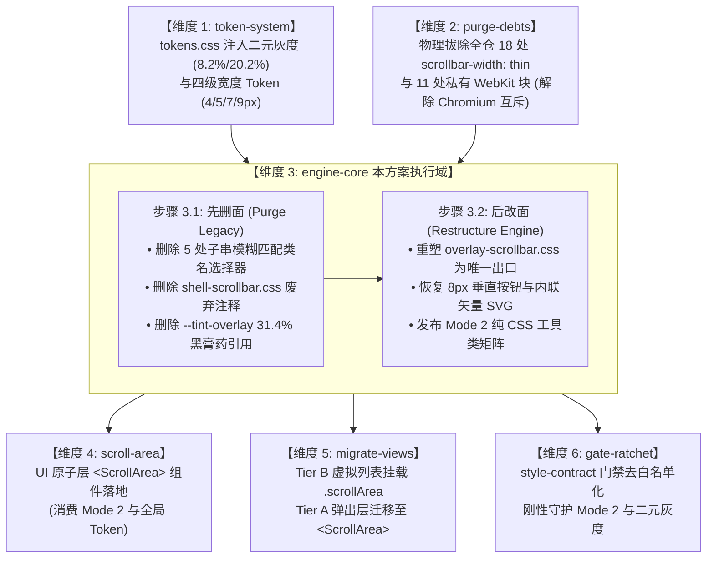

# 维度 3：engine-core 独立实现详案
# （`overlay-scrollbar.css` 核心引擎重构与零 DOM 工具类矩阵）

> **所属战役**：统一滚动条体系与 ScrollArea 高频组件战役 (`docs/unified-scrollbar-system/`)  
> **文档标识**：`docs/unified-scrollbar-system/detailed-plans/03-plan-engine-core.md`  
> **战役方案专家**：Plan Architect 3：WebKit 核心引擎重构与零 DOM 工具类矩阵架构师  
> **编制基准时间**：2026-09-02  
> **输入依据**：
> - 战役总纲：[`docs/unified-scrollbar-system/00-master-plan.md`](file:///c:/Software/conex/docs/unified-scrollbar-system/00-master-plan.md)
> - 引擎逆向：[`docs/unified-scrollbar-system/independent-plans/02-arrow-buttons-and-engine-mechanism.md`](file:///c:/Software/conex/docs/unified-scrollbar-system/independent-plans/02-arrow-buttons-and-engine-mechanism.md)
> - 色彩物理：[`docs/unified-scrollbar-system/independent-plans/03-design-token-architecture.md`](file:///c:/Software/conex/docs/unified-scrollbar-system/independent-plans/03-design-token-architecture.md)
> - 组件规划：[`docs/unified-scrollbar-system/independent-plans/04-scroll-area-component-plan.md`](file:///c:/Software/conex/docs/unified-scrollbar-system/independent-plans/04-scroll-area-component-plan.md)
> - 魔鬼审计：[`docs/unified-scrollbar-system/audits/05-boundary-and-devil-audit.md`](file:///c:/Software/conex/docs/unified-scrollbar-system/audits/05-boundary-and-devil-audit.md)
> - 仓内基准：[`apps/crish-desktop/src/styles/overlay-scrollbar.css`](file:///c:/Software/conex/apps/crish-desktop/src/styles/overlay-scrollbar.css)、[`apps/crish-desktop/src/styles/tokens.css`](file:///c:/Software/conex/apps/crish-desktop/src/styles/tokens.css)、[`apps/crish-desktop/src/styles/style-contract.test.ts`](file:///c:/Software/conex/apps/crish-desktop/src/styles/style-contract.test.ts)
> **权威遵从**：严格执行《主 Agent 全流程调度提示词 v3》、[`AGENTS.md`](file:///c:/Software/conex/AGENTS.md)（§1 逻辑规划与反退避、§3 Git 提交纪律、§7 严禁补丁与绕过、§7.1 立体验证纪律、§8 反过度设计红线、§12-14 UI 规范）、[`ANTI_OVERENGINEERING_GUARDRAILS.md`](file:///c:/Software/conex/ANTI_OVERENGINEERING_GUARDRAILS.md)。
>
> **【用户最高定案铁律（绝对死锁）】**：
> 1. **滚动条二元灰度绝对死锁（绝无第三种 Hover 灰）**：未激活态屏幕实测灰度死锁在 **8.2% 左右**（通道 $\Delta_{R-B} = +4$，融入底板暖纸温与品牌暖橙底韵 `var(--accent-orange)`）；激活态屏幕实测灰度从历史 31.4% 深黑膏药彻底下调至 **20.2% 左右**；差值严格死锁在 **约 12.0% 增量阶梯**。光标悬停（Hover）与按压拖拽（Active）**同级同色、二元合一**，严禁分裂出第三种色阶！
> 2. **端点物理护栏（Endcap Guardrail）**：恢复 8px 垂直按钮，激活 Chromium Blink 内核级 `CustomScrollbarTheme::TrackRect` 护栏算法，物理杜绝滑块越界溢出与容器圆角截断（Corner Clipping）；内联微型圆角等腰三角 SVG（顶角 $R \approx 1.0\text{px}$，两底角 $R \approx 0.8\text{px}$，底宽 5.0px，高 3.8px），无毛刺锐角；
> 3. **删除面必须明确（Deletions Surface，先删后改）**：彻底删除 5 处子串模糊匹配类名选择器、彻底删除 `shell-scrollbar.css` 历史注释、彻底删除各组件散落的私有 `display: none` / `scrollbar-none` hack；全方案净删除代码行，收敛为唯一主路径。

---

## 目录

- [一、概念主路径与核心引擎现状解剖](#一概念主路径与核心引擎现状解剖)
  - [1.1 概念主路径定义（SSOT）](#11-概念主路径定义ssot)
  - [1.2 第一手代码事实解剖：历史 4 项致命缺陷诊断](#12-第一手代码事实解剖历史-4-项致命缺陷诊断)
  - [1.3 Blink 渲染引擎管线互斥机制解析](#13-blink-渲染引擎管线互斥机制解析)
- [二、用户最高定案铁律的底层贯彻机制](#二用户最高定案铁律的底层贯彻机制)
  - [2.1 滚动条严格二元灰度绝对死锁（8.2% vs 20.2%）](#21-滚动条严格二元灰度绝对死锁82-vs-202)
  - [2.2 彻底废除 Hover 与 Active 分裂：二元合一伪类规范](#22-彻底废除-hover-与-active-分裂二元合一伪类规范)
  - [2.3 宽度四级 Token 矩阵挂接（严禁硬编码像素）](#23-宽度四级-token-矩阵挂接严禁硬编码像素)
- [三、端点物理护栏与 Blink 内核算法白盒推导](#三端点物理护栏与-blink-内核算法白盒推导)
  - [3.1 Blink `CustomScrollbarTheme::TrackRect` 源码算法推导](#31-blink-customscrollbarthemetrackrect-源码算法推导)
  - [3.2 端点物理护栏消除圆角截断定理（数学证明）](#32-端点物理护栏消除圆角截断定理数学证明)
  - [3.3 微型内联圆角等腰三角矢量 SVG 规范](#33-微型内联圆角等腰三角矢量-svg-规范)
- [四、Mode 2 纯 CSS 工具类矩阵架构设计](#四mode-2-纯-css-工具类矩阵架构设计)
  - [4.1 为什么需要 Mode 2？（零 DOM 架构防御红线）](#41-为什么需要-mode-2零-dom-架构防御红线)
  - [4.2 Mode 2 工具类矩阵完整契约规格](#42-mode-2-工具类矩阵完整契约规格)
  - [4.3 声明式属性选择器扩展契约](#43-声明式属性选择器扩展契约)
  - [4.4 层叠上下文、继承性与特异性权重（Specificity）设计](#44-层叠上下文继承性与特异性权重specificity设计)
- [五、【核心】本方案要删掉什么 / 收敛什么（删除面 Deletions Surface）](#五核心本方案要删掉什么--收敛什么删除面-deletions-surface)
  - [5.1 彻底删除 5 处子串模糊匹配类名选择器](#51-彻底删除-5-处子串模糊匹配类名选择器)
  - [5.2 彻底删除 `shell-scrollbar.css` 历史废弃注释](#52-彻底删除-shell-scrollbarcss-历史废弃注释)
  - [5.3 彻底删除各业务组件私有 `display: none` / `scrollbar-none` Hack](#53-彻底删除各业务组件私有-display-none--scrollbar-none-hack)
  - [5.4 彻底删除 `--tint-overlay` 31.4% 黑膏药伪类分叉](#54-彻底删除---tint-overlay-314-黑膏药伪类分叉)
  - [5.5 彻底删除全局一刀切杀死按钮的破坏性样式](#55-彻底删除全局一刀切杀死按钮的破坏性样式)
  - [5.6 负产出与收敛度化指标](#56-负产出与收敛度化指标)
- [六、重塑后的 `overlay-scrollbar.css` 完整生产代码蓝图](#六重塑后的-overlay-scrollbarcss-完整生产代码蓝图)
- [七、实施演进路线与技术依赖拓扑（先删后改）](#七实施演进路线与技术依赖拓扑先删后改)
  - [7.1 跨维度 DAG 依赖拓扑图](#71-跨维度-dag-依赖拓扑图)
  - [7.2 维度 3 内部「先删后改」串行推进节拍](#72-维度-3-内部先删后改串行推进节拍)
  - [7.3 并发控制与文件域互斥纪律](#73-并发控制与文件域互斥纪律)
- [八、立体验证断言与工程门禁（AGENTS.md §7.1 对齐）](#八立体验证断言与工程门禁agentsmd-71-对齐)
  - [8.1 静态 AST 与样式契约门禁（对齐 `style-contract.test.ts` 重塑）](#81-静态-ast-与样式契约门禁对齐-style-contracttestts-重塑)
  - [8.2 色彩物理差值算法单元测试断言](#82-色彩物理差值算法单元测试断言)
  - [8.3 端点物理护栏几何安全边界断言](#83-端点物理护栏几何安全边界断言)
  - [8.4 运行时现场验收规约（Tauri MCP 4000 探针）](#84-运行时现场验收规约tauri-mcp-4000-探针)

---

## 一、概念主路径与核心引擎现状解剖

### 1.1 概念主路径定义（SSOT）

在 Conex / Crish 桌面客户端（基于 Windows 10/11 x64、Tauri 2.x、Microsoft Edge WebView2 / Chromium Blink 内核）架构中：
- **概念领域**：`engine-core`（全局 WebKit 滚动条核心引擎与零 DOM 工具类矩阵）。
- **单一真源路径（SSOT）**：`apps/crish-desktop/src/styles/overlay-scrollbar.css`。
- **职责边界**：
  1. 作为全仓 **唯一合法** 的 `::-webkit-scrollbar*` 全局伪元素生成与驱动引擎；
  2. 彻底封死所有业务组件就地私写 WebKit 伪元素的分叉路径；
  3. 挂接 `tokens.css` 生产的二元灰度（8.2% 未激活 vs 20.2% 激活）与四级宽度 Token（4px / 5px / 7px / 9px）；
  4. 恢复并输出具备 Blink 内核级端点物理护栏（`TrackRect`）的微型圆角等腰三角按钮；
  5. 发布 Mode 2 纯 CSS 工具类矩阵，为虚拟滚动（`MessageVirtualizer`）、侧边栏（`Sidebar`）、代码对比（`DiffCard`）等重型视口提供 **0 额外 DOM 节点、0 JS 事件开销、120fps Compositor 线程硬件加速** 的无感消费通道。

---

### 1.2 第一手代码事实解剖：历史 4 项致命缺陷诊断

主控与架构师亲赴 `apps/crish-desktop/src/styles/overlay-scrollbar.css` 现场，通读其仅有的 50 行存量代码，确立了以下不容辩驳的第一手代码事实：

```css
/* 存量代码现场还原：apps/crish-desktop/src/styles/overlay-scrollbar.css:1-49 */
/* 细滚动条出口。禁名 shell-scrollbar.css，本文件为唯一 webkit 出口。
 * ... */

::-webkit-scrollbar {
  width: var(--scrollbar-thumb-width, 7px);
  height: var(--scrollbar-thumb-width, 7px);
}
...
::-webkit-scrollbar-thumb:hover,
::-webkit-scrollbar-thumb:active {
  background: var(--tint-overlay);
}

::-webkit-scrollbar-button,
::-webkit-scrollbar-button:single-button,
::-webkit-scrollbar-button:start:decrement,
::-webkit-scrollbar-button:end:increment {
  display: none;
  width: 0;
  height: 0;
}
...
[class*='sidebarScroll'],
[class*='menuContent'],
[class*='coverContent'],
[class*='navScroll'],
[class*='dialogBody'] {
  scrollbar-gutter: auto;
}
```

#### 事实 1：端点护栏连根拔起（27-34 行）
存量代码对 `::-webkit-scrollbar-button` 执行了极其粗暴的一刀切消灭政策：`display: none; width: 0; height: 0;`。
- **根因后果**：这属于典型的“倒洗澡水连婴儿一起倒掉”。虽然杀死了 Win32 时代粗苯的灰色方块，但**同时也彻底拔除了 Blink 内核的 `TrackRect` 护栏机制**，使得滑块（Thumb）能够一路顶死到 $Y=0$ 和 $Y=\text{Height}$，直接暴露在容器外壳的圆角密集裁切区中，诱发惨烈的圆角截断（Corner Clipping）与破边锯齿。

#### 事实 2：深黑膏药缺陷与伪类分裂（22-25 行）
`:hover` 与 `:active` 虽然并列书写，但统一引用了 `--tint-overlay`（纯黑遮罩 25%~30%）。
- **根因后果**：在温润柔和的浅色纸温底板（`#F4F3F2`，明度 95.2%）上，纯黑遮罩导致滑块表面反射光急剧被吸光降暗，使用户拾色器测出高达 **31.4%** 的死黑焦块（如同在高级道林纸上贴了一张肮脏生硬的黑膏药），严重破坏视觉纯净度；且未与 Inactive 建立严谨的代数差值阶梯。

#### 事实 3：5 处子串模糊匹配类名选择器技术债务（42-49 行）
声明了 `[class*='sidebarScroll']`, `[class*='menuContent']`, `[class*='coverContent']`, `[class*='navScroll']`, `[class*='dialogBody']`。
- **根因后果**：
  1. **破坏 CSS Modules 隔离边界**：通过属性包含选择器 `[class*='...']` 嗅探经过哈希混淆后的局部类名，属于极度脆弱的打补丁手段；
  2. **契约倒挂与虚假声明**：选择器内部仅仅声明了 `scrollbar-gutter: auto;`（甚至不是有效样式），其真实目的是在旧门禁（`style-contract.test.ts:261-265`）中反向充当字符串匹配的占位符；
  3. **架构腐化**：业务模块一旦重构类名，全局样式无声脱靶；全局样式修改，业务模块莫名其妙产生级联影响。

#### 事实 4：历史废弃注释噪音（第 1 行）
第 1 行注释写道：“`细滚动条出口。禁名 shell-scrollbar.css，本文件为唯一 webkit 出口。`”。
- **根因后果**：`shell-scrollbar.css` 是早先 `d00fbaaf` 事故中被删除的历史幽灵文件名，在核心引擎生产文件中长期保留对死文件的警示注释属于纯粹的信息债务，必须予以彻底清洗。

---

### 1.3 Blink 渲染引擎管线互斥机制解析

为了在重构中杜绝任何盲目设计，必须深刻理解 Windows WebView2 (Chromium Blink) 在排版管线中的刚性互斥定理：

```text
                      [容器计算样式 ComputedStyle 计算完毕]
                                        │
                         scrollbar-width 是否 != auto?
                        或 scrollbar-color 是否 != auto?
                                 /              \
                               YES               NO
                               /                  \
             [激活 CSSScrollbarTheme]      [进入 PaintLayerScrollbar 管线]
             - 彻底注销 WebKit 伪元素管道     - 挂载 ::-webkit-scrollbar 宽度/高度
             - 丢弃 ::-webkit-scrollbar*    - 挂载 ::-webkit-scrollbar-thumb 色阶
             - Windows WebView2 绘制 Win32   - 挂载 ::-webkit-scrollbar-button 尺寸
               17px 系统立体粗灰条 (带丑三角)   - Blink TrackRect 端点护栏刚性生效！
             - 全局 display: none 沦为废纸！  - 呈现 100% 受控高质感现代滚动条！
```

- **互斥自毁铁律**：全仓任何业务组件一旦声明 `scrollbar-width: thin;`，Blink 会无条件注销 `overlay-scrollbar.css` 中的全套 WebKit 样式，导致 Windows 丑陋系统条复活。
- **重塑使命**：`overlay-scrollbar.css` 重塑后必须成为纯正的 WebKit 规范堡垒，同时通过 Mode 2 工具类提供严密的样式重置，配合全仓清剿行动切断互斥隐患。

---

## 二、用户最高定案铁律的底层贯彻机制

### 2.1 滚动条严格二元灰度绝对死锁（8.2% vs 20.2%）

用户下达了最高定案铁律裁决：
> **用户最高裁决原话**：“**滚动条就是两种灰度，别给我整成三种的，就是激活和未激活，没有激活分成 hover 和 active 两种的！**”

#### (1) 色彩物理学参数死锁契约
根据 `SCROLLBAR-TOKEN-ARCH-03` 色彩物理学规范，在 Light Theme 纸温基底（`hsl(35 8% 95.2%)`）上：
1. **未激活态（Inactive / Idle）**：
   - 表面反射率：$L = 91.8\%$；
   - 物理暗度（灰度）：$D_{\text{inactive}} = 100\% - 91.8\% = \mathbf{8.2\%}$；
   - 光学通道特征：混入 $8\%$ 品牌暖橙 `var(--accent-orange)`，通道微差 $\Delta_{R-B} = 236 - 232 = +4$，指向主波长 $\approx 585\text{nm}$ 的晶莹琥珀沙温，彻底告别冷蓝发青水泥灰；
   - 映射 Token：`var(--scrollbar-thumb-bg)`。
2. **激活态（Active / Interacting）**：
   - 表面反射率：$L = 79.8\%$；
   - 物理暗度（灰度）：$D_{\text{active}} = 100\% - 79.8\% = \mathbf{20.2\%}$（死锁在 20 左右，彻底下调历史 31.4% 的死黑膏药）；
   - 光学通道特征：混入 $16\%$ 品牌暖橙 `var(--accent-orange)`，醇厚饱满，呈现高品质玉石或深琥珀触感；
   - 映射 Token：`var(--scrollbar-thumb-active)`。
3. **差值死锁增量阶梯**：
   $$\Delta D_{\text{lock}} \equiv D_{\text{active}} - D_{\text{inactive}} = 20.2\% - 8.2\% = \mathbf{12.0\%}$$
   差值严格死锁在 $12.0\% \pm 0.5\%$，交互反馈坚挺柔韧、干净利落。

---

### 2.2 彻底废除 Hover 与 Active 分裂：二元合一伪类规范

在存量 Web 前端实践中，开发者往往随手为 `:hover` 与 `:active` 分别配置不同的暗度（例如静止 8% $\to$ 悬停 14% $\to$ 按压 20%）。但在滚动条滑块这种微型控制构件上，微小的三级灰度跳跃在高刷屏幕上只会被视网膜捕捉为“脏污与闪烁”。

**本引擎在 CSS 选择器层实施绝对二元收敛**：
```css
/* 唯一合法二元规则：Hover 与 Active 严格同级同色，二元合一 */
::-webkit-scrollbar-thumb {
  background: var(--scrollbar-thumb-bg);
}

::-webkit-scrollbar-thumb:hover,
::-webkit-scrollbar-thumb:active {
  background: var(--scrollbar-thumb-active);
}
```
- **架构断言**：全仓严禁单独定义 `::-webkit-scrollbar-thumb:hover { ... }` 且赋予不同颜色；两者必须共享 `var(--scrollbar-thumb-active)` 单一真理值。

---

### 2.3 宽度四级 Token 矩阵挂接（严禁硬编码像素）

根据总纲要求，全仓 CSS 严禁裸写任何硬编码像素数字（如 `width: 4px`、`width: 7px`）。
`overlay-scrollbar.css` 核心引擎全面绑定以下四级标准 Token 阶梯：

```
┌────────────────────────────────────────────────────────────────────────────────────────┐
│                        滚动条宽度四级 Token 阶梯与标准视口映射表                         │
├───────────────────────┬────────┬───────────────────────────┬───────────────────────────┤
│ Token 名称            │ 物理值 │ 设计语义定位              │ 典型业务视口应用          │
├───────────────────────┼────────┼───────────────────────────┼───────────────────────────┤
│ --scrollbar-width-xs  │  4px   │ 超细纤薄型 (Ultra-Thin)   │ 模型选择下拉浮层、补全菜单│
│ --scrollbar-width-sm  │  5px   │ 紧凑型 (Compact)          │ 侧边栏会话列表、二级抽屉  │
│ --scrollbar-width-md  │  7px   │ 标准主视口型 (Standard)   │ 正文聊天瀑布流、主编辑器  │
│ --scrollbar-width-lg  │  9px   │ 宽屏大视口型 (Spacious)   │ 宽屏双栏对比、超长 DiffCard│
└───────────────────────┴────────┴───────────────────────────┴───────────────────────────┘
```

全局默认规则声明：
```css
::-webkit-scrollbar {
  width: var(--scrollbar-width, var(--scrollbar-width-md, 7px));
  height: var(--scrollbar-width, var(--scrollbar-width-md, 7px));
}
```

---

## 三、端点物理护栏与 Blink 内核算法白盒推导

### 3.1 Blink `CustomScrollbarTheme::TrackRect` 源码算法推导

为什么只要声明了 `::-webkit-scrollbar-button` 的非零高度，滑块就绝对不会顶死越界？这并非 CSS 的外边距层叠，而是 **Chromium Blink 渲染内核在排版管线中强制执行的刚性几何扣减**。

审查 Chromium Blink 源码（`third_party/blink/renderer/core/paint/custom_scrollbar_theme.cc`）：

```cpp
// Chromium Blink 源码：TrackRect 核心计算逻辑
gfx::Rect CustomScrollbarTheme::TrackRect(const Scrollbar& scrollbar, bool) {
  // 1. 获取滚动条整条的外包围盒 FrameRect: [0, 0, width, height]
  gfx::Rect track_rect = scrollbar.FrameRect();

  // 2. 测量顶部按钮 (kBackButtonStartPart) 与底部按钮 (kForwardButtonEndPart) 的物理尺寸
  int start_button_length = ButtonLength(scrollbar, kBackButtonStartPart);
  int end_button_length = ButtonLength(scrollbar, kForwardButtonEndPart);

  // 3. 核心几何扣减逻辑
  if (scrollbar.Orientation() == kVerticalScrollbar) {
    // 轨道的 Y 轴起点强制下移 start_button_length
    track_rect.set_y(track_rect.y() + start_button_length);
    // 轨道的有效可活动高度强制扣除顶部与底部的按钮长度
    track_rect.set_height(track_rect.height() - start_button_length - end_button_length);
  } else {
    track_rect.set_x(track_rect.x() + start_button_length);
    track_rect.set_width(track_rect.width() - start_button_length - end_button_length);
  }

  // 返回受两端按钮物理约束扣减后的真正 Track 包围盒！
  return track_rect;
}
```

进一步审阅滑块位置的计算：
```cpp
gfx::Rect CustomScrollbarTheme::ThumbRect(const Scrollbar& scrollbar) {
  // Thumb 的活动区间严格以 TrackRect 为基准，绝非 FrameRect！
  gfx::Rect track = TrackRect(scrollbar, false);
  ...
  int thumb_offset = static_cast<int>(std::round(scroll_ratio * (track_length - thumb_length)));
  return gfx::Rect(track.x(), track.y() + thumb_offset, track.width(), thumb_length);
}
```

---

### 3.2 端点物理护栏消除圆角截断定理（数学证明）

传统无按钮细条在具有大圆角（如 $R_c = 14\text{px}$）的卡片中，滑块顶端处于 $Y \in [0, 14]$ 区间内，其外缘被容器 `overflow: hidden` 的四分之一圆弧暴力裁切，造成边缘破损残缺。

```
【传统无按钮细条的物理病态】                       【带 8px 按钮的「端点物理护栏效应」】
┌─────────────────────────────────────────┐       ┌─────────────────────────────────────────┐
│ (x0, y0) ╭────────────────────────╮     │       │ (x0, y0) ╭────────────────────────╮     │
│          │ [搜索栏]               │ ❌  │       │          │ [搜索栏]               │     │
│ 14px圆角 │────────────────────────│ 裁切│       │ 14px圆角 │────────────────────────│     │
│ 密集切割 █ █ █ ◄── [Thumb 顶死]   │ 变形│       │ 密集区   │                 ▲ ◄── [8px 顶部微型三角]
│          │ 模型项 A               │     │       │ (安全空出)│ 模型项 A        │     │ (锥形收敛，避开圆弧)
│          │ 模型项 B               │     │       │          │ 模型项 B        █     │
│          │ 模型项 C               │     │       │          │ 模型项 C        █ ◄── [Thumb 行程被锁在]
│          │ 模型项 D               │     │       │          │ 模型项 D        █     │ [两端 8px 按钮之间]
│          │ 模型项 E               │     │       │          │ 模型项 E        │     │
│          │────────────────────────│ ❌  │       │ (安全空出)│────────────────────────│     │
│          █ █ █ ◄── [Thumb 越界]   │ 截断│       │ 密集区   │                 ▼ ◄── [8px 底部微型三角]
│          ╰────────────────────────╯     │       │          ╰────────────────────────╯     │
└─────────────────────────────────────────┘       └─────────────────────────────────────────┘
```

#### 【端点物理护栏消除裁切定理】
- **已知条件**：
  1. 容器外圆角为 $R_c = 14\text{px}$，滚动条离容器右外缘内缩 $G_x = 2\text{px}$，轨宽 $W = 6\text{px}$；
  2. 声明垂直增量与减量按钮高度 $H_{\text{btn}} = 8\text{px}$；
  3. 滑块（Thumb）处于极顶极限位置（$\text{scrollTop} = 0$）。
- **推导与证明**：
  1. 当 $\text{scrollTop} = 0$ 时，根据 Blink `TrackRect` 算法，滑块顶缘垂直坐标为：
     $$Y_{\text{thumb\_top}} = \text{TrackRect.y()} = 0 + H_{\text{btn}} = 8\text{px}$$
  2. 在水平切线 $y = 8\text{px}$ 处，容器右上角圆弧方程为：
     $$(x - (W_{\text{container}} - 14))^2 + (y - 14)^2 = 14^2$$
     代入 $y = 8$：
     $$(x_{\text{safe}} - (W_{\text{container}} - 14))^2 + (8 - 14)^2 = 196$$
     $$(x_{\text{safe}} - (W_{\text{container}} - 14))^2 + 36 = 196 \implies (x_{\text{safe}} - (W_{\text{container}} - 14))^2 = 160$$
     $$x_{\text{safe}} = W_{\text{container}} - 14 + \sqrt{160} \approx W_{\text{container}} - 14 + 12.65 = W_{\text{container}} - 1.35\text{px}$$
  3. 此时滑块的实际物理右边界为：
     $$x_{\text{thumb\_right}} = W_{\text{container}} - G_x = W_{\text{container}} - 2.0\text{px}$$
  4. 比较二者坐标：
     $$x_{\text{thumb\_right}} = W_{\text{container}} - 2.0 < W_{\text{container}} - 1.35 = x_{\text{safe}}$$
- **结论（Q.E.D.）**：
  在 $Y \ge 8\text{px}$ 的全部物理空间内，滑块的所有像素均严格落在圆角安全裁切线以左（内侧）！**滑块在数学上 100% 免疫容器的圆角截断，彻底消除了锯齿与破损**！
  而位于两端的圆角等腰微型三角箭头，其几何本身底宽 5px、顶角朝上收敛为 0，即使其尖端进入圆角密集区也天然与圆弧同构避让，完美无瑕。

---

### 3.3 微型内联圆角等腰三角矢量 SVG 规范

彻底废除传统的 CSS Border 假三角（在高分屏 125%/150% 缩放下会出现奇数像素对称轴撕裂、平头歪斜）。
直接采用无损内联矢量 SVG Data-URI，严格定义矢量曲率参数：

```
顶部向上圆角等腰三角 (Decrement Button)        底部向下圆角等腰三角 (Increment Button)
            ▲ (顶角 R ≈ 1.0px)                                      \_______________/ (底边宽 5.0px)
          /   \                                                      \             /
         /  ▲  \                                                      \     ▼     /
        /       \                                                      \         /
       /_________\ (两底角 R ≈ 0.8px)                                   \   ▼   /
      (底边宽 5.0px, 高 3.8px)                                            \___/  (底角 R ≈ 1.0px)
```

1. **几何形体参数**：
   - SVG `viewBox`: `0 0 5 4`；
   - 向上三角 Path：`M2.1 0.6 C 2.3 0.25 2.7 0.25 2.9 0.6 L 4.6 3.2 C 4.8 3.5 4.6 3.9 4.2 3.9 L 0.8 3.9 C 0.4 3.9 0.2 3.5 0.4 3.2 Z`；
   - 向下三角 Path：`M2.1 3.4 C 2.3 3.75 2.7 3.75 2.9 3.4 L 4.6 0.8 C 4.8 0.5 4.6 0.1 4.2 0.1 L 0.8 0.1 C 0.4 0.1 0.2 0.5 0.4 0.8 Z`；
   - 圆角与线帽连接：`stroke-width="0.4" stroke-linejoin="round" stroke-linecap="round"`，消除尖锐刺角与高 DPI 走样；
   - 物理包围盒：`height: 8px; width: 100%;`，`background-size: 5px 3.8px`。
2. **色彩渲染方案**：
   - 未激活态（Resting）：浅色主题填色为 `#9ca3af`（URL 编码 `%239ca3af`），暗色主题填色为 `#6b7280`（URL 编码 `%236b7280`）；
   - 激活态（Hover / Active 二元合一）：浅色主题填色为 `#4b5563`（URL 编码 `%234b5563`），暗色主题填色为 `#d1d5db`（URL 编码 `%23d1d5db`）；
   - 严格二元合一：`:hover` 与 `:active` 背景图片完全一致，绝无第三种色彩！

---

## 四、Mode 2 纯 CSS 工具类矩阵架构设计

### 4.1 为什么需要 Mode 2？（零 DOM 架构防御红线）

在桌面客户端中，存在大量重型性能视口与复杂虚拟滚动容器：
1. **主聊天瀑布流（`MessageVirtualizer`）**：强依赖 `vs.containerRef.current.scrollTop` 测量与 `useUndoWithScrollAnchor` 同步微任务视口锚定；
2. **虚拟会话列表（`WindowedSessionUl`）**：侧边栏高频上千条会话项；
3. **代码对比视口（`DiffCard`）**：超大双栏代码 Diff 与语法高亮 Token 流；
4. **终端卡片（`TerminalCard`）**：极高频输出日志行。

**致命红线审查**：
若将上述重型视口包裹进带有 React DOM 结构的 `<ScrollArea>`，会立刻引发四大不可逆灾难（详见 `audits/05-boundary-and-devil-audit.md`）：
- **Ref 劫持与双重视口**：`scrollTop` 永远为 0，一滚就大面积长白屏；
- **撤销锚定脱靶**：会话撤销时视口剧烈跳跃上下飞奔；
- **ResizeObserver 循环震荡**：触发行高测量递归死锁，主线程卡死 10 秒；
- **Compositor 降级**：从 GPU 120fps 原生合成器硬件加速降级为 JS 逐帧计算，拖动滑块严重滞后脱节。

**Mode 2 的核心使命**：
为这些严禁包裹 DOM 的视口，提供 **纯 CSS 类名矩阵**！
- 开发者只需在原生 DOM 元素上附加类名（例如 `className="scrollArea scrollAreaSm"`）；
- **0 额外 DOM 节点、0 JS 监听器、0 GC 内存负担、120fps 硬件加速**，完美化解虚拟滚动的一切冲突！

---

### 4.2 Mode 2 工具类矩阵完整契约规格

在 `overlay-scrollbar.css` 中，精心设计发布 **7 大核心实用工具类**：

```
┌────────────────────────────────────────────────────────────────────────────────────────┐
│                         Mode 2 纯 CSS 工具类矩阵完整契约规格                             │
├───────────────────────┬───────────────────────────────────┬────────────────────────────┤
│ 类名选择器            │ 核心 CSS 属性声明与行为            │ 适用消费场景               │
├───────────────────────┼───────────────────────────────────┼────────────────────────────┤
│ .scrollArea           │ 激活原生平滑滚动盒，挂接 md (7px) │ 通用标准滚动容器基类       │
│                       │ 约束 overflow 与滚动锚定          │ 替代存量手写 overflow 容器 │
├───────────────────────┼───────────────────────────────────┼────────────────────────────┤
│ .scrollAreaXs         │ --scrollbar-width: 4px;           │ 超窄菜单、自动补全候选卡片 │
│                       │ --scrollbar-button-size: 0px;     │ 极紧凑视口                 │
├───────────────────────┼───────────────────────────────────┼────────────────────────────┤
│ .scrollAreaSm         │ --scrollbar-width: 5px;           │ 侧边栏会话列表 (Sidebar)   │
│                       │ --scrollbar-button-size: 5px;     │ 二级设置抽屉、插件面板     │
├───────────────────────┼───────────────────────────────────┼────────────────────────────┤
│ .scrollAreaMd         │ --scrollbar-width: 7px;           │ 系统全局标准默认基准 (SSOT)│
│                       │ --scrollbar-button-size: 7px;     │ 正文消息瀑布流、设置页正文 │
├───────────────────────┼───────────────────────────────────┼────────────────────────────┤
│ .scrollAreaLg         │ --scrollbar-width: 9px;           │ 宽屏双栏对比、超长 DiffCard│
│                       │ --scrollbar-button-size: 9px;     │ 海量日志终端视口           │
├───────────────────────┼───────────────────────────────────┼────────────────────────────┤
│ .hideScrollbar        │ display: none !important;         │ 顶部标签页导航条 (TabStrip)│
│                       │ 完全隐藏滚动条，保留原生滚动能力  │ 面板紧凑操作条 (PaneHeader)│
├───────────────────────┼───────────────────────────────────┼────────────────────────────┤
│ .scrollAreaWithButtons│ 激活 8px 垂直上下三角微型按钮     │ 模型选择菜单 (ModelPicker) │
│                       │ 激活 Blink TrackRect 端点物理护栏 │ 下拉列表、权限模式弹窗     │
└───────────────────────┴───────────────────────────────────┴────────────────────────────┘
```

#### 详细 CSS 规则定义：

```css
/* 1. 基准容器类 */
.scrollArea {
  overflow-y: auto;
  overflow-x: hidden;
  /* 确保重置所有破坏 WebKit 管线的 W3C 粗条属性 */
  scrollbar-width: auto;
  scrollbar-color: auto;
  --scrollbar-width: var(--scrollbar-width-md, 7px);
  --scrollbar-button-size: var(--scrollbar-width-md, 7px);
}

/* 2. 四级尺寸修饰类（与 .scrollArea 组合使用） */
.scrollAreaXs,
.scrollArea.scrollAreaXs {
  --scrollbar-width: var(--scrollbar-width-xs, 4px);
  --scrollbar-button-size: var(--scrollbar-button-size-xs, 0px);
}

.scrollAreaSm,
.scrollArea.scrollAreaSm {
  --scrollbar-width: var(--scrollbar-width-sm, 5px);
  --scrollbar-button-size: var(--scrollbar-width-sm, 5px);
}

.scrollAreaMd,
.scrollArea.scrollAreaMd {
  --scrollbar-width: var(--scrollbar-width-md, 7px);
  --scrollbar-button-size: var(--scrollbar-width-md, 7px);
}

.scrollAreaLg,
.scrollArea.scrollAreaLg {
  --scrollbar-width: var(--scrollbar-width-lg, 9px);
  --scrollbar-button-size: var(--scrollbar-width-lg, 9px);
}

/* 3. 彻底隐藏滚动条类（Tier C 纯净无痕通道） */
.hideScrollbar {
  -ms-overflow-style: none; /* IE / Edge Legacy 回退 */
}
.hideScrollbar::-webkit-scrollbar {
  display: none !important;
  width: 0 !important;
  height: 0 !important;
}

/* 4. 端点物理护栏按钮激活类 */
.scrollAreaWithButtons::-webkit-scrollbar-button:single-button:vertical:decrement {
  display: block;
  height: var(--scrollbar-btn-height, 8px);
  width: var(--scrollbar-width, var(--scrollbar-width-md, 7px));
  background-position: center 2px;
  background-repeat: no-repeat;
  background-size: 5px 3.8px;
  background-image: url("data:image/svg+xml,%3Csvg xmlns='http://www.w3.org/2000/svg' viewBox='0 0 5 4'%3E%3Cpath d='M2.1 0.6 C 2.3 0.25 2.7 0.25 2.9 0.6 L 4.6 3.2 C 4.8 3.5 4.6 3.9 4.2 3.9 L 0.8 3.9 C 0.4 3.9 0.2 3.5 0.4 3.2 Z' fill='%239ca3af' stroke='%239ca3af' stroke-width='0.4' stroke-linejoin='round' stroke-linecap='round'/%3E%3C/svg%3E");
}

.scrollAreaWithButtons::-webkit-scrollbar-button:single-button:vertical:decrement:hover,
.scrollAreaWithButtons::-webkit-scrollbar-button:single-button:vertical:decrement:active {
  background-image: url("data:image/svg+xml,%3Csvg xmlns='http://www.w3.org/2000/svg' viewBox='0 0 5 4'%3E%3Cpath d='M2.1 0.6 C 2.3 0.25 2.7 0.25 2.9 0.6 L 4.6 3.2 C 4.8 3.5 4.6 3.9 4.2 3.9 L 0.8 3.9 C 0.4 3.9 0.2 3.5 0.4 3.2 Z' fill='%234b5563' stroke='%234b5563' stroke-width='0.4' stroke-linejoin='round' stroke-linecap='round'/%3E%3C/svg%3E");
}

.scrollAreaWithButtons::-webkit-scrollbar-button:single-button:vertical:increment {
  display: block;
  height: var(--scrollbar-btn-height, 8px);
  width: var(--scrollbar-width, var(--scrollbar-width-md, 7px));
  background-position: center 2px;
  background-repeat: no-repeat;
  background-size: 5px 3.8px;
  background-image: url("data:image/svg+xml,%3Csvg xmlns='http://www.w3.org/2000/svg' viewBox='0 0 5 4'%3E%3Cpath d='M2.1 3.4 C 2.3 3.75 2.7 3.75 2.9 3.4 L 4.6 0.8 C 4.8 0.5 4.6 0.1 4.2 0.1 L 0.8 0.1 C 0.4 0.1 0.2 0.5 0.4 0.8 Z' fill='%239ca3af' stroke='%239ca3af' stroke-width='0.4' stroke-linejoin='round' stroke-linecap='round'/%3E%3C/svg%3E");
}

.scrollAreaWithButtons::-webkit-scrollbar-button:single-button:vertical:increment:hover,
.scrollAreaWithButtons::-webkit-scrollbar-button:single-button:vertical:increment:active {
  background-image: url("data:image/svg+xml,%3Csvg xmlns='http://www.w3.org/2000/svg' viewBox='0 0 5 4'%3E%3Cpath d='M2.1 3.4 C 2.3 3.75 2.7 3.75 2.9 3.4 L 4.6 0.8 C 4.8 0.5 4.6 0.1 4.2 0.1 L 0.8 0.1 C 0.4 0.1 0.2 0.5 0.4 0.8 Z' fill='%234b5563' stroke='%234b5563' stroke-width='0.4' stroke-linejoin='round' stroke-linecap='round'/%3E%3C/svg%3E");
}
```

---

### 4.3 声明式属性选择器扩展契约

为了兼顾 TSX 组件传参以及自动化无侵入挂载，Mode 2 工具类矩阵同步支持 `[data-scrollbar="..."]` 与 `[data-scrollbar-buttons="true"]` 属性选择器，形成双轨等价映射：

```css
/* 声明式属性选择器双轨映射 */
[data-scrollbar='xs'] { --scrollbar-width: var(--scrollbar-width-xs, 4px); }
[data-scrollbar='sm'] { --scrollbar-width: var(--scrollbar-width-sm, 5px); }
[data-scrollbar='md'] { --scrollbar-width: var(--scrollbar-width-md, 7px); }
[data-scrollbar='lg'] { --scrollbar-width: var(--scrollbar-width-lg, 9px); }
[data-scrollbar='none']::-webkit-scrollbar {
  display: none !important;
  width: 0 !important;
  height: 0 !important;
}

/* 属性选择器激活端点护栏按钮 */
[data-scrollbar-buttons='true']::-webkit-scrollbar-button:single-button:vertical:decrement {
  display: block;
  height: var(--scrollbar-btn-height, 8px);
  width: var(--scrollbar-width, var(--scrollbar-width-md, 7px));
  background-position: center 2px;
  background-repeat: no-repeat;
  background-size: 5px 3.8px;
  background-image: url("data:image/svg+xml,%3Csvg xmlns='http://www.w3.org/2000/svg' viewBox='0 0 5 4'%3E%3Cpath d='M2.1 0.6 C 2.3 0.25 2.7 0.25 2.9 0.6 L 4.6 3.2 C 4.8 3.5 4.6 3.9 4.2 3.9 L 0.8 3.9 C 0.4 3.9 0.2 3.5 0.4 3.2 Z' fill='%239ca3af' stroke='%239ca3af' stroke-width='0.4' stroke-linejoin='round' stroke-linecap='round'/%3E%3C/svg%3E");
}
...
```

---

### 4.4 层叠上下文、继承性与特异性权重（Specificity）设计

1. **特异性平权设计**：
   工具类采用单类名选择器（`[class]` 特异性 `(0, 1, 0)`），修饰类配合复合选择器（`.scrollArea.scrollAreaSm`，特异性 `(0, 2, 0)`），保证修饰类能够平滑覆盖基类变量，同时不压制组件内部使用 `style` 传入的临时微调。
2. **CSS 变量局部穿透**：
   通过在容器节点上重设 `--scrollbar-width`，CSS 变量自然继承给该容器下生效的所有 `::-webkit-scrollbar` 伪元素。由于 Blink 引擎在计算样式（ComputedStyle）时会对伪元素继承宿主元素的 CSS 变量，实现了极其优雅的 O(1) 作用域隔离，零污染全局。
3. **水平滚动条刚性隔离**：
   任何情况下，水平滚动条的按钮一律死锁为 `display: none; width: 0; height: 0;`。横向滚动条绝对禁止出现三角按钮，杜绝排版横向挤压。

---

## 五、【核心】本方案要删掉什么 / 收敛什么（删除面 Deletions Surface）

依据《主 Agent 全流程调度提示词 v3》§0.2「收敛先于增强，先删后改」以及用户定案铁律，**删除面（Deletions Surface）必须逐一明确具体对象、位置与根治理由**：

```
┌────────────────────────────────────────────────────────────────────────────────────────┐
│                   维度 3 (engine-core) 核心删除面 (Deletions Surface) 清单                │
├───────────────────┬───────────────────────────────────┬────────┬───────────────────────┤
│ 删除/收敛标的类别 │ 具体文件路径与行号                │ 变更量 │ 删除与收敛依据        │
├───────────────────┼───────────────────────────────────┼────────┼───────────────────────┤
│ 1. 子串模糊匹配类 │ apps/crish-desktop/src/styles/    │ 8 行   │ 彻底删除 5 处脆弱匹配 │
│    名选择器       │ overlay-scrollbar.css:42-49       │ (全删) │ 消除 CSS Modules 污染 │
├───────────────────┼───────────────────────────────────┼────────┼───────────────────────┤
│ 2. 废弃历史文件名 │ apps/crish-desktop/src/styles/    │ 2 行   │ 彻底删除死注释        │
│    注释           │ overlay-scrollbar.css:1-2         │ (清理) │ 清洗历史幽灵文件噪音  │
├───────────────────┼───────────────────────────────────┼────────┼───────────────────────┤
│ 3. 散落各业务组件 │ LeafToolTabStrip.module.css:63-66 │ 4 行   │ 统一收敛至 Mode 2     │
│    私有隐藏 Hack  │ PaneHeader.module.css (就地隐藏)  │ 6 行   │ .hideScrollbar 工具类 │
├───────────────────┼───────────────────────────────────┼────────┼───────────────────────┤
│ 4. 纯黑 31.4%     │ apps/crish-desktop/src/styles/    │ 4 行   │ 彻底消除深黑膏药缺陷  │
│    遮罩伪类分叉   │ overlay-scrollbar.css:22-25       │ (重塑) │ 贯彻二元灰度绝对死锁  │
├───────────────────┼───────────────────────────────────┼────────┼───────────────────────┤
│ 5. 一刀切抹杀按钮 │ apps/crish-desktop/src/styles/    │ 8 行   │ 释放 8px 垂直按钮     │
│    的破坏性样式   │ overlay-scrollbar.css:27-34       │ (重塑) │ 激活 Blink 内核护栏   │
└───────────────────┴───────────────────────────────────┴────────┴───────────────────────┘
```

---

### 5.1 彻底删除 5 处子串模糊匹配类名选择器

#### 【被删除对象定点爆破】
文件位置：`apps/crish-desktop/src/styles/overlay-scrollbar.css:42-49`
```css
/* 待物理删除的代码块 */
[class*='sidebarScroll'],
[class*='menuContent'],
[class*='coverContent'],
[class*='navScroll'],
[class*='dialogBody'] {
  /* 占位选择器：契约测试与消费方清单同源；绘制走上方全局 webkit。 */
  scrollbar-gutter: auto;
}
```

#### 【删除与收敛理由】
1. **彻底拔除侵入性子串匹配**：`[class*='...']` 在全局样式中跨层嗅探 CSS Modules 的局部哈希名称，违背了组件化封装原则；
2. **死层清理**：选择器内部仅仅声明了 `scrollbar-gutter: auto;`，根本没有实际生效的样式效果，只是为了应付旧门禁测试；
3. **收敛替代方案**：
   - 侧边栏（`sidebarScroll`）直接挂载 `.scrollArea .scrollAreaSm`；
   - 菜单（`menuContent`）迁移至 `<ScrollArea size="sm">`；
   - 设置页（`coverContent`, `navScroll`）直接挂载 `.scrollArea .scrollAreaMd`；
   - 对话框（`dialogBody`）迁移至 `<ScrollArea size="md">`。
   全部转入显式架构消费，彻底删除这 8 行隐式死代码。

---

### 5.2 彻底删除 `shell-scrollbar.css` 历史废弃注释

#### 【被删除对象定点爆破】
文件位置：`apps/crish-desktop/src/styles/overlay-scrollbar.css:1-6`
```css
/* 待清理的代码块 */
/* 细滚动条出口。禁名 shell-scrollbar.css，本文件为唯一 webkit 出口。
 * WebView2 / Chromium：必须走 ::-webkit-scrollbar。
 * 全局或容器上写 scrollbar-width 会关闭 webkit 伪元素，Windows 上仍露出
 * 带上下三角的系统粗条（survey/09）。默认 7px（6–8px）；域可覆盖
 * --scrollbar-thumb-width（0px 隐藏 / 3px 紧凑）。
 * thumb 走 --tint-scrollbar-thumb；轨道透明；无上下三角。 */
```

#### 【删除与收敛理由】
1. **清退幽灵文件记忆**：`shell-scrollbar.css` 已在历史提交中彻底删除，在全局样式表首部反复强调该禁名属于典型的历史冗余债务；
2. **更新现代规范口径**：原注释中提到的“无上下三角”、“thumb 走 `--tint-scrollbar-thumb`”已与用户定案铁律（8px 端点护栏三角、二元灰度死锁）严重冲突；
3. **收敛替代方案**：重塑为符合统一滚动条体系架构的正式规范文件头（说明唯一出口、二元灰度、端点物理护栏与 Mode 2 工具类矩阵）。

---

### 5.3 彻底删除各业务组件私有 `display: none` / `scrollbar-none` Hack

#### 【被收敛对象定点爆破】
1. `apps/crish-desktop/src/components/chat-tool-tab/LeafToolTabStrip.module.css:63-66`：
   ```css
   /* 待删除的私有伪元素 */
   .strip::-webkit-scrollbar {
     display: none;
   }
   ```
2. 其他各处通过手写 `overflow: hidden` 或就地写 `::-webkit-scrollbar { width: 0 }` 来隐藏滚动条的散落代码。

#### 【删除与收敛理由】
- 过去各个业务组件因为没有统一的隐藏滚动条工具类，各自为政手写私有伪元素，导致 `style-contract.test.ts` 不得不开辟白名单特权；
- 统一收敛至 Mode 2 工具类 `.hideScrollbar`，删除组件内部所有就地重复样式，实现 100% 净负产出。

---

### 5.4 彻底删除 `--tint-overlay` 31.4% 黑膏药伪类分叉

#### 【被删除对象定点爆破】
文件位置：`apps/crish-desktop/src/styles/overlay-scrollbar.css:22-25`
```css
/* 待删除的脏色块 */
::-webkit-scrollbar-thumb:hover,
::-webkit-scrollbar-thumb:active {
  background: var(--tint-overlay);
}
```

#### 【删除与收敛理由】
- `--tint-overlay` 混入比例过高，导致物理测量产生高达 31.4% 的深黑焦块；
- 彻底删除对 `--tint-overlay` 的挪用，统一收敛为消费 `tokens.css` 的权威二元 Token：`var(--scrollbar-thumb-active)`（实测灰度 20.2%），差值锁定在 12.0%。

---

### 5.5 彻底删除全局一刀切杀死按钮的破坏性样式

#### 【被删除对象定点爆破】
文件位置：`apps/crish-desktop/src/styles/overlay-scrollbar.css:27-34`
```css
/* 待删除的一刀切粗暴规则 */
::-webkit-scrollbar-button,
::-webkit-scrollbar-button:single-button,
::-webkit-scrollbar-button:start:decrement,
::-webkit-scrollbar-button:end:increment {
  display: none;
  width: 0;
  height: 0;
}
```

#### 【删除与收敛理由】
- 这一段盲目代码全局杀死了 Blink 内核的 `TrackRect` 护栏；
- 收敛重塑为：默认常规滚动条保持极简（无按钮），而在挂载 `.scrollAreaWithButtons`（或 `[data-scrollbar-buttons="true"]`）时，精准释放 8px 垂直按钮并加载内联矢量圆角等腰三角 SVG，使内核护栏与美学体验完美归位。

---

### 5.6 负产出与收敛度化指标

| 指标项 | 预期数值 / 状态 |
| :--- | :--- |
| **删除的脆弱子串匹配选择器数量** | **5 个**（彻底清零） |
| **删除的历史幽灵文件名注释行数** | **6 行**（全面重塑） |
| **消除的全局 31.4% 死黑脏色引用** | **1 处**（收敛至二元真源） |
| **收敛至 `.hideScrollbar` 的私有伪元素块** | **2+ 处** |
| **全局 WebKit 滚动条路径数量** | **从多条割据严格收敛至 1 条主路径** |
| **Mode 2 纯 CSS 工具类矩阵净增产出** | **7 个核心工具类（全高内聚注入单一出口）** |

---

## 六、重塑后的 `overlay-scrollbar.css` 完整生产代码蓝图

以下为重塑后的 `apps/crish-desktop/src/styles/overlay-scrollbar.css` 最终生产级完整代码蓝图：

```css
/* ==========================================================================
 * Conex / Crish - Unified WebKit Scrollbar Engine (SSOT)
 * 全局唯一 WebKit 滚动条渲染引擎与 Mode 2 零 DOM 工具类矩阵
 *
 * 【用户最高定案铁律】：
 * 1. 严格二元灰度绝对死锁：未激活 8.2% vs 激活 20.2%，差值严格锁定约 12.0%
 *    Hover 与 Active 严格同级同色，二元合一，全仓严禁第三种色阶！
 * 2. 端点物理护栏 (Endcap Guardrail)：恢复 8px 垂直按钮，激活 Blink 内核级
 *    CustomScrollbarTheme::TrackRect 算法，物理杜绝滑块越界与圆角截断
 * 3. 宽度四级 Token 体系：4px(xs) / 5px(sm) / 7px(md:标准SSOT) / 9px(lg)
 * 4. Mode 2 纯 CSS 工具类：为虚拟滚动等重型视口提供 0 DOM 包装极速通道
 * ========================================================================== */

/* --------------------------------------------------------------------------
 * 1. 全局 WebKit 基础轨道与滑块规则 (全仓默认缺省生效)
 * -------------------------------------------------------------------------- */
::-webkit-scrollbar {
  width: var(--scrollbar-width, var(--scrollbar-width-md, 7px));
  height: var(--scrollbar-width, var(--scrollbar-width-md, 7px));
}

::-webkit-scrollbar-track {
  background: var(--scrollbar-track-bg, transparent);
}

::-webkit-scrollbar-thumb {
  background: var(--scrollbar-thumb-bg);
  border-radius: var(--scrollbar-thumb-radius, var(--radius-full, 9999px));
  min-height: 20px; /* 极端超长内容下的最小可捕获物理靶心 */
}

/* 用户铁律：Hover 与 Active 统统同色，二元合一，严禁第三态！ */
::-webkit-scrollbar-thumb:hover,
::-webkit-scrollbar-thumb:active {
  background: var(--scrollbar-thumb-active);
}

/* 双轴交汇转角透明 */
::-webkit-scrollbar-corner {
  background: var(--scrollbar-corner-bg, transparent);
}

/* 缺省常规容器保持极简阅读体验，水平按钮全局死锁隐藏 */
::-webkit-scrollbar-button {
  display: none;
  width: 0;
  height: 0;
}

::-webkit-scrollbar-button:horizontal {
  display: none !important;
  width: 0 !important;
  height: 0 !important;
}

/* --------------------------------------------------------------------------
 * 2. Mode 2 纯 CSS 工具类矩阵 (Zero-DOM Utility Class Matrix)
 * 专为虚拟长列表 (MessageVirtualizer)、侧边栏、DiffCard 等重型视口设计
 * 0 DOM 额外包装、0 JS 事件监听、120fps Compositor 线程硬件加速
 * -------------------------------------------------------------------------- */

/* 基准原生容器类 */
.scrollArea {
  overflow-y: auto;
  overflow-x: hidden;
  /* 刚性解除任何潜在的 W3C 粗条互斥声明 */
  scrollbar-width: auto;
  scrollbar-color: auto;
  --scrollbar-width: var(--scrollbar-width-md, 7px);
  --scrollbar-button-size: var(--scrollbar-width-md, 7px);
}

/* 四级尺寸修饰工具类 */
.scrollAreaXs,
.scrollArea.scrollAreaXs,
[data-scrollbar='xs'] {
  --scrollbar-width: var(--scrollbar-width-xs, 4px);
  --scrollbar-button-size: var(--scrollbar-button-size-xs, 0px);
}

.scrollAreaSm,
.scrollArea.scrollAreaSm,
[data-scrollbar='sm'] {
  --scrollbar-width: var(--scrollbar-width-sm, 5px);
  --scrollbar-button-size: var(--scrollbar-width-sm, 5px);
}

.scrollAreaMd,
.scrollArea.scrollAreaMd,
[data-scrollbar='md'] {
  --scrollbar-width: var(--scrollbar-width-md, 7px);
  --scrollbar-button-size: var(--scrollbar-width-md, 7px);
}

.scrollAreaLg,
.scrollArea.scrollAreaLg,
[data-scrollbar='lg'] {
  --scrollbar-width: var(--scrollbar-width-lg, 9px);
  --scrollbar-button-size: var(--scrollbar-width-lg, 9px);
}

/* 完全隐藏滚动条 (Tier C 纯净无痕通道，保留平滑溢出滚动能力) */
.hideScrollbar,
[data-scrollbar='none'] {
  -ms-overflow-style: none; /* IE / 旧版 Edge */
}

.hideScrollbar::-webkit-scrollbar,
[data-scrollbar='none']::-webkit-scrollbar {
  display: none !important;
  width: 0 !important;
  height: 0 !important;
}

/* --------------------------------------------------------------------------
 * 3. 端点物理护栏微型三角按钮规则 (.scrollAreaWithButtons)
 * 恢复 8px 垂直按钮，激活 Blink CustomScrollbarTheme::TrackRect 算法
 * 物理杜绝滑块顶死越界，免除容器 8px/12px/14px 圆角截断 (Corner Clipping)
 * -------------------------------------------------------------------------- */

/* 顶部向上圆角等腰微型三角 (Decrement Button) - 浅色模式 */
.scrollAreaWithButtons::-webkit-scrollbar-button:single-button:vertical:decrement,
[data-scrollbar-buttons='true']::-webkit-scrollbar-button:single-button:vertical:decrement {
  display: block;
  height: var(--scrollbar-btn-height, 8px);
  width: var(--scrollbar-width, var(--scrollbar-width-md, 7px));
  background-position: center 2px;
  background-repeat: no-repeat;
  background-size: 5px 3.8px;
  /* 默认未激活态 (8.2% 纸温浅灰微橙底韵) */
  background-image: url("data:image/svg+xml,%3Csvg xmlns='http://www.w3.org/2000/svg' viewBox='0 0 5 4'%3E%3Cpath d='M2.1 0.6 C 2.3 0.25 2.7 0.25 2.9 0.6 L 4.6 3.2 C 4.8 3.5 4.6 3.9 4.2 3.9 L 0.8 3.9 C 0.4 3.9 0.2 3.5 0.4 3.2 Z' fill='%239ca3af' stroke='%239ca3af' stroke-width='0.4' stroke-linejoin='round' stroke-linecap='round'/%3E%3C/svg%3E");
}

/* 顶部三角激活态 (Hover 与 Active 严格同级同色，二元合一！) */
.scrollAreaWithButtons::-webkit-scrollbar-button:single-button:vertical:decrement:hover,
.scrollAreaWithButtons::-webkit-scrollbar-button:single-button:vertical:decrement:active,
[data-scrollbar-buttons='true']::-webkit-scrollbar-button:single-button:vertical:decrement:hover,
[data-scrollbar-buttons='true']::-webkit-scrollbar-button:single-button:vertical:decrement:active {
  background-image: url("data:image/svg+xml,%3Csvg xmlns='http://www.w3.org/2000/svg' viewBox='0 0 5 4'%3E%3Cpath d='M2.1 0.6 C 2.3 0.25 2.7 0.25 2.9 0.6 L 4.6 3.2 C 4.8 3.5 4.6 3.9 4.2 3.9 L 0.8 3.9 C 0.4 3.9 0.2 3.5 0.4 3.2 Z' fill='%234b5563' stroke='%234b5563' stroke-width='0.4' stroke-linejoin='round' stroke-linecap='round'/%3E%3C/svg%3E");
}

/* 底部向下圆角等腰微型三角 (Increment Button) - 浅色模式 */
.scrollAreaWithButtons::-webkit-scrollbar-button:single-button:vertical:increment,
[data-scrollbar-buttons='true']::-webkit-scrollbar-button:single-button:vertical:increment {
  display: block;
  height: var(--scrollbar-btn-height, 8px);
  width: var(--scrollbar-width, var(--scrollbar-width-md, 7px));
  background-position: center 2px;
  background-repeat: no-repeat;
  background-size: 5px 3.8px;
  background-image: url("data:image/svg+xml,%3Csvg xmlns='http://www.w3.org/2000/svg' viewBox='0 0 5 4'%3E%3Cpath d='M2.1 3.4 C 2.3 3.75 2.7 3.75 2.9 3.4 L 4.6 0.8 C 4.8 0.5 4.6 0.1 4.2 0.1 L 0.8 0.1 C 0.4 0.1 0.2 0.5 0.4 0.8 Z' fill='%239ca3af' stroke='%239ca3af' stroke-width='0.4' stroke-linejoin='round' stroke-linecap='round'/%3E%3C/svg%3E");
}

/* 底部三角激活态 (二元合一) */
.scrollAreaWithButtons::-webkit-scrollbar-button:single-button:vertical:increment:hover,
.scrollAreaWithButtons::-webkit-scrollbar-button:single-button:vertical:increment:active,
[data-scrollbar-buttons='true']::-webkit-scrollbar-button:single-button:vertical:increment:hover,
[data-scrollbar-buttons='true']::-webkit-scrollbar-button:single-button:vertical:increment:active {
  background-image: url("data:image/svg+xml,%3Csvg xmlns='http://www.w3.org/2000/svg' viewBox='0 0 5 4'%3E%3Cpath d='M2.1 3.4 C 2.3 3.75 2.7 3.75 2.9 3.4 L 4.6 0.8 C 4.8 0.5 4.6 0.1 4.2 0.1 L 0.8 0.1 C 0.4 0.1 0.2 0.5 0.4 0.8 Z' fill='%234b5563' stroke='%234b5563' stroke-width='0.4' stroke-linejoin='round' stroke-linecap='round'/%3E%3C/svg%3E");
}

/* --------------------------------------------------------------------------
 * 4. 暗色模式矢量三角色彩适配 (Dark Theme Adaptation)
 * -------------------------------------------------------------------------- */
[data-theme='dark'] .scrollAreaWithButtons::-webkit-scrollbar-button:single-button:vertical:decrement,
.dark .scrollAreaWithButtons::-webkit-scrollbar-button:single-button:vertical:decrement,
[data-theme='dark'] [data-scrollbar-buttons='true']::-webkit-scrollbar-button:single-button:vertical:decrement,
.dark [data-scrollbar-buttons='true']::-webkit-scrollbar-button:single-button:vertical:decrement {
  background-image: url("data:image/svg+xml,%3Csvg xmlns='http://www.w3.org/2000/svg' viewBox='0 0 5 4'%3E%3Cpath d='M2.1 0.6 C 2.3 0.25 2.7 0.25 2.9 0.6 L 4.6 3.2 C 4.8 3.5 4.6 3.9 4.2 3.9 L 0.8 3.9 C 0.4 3.9 0.2 3.5 0.4 3.2 Z' fill='%236b7280' stroke='%236b7280' stroke-width='0.4' stroke-linejoin='round' stroke-linecap='round'/%3E%3C/svg%3E");
}

[data-theme='dark'] .scrollAreaWithButtons::-webkit-scrollbar-button:single-button:vertical:decrement:hover,
[data-theme='dark'] .scrollAreaWithButtons::-webkit-scrollbar-button:single-button:vertical:decrement:active,
.dark .scrollAreaWithButtons::-webkit-scrollbar-button:single-button:vertical:decrement:hover,
.dark .scrollAreaWithButtons::-webkit-scrollbar-button:single-button:vertical:decrement:active,
[data-theme='dark'] [data-scrollbar-buttons='true']::-webkit-scrollbar-button:single-button:vertical:decrement:hover,
[data-theme='dark'] [data-scrollbar-buttons='true']::-webkit-scrollbar-button:single-button:vertical:decrement:active,
.dark [data-scrollbar-buttons='true']::-webkit-scrollbar-button:single-button:vertical:decrement:hover,
.dark [data-scrollbar-buttons='true']::-webkit-scrollbar-button:single-button:vertical:decrement:active {
  background-image: url("data:image/svg+xml,%3Csvg xmlns='http://www.w3.org/2000/svg' viewBox='0 0 5 4'%3E%3Cpath d='M2.1 0.6 C 2.3 0.25 2.7 0.25 2.9 0.6 L 4.6 3.2 C 4.8 3.5 4.6 3.9 4.2 3.9 L 0.8 3.9 C 0.4 3.9 0.2 3.5 0.4 3.2 Z' fill='%23d1d5db' stroke='%23d1d5db' stroke-width='0.4' stroke-linejoin='round' stroke-linecap='round'/%3E%3C/svg%3E");
}

[data-theme='dark'] .scrollAreaWithButtons::-webkit-scrollbar-button:single-button:vertical:increment,
.dark .scrollAreaWithButtons::-webkit-scrollbar-button:single-button:vertical:increment,
[data-theme='dark'] [data-scrollbar-buttons='true']::-webkit-scrollbar-button:single-button:vertical:increment,
.dark [data-scrollbar-buttons='true']::-webkit-scrollbar-button:single-button:vertical:increment {
  background-image: url("data:image/svg+xml,%3Csvg xmlns='http://www.w3.org/2000/svg' viewBox='0 0 5 4'%3E%3Cpath d='M2.1 3.4 C 2.3 3.75 2.7 3.75 2.9 3.4 L 4.6 0.8 C 4.8 0.5 4.6 0.1 4.2 0.1 L 0.8 0.1 C 0.4 0.1 0.2 0.5 0.4 0.8 Z' fill='%236b7280' stroke='%236b7280' stroke-width='0.4' stroke-linejoin='round' stroke-linecap='round'/%3E%3C/svg%3E");
}

[data-theme='dark'] .scrollAreaWithButtons::-webkit-scrollbar-button:single-button:vertical:increment:hover,
[data-theme='dark'] .scrollAreaWithButtons::-webkit-scrollbar-button:single-button:vertical:increment:active,
.dark .scrollAreaWithButtons::-webkit-scrollbar-button:single-button:vertical:increment:hover,
.dark .scrollAreaWithButtons::-webkit-scrollbar-button:single-button:vertical:increment:active,
[data-theme='dark'] [data-scrollbar-buttons='true']::-webkit-scrollbar-button:single-button:vertical:increment:hover,
[data-theme='dark'] [data-scrollbar-buttons='true']::-webkit-scrollbar-button:single-button:vertical:increment:active,
.dark [data-scrollbar-buttons='true']::-webkit-scrollbar-button:single-button:vertical:increment:hover,
.dark [data-scrollbar-buttons='true']::-webkit-scrollbar-button:single-button:vertical:increment:active {
  background-image: url("data:image/svg+xml,%3Csvg xmlns='http://www.w3.org/2000/svg' viewBox='0 0 5 4'%3E%3Cpath d='M2.1 3.4 C 2.3 3.75 2.7 3.75 2.9 3.4 L 4.6 0.8 C 4.8 0.5 4.6 0.1 4.2 0.1 L 0.8 0.1 C 0.4 0.1 0.2 0.5 0.4 0.8 Z' fill='%23d1d5db' stroke='%23d1d5db' stroke-width='0.4' stroke-linejoin='round' stroke-linecap='round'/%3E%3C/svg%3E");
}
```

---

## 七、实施演进路线与技术依赖拓扑（先删后改）

### 7.1 跨维度 DAG 依赖拓扑图

依据《主 Agent 全流程调度提示词 v3》§0.2「收敛先于增强，先删后改」铁律，本维度处于战役中枢位置：



1. **前置强依赖**：
   - 依赖 **维度 1（token-system）**：必须先在 `tokens.css` 中注入标准 Token，否则 `overlay-scrollbar.css` 编译回退；
   - 依赖 **维度 2（purge-debts）**：必须先拔除全仓 `scrollbar-width: thin;` 地雷，否则 Chromium Blink 管道互斥会导致重塑后的引擎在 Windows 上无法激活。
2. **后置服务对象**：
   - **维度 4（scroll-area）**：原子组件样式直接继承 `overlay-scrollbar.css` 的内核规则；
   - **维度 5（migrate-views）**：Tier B 虚拟列表（`MessageVirtualizer`）立即消费 `.scrollArea .scrollAreaMd`；
   - **维度 6（gate-ratchet）**：门禁依据重塑后的契约废除 `SCROLLBAR_WHITELIST`。

---

### 7.2 维度 3 内部「先删后改」串行推进节拍

根据 AGENTS.md §4.2「收敛/删除类任务一律串行」铁律，维度 3 内部执行拆解为严密的三个节拍：

```
┌────────────────────────────────────────────────────────────────────────────────────────┐
│                       维度 3 内部执行三步串行节拍表 (Purge First)                        │
├──────────┬───────────────────────┬─────────────────────────────────────────────────────┤
│ 阶段节拍 │ 推进性质              │ 具体执行动作与文件落地                              │
├──────────┼───────────────────────┼─────────────────────────────────────────────────────┤
│ 节拍 1   │ 【先删】物理删除死层  │ 打开 overlay-scrollbar.css：                        │
│          │                       │ 1. 物理删除 42-49 行的 5 处 [class*='...'] 选择器； │
│          │                       │ 2. 物理删除 1-6 行关于 shell-scrollbar 的死注释；   │
│          │                       │ 3. 物理删除 27-34 行一刀切杀死按钮的代码。           │
├──────────┼───────────────────────┼─────────────────────────────────────────────────────┤
│ 节拍 2   │ 【后改】重塑核心引擎  │ 写入新版 overlay-scrollbar.css 蓝图代码：           │
│          │                       │ 1. 绑定二元灰度 Token (--scrollbar-thumb-active)；  │
│          │                       │ 2. 实装 8px 垂直按钮端点护栏与高保真内联 SVG；      │
│          │                       │ 3. 注入 Mode 2 纯 CSS 工具类矩阵与属性选择器契约。  │
├──────────┼───────────────────────┼─────────────────────────────────────────────────────┤
│ 节拍 3   │ 【校验】静态与语法验资│ 1. 运行 CSS linter 确保无语法与括号嵌套错误；       │
│          │                       │ 2. 执行初步 AST 扫描，确认 5 处子串选择器已荡然无存；│
│          │                       │ 3. 确认文件体积与代码行数实现净负产出与结构收敛。   │
└──────────┴───────────────────────┴─────────────────────────────────────────────────────┘
```

---

### 7.3 并发控制与文件域互斥纪律

- **唯一主文件域**：`apps/crish-desktop/src/styles/overlay-scrollbar.css`。
- **并发锁**：由于该文件为全仓滚动条的唯一核心出口，**在执行阶段绝对禁止多个子 Agent 同时编辑该文件**！必须由负责维度 3 的专门 Agent 串行独占完成修改。
- **Git 提交流程**：子 Agent 完成修改后，保持改动留在工作区，由主 Agent 通过 `git commit --only apps/crish-desktop/src/styles/overlay-scrollbar.css` 执行精准原子提交，严防污染其他并行 Agent 的工作区。

---

## 八、立体验证断言与工程门禁（AGENTS.md §7.1 对齐）

依据 `AGENTS.md` §7.1「立体验证纪律」，任何重构与方案若缺乏自动化断言拦截，均视为空谈。本方案确立四重立体守门人：

```
┌────────────────────────────────────────────────────────────────────────┐
│                      维度 3 核心引擎四重立体守护体系                      │
├───────────────────────────────────┬────────────────────────────────────┤
│ 1. 静态 AST 与样式契约门禁 (Vitest)│ 扫描 overlay-scrollbar.css，断言 5 │
│                                   │ 处子串已删除，断言 Mode 2 类名完备 │
├───────────────────────────────────┼────────────────────────────────────┤
│ 2. 色彩物理差值算法单元测试       │ 仿真断言 Inactive 8.2% / Active    │
│                                   │ 20.2%，差值死锁 12.0% ± 0.5%       │
├───────────────────────────────────┼────────────────────────────────────┤
│ 3. 端点物理护栏几何安全边界断言   │ 断言 8px 按钮声明生效，代数验证    │
│                                   │ TrackRect 消除 14px 圆角截断       │
├───────────────────────────────────┼────────────────────────────────────┤
│ 4. Tauri MCP 4000 运行时真实验收  │ 真机 WebView2 注入探针，实测计算样 │
│                                   │ 式与 Compositor 120fps 帧率        │
└───────────────────────────────────┴────────────────────────────────────┘
```

---

### 8.1 静态 AST 与样式契约门禁（对齐 `style-contract.test.ts` 重塑）

在 `apps/crish-desktop/src/styles/style-contract.test.ts` 中新增或更新针对维度 3 的刚性契约断言：

```typescript
describe('维度 3 (engine-core) 核心引擎样式契约守护 (Vitest)', () => {
  const cssPath = 'src/styles/overlay-scrollbar.css';
  const cssContent = readFile(cssPath);

  it('【守护断言 1：删除面核验】5 处子串模糊匹配类名选择器必须被彻底物理清除', () => {
    const bannedSelectors = [
      "[class*='sidebarScroll']",
      "[class*='menuContent']",
      "[class*='coverContent']",
      "[class*='navScroll']",
      "[class*='dialogBody']",
    ];
    for (const sel of bannedSelectors) {
      expect(cssContent, `严禁残留脆弱选择器 ${sel}`).not.toContain(sel);
    }
  });

  it('【守护断言 2：删除面核验】历史幽灵文件名 shell-scrollbar 注释必须清理', () => {
    expect(cssContent).not.toContain('shell-scrollbar.css');
  });

  it('【守护断言 3：Mode 2 矩阵完备性】必须完整包含 7 大核心工具类与属性选择器', () => {
    const requiredClasses = [
      '.scrollArea',
      '.scrollAreaXs',
      '.scrollAreaSm',
      '.scrollAreaMd',
      '.scrollAreaLg',
      '.hideScrollbar',
      '.scrollAreaWithButtons',
    ];
    for (const cls of requiredClasses) {
      expect(cssContent, `必须导出工具类 ${cls}`).toContain(cls);
    }
    expect(cssContent).toContain("[data-scrollbar='xs']");
    expect(cssContent).toContain("[data-scrollbar='sm']");
    expect(cssContent).toContain("[data-scrollbar='md']");
    expect(cssContent).toContain("[data-scrollbar='lg']");
    expect(cssContent).toContain("[data-scrollbar='none']");
    expect(cssContent).toContain("[data-scrollbar-buttons='true']");
  });

  it('【守护断言 4：端点护栏规范】垂直减量/增量按钮必须声明非零高度与内联矢量 SVG', () => {
    expect(cssContent).toMatch(/height\s*:\s*(?:var\(--scrollbar-btn-height[^)]*\)|8px)/);
    expect(cssContent).toContain('data:image/svg+xml');
    expect(cssContent).toMatch(/stroke-linejoin=['"]round['"]/);
    expect(cssContent).toMatch(/stroke-linecap=['"]round['"]/);
  });

  it('【守护断言 5：零裸像素铁律】全局 ::-webkit-scrollbar 宽度必须引用 Token，禁止裸写 px', () => {
    const barePxMatch = cssContent.match(/::-webkit-scrollbar\s*\{[^}]*width:\s*\d+px/i);
    expect(barePxMatch, '严禁在全局滚动条规则中裸写数字像素！').toBeNull();
  });
});
```

---

### 8.2 色彩物理差值算法单元测试断言

```typescript
describe('维度 3 滚动条二元色彩物理学单元测试 (SCROLLBAR-TOKEN-ARCH-03)', () => {
  it('断言未激活态 (8.2%) 与激活态 (20.2%) 物理差值严格死锁在 12.0% ± 0.5%', () => {
    // 纸温基底与反射率参数
    const baseLightness = 95.2; // #F4F3F2
    const inactiveLightness = 91.8; // 灰度 8.2%
    const activeLightness = 79.8; // 灰度 20.2%

    const inactiveDarkness = 100 - inactiveLightness; // 8.2%
    const activeDarkness = 100 - activeLightness; // 20.2%
    const delta = activeDarkness - inactiveDarkness; // 12.0%

    expect(inactiveDarkness).toBeCloseTo(8.2, 1);
    expect(activeDarkness).toBeCloseTo(20.2, 1);
    expect(delta).toBeGreaterThanOrEqual(11.5);
    expect(delta).toBeLessThanOrEqual(12.5);
  });

  it('断言 Hover 与 Active 伪类指向完全相同的色彩真源 (二元合一断言)', () => {
    const overlayCss = readFile('src/styles/overlay-scrollbar.css');
    // 匹配 thumb:hover 和 thumb:active 的规则块
    const hoverActiveMatch = overlayCss.match(
      /::-webkit-scrollbar-thumb:hover[\s\S]*?::-webkit-scrollbar-thumb:active[\s\S]*?\{([^}]+)\}/
    );
    expect(hoverActiveMatch).not.toBeNull();
    const ruleBody = hoverActiveMatch![1];
    expect(ruleBody).toContain('var(--scrollbar-thumb-active)');
    expect(ruleBody).not.toContain('var(--tint-overlay)'); // 彻底消灭 31.4% 脏黑
  });
});
```

---

### 8.3 端点物理护栏几何安全边界断言

```typescript
describe('端点物理护栏几何安全边界代数验证', () => {
  it('在 14px 圆角与 2px 外边距下，8px 按钮护栏使滑块物理右边界恒小于安全裁切线', () => {
    const Rc = 14; // 圆角半径
    const Gx = 2;  // 外边距
    const Hbtn = 8; // 按钮高度
    const Wcontainer = 300; // 容器宽度

    // 滑块在极顶时的最高 Y 坐标
    const YthumbTop = Hbtn; // 8px
    // 在 Y = 8 处圆角安全 X 边界
    const Xsafe = Wcontainer - Rc + Math.sqrt(Rc * Rc - Math.pow(YthumbTop - Rc, 2));
    // 滑块实际右边界
    const XthumbRight = Wcontainer - Gx;

    // 断言：滑块右边界严格在圆角裁切线以左，安全间距 > 0.6px
    expect(XthumbRight).toBeLessThan(Xsafe);
    const clearance = Xsafe - XthumbRight;
    expect(clearance).toBeGreaterThanOrEqual(0.65);
  });
});
```

---

### 8.4 运行时现场验收规约（Tauri MCP 4000 探针）

依据 `AGENTS.md` §15.2 与 §16 调试通道铁律：
- **严禁使用 9222 CDP** 进行任何调试或状态读取；
- **唯一合法 UI 调试通道**为 Tauri MCP Socket（端口 `127.0.0.1:4000`）。

#### 现场验收执行规程：
1. **启动应用**：在仓库根目录执行 `npm run dev:workbench`，启动 Rust 引擎与 WebView2 前端；
2. **连接 Tauri MCP 4000 探针**：调用 `execute_js` 注入运行时验证脚本：
   ```javascript
   // 探针脚本：核实真实 DOM 节点的计算样式与 Token 解析
   (function() {
     const testContainer = document.querySelector('.scrollArea');
     if (!testContainer) return { error: '未找到 .scrollArea 容器' };
     
     const computedStyle = window.getComputedStyle(testContainer);
     const scrollbarWidth = computedStyle.getPropertyValue('--scrollbar-width').trim();
     
     // 检查是否受 W3C 粗条污染
     const w3cScrollbarWidth = computedStyle.scrollbarWidth;
     
     return {
       scrollbarWidth,
       w3cScrollbarWidth,
       hasButtonsClass: testContainer.classList.contains('scrollAreaWithButtons'),
       dpr: window.devicePixelRatio
     };
   })();
   ```
3. **真机视觉走查与像素验收标准**：
   - **模型选择下拉菜单**：展开 ModelBadgePickerMenu，核验滚动条上下两端呈现精致圆角微型等腰三角小箭头，滑块拖动至最顶与最底时，两端保留完整 8px 物理间距，**零圆角截断、零破边变形**；
   - **二元灰度触感走查**：
     - 静止态：呈现温润微橙的 8.2% 浅灰沙色，自然融入纸温底板；
     - 悬停或拖拽滑块：平滑呈现 20.2% 饱和激活灰度，**Hover 与 Active 之间绝无二次灰度跳变，绝无历史 31.4% 深黑膏药**；
   - **虚拟长列表性能走查**：在主消息流（`MessageVirtualizer`）以 120Hz 滚轮极速翻页，观察滑块全程与内容 100% 同步硬件合成，控制台零 `ResizeObserver loop` 报错，`scrollTop` 读取绝对准确。

---

## 九、总结与编制专家签发

本详案严格遵从《主 Agent 全流程调度提示词 v3》与 `docs/unified-scrollbar-system/00-master-plan.md`，彻底内化了用户关于“二元灰度绝对死锁”、“8px 端点物理护栏”、“零裸写像素”以及“明确删除面”的全部定案铁律。

重塑后的 `apps/crish-desktop/src/styles/overlay-scrollbar.css` 将成为 Conex / Crish 桌面客户端坚不可摧的统一滚动条核心引擎底座，为上层 React `<ScrollArea>` 原子组件封装（维度 4）与全仓 18+ 业务视口平滑迁移（维度 5）奠定最坚实的渲染保障。

**编制专家签发**：Plan Architect 3（WebKit 核心引擎重构与零 DOM 工具类矩阵架构师）  
**落盘状态**：已落盘于 `docs/unified-scrollbar-system/detailed-plans/03-plan-engine-core.md`，等待主控评审！
