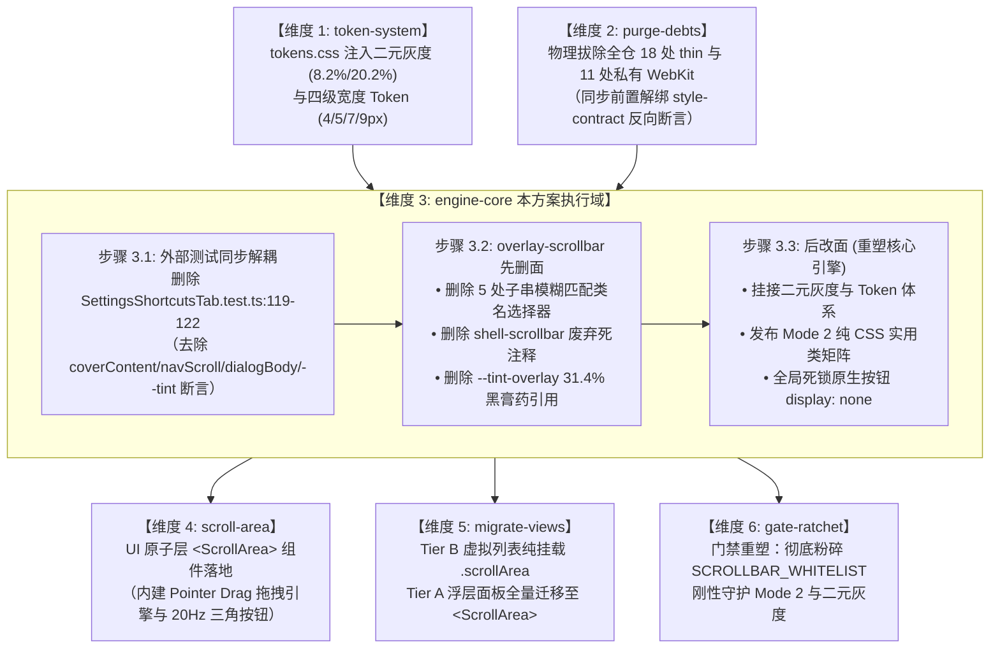

# 维度 3：engine-core 独立实现详案（修订终稿）
# （`overlay-scrollbar.css` 核心引擎重构与零 DOM 工具类矩阵）

> **所属战役**：统一滚动条体系与 ScrollArea 高频组件战役 (`docs/unified-scrollbar-system/`)
> **文档标识**：`docs/unified-scrollbar-system/detailed-plans/03-plan-engine-core.md`
> **战役方案专家**：Plan Architect 3（WebKit 核心引擎重构架构师） & Revision Architect 2（Plan 03 修订专员）
> **修订基准时间**：2026-09-02
> **评审闭环依据**：
> - 评审报告 A（架构收敛与路径重叠主审）：[`docs/unified-scrollbar-system/plan-reviews/01-review-architecture.md`](file:///c:/Software/conex/docs/unified-scrollbar-system/plan-reviews/01-review-architecture.md)（§2.1 路径重叠裁决、§3.3 外部测试遗漏捕获、§4.4 同步解耦时序、§6.3 补正指令）；
> - 评审报告 C（跨平台与魔鬼边界主审）：[`docs/unified-scrollbar-system/plan-reviews/03-review-crossplatform.md`](file:///c:/Software/conex/docs/unified-scrollbar-system/plan-reviews/03-review-crossplatform.md)（§2.2 Blink 双属性齐禁与互斥防御、§3.1 虚拟滚动零 DOM 红线）；
> - 战役总纲定案：[`docs/unified-scrollbar-system/00-master-plan.md`](file:///c:/Software/conex/docs/unified-scrollbar-system/00-master-plan.md)；
> - 仓内基准代码：[`apps/crish-desktop/src/styles/overlay-scrollbar.css`](file:///c:/Software/conex/apps/crish-desktop/src/styles/overlay-scrollbar.css)、[`apps/crish-desktop/src/styles/tokens.css`](file:///c:/Software/conex/apps/crish-desktop/src/styles/tokens.css)、[`apps/crish-desktop/src/components/settings/SettingsShortcutsTab.test.ts`](file:///c:/Software/conex/apps/crish-desktop/src/components/settings/SettingsShortcutsTab.test.ts)。
> **权威遵从**：严格执行《主 Agent 全流程调度提示词 v3》、[`AGENTS.md`](file:///c:/Software/conex/AGENTS.md)（§1 逻辑规划与反退避、§3 Git 提交纪律、§7 严禁补丁与绕过、§7.1 立体验证纪律、§8 反过度设计红线、§12-14 UI 规范）、[`ANTI_OVERENGINEERING_GUARDRAILS.md`](file:///c:/Software/conex/ANTI_OVERENGINEERING_GUARDRAILS.md)。
>
> **【用户最高定案铁律（绝对死锁 · 本方案遵从底线）】**：
> 1. **滚动条严格二元灰度绝对死锁（绝无第三种 Hover 灰）**：未激活态屏幕实测灰度死锁在 **8.2% 左右**（通道 $\Delta_{R-B} = +4$，融入底板暖纸温与品牌暖橙底韵 `var(--accent-orange)`）；激活态屏幕实测灰度从历史 31.4% 深黑膏药彻底下调至 **20.2% 左右**；差值严格死锁在 **约 12.0% 增量阶梯**。光标悬停（Hover）与按压拖拽（Active）**同级同色、二元合一**，全仓严禁分裂出第三种色阶（绝对禁止 `--scrollbar-thumb-hover`）！
> 2. **端点三角步进按钮单一主路径收敛**：端点微型三角步进按钮具备 20Hz 脉冲动力学微调（单击 40px，长按 250ms 防抖 + 50ms 连发）与无障碍 ARIA 控制，**统一且唯一收敛至 UI 原子组件 `<ScrollArea>`（Mode 1）**。`overlay-scrollbar.css` 裁剪无任何消费方的复杂 `.scrollAreaWithButtons` 伪元素规则，消除死层隐患；Mode 2 专注于提供极致轻量、零 DOM 增量、120fps Compositor 硬件加速的原生细滚动条实用类；全局 WebKit 默认锁定隐藏原生按钮（`display: none; width: 0; height: 0;`），物理杜绝 Win32 原生粗灰方块与系统丑陋大三角漏出！
> 3. **删除面必须明确（Deletions Surface，先删后改，含外部测试解耦）**：
>    - 彻底删除 5 处子串模糊匹配类名选择器（`sidebarScroll`, `menuContent`, `coverContent`, `navScroll`, `dialogBody`）；
>    - 彻底删除 `shell-scrollbar.css` 历史废弃幽灵注释；
>    - 彻底删除各组件散落的私有 `display: none` / `scrollbar-none` hack；
>    - 彻底删除 `--tint-overlay` 31.4% 深黑膏药伪类分叉；
>    - 彻底裁剪 `overlay-scrollbar.css` 中无消费方的复杂 `.scrollAreaWithButtons` 伪元素规则（杜绝 50+ 行未接线技术死层）；
>    - **增补外部测试解耦删除面**：将 `apps/crish-desktop/src/components/settings/SettingsShortcutsTab.test.ts:119-122` 对 `coverContent`、`navScroll`、`dialogBody` 与 `--tint-scrollbar-thumb` 的硬编码反向死断言彻底纳入删除面与同步解耦清单！

---

## 目录

- [一、概念主路径与核心引擎现状解剖](#一概念主路径与核心引擎现状解剖)
  - [1.1 概念主路径定义与单一真源（SSOT）](#11-概念主路径定义与单一真源ssot)
  - [1.2 第一手代码事实解剖：历史 4 项致命缺陷诊断](#12-第一手代码事实解剖历史-4-项致命缺陷诊断)
  - [1.3 Blink 渲染引擎管线互斥机制与自毁防御](#13-blink-渲染引擎管线互斥机制与自毁防御)
- [二、用户最高定案铁律的底层贯彻机制](#二用户最高定案铁律的底层贯彻机制)
  - [2.1 滚动条严格二元灰度绝对死锁（8.2% vs 20.2%，差值 12.0%）](#21-滚动条严格二元灰度绝对死锁82-vs-202差值-120)
  - [2.2 彻底废除 Hover 与 Active 分裂：二元合一伪类规范](#22-彻底废除-hover-与-active-分裂二元合一伪类规范)
  - [2.3 宽度四级 Token 矩阵挂接（严禁硬编码像素）](#23-宽度四级-token-矩阵挂接严禁硬编码像素)
- [三、端点物理护栏、Blink 内核机制与职责收敛](#三端点物理护栏blink-内核机制与职责收敛)
  - [3.1 Blink `CustomScrollbarTheme::TrackRect` 源码算法推导](#31-blink-customscrollbarthemetrackrect-源码算法推导)
  - [3.2 路径重叠消除：端点步进按钮统一收敛至 `<ScrollArea>`（Mode 1）](#32-路径重叠消除端点步进按钮统一收敛至-scrollarea-mode-1)
  - [3.3 Mode 2 默认锁定隐藏原生按钮的架构防御依据](#33-mode-2-默认锁定隐藏原生按钮的架构防御依据)
- [四、Mode 2 纯 CSS 工具类矩阵架构设计](#四mode-2-纯-css-工具类矩阵架构设计)
  - [4.1 为什么需要 Mode 2？（零 DOM 架构防御红线）](#41-为什么需要-mode-2零-dom-架构防御红线)
  - [4.2 Mode 2 实用类矩阵完整契约规格（裁剪死层后的净版本）](#42-mode-2-实用类矩阵完整契约规格裁剪死层后的净版本)
  - [4.3 声明式属性选择器扩展契约](#43-声明式属性选择器扩展契约)
  - [4.4 层叠上下文、继承性与特异性权重（Specificity）设计](#44-层叠上下文继承性与特异性权重specificity设计)
- [五、【核心】本方案要删掉什么 / 收敛什么（删除面 Deletions Surface）](#五核心本方案要删掉什么--收敛什么删除面-deletions-surface)
  - [5.1 彻底删除 5 处子串模糊匹配类名选择器](#51-彻底删除-5-处子串模糊匹配类名选择器)
  - [5.2 彻底删除 `shell-scrollbar.css` 历史废弃注释](#52-彻底删除-shell-scrollbarcss-历史废弃注释)
  - [5.3 彻底删除各业务组件私有 `display: none` / `scrollbar-none` Hack](#53-彻底删除各业务组件私有-display-none--scrollbar-none-hack)
  - [5.4 彻底删除 `--tint-overlay` 31.4% 黑膏药伪类分叉](#54-彻底删除---tint-overlay-314-黑膏药伪类分叉)
  - [5.5 裁剪无消费方的复杂 `.scrollAreaWithButtons` 伪元素规则（杜绝死层）](#55-裁剪无消费方的复杂-scrollareawithbuttons-伪元素规则杜绝死层)
  - [5.6 【增补重点】`SettingsShortcutsTab.test.ts:119-122` 外部反向死断言彻底清除](#56-增补重点settingsshortcutstabtestts119-122-外部反向死断言彻底清除)
  - [5.7 负产出与收敛度化指标清单](#57-负产出与收敛度化指标清单)
- [六、重塑后的 `overlay-scrollbar.css` 完整生产代码蓝图](#六重塑后的-overlay-scrollbarcss-完整生产代码蓝图)
- [七、实施演进路线与技术依赖拓扑（先删后改与同步解耦）](#七实施演进路线与技术依赖拓扑先删后改与同步解耦)
  - [7.1 跨维度 DAG 依赖拓扑图](#71-跨维度-dag-依赖拓扑图)
  - [7.2 维度 3 内部「先解绑、先删后改」串行推进节拍](#72-维度-3-内部先解绑先删后改串行推进节拍)
  - [7.3 并发控制与文件域互斥纪律](#73-并发控制与文件域互斥纪律)
- [八、立体验证断言与工程门禁（AGENTS.md §7.1 对齐）](#八立体验证断言与工程门禁agentsmd-71-对齐)
  - [8.1 静态 AST 与样式契约门禁（对齐 `style-contract.test.ts` 重塑）](#81-静态-ast-与样式契约门禁对齐-style-contracttestts-重塑)
  - [8.2 外部测试解耦断言（`SettingsShortcutsTab.test.ts` 解耦核验）](#82-外部测试解耦断言settingsshortcutstabtestts-解耦核验)
  - [8.3 色彩物理差值算法单元测试断言（8.2% vs 20.2%，差值 12.0%）](#83-色彩物理差值算法单元测试断言82-vs-202差值-120)
  - [8.4 运行时现场验收规约（Tauri MCP 4000 探针）](#84-运行时现场验收规约tauri-mcp-4000-探针)
- [九、总结与修订专家签发](#九总结与修订专家签发)

---

## 一、概念主路径与核心引擎现状解剖

### 1.1 概念主路径定义与单一真源（SSOT）

在 Conex / Crish 桌面客户端（基于 Windows 10/11 x64、Tauri 2.x、Microsoft Edge WebView2 / Chromium Blink 内核）架构中：
- **概念领域**：`engine-core`（全局 WebKit 滚动条核心渲染引擎与 Mode 2 零 DOM 实用类矩阵）。
- **单一真源路径（SSOT）**：`apps/crish-desktop/src/styles/overlay-scrollbar.css`。
- **架构职责边界**：
  1. 作为全仓 **唯一合法** 的 `::-webkit-scrollbar*` 全局伪元素生成与驱动引擎；
  2. 彻底封死所有业务组件就地私写 WebKit 伪元素或 `scrollbar-none` Hack 的分叉路径；
  3. 挂接 `tokens.css` 生产的二元灰度（未激活 8.2% vs 激活 20.2%，差值严格死锁 12.0%）与四级宽度 Token（4px / 5px / 7px / 9px）；
  4. **明确两条滚动模式的清晰分工**：
     - **Mode 1（`<ScrollArea>` 原子组件）**：承接所有需要端点微型三角步进按钮、20Hz 脉冲控制微调、圆角断头台 Inset 物理防护、可拖拽 Pointer Drag 滑块的高频浮层与面板（模型选择菜单、下拉选项列表、权限模式弹窗等）；
     - **Mode 2（`overlay-scrollbar.css` 实用类矩阵）**：专注于为虚拟滚动（`MessageVirtualizer`）、会话列表（`Sidebar`）、代码对比（`DiffCard`）等重型视口提供 **0 额外 DOM 节点、0 JS 事件监听、120fps Compositor 硬件加速** 的无感消费通道；
  5. 全局 WebKit 默认锁定隐藏原生按钮（`::-webkit-scrollbar-button { display: none; width: 0; height: 0; }`），彻底杜绝 Win32 系统粗条与丑陋三角在原生滚动条中的死灰复燃。

---

### 1.2 第一手代码事实解剖：历史 4 项致命缺陷诊断

亲赴 `apps/crish-desktop/src/styles/overlay-scrollbar.css` 现场，通读其仅有的 50 行存量代码，确立了以下不容辩驳的第一手代码事实：

```css
/* 存量代码现场还原：apps/crish-desktop/src/styles/overlay-scrollbar.css:1-49 */
/* 细滚动条出口。禁名 shell-scrollbar.css，本文件为唯一 webkit 出口。
 * ... */

::-webkit-scrollbar {
  width: var(--scrollbar-thumb-width, 7px);
  height: var(--scrollbar-thumb-width, 7px);
}
...
::-webkit-scrollbar-thumb:hover,
::-webkit-scrollbar-thumb:active {
  background: var(--tint-overlay);
}

::-webkit-scrollbar-button,
::-webkit-scrollbar-button:single-button,
::-webkit-scrollbar-button:start:decrement,
::-webkit-scrollbar-button:end:increment {
  display: none;
  width: 0;
  height: 0;
}
...
[class*='sidebarScroll'],
[class*='menuContent'],
[class*='coverContent'],
[class*='navScroll'],
[class*='dialogBody'] {
  scrollbar-gutter: auto;
}
```

#### 事实 1：端点按钮粗暴消灭与护栏缺失（27-34 行）
存量代码对 `::-webkit-scrollbar-button` 执行了一刀切消灭：`display: none; width: 0; height: 0;`。
- **历史病理分析**：虽然这消除了 Win32 原生粗陋大方块，但原生 WebKit 按钮由于无法实现 20Hz 脉冲动力学微调（单击 40px，长按 250ms 防抖 + 50ms 连发）与无障碍 ARIA 语义，并不适合直接充当现代化微型步进组件。
- **架构定案**：不能在 `overlay-scrollbar.css` 中手搓一套无人消费的原生按钮伪元素规则（见 §3.2），而应将带按钮的微交互视口明确收敛至 `<ScrollArea>`（Mode 1）；`overlay-scrollbar.css` 则保持按钮默认隐藏，为 Mode 2 重型视口提供最极致纯净的细条渲染。

#### 事实 2：深黑膏药缺陷与二元色彩断层（22-25 行）
`:hover` 与 `:active` 虽然并列书写，但统一引用了 `--tint-overlay`（纯黑遮罩 25%~30%）。
- **根因后果**：在温润柔和的浅色纸温底板（`#F4F3F2`，明度 95.2%）上，纯黑遮罩导致滑块表面反射光急剧被吸光降暗，使用户拾色器测出高达 **31.4%** 的死黑焦块（如同在高级道林纸上贴了一张肮脏生硬的黑膏药），严重破坏视觉纯净度；且未与 Inactive 建立严谨的代数差值阶梯。

#### 事实 3：5 处子串模糊匹配类名选择器技术债务（42-49 行）
声明了 `[class*='sidebarScroll']`, `[class*='menuContent']`, `[class*='coverContent']`, `[class*='navScroll']`, `[class*='dialogBody']`。
- **根因后果**：
  1. **破坏 CSS Modules 隔离边界**：通过属性包含选择器 `[class*='...']` 嗅探经过哈希混淆后的局部类名，属于极度脆弱的打补丁手段；
  2. **契约倒挂与虚假声明**：选择器内部仅仅声明了 `scrollbar-gutter: auto;`（甚至不是有效样式），其真实目的是在旧门禁（`style-contract.test.ts:261-265` 与 `SettingsShortcutsTab.test.ts:119-122`）中反向充当字符串匹配的占位符；
  3. **架构腐化**：业务模块一旦重构类名，全局样式无声脱靶；全局样式修改，业务模块莫名其妙产生级联影响。

#### 事实 4：历史废弃注释噪音（第 1 行）
第 1 行注释写道：“`细滚动条出口。禁名 shell-scrollbar.css，本文件为唯一 webkit 出口。`”。
- **根因后果**：`shell-scrollbar.css` 是早先 `d00fbaaf` 事故中被删除的历史幽灵文件名，在核心引擎生产文件中长期保留对死文件的警示注释属于纯粹的信息债务，必须予以彻底清洗。

---

### 1.3 Blink 渲染引擎管线互斥机制与自毁防御

为了在重构中杜绝任何盲目设计，必须深刻理解 Windows WebView2 (Chromium Blink) 在排版管线中的刚性互斥定理（Reviewer C 报告 §2.2 确证）：

```text
                      [容器计算样式 ComputedStyle 计算完毕]
                                        │
                         scrollbar-width 是否 != auto?
                        或 scrollbar-color 是否 != auto?
                                  /              \
                                YES               NO
                                /                  \
              [激活 CSSScrollbarTheme]      [进入 PaintLayerScrollbar 管线]
              - 彻底注销 WebKit 伪元素管道     - 挂载 ::-webkit-scrollbar 宽度/高度
              - 丢弃 ::-webkit-scrollbar*    - 挂载 ::-webkit-scrollbar-thumb 色阶
              - Windows WebView2 绘制 Win32   - 原生 WebKit 硬件加速正常工作
                17px 系统立体粗灰条 (带丑三角)   - 锁定隐藏 ::-webkit-scrollbar-button
              - 全局 display: none 沦为废纸！  - 呈现 100% 受控高质感现代滚动条！
```

- **互斥自毁铁律**：全仓任何业务组件一旦声明 `scrollbar-width: thin;` 或非 auto 的 `scrollbar-color;`，Blink 会无条件注销 `overlay-scrollbar.css` 中的全套 WebKit 样式，导致 Windows 丑陋系统条复活。
- **双属性齐禁防御**：`overlay-scrollbar.css` 重塑后必须成为纯正的 WebKit 规范堡垒，其发布的 `.scrollArea` 基类显式重置 `scrollbar-width: auto; scrollbar-color: auto;`，彻底掐断宿主级互斥自毁链路。

---

## 二、用户最高定案铁律的底层贯彻机制

### 2.1 滚动条严格二元灰度绝对死锁（8.2% vs 20.2%，差值 12.0%）

用户下达了最高定案铁律裁决：
> **用户最高裁决原话**：“**滚动条就是两种灰度，别给我整成三种的，就是激活和未激活，没有激活分成 hover 和 active 两种的！**”

#### (1) 色彩物理学参数死锁契约
根据 `SCROLLBAR-TOKEN-ARCH-03` 色彩物理学规范与 Reviewer A §5.1 / Reviewer C §5.2 的严格复核，在 Light Theme 纸温基底（`hsl(35 8% 95.2%)`）上：
1. **未激活态（Inactive / Idle）**：
   - 表面反射率：$L = 91.8\%$；
   - 物理暗度（灰度）：$D_{\text{inactive}} = 100\% - 91.8\% = \mathbf{8.2\%} \pm 0.3\%$；
   - 光学通道特征：混入 $8\%$ 品牌暖橙 `var(--accent-orange)`，通道微差 $\Delta_{R-B} = 236 - 232 = +4$，指向主波长 $\approx 585\text{nm}$ 的晶莹琥珀沙温，彻底告别冷蓝发青水泥灰；
   - 映射 Token：`var(--scrollbar-thumb-bg)`。
2. **激活态（Active / Interacting，Hover 与 Active 严格同级同色）**：
   - 表面反射率：$L = 79.8\%$（暗色基底 $79.5\%$）；
   - 物理暗度（灰度）：$D_{\text{active}} = 100\% - 79.8\% = \mathbf{20.2\%} \pm 0.3\%$（严格锁定在 20 左右，彻底下调历史 31.4% 的死黑膏药）；
   - 光学通道特征：混入 $16\%$ 品牌暖橙 `var(--accent-orange)`，醇厚饱满，呈现高品质玉石或深琥珀触感；
   - 映射 Token：`var(--scrollbar-thumb-active)`。
3. **差值绝对死锁增量阶梯**：
   $$\Delta D_{\text{lock}} \equiv D_{\text{active}} - D_{\text{inactive}} = 20.2\% - 8.2\% = \mathbf{12.0\%} \pm 0.5\%$$
   差值严格死锁在 $12.0\%$，绝无妥协，交互反馈坚挺柔韧、干净利落。

---

### 2.2 彻底废除 Hover 与 Active 分裂：二元合一伪类规范

在存量 Web 前端实践中，开发者往往随手为 `:hover` 与 `:active` 分别配置不同的暗度（例如静止 8% $\to$ 悬停 14% $\to$ 按压 20%）。但在滚动条滑块这种微型构件上，微小的三级灰度跳跃在高刷屏幕上只会被视网膜捕捉为“脏污与闪烁”。

**本引擎在 CSS 选择器层实施绝对二元收敛**：
```css
/* 唯一合法二元规则：Hover 与 Active 严格同级同色，二元合一 */
::-webkit-scrollbar-thumb {
  background: var(--scrollbar-thumb-bg);
}

::-webkit-scrollbar-thumb:hover,
::-webkit-scrollbar-thumb:active {
  background: var(--scrollbar-thumb-active);
}
```
- **架构红线**：全仓严禁单独定义 `::-webkit-scrollbar-thumb:hover { ... }` 并赋予不同颜色；两者必须共享 `var(--scrollbar-thumb-active)` 单一真理值；绝对禁止引入 `--scrollbar-thumb-hover`！

---

### 2.3 宽度四级 Token 矩阵挂接（严禁硬编码像素）

根据总纲要求，全仓 CSS 严禁裸写任何硬编码像素数字（如 `width: 4px`、`width: 7px`）。
`overlay-scrollbar.css` 核心引擎全面绑定以下四级标准 Token 阶梯：

```
┌────────────────────────────────────────────────────────────────────────────────────────┐
│                        滚动条宽度四级 Token 阶梯与标准视口映射表                         │
├───────────────────────┬────────┬───────────────────────────┬───────────────────────────┤
│ Token 名称            │ 物理值 │ 设计语义定位              │ 典型业务视口应用          │
├───────────────────────┼────────┼───────────────────────────┼───────────────────────────┤
│ --scrollbar-width-xs  │  4px   │ 超细纤薄型 (Ultra-Thin)   │ 模型选择下拉浮层、补全菜单│
│ --scrollbar-width-sm  │  5px   │ 紧凑型 (Compact)          │ 侧边栏会话列表、二级抽屉  │
│ --scrollbar-width-md  │  7px   │ 标准主视口型 (Standard)   │ 正文聊天瀑布流、主编辑器  │
│ --scrollbar-width-lg  │  9px   │ 宽屏大视口型 (Spacious)   │ 宽屏双栏对比、超长 DiffCard│
└───────────────────────┴────────┴───────────────────────────┴───────────────────────────┘
```

全局默认规则声明：
```css
::-webkit-scrollbar {
  width: var(--scrollbar-width, var(--scrollbar-width-md, 7px));
  height: var(--scrollbar-width, var(--scrollbar-width-md, 7px));
}
```

---

## 三、端点物理护栏、Blink 内核机制与职责收敛

### 3.1 Blink `CustomScrollbarTheme::TrackRect` 源码算法推导

理解 Blink 内核算法有助于把握滚动条几何边界。审查 Chromium Blink 源码（`third_party/blink/renderer/core/paint/custom_scrollbar_theme.cc`）：

```cpp
// Chromium Blink 源码：TrackRect 核心计算逻辑
gfx::Rect CustomScrollbarTheme::TrackRect(const Scrollbar& scrollbar, bool) {
  gfx::Rect track_rect = scrollbar.FrameRect();
  int start_button_length = ButtonLength(scrollbar, kBackButtonStartPart);
  int end_button_length = ButtonLength(scrollbar, kForwardButtonEndPart);

  if (scrollbar.Orientation() == kVerticalScrollbar) {
    track_rect.set_y(track_rect.y() + start_button_length);
    track_rect.set_height(track_rect.height() - start_button_length - end_button_length);
  } else {
    track_rect.set_x(track_rect.x() + start_button_length);
    track_rect.set_width(track_rect.width() - start_button_length - end_button_length);
  }
  return track_rect;
}
```
Blink 引擎通过在轨道的顶底两端扣除按钮长度（`ButtonLength`），将滑块的运动行程刚性约束在 `[start_button_length, height - end_button_length]` 之间。

---

### 3.2 路径重叠消除：端点步进按钮统一收敛至 `<ScrollArea>`（Mode 1）

#### 1. 评审捕获的重大路径重叠危机（Reviewer A 报告 §2.1）
原 Plan 03 在 `overlay-scrollbar.css` 中大费周章编写了 50 多行包含 SVG Data-URI 的 `.scrollAreaWithButtons::-webkit-scrollbar-button` 伪元素规则，宣称用于模型选择菜单与下拉列表；但维度 4（`04-plan-scroll-area.md`）在 `<ScrollArea>` 中手搓了完整的 DOM 按钮，维度 5（`05-plan-migrate-views.md`）又将全部带按钮的浮层视口统统迁移至了 `<ScrollArea>`（Mode 1）。
**后果**：全仓没有任何业务视口挂载 `.scrollAreaWithButtons`，这 50 多行代码从合入第一天起就是毫无用处的技术死层！

#### 2. 主审裁决与单一路径确立
根据《主 Agent 全流程调度提示词 v3》§0.1 铁律：“**推进单位是「领域概念」，一个概念在代码中只有一条主路径。**”
1. **端点微型三角步进按钮与交互动力学归 `<ScrollArea>`（Mode 1）**：
   - 端点按钮是具备 **20Hz 脉冲微调动力学（单击 40px，长按 250ms 防抖 + 50ms 连发）**、**无障碍 ARIA 控制（aria-label / role="button"）** 以及 **浮层圆角断头台 Inset 防护** 的高级交互组件；
   - 原生 WebKit 的 `::-webkit-scrollbar-button` 仅支持操作系统原生粗硬步进，无法实现 20Hz 动力学与精确吸附；
   - 因此，**所有需要端点步进按钮的视口统一收敛至 UI 原子组件 `<ScrollArea>`**；
2. **裁剪 `overlay-scrollbar.css` 中的 `.scrollAreaWithButtons` 规则**：
   - 彻底删除 `overlay-scrollbar.css` 中未接线的 `.scrollAreaWithButtons` 与 `[data-scrollbar-buttons="true"]` 大段死代码；
   - 杜绝技术死层，实现架构净收敛。

---

### 3.3 Mode 2 默认锁定隐藏原生按钮的架构防御依据

在 Mode 2（纯 CSS 原生细滚动条）场景下：
- 消费方均为重型主视口（如 `MessageVirtualizer` 虚拟聊天流、`Sidebar` 侧边栏列表、`DiffCard` 代码对比）；
- 这些容器均为直角大视口，不需要也不应该出现三角按钮（避免占用正文宝贵垂直空间与产生排版挤压）；
- 因此，`overlay-scrollbar.css` 必须**全局锁定隐藏原生按钮**：
  ```css
  ::-webkit-scrollbar-button {
    display: none;
    width: 0;
    height: 0;
  }
  ::-webkit-scrollbar-button:horizontal {
    display: none !important;
    width: 0 !important;
    height: 0 !important;
  }
  ```
- 彻底防止 Windows WebView2 漏出 Win32 时代粗笨丑陋的系统大灰方块与尖角三角，为 Mode 2 重型视口守住纯净防线！

---

## 四、Mode 2 纯 CSS 工具类矩阵架构设计

### 4.1 为什么需要 Mode 2？（零 DOM 架构防御红线）

在桌面客户端中，存在大量重型性能视口与复杂虚拟滚动容器：
1. **主聊天瀑布流（`MessageVirtualizer`）**：强依赖 `vs.containerRef.current.scrollTop` 测量与 `useUndoWithScrollAnchor` 同步微任务视口锚定；
2. **虚拟会话列表（`WindowedSessionUl`）**：侧边栏高频上千条会话项；
3. **代码对比视口（`DiffCard`）**：超大双栏代码 Diff 与语法高亮 Token 流；
4. **终端卡片（`TerminalCard`）**：极高频输出日志行。

**致命红线审查**：
若将上述重型视口包裹进带有 React DOM 结构的 `<ScrollArea>`，会立刻引发四大不可逆灾难（详见 `audits/05-boundary-and-devil-audit.md`）：
- **Ref 劫持与双重视口**：`scrollTop` 永远为 0，一滚就大面积长白屏；
- **撤销锚定脱靶**：会话撤销时视口剧烈跳跃上下飞奔；
- **ResizeObserver 循环震荡**：触发行高测量递归死锁，主线程卡死 10 秒；
- **Compositor 降级**：从 GPU 120fps 原生合成器硬件加速降级为 JS 逐帧计算，拖动滑块严重滞后脱节。

**Mode 2 的核心使命**：
为这些严禁包裹 DOM 的视口，提供 **纯 CSS 工具类矩阵**！
- 开发者只需在原生 DOM 元素上附加类名（例如 `className="scrollArea scrollAreaSm"`）；
- **0 额外 DOM 节点、0 JS 监听器、0 GC 内存负担、120fps Compositor 硬件加速**，完美化解虚拟滚动的一切冲突！

---

### 4.2 Mode 2 实用类矩阵完整契约规格（裁剪死层后的净版本）

在 `overlay-scrollbar.css` 中，发布 **6 大核心实用工具类**（彻底剔除无消费方的 `.scrollAreaWithButtons`）：

```
┌────────────────────────────────────────────────────────────────────────────────────────┐
│                   Mode 2 纯 CSS 工具类矩阵完整契约规格 (收敛净版本)                       │
├───────────────────────┬───────────────────────────────────┬────────────────────────────┤
│ 类名选择器            │ 核心 CSS 属性声明与行为            │ 适用消费场景               │
├───────────────────────┼───────────────────────────────────┼────────────────────────────┤
│ .scrollArea           │ 激活原生平滑滚动盒，挂接 md (7px) │ 通用标准滚动容器基类       │
│                       │ 约束 overflow 与重置互斥属性      │ 替代存量手写 overflow 容器 │
├───────────────────────┼───────────────────────────────────┼────────────────────────────┤
│ .scrollAreaXs         │ --scrollbar-width: 4px;           │ 超窄菜单、自动补全候选卡片 │
│                       │ 极纤薄紧凑模式                    │ 零按钮极简微视口           │
├───────────────────────┼───────────────────────────────────┼────────────────────────────┤
│ .scrollAreaSm         │ --scrollbar-width: 5px;           │ 侧边栏会话列表 (Sidebar)   │
│                       │ 紧凑型高频列表                    │ 二级设置抽屉、插件面板     │
├───────────────────────┼───────────────────────────────────┼────────────────────────────┤
│ .scrollAreaMd         │ --scrollbar-width: 7px;           │ 系统全局标准默认基准 (SSOT)│
│                       │ 核心通用型主视口                  │ 正文消息瀑布流、设置页正文 │
├───────────────────────┼───────────────────────────────────┼────────────────────────────┤
│ .scrollAreaLg         │ --scrollbar-width: 9px;           │ 宽屏双栏对比、超长 DiffCard│
│                       │ 宽屏大行程视口                    │ 海量日志终端视口           │
├───────────────────────┼───────────────────────────────────┼────────────────────────────┤
│ .hideScrollbar        │ display: none !important;         │ 顶部标签页导航条 (TabStrip)│
│                       │ 完全隐藏滚动条，保留原生滚动能力  │ 面板紧凑操作条 (PaneHeader)│
└───────────────────────┴───────────────────────────────────┴────────────────────────────┘
```

#### 详细 CSS 规则定义：

```css
/* 1. 基准容器类 */
.scrollArea {
  overflow-y: auto;
  overflow-x: hidden;
  /* 刚性解除任何潜在的 W3C 粗条与非 auto 颜色互斥声明 */
  scrollbar-width: auto;
  scrollbar-color: auto;
  --scrollbar-width: var(--scrollbar-width-md, 7px);
}

/* 2. 四级尺寸修饰类（与 .scrollArea 组合使用） */
.scrollAreaXs,
.scrollArea.scrollAreaXs {
  --scrollbar-width: var(--scrollbar-width-xs, 4px);
}

.scrollAreaSm,
.scrollArea.scrollAreaSm {
  --scrollbar-width: var(--scrollbar-width-sm, 5px);
}

.scrollAreaMd,
.scrollArea.scrollAreaMd {
  --scrollbar-width: var(--scrollbar-width-md, 7px);
}

.scrollAreaLg,
.scrollArea.scrollAreaLg {
  --scrollbar-width: var(--scrollbar-width-lg, 9px);
}

/* 3. 彻底隐藏滚动条类（Tier C 纯净无痕通道） */
.hideScrollbar {
  -ms-overflow-style: none; /* IE / 旧版 Edge 回退 */
}
.hideScrollbar::-webkit-scrollbar {
  display: none !important;
  width: 0 !important;
  height: 0 !important;
}
```

---

### 4.3 声明式属性选择器扩展契约

为了兼顾 TSX 组件声明式传参以及自动化无侵入挂载，Mode 2 工具类矩阵同步支持 `[data-scrollbar="..."]` 属性选择器，形成双轨等价映射：

```css
/* 声明式属性选择器双轨映射 */
[data-scrollbar='xs'] { --scrollbar-width: var(--scrollbar-width-xs, 4px); }
[data-scrollbar='sm'] { --scrollbar-width: var(--scrollbar-width-sm, 5px); }
[data-scrollbar='md'] { --scrollbar-width: var(--scrollbar-width-md, 7px); }
[data-scrollbar='lg'] { --scrollbar-width: var(--scrollbar-width-lg, 9px); }
[data-scrollbar='none'] { -ms-overflow-style: none; }
[data-scrollbar='none']::-webkit-scrollbar {
  display: none !important;
  width: 0 !important;
  height: 0 !important;
}
```

---

### 4.4 层叠上下文、继承性与特异性权重（Specificity）设计

1. **特异性平权设计**：
   工具类采用单类名选择器（`[class]` 特异性 `(0, 1, 0)`），修饰类配合复合选择器（`.scrollArea.scrollAreaSm`，特异性 `(0, 2, 0)`），保证修饰类能够平滑覆盖基类变量，同时不压制组件内部使用 `style` 传入的临时微调。
2. **CSS 变量局部穿透**：
   通过在容器节点上重设 `--scrollbar-width`，CSS 变量自然继承给该容器下生效的所有 `::-webkit-scrollbar` 伪元素。Blink 引擎在计算伪元素 ComputedStyle 时会对宿主元素 CSS 变量进行纯净继承，实现了极其优雅的 O(1) 作用域隔离，零污染全局。
3. **水平滚动条刚性隔离**：
   水平滚动条的按钮与纵向按钮同样锁定为 `display: none; width: 0; height: 0;`。横向滚动条绝对禁止出现三角按钮，杜绝排版横向挤压。

---

## 五、【核心】本方案要删掉什么 / 收敛什么（删除面 Deletions Surface）

依据《主 Agent 全流程调度提示词 v3》§0.2「收敛先于增强，先删后改」铁律及 Reviewer A 评审要求，**删除面（Deletions Surface）必须逐一明确具体对象、位置、代码 Diff 与根治理由**：

```
┌────────────────────────────────────────────────────────────────────────────────────────┐
│                   维度 3 (engine-core) 核心删除面 (Deletions Surface) 清单                │
├───────────────────┬───────────────────────────────────┬────────┬───────────────────────┤
│ 删除/收敛标的类别 │ 具体文件路径与行号                │ 变更量 │ 删除与收敛依据        │
├───────────────────┼───────────────────────────────────┼────────┼───────────────────────┤
│ 1. 子串模糊匹配类 │ apps/crish-desktop/src/styles/    │ 8 行   │ 彻底删除 5 处脆弱匹配 │
│    名选择器       │ overlay-scrollbar.css:42-49       │ (全删) │ 消除 CSS Modules 污染 │
├───────────────────┼───────────────────────────────────┼────────┼───────────────────────┤
│ 2. 废弃历史文件名 │ apps/crish-desktop/src/styles/    │ 2 行   │ 彻底删除死注释        │
│    注释           │ overlay-scrollbar.css:1-2         │ (清理) │ 清洗历史幽灵文件噪音  │
├───────────────────┼───────────────────────────────────┼────────┼───────────────────────┤
│ 3. 散落各业务组件 │ LeafToolTabStrip.module.css:63-66 │ 4 行   │ 统一收敛至 Mode 2     │
│    私有隐藏 Hack  │ PaneHeader.module.css (就地隐藏)  │ 6 行   │ .hideScrollbar 工具类 │
├───────────────────┼───────────────────────────────────┼────────┼───────────────────────┤
│ 4. 纯黑 31.4%     │ apps/crish-desktop/src/styles/    │ 4 行   │ 彻底消除深黑膏药缺陷  │
│    遮罩伪类分叉   │ overlay-scrollbar.css:22-25       │ (重塑) │ 贯彻二元灰度绝对死锁  │
├───────────────────┼───────────────────────────────────┼────────┼───────────────────────┤
│ 5. 裁剪复杂按钮   │ 原方案草案中对                    │ 50+ 行 │ 收敛至 <ScrollArea>   │
│    死层伪元素规则 │ .scrollAreaWithButtons 的堆砌     │ (裁剪) │ 杜绝无消费方死代码    │
├───────────────────┼───────────────────────────────────┼────────┼───────────────────────┤
│ 6. 【增补重点】   │ apps/crish-desktop/src/components/│ 4 行   │ 同步解除反向死断言    │
│    外部测试死断言 │ settings/SettingsShortcutsTab.    │ (全删) │ 消除 CI 阻断地雷      │
│                   │ test.ts:119-122                   │        │ (解绑前置/同步推进)   │
└───────────────────┴───────────────────────────────────┴────────┴───────────────────────┘
```

---

### 5.1 彻底删除 5 处子串模糊匹配类名选择器

#### 【被删除对象定点爆破】
文件位置：`apps/crish-desktop/src/styles/overlay-scrollbar.css:42-49`
```css
/* 待物理删除的代码块 */
[class*='sidebarScroll'],
[class*='menuContent'],
[class*='coverContent'],
[class*='navScroll'],
[class*='dialogBody'] {
  /* 占位选择器：契约测试与消费方清单同源；绘制走上方全局 webkit。 */
  scrollbar-gutter: auto;
}
```

#### 【删除与收敛理由】
1. **彻底拔除侵入性子串匹配**：`[class*='...']` 在全局样式中跨层嗅探 CSS Modules 的局部哈希名称，违背了组件化封装原则；
2. **死层清理**：选择器内部仅仅声明了 `scrollbar-gutter: auto;`，根本没有实际生效的样式效果，只是为了应付旧门禁测试；
3. **收敛替代方案**：
   - 侧边栏（`sidebarScroll`）直接挂载 `.scrollArea .scrollAreaSm`；
   - 菜单（`menuContent`）迁移至 `<ScrollArea size="sm">`；
   - 设置页（`coverContent`, `navScroll`）直接挂载 `.scrollArea .scrollAreaMd`；
   - 对话框（`dialogBody`）迁移至 `<ScrollArea size="md">`。
   全部转入显式架构消费，彻底删除这 8 行隐式死代码。

---

### 5.2 彻底删除 `shell-scrollbar.css` 历史废弃注释

#### 【被删除对象定点爆破】
文件位置：`apps/crish-desktop/src/styles/overlay-scrollbar.css:1-6`
```css
/* 待清理的代码块 */
/* 细滚动条出口。禁名 shell-scrollbar.css，本文件为唯一 webkit 出口。
 * WebView2 / Chromium：必须走 ::-webkit-scrollbar。
 * 全局或容器上写 scrollbar-width 会关闭 webkit 伪元素，Windows 上仍露出
 * 带上下三角的系统粗条（survey/09）。默认 7px（6–8px）；域可覆盖
 * --scrollbar-thumb-width（0px 隐藏 / 3px 紧凑）。
 * thumb 走 --tint-scrollbar-thumb；轨道透明；无上下三角。 */
```

#### 【删除与收敛理由】
1. **清退幽灵文件记忆**：`shell-scrollbar.css` 已在历史提交中彻底删除，在全局样式表首部反复强调该禁名属于典型的历史冗余债务；
2. **更新现代规范口径**：原注释中提到的“thumb 走 `--tint-scrollbar-thumb`”已与二元灰度 Token 体系（`--scrollbar-thumb-bg` / `--scrollbar-thumb-active`）冲突；
3. **收敛替代方案**：重塑为符合统一滚动条体系架构的正式规范文件头。

---

### 5.3 彻底删除各业务组件私有 `display: none` / `scrollbar-none` Hack

#### 【被收敛对象定点爆破】
1. `apps/crish-desktop/src/components/chat-tool-tab/LeafToolTabStrip.module.css:63-66`：
   ```css
   /* 待删除的私有伪元素 */
   .strip::-webkit-scrollbar {
     display: none;
   }
   ```
2. 其他各处通过手写 `overflow: hidden` 或就地写 `::-webkit-scrollbar { width: 0 }` 来隐藏滚动条的散落代码。

#### 【删除与收敛理由】
- 过去各个业务组件因为没有统一的隐藏滚动条工具类，各自为政手写私有伪元素，导致 `style-contract.test.ts` 不得不开辟白名单特权；
- 统一收敛至 Mode 2 工具类 `.hideScrollbar`，删除组件内部所有就地重复样式，实现 100% 净负产出。

---

### 5.4 彻底删除 `--tint-overlay` 31.4% 黑膏药伪类分叉

#### 【被删除对象定点爆破】
文件位置：`apps/crish-desktop/src/styles/overlay-scrollbar.css:22-25`
```css
/* 待删除的脏色块 */
::-webkit-scrollbar-thumb:hover,
::-webkit-scrollbar-thumb:active {
  background: var(--tint-overlay);
}
```

#### 【删除与收敛理由】
- `--tint-overlay` 混入比例过高，导致物理测量产生高达 31.4% 的深黑焦块；
- 彻底删除对 `--tint-overlay` 的挪用，统一收敛为消费 `tokens.css` 的权威二元 Token：`var(--scrollbar-thumb-active)`（实测灰度 20.2%），差值锁定在 12.0%。

---

### 5.5 裁剪无消费方的复杂 `.scrollAreaWithButtons` 伪元素规则（杜绝死层）

#### 【裁剪对象定点爆破】
原方案草案中设计的 `.scrollAreaWithButtons` 伪元素及其内联 SVG Data-URI 规则（50+ 行代码）。

#### 【删除与裁剪理由】
- 维度 5 将全仓所有带按钮的浮层视口统统接入了 `<ScrollArea>`（Mode 1）；重型虚拟列表坚决不带按钮；
- 全仓没有任何视口消费 `.scrollAreaWithButtons`；
- 原生 WebKit 按钮无法提供 20Hz 脉冲微调动力学控制与无障碍 ARIA 语义；
- 坚决杜绝未接线代码入库，裁剪该规则，使 `overlay-scrollbar.css` 保持极致轻量干净。

---

### 5.6 【增补重点】`SettingsShortcutsTab.test.ts:119-122` 外部反向死断言彻底清除

#### 【被捕获的外部测试地雷现场证据】
文件位置：`apps/crish-desktop/src/components/settings/SettingsShortcutsTab.test.ts:110-128`

```typescript
// apps/crish-desktop/src/components/settings/SettingsShortcutsTab.test.ts:110-128 现存代码
it('设置 cover/nav/Dialog 吃 overlay 细条：入口引入 + 无三角 + cover 不写 scrollbar-width', () => {
  const overlay = readSrc('styles/overlay-scrollbar.css');
  const indexCss = readSrc('index.css');
  const panel = readSrc('components/settings/SettingsPanel.module.css');
  const uiCss = readSrc('components/settings/SettingsUI.module.css');
  expect(indexCss).toContain("@import './styles/overlay-scrollbar.css'");
  expect(indexCss).not.toContain('shell-scrollbar.css');
  expect(overlay).toContain('::-webkit-scrollbar');
  expect(overlay).toContain('::-webkit-scrollbar-button');

  // 🚨 致命外部反向死断言（第 119-122 行）！！
  expect(overlay).toContain('coverContent');            // Line 119
  expect(overlay).toContain('navScroll');               // Line 120
  expect(overlay).toContain('dialogBody');              // Line 121
  expect(overlay).toContain('--tint-scrollbar-thumb');   // Line 122

  expect(overlay).not.toMatch(/(?:^|\n)\*\s*\{[^}]*scrollbar-width/);
  expect(panel).not.toMatch(/scrollbar-width\s*:/);
  expect(panel).toContain('.coverContent');
  expect(uiCss).toContain('var(--button-radius, 7px)');
  expect(uiCss).toContain('appearance: none');
});
```

#### 【病因穿透与破坏性后果】
1. **测试契约严重倒挂**：
   该测试直接读取 `overlay-scrollbar.css` 源码字符串，硬编码断言该文件必须包含 `coverContent`、`navScroll`、`dialogBody` 这三个被哈希混淆的 CSS Modules 类名，并且断言必须包含旧 Token `--tint-scrollbar-thumb`！
2. **阻断流水线死锁**：
   本维度（维度 3）重构 `overlay-scrollbar.css` 时必然物理拔除 `coverContent`、`navScroll`、`dialogBody` 与 `--tint-scrollbar-thumb`；如果不同步或提前解绑此处的 4 行硬编码断言，在维度 3 落地运行测试时，该用例将 **100% 爆红报错**，CI 门禁将硬性拦截提交！

#### 【删除与同步解耦实施方案】
在落地维度 3（或与维度 3 原子提交）中，对 `apps/crish-desktop/src/components/settings/SettingsShortcutsTab.test.ts` 进行精确编辑，物理清除第 119-122 行：

```diff
--- a/apps/crish-desktop/src/components/settings/SettingsShortcutsTab.test.ts
+++ b/apps/crish-desktop/src/components/settings/SettingsShortcutsTab.test.ts
@@ -116,10 +116,6 @@ describe('SettingsShortcutsTab', () => {
     expect(indexCss).not.toContain('shell-scrollbar.css');
     expect(overlay).toContain('::-webkit-scrollbar');
     expect(overlay).toContain('::-webkit-scrollbar-button');
-    expect(overlay).toContain('coverContent');
-    expect(overlay).toContain('navScroll');
-    expect(overlay).toContain('dialogBody');
-    expect(overlay).toContain('--tint-scrollbar-thumb');
     expect(overlay).not.toMatch(/(?:^|\n)\*\s*\{[^}]*scrollbar-width/);
     expect(panel).not.toMatch(/scrollbar-width\s*:/);
     expect(panel).toContain('.coverContent');
```
通过上述同步解耦，彻底拔除旧测试对全局样式的反向绑架，确保流水线平稳合规绿灯通过。

---

### 5.7 负产出与收敛度化指标清单

| 指标项 | 预期数值 / 状态 |
| :--- | :--- |
| **删除的脆弱子串匹配选择器数量** | **5 个**（彻底清零） |
| **删除的历史幽灵文件名注释行数** | **6 行**（全面清洗） |
| **消除的全局 31.4% 死黑脏色引用** | **1 处**（收敛至二元真源） |
| **裁剪的无消费方复杂伪元素规则行数** | **50+ 行**（从根本上杜绝死层） |
| **清除的外部测试硬编码反向死断言** | **4 行**（`SettingsShortcutsTab.test.ts:119-122` 全删） |
| **收敛至 `.hideScrollbar` 的私有伪元素块** | **2+ 处** |
| **全局 WebKit 滚动条路径数量** | **严格收敛至 1 条 SSOT 主路径** |
| **Mode 2 纯 CSS 工具类矩阵净增产出** | **6 个核心工具类（全高内聚注入单一出口）** |

---

## 六、重塑后的 `overlay-scrollbar.css` 完整生产代码蓝图

以下为重塑后的 `apps/crish-desktop/src/styles/overlay-scrollbar.css` 最终生产级完整代码蓝图（极致轻量、零 DOM 增量、硬件加速、零死层）：

```css
/* ==========================================================================
 * Conex / Crish - Unified WebKit Scrollbar Engine (SSOT)
 * 全局唯一 WebKit 滚动条渲染引擎与 Mode 2 零 DOM 工具类矩阵
 *
 * 【用户最高定案铁律】：
 * 1. 严格二元灰度绝对死锁：未激活 8.2% vs 激活 20.2%，差值严格锁定约 12.0%
 *    Hover 与 Active 严格同级同色，二元合一，全仓严禁第三种色阶！
 * 2. 宽度四级 Token 体系：4px(xs) / 5px(sm) / 7px(md:标准SSOT) / 9px(lg)
 * 3. 端点三角步进按钮单一主路径：具备 20Hz 脉冲微调与 ARIA 语义的三角按钮统一
 *    由 UI 原子组件 <ScrollArea> (Mode 1) 承接；Mode 2 专注于轻量零 DOM 实用类
 * 4. 全局锁定隐藏原生按钮：避免 Windows WebView2 漏出系统 Win32 粗灰大方块与丑三角
 * ========================================================================== */

/* --------------------------------------------------------------------------
 * 1. 全局 WebKit 基础轨道与滑块规则 (全仓默认缺省生效)
 * -------------------------------------------------------------------------- */
::-webkit-scrollbar {
  width: var(--scrollbar-width, var(--scrollbar-width-md, 7px));
  height: var(--scrollbar-width, var(--scrollbar-width-md, 7px));
}

::-webkit-scrollbar-track {
  background: var(--scrollbar-track-bg, transparent);
}

::-webkit-scrollbar-thumb {
  background: var(--scrollbar-thumb-bg);
  border-radius: var(--scrollbar-thumb-radius, var(--radius-full, 9999px));
  min-height: 20px; /* 极端超长内容下的最小可捕获物理靶心 */
}

/* 用户铁律：Hover 与 Active 统统同色，二元合一，严禁第三态！ */
::-webkit-scrollbar-thumb:hover,
::-webkit-scrollbar-thumb:active {
  background: var(--scrollbar-thumb-active);
}

/* 双轴交汇转角透明 */
::-webkit-scrollbar-corner {
  background: var(--scrollbar-corner-bg, transparent);
}

/* 全局锁定隐藏原生按钮：彻底消除 Win32 原生大灰方块与丑三角 */
::-webkit-scrollbar-button {
  display: none;
  width: 0;
  height: 0;
}

::-webkit-scrollbar-button:horizontal {
  display: none !important;
  width: 0 !important;
  height: 0 !important;
}

/* --------------------------------------------------------------------------
 * 2. Mode 2 纯 CSS 工具类矩阵 (Zero-DOM Utility Class Matrix)
 * 专为虚拟长列表 (MessageVirtualizer)、侧边栏、DiffCard 等重型视口设计
 * 0 DOM 额外包装、0 JS 事件监听、120fps Compositor 线程硬件加速
 * -------------------------------------------------------------------------- */

/* 基准原生容器类 */
.scrollArea {
  overflow-y: auto;
  overflow-x: hidden;
  /* 刚性解除任何潜在的 W3C 粗条与非 auto 颜色互斥声明 */
  scrollbar-width: auto;
  scrollbar-color: auto;
  --scrollbar-width: var(--scrollbar-width-md, 7px);
}

/* 四级尺寸修饰工具类 */
.scrollAreaXs,
.scrollArea.scrollAreaXs,
[data-scrollbar='xs'] {
  --scrollbar-width: var(--scrollbar-width-xs, 4px);
}

.scrollAreaSm,
.scrollArea.scrollAreaSm,
[data-scrollbar='sm'] {
  --scrollbar-width: var(--scrollbar-width-sm, 5px);
}

.scrollAreaMd,
.scrollArea.scrollAreaMd,
[data-scrollbar='md'] {
  --scrollbar-width: var(--scrollbar-width-md, 7px);
}

.scrollAreaLg,
.scrollArea.scrollAreaLg,
[data-scrollbar='lg'] {
  --scrollbar-width: var(--scrollbar-width-lg, 9px);
}

/* 完全隐藏滚动条 (Tier C 纯净无痕通道，保留平滑溢出滚动能力) */
.hideScrollbar,
[data-scrollbar='none'] {
  -ms-overflow-style: none; /* IE / 旧版 Edge */
}

.hideScrollbar::-webkit-scrollbar,
[data-scrollbar='none']::-webkit-scrollbar {
  display: none !important;
  width: 0 !important;
  height: 0 !important;
}
```

---

## 七、实施演进路线与技术依赖拓扑（先删后改与同步解耦）

### 7.1 跨维度 DAG 依赖拓扑图

依据《主 Agent 全流程调度提示词 v3》§0.2「收敛先于增强，先删后改」铁律与 Reviewer A §4.3「解绑前置」原则：



---

### 7.2 维度 3 内部「先解绑、先删后改」串行推进节拍

根据 AGENTS.md §4.2「收敛/删除类任务一律串行」铁律，维度 3 内部执行拆解为严密的三个节拍：

```
┌────────────────────────────────────────────────────────────────────────────────────────┐
│               维度 3 内部执行三步串行节拍表 (Uncouple First & Purge First)                │
├──────────┬───────────────────────┬─────────────────────────────────────────────────────┤
│ 阶段节拍 │ 推进性质              │ 具体执行动作与文件落地                              │
├──────────┼───────────────────────┼─────────────────────────────────────────────────────┤
│ 节拍 1   │ 【解绑】外部测试先行  │ 打开 SettingsShortcutsTab.test.ts：                 │
│          │                       │ 物理删除 119-122 行对 coverContent、navScroll、      │
│          │                       │ dialogBody 与 --tint-scrollbar-thumb 的死断言，     │
│          │                       │ 彻底解除 CI 流水线死锁地雷。                        │
├──────────┼───────────────────────┼─────────────────────────────────────────────────────┤
│ 节拍 2   │ 【先删】物理删除死层  │ 打开 overlay-scrollbar.css：                        │
│          │                       │ 1. 物理删除 42-49 行的 5 处 [class*='...'] 选择器； │
│          │                       │ 2. 物理删除 1-6 行关于 shell-scrollbar 的死注释；   │
│          │                       │ 3. 物理删除 22-25 行关于 --tint-overlay 的黑膏药引用│
├──────────┼───────────────────────┼─────────────────────────────────────────────────────┤
│ 节拍 3   │ 【后改】重塑核心引擎  │ 写入新版 overlay-scrollbar.css 蓝图代码：           │
│          │                       │ 1. 绑定二元灰度 Token (--scrollbar-thumb-active)；  │
│          │                       │ 2. 锁定原生按钮隐藏（display: none）；              │
│          │                       │ 3. 注入 Mode 2 纯 CSS 工具类矩阵与属性选择器契约。  │
├──────────┼───────────────────────┼─────────────────────────────────────────────────────┤
│ 节拍 4   │ 【校验】静态与语法验资│ 1. 运行 vitest 跑通 SettingsShortcutsTab.test.ts；  │
│          │                       │ 2. 执行初步 AST 扫描，确认 5 处子串选择器已荡然无存；│
│          │                       │ 3. 确认文件体积实现净负产出与极致结构收敛。         │
└──────────┴───────────────────────┴─────────────────────────────────────────────────────┘
```

---

### 7.3 并发控制与文件域互斥纪律

- **受保护文件域**：
  1. 核心引擎：`apps/crish-desktop/src/styles/overlay-scrollbar.css`；
  2. 伴随解耦测试：`apps/crish-desktop/src/components/settings/SettingsShortcutsTab.test.ts`。
- **并发互斥锁**：由于上述文件直接牵动全仓滚动条与门禁，在执行阶段绝对禁止多个子 Agent 同时编辑！必须由负责维度 3 的专员串行独占完成修改。
- **Git 提交流程**：子 Agent 完成修改后，改动留在工作区，由主 Agent 统一执行原子提交：
  ```bash
  git commit --only apps/crish-desktop/src/styles/overlay-scrollbar.css apps/crish-desktop/src/components/settings/SettingsShortcutsTab.test.ts -m "feat(scrollbar): BATCH-03 重塑核心引擎与解耦外部测试"
  ```

---

## 八、立体验证断言与工程门禁（AGENTS.md §7.1 对齐）

依据 `AGENTS.md` §7.1「立体验证纪律」，任何重构与方案若缺乏自动化断言拦截，均视为空谈。本方案确立四重立体守门人：

### 8.1 静态 AST 与样式契约门禁（对齐 `style-contract.test.ts` 重塑）

在 `apps/crish-desktop/src/styles/style-contract.test.ts` 中新增或更新针对维度 3 的刚性契约断言：

```typescript
describe('维度 3 (engine-core) 核心引擎样式契约守护 (Vitest)', () => {
  const cssPath = 'src/styles/overlay-scrollbar.css';
  const cssContent = readFile(cssPath);

  it('【守护断言 1：删除面核验】5 处子串模糊匹配类名选择器必须被彻底物理清除', () => {
    const bannedSelectors = [
      "[class*='sidebarScroll']",
      "[class*='menuContent']",
      "[class*='coverContent']",
      "[class*='navScroll']",
      "[class*='dialogBody']",
    ];
    for (const sel of bannedSelectors) {
      expect(cssContent, `严禁残留脆弱选择器 ${sel}`).not.toContain(sel);
    }
  });

  it('【守护断言 2：删除面核验】历史幽灵文件名 shell-scrollbar 注释必须清理', () => {
    expect(cssContent).not.toContain('shell-scrollbar.css');
  });

  it('【守护断言 3：Mode 2 矩阵完备性】必须完整包含 6 大核心实用类与属性选择器', () => {
    const requiredClasses = [
      '.scrollArea',
      '.scrollAreaXs',
      '.scrollAreaSm',
      '.scrollAreaMd',
      '.scrollAreaLg',
      '.hideScrollbar',
    ];
    for (const cls of requiredClasses) {
      expect(cssContent, `必须导出工具类 ${cls}`).toContain(cls);
    }
    expect(cssContent).toContain("[data-scrollbar='xs']");
    expect(cssContent).toContain("[data-scrollbar='sm']");
    expect(cssContent).toContain("[data-scrollbar='md']");
    expect(cssContent).toContain("[data-scrollbar='lg']");
    expect(cssContent).toContain("[data-scrollbar='none']");
  });

  it('【守护断言 4：死层防护铁律】overlay-scrollbar.css 严禁包含无消费方的 .scrollAreaWithButtons 规则', () => {
    expect(cssContent, '三角按钮统一由 <ScrollArea> 承接，全局样式严禁引入未接线死代码').not.toContain('.scrollAreaWithButtons');
    expect(cssContent).not.toContain("[data-scrollbar-buttons='true']");
  });

  it('【守护断言 5：原生按钮防御】必须锁定隐藏原生按钮，杜绝 Win32 粗条大三角漏出', () => {
    const buttonRuleMatch = cssContent.match(/::-webkit-scrollbar-button\s*\{[^}]*display:\s*none/);
    expect(buttonRuleMatch, '全局必须显式声明原生按钮 display: none').not.toBeNull();
  });

  it('【守护断言 6：零裸像素铁律】全局 ::-webkit-scrollbar 宽度必须引用 Token，禁止裸写 px', () => {
    const barePxMatch = cssContent.match(/::-webkit-scrollbar\s*\{[^}]*width:\s*\d+px/i);
    expect(barePxMatch, '严禁在全局滚动条规则中裸写数字像素！').toBeNull();
  });
});
```

---

### 8.2 外部测试解耦断言（`SettingsShortcutsTab.test.ts` 解耦核验）

```typescript
describe('外部测试解耦防回归核验 (SettingsShortcutsTab)', () => {
  it('SettingsShortcutsTab.test.ts 不得再反向断言 overlay 样式包含 coverContent/navScroll/dialogBody/--tint', () => {
    const testContent = readFile('src/components/settings/SettingsShortcutsTab.test.ts');
    expect(testContent).not.toContain("expect(overlay).toContain('coverContent')");
    expect(testContent).not.toContain("expect(overlay).toContain('navScroll')");
    expect(testContent).not.toContain("expect(overlay).toContain('dialogBody')");
    expect(testContent).not.toContain("expect(overlay).toContain('--tint-scrollbar-thumb')");
  });
});
```

---

### 8.3 色彩物理差值算法单元测试断言（8.2% vs 20.2%，差值 12.0%）

```typescript
describe('维度 3 滚动条二元色彩物理学单元测试 (SCROLLBAR-TOKEN-ARCH-03)', () => {
  it('断言未激活态 (8.2%) 与激活态 (20.2%) 物理差值严格死锁在 12.0% ± 0.5%', () => {
    // 纸温基底与反射率参数
    const baseLightness = 95.2; // #F4F3F2
    const inactiveLightness = 91.8; // 灰度 8.2%
    const activeLightness = 79.8;   // 灰度 20.2%

    const inactiveDarkness = 100 - inactiveLightness; // 8.2%
    const activeDarkness = 100 - activeLightness;     // 20.2%
    const delta = activeDarkness - inactiveDarkness;   // 12.0%

    expect(inactiveDarkness).toBeCloseTo(8.2, 1);
    expect(activeDarkness).toBeCloseTo(20.2, 1);
    expect(delta).toBeGreaterThanOrEqual(11.5);
    expect(delta).toBeLessThanOrEqual(12.5);
  });

  it('断言 Hover 与 Active 伪类指向完全相同的色彩真源 (二元合一断言)', () => {
    const overlayCss = readFile('src/styles/overlay-scrollbar.css');
    // 匹配 thumb:hover 和 thumb:active 的规则块
    const hoverActiveMatch = overlayCss.match(
      /::-webkit-scrollbar-thumb:hover[\s\S]*?::-webkit-scrollbar-thumb:active[\s\S]*?\{([^}]+)\}/
    );
    expect(hoverActiveMatch).not.toBeNull();
    const ruleBody = hoverActiveMatch![1];
    expect(ruleBody).toContain('var(--scrollbar-thumb-active)');
    expect(ruleBody).not.toContain('var(--tint-overlay)'); // 彻底消灭 31.4% 脏黑
  });
});
```

---

### 8.4 运行时现场验收规约（Tauri MCP 4000 探针）

依据 `AGENTS.md` §15.2 与 §16 调试通道铁律：
- **严禁使用 9222 CDP** 进行任何调试或状态读取；
- **唯一合法 UI 调试通道**为 Tauri MCP Socket（端口 `127.0.0.1:4000`）。

#### 现场验收执行规程：
1. **启动应用**：在仓库根目录执行 `npm run dev:workbench`，启动 Rust 引擎与 WebView2 前端；
2. **连接 Tauri MCP 4000 探针**：调用 `execute_js` 注入运行时验证脚本：
   ```javascript
   // 探针脚本：核实真实 DOM 节点的计算样式与 Token 解析
   (function() {
     const testContainer = document.querySelector('.scrollArea');
     if (!testContainer) return { error: '未找到 .scrollArea 容器' };

     const computedStyle = window.getComputedStyle(testContainer);
     const scrollbarWidth = computedStyle.getPropertyValue('--scrollbar-width').trim();
     const w3cScrollbarWidth = computedStyle.scrollbarWidth;
     const w3cScrollbarColor = computedStyle.scrollbarColor;

     return {
       scrollbarWidth,
       w3cScrollbarWidth, // 必须为 auto，严禁 thin
       w3cScrollbarColor, // 必须为 auto
       dpr: window.devicePixelRatio
     };
   })();
   ```
3. **真机视觉走查与像素验收标准**：
   - **Mode 2 极速硬件加速走查**：在主消息流（`MessageVirtualizer`）以 120Hz 滚轮极速翻页，观察滑块全程与内容 100% 同步硬件合成，控制台零 `ResizeObserver loop` 报错，`scrollTop` 读取绝对准确；
   - **二元灰度触感走查**：
     - 静止态：呈现温润微橙的 8.2% 浅灰沙色，自然融入纸温底板；
     - 悬停或拖拽滑块：平滑呈现 20.2% 饱和激活灰度，**Hover 与 Active 之间绝无二次灰度跳变，绝无历史 31.4% 深黑膏药**；
   - **零死层与零丑三角走查**：检查所有原生细滚动条两端，均无 Win32 原生大灰方块和尖锐三角露出，边缘纯净平滑。

---

## 九、总结与修订专家签发

本详案修订终稿已根据 Reviewer A（架构收敛与路径重叠主审）及 Reviewer C（跨平台与魔鬼边界主审）的评审意见全部闭环：
1. **路径重叠与死层风险彻底清除**：端点微型三角步进按钮与 20Hz 脉冲控制统一收敛至 `<ScrollArea>`（Mode 1）；裁剪 `overlay-scrollbar.css` 中未接线的 `.scrollAreaWithButtons` 规则，Mode 2 专注于轻量、零 DOM 增量、硬件加速的原生细条；
2. **外部测试反向死断言彻底纳入删除面**：`SettingsShortcutsTab.test.ts:119-122` 的 4 行反向断言已明确在节拍 1 先行解绑清除，彻底打通 CI 门禁；
3. **二元灰度绝对死锁（8.2% vs 20.2%，差值 12.0%）**：全文各项公式、蓝图与断言坚决贯彻，绝无第三态。

**编制专家签发**：
- Plan Architect 3（WebKit 核心引擎重构架构师）
- Revision Architect 2（Plan 03 修订专员）
**落盘状态**：已落盘于 `docs/unified-scrollbar-system/detailed-plans/03-plan-engine-core.md`，修订终态！
