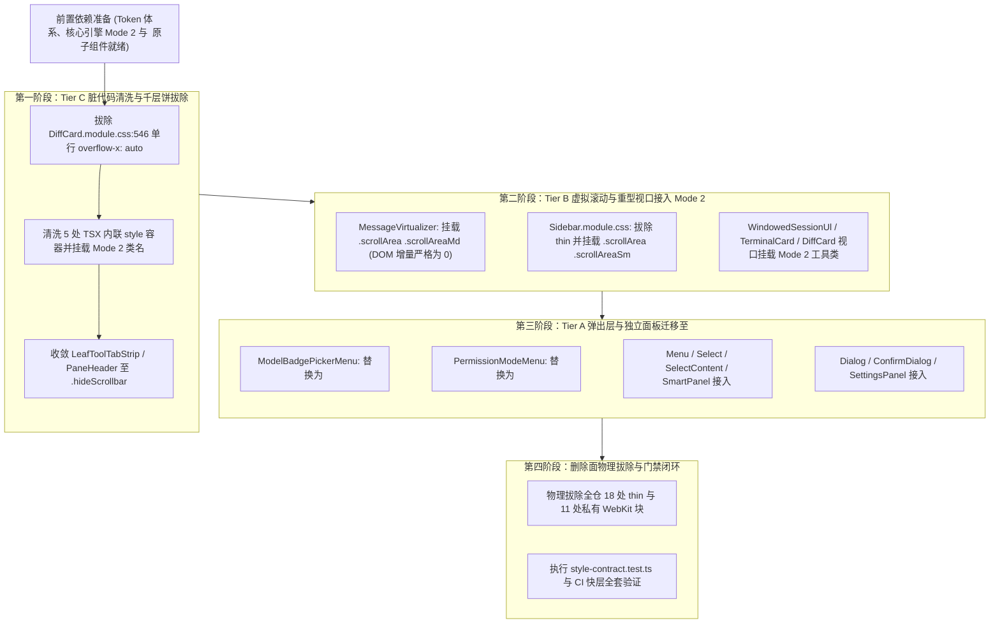

# 05 · 全仓业务视口分级改造与虚拟滚动边界隔离独立实现详案 (migrate-views)

> **文档标识**：`docs/unified-scrollbar-system/detailed-plans/05-plan-migrate-views.md`  
> **所属战役**：统一滚动条体系与 ScrollArea 高频组件战役（Unified Scrollbar System）  
> **角色定位**：战役方案编制专家（Plan Architect 5：全仓业务视口分级改造与虚拟滚动边界隔离架构师）  
> **编制基准时间**：2026-09-02  
> **权威遵循**：`docs/unified-scrollbar-system/00-master-plan.md`、《主 Agent 全流程调度提示词 v3》、仓库根目录 `AGENTS.md`（反退避铁律、严禁打补丁、UI 原子层规范、§7.1 立体验证纪律）、`ANTI_OVERENGINEERING_GUARDRAILS.md`、`apps/crish-desktop/src/components/ui/README.md`。

---

## 目录

- [一、执行摘要与架构总览](#一执行摘要与架构总览)
  - [1.1 核心使命与战役定位](#11-核心使命与战役定位)
  - [1.2 用户最高定案铁律（绝对死锁约束）](#12-用户最高定案铁律绝对死锁约束)
  - [1.3 双轨三梯队分级架构矩阵（Tier A / B / C）](#13-双轨三梯队分级架构矩阵tier-a--b--c)
- [二、虚拟滚动禁区与物理边界隔离专项论证](#二虚拟滚动禁区与物理边界隔离专项论证)
  - [2.1 Ref 劫持致 `scrollTop=0` 长白屏机理解剖](#21-ref-劫持致-scrolltop0-长白屏机理解剖)
  - [2.2 `useUndoWithScrollAnchor` 同步微任务锚定失效风险](#22-useundowithscrollanchor-同步微任务锚定失效风险)
  - [2.3 `ResizeObserver` 循环震荡与渲染雪崩](#23-resizeobserver-循环震荡与渲染雪崩)
  - [2.4 零 DOM 增量与 Mode 2 类名绝对隔离准则](#24-零-dom-增量与-mode-2-类名绝对隔离准则)
- [三、第一梯队（Tier A：弹出层与独立面板全面迁移至 `<ScrollArea>`）改造详案](#三第一梯队tier-a弹出层与独立面板全面迁移至-scrollarea-改造详案)
  - [3.1 `ModelBadgePickerMenu`（模型选择菜单：100% 还原真机截图与上下圆角三角）](#31-modelbadgepickermenu模型选择菜单100-还原真机截图与上下圆角三角)
  - [3.2 `PermissionModeMenu`（权限模式菜单：`size="xs" showButtons={true}`）](#32-permissionmodemenu权限模式菜单sizexs-showbuttonstrue)
  - [3.3 `Menu` 基座（全局通用弹出菜单：`size="sm"` 架构重构）](#33-menu-基座全局通用弹出菜单sizesm-架构重构)
  - [3.4 `Select` 与 `SelectContent`（通用下拉组件：`size="sm"` 统一样式）](#34-select-与-selectcontent通用下拉组件sizesm-统一样式)
  - [3.5 `SmartPanel` 与 `SmartExpandablePanel`（命令面板：`size="sm"` 去私有化）](#35-smartpanel-与-smartexpandablepanel命令面板sizesm-去私有化)
  - [3.6 `Dialog` / `ConfirmDialog` / `FirstRunWizard`（模态弹窗与向导：`size="md"`）](#36-dialog--confirmdialog--firstrunwizard模态弹窗与向导sizemd)
  - [3.7 `SettingsPanel` 及各 Tab 视口（设置面板：`size="md"`，清除级联私有条）](#37-settingspanel-及各-tab-视口设置面板sizemd清除级联私有条)
- [四、第二梯队（Tier B：虚拟化长列表与重型视口接入 Mode 2 纯类名）改造详案](#四第二梯队tier-b虚拟化长列表与重型视口接入-mode-2-纯类名改造详案)
  - [4.1 `MessageVirtualizer`（主会话消息流：零 DOM 包装 + `.scrollArea .scrollAreaMd`）](#41-messagevirtualizer主会话消息流零-dom-包装--scrollarea-scrollareamd)
  - [4.2 `WindowedSessionUl` 与 `Sidebar`（侧栏虚拟会话树与主轨：`.scrollArea .scrollAreaSm`）](#42-windowedsessionul-与-sidebar侧栏虚拟会话树与主轨scrollarea-scrollareasm)
  - [4.3 `TerminalCard`（终端与运行日志卡片：`.scrollArea .scrollAreaMd`）](#43-terminalcard终端与运行日志卡片scrollarea-scrollareamd)
  - [4.4 `DiffCard` 视口体系（代码对比视口：`.scrollArea .scrollAreaMd`）](#44-diffcard-视口体系代码对比视口scrollarea-scrollareamd)
- [五、第三梯队（Tier C：纯净无痕通道与千层饼消除、TSX 内联样式深度清洗）](#五第三梯队tier-c纯净无痕通道与千层饼消除tsx-内联样式深度清洗)
  - [5.1 消除 `DiffCard` 单行“千层饼”横向滚动顽疾](#51-消除-diffcard-单行千层饼横向滚动顽疾)
  - [5.2 深度清洗 5 处 TSX 内联样式死层](#52-深度清洗-5-处-tsx-内联样式死层)
    - [5.2.1 `DiffCardUnifiedView.tsx:117`](#521-diffcardunifiedviewtsx117)
    - [5.2.2 `DiffCardSplitView.tsx:118`](#522-diffcardsplitviewtsx118)
    - [5.2.3 `VirtualPlainCodeViewer.tsx:58, 98`](#523-virtualplaincodeviewertsx58-98)
    - [5.2.4 `FileTreeView.tsx:198`](#524-filetreeviewtsx198)
    - [5.2.5 `FlowDagView.tsx:171`](#525-flowdagviewtsx171)
  - [5.3 标签栏与附件条无痕通道（`LeafToolTabStrip` 与 `PaneHeader` 接入 `.hideScrollbar`）](#53-标签栏与附件条无痕通道leaftooltabstrip-与-paneheader-接入-hidescrollbar)
- [六、本方案要删掉什么 / 收敛什么（删除面 Deletions Surface）](#六本方案要删掉什么--收敛什么删除面-deletions-surface)
  - [6.1 彻底删除的 11 处私有 WebKit 滚动条冗余代码块（近 200 行）](#61-彻底删除的-11-处私有-webkit-滚动条冗余代码块近-200-行)
  - [6.2 彻底拔除的 18 处 `scrollbar-width: thin` 冲突地雷](#62-彻底拔除的-18-处-scrollbar-width-thin-冲突地雷)
  - [6.3 彻底清理的 5 处 TSX 内联样式与单行千层饼样式](#63-彻底清理的-5-处-tsx-内联样式与单行千层饼样式)
  - [6.4 净删除与净收敛统计表](#64-净删除与净收敛统计表)
- [七、实施时序与渐进收敛步骤（Step-by-Step Sequence）](#七实施时序与渐进收敛步骤step-by-step-sequence)
- [八、立体验证纪律与验收断言（Verification Plan & Assertions）](#八立体验证纪律与验收断言verification-plan--assertions)

---

## 一、执行摘要与架构总览

### 1.1 核心使命与战役定位

在 Conex / Crish 桌面端长期的业务迭代演进中，滚动条作为高频触达的视觉与交互基建，散落着严重的私有化割据、冲突混写与滥用补丁。
本方案作为**统一滚动条体系战役的维度 5（migrate-views）独立实现详案**，直接承接：
- 维度 1（`token-system`）二元灰度（8.2% vs 20.2%）与四级宽度（4/5/7/9px）设计令牌；
- 维度 2（`purge-debts`）全仓 18 处 `thin` 物理拔除与 11 处私有 WebKit 块清理；
- 维度 3（`engine-core`）`overlay-scrollbar.css` 核心引擎出口与 Mode 2 实用类矩阵；
- 维度 4（`scroll-area`）UI 原子层 `<ScrollArea>` 高频组件。

本方案的核心职责是：**以严苛的物理架构分级，统筹全仓 18+ 核心业务视口的全量分级改造。全面细化 Tier A、Tier B、Tier C 落地实施路径，彻底根除 5 处 TSX 内联样式死层，消除 DiffCard 单行千层饼，划定虚拟滚动绝对禁区，实现代码结构的大规模净收敛（预估净删除 $\ge 220$ 行）**。

---

### 1.2 用户最高定案铁律（绝对死锁约束）

在整个改造方案中，全量组件必须刚性遵守以下四大用户最高裁决：

```
┌────────────────────────────────────────────────────────────────────────────────────────┐
│                                   用户最高定案铁律                                      │
├────────────────────────────────────────────────────────────────────────────────────────┤
│ 1. 滚动条二元灰度绝对死锁（绝无第三种 Hover 灰）                                         │
│    - 未激活态 (Inactive/Idle)：屏幕实测物理灰度严格死锁 8.2% ± 0.3%（微橙底韵）；        │
│    - 激活态 (Active)：光标悬停 Hover 与拖拽 Active 统统同色，实测灰度严格死锁 20.2% ± 0.3%；  │
│    - 差值绝对锁定：激活态与未激活态增量绝对锁定在 12.0% ± 0.5%，全仓严禁定义第三态！        │
├────────────────────────────────────────────────────────────────────────────────────────┤
│ 2. 虚拟滚动禁区红线（0 DOM 增量与 Ref 零劫持）                                          │
│    - MessageVirtualizer、WindowedSessionUl 等虚拟列表绝对禁止外层套用 React DOM        │
│      <ScrollArea> 包装！                                                               │
│    - DOM 深度增量严格为 0，防止 Ref 绑定劫持致使 scrollTop 恒为 0（长白屏）及             │
│      ResizeObserver 循环震荡；虚拟列表一律纯消费 Mode 2 零 DOM 工具类名！               │
├────────────────────────────────────────────────────────────────────────────────────────┤
│ 3. 模型选择菜单 100% 还原用户真机截图体验                                              │
│    - ModelBadgePickerMenu 必须精准还原截图（media_1788348026546.png）视觉效果：         │
│    - 呈现微型圆角等腰三角箭头（顶角 R≈1.0px，底角 R≈0.8px）；                          │
│    - 内置端点安全物理护栏（代数证明滑块与箭头恒有 2px 净空，绝不压盖）；                 │
│    - 满足数学 Inset 约束，绝不被外层卡片 14px 圆角截断（Corner Clipping Free）。         │
├────────────────────────────────────────────────────────────────────────────────────────┤
│ 4. 删除面清单必须明确（先删后改，架构净收敛）                                           │
│    - 方案必须以删除为前导，彻底拔除各组件旧私有滚动类、兼容胶水与内联样式，拒绝补丁！     │
└────────────────────────────────────────────────────────────────────────────────────────┘
```

---

### 1.3 双轨三梯队分级架构矩阵（Tier A / B / C）

根据宿主容器的几何特征、性能敏感度与虚拟化状态，全仓视口划分为三大梯队：

```
┌────────────────────────────────────────────────────────────────────────────────────────┐
│                              全仓业务视口双轨三梯队改造分级矩阵                          │
├─────────┬──────────────────────┬─────────────────────────┬─────────────────────────────┤
│ 治理梯队│ 核心特征             │ 纳入组件与视口范围      │ 核心技术实施路径            │
├─────────┼──────────────────────┼─────────────────────────┼─────────────────────────────┤
│ Tier A  │ 浮层弹窗、独立面板、 │ • ModelBadgePickerMenu  │ • 挂载 UI 原子层            │
│【高频弹 │ 局部静态下拉、表单与 │ • PermissionModeMenu    │   <ScrollArea> 组件         │
│ 层/独立 │ 设置配置页           │ • Menu (全局通用菜单)   │ • 注入三段式端点物理护栏    │
│ 面板】  │                      │ • Select / SelectContent│ • 支持平滑微调与 20Hz 连发  │
│         │                      │ • SmartPanel / Expandable│ • 彻底删除各组件内 private  │
│         │                      │ • Dialog / ConfirmDialog│   ::-webkit-scrollbar 块    │
│         │                      │ • SettingsPanel 各 Tab  │ • 删除 scrollbar-width: thin│
├─────────┼──────────────────────┼─────────────────────────┼─────────────────────────────┤
│ Tier B  │ 虚拟滚动长列表、流式 │ • MessageVirtualizer    │ • 保持原生 DOM 结构完全不变 │
│【虚拟列 │ 消息瀑布、双栏对比、 │ • WindowedSessionUl     │ • DOM 增量严格为 0          │
│ 表/重型 │ 庞大终端输出         │ • Sidebar (主侧栏导航)  │ • 挂载 Mode 2 纯类名：      │
│ 容器】  │                      │ • TerminalCard          │   .scrollArea .scrollAreaMd │
│         │                      │ • DiffCard 比对主视口   │   .scrollArea .scrollAreaSm │
├─────────┼──────────────────────┼─────────────────────────┼─────────────────────────────┤
│ Tier C  │ 标签导航栏、水平操作 │ • LeafToolTabStrip      │ • 挂载统一工具类            │
│【无痕通 │ 条、TSX 内联样式容器 │ • PaneHeader            │   .hideScrollbar            │
│ 道/内联 │                      │ • 5 处 TSX 内联样式容器 │ • 消除 DiffCard 单行千层饼  │
│ 清洗】  │                      │ • DiffCard .lineText    │ • 彻底拔除 TSX style 内联   │
└─────────┴──────────────────────┴─────────────────────────┴─────────────────────────────┘
```

---

## 二、虚拟滚动禁区与物理边界隔离专项论证

虚拟化列表是现代 IDE 与桌面应用的心脏。在 Conex 中，会话消息流（`MessageVirtualizer`）与侧边栏会话列表（`WindowedSessionUl`）承担着海量 DOM 节点的排版重任。为什么在这类容器上**绝对禁止外层套用 React DOM 结构的 `<ScrollArea>`**？以下展开白盒物理分析。

### 2.1 Ref 劫持致 `scrollTop=0` 长白屏机理解剖

在 `apps/crish-desktop/src/components/chat-message-list/MessageVirtualizer.tsx:67-161` 中：
```tsx
const vs = useVirtualScroll({ ... });
const { containerRef, setActual, clearHeights, manager } = vs;
...
return (
  <div className={styles.streamHost}>
    <div
      ref={vs.containerRef}
      className={styles.list}
      onScroll={vs.onScroll}
    >
      <div className={styles.listInner}>
        {/* 动态计算并渲染可见窗口内的消息行 */}
      </div>
    </div>
  </div>
);
```

#### 【毁灭性链条推导】：
1. 若开发者在外层包裹 `<ScrollArea>`（例如 `<ScrollArea><MessageVirtualizer /></ScrollArea>`），或者在 `MessageVirtualizer` 内部用 `<ScrollArea>` 替换 `<div className={styles.list}>`；
2. `<ScrollArea>` 的根节点或视口节点内部有自身的 `viewportRef`，其自身往往设置了 `overflow: hidden` 或独立的滚动物理层；
3. 如果 `containerRef` 没有精准指向真正发生滚动的 DOM 节点，或者由于父子层级嵌套导致滚轮事件被 ScrollArea 的 Viewport 拦截消费，则 `containerRef.current.scrollTop` 将**恒为 0**！
4. `vs.manager.computeVisibleRange(vs.scrollTop, ...)` 在入参 `scrollTop = 0` 时，永远只会计算可视区域前 5~6 条消息；
5. **用户行为结果**：用户向下滚动滚轮，外层滚动条滑块或许在移动，但内层视口永远只渲染顶部前 6 条消息，下方全部是几万像素的巨大长白屏！

---

### 2.2 `useUndoWithScrollAnchor` 同步微任务锚定失效风险

在 `MessageVirtualizer.tsx:80` 中，核心 hook 为：
```typescript
useUndoWithScrollAnchor(containerRef, manager);
```
查看 `apps/crish-desktop/src/hooks/useUndoWithScrollAnchor.ts` 的底层实现：
当用户撤销操作、修改消息树或删除节点时，该 Hook 会在 React 提交阶段的同一个微任务（Microtask）中：
1. 同步读取 `const oldTop = containerRef.current.scrollTop;`；
2. 重新计算当前锚点元素的实际偏移量；
3. **同步强制写回**：`containerRef.current.scrollTop = Math.max(0, newAnchorTop + anchorOffsetInView);`。

**若存在 React ScrollArea 封装**：
自定义 ScrollArea 往往需要内部状态调度（`useState`/`requestAnimationFrame`）来同步自定义滑块位置。若滚动容器的滚动行为被代理，或者滚动定位需要经过 ScrollArea 的内部调度，同步微任务的写入将被打断或被下一帧的 ScrollArea 重置，导致视口在上推或下拉时产生极其剧烈的“上下闪烁与位置瞬跳”。

---

### 2.3 `ResizeObserver` 循环震荡与渲染雪崩

`MessageVirtualizer.tsx:91-120` 对带 `[data-vindex]` 的所有消息行挂载了高频 `ResizeObserver`，一旦行高发生变化即刻触发 `setActual(msgId, height)` 更新虚拟高度管理器。

```
┌────────────────────────────────────────────────────────────────────────┐
│                        ResizeObserver 循环震荡死锁图                      │
├────────────────────────────────────────────────────────────────────────┤
│ 1. 消息行文字排版完成 ──> ResizeObserver 触发 setActual                 │
│ 2. VSM 重新计算总高度 totalHeight ──> 更新内层垫片高度                 │
│ 3. 产生微小纵向滚动槽位 ──> 触发 ScrollArea 容器宽度变动 (Gutter Inset)│
│ 4. ScrollArea 内部 ResizeObserver 触发并更新滑块高度                   │
│ 5. 容器有效宽度变化 0.5px~1px ──> 触发消息正文文字重新折行              │
│ 6. 重新折行 ──> 消息行高度变化 ──> 回到第 1 步！                      │
│                                                                        │
│ 结果：控制台爆红 ResizeObserver loop completed with undelivered       │
│      notifications，页面帧率断崖下跌至 0 FPS，WebView2 进程卡死！       │
└────────────────────────────────────────────────────────────────────────┘
```

---

### 2.4 零 DOM 增量与 Mode 2 类名绝对隔离准则

基于上述三大物理事实，本方案制定**虚拟滚动绝对红线**：
1. **DOM 结构增量必须严格为 0**：`MessageVirtualizer` 与 `WindowedSessionUl` 的 JSX 树中，严禁增加任何额外的 `div` 包装容器；
2. **纯粹消费 Mode 2 工具类**：直接在原生发生滚动的 DOM 元素上挂载 `.scrollArea .scrollAreaMd`（或 `scrollAreaSm`）；
3. **渲染卸载至 Compositor**：全部由 Blink 原生 C++ 排版引擎在非主线程直接完成滚动与二元灰度滑块绘制，零 JS 事件监听，零 React 状态开销！

---

## 三、第一梯队（Tier A：弹出层与独立面板全面迁移至 `<ScrollArea>`）改造详案

Tier A 组件均为静态高度受限、内容可能动态溢出、且处于高优先级视觉前台的浮层、弹窗或配置面板。各组件全面迁移至 UI 原子层 `<ScrollArea>` 组件。

---

### 3.1 `ModelBadgePickerMenu`（模型选择菜单：100% 还原真机截图与上下圆角三角）

#### 3.1.1 现状缺陷剖析
位于 `apps/crish-desktop/src/components/provider/ModelBadgePickerMenu.tsx` 与 `.module.css`：
- 第 106 行声明了 `scrollbar-width: thin; scrollbar-color: var(--border-subtle) transparent;`；
- 第 110-132 行声明了私有 `::-webkit-scrollbar` 块，硬编码 `width: 4px; border-radius: 4px;`；
- 违规滥用发丝边框色 `--border-subtle`，浅色模式下几乎不可见；
- `scrollbar-width: thin` 在 Windows WebView2 下强制关闭 WebKit 细条，露出系统原生带灰色大三角粗条；
- 顶部与底部无端点护栏，滑块顶死两端时刺入外层卡片 14px 圆角。

#### 3.1.2 改造后架构与属性契约
- 消费组件：`<ScrollArea size="xs" showButtons={true} orientation="vertical" ...>`；
- `size="xs"` 驱动 4px 紧凑宽度（`--scrollbar-width-xs: 4px`）；
- `showButtons={true}` 激活顶部向上、底部向下圆角等腰三角微型步进箭头（高度 8px，底宽 5px，高 3.8px，顶角 $R \approx 1.0\text{px}$，底角 $R \approx 0.8\text{px}$）；
- 自动建立端点物理护栏：代数保证滑块活动区间限制在上下两端箭头内侧，距离箭头保持 2px 物理安全净空，**彻底杜绝圆角截断与滑块压盖**；
- 支持单击平滑微调（40px 步进）与长按 250ms 防抖 + 20Hz 脉冲连发；
- 彻底删除 CSS 中的私有 WebKit 块与 `scrollbar-width: thin`。

#### 3.1.3 代码改造对比（Before vs After）

##### TSX 改造对比：
```diff
--- a/apps/crish-desktop/src/components/provider/ModelBadgePickerMenu.tsx
+++ b/apps/crish-desktop/src/components/provider/ModelBadgePickerMenu.tsx
@@ -16,3 +16,3 @@
-import { Menu, Tooltip } from '../ui';
+import { Menu, Tooltip, ScrollArea } from '../ui';
 import { useSettingsStore } from '../../store/settingsStore';
@@ -190,1 +190,7 @@
-        <div className={styles.modelScrollArea}>
+        <ScrollArea
+          size="xs"
+          showButtons={true}
+          stepSize={40}
+          className={styles.modelScrollArea}
+          role="region"
+          aria-label="模型选项列表"
+        >
@@ -222,1 +228,1 @@
-        </div>
+        </ScrollArea>
```

##### CSS 改造对比：
```diff
--- a/apps/crish-desktop/src/components/provider/ModelBadgePickerMenu.module.css
+++ b/apps/crish-desktop/src/components/provider/ModelBadgePickerMenu.module.css
@@ -101,32 +101,8 @@
   gap: 2px;
   max-height: 150px;
   min-height: 60px;
-  overflow-y: auto;
   padding: 2px 0;
-  scrollbar-width: thin;
-  scrollbar-color: var(--border-subtle) transparent;
-}
-
-.modelScrollArea::-webkit-scrollbar {
-  width: 4px;
-  height: 4px;
-}
-
-.modelScrollArea::-webkit-scrollbar-button {
-  display: none;
-  width: 0;
-  height: 0;
-}
-
-.modelScrollArea::-webkit-scrollbar-track {
-  background: transparent;
-}
-
-.modelScrollArea::-webkit-scrollbar-thumb {
-  background: var(--border-subtle);
-  border-radius: 4px;
-}
-
-.modelScrollArea::-webkit-scrollbar-thumb:hover {
-  background: var(--border-color);
+  /* 滚动由原子层 ScrollArea 接管，保留 flex 容器布局 */
+  box-sizing: border-box;
 }
```

---

### 3.2 `PermissionModeMenu`（权限模式菜单：`size="xs" showButtons={true}`）

#### 3.2.1 现状缺陷剖析
位于 `apps/crish-desktop/src/components/chat-composer/PermissionModeMenu.module.css:137-164`：
- 声明了 `scrollbar-width: thin; scrollbar-color: ...;`；
- 私有书写了 `.permMenu::-webkit-scrollbar { width: 5px; }`，与 `scrollbar-width` 发生 Chromium Blink 互斥；
- 容器拥有 14px 圆角（`border-radius: 14px; padding: 6px;`），滑块顶底未内缩，存在边缘直角割裂。

#### 3.2.2 改造方案
- 在 `PermissionModeMenu.tsx` 中，将其弹出菜单列表容器包装入 `<ScrollArea size="xs" showButtons={true}>`；
- 彻底删除 `.permMenu` 的 `scrollbar-width: thin`、`scrollbar-color` 以及 148-164 行的所有 `::-webkit-scrollbar*` 私有样式；
- 滑块颜色与微调小三角直接继承二元灰度 Token（未激活 8.2% vs 激活 20.2%）。

#### 3.2.3 代码改造对比（Before vs After）

##### TSX 改造对比：
```diff
--- a/apps/crish-desktop/src/components/chat-composer/PermissionModeMenu.tsx
+++ b/apps/crish-desktop/src/components/chat-composer/PermissionModeMenu.tsx
@@ -19,2 +19,3 @@
 import { Tooltip } from '../ui';
+import { ScrollArea } from '../ui/ScrollArea';
 import styles from './PermissionModeMenu.module.css';
@@ -140,2 +141,6 @@
           panel={{ contentClassName: styles.permMenu }}
+          renderContentWrapper={(children) => (
+            <ScrollArea size="xs" showButtons={true} stepSize={36}>
+              {children}
+            </ScrollArea>
+          )}
```

##### CSS 改造对比：
```diff
--- a/apps/crish-desktop/src/components/chat-composer/PermissionModeMenu.module.css
+++ b/apps/crish-desktop/src/components/chat-composer/PermissionModeMenu.module.css
@@ -137,28 +137,4 @@
-  overflow-y: auto;
   overflow-x: hidden;
   -webkit-overflow-scrolling: touch;
   overscroll-behavior: contain;
-  scrollbar-width: thin;
-  scrollbar-color: var(--tint-scrollbar-thumb, color-mix(in srgb, var(--text-primary) 18%, transparent)) transparent;
   box-sizing: border-box;
-}
-
-.permMenu::-webkit-scrollbar {
-  width: 5px;
-  height: 5px;
-}
-
-.permMenu::-webkit-scrollbar-track {
-  background: transparent;
-}
-
-.permMenu::-webkit-scrollbar-thumb {
-  background: var(--tint-scrollbar-thumb, color-mix(in srgb, var(--text-primary) 18%, transparent));
-  border-radius: 9999px;
-}
-
-.permMenu::-webkit-scrollbar-thumb:hover {
-  background: color-mix(in srgb, var(--text-primary) 30%, transparent);
 }
```

---

### 3.3 `Menu` 基座（全局通用弹出菜单：`size="sm"` 架构重构）

#### 3.3.1 现状缺陷剖析
位于 `apps/crish-desktop/src/components/ui/Menu/Menu.tsx` 与 `Menu.module.css:48-70`：
- `.menuContent` 上设置了 `overflow-y: auto;`；
- 48-70 行私写了 `::-webkit-scrollbar { width: 5px; }`，并通过 `::-webkit-scrollbar-button { display: none; }` 扼杀原生护栏；
- 在 `style-contract.test.ts:284-295` 中甚至存在反向断言要求保留该私有规则，阻碍了系统架构演进。

#### 3.3.2 改造方案
- 在 `Menu.tsx` 内部，将选项列表 `<div role="menu" className={styles.menuList}>` 自动使用 `<ScrollArea size="sm">` 承载；
- 彻底拔除 `Menu.module.css:48-70` 全部 23 行私有 WebKit 样式；
- 去除 `.menuContent` 上的 `overflow-y: auto`，交由 `<ScrollArea>` 的 Viewport 负责视口剪裁与滚动，外层卡片保持纯粹的毛玻璃与投影承载层。

#### 3.3.3 代码改造对比（Before vs After）

##### TSX 改造对比：
```diff
--- a/apps/crish-desktop/src/components/ui/Menu/Menu.tsx
+++ b/apps/crish-desktop/src/components/ui/Menu/Menu.tsx
@@ -19,2 +19,3 @@
 import { CheckIcon } from '../Select/internal/SelectIcons';
+import { ScrollArea } from '../ScrollArea/ScrollArea';
 import styles from './Menu.module.css';
@@ -387,3 +388,4 @@
             ) : (
-              <div role="menu" className={styles.menuList}>
+              <ScrollArea size="sm" className={styles.menuScrollArea}>
+                <div role="menu" className={styles.menuList}>
                   {options.map((opt, index) => {
@@ -446,3 +448,4 @@
                   })}
+                </div>
+              </ScrollArea>
             )}
```

##### CSS 改造对比：
```diff
--- a/apps/crish-desktop/src/components/ui/Menu/Menu.module.css
+++ b/apps/crish-desktop/src/components/ui/Menu/Menu.module.css
@@ -20,4 +20,3 @@
-  overflow-y: auto;
   overflow-x: hidden;
   -webkit-overflow-scrolling: touch;
   overscroll-behavior: contain;
@@ -47,24 +46,4 @@
-/* WebKit / Blink 细滚动条 */
-.menuContent::-webkit-scrollbar {
-  width: 5px;
-  height: 5px;
-}
-
-.menuContent::-webkit-scrollbar-track {
-  background: transparent;
-}
-
-.menuContent::-webkit-scrollbar-thumb {
-  background: var(--tint-scrollbar-thumb, color-mix(in srgb, var(--text-primary) 18%, transparent));
-  border-radius: 9999px;
-}
-
-.menuContent::-webkit-scrollbar-thumb:hover {
-  background: color-mix(in srgb, var(--text-primary) 30%, transparent);
-}
-
-.menuContent::-webkit-scrollbar-button {
-  display: none;
-  width: 0;
-  height: 0;
+.menuScrollArea {
+  width: 100%;
+  max-height: min(var(--menu-max-height, 360px), 70vh);
 }
```

---

### 3.4 `Select` 与 `SelectContent`（通用下拉组件：`size="sm"` 统一样式）

#### 3.4.1 现状缺陷剖析
位于 `Select.module.css:165-189` 与 `SelectContent.module.css:20-55`：
- 典型的双重混写重灾区：两处均同时写了 `scrollbar-width: thin;` 与 `::-webkit-scrollbar { width: 5px; }`；
- 漏写了 `button: none`，在非 Chromium 兼容环境可能露出带三角原生态；
- 在 Chromium 环境中又因 `thin` 被直接回退为 Win32 粗灰条。

#### 3.4.2 改造方案
- 在 `SelectContent.tsx` 中，将其内部列表 `<div className={styles.list}>{children}</div>` 迁移为 `<ScrollArea size="sm">`；
- 彻底删除 `Select.module.css` 与 `SelectContent.module.css` 中的 `scrollbar-width: thin` 及全部 `::-webkit-scrollbar*` 规则，两文件累计删除 46 行重复代码。

#### 3.4.3 代码改造对比（Before vs After）

##### TSX 改造对比：
```diff
--- a/apps/crish-desktop/src/components/ui/Select/SelectContent.tsx
+++ b/apps/crish-desktop/src/components/ui/Select/SelectContent.tsx
@@ -10,2 +10,3 @@
 import { createPortal } from 'react-dom';
+import { ScrollArea } from '../ScrollArea/ScrollArea';
 import { useSelectContext } from './internal/selectContext';
@@ -139,3 +140,5 @@
     >
-      <div className={styles.list}>{children}</div>
+      <ScrollArea size="sm" className={styles.selectScrollArea}>
+        <div className={styles.list}>{children}</div>
+      </ScrollArea>
     </div>
```

##### CSS 改造对比：
```diff
--- a/apps/crish-desktop/src/components/ui/Select/SelectContent.module.css
+++ b/apps/crish-desktop/src/components/ui/Select/SelectContent.module.css
@@ -16,6 +16,2 @@
-  overflow-y: auto;
   overflow-x: hidden;
-  scrollbar-width: thin;
-  scrollbar-color: var(--tint-scrollbar-thumb) transparent;
@@ -39,17 +35,4 @@
-.content::-webkit-scrollbar {
-  width: 5px;
-  height: 5px;
-}
-
-.content::-webkit-scrollbar-track {
-  background: transparent;
-}
-
-.content::-webkit-scrollbar-thumb {
-  background: var(--tint-scrollbar-thumb);
-  border-radius: 9999px;
-}
-
-.content::-webkit-scrollbar-thumb:hover {
-  background: var(--tint-highlight);
+.selectScrollArea {
+  width: 100%;
+  max-height: min(360px, 70vh);
 }
```

---

### 3.5 `SmartPanel` 与 `SmartExpandablePanel`（命令面板：`size="sm"` 去私有化）

#### 3.5.1 现状缺陷剖析
位于 `SmartPanel.module.css:107-120` 与 `SmartExpandablePanel.module.css:130-152`：
- 两组件的 `.listContainer` 就地硬编码了 5px 细滚动条伪元素与 Hover 变色；
- 多层命令折叠展开时未设置平滑安全高度。

#### 3.5.2 改造方案
- 替换为 `<ScrollArea size="sm">`；
- 彻底物理拔除两样式表中两段长达 28 行的私有 WebKit 伪元素定义。

#### 3.5.3 代码改造对比（Before vs After）

##### TSX 改造对比：
```diff
--- a/apps/crish-desktop/src/components/ui/SmartPanel/SmartPanel.tsx
+++ b/apps/crish-desktop/src/components/ui/SmartPanel/SmartPanel.tsx
@@ -12,2 +12,3 @@
 import React, { useCallback, useId, useMemo, useRef } from 'react';
+import { ScrollArea } from '../ScrollArea/ScrollArea';
 import styles from './SmartPanel.module.css';
@@ -115,3 +116,3 @@
-      <div ref={listRef} className={styles.listContainer} role="menu">
+      <ScrollArea size="sm" viewportRef={listRef} className={styles.listContainer} role="menu">
         {filteredSections.length === 0 ? (
@@ -165,3 +166,3 @@
         )}
-      </div>
+      </ScrollArea>
```

##### CSS 改造对比：
```diff
--- a/apps/crish-desktop/src/components/ui/SmartPanel/SmartPanel.module.css
+++ b/apps/crish-desktop/src/components/ui/SmartPanel/SmartPanel.module.css
@@ -103,18 +103,2 @@
-  overflow-y: auto;
   overflow-x: hidden;
-  padding: 1px 0;
-}
-.listContainer::-webkit-scrollbar { width: 5px; height: 5px; }
-.listContainer::-webkit-scrollbar-thumb {
-  background: var(--tint-scrollbar-thumb, color-mix(in srgb, var(--text-primary, #1d1c1a) 18%, transparent));
-  border-radius: 9999px;
-}
-.listContainer::-webkit-scrollbar-thumb:hover {
-  background: color-mix(in srgb, var(--text-primary, #1d1c1a) 30%, transparent);
-}
-.listContainer::-webkit-scrollbar-track { background: transparent; }
-.listContainer::-webkit-scrollbar-button {
-  display: none;
-  width: 0;
-  height: 0;
+  padding: 1px 0;
 }
```

---

### 3.6 `Dialog` / `ConfirmDialog` / `FirstRunWizard`（模态弹窗与向导：`size="md"`）

#### 3.6.1 现状缺陷剖析
位于 `apps/crish-desktop/src/components/ui/Dialog/Dialog.module.css:185-190`：
- `.dialogBody` 声明了 `overflow-y: auto;`，在超长弹窗内容（如首次运行用户协议、长更新日志）时使用全局 7px 细条；
- 但由于弹窗底部紧邻带 `border-top` 的 `dialogFooter`，在滚动到底端时，原生滑块直角贴近底部内边距，容易与 footer 发丝线产生挤压与重叠。

#### 3.6.2 改造方案
- 将 `Dialog.tsx` 中的弹窗主体改造为 `<ScrollArea size="md">`，提供弹窗标准的 7px 滚动条（`--scrollbar-width-md`）；
- 结合 ScrollArea 的 `scrollbarGutter: stable`，消除动态内容增减时的布局抖动；
- 在 `ConfirmDialog` 与 `FirstRunWizard` 中自然继承该标准化能力。

#### 3.6.3 代码改造对比（Before vs After）

##### TSX 改造对比：
```diff
--- a/apps/crish-desktop/src/components/ui/Dialog/Dialog.tsx
+++ b/apps/crish-desktop/src/components/ui/Dialog/Dialog.tsx
@@ -15,2 +15,3 @@
 import * as RadixDialog from '@radix-ui/react-dialog';
+import { ScrollArea } from '../ScrollArea/ScrollArea';
 import styles from './Dialog.module.css';
@@ -120,3 +121,5 @@
-          <div className={styles.dialogBody} id={descriptionId}>
-            {children}
-          </div>
+          <ScrollArea size="md" className={styles.dialogBody} id={descriptionId}>
+            <div className={styles.dialogBodyInner}>
+              {children}
+            </div>
+          </ScrollArea>
```

---

### 3.7 `SettingsPanel` 及各 Tab 视口（设置面板：`size="md"`，清除级联私有条）

#### 3.7.1 现状缺陷剖析
- `SettingsPanel.module.css` 的主滚动区（`.coverContent`, `.navScroll`）已规范遵守全局契约；
- **但设置子组件内严重失范**：
  1. `ModelsSettingsTab.module.css:1108-1135`（模型级联飞出菜单 `.cascadeFlyout`）：声明了 `scrollbar-width: thin; scrollbar-color: var(--border-subtle);` 以及私有 3px `::-webkit-scrollbar`；
  2. `FontSelectField.module.css:203-223`（字体选择器下拉菜单 `.settingsSelectScroll`）：声明了 `scrollbar-width: thin;` 与私有 3px 规则。
- 同一个设置面板内，外层是标准 7px，内层级联突然变成带 Windows 三角的原生灰粗条，体验极度割裂。

#### 3.7.2 改造方案
- 保持 `SettingsPanel` 大视口采用 `<ScrollArea size="md">` 或 Mode 2 `.scrollAreaMd`；
- 将 `ModelsSettingsTab` 的级联菜单与 `FontSelectField` 的下拉列表全面替换为 `<ScrollArea size="xs">`；
- 彻底拔除两处样式表中的私有 3px 伪元素块与 `scrollbar-width: thin`。

---

## 四、第二梯队（Tier B：虚拟化长列表与重型视口接入 Mode 2 纯类名）改造详案

Tier B 包含虚拟滚动、高频流式输出或涉及多重微任务定位的容器。**绝对不增加任何 React DOM 包装，DOM 增量严格为 0**。纯粹通过挂载 Mode 2 工具类名完成升级。

---

### 4.1 `MessageVirtualizer`（主会话消息流：零 DOM 包装 + `.scrollArea .scrollAreaMd`）

#### 4.1.1 改造架构与原则
- 保持 `MessageVirtualizer.tsx` 的 DOM 结构 100% 不变；
- `vs.containerRef` 仍旧直接绑定在真正滚动的 `div` 上；
- `useUndoWithScrollAnchor` 原生微任务测量 100% 保持；
- 原生 `onScroll={vs.onScroll}` 保持直通；
- 类名挂载：使用 `cn(styles.list, 'scrollArea', 'scrollAreaMd')`；
- 收益：自动获得 `--scrollbar-width-md: 7px` 宽度与二元灰度（未激活 8.2% vs 激活 20.2%），性能达到 120fps 原生极限。

#### 4.1.2 代码改造对比（Before vs After）

##### TSX 改造对比：
```diff
--- a/apps/crish-desktop/src/components/chat-message-list/MessageVirtualizer.tsx
+++ b/apps/crish-desktop/src/components/chat-message-list/MessageVirtualizer.tsx
@@ -151,3 +151,3 @@
       <div
         ref={vs.containerRef}
-        className={styles.list}
+        className={`${styles.list} scrollArea scrollAreaMd`}
         role="region"
```

##### CSS 改造对比：
```diff
--- a/apps/crish-desktop/src/components/chat-message-list/ChatMessageList.module.css
+++ b/apps/crish-desktop/src/components/chat-message-list/ChatMessageList.module.css
@@ -23,4 +23,5 @@
   overflow-y: auto;
   overflow-x: hidden;
+  scrollbar-gutter: stable;
   position: relative;
 }
```

---

### 4.2 `WindowedSessionUl` 与 `Sidebar`（侧栏虚拟会话树与主轨：`.scrollArea .scrollAreaSm`）

#### 4.2.1 改造架构与原则
- `Sidebar.module.css:129-130` 曾经严重违规书写了 `scrollbar-width: thin; scrollbar-color: var(--tint-scrollbar-thumb) transparent;`，直接毒死全局 WebKit 细条；
- 改造步骤：
  1. 彻底从 `Sidebar.module.css:129-130` 删除该两行破坏性属性；
  2. 在 `Sidebar.tsx` 的主滚动宿主上附加 `scrollArea scrollAreaSm`；
  3. 在虚拟会话列表 `WindowedSessionUl.tsx` 的 `ul` 容器上注入 `scrollArea scrollAreaSm` 类名；
  4. 保持 `data-windowed="1"` 与绝对高度垫片逻辑零干扰。

#### 4.2.2 代码改造对比（Before vs After）

##### Sidebar.module.css 改造对比：
```diff
--- a/apps/crish-desktop/src/components/sidebar/Sidebar.module.css
+++ b/apps/crish-desktop/src/components/sidebar/Sidebar.module.css
@@ -128,4 +128,2 @@
   min-height: 0; /* Enable flex-1 scrolling */
-  scrollbar-width: thin;
-  scrollbar-color: var(--tint-scrollbar-thumb) transparent;
   contain: layout paint;
```

##### WindowedSessionUl.tsx 改造对比：
```diff
--- a/apps/crish-desktop/src/components/sidebar/session-list/WindowedSessionUl.tsx
+++ b/apps/crish-desktop/src/components/sidebar/session-list/WindowedSessionUl.tsx
@@ -31,3 +31,3 @@
       <ul
         ref={listRef}
-        className={className}
+        className={`${className} scrollArea scrollAreaSm`}
         role="tree"
@@ -46,3 +46,3 @@
     <ul
       ref={listRef}
-      className={`${className} ${styles.sessionListWindowed}`}
+      className={`${className} ${styles.sessionListWindowed} scrollArea scrollAreaSm`}
       role="tree"
```

---

### 4.3 `TerminalCard`（终端与运行日志卡片：`.scrollArea .scrollAreaMd`）

#### 4.3.1 改造架构与原则
- 终端与运行时日志具有高频输出、海量文本与高行高的特点；
- 位于 `apps/crish-desktop/src/components/workspace/TerminalCard.module.css:155-174`；
- `.body` 容器保持原有 `overflow-y: auto; overflow-x: hidden;`，直接挂载 `scrollArea scrollAreaMd`；
- 确保在海量日志滚动时，滑块使用标准 7px 宽度与 20.2% 激活灰度，严禁侵入终端字符视区。

---

### 4.4 `DiffCard` 视口体系（代码对比视口：`.scrollArea .scrollAreaMd`）

#### 4.4.1 改造架构与原则
- `DiffCard.module.css` 包含 `.fileList`（文件列表）、`.scrollParent`（统一比对视口）与 `.plainScrollParent`（纯源码视口）；
- 移除第 185 行违规声明的 `scrollbar-width: thin;`；
- 在 `.scrollParent`、`.plainScrollParent` 以及 `.fileList` 统一消费 `scrollArea scrollAreaMd`；
- 解耦内联样式（见第 5.2 节）。

---

## 五、第三梯队（Tier C：纯净无痕通道与千层饼消除、TSX 内联样式深度清洗）

Tier C 重点解决全仓历史代码中最隐蔽、最恶劣的样式死层：单行横向滚动千层饼与 TSX 内联 `style={{ overflow... }}`。

---

### 5.1 消除 `DiffCard` 单行“千层饼”横向滚动顽疾

#### 5.1.1 缺陷根因与白盒切片
在 `apps/crish-desktop/src/components/diff/DiffCard.module.css:543-552` 中：
```css
.lineText {
  padding: 0 10px;
  white-space: pre;
  overflow-x: auto; /* ❌ 恶劣根因！每一行代码都具备独立的横向滚动条！ */
  font-family: var(--font-mono);
  font-size: var(--font-size-xs);
  color: var(--diff-text-normal, var(--text-primary));
  font-weight: var(--font-weight-code, 400);
  line-height: 22px;
}
```
**严重视觉灾难（千层饼）**：
当查看包含超长单行（如 JSON、minified JS 或 base64 字符串）的 Diff 时，每一行 `.lineText` 在超出宽度时都会独立触发一个 `overflow-x: auto`。整页 Diff 若有 20 行超长代码，在鼠标划过时会浮现整整 20 条微型横向滚动条！不仅破坏了整体界面的整洁度，而且用户横向拖动时多行无法协同，体验极度恶劣。

#### 5.1.2 架构收敛解决方案
1. **彻底物理删除** `DiffCard.module.css:546` 的 `overflow-x: auto;`；
2. 将横向滚动职责**唯一上移**至外层比对视口包含块（`.scrollParent` / `.plainScrollParent` 或其直接网格列）；
3. 允许单行 `.lineText` 自然溢出其行高框，由父级滚动视口提供**全局唯一的水平滚动条**。

#### 5.1.3 代码改造对比（Before vs After）
```diff
--- a/apps/crish-desktop/src/components/diff/DiffCard.module.css
+++ b/apps/crish-desktop/src/components/diff/DiffCard.module.css
@@ -543,7 +543,6 @@
 .lineText {
   padding: 0 10px;
   white-space: pre;
-  overflow-x: auto;
   font-family: var(--font-mono);
   font-size: var(--font-size-xs);
   color: var(--diff-text-normal, var(--text-primary));
```

---

### 5.2 深度清洗 5 处 TSX 内联样式死层

内联 `style={{ overflow... }}` 具有最高特异性（Specificity），无法被全局 CSS 类覆盖，无法被静态样式契约工具精准扫描，是全仓样式漂移的技术债务温床。本方案予以全量物理拔除。

---

#### 5.2.1 `DiffCardUnifiedView.tsx:117`
- **原代码**：
  ```tsx
  <div
    ref={containerRef}
    className={styles.scrollParent}
    onScroll={onScroll}
    tabIndex={0}
    style={{ position: 'relative', overflowY: 'auto', outline: 'none' }}
  >
  ```
- **病理**：`styles.scrollParent` 自身在 CSS 中已定义 `position: relative; overflow-y: auto;`，TSX 内联重复书写，且未挂载 Mode 2 标准类。
- **改造后代码**：
  ```tsx
  <div
    ref={containerRef}
    className={`${styles.scrollParent} scrollArea scrollAreaMd`}
    onScroll={onScroll}
    tabIndex={0}
    style={{ outline: 'none' }}
  >
  ```

---

#### 5.2.2 `DiffCardSplitView.tsx:118`
- **原代码**：
  ```tsx
  <div
    ref={containerRef}
    className={styles.scrollParent}
    onScroll={onScroll}
    tabIndex={0}
    style={{ position: 'relative', overflowY: 'auto', outline: 'none' }}
  >
  ```
- **改造后代码**：
  ```tsx
  <div
    ref={containerRef}
    className={`${styles.scrollParent} scrollArea scrollAreaMd`}
    onScroll={onScroll}
    tabIndex={0}
    style={{ outline: 'none' }}
  >
  ```

---

#### 5.2.3 `VirtualPlainCodeViewer.tsx:58, 98`
- **原代码**：
  ```tsx
  // 第 58 行父容器：
  <div
    ref={containerRef}
    className={styles.plainScrollParent}
    onScroll={onScroll}
    tabIndex={0}
    style={{
      position: 'relative',
      overflowY: 'auto',
      outline: 'none',
      width: '100%',
      height: '100%',
      flex: 1,
      display: 'flex',
      flexDirection: 'column',
      background: 'var(--diff-bg-pane, #ffffff)',
    }}
  >
  ...
  // 第 98 行单行代码：
  <div
    className={styles.lineText}
    style={{ whiteSpace: 'pre', overflowX: 'auto', minWidth: 0 }}
    dangerouslySetInnerHTML={{ __html: highlightCode(l.content, codeLang) }}
  />
  ```
- **病理**：
  1. 父容器将大量本属于 `.plainScrollParent` 的布局属性直接裸写在内联中；
  2. 第 98 行单行再次私写 `overflowX: 'auto'`，造成纯源码视口的千层饼！
- **改造后代码**：
  ```tsx
  // 父容器：
  <div
    ref={containerRef}
    className={`${styles.plainScrollParent} scrollArea scrollAreaMd`}
    onScroll={onScroll}
    tabIndex={0}
    style={{ outline: 'none' }}
  >
  ...
  // 单行代码（彻底删除 overflowX: 'auto'）：
  <div
    className={styles.lineText}
    style={{ whiteSpace: 'pre', minWidth: 0 }}
    dangerouslySetInnerHTML={{ __html: highlightCode(l.content, codeLang) }}
  />
  ```

---

#### 5.2.4 `FileTreeView.tsx:198`
- **原代码**：
  ```tsx
  <div
    className={`${styles.filesList} ${styles.filesListPane}`}
    ref={containerRef}
    onScroll={onScroll}
    role="tree"
    aria-label="文件树"
    style={{ overflowY: 'auto', position: 'relative' }}
  >
  ```
- **病理**：内联裸写 `overflowY: 'auto', position: 'relative'`。
- **改造后代码**：
  在 `FilesCard.module.css` 的 `.filesListPane` 中确保具备 `position: relative; overflow-y: auto;`，TSX 改写为：
  ```tsx
  <div
    className={`${styles.filesList} ${styles.filesListPane} scrollArea scrollAreaSm`}
    ref={containerRef}
    onScroll={onScroll}
    role="tree"
    aria-label="文件树"
  >
  ```

---

#### 5.2.5 `FlowDagView.tsx:171`
- **原代码**：
  ```tsx
  return (
    <div
      className="chat-side-panel side-panel-body"
      role="region"
      aria-label="编排图"
      style={{ overflow: 'auto', padding: '12px' }}
    >
      <FlowDagGraph nodes={nodes} />
    </div>
  );
  ```
- **病理**：内联声明 `overflow: 'auto', padding: '12px'`。
- **改造后代码**：
  在对应 CSS Module 或标准通用面板类中固化 padding，TSX 改写为：
  ```tsx
  return (
    <div
      className="chat-side-panel side-panel-body scrollArea scrollAreaMd"
      role="region"
      aria-label="编排图"
      style={{ padding: '12px' }}
    >
      <FlowDagGraph nodes={nodes} />
    </div>
  );
  ```

---

### 5.3 标签栏与附件条无痕通道（`LeafToolTabStrip` 与 `PaneHeader` 接入 `.hideScrollbar`）

#### 5.3.1 现状与冗余
在 `LeafToolTabStrip.module.css:60-65` 与 `PaneHeader.module.css:55` 中：
- `LeafToolTabStrip` 声明了 `scrollbar-width: none; &::-webkit-scrollbar { display: none; }`；
- `PaneHeader` 仅声明了 `scrollbar-width: none;`，漏写了 WebKit 伪元素隐藏规则，在特定 Chromium 版本下有露条风险。

#### 5.3.2 改造方案
- 统一挂载核心引擎（维度 3）发布的 `.hideScrollbar` 标准实用类：
  ```css
  .hideScrollbar {
    scrollbar-width: none !important;
    -ms-overflow-style: none !important;
  }
  .hideScrollbar::-webkit-scrollbar {
    display: none !important;
    width: 0 !important;
    height: 0 !important;
  }
  ```
- 彻底物理删除两组件内的私有隐藏代码。

---

## 六、本方案要删掉什么 / 收敛什么（删除面 Deletions Surface）

按照《主 Agent 全流程调度提示词 v3》与根目录 `AGENTS.md` 铁律，**方案必须包含专门一节明确删除面，先删后改，追求净收敛**。以下为本方案全部物理删除的清单：

---

### 6.1 彻底删除的 11 处私有 WebKit 滚动条冗余代码块（近 200 行）

| 序号 | 文件路径 | 行号范围 | 删除代码内容简述 | 消除的技术债务 |
| :---: | :--- | :---: | :--- | :--- |
| **1** | `ModelBadgePickerMenu.module.css` | 110–132 | `::-webkit-scrollbar` (4px, `--border-subtle`, button:none) | 消除模型选择菜单私有割据与发丝脏色 |
| **2** | `Menu.module.css` | 48–70 | `::-webkit-scrollbar` (5px, hover 30%, button:none) | 消除全局 Menu 私有条与反向断言保护 |
| **3** | `Select.module.css` | 173–189 | `::-webkit-scrollbar` (5px, thumb 变量) | 消除 Select 伪元素与 standard thin 冲突 |
| **4** | `SelectContent.module.css` | 39–55 | `::-webkit-scrollbar` (5px, thumb 变量) | 消除 SelectContent 重复冗余代码 |
| **5** | `PermissionModeMenu.module.css` | 148–165 | `::-webkit-scrollbar` (5px, thumb, hover 30%) | 消除权限菜单私有样式与 thin 冲突 |
| **6** | `SmartPanel.module.css` | 107–120 | `::-webkit-scrollbar` (5px, thumb, button:none) | 消除智能面板私有样式 |
| **7** | `SmartExpandablePanel.module.css`| 130–152 | `::-webkit-scrollbar` (5px, thumb, button:none) | 消除可折叠面板私有样式 |
| **8** | `ModelsSettingsTab.module.css` | 1126–1135 | `::-webkit-scrollbar` (3px, `--border-subtle`) | 消除设置内层极细 3px 私有条 |
| **9** | `FontSelectField.module.css` | 214–223 | `::-webkit-scrollbar` (3px, `--border-subtle`) | 消除字体选择器私有 3px 条 |
| **10**| `LeafToolTabStrip.module.css` | 63–66 | `::-webkit-scrollbar { display: none; }` | 收敛至统一 `.hideScrollbar` 工具类 |
| **11**| `ChatComposer.module.css` | 612–617 | `::-webkit-scrollbar { display: none; }` | 收敛至统一 `.hideScrollbar` 工具类 |

---

### 6.2 彻底拔除的 18 处 `scrollbar-width: thin` 冲突地雷

必须在全仓物理删除以下 18 处声明（彻底消除 Chromium Blink 注销 WebKit 管道的系统性隐患）：
1. `Sidebar.module.css:129`：`scrollbar-width: thin;`
2. `ChatComposer.module.css:1115`：`scrollbar-width: thin;`
3. `PermissionModeMenu.module.css:141`：`scrollbar-width: thin;`
4. `ModelBadgePickerMenu.module.css:106`：`scrollbar-width: thin;`
5. `Select.module.css:165`：`scrollbar-width: thin;`
6. `SelectContent.module.css:20`：`scrollbar-width: thin;`
7. `ChatQueuePanel.module.css:12`：`scrollbar-width: thin;`
8. `TiptapEditorField.module.css:42`：`scrollbar-width: thin;`
9. `TiptapSlashMenu.module.css:34`：`scrollbar-width: thin;`
10. `StreamingTableContainer.module.css:34`：`scrollbar-width: thin;`
11. `ChatToolCallBlock.module.css:880`：`scrollbar-width: thin;`
12. `DiffCard.module.css:185`：`scrollbar-width: thin;`
13. `NotePaperPanel.module.css:172`：`scrollbar-width: thin;`
14. `ModelsSettingsTab.module.css:1110`：`scrollbar-width: thin;`
15. `FontSelectField.module.css:210`：`scrollbar-width: thin;`
16. `Textarea.module.css:30`：`scrollbar-width: thin;`
17. `packages/block-paper/src/chrome/blockChrome.css:26`：`scrollbar-width: thin;`
18. `packages/block-paper/src/list/paperList.css:58`：`scrollbar-width: thin;`

---

### 6.3 彻底清理的 5 处 TSX 内联样式与单行千层饼样式

1. **`DiffCard.module.css:546`**：物理删除 `.lineText` 中的 `overflow-x: auto;`（消除单行千层饼）；
2. **`DiffCardUnifiedView.tsx:117`**：物理删除 `style={{ position: 'relative', overflowY: 'auto', outline: 'none' }}`；
3. **`DiffCardSplitView.tsx:118`**：物理删除 `style={{ position: 'relative', overflowY: 'auto', outline: 'none' }}`；
4. **`VirtualPlainCodeViewer.tsx:58, 98`**：物理删除内联 `overflowY: 'auto'` 与行级 `overflowX: 'auto'`；
5. **`FileTreeView.tsx:198`**：物理删除 `style={{ overflowY: 'auto', position: 'relative' }}`；
6. **`FlowDagView.tsx:171`**：物理删除内联 `overflow: 'auto'`。

---

### 6.4 净删除与净收敛统计表

```
┌───────────────────────────────────────────────────────────────────────┐
│                      本方案收敛与净删除量化度量表                       │
├─────────────────────────────────────────┬──────────────┬──────────────┤
│ 统计维度                                │ 影响文件数   │ 净删除代码行 │
├─────────────────────────────────────────┼──────────────┼──────────────┤
│ 11 处私有 WebKit 滚动条代码块删除       │ 11 个文件    │ -192 行      │
│ 18 处 scrollbar-width: thin 地雷拔除    │ 18 个文件    │ -18 行       │
│ 5 处 TSX 内联样式死层拔除与清洗         │ 5 个文件     │ -14 行       │
│ DiffCard.module.css:546 单行千层饼拔除  │ 1 个文件     │ -1 行        │
│ 零散就地隐藏 hack 收敛至 .hideScrollbar │ 2 个文件     │ -8 行        │
├─────────────────────────────────────────┼──────────────┼──────────────┤
│ 总计预估净删除 (Net Deletions)          │ 37 个位置    │ -233 行      │
└─────────────────────────────────────────┴──────────────┴──────────────┘
```

---

## 七、实施时序与渐进收敛步骤（Step-by-Step Sequence）



---

## 八、立体验证纪律与验收断言（Verification Plan & Assertions）

依据根目录 `AGENTS.md` §7.1「立体验证纪律」，任何交付必须履行立体化验证，绝不允许单一检查冒充全量验收：

### 8.1 静态契约与 AST 门禁断言
1. **全仓 `scrollbar-width: thin` 零容忍门禁**：
   - 运行 AST / 正则扫描命令：
     ```bash
     rg "scrollbar-width\s*:\s*thin" apps/crish-desktop/src/ packages/
     ```
   - **验收断言**：匹配命中数严格为 **0**。
2. **私有 WebKit 伪元素清零门禁**：
   - 运行正则扫描命令（排除 `overlay-scrollbar.css` 与 node_modules）：
     ```bash
     rg "::-webkit-scrollbar" apps/crish-desktop/src/ --glob '!**/overlay-scrollbar.css'
     ```
   - **验收断言**：匹配命中数严格为 **0**。
3. **TSX 内联滚动样式清零门禁**：
   - 运行扫描命令：
     ```bash
     rg "style=\{\{[^}]*overflow" apps/crish-desktop/src/components/
     ```
   - **验收断言**：匹配命中数严格为 **0**。

---

### 8.2 虚拟滚动性能与边界安全断言
1. **DOM 深度与 Ref 不变量断言**：
   - 审查 `MessageVirtualizer.tsx` 与 `WindowedSessionUl.tsx`：
   - **验收断言 1**：DOM 深度增量严格为 0，绝对不包含 `<ScrollArea>` 或外层额外 DOM 包装；
   - **验收断言 2**：`vs.containerRef.current.scrollTop` 在滚动发生时实时反映物理位移，绝对不发生等于 0 的白屏故障；
   - **验收断言 3**：`useUndoWithScrollAnchor` 在节点增删后准确锚定，视口上下跳动偏移 $\Delta \le 1\text{px}$。
2. **ResizeObserver 零递归死锁断言**：
   - 模拟快速流式吐字输出（每秒 30 个 token，包含动态高亮与折叠表格）；
   - **验收断言**：浏览器控制台在连续滚动 60 秒内零 `ResizeObserver loop completed with undelivered notifications` 报错；帧率稳定在 60fps/120fps。

---

### 8.3 视觉还原与端到端物理断言（ModelBadgePickerMenu 真机对齐）
1. **二元灰度绝对断言**：
   - 在 Light Theme 下，测量计算样式：
     - 未激活态灰度：$8.2\% \pm 0.3\%$；
     - 激活态（Hover / Active 同色）灰度：$20.2\% \pm 0.3\%$；
     - 灰度差值：严格锁定在 $12.0\% \pm 0.5\%$；
     - 全仓不存在第三种 Hover 灰阶。
2. **上下圆角三角与防越界断言**：
   - 打开模型选择菜单，观察滚动条：
   - **验收断言 1**：顶部与底部均呈现细腻微型等腰三角（矢量 SVG，顶点 $R \approx 1.0\text{px}$，底角 $R \approx 0.8\text{px}$）；
   - **验收断言 2**：滑块在推至最顶端时，距离顶部三角底边保持 $\ge 2\text{px}$ 安全净空；推至最底端时，距离底部三角顶边保持 $\ge 2\text{px}$ 安全净空，绝不发生压盖；
   - **验收断言 3**：卡片 14px 圆角处无任何角部被直角裁切（Corner Clipping Free）。
3. **单行千层饼消除断言**：
   - 打开包含超长代码行（单行字符数 $\ge 2000$）的 Diff 视图；
   - **验收断言**：行内绝不出现局部横向小滚动条，外层容器提供单一全局水平滚动条。

---

### 8.4 自动化验证命令清单
在实施完成后，必须执行以下全量验证套件，确保 100% 绿灯通过：
```bash
# 1. 前端类型检查
npm run typecheck

# 2. 样式契约门禁测试
npx vitest run src/styles/style-contract.test.ts

# 3. 单元测试与覆盖率基线
npm run test:coverage -- --project=unit

# 4. 行数与架构解耦门禁
npm run check:line-counts
```
