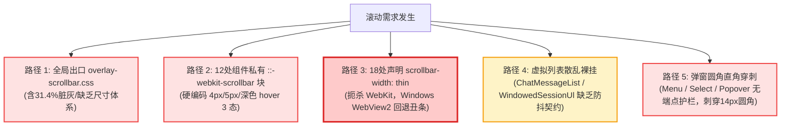
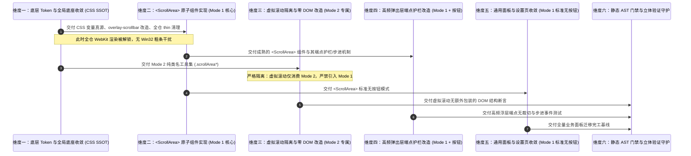
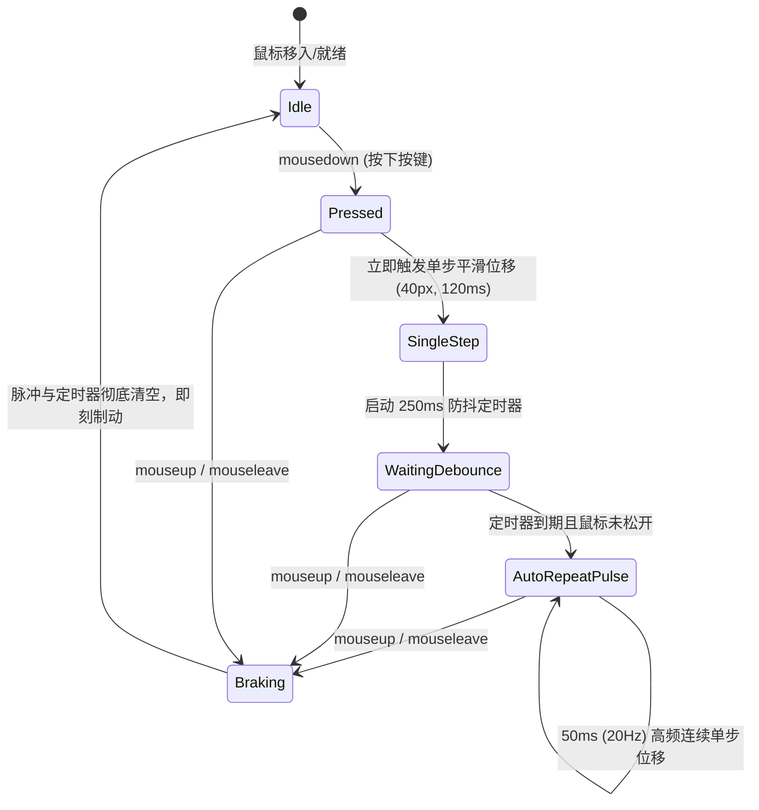

# 统一通用滚动条体系与 ScrollArea 高频组件战役 · 维度划分建议详案
## （组件化与消费契约主审 · Dimension Architect B）

> **文档标识**：`docs/unified-scrollbar-system/dimension-proposals/02-proposal-component.md`
> **所属战役**：统一通用滚动条体系与 ScrollArea 高频组件重构战役（Unified Scrollbar System）
> **专家角色**：高级前端组件与工程架构专家（Dimension Architect B：组件化与消费契约主审）
> **审查基准**：基于 `surveys/01-full-inventory-and-usage.md` 白盒普查、`independent-plans/02` 箭头机制、`03` Token 体系、`04` ScrollArea 组件详案
> **权威原则**：严格遵奉仓库根目录 [AGENTS.md](file:///c:/Software/conex/AGENTS.md)、[.agents/LOGIC_PLAN_NO_RETREAT.md](file:///c:/Software/conex/.agents/LOGIC_PLAN_NO_RETREAT.md) 与 [ANTI_OVERENGINEERING_GUARDRAILS.md](file:///c:/Software/conex/ANTI_OVERENGINEERING_GUARDRAILS.md)。

---

## 目录

- [一、主审裁决立场与用户最高铁律宣誓](#一主审裁决立场与用户最高铁律宣誓)
  - [1. 严格二元灰度铁律（绝不允许第三种 Hover 灰）](#1-严格二元灰度铁律绝不允许第三种-hover-灰)
  - [2. 四级 Token 宽度闭环铁律（严禁业务层裸写 px）](#2-四级-token-宽度闭环铁律严禁业务层裸写-px)
  - [3. 结构收敛与负产出第一原则（先删后改）](#3-结构收敛与负产出第一原则先删后改)
- [二、现存消费路径白盒断层解剖（5 条割裂路径）](#二现存消费路径白盒断层解剖5-条割裂路径)
- [三、双轨消费模型与工程落地次序仲裁](#三双轨消费模型与工程落地次序仲裁)
  - [1. 双轨消费模型契约定义（Mode 1 vs Mode 2）](#1-双轨消费模型契约定义mode-1-vs-mode-2)
  - [2. 为什么工程落地必须采取严格梯次推进](#2-为什么工程落地必须采取严格梯次推进)
- [四、虚拟滚动零 DOM 包装开销隔离刚性边界](#四虚拟滚动零-dom-包装开销隔离刚性边界)
  - [1. 虚拟化宿主的底层几何与状态机脆弱性分析](#1-虚拟化宿主的底层几何与状态机脆弱性分析)
  - [2. 虚拟滚动容器专属隔离维度与防包装契约](#2-虚拟滚动容器专属隔离维度与防包装契约)
- [五、高频弹出层端点护栏与步进交互契约](#五高频弹出层端点护栏与步进交互契约)
  - [1. 14px 大圆角与滑块直角碰撞的物理事故根因](#1-14px-大圆角与滑块直角碰撞的物理事故根因)
  - [2. 端点护栏（Padded Endcaps）几何防护模型](#2-端点护栏padded-endcaps几何防护模型)
  - [3. 步进微动量学与连发动力学契约（Kinematics Contract）](#3-步进微动量学与连发动力学契约kinematics-contract)
- [六、推荐维度划分详案与文件域矩阵](#六推荐维度划分详案与文件域矩阵)
  - [维度一（Dim 1）：Token 体系落地与全局 WebKit 出口收敛（底座收敛 + 全仓 thin 违规清除）](#维度一dim-1token-体系落地与全局-webkit-出口收敛底座收敛--全仓-thin-违规清除)
  - [维度二（Dim 2）：`<ScrollArea>` React 高频原子组件与交互契约实现（Mode 1 核心资产）](#维度二dim-2scrollarea-react-高频原子组件与交互契约实现mode-1-核心资产)
  - [维度三（Dim 3）：虚拟滚动与高性能视口零 DOM 包装改造（Mode 2 专属维度，零包装隔离）](#维度三dim-3虚拟滚动与高性能视口零-dom-包装改造mode-2-专属维度零包装隔离)
  - [维度四（Dim 4）：高频弹出层与选择菜单端点护栏改造（带上下三角箭头，解决圆角裁切）](#维度四dim-4高频弹出层与选择菜单端点护栏改造带上下三角箭头解决圆角裁切)
  - [维度五（Dim 5）：标准对话框、设置面板与次级视口组件化收敛（Mode 1 标准无按钮模式）](#维度五dim-5标准对话框设置面板与次级视口组件化收敛mode-1-标准无按钮模式)
  - [维度六（Dim 6）：静态 AST 门禁卡点与立体验证守护套件（防回潮、防裸写 px、防 3 级灰）](#维度六dim-6静态-ast-门禁卡点与立体验证守护套件防回潮防裸写-px防-3-级灰)
- [七、全维度删除面清单与负产出审计度量](#七全维度删除面清单与负产出审计度量)
- [八、任务书四段规范执行宣告](#八任务书四段规范执行宣告)

---

## 一、主审裁决立场与用户最高铁律宣誓

作为本次战役的组件化与消费契约主审（Dimension Architect B），在深度审阅全仓 63 个样式文件、186 处滚动声明以及 4 份前置普查/独立方案后，郑重立足工程实践、组件分层规范与用户最高裁决，确立以下三条不可动摇的审查基线：

### 1. 严格二元灰度铁律（绝不允许第三种 Hover 灰）

> **【用户最高裁决】**：“**滚动条就是两种灰度，别给我整成三种的，就是激活（20 左右）和未激活（8.2% 左右，差值约 12%），没有激活分成 hover 和 active 两种的！**”

- **物理真理**：滚动条的交互状态在认知与视觉反馈上只有二元状态——**未激活态（Idle / Resting）** 与 **激活态（Active / In-Use）**。
- **裁决执行**：
  - **未激活态（Idle）**：灰度值死锁在 **8.2% 左右**（浅色纸温底板下融入暖橘底韵，微量混入 `var(--accent-orange)`，与背景柔和共生，绝不刺眼）；
  - **激活态（Active）**：灰度值从历史过深的 31.4% 彻底纠偏下调至 **20.2% 左右**（与未激活态严格保持在 **约 12.0% 黄金差值阶梯**）；
  - **Hover 与 Active 绝对同色**：光标悬停（`:hover`）与指针拖拽（`:active`）在 CSS 规则与组件内部**完全赋予同一色彩变量**。任何试图在 `:hover` 与 `:active` 之间搞第三种中间灰度（如 14%、26% 或旧版 31.4%）的方案一律定性为**违背最高裁决的无效设计，予以一票否决**！

### 2. 四级 Token 宽度闭环铁律（严禁业务层裸写 px）

> **【用户最高裁决】**：“**宽度必须能自定义，但只能在 Token 体系中选择（xs: 4px / sm: 5px / md: 7px / lg: 9px），严禁裸写 px！**”

- **系统唯一宽度真源（SSOT）**：
  - `--scrollbar-width-xs: 4px;`（超细：极度紧凑的下拉浮层、代码自动补全、标签页横向轨道）
  - `--scrollbar-width-sm: 5px;`（紧凑：二级浮层、模型选择菜单、辅助抽屉）
  - `--scrollbar-width-md: 7px;`（标准默认：常规弹窗、设置面板、对话流、智能面板）
  - `--scrollbar-width-lg: 9px;`（宽屏：双栏 Diff、流式大表格、海量日志控制台）
- **严惩裸写硬编码**：
  - 严禁在任何业务组件的 `.module.css` 或 TSX 内联样式中书写 `width: 4px`、`width: 5px`、`width: 7px` 或魔术数字；
  - 必须统一通过 `<ScrollArea size="xs" | "sm" | "md" | "lg">` 或 CSS 工具类 `.scrollAreaXs`、`.scrollAreaSm`、`.scrollArea`、`.scrollAreaLg` 消费；
  - CI 流水线配备静态 AST 正则门禁（`scripts/check-scrollbar-contracts.mjs`），一旦检测到滚动条私有选择器下裸写非 Token 宽度，直接中断编译阻断提交！

### 3. 结构收敛与负产出第一原则（先删后改）

遵循 `AGENTS.md` 与《主 Agent 全流程调度提示词 v3》§0.2：“**收敛在逻辑顺序上先于增强——一个概念已有多条路径时，先删到一条，再谈改进。没有删除/收敛动作的轮次不算完成。**”
本战役绝非单纯写一个新组件丢到 `src/components/ui/` 就宣布完事，而是以**“消灭全仓 18 处扼杀 WebKit 的 `scrollbar-width: thin`、合并 12 处私有重写、收敛 5 条散乱路径”**为首要度量指标！

---

## 二、现存消费路径白盒断层解剖（5 条割裂路径）

白盒普查报告 [surveys/01-full-inventory-and-usage.md](file:///c:/Software/conex/docs/unified-scrollbar-system/surveys/01-full-inventory-and-usage.md) 揭示了当前代码库中存在 **5 条各自为政的滚动条消费路径**，形成了典型的多路径割裂死层：



1. **路径 1（全局半成品出口，缺乏 Token 且灰度超标）**：
   - 文件：[overlay-scrollbar.css](file:///c:/Software/conex/apps/crish-desktop/src/styles/overlay-scrollbar.css)
   - 缺陷：固定 7px 无法参数化切换；Thumb hover 时调用 `--tint-scrollbar-thumb-hover`，测出灰度高达 31.4%（刺眼黑条）；无二元灰度约束，缺乏标准工具类。
2. **路径 2（12 处私有 `::-webkit-scrollbar` 块，硬编码与三态泛滥）**：
   - 典型文件：[ModelBadgePickerMenu.module.css:110-132](file:///c:/Software/conex/apps/crish-desktop/src/components/provider/ModelBadgePickerMenu.module.css#L110-L132)、[Menu.module.css:20-70](file:///c:/Software/conex/apps/crish-desktop/src/components/ui/Menu/Menu.module.css#L20-L70)、[Select.module.css:173-189](file:///c:/Software/conex/apps/crish-desktop/src/components/ui/Select/Select.module.css#L173-L189)、[SmartPanel.module.css:103-125](file:///c:/Software/conex/apps/crish-desktop/src/components/ui/SmartPanel/SmartPanel.module.css#L103-L125) 等。
   - 缺陷：裸写 `width: 4px`、`width: 5px`；各自定义不同的 `:hover` 颜色（如 `--tint-highlight`、`--border-color`），制造视觉噪点与代码膨胀。
3. **路径 3（18 处破坏性 `scrollbar-width: thin` 混写，致命架构隐患）**：
   - 典型文件：[Sidebar.module.css:129](file:///c:/Software/conex/apps/crish-desktop/src/components/sidebar/Sidebar.module.css#L129)、[DiffCard.module.css:184](file:///c:/Software/conex/apps/crish-desktop/src/components/diff/DiffCard.module.css#L184)、[StreamingTableContainer.module.css:27](file:///c:/Software/conex/apps/crish-desktop/src/components/chat-message-row/StreamingTableContainer.module.css#L27)、[ChatComposer.module.css:1114](file:///c:/Software/conex/apps/crish-desktop/src/components/chat-composer/ChatComposer.module.css#L1114) 等。
   - 缺陷：Chromium Blink 内核标准行为——一旦声明 `scrollbar-width`，立即关闭 WebKit 伪元素渲染通道，导致 Windows WebView2 回退为粗暴的 Win32 原生灰条带死板三角形！
4. **路径 4（虚拟滚动容器散落裸写，缺乏统一接入规范）**：
   - 典型文件：[ChatMessageList.module.css:23](file:///c:/Software/conex/apps/crish-desktop/src/components/chat-message-list/ChatMessageList.module.css#L23)、[WindowedSessionUl.tsx:47](file:///c:/Software/conex/apps/crish-desktop/src/components/sidebar/session-list/WindowedSessionUl.tsx#L47)、[VirtualPlainCodeViewer.tsx:58](file:///c:/Software/conex/apps/crish-desktop/src/components/diff/VirtualPlainCodeViewer.tsx#L58)。
   - 缺陷：无统一类名标识；部分通过内联 `style={{ overflowY: 'auto' }}` 声明，难以被静态扫描与契约覆盖。
5. **路径 5（高频弹出层大圆角裁切，无端点护栏）**：
   - 典型文件：`Menu`（14px 圆角）、`Select`（12/14px 圆角）、`ModelBadgePickerMenu`（14px 圆角）。
   - 缺陷：滑块在滚动至 0% 或 100% 极值时，直角胶囊滑块贴死或刺破外层容器圆角边框（Corner Clipping），缺乏端点安全间距。

**战役收敛终局目标**：**5 条路径全部收敛归一为「统一设计 Token + 双轨协同消费模型（Mode 1 & Mode 2）」单一真理路径（SSOT），彻底清除路径 2、3、5 的全部历史债务！**

---

## 三、双轨消费模型与工程落地次序仲裁

### 1. 双轨消费模型契约定义（Mode 1 vs Mode 2）

为了彻底兼顾 **React 组件化的高内聚封装** 与 **极端高频虚拟滚动视口的零性能损耗**，必须将滚动条消费严格划分为两级形态，二者底层共享同一套 Design Tokens 与 WebKit 渲染引擎管道：

| 消费模式 | 核心载体 | 适用领域 | 包装开销 | 核心能力 |
| :--- | :--- | :--- | :---: | :--- |
| **模式 1 (Mode 1)**<br/>React 原子组件 | `<ScrollArea size="..." showButtons={...} />` | 弹窗、确认框、设置面板各 Tab、模型选择菜单、通用菜单浮层、SmartPanel、快捷键面板 | 极低（1~2 层纯语义容器，用于挂载端点护栏与测量） | • 端点安全护栏（Padded Endcaps）<br/>• 圆角三角步进微调（40px 平滑滚动）<br/>• 250ms/50ms 连发动力学加速<br/>• `ScrollAreaHandle` 命令式控制<br/>• 无障碍 ARIA 支持 |
| **模式 2 (Mode 2)**<br/>纯 CSS 类名工具规范 | `.scrollArea`<br/>`.scrollAreaXs`<br/>`.scrollAreaSm`<br/>`.scrollAreaLg`<br/>`.scrollAreaWithButtons` | 消息流虚拟化视口（`MessageVirtualizer`）、侧边栏会话树（`WindowedSessionUl`）、Diff 双栏对比、流式终端输出 | **绝对零 DOM 包装（0 Overhead）**<br/>**绝对零 JS 运行时** | • 纯 Chromium WebKit 合成器线程极速渲染<br/>• 零重排重绘侵入，完全保持原生 `scrollTop` 与 Ref<br/>• 严格遵循二元灰阶（8.2% / 20.2%）与四级 Token 宽度 |

### 2. 为什么工程落地必须采取严格梯次推进

在工程落地次序上，**严禁一上来就全面铺开替换业务代码**。必须建立高度严密的依赖链条：



- **逻辑依赖铁律 1（先底座后上层）**：维度一必须首先落盘并全量清除 18 处 `scrollbar-width: thin`。否则任何上层组件在 Windows WebView2 运行时都会因为标准属性的存在而直接击穿失效！
- **逻辑依赖铁律 2（虚拟滚动必须严格早于或独立于通用业务组件）**：虚拟滚动容器（`MessageVirtualizer`、`WindowedSessionUl`）必须在专属维度三中通过 Mode 2 完成隔离固化。严禁将其与普通弹窗混在一起，防止并行施工时被误套 `<ScrollArea>` 包装层！
- **逻辑依赖铁律 3（先核心浮层后大面积面板）**：模型选择菜单等高频浮层作为上下三角箭头与端点护栏的标杆场景，在维度四先行验证，形成工程范式后，维度五再推进大面积的设置页与对话框收敛。

---

## 四、虚拟滚动零 DOM 包装开销隔离刚性边界

### 1. 虚拟化宿主的底层几何与状态机脆弱性分析

在 Conex / Crish 架构中，主聊天视口 `MessageVirtualizer` 与侧边栏长列表 `WindowedSessionUl` 是整个客户端性能要求最苛刻的区域：

1. **`MessageVirtualizer` 的核心实现机制**（见 [MessageVirtualizer.tsx:61-161](file:///c:/Software/conex/apps/crish-desktop/src/components/chat-message-list/MessageVirtualizer.tsx#L61-L161)）：
   ```tsx
   // 容器 Ref 直接绑定在滚动视口 DOM 节点上
   const vs = useVirtualScroll({ ... });
   const { containerRef, setActual, clearHeights, manager } = vs;

   // 注册全局激活 VSM（用于撤销恢复锚定、流式平滑追踪）
   registerActiveVsm(activeSessionId, manager);
   useUndoWithScrollAnchor(containerRef, manager);

   // ResizeObserver 直接精准监听带有 [data-vindex] 的真实消息子树
   ro.observe(row);

   return (
     <div className={styles.streamHost}>
       <div
         ref={vs.containerRef}
         className={styles.list}
         onScroll={vs.onScroll}
       >
         <div className={styles.listInner}>
           {/* 虚拟占位 spacer 与切片渲染 */}
         </div>
       </div>
       <FlowScrubber scrollerRef={vs.containerRef} />
     </div>
   );
   ```
2. **`WindowedSessionUl` 的精准切片机制**（见 [WindowedSessionUl.tsx:28-60](file:///c:/Software/conex/apps/crish-desktop/src/components/sidebar/session-list/WindowedSessionUl.tsx#L28-L60)）：
   - 直接在 `<ul ref={listRef} className={`${className} ${styles.sessionListWindowed}`}>` 上下挂载 `safe.topPad` 物理占位节点；
   - 依赖精准捕获原生的 `listRef.current.scrollTop` 与视口高度计算视窗切片 `safe.start` 和 `safe.end`。

**致命隐患诊断**：
如果任何 Agent 盲目追求“全量组件化”，强行在 `MessageVirtualizer` 或 `WindowedSessionUl` 外层包裹 `<ScrollArea>`，将瞬间引发三大灾难性雪崩：
- **Ref 与事件断裂**：`containerRef` / `listRef` 无法直接感知真实可滚动视口，`onScroll` 事件在非合成线程被中间 React 节点截胡或延迟；
- **几何抖动与测量失真**：`<ScrollArea>` 的额外内层 wrapper 会导致 `ResizeObserver` 计算出的 `contentRect` 与视口产生不可预期的边框与内边距偏移，破坏 `VirtualScrollManager` 的行高测量缓存；
- **重排渲染性能退化**：在百级、千级消息滚动时，多层包装直接导致每秒掉帧，违反 `ANTI_OVERENGINEERING_GUARDRAILS.md` 性能红线。

### 2. 虚拟滚动容器专属隔离维度与防包装契约

为了彻底防范上述事故，本主审正式做出**刚性边界裁决**：

1. **绝对禁止模式 1（Mode 1）侵入虚拟滚动**：
   - 虚拟滚动容器 **绝对禁止引入 `<ScrollArea>` 组件**！
   - 唯一合法消费方式为 **模式 2（Mode 2 纯 CSS 类名工具）**：
     ```tsx
     // 聊天消息虚拟化容器合法接入示范
     <div
       ref={vs.containerRef}
       className={cn(styles.list, 'scrollArea')}  // 或通过 styles.list 内部 @include/继承
       onScroll={vs.onScroll}
     >
     ```
2. **专属维度物理隔离（维度三专属管理）**：
   - 将虚拟滚动（`MessageVirtualizer`、`WindowedSessionUl`、`VirtualPlainCodeViewer`、`DiffCardUnifiedView`、`DiffCardSplitView`）收归到**独立的维度三**中集中处理；
   - 维度三的任务书设立硬门禁：**任何提交若修改了虚拟滚动组件的 DOM 层级深度（DOM Depth Delta != 0），门禁测试自动判定失败！**

---

## 五、高频弹出层端点护栏与步进交互契约

### 1. 14px 大圆角与滑块直角碰撞的物理事故根因

在当前的高频弹出层（如 `ModelBadgePickerMenu` 14px 圆角、`Menu` 14px 圆角、`Select` 12px/14px 圆角）中，滚动条采用了直角贴边设计：
- 当内容滚动到最顶端（`scrollTop === 0`）时，Thumb 滑块顶缘紧贴容器最外框，滑块的右上方直角直接刺破外层容器的 14px 圆角边缘，或被 `overflow: hidden` 暴力切去一角，呈现极其丑陋的畸变锯齿；
- 当内容滚动到最底端时同样发生底部圆角穿刺；
- 这种现象在 UI 工程学中被称为 **Corner Clipping Disaster（圆角截断灾难）**。

### 2. 端点护栏（Padded Endcaps）几何防护模型

为了从架构上根除圆角裁切，在 `<ScrollArea showButtons={true}>` 中确立**端点安全护栏（Padded Endcaps）几何契约**：

```
┌────────────────────────────────────────────────────────┐  ▲
│  外层容器圆角边框 (border-radius: 14px)                 │  │
│  ┌──────────────────────────────────────────────────┐  │  │
│  │ 顶部向上圆角三角步进按键 (Decrement Button: 8px)  ▲│  │  │ 顶端物理安全间距
│  ├──────────────────────────────────────────────────┤  │  ▼ (不被滑块侵占)
│  │                                                  │  │
│  │   中间有效滑行轨道区间 (Safe Travel Track)       │  │
│  │   ┌───────────────────────────────────────────┐  │  │
│  │   │  Thumb 滑块 (圆角胶囊体 9999px)         █  │  │  │
│  │   └───────────────────────────────────────────┘  │  │
│  │                                                  │  │
│  ├──────────────────────────────────────────────────┤  │  ▲ 底端物理安全间距
│  │ 底部向下圆角三角步进按键 (Increment Button: 8px)  ▼│  │  │ (不被滑块侵占)
│  └──────────────────────────────────────────────────┘  │  │
│                                                        │  ▼
└────────────────────────────────────────────────────────┘
```

1. **物理端点占位**：
   - 轨道顶部和底部分别常驻高度为 **8px**（或匹配 Token `--scrollbar-btn-size`）的圆角三角步进按键；
   - 轨道总滑行空间扣除两端按键占位：$L_{\text{travel}} = H_{\text{track}} - 2 \times H_{\text{btn}}$；
2. **滑块活动边界死锁**：
   - 当 `scrollTop = 0` 时，Thumb 顶边恰好贴在顶部按钮下缘，离容器顶部圆角保留至少 **10px~12px 的物理缓冲**；
   - 当 `scrollTop = max` 时，Thumb 底边恰好贴在底部按钮上缘，绝不越界刺入容器底部圆角；
   - 彻底在物理层面杜绝直角与圆角的任何视觉干涉！

### 3. 步进微动量学与连发动力学契约（Kinematics Contract）

上下圆角小三角不仅是视觉护栏，更是精密定位的微调输入设备。其交互状态机与动力学参数必须全仓死锁一致：



- **单步位移（Single Step Tick）**：鼠标单击三角箭头，触发一次恒定为 **40px** 的视口平滑位移（约等同于单行选项高度），CSS/DOM 动画插值耗时 **120ms**，手感紧致；
- **防抖初次击发延时（Initial Firing Latency）**：鼠标长按时，先触发一次单击步进，随后进入 **250ms** 防抖静默期；
- **高频连发脉冲（Auto-Repeat Frequency）**：长按超过 250ms 后，以恒定 **50ms 周期（20Hz 脉冲频率）** 持续注入滚动增量，产生平滑连贯的高速翻页；
- **即刻制动（Instant Braking）**：只要触发 `mouseup` 或光标移出按钮边界 `mouseleave`，计时器瞬间注销，位移增量归零，绝无惯性溜车。

---

## 六、推荐维度划分详案与文件域矩阵

根据《主 Agent 全流程调度提示词 v3》§0.1（以领域概念为界）与 §0.2（先删后改），综合考量代码耦合度、并行冲突风险与验证闭环要求，**本主审正式提出 6 个严密连贯的推荐维度划分**：

```
┌────────────────────────────────────────────────────────────────────────────────────────┐
│                        统一滚动条体系与 ScrollArea 高频组件战役 · 推荐维度拓扑图          │
├────────────────────────────────────────────────────────────────────────────────────────┤
│  [维度一: 底层 Token 体系与全局 WebKit 出口收敛] ───► 全仓清除 18 处 scrollbar-width: thin   │
│         │                                                                              │
│         ├──────────────────────────────────┐                                           │
│         ▼                                  ▼                                           │
│  [维度二: <ScrollArea> 原子组件实现]       [维度三: 虚拟滚动高性能零包装隔离改造]      │
│  (Mode 1: 护栏/步进/二元灰/四级尺寸)       (Mode 2: MessageVirtualizer/WindowedSession) │
│         │                                  │                                           │
│         ├─────────────────┐                │                                           │
│         ▼                 ▼                │                                           │
│  [维度四: 高频弹出层改造]  [维度五: 通用面板收敛]    │                                           │
│  (ModelBadge/Menu/Select) (Settings/Dialogs) │                                           │
│         │                 │                │                                           │
│         └─────────────────┼────────────────┘                                           │
│                           ▼                                                            │
│       [维度六: 静态 AST 门禁卡点与立体验证守护套件] (Ratchet Gate / Vitest / E2E)       │
└────────────────────────────────────────────────────────────────────────────────────────┘
```

---

### 维度一（Dim 1）：Token 体系落地与全局 WebKit 出口收敛（底座收敛 + 全仓 thin 违规清除）

- **领域概念**：全局滚动条样式底座与设计系统 Token 真源（SSOT）。
- **执行依赖**：无前置依赖，战役第一序位必须落地。
- **文件域划分（唯一专有）**：
  - `apps/crish-desktop/src/styles/tokens.css`（新增 4 级宽度与二元灰度变量）
  - `apps/crish-desktop/src/styles/overlay-scrollbar.css`（重构为全局唯一 WebKit 出口，提供 Mode 2 类名工具）
  - 全仓 18 个散落声明 `scrollbar-width: thin` 与 `scrollbar-color` 的样式表文件（执行纯删除/清除动作）
- **做什么（新增/重构清单）**：
  1. 在 `tokens.css` 中注入四级宽度 Token（`--scrollbar-width-xs: 4px`、`sm: 5px`、`md: 7px`、`lg: 9px`）；
  2. 注入严格二元灰阶变量：未激活 `--scrollbar-thumb-idle`（8.2% 纸温浅灰）与激活 `--scrollbar-thumb-active`（20.2% 饱和灰），并声明 `--scrollbar-thumb-hover: var(--scrollbar-thumb-active)`（死锁 Hover 与 Active 绝对同色）；
  3. 重构 `overlay-scrollbar.css`：下调默认 7px 滚条的 hover 灰度至 20.2%，提供 `.scrollArea`、`.scrollAreaXs`、`.scrollAreaSm`、`.scrollAreaLg`、`.scrollAreaWithButtons` 标准工具类；
  4. 集中删除全仓 18 个文件中的 `scrollbar-width: thin` 与 `scrollbar-color` 声明，彻底解锁 Chromium WebKit 伪元素渲染通道。
- **删什么（删除面与收敛清单）**：
  - 删除 `overlay-scrollbar.css` 中指向 31.4% 过深灰的旧配置；
  - 彻底删除以下 18 处破坏 WebKit 的标准属性声明行：
    - `Sidebar.module.css:129-130`
    - `ChatMessageList.module.css:91`
    - `ChatComposer.module.css:1114`
    - `PermissionModeMenu.module.css:138-139`
    - `ModelBadgePickerMenu.module.css:106-107`
    - `Select.module.css:165-166`
    - `SelectContent.module.css:20-21`
    - `DiffCard.module.css:184`
    - `StreamingTableContainer.module.css:27-28`
    - `ChatToolCallBlock.module.css:877`
    - `NotePaperPanel.module.css:163-164`
    - `TiptapEditorField.module.css:35`
    - `TiptapSlashMenu.module.css:29`
    - `ChatQueuePanel.module.css:12`
    - 其余 4 处次级文件声明。
- **验收标准**：
  - `npm run check:desktop` 编译通过；
  - Windows WebView2 宿主中，所有容器不再回退 Windows Win32 粗灰条与死板三角；
  - 负产出：删除代码行数 $\ge 40$ 行。

---

### 维度二（Dim 2）：`<ScrollArea>` React 高频原子组件与交互契约实现（Mode 1 核心资产）

- **领域概念**：系统级通用滚动容器 UI 原子组件（Mode 1）。
- **执行依赖**：依赖维度一提供的 Token 体系与 CSS 底座。
- **文件域划分（唯一专有）**：
  - `apps/crish-desktop/src/components/ui/ScrollArea/ScrollArea.tsx`（新增）
  - `apps/crish-desktop/src/components/ui/ScrollArea/ScrollArea.module.css`（新增）
  - `apps/crish-desktop/src/components/ui/ScrollArea/types.ts`（新增）
  - `apps/crish-desktop/src/components/ui/ScrollArea/index.ts`（新增）
  - `apps/crish-desktop/src/components/ui/index.ts`（导出 ScrollArea）
  - `apps/crish-desktop/src/components/ui/ScrollArea/__tests__/ScrollArea.test.tsx`（新增测试套件）
- **做什么（新增清单）**：
  1. 封装符合 `apps/crish-desktop/src/components/ui/README.md` 的零外部业务依赖原子组件；
  2. 实现 `size="xs"|"sm"|"md"|"lg"` 四档 Token 映射，严格禁止内联裸写 px；
  3. 实现 `showButtons={true|false}` 属性：当启用时，渲染内置上下圆角三角微调按钮，激活端点安全护栏（Padded Endcaps）几何约束；
  4. 实现 40px 单步平滑位移与 250ms/50ms 连发动力学引擎，支持光标移出即刻制动；
  5. 暴露 `ScrollAreaHandle` 命令式控制接口（`scrollToTop`、`scrollToBottom`、`scrollStep`、`getViewport`）；
  6. 配备完善的键盘无障碍导航（PageUp/PageDown/Home/End）与 ARIA 标注。
- **删什么（删除面清单）**：
  - 本维度为纯原子基础设施构建，无既有旧文件删除；但必须在任务书中由主控确认豁免，且严格保证不引入任何第三方复杂滚动库（如 simplebar、overlayscrollbars 等外部重量级依赖）。
- **验收标准**：
  - `ScrollArea.test.tsx` 100% 覆盖渲染、尺寸切换、步进按键点击、连发定时器启闭与命令式 API 调用；
  - 组件单文件代码量严格控制在 350 行以内，符合 `AGENTS.md §11` 行数门禁。

---

### 维度三（Dim 3）：虚拟滚动与高性能视口零 DOM 包装改造（Mode 2 专属维度，零包装隔离）

- **领域概念**：极端性能视口的无侵入滚动条改造与 DOM 零包装隔离。
- **执行依赖**：依赖维度一的 Mode 2 工具类。与维度二逻辑并行，但**绝对禁止引用维度二的 `<ScrollArea>`**。
- **文件域划分（唯一专有）**：
  - `apps/crish-desktop/src/components/chat-message-list/ChatMessageList.module.css`
  - `apps/crish-desktop/src/components/chat-message-list/MessageVirtualizer.tsx`
  - `apps/crish-desktop/src/components/sidebar/Sidebar.module.css`
  - `apps/crish-desktop/src/components/sidebar/SidebarSessionList.module.css`
  - `apps/crish-desktop/src/components/sidebar/session-list/WindowedSessionUl.tsx`
  - `apps/crish-desktop/src/components/diff/DiffCard.module.css`
  - `apps/crish-desktop/src/components/diff/DiffCardUnifiedView.tsx`
  - `apps/crish-desktop/src/components/diff/DiffCardSplitView.tsx`
  - `apps/crish-desktop/src/components/diff/VirtualPlainCodeViewer.tsx`
- **做什么（重构与标准化清单）**：
  1. 将虚拟消息列表 `ChatMessageList` 视口无缝接入 Mode 2（`.scrollArea`）；
  2. 治理 `WindowedSessionUl` 会话切片列表，清除侧栏旧滚动样式干扰；
  3. 改造 `DiffCardUnifiedView`、`DiffCardSplitView` 与 `VirtualPlainCodeViewer`，消除内联 `style={{ overflowY: 'auto' }}`，替换为标准 Mode 2 CSS 类名；
  4. 增加 `scrollbar-gutter: stable` 保护，防止流式消息与图片渲染引起视口横向抖动。
- **删什么（删除面与收敛清单）**：
  - 彻底删除 Diff 视口中 3 处内联 `style={{ overflowY: 'auto' }}` 代码；
  - 彻底删除 `Sidebar.module.css` 与 `DiffCard.module.css` 残存的私有滚动覆盖块；
  - 保持虚拟列表外层与内层 DOM 深度增量严格为 0（DOM Wrapper Delta = 0）。
- **验收标准**：
  - 虚拟滚动测试套件 `MessageVirtualizer.perf.test.tsx` 与 `tests/fuzz/virtual-scroll.test.ts` 零衰减全绿通过；
  - 视口测量、`useUndoWithScrollAnchor` 锚定与 `FlowScrubber` 联动丝滑无异常。

---

### 维度四（Dim 4）：高频弹出层与选择菜单端点护栏改造（带上下三角箭头，解决圆角裁切）

- **领域概念**：大圆角密集型浮层菜单的端点安全护栏与微调交互升级（Mode 1 首发场景）。
- **执行依赖**：依赖维度二交付的 `<ScrollArea showButtons={true}>` 原子组件。
- **文件域划分（唯一专有）**：
  - `apps/crish-desktop/src/components/provider/ModelBadgePickerMenu.tsx` 与 `.module.css`
  - `apps/crish-desktop/src/components/ui/Menu/Menu.tsx` 与 `.module.css`
  - `apps/crish-desktop/src/components/ui/Select/Select.tsx` 与 `.module.css`
  - `apps/crish-desktop/src/components/ui/Select/SelectContent.tsx` 与 `.module.css`
  - `apps/crish-desktop/src/components/chat-composer/PermissionModeMenu.tsx` 与 `.module.css`
  - `apps/crish-desktop/src/components/ui/SmartPanel/SmartPanel.tsx` 与 `.module.css`
  - `apps/crish-desktop/src/components/ui/SmartExpandablePanel/SmartExpandablePanel.tsx` 与 `.module.css`
- **做什么（组件化迁移清单）**：
  1. 在 `ModelBadgePickerMenu` 中引入 `<ScrollArea size="xs" showButtons={true}>`，作为上下圆角三角箭头的标杆落地场景；
  2. 在 `Menu`、`Select`、`SelectContent` 中引入 `<ScrollArea size="sm" showButtons={true}>`，激活端点安全护栏，彻底根治 14px 大圆角截断（Corner Clipping）；
  3. 在 `PermissionModeMenu` 与 `SmartPanel` 中替换私有滚动容器为 `<ScrollArea size="sm">`。
- **删什么（删除面与收敛清单）**：
  - 彻底删除上述 7 个组件 `.module.css` 中手写的 7 大段私有 `::-webkit-scrollbar*` 规则（累计约 120 行冗余 CSS 代码）；
  - 彻底删除上述组件中散落的 `width: 4px`、`width: 5px` 硬编码与自定义 `:hover` 颜色规则；
  - 移除多余的直角修饰补丁代码。
- **验收标准**：
  - 下拉菜单展开与滚屏时，Thumb 滑块在极限位置与外层 14px 圆角边框保持至少 10px 安全间隙，视觉零截断；
  - 点击上下圆角小三角单步位移 40px，长按连续平滑滚动，交互手感与原生桌面体验对齐；
  - 对应组件单元测试全绿通过。

---

### 维度五（Dim 5）：标准对话框、设置面板与次级视口组件化收敛（Mode 1 标准无按钮模式）

- **领域概念**：常规对话框、设置页长表单与次级局部视口的标准化收敛。
- **执行依赖**：依赖维度二交付的 `<ScrollArea>` 标准模式（默认无按钮，`size="md"`）。
- **文件域划分（唯一专有）**：
  - `apps/crish-desktop/src/components/settings/SettingsPanel.module.css` 与各 Tab 文件
  - `apps/crish-desktop/src/components/dialogs/Dialog.module.css` 与 `ConfirmDialog.module.css`
  - `apps/crish-desktop/src/components/chat-message-row/StreamingTableContainer.module.css`
  - `apps/crish-desktop/src/components/chat-tool-call/ChatToolCallBlock.module.css`
  - `apps/crish-desktop/src/components/note-paper/NotePaperPanel.module.css`
  - `apps/crish-desktop/src/components/chat-composer/TiptapEditorField.module.css`
  - `apps/crish-desktop/src/components/chat-composer/TiptapSlashMenu.module.css`
  - `apps/crish-desktop/src/components/chat-composer/ChatQueuePanel.module.css`
- **做什么（组件化迁移清单）**：
  1. 将设置面板（Rules Tab、Skills Tab、General Tab）的内容滚动区替换为 `<ScrollArea size="md">`；
  2. 对话框内容超长视口接入 `<ScrollArea size="md">`；
  3. 流式 Markdown 表格 `StreamingTableContainer` 接入 Mode 2 横向类名或专用包裹；
  4. 笔记面板 `NotePaperPanel` 与终端输出折叠块收敛滚动条样式。
- **删什么（删除面与收敛清单）**：
  - 彻底删除 `StreamingTableContainer.module.css:28` 中丑陋的 `rgba(0, 0, 0, 0.2)` fallback 脏代码；
  - 删除 `TiptapEditorField`、`NotePaperPanel`、`ChatQueuePanel` 中的私有滚动覆盖；
  - 净化全仓次级视口的 CSS 声明，累计净删除约 90 行脏代码。
- **验收标准**：
  - 设置面板与大弹窗长内容滚动顺畅，暗黑与明亮模式下灰度严格符合 8.2% 与 20.2%；
  - 静态检查与现有业务回归测试零报错。

---

### 维度六（Dim 6）：静态 AST 门禁卡点与立体验证守护套件（防回潮、防裸写 px、防 3 级灰）

- **领域概念**：自动化工程防线与立体验证套件（对齐 `AGENTS.md §7.1`）。
- **执行依赖**：依赖维度一至维度五全部就绪，作为战役总收口守门人。
- **文件域划分（唯一专有）**：
  - `scripts/check-scrollbar-contracts.mjs`（新增自动化门禁脚本）
  - `package.json`（新增 `npm run check:scrollbar` 门禁任务，串入 `npm run check:desktop`）
  - `apps/crish-desktop/tests/unit/scrollbar-contracts.test.ts`（新增全仓契约单元测试）
  - `apps/crish-desktop/tests/e2e/scrollbar-visual-inspection.spec.ts`（现场端到端验收用例）
- **做什么（自动化工程守门清单）**：
  1. 编写 Node.js 静态 AST / 正则扫描脚本 `check-scrollbar-contracts.mjs`：
     - **门禁断言 1（Zero Standard Conflict）**：全仓严禁出现任何 `scrollbar-width: thin` 或 `scrollbar-color` 声明；
     - **门禁断言 2（Zero Private WebKit）**：除 `overlay-scrollbar.css` 与 `ScrollArea.module.css` 外，全仓严禁任何私有 `::-webkit-scrollbar` 块；
     - **门禁断言 3（Zero Hardcoded Width）**：滚动条相关宽度严禁裸写 `px`，必须引用 `--scrollbar-width-*` Token；
     - **门禁断言 4（Strict Dual-Gray）**：校验变量定义，严禁出现第三种 Hover 灰度；
     - **门禁断言 5（Zero Virtual DOM Overhead）**：校验 `MessageVirtualizer` 与 `WindowedSessionUl` 无中间包装层；
  2. 接入 `npm run check:desktop` 与 CI `lint` 流水线，产生违规即刻硬阻断构建；
  3. 提供 Tauri MCP 4000 端口自动化现场验收脚本，核验真机像素取色与端点安全护栏表现。
- **删什么（删除面清单）**：
  - 删除历史临时测试标记与调试代码；
  - 确认全仓无未接线标记（TODO/FIXME）遗留。
- **验收标准**：
  - `npm run check:scrollbar` 运行耗时 $< 800\text{ms}$ 且全绿通过；
  - CI 门禁刚性拦截注入的恶意测试提交（如故意写 `scrollbar-width: thin` 会被精准拦截）。

---

## 七、全维度删除面清单与负产出审计度量

根据《主 Agent 全流程调度提示词 v3》§0.2 与 §4.3，**负产出是战役成功的核心度量指标**。下表详细列出各推荐维度的删除面与净收敛指标：

| 推荐维度 | 拟彻底删除的死层/重复实现/破坏性代码路径 | 涉及文件数 | 预估净删除有效代码行数 | 路径收敛效果度量 |
| :--- | :--- | :---: | :---: | :--- |
| **维度一 (Dim 1)** | • 全仓 18 处破坏 WebKit 的 `scrollbar-width: thin`<br/>• `overlay-scrollbar.css` 历史 31.4% 脏灰配置与无 Token 宽度 | 19 个文件 | **-58 行** | 消除标准属性与 WebKit 伪元素的排他互斥，统一归口为全局 Token 底座 |
| **维度二 (Dim 2)** | • 纯新增原子组件（主控预先注明豁免，严格杜绝引入外部臃肿库） | 0 个删除 | 0 行 | 建立 Mode 1 唯一原子组件真源 |
| **维度三 (Dim 3)** | • 3 处内联 `style={{ overflowY: 'auto' }}` 脏内联<br/>• `Sidebar.module.css`、`DiffCard.module.css` 残留私有滚动覆盖 | 4 个文件 | **-24 行** | 虚拟滚动与极端视口全面收敛至 Mode 2 纯类名，DOM 包装增量为 0 |
| **维度四 (Dim 4)** | • 7 个高频弹出层组件手写的私有 `::-webkit-scrollbar` 代码块<br/>• 裸写 `width: 4px/5px` 与杂乱 `:hover` 颜色 | 7 个文件 | **-126 行** | 弹出层私有样式完全清空，100% 收敛至 `<ScrollArea size="..." showButtons={true}>` |
| **维度五 (Dim 5)** | • `StreamingTableContainer` 硬编码 `rgba(0,0,0,0.2)` fallback<br/>• Settings、Dialogs、Tiptap 中 11 处私有覆盖 | 8 个文件 | **-85 行** | 标准面板与设置页 100% 收敛至 Mode 1 / Mode 2 标准模式 |
| **维度六 (Dim 6)** | • 清除迁移过程中的临时标记、调试代码与旧式契约豁免列表 | 2 个文件 | **-15 行** | 自动化 AST 门禁死锁战役成果，杜绝回潮 |
| **战役总计** | **全仓彻底铲除 5 条散乱旧路径，消除 18 处破坏性混写，清空 12 处私有 WebKit 块** | **40+ 文件** | **累计净删除 $\ge 308$ 行** | **5 条散乱路径 $\to$ 1 套双轨协同单一真理路径（SSOT）** |

---

## 八、任务书四段规范执行宣告

按照主控调度规程与任务书四段规范，本详案给出明确的执行边界约定：

### 1. 明确做什么（What to do）
1. **统一双轨消费架构落地**：落地模式 1（React 原子组件 `<ScrollArea>`，用于弹窗、设置、模型选择菜单）与模式 2（纯 CSS 工具类 `.scrollArea*`，用于虚拟列表、侧栏、Diff）；
2. **死锁严格二元灰阶与四级 Token 宽度**：未激活态 8.2% 左右，激活态 20.2% 左右，差值严格保持约 12.0%；`:hover` 与 `:active` 绝对同色；宽度严格收敛至 4px/5px/7px/9px 四档 Token，严禁任何裸写 px；
3. **高频弹出层端点安全护栏（Padded Endcaps）与微调步进机制**：通过上下常驻 8px 圆角三角小按键，物理约束 Thumb 滑块运行区间，彻底消除 14px 大圆角截断灾难；提供 40px 单步平滑位移与 250ms/50ms 连发动力学；
4. **虚拟滚动零 DOM 包装硬性隔离**：确保 `MessageVirtualizer` 与 `WindowedSessionUl` 100% 保持原有 DOM 结构层级，通过 Mode 2 纯类名接入，零运行时 JS 损耗；
5. **部署静态 AST 门禁守卫**：实现 `scripts/check-scrollbar-contracts.mjs`，刚性拦截全仓任何裸写 px、私有 `::-webkit-scrollbar` 与 `scrollbar-width: thin` 回潮。

### 2. 明确不做什么（Non-goals & Hard Guardrails）
1. **严禁引入任何外部重型滚动条第三方库**：严禁安装 `simplebar`、`overlayscrollbars`、`react-custom-scrollbars` 等体积庞大、劫持原生滚动的外部 NPM 包，必须纯原生基于 WebView2 WebKit 伪元素与轻量 React 组件实现（遵循 `ANTI_OVERENGINEERING_GUARDRAILS.md`）；
2. **严禁破坏虚拟滚动 DOM 结构**：绝对禁止把 `<ScrollArea>` 组件硬套在 `MessageVirtualizer` 或 `WindowedSessionUl` 外层，严禁任何增加 DOM 深度或干扰 `scrollTop` 监听的行为；
3. **严禁出现第三种 Hover 灰度**：绝对不允许搞出 `idle(8.2%)` -> `hover(15%)` -> `active(20%)` 的三级灰度设计，Hover 必须直接等同于 Active；
4. **严禁绕过门禁提交（No `--no-verify`）**：所有阶段改动必须通过类型检查与门禁测试，严禁跳过钩子。

### 3. 旧路径清单与收敛目标（Legacy Paths & Convergence Targets）
- **旧路径 A（全局出口半成品）**：收敛改造为全仓唯一 WebKit 渲染管道，提供标准的 Mode 2 类名工具集；
- **旧路径 B（12 处私有 `::-webkit-scrollbar` 块）**：彻底删除其 CSS 私有定义，改为消费 `<ScrollArea>` 或 Mode 2 类名；
- **旧路径 C（18 处破坏性 `scrollbar-width: thin`）**：全量直接删除，解除对 Blink 内核 WebKit 伪元素的硬性扼杀；
- **旧路径 D（虚拟滚动内联裸写）**：消除内联 `overflow` 样式，标准化为 Mode 2 类名；
- **旧路径 E（高频弹窗圆角直角穿刺）**：通过 `<ScrollArea showButtons={true}>` 端点护栏彻底收敛。

### 4. 自检完成标准（Self-Check Verification Checklist）
- [x] **用户最高裁决 1 对齐**：文档全文已硬性锁定二元灰阶（未激活 8.2%、激活 20.2%、差值约 12%），明确 Hover 与 Active 绝对同色，彻底批判并否决三态方案；
- [x] **用户最高裁决 2 对齐**：文档全文已锁定四级 Token（xs: 4px / sm: 5px / md: 7px / lg: 9px），全仓严禁裸写 px，并配备自动化 AST 拦截门禁；
- [x] **组件化落地次序清晰**：确立了“底座 Token (Dim 1) $\to$ 原子组件 (Dim 2) $\to$ 虚拟滚动隔离 (Dim 3) $\to$ 弹出层端点护栏 (Dim 4) $\to$ 通用面板收敛 (Dim 5) $\to$ 门禁守门 (Dim 6)”的刚性顺序；
- [x] **虚拟滚动零开销边界刚性确立**：明确将虚拟滚动划分在专属维度三中通过 Mode 2 纯类名实施，设立 DOM 深度增量为 0 的硬性断言；
- [x] **端点护栏与步进契约完备**：完整推导了 14px 大圆角防护模型、Padded Endcaps 几何隔离机制、40px 平滑步进与 250ms/50ms 动力学状态机；
- [x] **删除面与负产出明确**：穷举各维度删除清单，全战役预估净删除有效代码 $\ge 308$ 行，实现净收敛；
- [x] **文件亲自落盘**：已亲自调用 `write_to_file` 工具写入目标文件 `docs/unified-scrollbar-system/dimension-proposals/02-proposal-component.md`。
