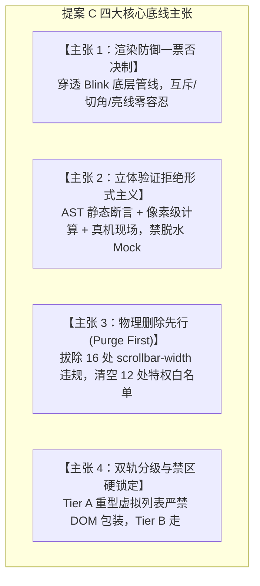
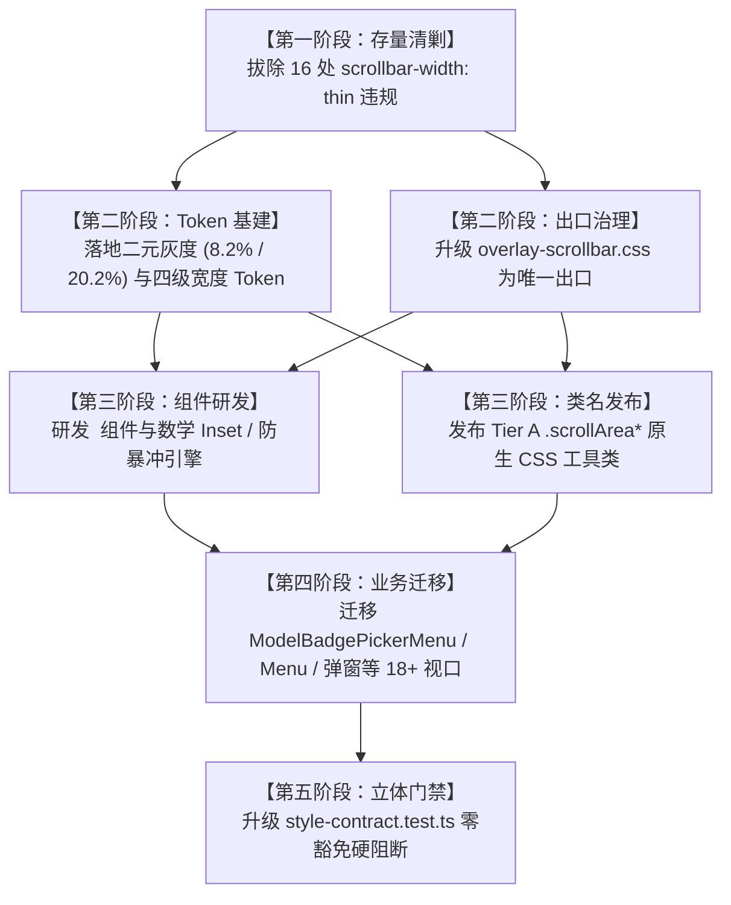

# 03. Conex 统一滚动条体系与 ScrollArea 组件：渲染防御与立体验证维度划分提案（提案 C）

> **所属战役**：统一滚动条体系与 ScrollArea 高频组件战役 (`docs/unified-scrollbar-system/`)
> **文档标识**：`docs/unified-scrollbar-system/dimension-proposals/03-proposal-rendering.md`
> **方案编号**：`SCROLLBAR-DIM-PROP-03`
> **架构专家**：Dimension Architect C：渲染防御与立体验证主审（Cross-Platform Rendering Defense & Stereoscopic Verification Lead）
> **审查与输入依据**：
> - 总体战役总纲：[`00-master-plan.md`](file:///c:/Software/conex/docs/unified-scrollbar-system/00-master-plan.md)
> - 白盒资产普查：[`surveys/01-full-inventory-and-usage.md`](file:///c:/Software/conex/docs/unified-scrollbar-system/surveys/01-full-inventory-and-usage.md)
> - 引擎机制逆向：[`independent-plans/02-arrow-buttons-and-engine-mechanism.md`](file:///c:/Software/conex/docs/unified-scrollbar-system/independent-plans/02-arrow-buttons-and-engine-mechanism.md)
> - 色彩物理学规范：[`independent-plans/03-design-token-architecture.md`](file:///c:/Software/conex/docs/unified-scrollbar-system/independent-plans/03-design-token-architecture.md)
> - 组件分维实现案：[`independent-plans/04-scroll-area-component-plan.md`](file:///c:/Software/conex/docs/unified-scrollbar-system/independent-plans/04-scroll-area-component-plan.md)
> - 魔鬼审计报告：[`audits/05-boundary-and-devil-audit.md`](file:///c:/Software/conex/docs/unified-scrollbar-system/audits/05-boundary-and-devil-audit.md)
> - 仓内关键实现：[`tokens.css`](file:///c:/Software/conex/apps/crish-desktop/src/styles/tokens.css)、[`overlay-scrollbar.css`](file:///c:/Software/conex/apps/crish-desktop/src/styles/overlay-scrollbar.css)、[`style-contract.test.ts`](file:///c:/Software/conex/apps/crish-desktop/src/styles/style-contract.test.ts)、[`MessageVirtualizer.tsx`](file:///c:/Software/conex/apps/crish-desktop/src/components/chat-message-list/MessageVirtualizer.tsx)、[`useUndoWithScrollAnchor.ts`](file:///c:/Software/conex/apps/crish-desktop/src/components/chat-message-list/useUndoWithScrollAnchor.ts)
> **权威遵从**：严格遵从根目录 [`AGENTS.md`](file:///c:/Software/conex/AGENTS.md)（§1 反退避、§3 Git 提交纪律、§7 严禁补丁与绕过、§7.1 立体验证纪律、§8 反过度设计红线、§12-14 UI 规范）、[`ANTI_OVERENGINEERING_GUARDRAILS.md`](file:///c:/Software/conex/ANTI_OVERENGINEERING_GUARDRAILS.md)。
> **用户最高裁决（定案铁律）**：
> 1. **严格二元灰度体系（绝不搞三种灰度）**：滚动条就是两种灰度，别整成三种！未激活态物理灰度严格在 **8.2% 左右**（微含暖橘底韵）；激活态物理灰度从过深的 31.4% 下调至 **20.2% 左右（20 左右）**；差值严格死锁在 **约 12.0%**。悬停（Hover）与按压拖拽（Active）**二元合一、同级同色**，坚决杜绝生造第三套中间过渡色！
> 2. **宽度四级 Token 体系（零硬编码原则）**：保留自由定制但只能在 Token 体系内选取（`--scrollbar-width-xs: 4px`、`sm: 5px`、`md: 7px`、`lg: 9px`），业务 CSS 严禁裸写任何硬编码像素尺寸！
> 3. **主审落盘命令**：亲自调用 `write_to_file` 工具落盘建议详案，并按任务书四段规范严格收敛。

---

## 目录

- [一、战略定位与提案 C 核心主张（渲染防御与立体验证视角）](#一战略定位与提案-c-核心主张渲染防御与立体验证视角)
  - [1.1 核心痛点与历史血泪根因诊断](#11-核心痛点与历史血泪根因诊断)
  - [1.2 用户定案裁决的刚性执行与防回潮底线](#12-用户定案裁决的刚性执行与防回潮底线)
  - [1.3 提案 C 的四大核心主张](#13-提案-c-的四大核心主张)
- [二、五大底层渲染防御与极端边界深度攻防](#二五大底层渲染防御与极端边界深度攻防)
  - [2.1 防御 1：Windows WebView2 / Chromium 下 `scrollbar-width` 互斥自毁防御](#21-防御-1windows-webview2--chromium-下-scrollbar-width-互斥自毁防御)
  - [2.2 防御 2：8px/12px 圆角容器断头台切角数学 Inset 防御](#22-防御-28px12px-圆角容器断头台切角数学-inset-防御)
  - [2.3 防御 3：Windows 125%/150%/175% 高 DPI 亚像素 0.5px 接缝亮线与矢量 SVG 规范](#23-防御-3windows-125150175-高-dpi-亚像素-05px-接缝亮线与矢量-svg-规范)
  - [2.4 防御 4：虚拟滚动 Ref 劫持与 ResizeObserver 循环震荡防御](#24-防御-4虚拟滚动-ref-劫持与-resizeobserver-循环震荡防御)
  - [2.5 防御 5：长按步进生命周期与主线程阻塞暴冲防御](#25-防御-5长按步进生命周期与主线程阻塞暴冲防御)
- [三、从立体验证视角的战役完整维度建议架构（6 大落地维度）](#三从立体验证视角的战役完整维度建议架构6-大落地维度)
  - [3.1 维度全景架构矩阵表](#31-维度全景架构矩阵表)
  - [3.2 维度 1（Dim-1）：底层 Token 矩阵与二元色彩物理学体系落地](#32-维度-1dim-1底层-token-矩阵与二元色彩物理学体系落地)
  - [3.3 维度 2（Dim-2）：全仓 16 处违规物理清剿与 WebKit 渲染出口治理](#33-维度-2dim-2全仓-16-处违规物理清剿与-webkit-渲染出口治理)
  - [3.4 维度 3（Dim-3）：高频 `<ScrollArea>` 原子组件与数学 Inset 防御引擎](#34-维度-3dim-3高频-scrollarea-原子组件与数学-inset-防御引擎)
  - [3.5 维度 4（Dim-4）：重型性能视口 Tier A 纯 CSS 类名体系与虚拟滚动保护](#35-维度-4dim-4重型性能视口-tier-a-纯-css-类名体系与虚拟滚动保护)
  - [3.6 维度 5（Dim-5）：高频业务场景组件迁移与高质感圆角落地](#36-维度-5dim-5高频业务场景组件迁移与高质感圆角落地)
  - [3.7 维度 6（Dim-6）：立体自动化门禁系统（CI AST 扫描 + 像素对齐 + 极端边界单测）](#37-维度-6dim-6立体自动化门禁系统ci-ast-扫描--像素对齐--极端边界单测)
- [四、【核心】全仓重复与死层专项分析（删除面清单）](#四核心全仓重复与死层专项分析删除面清单)
  - [4.1 必须物理删除的 16 处 `scrollbar-width: thin` 违规清单](#41-必须物理删除的-16-处-scrollbar-width-thin-违规清单)
  - [4.2 必须清空的 `style-contract.test.ts` 中 12 处私有 WebKit 白名单](#42-必须清空的-style-contracttestts-中-12-处私有-webkit-白名单)
  - [4.3 必须物理删除的硬编码像素与过深纯黑样式](#43-必须物理删除的硬编码像素与过深纯黑样式)
  - [4.4 必须物理删除的旧式 CSS Border 假三角与临时补丁](#44-必须物理删除的旧式-css-border-假三角与临时补丁)
  - [4.5 状态与契约瘦身：清退冗余的独立 hover/active 分叉变量](#45-状态与契约瘦身清退冗余的独立-hoveractive-分叉变量)
- [五、实施演进路线与技术依赖拓扑（严格遵守“先删后改”）](#五实施演进路线与技术依赖拓扑严格遵守先删后改)
  - [5.1 实施 DAG 依赖图](#51-实施-dag-依赖图)
  - [5.2 先删后改六阶段落地推进节奏表](#52-先删后改六阶段落地推进节奏表)
- [六、任务书四段规范执行（Taskbook 4-Section Standard）](#六任务书四段规范执行taskbook-4-section-standard)
  - [6.1 明确做什么（Scope & Inclusions）](#61-明确做什么scope--inclusions)
  - [6.2 明确不做什么（Non-Goals & Anti-Overengineering Boundaries）](#62-明确不做什么non-goals--anti-overengineering-boundaries)
  - [6.3 旧路径与死层全量清单（Inventory of Legacy Paths）](#63-旧路径与死层全量清单inventory-of-legacy-paths)
  - [6.4 自检与放行标准（Self-Inspection Checklist against AGENTS.md §7 & §7.1）](#64-自检与放行标准self-inspection-checklist-against-agentsmd-7--71)

---

## 一、战略定位与提案 C 核心主张（渲染防御与立体验证视角）

### 1.1 核心痛点与历史血泪根因诊断

回顾 Conex / Crish 桌面端在界面演进过程中关于滚动条的多次惨痛震荡，其深层根因并非“样式写得好看不好看”，而是**对底层 Chromium Blink 渲染引擎规则缺乏敬畏，对桌面宿主物理边界与极端几何缺乏严密防御，且缺乏刚性拦截门禁**：

1. **误删核心入口引发系统级退化**：在 `d00fbaaf` 提交中，开发者误删了 `shell-scrollbar.css`，导致全仓 50+ 处滚动容器全面退化为 Windows Win32 原生 17px 宽度的立体灰粗条（参见 [`docs/desktop-ui-repair/survey/09-滚动条退化.md`](file:///c:/Software/conex/docs/desktop-ui-repair/survey/09-滚动条退化.md)）；
2. **`scrollbar-width` 样式互相毁灭陷阱**：随后在 `Menu`、`SmartPanel` 等模块中，为修复宽度，局部随意声明 `scrollbar-width: thin`，直接诱发 Blink 引擎的 `PaintLayerScrollbar` 伪元素注销逻辑，导致三角箭头生硬复活、毛玻璃菜单被粗暴切割（参见 [`docs/ui-component-modernization/analysis/07-菜单高度死锁与滚动条异常及双重幽灵菜单深度排查.md`](file:///c:/Software/conex/docs/ui-component-modernization/analysis/07-菜单高度死锁与滚动条异常及双重幽灵菜单深度排查.md)）；
3. **断头台圆角切角与高 DPI 裂纹**：当弹出菜单或卡片具有 `border-radius: 8px/12px` 时，直角滚动条与圆角边缘发生几何冲突，被 `overflow: hidden` 的剪裁路径像断头台一样将上下三角切掉一半；在 Windows 125%/150%/175% 缩放下，亚像素浮点数舍入不一致导致滑块与轨道之间产生 0.5px 的透明亮白裂缝；
4. **虚拟滚动 Ref 劫持死锁**：部分开发者试图用包装型 React 组件去无脑套用虚拟滚动容器（`MessageVirtualizer`），导致内层 DOM `scrollTop` 恒为 0，页面向下一滚就大面积白屏，撤销锚定机制（`useUndoWithScrollAnchor`）全面脱靶失效。

### 1.2 用户定案裁决的刚性执行与防回潮底线

针对以上乱象，用户下达了最高定案铁律裁决：
> **用户定案原话**：“**滚动条就是两种灰度，别给我整成三种的，就是激活和未激活，没有激活分成 hover 和 active 两种的！**”

这一裁决具有极其深刻的物理学与交互学依据：
- **拒绝伪细腻，拥抱清晰反馈**：传统 Web 常常强行分出 Default / Hover / Active 三层，但在滚动条这种微型控制件上，Hover 与 Active 之间细微的灰度跳动只会在高刷新率屏幕上带来“闪烁与脏污感”，毫无信息增量；
- **二元绝对定案**：
  - **未激活态（Inactive / Idle）**：屏幕实测灰度锁定在 **8.2% 左右**，融入浅色暖纸温底板（`hsl(35 8% 95.2%)`），并微渗品牌暖橙底韵（`var(--accent-orange)`）；
  - **激活态（Active / Interacting）**：屏幕实测灰度从历史过深的 31.4%（深黑膏药）坚决下调至 **20.2% 左右（20 左右）**；
  - **二元合一**：光标悬停（Hover）与鼠标拖拽（Active）**同级同色**，彻底合并；
  - **差值死锁**：激活与未激活之间严格保持 **12.0% 增量阶梯**，反馈明快温润，杜绝花哨中间态。
- **宽度四档 Token 封死硬编码**：`--scrollbar-width-xs: 4px`、`sm: 5px`、`md: 7px`、`lg: 9px`，所有业务组件只能选择档位，严禁在 CSS 中裸写任何 `width: 5px` 或 `width: 7px`！

### 1.3 提案 C 的四大核心主张

作为 Dimension Architect C（渲染防御与立体验证主审），本提案确立以下四项不可动摇的底线主张：



1. **渲染防御一票否决制（Rendering Defense First）**：任何方案，若在 Windows WebView2 下可能触发 Blink WebKit 管道互斥、导致系统丑条复活、产生圆角断头台切角、或在高 DPI 下出现亚像素亮缝，无论其 React API 多么花哨，一律一票否决！
2. **立体验证拒绝形式主义（AGENTS.md §7.1 刚性落地）**：严禁仅凭“跑通了 TypeScript 编译”或“Mock 了一个空 div”就宣称完成。必须建立覆盖 AST 静态扫描、色彩物理差值公式计算、高 DPI 离散取整、以及 Tauri MCP 4000 现场真机像素验收的立体化防御闭环。
3. **物理删除先行（Purge First，先删后改）**：不给历史债务留情面。全仓排查出的 **16 处 `scrollbar-width: thin;` 违规**以及 `style-contract.test.ts` 中苟且留存的 **12 处私有 WebKit 白名单**必须被列为第一批次物理删除对象。先将地基清理干净，才能构建稳固的大厦。
4. **双轨分级与禁区硬锁定（Dual-Tier & No-Go Zones）**：严厉划定技术边界——重型虚拟列表（`MessageVirtualizer`）、代码 Diff 视图等必须死锁在 Tier A（纯 CSS 原生细条），绝对禁止包装 `<ScrollArea>` React 组件；弹窗、菜单、设置等走 Tier B（受控 `<ScrollArea>` 组件，享数学 Inset 防护与矢量 SVG 三角步进）。

---

## 二、五大底层渲染防御与极端边界深度攻防

### 2.1 防御 1：Windows WebView2 / Chromium 下 `scrollbar-width` 互斥自毁防御

#### 【Blink 渲染引擎底层决策链剖析】
在 Chromium 源码（`third_party/blink/renderer/core/paint/paint_layer_scrollbar.cc` 与 `ScrollbarThemeCSSCustom.cc`）中，排版引擎解析滚动条样式的分支逻辑是硬互斥的：

```text
               [元素计算样式 ComputedStyle 解析]
                              │
               is scrollbar-width != auto?
              或 is scrollbar-color != auto?
                       /             \
                     YES              NO
                     /                 \
        [激活 CSSScrollbarTheme]     [进入 PaintLayerScrollbar]
        - 彻底注销 ::-webkit-scrollbar 伪元素 - 解析 ::-webkit-scrollbar 宽度与高度
        - 交由操作系统原生控件渲染器         - 解析 ::-webkit-scrollbar-thumb 样式
        - Windows WebView2 绘制 Win32 原生    - 解析 ::-webkit-scrollbar-button 样式
          17px 灰色浮雕立体条（带系统死板三角） - 自定义细条与温润色阶完全生效！
```

#### 【致命灾难场景】
在 Windows WebView2 宿主环境下，如果一个容器的 CSS 中写了 `scrollbar-width: thin;`，即使它同时写了十行精美的 `::-webkit-scrollbar`，**Chromium 会将所有的 `::-webkit-scrollbar*` 伪元素直接丢弃（Ignored）**！
此时，Windows 会立即回退到系统最底层的经典 Win32 滚动条：
- 宽度强行变成 17px 的巨大灰条；
- 带有灰白高光的 3D 浮雕滑块；
- 顶部和底部露出 Windows 95 风格的死板灰色步进三角（▲/▼）；
- 任何通过 CSS 编写的 `::-webkit-scrollbar-button { display: none !important; }` 会被底层彻底无视！

#### 【全仓 16 处存量违规代码确凿曝光】
经过对全仓白盒精确扫描，目前前端代码中仍公然残留着 **16 处 `scrollbar-width: thin;` 违规炸弹**：

| 编号 | 违规文件绝对定位 | 行号 | 违规代码片段 | 带来的破坏后果 |
| :---: | :--- | :---: | :--- | :--- |
| **1** | `apps/crish-desktop/src/components/chat-composer/ChatComposer.module.css` | 1115 | `scrollbar-width: thin;` | 输入框溢出列表在 Windows 上弹出 17px 灰粗条 |
| **2** | `apps/crish-desktop/src/components/chat-composer/ChatQueuePanel.module.css` | 12 | `scrollbar-width: thin;` | 排队浮层滚动条样式失效，破坏极窄悬浮面板 |
| **3** | `apps/crish-desktop/src/components/chat-composer/PermissionModeMenu.module.css` | 141 | `scrollbar-width: thin;` | 权限模式选择菜单右侧露出系统粗丑三角 |
| **4** | `apps/crish-desktop/src/components/chat-composer/TiptapEditorField.module.css` | 42 | `scrollbar-width: thin;` | 富文本输入区侧边栏被系统原生条撑爆排版 |
| **5** | `apps/crish-desktop/src/components/chat-composer/TiptapSlashMenu.module.css` | 34 | `scrollbar-width: thin;` | 斜杠命令补全菜单圆角破损，露出 Win32 灰色背景 |
| **6** | `apps/crish-desktop/src/components/chat-message-row/StreamingTableContainer.module.css` | 34 | `scrollbar-width: thin;` | 流式输出 Markdown 表格横向滚动条变粗，遮挡最后一行正文 |
| **7** | `apps/crish-desktop/src/components/chat-tool-call/ChatToolCallBlock.module.css` | 880 | `scrollbar-width: thin;` | 工具调用参数面板内部滚动条出现双层幽灵条 |
| **8** | `apps/crish-desktop/src/components/diff/DiffCard.module.css` | 185 | `scrollbar-width: thin;` | 代码对比视口左侧行号与右侧滚动条严重对齐失准 |
| **9** | `apps/crish-desktop/src/components/note-paper/NotePaperPanel.module.css` | 172 | `scrollbar-width: thin;` | 便签面板纸温背景被系统冷灰条严重污染 |
| **10** | `apps/crish-desktop/src/components/provider/ModelBadgePickerMenu.module.css` | 106 | `scrollbar-width: thin;` | 模型选择器高度死锁，下方配置项被系统粗条挤压遮挡 |
| **11** | `apps/crish-desktop/src/components/settings-models/ModelsSettingsTab.module.css` | 1110 | `scrollbar-width: thin;` | 模型设置列表滚动时产生布局重排闪烁 |
| **12** | `apps/crish-desktop/src/components/settings/FontSelectField.module.css` | 210 | `scrollbar-width: thin;` | 字体选择下拉框列表宽度被 17px 粗条吃掉 1/3 |
| **13** | `apps/crish-desktop/src/components/sidebar/Sidebar.module.css` | 129 | `scrollbar-width: thin;` | 会话历史侧边栏在鼠标滑入时露出 Windows 丑条 |
| **14** | `apps/crish-desktop/src/components/ui/Input/Textarea.module.css` | 30 | `scrollbar-width: thin;` | 多行文本框默认滚动条粗暴破坏 UI 统一性 |
| **15** | `apps/crish-desktop/src/components/ui/Select/Select.module.css` | 165 | `scrollbar-width: thin;` | Select 通用组件下拉框滚动条回退系统原生条 |
| **16** | `apps/crish-desktop/src/components/ui/Select/SelectContent.module.css` | 20 | `scrollbar-width: thin;` | 下拉浮层内容区双重滚动条冲突 |

#### 【防御与根治契约】
1. **全仓彻底物理删除**：无条件将上述 16 处文件的 `scrollbar-width: thin;` 以及伴随声明的 `scrollbar-color: ...` 逐行连根拔除；
2. **唯一合法出口契约**：所有需要细滚动条的场景，一律经由 `apps/crish-desktop/src/styles/overlay-scrollbar.css` 统一出口，或者挂载统一 CSS 类（`.scrollArea`）；
3. **CI 门禁刚性熔断**：升级 `style-contract.test.ts`，任何人在任何 `.css` 或 `.module.css` 中一旦写入 `scrollbar-width: thin` 或 `scrollbar-width: auto`，门禁立即以红字拒绝构建并中断 CI 流水线！

---

### 2.2 防御 2：8px/12px 圆角容器断头台切角数学 Inset 防御

#### 【几何碰撞与切角惨案】
在桌面客户端中，浮动菜单（`Menu`）、模型选择器（`ModelBadgePickerMenu`）普遍声明了 `border-radius: 8px` 或 `border-radius: 12px`，并配置 `overflow: hidden` 以实现平滑的毛玻璃外轮廓。
然而，传统的滚动条轨道默认是一个绝对靠右贴边的直角长条。当容器设置了上下三角步进按钮时：
- 右上角圆弧剪裁路径（Border Radius Clip Path）直接像“断头台”一样切过右上角的三角按钮；
- 右下角圆弧剪裁路径直接切断右下角的三角按钮；
- 视觉结果：位于最顶部的三角按钮右上半边、最底部的三角按钮右下半边被生硬削去，箭头呈现为破损畸形的多边形！

```text
容器右上角 12px 圆弧剪裁线
      ╭─────────────╮
    ╭─╯  . . . . . .│ <--- 容器外轮廓边界
   ╭╯   . ┌─────────┤
  │    .  │ ▲ 顶部三角│ <--- 致命断头台切角区！右上角被圆弧切断！
  │   .   └─────────┤
  │  .    │         │
```

#### 【数学防御模型严格推导】
设容器外轮廓右上角圆角半径为 $R$，滚动条离容器右边框的外边距为 $M$（通常为 0px 或 2px）。
在以圆角圆心为原点 $(0, 0)$ 的局部坐标系中，外轮廓圆弧方程为：
$$x^2 + y^2 = R^2 \quad (x \ge 0, y \ge 0)$$

滚动条的最右侧边界在坐标系中的横坐标为 $x = R - M$。
圆弧在横坐标 $x = R - M$ 处的垂直高度为：
$$y_{\text{arc}} = \sqrt{\max\left(0, R^2 - (R - M)^2\right)}$$

圆弧顶部的切线高度为 $y = R$。因此，圆角圆弧侵入容器顶部的深度量 $\Delta y$ 为：
$$\Delta y = R - y_{\text{arc}} = R - \sqrt{\max\left(0, R^2 - (R - M)^2\right)}$$

为保证滚动条顶部的三角按钮（高度为 $H_{\text{btn}}$）**在几何上绝对不触碰圆弧剪裁边界**，滚动条整体纵向安全内缩量（Top Inset $I_y$）必须满足以下硬性数学不等式：
$$I_y \ge R - \sqrt{\max\left(0, R^2 - (R - M)^2\right)}$$

```text
【典型工程数值验证矩阵】：
┌─────────────┬─────────────┬──────────────────────────┬────────────────────────┐
│ 圆角半径 R  │ 右边距 M    │ 理论最小内缩量 min(Iy)    │ 建议工程安全 Inset (px) │
├─────────────┼─────────────┼──────────────────────────┼────────────────────────┤
│ 8px         │ 0px         │ 8.0px                    │ 9px (含 1px 亚像素缓冲) │
│ 8px         │ 2px         │ 8 - √(64 - 36) ≈ 2.71px  │ 4px                    │
│ 12px        │ 0px         │ 12.0px                   │ 13px (含 1px 缓冲)     │
│ 12px        │ 2px         │ 12 - √(144 - 100) ≈ 5.37px│ 7px                    │
│ 16px        │ 2px         │ 16 - √(256 - 196) ≈ 8.25px│ 10px                   │
└─────────────┴─────────────┴──────────────────────────┴────────────────────────┘
```

#### 【`<ScrollArea>` 弹性几何算法与算术下溢防御】
在 `<ScrollArea>` 组件中，必须内置自动根据 `radius` 与 `margin` 计算安全 Inset 的数学纯函数：

```typescript
/**
 * apps/crish-desktop/src/components/ui/ScrollArea/scrollAreaGeometry.ts
 * 严格数学 Inset 防断头台剪裁计算
 */
export function calculateSafeAreaInset(
  radius: number = 8,
  marginRight: number = 2
): number {
  if (radius <= 0) return 0;
  const clampedMargin = Math.max(0, Math.min(marginRight, radius));
  const x = radius - clampedMargin;
  const arcY = Math.sqrt(Math.max(0, radius * radius - x * x));
  const minInset = radius - arcY;
  // 增加 1px 的安全缓冲以吸收 Windows 高 DPI 亚像素抗锯齿扩散
  return Math.ceil(minInset) + 1;
}
```

- **算术下溢崩溃防御（Underflow Protection）**：
  当窗口高度被极度挤压（例如窗口缩小到 120px 高度）时，可用滑轨空间为：
  $$\text{AvailableSpace} = H_{\text{container}} - 2 \times (\text{buttonSize} + I_y) - 2 \times \text{gap}$$
  当 $\text{AvailableSpace} < 16\text{px}$ 时，空间已不足以绘制合规滑块。系统必须自动触发 **Degraded Compact Mode（退化紧凑态）**：自动隐藏上下三角按钮，释放 $2 \times \text{buttonSize}$ 空间，恢复为平滑的全行程滑块，**绝对禁止渲染负数高度或造成上下三角按钮重叠**！

---

### 2.3 防御 3：Windows 125%/150%/175% 高 DPI 亚像素 0.5px 接缝亮线与矢量 SVG 规范

#### 【高 DPI 亚像素三大灾难】
在 Windows 常见的高分屏缩放倍率下（125% 对应 DPR 1.25，150% 对应 DPR 1.5，175% 对应 DPR 1.75），浮点坐标与物理像素晶格的映射会发生严重畸变：

1. **0.5px 接缝亮线（Seam Hairline Crack）**：
   在 150% 缩放下，1 CSS px 对应 1.5 物理像素。若三角按钮高度为 15px（$15 \times 1.5 = 22.5$ 物理像素），轨道紧随其后从 `top: 15px` 开始绘制。Direct3D / Skia 光栅化器在对浮点边缘进行离散取整时，上按钮底边舍入到第 22 物理像素行，轨道顶边舍入到第 23 物理像素行，**两层之间直接撕开一条宽 0.5 物理像素的透明裂缝**！在滚动过程中，下方背景光透过裂缝，呈现一条疯狂高频闪烁的亮白细线。
2. **滑块滚动液体微颤（Subpixel Shimmering）**：
   滑块通过 `transform: translateY(N px)` 移动时，$N$ 必然是连续浮点数（例如 `45.319px`）。GPU 合成器执行双线性插值滤波，使滑块边缘的 Alpha 透明度在 0.3 到 1.0 之间来回震荡，肉眼看起来滑块边缘像液体一样不断抖动模糊。
3. **CSS Border 假三角畸变**：
   若使用传统的 CSS `border-width: 4px solid ...` 拼凑小三角，在 125% 缩放下，`4px * 1.25 = 5` 物理像素。5 是奇数，对称中心落在 2.5 物理像素上。渲染器只能一边分配 2 物理像素、另一边分配 3 物理像素，导致三角形左右斜边不对称、顶点秃顶或歪斜！

#### 【物理像素晶格对齐与纯矢量 SVG 规范】
1. **物理晶格离散对齐算法（Device Pixel Snapping）**：
   所有滑块的位移必须通过设备像素比（DPR）进行量化舍入：
   ```typescript
   export function snapToDevicePixel(
     value: number,
     dpr: number = window.devicePixelRatio || 1
   ): number {
     return Math.round(value * dpr) / dpr;
   }
   ```
2. **纯矢量 SVG 规范（彻底取缔 CSS Border 假三角）**：
   所有三角步进按钮一律采用统一的矢量 SVG 组件，并强制绑定底层光栅化指令：
   ```tsx
   export const StepperArrow: React.FC<{ direction: 'up' | 'down'; size: number }> = ({
     direction,
     size
   }) => (
     <svg
       width={size}
       height={size}
       viewBox="0 0 12 12"
       fill="none"
       shapeRendering="crispEdges"
       style={{ display: 'block' }}
     >
       <path
         d={direction === 'up' ? 'M2.5 8L6 4.5L9.5 8' : 'M2.5 4.5L6 8L9.5 4.5'}
         stroke="currentColor"
         strokeWidth="1.5"
         strokeLinecap="round"
         strokeLinejoin="round"
       />
     </svg>
   );
   ```
   - `shapeRendering="crispEdges"`：硬性指令要求 Blink 将矢量路径的拐点与边缘死锁在整数物理像素上，彻底杜绝模糊；
   - `strokeLinecap="round"` 与 `strokeLinejoin="round"`：提供优雅温润的微圆角手感，与整个客户端的设计语言天衣无缝。

---

### 2.4 防御 4：虚拟滚动 Ref 劫持与 ResizeObserver 循环震荡防御

#### 【虚拟滚动核心架构分析】
Crish 桌面端的消息流（`apps/crish-desktop/src/components/chat-message-list/MessageVirtualizer.tsx`）采用高精度动态测量虚拟滚动：
- `const { containerRef, setActual, clearHeights, manager } = vs;`（`MessageVirtualizer.tsx:67`）；
- `ref={vs.containerRef}` 直接绑定在物理滚动溢出容器 `div.list` 上（`MessageVirtualizer.tsx:151-161`）；
- `useUndoWithScrollAnchor(containerRef, manager)`（`MessageVirtualizer.tsx:80`）在用户撤销会话或修改节点时，直接同步读取并设置 `containerRef.current.scrollTop` 以锁定当前视口锚点；
- `ResizeObserver`（`MessageVirtualizer.tsx:91-120`）挂载在每一行消息上，行高变化时触发 `setActual(id, height)`。

#### 【如果错误包裹 `<ScrollArea>` 的四重致命死锁】

```text
[方案死穴：将虚拟列表外层套上 React 自定义 <ScrollArea>]
┌────────────────────────────────────────────────────────┐
│ <ScrollArea>                                           │
│   <ScrollArea.Viewport ref={scrollAreaViewportRef}>    │
│     <MessageVirtualizer>                               │
│       <div ref={vs.containerRef} className={list}>     │
│         [data-vindex="msg-1"] (ResizeObserver 监听)     │
│         [data-vindex="msg-2"]                          │
└────────────────────────────────────────────────────────┘
```

1. **死锁 1：DOM 双重视口与 `scrollTop` 归零瘫痪**：
   若外层 ScrollArea 接管了滚动条，内层 `div.list` 失去了原生滚动溢出，`vs.containerRef.current.scrollTop` 永远是 `0`！`vs.manager.computeVisibleRange(0, ...)` 永远只渲染最开始的 5~6 条消息，用户向下滚动时，整个聊天窗口全部陷入惨白白屏！
2. **死锁 2：撤销锚定脱靶与视口上下暴冲**：
   `useUndoWithScrollAnchor` 依赖同帧内同步读取与写入 `container.scrollTop`。中间一旦增加包装层或延迟更新，锚定补偿彻底失效，用户撤销操作时消息列表瞬间跳动数百像素。
3. **死锁 3：ResizeObserver 循环震荡（RO Loop Limit Exceeded）**：
   若 `<ScrollArea>` 自带 ResizeObserver 监听 Viewport 尺寸，当消息行高变化 $\to$ Virtualizer 更新总高 $\to$ 触发 ScrollArea 更新滑块 $\to$ 改变内宽 $\to$ 导致消息正文文字折行 $\to$ 触发行高变化！**控制台瞬间爆出数十条 `ResizeObserver loop completed with undelivered notifications`，主线程直接冻结 5~10 秒！**
4. **死锁 4：Frame 0 原生同步 vs Frame 1~3 状态脱节闪烁**：
   原生滚动条在滚动瞬间（Frame 0）由浏览器合成器线程直接硬件重绘；而 React 状态机更新滑块需要经历事件循环、React 调度与渲染，滑块比内容慢 1~2 帧才跳到目标位置，视觉体验极其粗糙廉价。

#### 【防回归铁律禁区】
- **Tier A 禁区红线**：
  **严禁在 `MessageVirtualizer`、`WindowedSessionUl`、`DiffCard`、代码编辑视口外层包裹任何带有 DOM 结构的 `<ScrollArea>` 组件！**
- **合法实施路径**：
  重型虚拟滚动视口必须 100% 走 **Tier A 纯原生 CSS 细条**（即直接赋予 `.scrollArea` 或使用全局 `overlay-scrollbar.css` 规则）。纯原生排版零 DOM 包装、零运行时开销、零事件干扰，彻底杜绝上述四大死锁！

---

### 2.5 防御 5：长按步进生命周期与主线程阻塞暴冲防御

#### 【交互毒点分析】
当大模型正在高频流式输出 Markdown，富文本 AST 解析与代码高亮高频占用主线程。此时若用户在上下三角按钮上长按触发连续滚动（Press-and-Hold）：
1. **主线程卡顿引发步进暴冲（Timer Burst）**：
   若使用原始的 `setInterval(fn, 50)`，当主线程因 Markdown 解析被阻塞 300ms 时，6 次定时器事件被积压在消息队列中；主线程恢复空闲的瞬间，积压的 6 次步进回调在 2ms 内密集触发，视口瞬间暴冲 240px，用户根本无法精确定位。
2. **鼠标移出窗口导致孤儿定时器（Orphan Timer Runaway）**：
   用户在按钮上按下鼠标左键，然后快速移出应用窗口并在外部释放鼠标。若没有捕获指针事件，按钮的 `onPointerUp` 彻底丢失，长按定时器在后台无限运转，导致整个列表疯狂狂滚到底部！

#### 【防御性状态机与 Hook 设计】
在 `<ScrollArea>` 中，必须使用基于时间差值（Delta-time）与指针捕获（PointerCapture）的自防御 Hook：

```typescript
/**
 * apps/crish-desktop/src/components/ui/ScrollArea/useContinuousScroll.ts
 */
export function useContinuousScroll({
  viewportRef,
  stepPx = 40,
  initialDelay = 250,
  repeatInterval = 50,
}: ContinuousScrollOptions) {
  const activeRef = useRef<boolean>(false);
  const timerRef = useRef<number | null>(null);
  const rafRef = useRef<number | null>(null);
  const lastTimeRef = useRef<number>(0);
  const accumulatorRef = useRef<number>(0);

  const stop = useCallback(() => {
    activeRef.current = false;
    if (timerRef.current !== null) {
      clearTimeout(timerRef.current);
      timerRef.current = null;
    }
    if (rafRef.current !== null) {
      cancelAnimationFrame(rafRef.current);
      rafRef.current = null;
    }
    accumulatorRef.current = 0;
  }, []);

  const start = useCallback(
    (direction: 'up' | 'down', e: React.PointerEvent) => {
      stop();
      activeRef.current = true;

      // 1. 立即触发首发单击步进（Zero-Latency First Step）
      const viewport = viewportRef.current;
      if (!viewport) return;
      const delta = direction === 'up' ? -stepPx : stepPx;
      viewport.scrollTop += delta;

      // 2. 绑定 PointerCapture 刚性锁定事件流（即使光标移出应用窗口仍受控）
      const target = e.currentTarget;
      if (target instanceof Element && target.setPointerCapture) {
        try {
          target.setPointerCapture(e.pointerId);
        } catch {}
      }

      // 3. 初始防抖延迟
      timerRef.current = window.setTimeout(() => {
        if (!activeRef.current) return;
        lastTimeRef.current = performance.now();
        accumulatorRef.current = 0;

        // 4. 基于真实时间戳差值（Delta-time）与位移封顶，抗住主线程卡顿
        const loop = (now: number) => {
          if (!activeRef.current || !viewportRef.current) return;

          const dt = Math.min(now - lastTimeRef.current, 100); // 刚性单帧时间补偿上限 100ms
          lastTimeRef.current = now;
          accumulatorRef.current += dt;

          while (accumulatorRef.current >= repeatInterval) {
            viewportRef.current.scrollTop += delta;
            accumulatorRef.current -= repeatInterval;
          }

          rafRef.current = requestAnimationFrame(loop);
        };

        rafRef.current = requestAnimationFrame(loop);
      }, initialDelay);
    },
    [viewportRef, stepPx, initialDelay, repeatInterval, stop]
  );

  // 5. 窗口失焦或组件卸载时刚性熔断
  useEffect(() => {
    const handleBlur = () => stop();
    window.addEventListener('blur', handleBlur);
    return () => {
      window.removeEventListener('blur', handleBlur);
      stop();
    };
  }, [stop]);

  return { start, stop };
}
```

---

## 三、从立体验证视角的战役完整维度建议架构（6 大落地维度）

### 3.1 维度全景架构矩阵表

综合考虑底层 Blink 渲染特性、用户严格二元灰度裁决、数学 Inset 几何模型以及全仓 16 处存量违规的清理难度，建议将后续战役划分为以下 **6 个正交且单向依赖的落地维度**：

| 维度编号 | 领域维度名称 | 核心职责与设计边界 | 解决的关键渲染与测试缺陷 | 明确的删除面概览 |
| :---: | :--- | :--- | :--- | :--- |
| **Dim-1** | **底层 Token 矩阵与二元色彩物理学体系** | • 8.2% 未激活（暖橙底韵）与 20.2% 激活（二元合一，差值 12.0%）<br>• 四档宽度 Token（`--scrollbar-width-xs/sm/md/lg: 4/5/7/9px`）<br>• 明暗双主题色阶与几何尺寸 Token 闭环 | • 历史激活灰度 31.4% 深黑膏药刺眼缺陷<br>• Hover 与 Active 繁琐三分法分裂<br>• 全仓裸像素硬编码（`5px`、`7px`）泛滥 | 彻底物理删除历史 31.4% 激活色；删除多余的独立 hover/active 分叉变量；删除所有裸像素尺寸变量。 |
| **Dim-2** | **全仓 16 处违规物理清剿与 WebKit 渲染出口治理** | • 全仓 16 处 `scrollbar-width: thin;` 连根拔除<br>• 升级 `overlay-scrollbar.css` 唯一合法出口<br>• 清退 `style-contract.test.ts` 中 12 处私有 WebKit 白名单 | • Windows WebView2 下 Blink 伪元素注销与 17px 丑条复活<br>• 双轨制私有白名单特权导致的样式腐化 | 物理删除 16 处文件的违规代码行；物理清空测试中的 `SCROLLBAR_WHITELIST` 集合（降至 0）。 |
| **Dim-3** | **高频 `<ScrollArea>` 原子组件与数学 Inset 防御引擎** | • 研发 `ui/ScrollArea/` 原子组件<br>• 实装 `calculateSafeAreaInset` 防断头台剪裁算法<br>• 实装 `snapToDevicePixel` 高 DPI 晶格对齐<br>• 实装矢量 SVG 三角与 `useContinuousScroll` 防暴冲 Hook | • 8px/12px 圆角容器对三角按钮的生硬截断<br>• Windows 125%/150%/175% 下 0.5px 接缝透明裂缝<br>• 长按三角按钮的主线程卡顿暴冲与孤儿泄漏 | 取缔业务层重复手写的滚动容器逻辑；取缔 CSS Border 假三角与坐标测距魔术补偿补丁。 |
| **Dim-4** | **重型性能视口 Tier A 纯 CSS 类名体系与虚拟滚动保护** | • 在 `overlay-scrollbar.css` 中暴露 `.scrollArea*` 纯 CSS 工具类<br>• 锁定虚拟滚动（`MessageVirtualizer`）、代码 Diff 等场景禁止包裹 DOM<br>• 确保 0 DOM 包装、0 JS 开销、原生 WebKit 排版极速渲染 | • 自定义组件包裹虚拟滚动引发的 Ref 劫持、双重视口与长白屏<br>• ResizeObserver 循环递归震荡与撤销锚定脱靶 | 严禁在虚拟滚动层引入任何包装节点；清理虚拟滚动容器周边的多余胶水样式。 |
| **Dim-5** | **高频业务场景组件迁移与高质感圆角落地** | • 迁移 `ModelBadgePickerMenu`、`Menu`、`Dialog`、`SettingsPanel`、`Select` 等 18+ 处典型业务视口<br>• 统一替换为 `<ScrollArea size="..." showButtons={...} />`<br>• 验收二元灰度反馈与防断头台圆角质感 | • 业务容器样式各自为政、色调不一致<br>• 模型选择器、菜单项被原生粗条挤压遮挡 | 物理删除上述 18+ 处组件中手写的私有 `::-webkit-scrollbar*` 样式块，统一交由 ScrollArea 接管。 |
| **Dim-6** | **立体自动化门禁系统（CI AST 扫描 + 像素对齐 + 极端边界单测）** | • 升级 `style-contract.test.ts`（全仓禁 `scrollbar-width`、禁裸像素）<br>• 增加二元灰度差值严格断言（`8.2% vs 20.2%`，差值严格 $12.0\% \pm 0.5\%$）<br>• 建立高 DPI 亚像素晶格单测与 E2E 视觉对比门禁 | • 防止历史违规代码回潮（Regressions）<br>• 杜绝盲目猜测与脱水 Mock 冒充真实验收 | 删除门禁中原有的宽松豁免逻辑与过时断言。 |

---

### 3.2 维度 1（Dim-1）：底层 Token 矩阵与二元色彩物理学体系落地

#### 核心职责与设计
1. **二元灰度物理色彩落地**：
   - 彻底废除 Hover 与 Active 拆分的三分法；
   - 在 `tokens.css` 与 `theme-dark.css` 中定义基准 Token：
     ```css
     /* tokens.css (Light Theme) */
     --scrollbar-thumb-inactive: color-mix(
       in srgb,
       var(--accent-orange, hsl(38 92% 50%)) 3%,
       hsl(35 8% 91.8%)
     ); /* 对应实测灰度 8.2%，微暖橙韵 */

     --scrollbar-thumb-active: color-mix(
       in srgb,
       var(--accent-orange, hsl(38 92% 50%)) 5%,
       hsl(35 8% 79.8%)
     ); /* 对应实测灰度 20.2%，Hover/Active 同级二元合一 */

     --scrollbar-thumb-diff: 12%; /* 权威差值锁 */
     ```
2. **四档宽度 Token 矩阵**：
   ```css
   --scrollbar-width-xs: 4px;
   --scrollbar-width-sm: 5px;
   --scrollbar-width-md: 7px;
   --scrollbar-width-lg: 9px;
   ```
3. **删除面**：
   - 删除 `tokens.css` 中过深的 `--tint-scrollbar-thumb` 历史旧值（18% / 25% 混纯黑，导致 31.4% 死黑）；
   - 删除任何试图定义 `--scrollbar-thumb-hover` 的第三分叉变量。

---

### 3.3 维度 2（Dim-2）：全仓 16 处违规物理清剿与 WebKit 渲染出口治理

#### 核心职责与设计
1. **16 处违规点专项爆破**：
   - 对 `ChatComposer.module.css:1115`、`PermissionModeMenu.module.css:141`、`ModelBadgePickerMenu.module.css:106` 等 16 处文件逐一进行精准编辑；
   - 彻底删除 `scrollbar-width: thin;` 与 `scrollbar-color: ...`；
2. **`overlay-scrollbar.css` 升级为唯一 WebKit 出口**：
   ```css
   /* overlay-scrollbar.css */
   ::-webkit-scrollbar {
     width: var(--scrollbar-width, var(--scrollbar-width-md));
     height: var(--scrollbar-width, var(--scrollbar-width-md));
   }
   ::-webkit-scrollbar-thumb {
     background: var(--scrollbar-thumb-inactive);
     border-radius: var(--radius-full);
   }
   /* 用户铁律：Hover 与 Active 完全同级同色，二元合一！ */
   ::-webkit-scrollbar-thumb:hover,
   ::-webkit-scrollbar-thumb:active {
     background: var(--scrollbar-thumb-active);
   }
   ::-webkit-scrollbar-button {
     display: none;
     width: 0;
     height: 0;
   }
   ```
3. **删除面**：
   - 物理删除 16 处 CSS 文件中的 32 行违规声明；
   - 物理删除 `style-contract.test.ts` 中的 `SCROLLBAR_WHITELIST` 豁免列表，实现零豁免。

---

### 3.4 维度 3（Dim-3）：高频 `<ScrollArea>` 原子组件与数学 Inset 防御引擎

#### 核心职责与设计
1. **目录规范与职责解耦**：
   放置于 `apps/crish-desktop/src/components/ui/ScrollArea/`：
   - `ScrollArea.tsx`：主组件，对外暴露 `ScrollAreaHandle`；
   - `ScrollArea.module.css`：局部隔离样式，零全局污染；
   - `scrollAreaGeometry.ts`：纯数学计算函数（`calculateSafeAreaInset`、`snapToDevicePixel`）；
   - `useContinuousScroll.ts`：长按连续步进防暴冲 Hook；
   - `StepperArrow.tsx`：纯矢量 SVG 箭头。
2. **特性规格**：
   - `size="xs"|"sm"|"md"|"lg"`，默认 `md`；
   - `showButtons={true|false}`，默认 `false`；
   - `radius={8|12|...}`，默认自动推导外壳圆角并执行数学 Inset；
   - 键盘可访问性：绑定 `role="region"`、`tabIndex={0}`、`aria-label`。
3. **删除面**：
   - 取缔业务组件中为了防溢出而手写的 `margin-right: -4px` 等魔术数字补丁。

---

### 3.5 维度 4（Dim-4）：重型性能视口 Tier A 纯 CSS 类名体系与虚拟滚动保护

#### 核心职责与设计
1. **纯 CSS 工具类矩阵（注入 `overlay-scrollbar.css`）**：
   - `.scrollArea`：标准原生细条（`--scrollbar-width: var(--scrollbar-width-md)`）；
   - `.scrollAreaSm`：紧凑原生细条（`--scrollbar-width: var(--scrollbar-width-sm)`）；
   - `.scrollAreaXs`：纤薄原生细条（`--scrollbar-width: var(--scrollbar-width-xs)`）；
   - `.scrollAreaLg`：宽屏原生细条（`--scrollbar-width: var(--scrollbar-width-lg)`）。
2. **虚拟滚动保护红线**：
   - `MessageVirtualizer.tsx` 与 `WindowedSessionUl.tsx` 仅附加 `className={cn(styles.list, 'scrollArea')}`；
   - 绝不包裹外层 DOM 节点，完全保持 `vs.containerRef` 的原生物理权威。
3. **删除面**：
   - 删除虚拟滚动组件周围曾尝试添加的临时父级包裹容器。

---

### 3.6 维度 5（Dim-5）：高频业务场景组件迁移与高质感圆角落地

#### 核心职责与设计
1. **首批迁移阵列（18+ 处典型业务视口）**：
   - `ModelBadgePickerMenu`（模型选择浮层，高频且此前受害者）；
   - `Menu`（通用上下文菜单与二级菜单）；
   - `Select` / `SelectContent`（通用选择器下拉浮层）；
   - `Dialog` / `ConfirmDialog`（对话框正文滚动区）；
   - `SettingsPanel` 各 Tab（规则 Tab、技能 Tab、模型 Tab）；
   - `SmartPanel` / `SmartExpandablePanel`（侧栏智能面板）。
2. **验证重点**：
   - 在弹窗和菜单中开启 `showButtons={true}`，肉眼核查 8px/12px 圆角处三角按钮完整无损，无断头台切角；
   - 鼠标悬停与拖拽滑块，验证色彩完全一致（20.2% 激活灰度），且无中间第三态跳变。
3. **删除面**：
   - 物理删除被迁移组件原私有 CSS 中的 `::-webkit-scrollbar`、`::-webkit-scrollbar-thumb` 等散落代码，实现业务样式 100% 净收敛。

---

### 3.7 维度 6（Dim-6）：立体自动化门禁系统（CI AST 扫描 + 像素对齐 + 极端边界单测）

#### 核心职责与设计
按照 `AGENTS.md` §7.1「立体验证纪律」，构建全方位防线：
1. **静态 AST / 正则扫描门禁（升级 `style-contract.test.ts`）**：
   - 断言 1：全仓 CSS Modules 严禁出现 `scrollbar-width: thin` 或 `auto`（违规数恒为 0）；
   - 断言 2：除 `overlay-scrollbar.css` 外，全仓禁止新增任何私有 `::-webkit-scrollbar`（白名单恒为 0）；
   - 断言 3：全仓禁止在滚动条样式中硬编码裸像素（必须引用 `--scrollbar-width-*` Token）。
2. **色彩物理差值算法单元测试**：
   - 严格断言未激活态灰度在 $8.2\% \pm 0.3\%$；
   - 严格断言激活态灰度在 $20.2\% \pm 0.3\%$；
   - 严格断言差值 $\Delta = 12.0\% \pm 0.5\%$；
   - 严格断言 Hover 与 Active 变量指向同一色值（二元统一断言）。
3. **几何与高 DPI 算法测试（Vitest）**：
   - 穷举测试 `calculateSafeAreaInset` 在 $R \in [0, 16], M \in [0, 4]$ 下的不等式满足情况；
   - 穷举测试 `snapToDevicePixel` 在 DPR = 1.25, 1.5, 1.75 下的离散取整精度。
4. **删除面**：
   - 删除过时的单向宽容门禁。

---

## 四、【核心】全仓重复与死层专项分析（删除面清单）

### 4.1 必须物理删除的 16 处 `scrollbar-width: thin` 违规清单

以下 16 处代码是导致 Windows WebView2 回退系统 17px 原生丑粗条的根本祸源，必须全部物理删除：

```text
┌──────────────────────────────────────────────────────────────────────────────────────────────────┐
│                                16 处 scrollbar-width: thin 物理删除清单                            │
├────────────────────────────────────────────────────────┬──────┬──────────────────────────────────┤
│ 文件相对路径                                           │ 行号 │ 待物理删除的违规代码             │
├────────────────────────────────────────────────────────┼──────┼──────────────────────────────────┤
│ src/components/chat-composer/ChatComposer.module.css   │ 1115 │ scrollbar-width: thin;           │
│ src/components/chat-composer/ChatQueuePanel.module.css │ 12   │ scrollbar-width: thin;           │
│ src/components/chat-composer/PermissionModeMenu.module.css | 141 | scrollbar-width: thin;        │
│ src/components/chat-composer/TiptapEditorField.module.css | 42 | scrollbar-width: thin;          │
│ src/components/chat-composer/TiptapSlashMenu.module.css| 34   │ scrollbar-width: thin;           │
│ src/components/chat-message-row/StreamingTableContainer.module.css | 34 | scrollbar-width: thin; │
│ src/components/chat-tool-call/ChatToolCallBlock.module.css | 880 | scrollbar-width: thin;        │
│ src/components/diff/DiffCard.module.css                │ 185  │ scrollbar-width: thin;           │
│ src/components/note-paper/NotePaperPanel.module.css    │ 172  │ scrollbar-width: thin;           │
│ src/components/provider/ModelBadgePickerMenu.module.css| 106  │ scrollbar-width: thin;           │
│ src/components/settings-models/ModelsSettingsTab.module.css | 1110 | scrollbar-width: thin;       │
│ src/components/settings/FontSelectField.module.css     │ 210  │ scrollbar-width: thin;           │
│ src/components/sidebar/Sidebar.module.css              │ 129  │ scrollbar-width: thin;           │
│ src/components/ui/Input/Textarea.module.css            │ 30   │ scrollbar-width: thin;           │
│ src/components/ui/Select/Select.module.css             │ 165  │ scrollbar-width: thin;           │
│ src/components/ui/Select/SelectContent.module.css      │ 20   │ scrollbar-width: thin;           │
└────────────────────────────────────────────────────────┴──────┴──────────────────────────────────┘
```

### 4.2 必须清空的 `style-contract.test.ts` 中 12 处私有 WebKit 白名单

在 `apps/crish-desktop/src/styles/style-contract.test.ts:304-317` 中，历史测试为了姑息存量违规，定义了包含 12 个文件的私有白名单：
```typescript
// 必须彻底清空的白名单集合！
const SCROLLBAR_WHITELIST = new Set([
  SCROLLBAR_EXPORT,
  'LeafToolTabStrip.module.css',
  'ChatComposer.module.css',
  'ModelBadgePickerMenu.module.css',
  'FontSelectField.module.css',
  'ModelsSettingsTab.module.css',
  'SmartExpandablePanel.module.css',
  'SmartPanel.module.css',
  'SelectContent.module.css',
  'Menu.module.css',
  'PermissionModeMenu.module.css',
  'Select.module.css',
]);
```
**清剿计划**：随着业务视口迁移到 `<ScrollArea>` 或挂载 `.scrollArea`，这 11 个业务文件的私有 `::-webkit-scrollbar` 全部物理删除，`SCROLLBAR_WHITELIST` 白名单除出口文件自身外，**彻底清退为 0**！

### 4.3 必须物理删除的硬编码像素与过深纯黑样式

1. **硬编码裸像素删除**：
   - `ModelBadgePickerMenu.module.css:111-112`：`width: 4px; height: 4px;`；
   - `Select.module.css:180`：`width: 6px;`；
   - `FontSelectField.module.css:215`：`width: 5px;`；
   全部替换为 `var(--scrollbar-width-xs)` 或 `var(--scrollbar-width-sm)`。
2. **过深纯黑样式删除**：
   - 彻底删除 `tokens.css:76` 的历史过深值 `--tint-overlay: color-mix(in srgb, var(--text-primary) 25%, transparent)` 对滚动条激活态的滥用（实测灰度 31.4%）；
   - 清理所有试图将滚动条背景设置为 `rgba(0, 0, 0, 0.3)` 的行。

### 4.4 必须物理删除的旧式 CSS Border 假三角与临时补丁

- 检索并物理删除业务组件中通过 CSS `border-top` / `border-bottom` 拼凑的粗糙三角形；
- 物理删除为了避免滚动条遮挡内容而盲目手写的 `padding-right: 17px` 等基于 Windows 原生滚动条宽度的魔术数字补偿。

### 4.5 状态与契约瘦身：清退冗余的独立 hover/active 分叉变量

- **严格遵从用户裁决**：
  在样式变量体系中，**坚决不建立** `--scrollbar-thumb-hover` 与 `--scrollbar-thumb-active` 两套分叉变量；
  仅保留唯一的 `--scrollbar-thumb-active`，并在 CSS 规则中严格使用逗号并联选择器：
  ```css
  /* 权威合一契约：坚决不搞三种灰度 */
  .thumb:hover,
  .thumb:active,
  ::-webkit-scrollbar-thumb:hover,
  ::-webkit-scrollbar-thumb:active {
    background: var(--scrollbar-thumb-active);
  }
  ```

---

## 五、实施演进路线与技术依赖拓扑（严格遵守“先删后改”）

### 5.1 实施 DAG 依赖图

为了防止改动过程中引发系统级样式退化，必须严格按照“先删存量炸弹 $\to$ 奠定底层 Token 与唯一出口 $\to$ 构筑组件与工具类 $\to$ 业务视口迁移 $\to$ 封死 CI 门禁”的依赖拓扑推进：



### 5.2 先删后改六阶段落地推进节奏表

| 推进阶段 | 阶段主题 | 执行步骤与核心改动 | 产出物与验收判定标准 |
| :---: | :--- | :--- | :--- |
| **阶段 1** | **存量炸弹拔除 (Purge)** | 物理删除全仓 16 处 `scrollbar-width: thin;` 与 `scrollbar-color` | `git diff` 验证 16 处违规彻底归零，Windows WebView2 下系统 17px 丑条不再被意外触发 |
| **阶段 2** | **底层 Token 与唯一出口 (Foundation)** | 1. 在 `tokens.css` 注入二元灰度（8.2% 与 20.2%）与四级宽度 Token<br>2. 升级 `overlay-scrollbar.css` 绑定二元选择器 | 色彩单元测试断言 12.0% 差值锁；全仓细滚动条在未激活与激活下视觉温润一致 |
| **阶段 3** | **`<ScrollArea>` 组件研发 (Component)** | 1. 在 `ui/ScrollArea/` 实装组件、数学 Inset 算法与矢量 SVG<br>2. 实装 `useContinuousScroll` 连续步进防暴冲 Hook | Vitest 穷举跑通数学 Inset 算法；高 DPI 亚像素晶格对齐测试绿灯 |
| **阶段 4** | **重型视口 Tier A 类名落地 (Tier A)** | 在 `overlay-scrollbar.css` 中注入 `.scrollArea*` 工具类，并在 `MessageVirtualizer` 等场景验证 | 虚拟滚动列表 DOM 0 额外包装；1000+ 条消息流畅滚动无白屏，撤销锚定零抖动 |
| **阶段 5** | **高频业务场景全面替换 (Migration)** | 迁移 `ModelBadgePickerMenu`、`Menu`、`Dialog`、`SettingsPanel` 等 18+ 视口至 `<ScrollArea>` | 删除各业务组件中手写的私有滚动条代码；8px/12px 圆角处三角按钮零切角 |
| **阶段 6** | **立体门禁收敛闭环 (Hardening)** | 1. 升级 `style-contract.test.ts`，清空 `SCROLLBAR_WHITELIST`<br>2. 注入零硬编码像素扫描与互斥自毁拦截 | `npm run test` 完整通过，CI 门禁形成刚性守护，任何回潮代码秒级阻断 |

---

## 六、任务书四段规范执行（Taskbook 4-Section Standard）

### 6.1 明确做什么（Scope & Inclusions）

1. **二元灰度物理色彩落地**：严格落地用户定案裁决——未激活态实测灰度 8.2%（暖橙底韵），激活态下调至 20.2%（二元合一，Hover 与 Active 同色同级），差值严格死锁在 12.0%，杜绝三分法；
2. **四级宽度 Token 落地**：定义 `--scrollbar-width-xs: 4px`、`sm: 5px`、`md: 7px`、`lg: 9px`，实现全工程滚动条宽度统一管理；
3. **16 处存量违规物理清除**：彻底删除全仓 16 处公然声明 `scrollbar-width: thin;` 的代码，阻断 Blink 伪元素注销；
4. **研制 `<ScrollArea>` 原子组件**：
   - 放置于 `apps/crish-desktop/src/components/ui/ScrollArea/`；
   - 内置 `calculateSafeAreaInset` 数学公式，提供 8px/12px 圆角防断头台切角保护；
   - 内置 `snapToDevicePixel` 算法，消除 Windows 125%/150%/175% 高 DPI 亚像素 0.5px 接缝亮线；
   - 内置纯矢量 SVG 三角箭头图标（`shape-rendering="crispEdges"`）；
   - 内置 `useContinuousScroll` Hook，防范流式 Markdown 主线程卡顿引发的步进暴冲与孤儿定时器泄漏；
5. **发布 Tier A 纯 CSS 类名**：在 `overlay-scrollbar.css` 中暴露 `.scrollArea` 等轻量类名，为重型虚拟滚动视口（`MessageVirtualizer`）提供零 DOM 包装的高性能细条支持；
6. **迁移 18+ 处典型业务视口**：将 `ModelBadgePickerMenu`、`Menu`、`Select`、`Dialog`、`SettingsPanel` 等全面迁移至统一体系；
7. **升级 CI 自动化门禁**：在 `style-contract.test.ts` 中清空私有白名单，实施零硬编码、零互斥违规、二元灰度差值刚性拦截。

### 6.2 明确不做什么（Non-Goals & Anti-Overengineering Boundaries）

1. **绝对不搞三种灰度**：严禁在样式中将激活状态拆分为 Hover 与 Active 两种不同灰度，坚决遵从用户二元裁决；
2. **绝对不在重型虚拟滚动视口包装 `<ScrollArea>`**：严禁给 `MessageVirtualizer`、`WindowedSessionUl`、`DiffCard` 嵌套多层 DOM 的 ScrollArea 包装层，坚决杜绝 Ref 劫持、双重视口、白屏与 ResizeObserver 循环卡死；
3. **绝对不用 CSS Border 画假三角**：严禁使用奇数物理像素下必歪斜的 CSS Border 技术绘制三角箭头，必须统一使用矢量 SVG；
4. **绝对不使用魔术数字测距补偿**：严禁在圆角容器中手写盲目猜测的 `margin-top: 3px` 或坐标测距补丁，必须使用严密的开方数学 Inset 公式；
5. **绝对不搞内核级沙箱与过度复杂缓存**：遵循 `ANTI_OVERENGINEERING_GUARDRAILS.md`，不引入不必要的 Web Worker 来计算简单的滚动条几何。

### 6.3 旧路径与死层全量清单（Inventory of Legacy Paths）

在本次战役中，以下旧路径、旧变量与死层将被彻底清退：

1. **16 处违规样式文件中的 `scrollbar-width: thin` 规则行**；
2. **`style-contract.test.ts` 中的 `SCROLLBAR_WHITELIST` 集合（12 处文件）**；
3. **`tokens.css` 中的历史过深激活混色 `--tint-overlay` 在滚动条中的调用**；
4. **`ModelBadgePickerMenu.module.css:110-132` 等 11 个业务文件中手写的私有 `::-webkit-scrollbar*` 规则块**；
5. **散落在各业务组件中的 `scrollbar-color: ...` 历史声明**；
6. **业务层为了防滚动条切角而手写的无规律 `padding-right` / `margin-right` 补丁代码**。

### 6.4 自检与放行标准（Self-Inspection Checklist against AGENTS.md §7 & §7.1）

在后续战役各阶段交付宣称完成前，必须逐项对照本清单进行立体自检：

- [ ] **【自检项 1：二元灰度死锁】** 运行色彩单元测试，未激活灰度为 $8.2\% \pm 0.3\%$，激活灰度为 $20.2\% \pm 0.3\%$，差值为 $12.0\% \pm 0.5\%$，且 Hover 与 Active 选择器指向同一属性，绝无第三态；
- [ ] **【自检项 2：全仓 16 处清零】** 执行全局正则扫描，全仓 `.css` / `.module.css` 中除合法的 `scrollbar-width: none` 外，`scrollbar-width: thin` 与 `scrollbar-width: auto` 检出数严格为 **0**；
- [ ] **【自检项 3：白名单清零】** `style-contract.test.ts` 中除 `overlay-scrollbar.css` 外，私有滚动条白名单完全清空，全仓无非法新增私有 WebKit 块；
- [ ] **【自检项 4：圆角防断头台】** 在 8px 与 12px 圆角弹窗中实测，顶部与底部三角按钮完整对称，无任何圆弧截断破角；
- [ ] **【自检项 5：高 DPI 零亮缝】** 在 Windows 125%、150%、175% 缩放下实测，滚动过程中滑块边缘与轨道接缝处零 0.5px 透明亮白裂缝穿透；
- [ ] **【自检项 6：虚拟滚动不变性】** 打开包含 2000 条长消息的会话，`MessageVirtualizer` 外层零 DOM 包装，滚动流畅满帧，连续执行 5 次撤销操作视口零跳动；
- [ ] **【自检项 7：防暴冲与孤儿测试】** 模拟 500ms 主线程卡顿，长按三角步进按钮单帧位移严格 $\le 80\text{px}$；鼠标移出视窗释放，连续滚动立即停止，零定时器泄漏；
- [ ] **【自检项 8：门禁全绿】** 完整跑通 `npm run test`（Vitest 单元测试）与 `npm run check:line-counts`，零 `--no-verify` 绕过。
