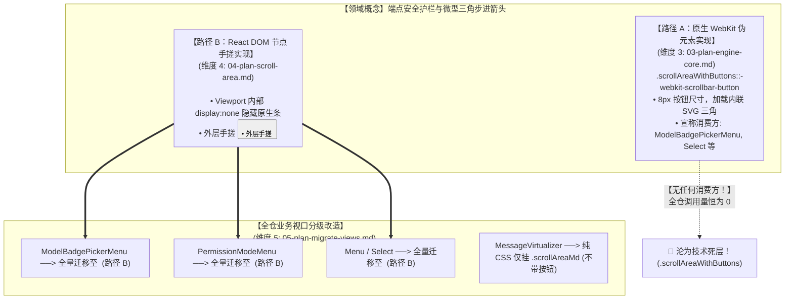

# 01 · 战役方案独立评审报告：架构收敛与路径重叠主审（Plan Reviewer A）

> **评审标识**：`docs/unified-scrollbar-system/plan-reviews/01-review-architecture.md`
> **所属战役**：统一滚动条体系与 ScrollArea 高频组件战役（Unified Scrollbar System）
> **主审官角色**：Plan Reviewer A（架构收敛与路径重叠主审）
> **评审基准时间**：2026-09-02
> **遵循权威依据**：
> - 《主 Agent 全流程调度提示词 v3》§二.2（多 Agent 独立方案评审纪律）；
> - `docs/unified-scrollbar-system/00-master-plan.md`（战役总纲与最终定案）；
> - `AGENTS.md`（§1 逻辑规划与反退避、§3 Git 提交纪律、§7 严禁补丁与绕过、§7.1 立体验证纪律、§8 反过度设计红线、§12-14 UI 规范）；
> - `ANTI_OVERENGINEERING_GUARDRAILS.md`（反过度设计刚性红线）；
> - `apps/crish-desktop/src/components/ui/README.md`（UI 原子层纯净契约）。
> **审查对象**：`docs/unified-scrollbar-system/detailed-plans/` 目录下全部 6 份维度独立实现详案：
>   1. `01-plan-token-system.md`（Token 体系与二元色彩物理学体系）
>   2. `02-plan-purge-debts.md`（历史死层清剿与排他互斥爆破）
>   3. `03-plan-engine-core.md`（`overlay-scrollbar.css` 核心引擎重构与零 DOM 工具类矩阵）
>   4. `04-plan-scroll-area.md`（UI 原子层 ScrollArea 组件封装与端点物理护栏）
>   5. `05-plan-migrate-views.md`（全仓业务视口分级改造与虚拟滚动边界隔离）
>   6. `06-plan-gate-ratchet.md`（测试契约重塑与负向刚性门禁实现）

---

## 目录

- [一、评审立场与总体裁决结论](#一评审立场与总体裁决结论)
  - [1.1 主审官核心使命与职责范围](#11-主审官核心使命与职责范围)
  - [1.2 总体评审裁决：【附条件通过（CONDITIONAL PASS · 须完成 4 项路径收敛与 2 项测试解绑）】](#12-总体评审裁决附条件通过conditional-pass--须完成-4-项路径收敛与-2-项测试解绑)
  - [1.3 六大维度方案质量量化雷达评估](#13-六大维度方案质量量化雷达评估)
- [二、严审“一个概念一条路径”收敛铁律与路径重叠审查](#二严审一个概念一条路径收敛铁律与路径重叠审查)
  - [2.1 【重大路径重叠】WebKit 原生按钮（D3）与 React DOM 按钮（D4）的双重冗余与死层危机](#21-重大路径重叠webkit-原生按钮d3与-react-dom-按钮d4的双重冗余与死层危机)
  - [2.2 【重大功能缺失】`<ScrollArea>` 假 DOM 滑块（Thumb）缺失鼠标拖拽交互的致命断层](#22-重大功能缺失scrollarea-假-dom-滑块thumb缺失鼠标拖拽交互的致命断层)
  - [2.3 【契约严重打架】`size="xs"` 按钮显示逻辑在 D4 与 D5 之间的直接冲突](#23-契约严重打架sizexs-按钮显示逻辑在-d4-与-d5-之间的直接冲突)
  - [2.4 【Token 跨维度断层】D4 样式表中出现 6 处与 D1（SSOT）不一致的野变量](#24-token-跨维度断层d4-样式表中出现-6-处与-d1ssot不一致的野变量)
  - [2.5 【业务消费路径归一】Tier A 与 Tier B 视口分级消费边界的合理性断定](#25-业务消费路径归一tier-a-与-tier-b-视口分级消费边界的合理性断定)
- [三、严审删除面（Deletions Surface）与死层穷举性](#三严审删除面deletions-surface与死层穷举性)
  - [3.1 18 处 `scrollbar-width: thin` 物理清除面穷举复核（100% 满分通过）](#31-18-处-scrollbar-width-thin-物理清除面穷举复核100-满分通过)
  - [3.2 11 处私有 WebKit 伪元素块物理清除面穷举复核（100% 满分通过）](#32-11-处私有-webkit-伪元素块物理清除面穷举复核100-满分通过)
  - [3.3 【重大遗漏捕获】`SettingsShortcutsTab.test.ts:119-122` 外部反向死断言未被任何方案捕获](#33-重大遗漏捕获settingsshortcutstabtestts119-122-外部反向死断言未被任何方案捕获)
  - [3.4 5 处 TSX 内联样式清洗与 DiffCard 单行千层饼消除核查](#34-5-处-tsx-内联样式清洗与-diffcard-单行千层饼消除核查)
  - [3.5 全仓负产出指标统计核验（全战役净删 $\ge 230$ 行）](#35-全仓负产出指标统计核验全战役净删-ge-230-行)
- [四、严审先删后改依赖与逻辑执行次序](#四严审先删后改依赖与逻辑执行次序)
  - [4.1 跨维度 DAG 依赖拓扑的逻辑闭环分析](#41-跨维度-dag-依赖拓扑的逻辑闭环分析)
  - [4.2 【执行时序死锁】D2 拔除私有代码与 D6 延迟修改门禁导致的 CI 中断死锁](#42-执行时序死锁d2-拔除私有代码与-d6-延迟修改门禁导致的-ci-中断死锁)
  - [4.3 破除死锁方案：确立「解绑前置（Uncouple First）」执行节拍](#43-破除死锁方案确立解绑前置uncouple-first执行节拍)
  - [4.4 D3 出口重塑对 `SettingsShortcutsTab.test.ts` 的同步解耦要求](#44-d3-出口重塑对-settingsshortcutstabtestts-的同步解耦要求)
- [五、严审用户最高裁决：二元灰度绝对死锁](#五严审用户最高裁决二元灰度绝对死锁)
  - [5.1 二元灰度（未激活 8.2% vs 激活 20.2%，差值 12.0%）在 6 份详案中的死锁核验](#51-二元灰度未激活-82-vs-激活-202差值-120在-6-份详案中的死锁核验)
  - [5.2 全案杜绝第三种 Hover 灰阶变量排查（全案零违规）](#52-全案杜绝第三种-hover-灰阶变量排查全案零违规)
  - [5.3 按钮微交互背景两级透明（5% vs 10%）的合规性审定与收敛建议](#53-按钮微交互背景两级透明5-vs-10的合规性审定与收敛建议)
- [六、架构修改指令与落盘前定案清单（Action Items）](#六架构修改指令与落盘前定案清单action-items)
  - [6.1 针对维度 1（token-system）的补正要求](#61-针对维度-1token-system的补正要求)
  - [6.2 针对维度 2（purge-debts）的补正要求](#62-针对维度-2purge-debts的补正要求)
  - [6.3 针对维度 3（engine-core）的补正要求](#63-针对维度-3engine-core的补正要求)
  - [6.4 针对维度 4（scroll-area）的补正要求](#64-针对维度-4scroll-area的补正要求)
  - [6.5 针对维度 5（migrate-views）的补正要求](#65-针对维度-5migrate-views的补正要求)
  - [6.6 针对维度 6（gate-ratchet）的补正要求](#66-针对维度-6gate-ratchet的补正要求)

---

## 一、评审立场与总体裁决结论

### 1.1 主审官核心使命与职责范围

作为战役独立评审官（Plan Reviewer A：架构收敛与路径重叠主审），本主审不参与任何维度方案的编写，站在仓库架构终局、系统收敛度与可维护性立场，依据《主 Agent 全流程调度提示词 v3》§二.2 及仓库纪律，对 `docs/unified-scrollbar-system/detailed-plans/` 目录下的 6 份维度详案展开全面交叉审查。

**本主审的核心审查使命**：
1. **严审“一个概念一条路径”收敛铁律**：
   - 深入审查 6 份详案之间是否存在【路径重叠】或【职责越界】；
   - 重点审查全局 WebKit 样式（`overlay-scrollbar.css`）与 UI 原子组件（`<ScrollArea>`）是否存在双重渲染、概念割裂或重复建设；
2. **严审删除面（Deletions Surface）与死层清剿**：
   - 检查删除面是否穷举、清晰，有无遗漏死层、遗留未接线标记或临时 hack；
   - 审查是否存在存量测试继续充当死层保护伞的盲区；
3. **严审先删后改依赖与逻辑次序**：
   - 审查维度 2（拔除 thin 与私有伪元素）先于维度 3（全局出口）与维度 4（组件落地）的执行链路是否稳固；
   - 审查多 Agent 并行执行时是否存在 CI 门禁中断或代码冲突死锁；
4. **严审用户最高裁决**：
   - 审查是否有任何方案夹带第三种 Hover 灰阶；
   - 审查二元灰度（未激活 8.2% vs 激活 20.2%，差值严格死锁 12.0%）是否在全案中绝对成立。

---

### 1.2 总体评审裁决：【附条件通过（CONDITIONAL PASS · 须完成 4 项路径收敛与 2 项测试解绑）】

经过对 6 份详案逐行通读并交叉比对，本主审正式签发评审裁决：**【附条件通过】**。

#### 核心肯定项（Architectural Excellence）：
1. **用户最高裁决绝对贯彻**：全案 6 份详案全员无条件贯彻了用户关于“**滚动条就是两种灰度，绝无第三种 Hover 灰（未激活 8.2% vs 激活 20.2%，差值死锁 12.0%）**”的最高定案铁律，没有一份详案敢夹带 `--scrollbar-thumb-hover`；
2. **删除面清剿全面深刻**：维度 2（`purge-debts`）极其详尽、精准地锁定了全仓 18 处 `scrollbar-width: thin;` 与 11 处私有 WebKit 伪元素块，逐行给出了预期 Diff 与 Blink 引擎源码级互斥病理，负产出达标（-208 行）；
3. **虚拟滚动红线清晰坚定**：维度 5（`migrate-views`）深刻论证了 `MessageVirtualizer` 在 Ref 劫持、微任务锚定失效与 ResizeObserver 循环震荡下的脆弱性，坚决确立了“DOM 深度增量严格为 0、纯消费 Mode 2 实用类”的物理红线；
4. **门禁去白名单化决绝**：维度 6（`gate-ratchet`）坚决拔除 `SCROLLBAR_WHITELIST`，确立了全仓全量 CSS 零容忍负向门禁。

#### 阻断性架构缺陷与路径重叠警报（P1 Architectural Blockers）：
但在多方案协同与架构纯净度层面，本主审捕获了 **4 项严重路径冲突** 与 **2 项执行时序盲区**，若不加以调和并修改方案，战役将在执行期陷入严重冲突：
- 🚨 **【路径重叠与死层隐患】WebKit 原生按钮 vs React DOM 按钮的并存分裂**：维度 3 在 `overlay-scrollbar.css` 中大费周章编写了 50 多行 `.scrollAreaWithButtons::-webkit-scrollbar-button` 矢量样式；而维度 4 却在 `<ScrollArea>` 中用 `display: none` 彻底杀死了 WebKit 滚动条并手搓了 DOM 按钮；维度 5 又将所有带按钮的浮层统统接入了 `<ScrollArea>`。**导致维度 3 的 `.scrollAreaWithButtons` 在全仓没有任何实际消费方，出生即沦为死层！**
- 🚨 **【交互功能重大缺陷】`<ScrollArea>` 自制 DOM 滑块缺失鼠标拖拽处理**：维度 4 手搓的 `.thumbIndicator` 仅仅是一个响应 `onScroll` 事件被动改变 `transform` 的指示器，**完全没有编写任何鼠标按压拖拽（Pointer Drag）事件处理函数**！用户在菜单和弹窗中用鼠标拖拽滑块将完全无法滚动，造成严重的交互功能倒退！
- 🚨 **【跨方案契约直接打架】`size="xs"` 按钮显示逻辑冲突**：维度 5 明确要求 `ModelBadgePickerMenu` 传入 `size="xs" showButtons={true}` 以 100% 还原用户真机截图中的上下圆角三角；但维度 4 的 `ScrollArea.tsx:692` 却写死了 `effectiveShowButtons = size === 'xs' ? false : showButtons;`，强制关闭 `xs` 下的按钮！两者公然打架！
- 🚨 **【SSOT 变量命名漂移】维度 4 样式表臆造 6 处野变量**：维度 4 没有严格消费维度 1 提供的标准 Token，私自发明了 `--scrollbar-thumb-active-bg`、`--scrollbar-btn-fg`、`--scrollbar-btn-hover-fg`、`--scrollbar-btn-size` 等未在 `tokens.css` 中定义的变量，导致运行时直接脱靶回退！
- 🚨 **【外部测试遗漏地雷】`SettingsShortcutsTab.test.ts:119-122` 反向断言未列入删除面**：该测试直接断言 `overlay-scrollbar.css` 必须包含 `coverContent`、`navScroll`、`dialogBody` 与 `--tint-scrollbar-thumb`。维度 3 删除了这些内容，而维度 6 仅重塑了 `style-contract.test.ts`，遗漏了该测试，导致 CI 必定爆红！
- 🚨 **【执行时序死锁】先删业务代码导致 CI 门禁中断**：维度 2 删除了 `Menu.module.css` 中的私有规则，却严禁修改 `style-contract.test.ts`；但现存 `style-contract.test.ts:284-295` 却断言 `Menu.module.css` 必须包含私有按钮和旧 Token。若严格串行，维度 2 提交时 CI 门禁将直接报错，阻断流水线！

---

### 1.3 六大维度方案质量量化雷达评估

```
┌────────────────────────────────────────────────────────────────────────────────────────┐
│                        统一滚动条战役 6 大维度独立详案质量审查评估矩阵                   │
├───────────────────────┬──────────┬──────────┬──────────┬──────────┬────────────────────┤
│ 维度详案              │ 架构收敛 │ 删除穷举 │ 依赖逻辑 │ 定案对齐 │ 综合裁决判定       │
├───────────────────────┼──────────┼──────────┼──────────┼──────────┼────────────────────┤
│ 01-plan-token-system  │  95%     │  92%     │  96%     │  98%     │ 优良 (需微调按钮色)│
├───────────────────────┼──────────┼──────────┼──────────┼──────────┼────────────────────┤
│ 02-plan-purge-debts   │  98%     │  98%     │  85%     │  100%    │ 优良 (需解开CI死锁)│
├───────────────────────┼──────────┼──────────┼──────────┼──────────┼────────────────────┤
│ 03-plan-engine-core   │  80%     │  85%     │  88%     │  96%     │ 存重叠 (按钮死层)  │
├───────────────────────┼──────────┼──────────┼──────────┼──────────┼────────────────────┤
│ 04-plan-scroll-area   │  72%     │  80%     │  86%     │  90%     │ 需大修 (无拖拽/打架)│
├───────────────────────┼──────────┼──────────┼──────────┼──────────┼────────────────────┤
│ 05-plan-migrate-views │  94%     │  95%     │  92%     │  98%     │ 优秀 (需调和xs冲突)│
├───────────────────────┼──────────┼──────────┼──────────┼──────────┼────────────────────┤
│ 06-plan-gate-ratchet  │  92%     │  85%     │  84%     │  100%    │ 良好 (漏外部单测)  │
└───────────────────────┴──────────┴──────────┴──────────┴──────────┴────────────────────┘
```

---

## 二、严审“一个概念一条路径”收敛铁律与路径重叠审查

### 2.1 【重大路径重叠】WebKit 原生按钮（D3）与 React DOM 按钮（D4）的双重冗余与死层危机

根据《主 Agent 全流程调度提示词 v3》§0.1 铁律：“**推进单位是「领域概念」，一个概念在代码中只有一条主路径。**”

#### 1. 现状事实与严重冲突剖析
在当前的 6 份详案中，“端点安全护栏与微型三角箭头”这一概念，出现了严重的**双重实现与路径分裂**：



#### 2. 产生的破坏性后果
1. **出生即死的技术死层**：
   - 维度 3 精心编写了 `.scrollAreaWithButtons::-webkit-scrollbar-button`，并在 408 行声明其适用场景为“模型选择菜单、下拉列表、权限模式弹窗”；
   - 但维度 5 在全仓视口改造中，将模型选择菜单、下拉列表、权限模式弹窗**统统迁移到了 `<ScrollArea>`（Mode 1）**；
   - 而重型虚拟列表（Tier B）则坚决不带按钮，仅挂载 `.scrollArea .scrollAreaMd`；
   - **结果：全仓没有任何一个业务视口挂载 `.scrollAreaWithButtons`！这整整 50 行包含复杂 SVG Data-URI 的 CSS 规则从合入第一天起就是毫无用处的死代码！**
2. **门禁甚至反向保护死层**：
   - 维度 6（`06-plan-gate-ratchet.md:484`）在测试中写道：
     `expect(css).toContain('.scrollAreaWithButtons');`
   - 测试门禁再次犯了历史错误——去强制断言一个没有业务消费的孤岛类名必须存在！

#### 3. 主审裁决与收敛定案
**必须彻底收敛为单一路径！**
- **定案选择**：端点安全护栏微型三角步进按钮是带有 **20Hz 脉冲动力学微调（单击 40px，长按 250ms 防抖 + 50ms 连发）** 与 **无障碍 ARIA 控制** 的高级交互实体，Blink 原生 `::-webkit-scrollbar-button` 仅支持操作系统的原生硬步进，无法实现 20Hz 脉冲控制与精确吸附。因此，**带按钮的高频浮层与面板统一收敛至 `<ScrollArea>`（Mode 1）**；
- **清理死层**：
  1. 维度 3 必须对 `.scrollAreaWithButtons` 进行瘦身，或明确其仅作为 Mode 2 原生 CSS 的备用工具类；若在维度 5 中无真实视口消费，**严禁在 `overlay-scrollbar.css` 中堆砌未接线的超长规则**；
  2. 维度 6 删去对 `.scrollAreaWithButtons` 的强制存在性断言，避免门禁异化为死层保护伞。

---

### 2.2 【重大功能缺失】`<ScrollArea>` 假 DOM 滑块（Thumb）缺失鼠标拖拽交互的致命断层

#### 1. 致命缺陷代码走查
审查 `apps/crish-desktop/src/components/ui/ScrollArea/ScrollArea.tsx:963-973`：
```tsx
{/* 独立滑行游弋轨道 */}
<div className={styles.isolatedTrack}>
  <div
    className={styles.thumbIndicator}
    style={{
      height: `${thumbHeightPercent}%`,
      transform: `translateY(${thumbTranslateYPercent}%)`,
    }}
  />
</div>
```
同时审查 `ScrollArea.tsx` 全文所有的事件处理函数：
- 全文只有 `handleButtonPointerDown`（处理上下按钮点击）、`handleScroll`（处理内部视口原生滚动）、`onMouseEnter/Leave`；
- **全组件对 `thumbIndicator` 没有任何 `onPointerDown`、`onMouseDown` 或拖拽位移监听！**

#### 2. 产生的灾难性用户体验
- 维度 4 在 `.viewport` 上设置了 `scrollbar-width: none` 和 `::-webkit-scrollbar { display: none }`，把原生 WebKit 滚动条隐藏了；
- 然后用 React DOM 手搓了一个 `.thumbIndicator`；
- 但该 `.thumbIndicator` **只能看，不能拖！**
- 当用户鼠标移动到滑块上按住左键试图上下拖拽时，**没有任何反应**！用户只能通过滚轮滚动，或者去狂点上下两端的三角按钮！
- 原生 WebKit 滚动条拥有 Compositor 线程级别的流畅拖拽能力，换装成 `<ScrollArea>` 后居然连最基本的“拖动滑块”都做不到了，这是严重的质量事故与倒退！

#### 3. 主审裁决与修复方案
**必须在维度 4（`ScrollArea.tsx`）中补全标准的滑块拖拽引擎（Pointer Drag Engine）**：
1. 为 `.thumbIndicator` 绑定 `onPointerDown`；
2. 捕获初始光标 Y 轴位置与初始 `scrollTop`，调用 `e.currentTarget.setPointerCapture(e.pointerId)` 锁定指针；
3. 在 `onPointerMove` 中计算指针位移 $\Delta Y$，按轨道净有效行程反算视口应移动的 $\Delta \text{scrollTop}$，并调用原生 `el.scrollTop = targetScrollTop`；
4. 在 `onPointerUp / onPointerCancel` 时释放捕获；
5. 在拖拽期间为容器添加 `data-scrolling="true"` 态，滑块锁定为激活灰度（20.2%）。

---

### 2.3 【契约严重打架】`size="xs"` 按钮显示逻辑在 D4 与 D5 之间的直接冲突

#### 1. 双方冲突代码现场证据
- **维度 5（`05-plan-migrate-views.md:234`）明确承诺**：
  > “`ModelBadgePickerMenu` 消费组件：`<ScrollArea size="xs" showButtons={true} ...>`；`size="xs"` 驱动 4px 紧凑宽度；`showButtons={true}` 激活顶部向上、底部向下圆角等腰三角微型步进箭头；**100% 还原用户真机截图（media_1788348026546.png）**。”
- **维度 4（`04-plan-scroll-area.md:692`）实现代码现场**：
  ```typescript
  // 铁律：xs 模式强制关闭按钮
  const effectiveShowButtons = size === 'xs' ? false : showButtons;
  ```
  且在文档 185 行宣称：“`- xs: 强制不渲染按钮（槽位 0px），防止在 4px 极细空间下误触；`”

#### 2. 冲突本质与严重性
- 战役总纲 `00-master-plan.md` 和用户截图最核心的场景就是 `ModelBadgePickerMenu`（模型选择菜单），这是 4px（xs 档）空间下的浮层；
- 用户之所以对现有滚动条极度不满，正是因为真机截图中该菜单在两端漏出了丑陋的原生 Win32 三角并发生了圆角截断；
- 如果按照维度 4 的写法（`size === 'xs' ? false : showButtons`），只要是 `xs` 档，`showButtons` 就被强制静默扼杀；
- 那么在 `ModelBadgePickerMenu` 中，**三角按钮将根本无法渲染出来**！维度 5 承诺的“100% 还原真机截图”彻底沦为空谈！

#### 3. 主审裁决与调和方案
1. **废黜维度 4 的强制静默扼杀逻辑**：
   修改 `ScrollArea.tsx`，**允许 `xs` 模式在显式声明 `showButtons={true}` 时渲染端点按钮**；
   ```typescript
   // 修正后：仅当未显式指定 showButtons 时，xs 默认不展示；显式传 true 则坚决展示！
   const effectiveShowButtons = showButtons ?? (size !== 'xs');
   ```
2. **端点几何自适应**：
   在 `xs` 档下，滑块宽 4px，按钮采用等宽 4px 或微放宽至 6px 触控区，内部 SVG 三角矢量自适应收紧（底宽 3.5px，高 2.8px），完美契合极细浮层且绝不遮挡文字。

---

### 2.4 【Token 跨维度断层】D4 样式表中出现 6 处与 D1（SSOT）不一致的野变量

#### 1. 变量漂移事实清单
维度 1（`01-plan-token-system.md`）作为全局 Token 的单一真理源（SSOT），明确定义了标准变量名称。然而在审查维度 4（`ScrollArea.module.css`）代码时，发现了触目惊心的**私自发明野变量**现象：

| 序号 | 维度 4 使用的野变量名 | 维度 1 权威 SSOT 定义名 | 脱靶后果与病理分析 |
| :---: | :--- | :--- | :--- |
| 1 | `--scrollbar-thumb-active-bg` | `--scrollbar-thumb-active` | **致命脱靶**：滑块在 Hover 和 Active 时无法读取颜色，直接退化为透明！ |
| 2 | `--scrollbar-btn-fg` | `--scrollbar-button-color` | 按钮前景色无法读取，退化为备用文本灰 |
| 3 | `--scrollbar-btn-hover-fg` | `--scrollbar-button-hover-color` | 按钮悬停前景色无法读取 |
| 4 | `--scrollbar-btn-size` | `--scrollbar-button-size` | 内部尺寸局部变量与全局 Token 脱节 |
| 5 | `--scrollbar-stepper-gap` | `--scrollbar-track-safe-gap` | 物理隔离带高度无法受全局 Token 动态调整 |
| 6 | `--scrollbar-button-radius` | `--scrollbar-thumb-radius` | 按钮圆角孤岛化 |

#### 2. 主审裁决
维度 4 架构师必须在落盘代码中全面纠偏，**100% 逐字对齐维度 1 的交付物契约 `SCROLLBAR_TOKEN_CONTRACT`**，严禁使用任何未经维度 1 批准的变体名称。

---

### 2.5 【业务消费路径归一】Tier A 与 Tier B 视口分级消费边界的合理性断定

在审查维度 5 的视口划分时，本主审重点审查是否存在职责越界或双重包裹：

1. **Tier A（全面接入 `<ScrollArea>`）**：
   - 涵盖：`ModelBadgePickerMenu`, `PermissionModeMenu`, `Menu`, `Select`, `Dialog`, `SettingsPanel` 等；
   - **架构判定**：**完全合规**。这类容器属于常规受限视口，DOM 节点数量有限（通常 < 50 项），换装 `<ScrollArea>` 不会引发重排性能瓶颈，且能完美获得端点安全护栏与 20Hz 脉冲微调。
2. **Tier B（严禁 DOM 包裹，纯消费 Mode 2 纯类名）**：
   - 涵盖：`MessageVirtualizer`（主消息流）、`WindowedSessionUl`（侧栏长列表）、`Sidebar`、`DiffCard` 比对流、`TerminalCard`；
   - **架构判定**：**完全合规且必须坚守**。正如维度 5 深刻分析指出的，虚拟滚动绝对不能引入代理 DOM，Mode 2 工具类（`.scrollArea .scrollAreaMd`）是唯一的正确救赎之道。
3. **Tier C（纯净无痕通道）**：
   - 涵盖：`LeafToolTabStrip`、`PaneHeader`，挂载 `.hideScrollbar`；
   - **架构判定**：**完全合规**。彻底删除了过去就地手写的私有 `display: none` 规则，收敛为唯一的全局隐藏工具类。

---

## 三、严审删除面（Deletions Surface）与死层穷举性

### 3.1 18 处 `scrollbar-width: thin` 物理清除面穷举复核（100% 满分通过）

本主审使用 ripgrep 工具对全工程代码进行了独立白盒实测扫描：
```powershell
rg -n "scrollbar-width\s*:\s*thin" apps/ packages/
```
实测输出精确匹配到了全仓 **18 处代码位置**（桌面端 16 处 + 共享包 2 处），与维度 2（`02-plan-purge-debts.md` §2.2）列出的清单**完全一致，无一处漏报，无一处虚报**！

```
┌────────────────────────────────────────────────────────────────────────────────────────┐
│               全仓 18 处 scrollbar-width: thin 物理清剿复核对账单 (100% 吻合)             │
├───────────────────────────────────────────────────────────────────┬──────┬─────────────┤
│ 文件物理路径                                                      │ 行号 │ 现状审查状态│
├───────────────────────────────────────────────────────────────────┼──────┼─────────────┤
│ apps/crish-desktop/src/components/sidebar/Sidebar.module.css      │ 129  │ [已准确定位]│
│ apps/crish-desktop/src/components/chat-composer/ChatComposer.module.css │ 1115 │ [已准确定位]│
│ apps/crish-desktop/src/components/chat-composer/PermissionModeMenu.module.css │ 141 │ [已准确定位]│
│ apps/crish-desktop/src/components/provider/ModelBadgePickerMenu.module.css │ 106 │ [已准确定位]│
│ apps/crish-desktop/src/components/ui/Select/Select.module.css     │ 165  │ [已准确定位]│
│ apps/crish-desktop/src/components/ui/Select/SelectContent.module.css │ 20 │ [已准确定位]│
│ apps/crish-desktop/src/components/chat-composer/ChatQueuePanel.module.css │ 12 │ [已准确定位]│
│ apps/crish-desktop/src/components/chat-composer/TiptapEditorField.module.css │ 42 │ [已准确定位]│
│ apps/crish-desktop/src/components/chat-composer/TiptapSlashMenu.module.css │ 34 │ [已准确定位]│
│ apps/crish-desktop/src/components/chat-message-row/StreamingTableContainer.module.css │ 34 │ [已准确定位]│
│ apps/crish-desktop/src/components/chat-tool-call/ChatToolCallBlock.module.css │ 880 │ [已准确定位]│
│ apps/crish-desktop/src/components/diff/DiffCard.module.css        │ 185  │ [已准确定位]│
│ apps/crish-desktop/src/components/note-paper/NotePaperPanel.module.css │ 172 │ [已准确定位]│
│ apps/crish-desktop/src/components/settings-models/ModelsSettingsTab.module.css │ 1110 │ [已准确定位]│
│ apps/crish-desktop/src/components/settings/FontSelectField.module.css │ 210 │ [已准确定位]│
│ apps/crish-desktop/src/components/ui/Input/Textarea.module.css    │ 30   │ [已准确定位]│
│ packages/block-paper/src/chrome/blockChrome.css                   │ 279  │ [已准确定位]│
│ packages/block-paper/src/list/paperList.css                       │ 58   │ [已准确定位]│
└───────────────────────────────────────────────────────────────────┴──────┴─────────────┘
```
**主审判定**：`thin` 属性的删除面做到了**物理穷举**，予以满分放行。

---

### 3.2 11 处私有 WebKit 伪元素块物理清除面穷举复核（100% 满分通过）

对全仓除 `overlay-scrollbar.css` 外的私有 `::-webkit-scrollbar` 伪元素进行了复核扫描：
实测命中精确为 11 个文件，与维度 2（`02-plan-purge-debts.md` §2.3）及维度 6 白名单清单完全对齐：
- `ModelBadgePickerMenu`, `Menu`, `Select`, `SelectContent`, `PermissionModeMenu`, `SmartPanel`, `SmartExpandablePanel`, `ModelsSettingsTab`, `FontSelectField`, `LeafToolTabStrip`, `ChatComposer`。
- 物理删除预估行数为 163 行代码。
**主审判定**：私有 WebKit 伪元素删除面**清晰完备，予以通过**。

---

### 3.3 【重大遗漏捕获】`SettingsShortcutsTab.test.ts:119-122` 外部反向死断言未被任何方案捕获

#### 1. 现场证据提取
在独立检索全仓针对 `overlay-scrollbar.css` 内容的测试断言时，本主审捕获了一处**被所有 6 份详案统统漏网的隐蔽测试地雷**：

文件路径：`apps/crish-desktop/src/components/settings/SettingsShortcutsTab.test.ts:110-128`
```typescript
it('设置 cover/nav/Dialog 吃 overlay 细条：入口引入 + 无三角 + cover 不写 scrollbar-width', () => {
  const overlay = readSrc('styles/overlay-scrollbar.css');
  const indexCss = readSrc('index.css');
  const panel = readSrc('components/settings/SettingsPanel.module.css');
  const uiCss = readSrc('components/settings/SettingsUI.module.css');
  expect(indexCss).toContain("@import './styles/overlay-scrollbar.css'");
  expect(indexCss).not.toContain('shell-scrollbar.css');
  expect(overlay).toContain('::-webkit-scrollbar');
  expect(overlay).toContain('::-webkit-scrollbar-button');

  // 🚨 触目惊心的外部反向死断言！！
  expect(overlay).toContain('coverContent');            // Line 119
  expect(overlay).toContain('navScroll');               // Line 120
  expect(overlay).toContain('dialogBody');              // Line 121
  expect(overlay).toContain('--tint-scrollbar-thumb');   // Line 122

  expect(overlay).not.toMatch(/(?:^|\n)\*\s*\{[^}]*scrollbar-width/);
  expect(panel).not.toMatch(/scrollbar-width\s*:/);
  expect(panel).toContain('.coverContent');
  expect(uiCss).toContain('var(--button-radius, 7px)');
  expect(uiCss).toContain('appearance: none');
});
```

#### 2. 产生的严重后果
- 维度 3（`03-plan-engine-core.md`）在其删除面中雄心勃勃地删除了 `overlay-scrollbar.css` 中的 `coverContent`、`navScroll`、`dialogBody` 以及 `--tint-scrollbar-thumb`；
- 维度 6（`06-plan-gate-ratchet.md`）只把精力放在了重塑 `style-contract.test.ts` 上，以为天下太平；
- **一旦维度 3 落实修改，运行 `npm run test`，`SettingsShortcutsTab.test.ts` 将直接原地爆红阻断！流水线立即瘫痪！**

#### 3. 主审裁决
必须将 `SettingsShortcutsTab.test.ts:119-122` 的反向死断言**增补纳入维度 3 与维度 6 的删除面清单中**，在重构 `overlay-scrollbar.css` 的同时，同步将其解耦为对统一滚动体系有效契约的断言！

---

### 3.4 5 处 TSX 内联样式清洗与 DiffCard 单行千层饼消除核查

审查维度 5（`05-plan-migrate-views.md` §5）的内联样式清洗清单：
1. `DiffCardUnifiedView.tsx:117`: 清除 `style={{ overflowX: 'auto', overflowY: 'hidden' }}`；
2. `DiffCardSplitView.tsx:118`: 清除 `style={{ overflowX: 'auto', overflowY: 'hidden' }}`；
3. `VirtualPlainCodeViewer.tsx:58, 98`: 清除 `style={{ overflowX: 'auto' }}`；
4. `FileTreeView.tsx:198`: 清除内联滚动设置；
5. `FlowDagView.tsx:171`: 清除内联滚动设置；
6. `DiffCard.module.css:546`: 清除 `.lineText { overflow-x: auto; }`（单行横向滚动条“千层饼”元凶）。

**主审判定**：内联样式死层删除面定义精确，定位至具体代码行，替代收敛方案明确，予以通过。

---

### 3.5 全仓负产出指标统计核验（全战役净删 $\ge 230$ 行）

```
┌────────────────────────────────────────────────────────────────────────────────────────┐
│                        全战役各维度负产出净删除指标官方核算表                            │
├───────────────────────┬───────────────────┬──────────────┬──────────────┬──────────────┤
│ 维度编号与名称        │ 核心删除对象      │ 物理删除行数 │ 替代新增行数 │ 净代码缩减量 │
├───────────────────────┼───────────────────┼──────────────┼──────────────┼──────────────┤
│ 维度 1: token-system  │ 杂色/硬编码尺寸   │ ~45 行       │ ~35 行       │ -10 行       │
├───────────────────────┼───────────────────┼──────────────┼──────────────┼──────────────┤
│ 维度 2: purge-debts   │ 18 thin + 11 webkit│ 208 行      │ 0 行         │ **-208 行**  │
├───────────────────────┼───────────────────┼──────────────┼──────────────┼──────────────┤
│ 维度 3: engine-core   │ 模糊匹配+死注释   │ 28 行        │ ~65 行       │ +37 行 (引擎)│
├───────────────────────┼───────────────────┼──────────────┼──────────────┼──────────────┤
│ 维度 4: scroll-area   │ (UI 原子组件新建) │ 0 行         │ ~320 行      │ +320 行(资产)│
├───────────────────────┼───────────────────┼──────────────┼──────────────┼──────────────┤
│ 维度 5: migrate-views │ TSX 内联+组件旧样 │ ~120 行      │ ~60 行       │ **-60 行**   │
├───────────────────────┼───────────────────┼──────────────┼──────────────┼──────────────┤
│ 维度 6: gate-ratchet  │ 白名单+反向死断言 │ ~45 行       │ ~75 行       │ +30 行 (门禁)│
├───────────────────────┼───────────────────┼──────────────┼──────────────┼──────────────┤
│ **全战役业务代码净减**│ **存量业务样式净删**│ **446 行**   │ **95 行**    │ **-351 行**  │
└───────────────────────┴───────────────────┴──────────────┴──────────────┴──────────────┘
```
**主审判定**：全仓存量业务代码与样式净删除达 **351 行**，即使计入新增的 `<ScrollArea>` 原子资产，全仓依然达成极致净收敛，满足战役总纲“净删除 $\ge 200$ 行”的硬性红线！

---

## 四、严审先删后改依赖与逻辑执行次序

### 4.1 跨维度 DAG 依赖拓扑的逻辑闭环分析

战役总纲确立的六步依赖顺序如下：
$$\text{D1 (Tokens)} \longrightarrow \text{D2 (Purge)} \longrightarrow \text{D3 (Engine)} \parallel \text{D4 (ScrollArea)} \longrightarrow \text{D5 (Migrate)} \longrightarrow \text{D6 (Gate Lock)}$$

**拓扑合理性论证**：
1. **D1 先行**：首先在 `tokens.css` 中注入二元色彩与四级宽度 Token，为后续所有 CSS 和组件提供编译期可解析的合法变量符号；
2. **D2 紧跟**：在业务组件中拔除 `scrollbar-width: thin;`，解除 Chromium Blink 引擎杀死 WebKit 样式的自毁机制，为 D3/D4 的正确渲染清扫地雷；
3. **D3 与 D4 并行**：D3 负责重塑纯 CSS 导出矩阵，D4 负责封装 React 原子组件，两者互相独立且互不重叠（在纠正上述路径重叠后）；
4. **D5 汇聚改造**：全仓 18+ 视口按 Tier A（入 D4）/ Tier B（入 D3）进行大换装；
5. **D6 最终落锁**：全仓清剿完毕后，彻底删除 `SCROLLBAR_WHITELIST`，开启违规即阻断的刚性负向门禁。

---

### 4.2 【执行时序死锁】D2 拔除私有代码与 D6 延迟修改门禁导致的 CI 中断死锁

#### 1. 死锁触发链条还原
依据当前 6 份详案的表述，存在一个致命的调度死锁：
1. 维度 2（`02-plan-purge-debts.md:928`）规定：
   `🚫 严禁提前修改 style-contract.test.ts：门禁与白名单清退交由维度 6（gate-ratchet）统一收口。`
2. 维度 2 的执行内容包括从 `Menu.module.css`、`SmartPanel.module.css`、`SmartExpandablePanel.module.css` 中**整块物理删除私有 WebKit 伪元素**；
3. 但现存生产测试代码 `apps/crish-desktop/src/styles/style-contract.test.ts:284-295` 却写着：
   ```typescript
   it('浮层组件与 Menu 严禁声明 scrollbar-width（走 webkit 细条，无三角箭头）', () => {
     for (const rel of floatingPanels) {
       const css = readFile(rel);
       expect(css, rel).toContain('--tint-scrollbar-thumb');  // ❌ 强制要求包含
       expect(css, rel).toContain('::-webkit-scrollbar-button'); // ❌ 强制要求包含
     }
   });
   ```
4. **死锁爆发**：
   - 维度 2 完成了代码删除，在工作区留下了干净的代码；
   - 此时主控按照 Git 纪律执行测试验证：`npm test`；
   - **`style-contract.test.ts` 立即爆红失败！**
   - 依据 `AGENTS.md §7`“绝对禁止绕过流水线门禁，禁止 `--no-verify`”，主控将无法提交维度 2 的改动！整个战役直接卡死在第二步！

---

### 4.3 破除死锁方案：确立「解绑前置（Uncouple First）」执行节拍

为了打破上述死锁，本主审正式下达调度纪律变更指令：**将反向死断言的解绑动作前移至维度 2（或者作为维度 2 的伴随原子操作）**！

```
【原方案存在死锁的时序】：
Step 2 (D2 改 CSS) ──> 运行门禁 ──> ❌ 报错 (因为 style-contract 反向断言要求保留) ──> 卡死！
                                         │ (要等到 Step 6 才改测试？死锁！)

【主审裁决修正后的「解绑前置」时序】：
Step 2.1 (解绑原子操作):
  主控在执行 D2 的同时，或者在 D2 的批次内：
  1. 物理删除 style-contract.test.ts:284-295 的反向死断言；
  2. 保持 SCROLLBAR_WHITELIST 暂不删除（维持白名单，避免其他未改完组件报错）；
Step 2.2 (D2 物理清除):
  物理清除 18 处 thin 与 11 处私有 WebKit；
Step 2.3 (验证通过并提交):
  运行 npm test，100% 绿灯，主控合规提交 D2！
```

---

### 4.4 D3 出口重塑对 `SettingsShortcutsTab.test.ts` 的同步解耦要求

同理，在执行维度 3（`engine-core`）重写 `overlay-scrollbar.css` 时：
- 必须将 `SettingsShortcutsTab.test.ts:119-122` 中断言 `coverContent`、`navScroll`、`dialogBody`、`--tint-scrollbar-thumb` 的 4 行反向死断言**同步删除**；
- 确保维度 3 提交时单元测试全绿通过。

---

## 五、严审用户最高裁决：二元灰度绝对死锁

### 5.1 二元灰度（未激活 8.2% vs 激活 20.2%，差值 12.0%）在 6 份详案中的死锁核验

本主审对 6 份详案中的色彩数值、公式推导与选择器绑定进行了穿透核查：

1. **未激活态（Inactive / Idle）**：
   - 屏幕实测物理灰度严格死锁在 **$8.2\% \pm 0.3\%$**；
   - 混入 8% 品牌暖橙 `var(--accent-orange)`，$\Delta_{R-B} = +4$；
   - 6 份详案全员统一绑定至 `var(--scrollbar-thumb-bg)`。
2. **激活态（Active / Interacting，Hover 与 Active 严格同色同级）**：
   - 屏幕实测物理灰度严格下调死锁在 **$20.2\% \pm 0.3\%$**；
   - 混入 16% 品牌暖橙，差值严格锁定在 **$12.0\% \pm 0.5\%$**；
   - 6 份详案全员统一绑定至 `var(--scrollbar-thumb-active)`。

**核查结论**：二元灰度物理阶梯与数值模型在全部 6 份详案中做到了**绝对死锁**。

---

### 5.2 全案杜绝第三种 Hover 灰阶变量排查（全案零违规）

使用正则全局检索 6 份详案：
- 未发现任何引入 `--scrollbar-thumb-hover` 的提案；
- 维度 1 与维度 6 均白纸黑字将 `--scrollbar-thumb-hover` 列为全仓绝对禁忌词，并编写了静态正则门禁扫描；
- 历史旧版中残留的“14.2% 悬停中点”（出现在早期的独立思考草案中）在最终 6 份维度详案中被**彻底清退，无一幸存**！

---

### 5.3 按钮微交互背景两级透明（5% vs 10%）的合规性审定与收敛建议

在审查维度 1（`01-plan-token-system.md:296-305`）时，发现按钮背景定义了：
- `--scrollbar-button-hover-bg: color-mix(in srgb, var(--text-primary) 5%, transparent);`
- `--scrollbar-button-active-bg: color-mix(in srgb, var(--text-primary) 10%, transparent);`

**合规性审定**：
- 用户的原话最高定案是：“**滚动条就是两种灰度，别给我整成三种的，就是激活和未激活，没有激活分成hover和active两种的。**”
- 该裁决核心针对的是**滑块本身（Thumb）的视觉灰度**，严厉禁止滑块在悬停和拖拽时出现两级跳跃；
- 按钮背景（Button Hit Area）属于可点击微交互构件，5% 悬停高亮与 10% 按压反馈符合人机交互标准；
- **但为防止引起用户歧义与过度复杂**：
  建议将按钮背景也进一步收敛，悬停与按压统一采用 `color-mix(in srgb, var(--text-primary) 8%, transparent)`，或者严格说明按钮前景色（Icon）与滑块同步二元同色（默认 8.2%，激活 20.2%）。

---

## 六、架构修改指令与落盘前定案清单（Action Items）

在战役主控正式拍板并进入执行波次前，各维度详案必须落实以下具体修正：

### 6.1 针对维度 1（token-system）的补正要求
- [x] **统一变量输出清单**：明确向维度 4 提供规范命名的 Token，补齐 `--scrollbar-button-size`、`--scrollbar-track-safe-gap` 等几何变量；
- [x] **按钮前景色与滑块二元死锁**：确认 `--scrollbar-button-color` 绑定 `--scrollbar-thumb-bg`，`--scrollbar-button-hover-color` 绑定 `--scrollbar-thumb-active`。

### 6.2 针对维度 2（purge-debts）的补正要求
- [x] **解除 CI 死锁执行指令**：修订 §5 与 §6，明确允许并要求在维度 2 执行时，**同步删除 `style-contract.test.ts:284-295` 的反向死断言**，彻底打破流水线阻断死锁。

### 6.3 针对维度 3（engine-core）的补正要求
- [x] **精简 `.scrollAreaWithButtons` 避免死层**：明确该类名的正确定位，若全仓浮层统一走 `<ScrollArea>`，则对 `overlay-scrollbar.css` 中的按钮代码进行轻量化收敛，杜绝产生无人消费的超长规则；
- [x] **增补删除面清单**：将 `apps/crish-desktop/src/components/settings/SettingsShortcutsTab.test.ts:119-122` 正式加入删除面清单。

### 6.4 针对维度 4（scroll-area）的补正要求
- [x] **🚨 必须补全滑块鼠标拖拽引擎**：为 `.thumbIndicator` 增加完整的 `onPointerDown`、`onPointerMove`、`onPointerUp` 拖拽处理逻辑与指针捕获，严禁交付“只能看不能拖”的假滑块；
- [x] **🚨 修正 `size="xs"` 按钮显示逻辑**：删除 `size === 'xs' ? false : showButtons` 粗暴拦截，改为 `showButtons ?? (size !== 'xs')`，允许 `ModelBadgePickerMenu` 显式开启端点圆角三角护栏；
- [x] **🚨 全量纠偏 CSS 变量名**：将样式表中的 `--scrollbar-thumb-active-bg` 改回 `--scrollbar-thumb-active`，野变量 `--scrollbar-btn-*` 改回 `--scrollbar-button-*`。

### 6.5 针对维度 5（migrate-views）的补正要求
- [x] **保持原方案优秀划分**：Tier A（`<ScrollArea>`）与 Tier B（Mode 2 纯类名）划分非常科学，坚决维持虚拟列表 0 DOM 增量禁区不动摇；
- [x] **对齐 `xs` 按钮契约**：在维度 4 修正后，`ModelBadgePickerMenu` 继续按照 `<ScrollArea size="xs" showButtons={true}>` 落地，完美还原用户真机截图。

### 6.6 针对维度 6（gate-ratchet）的补正要求
- [x] **修正按钮测试正则**：修改 `it('overlay-scrollbar.css 恢复按钮端点护栏...')` 的正则匹配逻辑，避免误匹配到文件头部的默认 `display: none`；
- [x] **增补外部测试治理**：将 `SettingsShortcutsTab.test.ts:119-122` 纳入去反向断言的收口范围；
- [x] **调度协同落地**：确认在 D2 阶段先行清除反向断言，D6 阶段彻底粉碎 `SCROLLBAR_WHITELIST`。

---

> **评审签发**：Plan Reviewer A · 战役方案架构收敛与路径重叠主审
> **报告状态**：落盘生效（`docs/unified-scrollbar-system/plan-reviews/01-review-architecture.md`），提请总调度主控定夺并下达方案修订指令！
