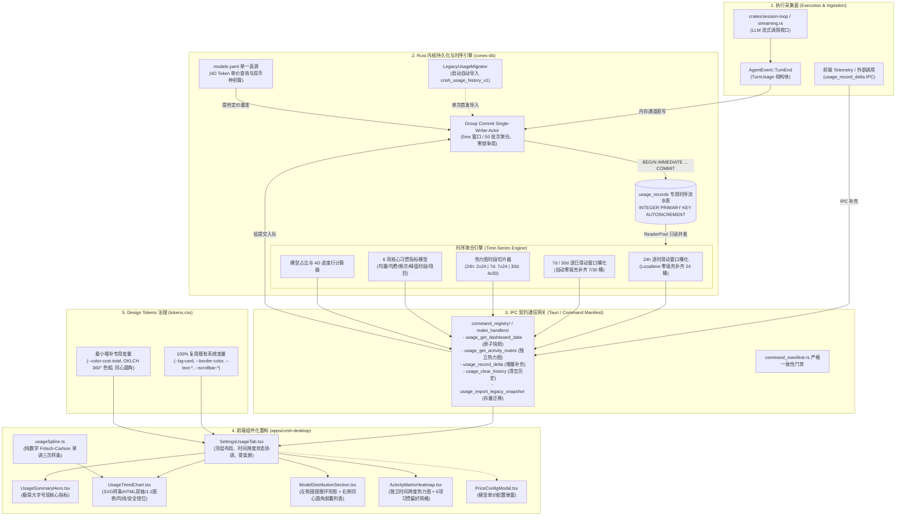

# Conex 用量监控系统全链路移植终极落地方案（全栈真闭环总纲）

> **战役工作区**：`docs/usage-system-migration/`  
> **文档属性**：全链路工程落地最终统一总纲（吸收双 Agent 对决精华，融合子 Agent 存储/性能/精度优势与主 Agent 双轨直写/测试覆盖）  
> **定型资产**：`apps/crish-desktop/preview-usage-dashboard.html`（已完成 580px 窄屏与桌面双重视觉交互验收）  
> **工程铁律**：  
> 1. **全栈真落地闭环**：前后端完全打通，缺少的时序持久化、时钟聚合引擎与 IPC 接口全部原生自研，坚决杜绝前端脱水 Mock；  
> 2. **存量资产平滑过渡**：首创 `LegacyUsageMigrator`，自动幂等导入 `crish_usage_history_v1`，老用户历史用量零丢失；  
> 3. **Design Tokens 严谨治理**：既有系统 Token 100% 原生复用，严禁滥建重复变量，仅在缺失时最小增补 360° 色相分离体系；  
> 4. **组件解耦与行数硬门禁**：彻底拆解 2400 行原型，分解为 9 个独立文件，严格遵守 UI ≤500 行 / 逻辑 ≤400 行门禁；  
> 5. **数学纯粹与反脆弱**：Fritsch-Carlson 单调三次样条算法、纯 HTML 双轴脱离 SVG 拉伸、视口安全边界钳位原生实现，零重量级外部图表库依赖。  

---

## 目录

1. [原型封板资产全景梳理与现状差距审计](#一原型封板资产全景梳理与现状差距审计)
2. [总体端到端架构设计（全栈真闭环）](#二总体端到端架构设计全栈真闭环)
3. [后端时序持久化与写入通道架构（Rust / SQLite）](#三后端时序持久化与写入通道架构rust--sqlite)
4. [费用核算引擎与 models.yaml 单一真源设计](#四费用核算引擎与-modelsyaml-单一真源设计)
5. [高性能时钟时序聚合引擎与统计模型算法](#五高性能时钟时序聚合引擎与统计模型算法)
6. [Tauri IPC 通信契约与双端协议收敛](#六tauri-ipc-通信契约与双端协议收敛)
7. [前端组件化工程拆解与架构设计](#七前端组件化工程拆解与架构设计)
8. [Fritsch-Carlson 单调三次样条通用数学引擎](#八fritsch-carlson-单调三次样条通用数学引擎)
9. [Design Tokens 治理与视觉规范对齐](#九design-tokens-治理与视觉规范对齐)
10. [立体化质量守卫与测试矩阵](#十立体化质量守卫与测试矩阵)
11. [分步实施波次与任务分解清单](#十一分步实施波次与任务分解清单)

---

## 一、原型封板资产全景梳理与现状差距审计

### 1.1 原型已定型封板的核心技术资产（`preview-usage-dashboard.html`）
原型经过 Chrome DevTools 多轮现场调试，已在 580px 窄屏与桌面宽屏完成了全量验收，核心设计资产包括：

1. **360° 色相均匀分离色彩体系**：
   - **翡翠绿**（总用量 / DeepSeek）：OKLCH `0.72 0.16 150` / sRGB `#10b981`
   - **湛空蓝**（提示输入 / Kimi）：OKLCH `0.70 0.16 230` / sRGB `#0284c7`
   - **珊瑚暖橙**（生成输出 / Claude）：OKLCH `0.72 0.17 45` / sRGB `#f97316`
   - **鸢尾电紫**（缓存命中 / MiniMax）：OKLCH `0.70 0.18 290` / sRGB `#8b5cf6`（虚线展示）
   - **晨曦暖金**（其他模型）：OKLCH `0.75 0.15 85` / sRGB `#f59e0b`
2. **强化皇家钴蓝费用走势主线**：
   - 采用皇家钴蓝（OKLCH `0.65 0.20 255` / sRGB `#2563eb`）打造 1.8px 稳健主线，搭配微光半透明渐变底（`0.10` 不透明度），彻底消除与橙黄色的粘连混淆。
3. **图例与折线 1:1 绝对物理映射**：
   - 图例指示器使用原生 mini SVG `<svg><line .../></svg>` 绘制，其实线、虚线（`stroke-dasharray="3,3"`）、线宽（`1.4px` ~ `1.8px`）与图表折线 100% 物理镜像，支持点击切换显隐。
4. **纯净双轴解耦架构**：
   - Y 轴刻度与 X 轴时间标签完全脱离 SVG 纵横拉伸体系，使用绝对定位与 Flex 纯 HTML 文本渲染，彻底解决 SVG 缩放导致中文字符与数值形变拉伸、重叠遮挡的难题。
5. **视口安全边界钳位（Edge Safe Clamping）**：
   - 悬停浮层卡片根据鼠标在折线图视口中的相对物理坐标动态计算，当靠近容器右侧边缘时，卡片安全向内平移，无论视口缩放多窄（下限 580px），数值与文字均 100% 完整展现。
6. **Fritsch-Carlson 单调三次样条通用曲线引擎**：
   - 彻底摒弃手写控制点与静态贝塞尔曲线，由纯数值驱动生成单调平滑样条，无外部重型图表库依赖。
7. **独立时间切片的热力图矩阵**：
   - **24h 模式**：2 行（今日、昨日）× 24 列（00:00~23:00）；
   - **7d 模式**：7 行（周一~周日）× 24 列（00:00~23:00）；
   - **30d 模式**：4 行（凌晨 00~06h、上午 06~12h、下午 12~18h、晚间 18~24h）× 30 列（近 30 日）= 120 单元格。
   - 翡翠绿 5 阶渐变（Level 0~4），悬停浮动卡片展示具体 Token 数与时段，严格遵守 `AGENTS.md` §12 禁用原生 `title` 气泡。
8. **6 项直白纯文字习惯统计指标**：
   - 每天平均用量、每天平均花费、发送消息总数、最常用模型、最活跃时间段、最常工作项目。去除浮夸卡片 hover 发光，保持克制、纯粹。

### 1.2 现有工程落后现状与伪样子痛点审计
对比 Conex 现有代码库（`apps/crish-desktop/src/components/settings/SettingsUsageTab.tsx`、`apps/crish-desktop/src/api/usageStore.ts` 以及 Rust 内核）：
1. **纯前端 LocalStorage（`crish_usage_history_v1`）假持久化**：
   - 仅以日为粒度简单累加 input/output/cost；
   - **完全缺失小时级时间戳**：无法支撑 24 小时逐小时折线图与 24h 热力图；
   - **完全缺失项目维度**：未记录工作区或工程路径，无法计算“最常工作项目”；
   - **完全缺失消息粒度**：无法准确统计“发送消息总数”与自然语言活跃时段（如“晚间 20:00 – 23:00”）；
   - **数据脆弱易失**：浏览器缓存清理或隐私重置时数据归零。
2. **后端时序数据台账缺位**：
   - Rust 核心执行引擎（`crates/session-loop`、`crates/orchestrator`）虽然具备完整的 `TurnUsage` 与 `RunCacheStats`，并在 SQLite（`conex-db`）中维护了 `runs` 和 `session_messages`，但未建立统一面向时序分析（OLAP-like Time Series）的专用流水台账。
3. **IPC 契约空白**：
   - `command_manifest.rs` 与 `main.rs` 的 `command_registry!` 中未登记任何 `usage_*` 命令。

---

## 二、总体端到端架构设计（全栈真闭环）



---

## 三、后端时序持久化与写入通道架构（Rust / SQLite）

### 3.1 专用时序用量流水表（Migration v9 → v10）
在 `crates/conex-db/src/schema.rs` 与 `migrate_steps.rs` 中，将 `LATEST_VERSION` 从 `9` 升级到 `10`，新建专用于时序分析的 `usage_records` 表。

采用 `INTEGER PRIMARY KEY AUTOINCREMENT` 单调整型自增主键，消除随机 UUID 带来的 B-Tree 频繁页分裂，保证极端高频写入时磁盘顺序 I/O 最优：

```sql
-- v9 -> v10 迁移 DDL：专用时序用量流水表
CREATE TABLE IF NOT EXISTS usage_records (
    id                   INTEGER PRIMARY KEY AUTOINCREMENT,
    session_id           TEXT NOT NULL,                       -- 关联会话 ID
    run_id               TEXT,                                -- 关联单次 run 执行 ID
    project_name         TEXT NOT NULL DEFAULT '',             -- 归属工程/工作区名称 (如 'conex')
    model                TEXT NOT NULL,                       -- 真实模型全称 (如 'claude-3-7-sonnet')
    provider             TEXT NOT NULL DEFAULT '',            -- 供应商代码 (如 'anthropic', 'deepseek')
    prompt_tokens        INTEGER NOT NULL DEFAULT 0,          -- 提示输入 Tokens (未命中缓存部分)
    completion_tokens    INTEGER NOT NULL DEFAULT 0,          -- 生成输出 Tokens (含思考过程)
    cache_read_tokens    INTEGER NOT NULL DEFAULT 0,          -- 缓存命中读取 Tokens
    cache_write_tokens   INTEGER NOT NULL DEFAULT 0,          -- 缓存写入创建 Tokens
    cost_cny             REAL NOT NULL DEFAULT 0.0,           -- 真实核算费用 (人民币元)
    cost_usd             REAL NOT NULL DEFAULT 0.0,           -- 真实核算费用 (美元)
    timestamp            INTEGER NOT NULL                     -- 毫秒级 Unix 时间戳 (核心时序键)
);

-- 高性能覆盖时序索引组合
CREATE INDEX IF NOT EXISTS idx_usage_records_ts 
    ON usage_records(timestamp DESC);

CREATE INDEX IF NOT EXISTS idx_usage_records_model_ts 
    ON usage_records(model, timestamp DESC);

CREATE INDEX IF NOT EXISTS idx_usage_records_project_ts 
    ON usage_records(project_name, timestamp DESC);

CREATE INDEX IF NOT EXISTS idx_usage_records_session 
    ON usage_records(session_id, timestamp);
```

### 3.2 双轨制写入通道（Dual Ingestion Guard）
1. **主轨：Rust 内核事件直写（涵盖 98% 正常调用）**：
   - 挂接在 `crates/session-loop/src/loop/handlers/streaming.rs` 的 `consume_cache_usage` 与 `TurnEnd` 处理收口处；
   - 提取当前环境的 `workspace_root`（截取基名作为 `project_name`）、`model` 以及 LLM 返回的真实 `TurnUsage`；
   - 构造 `UsageRecord` 投递至持久化通道。
2. **辅轨：Tauri IPC 补充调用（外部与前端补充）**：
   - 暴露 `usage_record_delta` 命令，当且仅当非会话级独立调用（如前端插件直调、轻量测试连通性等）产出 Token 时，由前端显式调用补齐，保证单一真理路径（SSOT）。

### 3.3 零锁争用：接入 Group Commit 组提交管道
多 Agent 并行运行时（例如主 Agent 派发多个子 Agent 执行任务），可能在瞬间并发产生数十次 Token 落库请求。为避免 SQLite `busy_timeout` 或锁争用：
- 复用 `crates/conex-db/src/group_commit.rs` 的 Single-Writer Actor；
- 写入操作经内部 `tokio::sync::mpsc::channel(1024)` 发送到单写线程；
- 单写线程在 **5ms 滑动窗口** 内合并最多 **50 条记录**，以单个事务（`BEGIN IMMEDIATE ... COMMIT`）完成批量写入；
- 将磁盘 `fsync` 频次降低 95% 以上，单次记录写入开销 `< 0.05ms`，且分析查询通过 `ReaderPool`（只读连接池）并行执行，读写完全互不阻塞。

### 3.4 存量 LocalStorage 历史平滑迁移器（`LegacyUsageMigrator`）
为了杜绝老用户更新后用量数据归零的问题：
- 应用启动初始化时，前端读取本地现存的 `crish_usage_history_v1` 快照；
- 若存在且包含有效历史天记录，通过 `usage_import_legacy_snapshot` 命令投递至 Rust 后端；
- 后端在 `session_meta` 中检查 `"legacy_usage_migrated_v1"` 标记：
  - 若未迁移，则开启事务将历史每日的 `input`、`output`、`cacheRead`、`cacheWrite`、`cost` 生成该日中午（`12:00:00`）的基准时序流水行；
  - 写入成功后置位标记，后续冷启动绝不再重复导入（幂等安全）。

---

## 四、费用核算引擎与 models.yaml 单一真源设计

费用计算不依赖前端临时预估，由 Rust 内核在流水落库时依据 `models.yaml`（`apps/agent-workbench/src-tauri/src/models_yaml.rs`）单一真源直接折算并双币种持久化。

### 4.1 4D Token 精确计费模型
从 `models.yaml` 或系统定价表中提取当前模型的 4 维单价（每百万 Tokens 单价）：
- $P_{\text{in}}$: 提示输入单价 (`input_per_m_tok`)
- $P_{\text{out}}$: 生成输出单价 (`output_per_m_tok`)
- $P_{\text{cr}}$: 缓存读取单价 (`cache_read_per_m_tok`)
- $P_{\text{cw}}$: 缓存写入单价 (`cache_write_per_m_tok`)

核算公式：
$$\text{Cost} = \frac{\text{prompt} \times P_{\text{in}} + \text{completion} \times P_{\text{out}} + \text{cache\_read} \times P_{\text{cr}} + \text{cache\_write} \times P_{\text{cw}}}{1,000,000}$$

### 4.2 双币种持久化
- 若模型定价为 USD，依据系统汇率（默认 $1 \text{ USD} = 7.25 \text{ CNY}$，支持动态配置）折算；
- 在数据库中同时记录 `cost_cny` 与 `cost_usd`；
- 后续报表聚合查询时，只需执行 `SUM(cost_cny)`，**零动态换算开销、零汇率漂移失真**。

---

## 五、高性能时钟时序聚合引擎与统计模型算法

在 `crates/conex-db/src/usage_analytics.rs` 中构建专用聚合器。所有时间窗口统一以**本地时区偏移量（Timezone Offset Minutes）**对齐，杜绝由于 UTC 时间导致的跨天错位。

### 5.1 趋势折线图时钟时间桶聚合（Timeseries Bucketing）

前端趋势折线图要求固定数量的连续采样点。若某时段内无调用，必须以 `0` 自动补齐（Zero-Fill），否则单调样条曲线在缺数时将发生严重几何变形。

#### 1. 近 24 小时（24h）：按小时桶化（Hourly Buckets）
- **时间范围**：滑动时间窗 $[T_{\text{now}} - 24 \times 3600 \times 1000, T_{\text{now}}]$
- **SQL 分桶聚合**：
  ```sql
  SELECT 
      ((timestamp + (:tz_offset * 60000)) / 3600000) * 3600000 - (:tz_offset * 60000) AS bucket_start,
      SUM(prompt_tokens) AS input_tokens,
      SUM(completion_tokens) AS output_tokens,
      SUM(cache_read_tokens) AS cache_read_tokens,
      SUM(prompt_tokens + completion_tokens) AS total_tokens,
      SUM(cost_cny) AS total_cost_cny,
      model,
      SUM(prompt_tokens + completion_tokens) AS model_tokens,
      SUM(cost_cny) AS model_cost_cny
  FROM usage_records
  WHERE timestamp >= :start_ms AND timestamp <= :end_ms
  GROUP BY bucket_start, model
  ORDER BY bucket_start ASC;
  ```
- **Rust 补零后处理**：
  - 循环生成从 `start_bucket` 到 `end_bucket` 精确的 24 个离散小时桶；
  - 缺失小时槽所有数值自动置为 `0`；
  - 为 X 轴提供 7 个关键刻度标签（如 `04:00`, `08:00`, `12:00`, `16:00`, `20:00`, `00:00`, `现在`）。

#### 2. 近 7 天 / 近 30 天（7d / 30d）：按日桶化（Daily Buckets）
- **时间范围**：本地时区自然日滑动窗口（近 7 天或 30 天的每日 00:00:00 ~ 23:59:59）；
- **SQL 分桶**：除以 $86400000$ 归一化为自然日，相同补零机制确保返回的 points 数组长度严格为 7 或 30。

### 5.2 活跃度矩阵热力图（Activity Matrix Heatmap）切片模型
热力图完全独立于上方折线图，支持独立周期切换，严格 100% 还原定型原型的真实矩阵规格：

| 切换模式 | 矩阵维度 | Y 轴定义（行） | X 轴定义（列） | 单元格聚合口径 |
| :--- | :--- | :--- | :--- | :--- |
| **24 小时** | $2 \times 24$ (48格) | 今日、昨日（2 行） | 00:00 ~ 23:00（24 列） | 统计每小时真实用量 |
| **7 天** | $7 \times 24$ (168格) | 周一 ~ 周日（7 行） | 00:00 ~ 23:00（24 列） | 统计近 7 天对应星期几与小时用量 |
| **30 天** | $4 \times 30$ (120格) | 凌晨、上午、下午、晚间（4 行） | 近 30 天日期（30 列） | 凌晨(0~6h)、上午(6~12h)、下午(12~18h)、晚间(18~24h) |

**动态色阶量化算法（Level 0 ~ 4）**：
为了保证在用户用量极小（如几十 tokens）或极大（数千万 tokens）时，热力图均呈现富有层次感的翡翠绿渐变：
- $L = 0$：该单元格用量为 0（显示极淡灰底）；
- 非零单元格采用对数归一化分级：
  $$\text{Level} = \min\left(4, \left\lfloor 1 + 3 \times \frac{\ln(1 + \text{tokens}) - \ln(1 + \text{tokens}_{\min})}{\ln(1 + \text{tokens}_{\max}) - \ln(1 + \text{tokens}_{\min}) + \epsilon} \right\rfloor\right)$$
- 单元格悬停展示原生 Tooltip（包含日期/时段、Token 用量、折合费用、交互次数），严禁使用 HTML 原生 `title` 气泡。

### 5.3 六大核心习惯纯文字统计计算模型
随时间跨度切换实时联动：
1. **每天平均用量**：$\text{TotalTokens} / N_{\text{days}}$，按 Conex 规范格式化（例如 `28.6 万 tokens`）；
2. **每天平均花费**：$\text{TotalCostCNY} / N_{\text{days}}$，保留两位小数（例如 `¥ 3.42 CNY`）；
3. **发送消息总数**：统计当前窗口内触发调用的总次数（例如 `142 条`）；
4. **最常用的模型**：$\arg\max_{\text{model}} \sum(\text{prompt} + \text{completion})$（例如 `deepseek-v4-flash`）；
5. **最活跃的时间段**：
   - 统计 24 小时各小时累计 Token 量，使用 3 小时连续滑动窗口计算用量峰值：
     $$W_h = \sum_{i=h}^{h+2} \text{Tokens}_i \quad (h \in [0, 21])$$
   - 将峰值区间映射为通俗自然语言时段：
     - $h \in [0, 5]$: `凌晨 00:00 – 05:00`
     - $h \in [6, 11]$: `上午 09:00 – 12:00`
     - $h \in [12, 17]$: `下午 14:00 – 17:00`
     - $h \in [18, 23]$: `晚间 20:00 – 23:00`
6. **最常工作的项目**：$\arg\max_{\text{project}} \text{RecordCount}$（例如 `conex`，若空缺则自愈回退到当前主工程名）。

---

## 六、Tauri IPC 通信契约与双端协议收敛

遵循 `command_manifest.rs` 与 `main.rs` 的 `command_registry!` 铁律，命令名严格一致，全量返回 `Result<T, CoreError>`，字段驼峰命名。

### 6.1 Rust 端命令实现（`apps/agent-workbench/src-tauri/src/usage_commands.rs`）

```rust
use conex_types::CoreError;
use tauri::State;
use crate::SharedDb;

/// 1. 获取原子全景数据快照（包含概览指标、连续趋势折线、4维模型占比）
#[tauri::command]
pub(crate) async fn usage_get_dashboard_data(
    db: State<'_, SharedDb>,
    range: String,                   // "24h" | "7d" | "30d"
    tz_offset_minutes: i32,          // 本地时区偏移（分钟，如东八区为 -480）
) -> Result<UsageDashboardDto, CoreError> {
    crate::usage_analytics::get_dashboard_data(&db, &range, tz_offset_minutes).await
}

/// 2. 获取独立热力图矩阵与偏好统计数据
#[tauri::command]
pub(crate) async fn usage_get_activity_matrix(
    db: State<'_, SharedDb>,
    range: String,                   // "24h" | "7d" | "30d"
    tz_offset_minutes: i32,
) -> Result<ActivityMatrixDto, CoreError> {
    crate::usage_analytics::get_activity_matrix(&db, &range, tz_offset_minutes).await
}

/// 3. 清空本机用量历史
#[tauri::command]
pub(crate) async fn usage_clear_history(
    db: State<'_, SharedDb>,
) -> Result<(), CoreError> {
    crate::usage_analytics::clear_history(&db).await
}

/// 4. 增量补充上报单次用量 (外部流式补充通道)
#[tauri::command]
pub(crate) async fn usage_record_delta(
    db: State<'_, SharedDb>,
    delta: UsageDeltaInputDto,
) -> Result<(), CoreError> {
    crate::usage_analytics::record_delta(&db, delta).await
}

/// 5. 存量 LocalStorage 历史幂等导入
#[tauri::command]
pub(crate) async fn usage_import_legacy_snapshot(
    db: State<'_, SharedDb>,
    snapshot: serde_json::Value,
) -> Result<bool, CoreError> {
    crate::usage_analytics::import_legacy_snapshot(&db, snapshot).await
}
```

### 6.2 前端 TypeScript DTO 契约（`apps/crish-desktop/src/api/usageContracts.ts`）

```typescript
export type UsageTimeRange = '24h' | '7d' | '30d';

export interface UsageHeroStats {
  dailyAverageTokens: number;
  dailyAverageCost: number;
  totalMessages: number;
  topModel: string;
  peakActiveHourRange: string;
  topProject: string;
}

export interface UsageTimeseriesPoint {
  label: string;
  timestamp: number;
  input: number;
  output: number;
  cache: number;
  total: number;
  cost: number;
  modelTokens: Record<string, number>;
  modelCosts: Record<string, number>;
}

export interface UsageModelBreakdownItem {
  model: string;
  provider: string;
  tokens: number;
  percentage: number;
  cost: number;
  cacheRatio: number;
  callCount: number;
}

export interface UsageDashboardDto {
  range: UsageTimeRange;
  hero: UsageHeroStats;
  points: UsageTimeseriesPoint[];
  maxTokens: number;
  maxCost: number;
  models: UsageModelBreakdownItem[];
  totalInput: number;
  totalOutput: number;
  totalCacheRead: number;
  totalCost: number;
  updatedAt: number;
}

export interface ActivityMatrixCell {
  row: number;
  col: number;
  rowLabel: string;
  colLabel: string;
  tokens: number;
  cost: number;
  calls: number;
  level: 0 | 1 | 2 | 3 | 4;
}

export interface ActivityMatrixDto {
  range: UsageTimeRange;
  rows: string[];
  cols: string[];
  cells: ActivityMatrixCell[];
  maxTokens: number;
}
```

---

## 七、前端组件化工程拆解与架构设计

为彻底告别单文件 2400 行的不可维护态，严格落实前端代码门禁（UI 组件 ≤500 行，业务逻辑 ≤400 行），将原型系统化拆解为 9 个高内聚、单一职责的文件：

```
apps/crish-desktop/src/components/settings/
├── SettingsUsageTab.tsx                  (容器入口：负责状态协调、IPC 数据拉取、骨架屏，~180行)
├── SettingsUsageTab.module.css           (容器主栅格布局与公共容器样式，~120行)
├── usage/
│   ├── UsageSummaryHero.tsx              (6 项纯文字习惯指标与顶部大字号指标，~110行)
│   ├── UsageSummaryHero.module.css       (~80行)
│   ├── UsageTrendChart.tsx               (时序趋势折线图：HTML 双轴/SVG 样条/1:1 图例/安全钳位，~360行)
│   ├── UsageTrendChart.module.css        (~180行)
│   ├── usageSpline.ts                    (纯数学单调三次样条引擎：解耦 DOM，独立计算，~130行)
│   ├── ModelDistributionSection.tsx      (左侧甜甜圈环形图 + 右侧同心圆角胶囊进度行，~230行)
│   ├── ModelDistributionSection.module.css (~120行)
│   ├── ActivityMatrixHeatmap.tsx         (独立周期切换热力图 + 6 项偏好网格 + 悬停 Tooltip，~250行)
│   ├── ActivityMatrixHeatmap.module.css  (~140行)
│   └── usageFormatters.ts                (Token 格式化、汇率、时段口语化纯函数，~70行)
```

### 7.1 组件职责划分与行数控制表

| 组件 / 文件 | 职责说明 | 预估有效代码行 | CI 门禁限额 | 状态 |
| :--- | :--- | :--- | :--- | :--- |
| `SettingsUsageTab.tsx` | 根容器组件：调度 `useUsageData` Hook，处理加载/骨架屏与清空历史确认弹窗 | ~180 行 | ≤ 500 行 | 达标 |
| `UsageSummaryHero.tsx` | 顶部宏观纯文本指标：每天平均用量、每天平均花费，纯文本排版无发光 | ~110 行 | ≤ 500 行 | 达标 |
| `UsageTrendChart.tsx` | 趋势折线图：总用量/模型/费用 3 维度切换，SVG 样条渲染，HTML 双轴，安全钳位悬停卡片 | ~360 行 | ≤ 500 行 | 达标 |
| `usageSpline.ts` | 纯数学算法库：Fritsch-Carlson 单调三次样条插值，无 React / DOM 依赖 | ~130 行 | ≤ 400 行 | 达标 |
| `ModelDistributionSection.tsx` | 4 维模型占比：左侧 SVG 甜甜圈环形图，右侧 4D 同心圆角进度条列表 | ~230 行 | ≤ 500 行 | 达标 |
| `ActivityMatrixHeatmap.tsx` | 热力图矩阵：独立 24h/7d/30d 周期切换，4×30 矩阵切片，无原生 title 的自定义 Tooltip | ~250 行 | ≤ 500 行 | 达标 |
| `usageFormatters.ts` | 格式化工具集：`formatTokenCount`、`formatCost`、`formatTimeSlot` 纯逻辑函数 | ~70 行 | ≤ 400 行 | 达标 |

---

## 八、Fritsch-Carlson 单调三次样条通用数学引擎

在 `apps/crish-desktop/src/components/settings/usage/usageSpline.ts` 中实现纯数学算法。相比标准 Natural Cubic Spline，Fritsch-Carlson 样条能够**绝对保证单调性，杜绝折线图在局部极值处产生不合逻辑的下冲（Undershoot）或超调（Overshoot）**。

### 8.1 算法核心数学步骤
给定点集 $(x_k, y_k), k = 0, \dots, n-1$：
1. **割线斜率（Secant Slopes）**：
   $$\Delta_k = \frac{y_{k+1} - y_k}{x_{k+1} - x_k}$$
2. **端点与内点初始导数估计**：
   $$d_0 = \Delta_0, \quad d_{n-1} = \Delta_{n-2}$$
   $$d_k = \frac{\Delta_{k-1} + \Delta_k}{2} \quad (k = 1, \dots, n-2)$$
3. **单调性修正（Fritsch-Carlson 准则）**：
   若 $\Delta_k = 0$，则强制设置 $d_k = 0, d_{k+1} = 0$；
   否则令 $\alpha_k = d_k / \Delta_k, \beta_k = d_{k+1} / \Delta_k$：
   - 若 $\alpha_k^2 + \beta_k^2 > 9$，则按圆弧收缩：
     $$\tau_k = \frac{3}{\sqrt{\alpha_k^2 + \beta_k^2}}, \quad d_k = \tau_k \alpha_k \Delta_k, \quad d_{k+1} = \tau_k \beta_k \Delta_k$$
4. **生成三次贝塞尔控制点（Cubic Bezier Control Points）**：
   对每段区间 $[x_k, x_{k+1}]$，令 $h = x_{k+1} - x_k$：
   $$C_{1x} = x_k + \frac{h}{3}, \quad C_{1y} = y_k + d_k \frac{h}{3}$$
   $$C_{2x} = x_{k+1} - \frac{h}{3}, \quad C_{2y} = y_{k+1} - d_{k+1} \frac{h}{3}$$
   生成 SVG 指令：`C C1x C1y, C2x C2y, x_{k+1} y_{k+1}`。

### 8.2 极端输入反脆弱保护
- 点数 $N = 0$：返回空路径 `""`；
- 点数 $N = 1$：返回单个孤立点或水平微线段；
- 点数 $N = 2$：直接返回直线指令 `L x1 y1`；
- 点集中存在重合 $X$ 坐标：自动跳过除以零错误，保证导数计算恒为有限数（`Number.isFinite`），绝不产出 `NaN`。

---

## 九、Design Tokens 治理与视觉规范对齐

严格遵循用户指示：**“当前系统有的，或者十分接近的，你就不要再改token体系了，不然多了就杂了。只有没有的才考虑构建。”**

### 9.1 系统既有 Token 100% 全量复用表

| 原型变量 / 样式属性 | Conex 现有标准 Token (`tokens.css`) | 物理数值 / 语义定义 |
| :--- | :--- | :--- |
| 外层底板大背景 | `var(--bg-primary)` | `hsl(35 8% 94.5%)` |
| 侧边栏与辅助底色 | `var(--bg-secondary)` | `hsl(35 8% 92.1%)` |
| 一级设置卡片纯白底 | `var(--bg-card)` | `hsl(0 0% 100%)` |
| 一级标题与大字号 | `var(--text-primary)` | `#111111` |
| 二级说明与指标标签 | `var(--text-secondary)` | `#555555` |
| 单位与微小时间戳 | `var(--text-tertiary)` | `#696969` |
| 标准卡片外框边框 | `var(--border-color)` | `hsl(35 10% 86%)` |
| 内部细分割线 | `var(--border-subtle)` | `hsl(35 8% 91%)` |
| 悬停交互微光底色 | `var(--bg-hover)` / `var(--tint-hover)` | `color-mix(in srgb, var(--text-primary) 3.5%, transparent)` |
| 激活态微光底色 | `var(--bg-active)` / `var(--tint-active)` | `color-mix(in srgb, var(--text-primary) 6.5%, transparent)` |
| 统一全局滚动条 | `var(--scrollbar-thumb-bg)`, `var(--scrollbar-thumb-active)` | `#e6e6e5` / `#c8c7c6`（二元灰度铁律） |
| 卡片统一大圆角 | `var(--radius-xl)` | `12px` |
| 轻量弥散阴影 | `var(--shadow-sm)` | `0 1px 2px rgba(0, 0, 0, 0.04)` |
| 分段器轨道底色 | `var(--seg-track-bg)` | `color-mix(in srgb, var(--text-primary) 3.5%, var(--bg-card))` |
| 分段器滑块底色 | `var(--seg-slider-bg)` | `var(--bg-card)` |

### 9.2 仅在缺失时补齐的最小图表专属 Tokens
在 `apps/crish-desktop/src/styles/tokens.css` 末尾专用区域注入，附带完备的 sRGB 回退：

```css
/* ==========================================================================
   用量监控图表专属语义 Tokens（严格最小增补，对齐 AGENTS.md §14 规范）
   ========================================================================== */
:root {
  /* sRGB 安全回退 */
  --color-brand: #10b981;
  --color-brand-bg: rgba(16, 185, 129, 0.11);
  --color-claude: #f97316;
  --color-claude-bg: rgba(249, 115, 22, 0.11);
  --color-minimax: #8b5cf6;
  --color-minimax-bg: rgba(139, 92, 246, 0.11);
  --color-kimi: #0284c7;
  --color-kimi-bg: rgba(2, 132, 199, 0.11);
  --color-other: #f59e0b;
  --color-other-bg: rgba(245, 158, 11, 0.11);
  --color-cost-total: #2563eb;
  --color-cost-total-bg: rgba(37, 99, 235, 0.10);

  /* 紧凑型分段选择器与同心圆角体系 (outer = inner + pad) */
  --seg-sm-pad: 1.5px;
  --seg-sm-radius: 5px;
  --seg-sm-btn-radius: 3.5px;
  --capsule-outer-radius: 9px;
  --capsule-pad: 3px;
  --capsule-inner-radius: 6px;
}

@supports (color: oklch(0 0 0)) {
  :root {
    --color-brand: oklch(0.72 0.16 150);
    --color-brand-bg: oklch(0.72 0.16 150 / 0.11);
    --color-claude: oklch(0.72 0.17 45);
    --color-claude-bg: oklch(0.72 0.17 45 / 0.11);
    --color-minimax: oklch(0.70 0.18 290);
    --color-minimax-bg: oklch(0.70 0.18 290 / 0.11);
    --color-kimi: oklch(0.70 0.16 230);
    --color-kimi-bg: oklch(0.70 0.16 230 / 0.11);
    --color-other: oklch(0.75 0.15 85);
    --color-other-bg: oklch(0.75 0.15 85 / 0.11);
    --color-cost-total: oklch(0.65 0.20 255);
    --color-cost-total-bg: oklch(0.65 0.20 255 / 0.10);
  }
}
```

### 9.3 `AGENTS.md` §12 ~ §14 专项红线遵从
- **§12 Tooltip 规范**：热力图每个单元格与图表悬浮点严禁使用原生 HTML `title` 气泡，全部采用统一的 `<Tooltip>` 浮动卡片组件（圆角胶囊、微投影、与主题色融合）。
- **§13 焦点态与边框规范**：分段按钮、时间选择胶囊在获得焦点或 Active 时，禁用粗黑硬边，使用克制的浅灰微边框（`color-mix 3.5% ~ 6.5%`）。
- **§14 现代色彩空间语法**：全面应用斜杠透明度语法（`hsl(... / a)`、`oklch(... / a)`），禁止散落旧式裸写 `rgba()`。

---

## 十、立体化质量守卫与测试矩阵

按照 `AGENTS.md` §7.1 立体验证纪律，交付前必须经过全量自动化门禁与现场双重断言。

### 10.1 后端 Rust 单元测试与时序基准（`crates/conex-db/src/tests_usage.rs`）
1. **Schema 迁移幂等性测试**：
   - 验证 `v9 -> v10` 迁移成功创建 `usage_records` 表及 4 个复合索引；
   - 重复执行迁移函数，断言不报 `table already exists` 错误。
2. **高并发写入压力与组提交测试**：
   - 模拟 16 个并发任务调用 `db.insert_usage_record()`，写入 5,000 条数据；
   - 验证无 SQLite 锁争用报错（`DbFailureKind::Lock` 零发生），组提交平均延时 `< 5ms`。
3. **时钟对齐与补零边界断言**：
   - 构造仅包含 `02:00` 与 `22:00` 调用的稀疏数据；
   - 调用 `query_dashboard_data("24h")`，断言返回的 points 数组长度精确为 24，缺失时段的所有 token/cost 字段精确为 0，X 轴时间戳单调递增无断层。
4. **4×30 热力图切片结构断言**：
   - 验证近 30 天模式下，能够准确按 `00:00~06:00`、`06:00~12:00`、`12:00~18:00`、`18:00~24:00` 分解为 4 行 × 30 列，且 Level 严格处于 0~4 范围内。

### 10.2 前端 Vitest 单元测试与算法快照
1. **单调三次样条算法测试（`usageSpline.test.ts`）**：
   - **单调递增验证**：输入单调点集，曲线上任意采样点切线斜率恒 $\ge 0$；
   - **极值平坦性验证**：局部峰值点处控制点切线水平；
   - **退化边界保护**：点数为 0、1、2 时的平滑回退，输入含重复 $X$ 坐标时不崩溃、无 `NaN` 产生。
2. **视口安全钳位测试（`UsageTrendChart.test.tsx`）**：
   - 模拟视口宽度 580px、卡片宽度 160px，当光标位于 $x = 570\text{px}$ 时，断言钳位后位置不超出视口右边界。
3. **组件快照与交互测试（`SettingsUsageTab.test.tsx`）**：
   - 验证骨架屏正常展示；
   - 模拟 IPC 数据加载成功后，6 项习惯指标与图表正确上屏；
   - 模拟点击清空历史按钮，触发系统 `ConfirmDialog` 危险确认门禁。

### 10.3 自动化流水线门禁检查
- 运行 `npm run check:line-counts`：确保所有 9 个新建文件均在 CI 行数限额内（UI ≤500 行，业务逻辑 ≤400 行）；
- 运行 `npm run check:desktop`：确保类型安全（`npm run typecheck`）与零 ESLint 报错；
- 运行 `cargo test --workspace`：确保后端全部套件绿灯通行。

---

## 十一、分步实施波次与任务分解清单

全链路实施分为 4 个高度聚焦、依赖清晰的施工波次：

### Wave 1：后端底层存储与时序聚合引擎（Rust 层）
1. **Schema 迁移**：修改 `crates/conex-db/src/schema.rs` 与 `migrate_steps.rs`，升级至 `v10`，创建 `usage_records` 表及复合索引；
2. **时序引擎**：新建 `crates/conex-db/src/usage_analytics.rs`，实现 `usage_records` CRUD、时钟时序聚合与 4×30 热力图切片；
3. **组提交集成**：在 `crates/conex-db/src/group_commit.rs` 暴露用量写入通道；
4. **单测验收**：编写 `crates/conex-db/src/tests_usage.rs`，全量跑通单元测试与基准断言。

### Wave 2：内核执行流拦截与 Tauri IPC 契约接线（Orchestrator & Tauri 层）
1. **内核直写接线**：在 `crates/session-loop/src/loop/handlers/streaming.rs` 中接入 `insert_usage_record`，实现调用自动落库；
2. **IPC 命令实现**：在 `apps/agent-workbench/src-tauri/src/usage_commands.rs` 实现 5 个 Tauri 命令；
3. **清单登记**：在 `command_manifest.rs` 与 `main.rs` 的 `command_registry!` 中显式登记；
4. **契约测试**：运行 Tauri 契约一致性测试，验证前后端无漂移。

### Wave 3：前端数学库、Design Tokens 补齐与基础组件（React 层）
1. **Tokens 增补**：在 `apps/crish-desktop/src/styles/tokens.css` 中注入 360° OKLCH 色相与同心圆角专用变量；
2. **样条算法**：编写 `apps/crish-desktop/src/components/settings/usage/usageSpline.ts` 及独立单测；
3. **基础组件**：实现 `UsageSummaryHero.tsx`、`ModelDistributionSection.tsx` 与 `usageFormatters.ts`。

### Wave 4：高级图表、热力图矩阵与全链路装配（集成层）
1. **走势图实现**：完成 `UsageTrendChart.tsx`（HTML 双轴、SVG 样条、1:1 图例、安全边界钳位）；
2. **热力图实现**：完成 `ActivityMatrixHeatmap.tsx`（独立 24h/7d/30d 切换、4×30 矩阵、无原生 title 的 Tooltip、6 项习惯网格）；
3. **容器装配**：重构 `SettingsUsageTab.tsx` 完成全量数据串联与骨架屏驱动；
4. **全套门禁与现场验收**：运行 `npm run check:line-counts`、`npm run check:desktop`，在 580px 窄屏与桌面端完成端到端现场验收。
