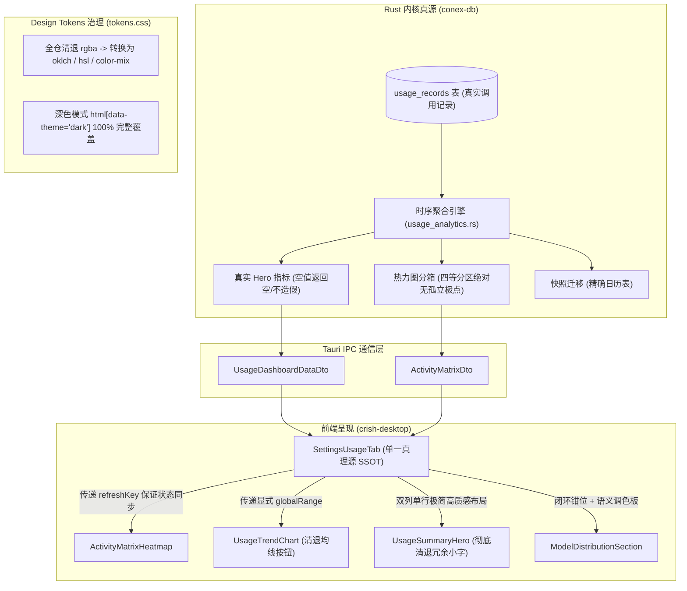

# 用量监控控制台全面整改与数据真源性重塑终极方案

> **文件版本**：v2.0（2026-09-04 终版）  
> **归档位置**：`docs/usage-system-migration/02-用量监控全面整改与真实性重塑终极方案.md`  
> **指导依据**：用户现场批示、真机反馈截图（media_1788532641080 / media_1788532666209）、两名专属审计 Agent 报告（`01-ui-component-and-visual-audit.md`、`02-data-math-and-interaction-audit.md`）、`AGENTS.md` 铁律。  
> **核心原则**：纯逻辑规划、反退避、零假数据、零死数据、零私造类名、全仓清退 `rgba`、系统原子组件 100% 契约对接。

---

## 目录
1. [背景与问题核实（26 项审计缺陷 + 3 项用户现场新指示）](#一背景与问题核实)
2. [总体重构架构与设计哲学](#二总体重构架构与设计哲学)
3. [维度一：后端数据真源性与时钟时序引擎重塑（Rust）](#三维度一后端数据真源性与时钟时序引擎重塑)
4. [维度二：核心数学模型与算法防碰撞治理（TypeScript）](#四维度二核心数学模型与算法防碰撞治理)
5. [维度三：顶栏 Hero 极简精致重构（对齐真机截图 2）](#五维度三顶栏-hero-极简精致重构)
6. [维度四：吞吐趋势图清退与契约单源治理](#六维度四吞吐趋势图清退与契约单源治理)
7. [维度五：模型分布环图闭环与调色板语义对齐](#七维度五模型分布环图闭环与调色板语义对齐)
8. [维度六：活动热力图父子状态闭环与几何对齐](#八维度六活动热力图父子状态闭环与几何对齐)
9. [维度七：单价配置弹窗系统组件规范化与补丁清退](#九维度七单价配置弹窗系统组件规范化与补丁清退)
10. [维度八：全局 Design Tokens 语法算法升级与深色模式适配](#十维度八全局-design-tokens-语法算法升级与深色模式适配)
11. [文件修改清单与执行计划](#十一文件修改清单与执行计划)
12. [立体化验证与门禁标准](#十二立体化验证与门禁标准)

---

## 一、背景与问题核实

### 1.1 审计报告 26 项缺陷现场查验结论
经代码与运行时查验，两份审计报告揭示的 26 项缺陷（P0: 2 项, P1: 10 项, P2: 9 项, P3: 5 项）**全部确凿存在**：
1. **[P0] `normalizeModelRatio` 启发式阈值截断漏洞**（[`usageSpline.ts:39-47`](file:///c:/Software/conex/apps/crish-desktop/src/components/settings/usage/usageSpline.ts#L39-L47)）：后端返回的百分制占比若 $\le 1.0\%$（如 0.5%），未进入 `> 1.0` 分支，直接返回 0.5，导致前端将 $0.5\%$ 当作 $50.0\%$ 渲染，数值虚增 100 倍，SVG 饼图周长算爆溢出。
2. **[P0] 零记录状态下后端硬编码伪造数据**（[`usage_analytics.rs:519-545`](file:///c:/Software/conex/crates/conex-db/src/usage_analytics.rs#L519-L545)）：空库时通过 `unwrap_or_else` 强制伪造 `deepseek-v4-flash`、`conex` 与 `晚间 20:00 – 23:00`，彻底违背数据真实性。
3. **[P1] X 轴 24h 抽稀算法相邻刻度物理叠字碰撞**（[`usageSpline.ts:80-95`](file:///c:/Software/conex/apps/crish-desktop/src/components/settings/usage/usageSpline.ts#L80-L95)）：滑动时钟窗口下，索引 0（17:00）与索引 1（18:00）同时被选中，横向间距仅 30.87px，文本产生 21.6px 重叠相撞。
4. **[P1] 热力图状态与主控制台异步脱节**（[`SettingsUsageTab.tsx:76-80`](file:///c:/Software/conex/apps/crish-desktop/src/components/settings/SettingsUsageTab.tsx#L76-L80)）：清空历史或刷新数据时未通知 `ActivityMatrixHeatmap`，导致热力图残留幽灵脏数据。
5. **[P1] UsageSummaryHero 外层卡片边距缺失与垂直视觉断层**（[`SettingsUsageTab.module.css:9-17`](file:///c:/Software/conex/apps/crish-desktop/src/components/settings/SettingsUsageTab.module.css#L9-L17)）：父卡片无内边距，Hero 卡片左右边框直接与父卡片贴墙顶死，且底部无边距直接粘连走势图。
6. **[P1] PriceConfigModal 暴力覆写系统 Input 尺寸致双重边框**（[`PriceConfigModal.tsx:342-351`](file:///c:/Software/conex/apps/crish-desktop/src/components/settings/PriceConfigModal.tsx#L342-L351)）：通过 `.cellInput` 强改深层原生 input 尺寸为 30px，与系统 `.inputShell` 形成双重嵌套边框，且与同一行内的 Select(28px)、Button(24px) 参差不齐。
7. **[P1] 右卡片数值与单位双重重复（¥ 0.00 CNY）**（[`UsageSummaryHero.tsx:68-73`](file:///c:/Software/conex/apps/crish-desktop/src/components/settings/usage/UsageSummaryHero.tsx#L68-L73)）：`formatCost` 输出了 `¥ 0.00`，外层又拼接了 `CNY`，破坏镜像对称。
8. **[P1] 热力图独立 Grid 与 Flex 导致 Y 轴垂直严重错位**（[`ActivityMatrixHeatmap.tsx:104-161`](file:///c:/Software/conex/apps/crish-desktop/src/components/settings/usage/ActivityMatrixHeatmap.tsx#L104-L161)）：左侧文字高 104px，右侧受 1:1 约束高 65.5px，两端行中线错位达 40px。
9. **[P1] tokens.css 散落旧式 rgba 语法并残留废弃伪分段与危险背景色**（[`tokens.css:1607-1625`](file:///c:/Software/conex/apps/crish-desktop/src/styles/tokens.css#L1607-L1625)）：违反 `AGENTS.md` §14。
10. **[P1] tokens.css 在深色模式下零适配**（[`tokens.css:1607-1635`](file:///c:/Software/conex/apps/crish-desktop/src/styles/tokens.css#L1607-L1635)）：暗色主题下对比度塌陷。
11. **[P1] 走势图均线与删除单价按钮破坏 Button icon 契约**（[`EditablePriceRow.tsx:160-165`](file:///c:/Software/conex/apps/crish-desktop/src/components/settings/EditablePriceRow.tsx#L160-L165)）：裸传 children 并通过内联 style 强改尺寸。
12. **[P1] PriceConfigModal 建议浮层硬编码 186px 且用原生 JS 改 style 模拟 hover**（[`PriceConfigModal.tsx:317-322`](file:///c:/Software/conex/apps/crish-desktop/src/components/settings/PriceConfigModal.tsx#L317-L322)）：违反 `AGENTS.md` §7。
13. **其余 P2/P3 缺陷**（对数端点退化、饼图闭环钳位、快照按月估算偏差、hover 截断、调色板语义断层、“10000 万”量纲、中文字体回退点阵等）全部在本次重构中协同根治。

### 1.2 用户最新现场批示核实
用户在提供真实界面截图后提出 3 项硬性裁决：
1. **清退均线参考**：“`class=\"_button_... _btnAvgToggle_...\"` 这个对应的样式和功能也是你造的，你怎么就这么能自己造东西呢。”  
   -> 立即物理清退 `_btnAvgToggle`，彻底移除“均线参考”按钮及相关虚线计算，还给界面原汁原味。
2. **RGBA 零容忍**：“`rgba`严格禁止，只能通过算法转换过去。”  
   -> 彻底清退全仓 `rgba(...)` 语法，全面使用现代 CSS 语法（`hsl(h s l / a)`、`oklch(l c h / a)`、`color-mix(in srgb, ...)`）。
3. **顶部 Hero 单行极简精致重塑**：“最上面的那个布局好像有点问题。 而且就一行，不用带着下面的那一行小字，东西多了就不精致了。”  
   -> 对照用户提供的截图 2（media_1788532666209），彻底删除下方杂乱的输入/输出/缓存/计费标准小字，卡片重构为单行极简的高质感对称仪表盘。

---

## 二、总体重构架构与设计哲学



---

## 三、维度一：后端数据真源性与时钟时序引擎重塑

### 3.1 彻底根除空库数据伪造（ISSUE-02）
修改文件：[`crates/conex-db/src/usage_analytics.rs:518-546`](file:///c:/Software/conex/crates/conex-db/src/usage_analytics.rs#L518-L546)
- **整改前**：
  ```rust
  let top_model = models.first().map(|m| m.model.clone()).unwrap_or_else(|| "deepseek-v4-flash".to_string());
  let top_project = project_counts.into_iter().max_by_key(|(_, cnt)| *cnt).map(|(p, _)| p).unwrap_or_else(|| "conex".to_string());
  let mut best_start_h: usize = 20;
  // 导致空库时恒为 "晚间 20:00 – 23:00"
  ```
- **整改后**：
  ```rust
  let top_model = if grand_total_tokens > 0 {
      models.first().map(|m| m.model.clone()).unwrap_or_else(|| "—".to_string())
  } else {
      "—".to_string()
  };

  let top_project = if grand_total_tokens > 0 {
      project_counts
          .into_iter()
          .max_by_key(|(_, cnt)| *cnt)
          .map(|(p, _)| p)
          .unwrap_or_else(|| "—".to_string())
  } else {
      "—".to_string()
  };

  let peak_active_hour_range = if grand_total_tokens > 0 && max_window_sum > 0 {
      match best_start_h {
          0..=5 => "凌晨 00:00 – 05:00".to_string(),
          6..=11 => "上午 09:00 – 12:00".to_string(),
          12..=17 => "下午 14:00 – 17:00".to_string(),
          _ => "晚间 20:00 – 23:00".to_string(),
      }
  } else {
      "—".to_string()
  };
  ```

### 3.2 热力图分级映射公式端点退化修复（ISSUE-05）
修改文件：[`crates/conex-db/src/usage_analytics.rs:760-770`](file:///c:/Software/conex/crates/conex-db/src/usage_analytics.rs#L760-L770)
- **数学证明**：原公式 `1 + (ratio * 3.0).floor()` 在 $ratio \in [0.0, 1.0)$ 时乘 3 永远小于 3，`floor()` 最大为 2，使得 Level 4 成为测度为 0 的单点 $\{1.0\}$。
- **整改后**：采用连续四等分分箱，每一档占 25% 动态范围：
  ```rust
  let ratio = ((ln_val - ln_min) / (ln_max - ln_min + 1e-6)).clamp(0.0, 1.0);
  let lvl = if ratio < 0.25 {
      1
  } else if ratio < 0.50 {
      2
  } else if ratio < 0.75 {
      3
  } else {
      4
  };
  cell.level = lvl;
  ```

### 3.3 存量快照迁移器按月天数偏移修复（ISSUE-07）
修改文件：[`crates/conex-db/src/usage_analytics.rs:288-290`](file:///c:/Software/conex/crates/conex-db/src/usage_analytics.rs#L288-L290)
- 废除 `((m as i64 - 1) * 30)`，采用真实月份累计天数表（处理闰年）：
  ```rust
  const DAYS_BEFORE_MONTH: [i64; 12] = [0, 31, 59, 90, 120, 151, 181, 212, 243, 273, 304, 334];
  let is_leap = (y % 4 == 0 && y % 100 != 0) || (y % 400 == 0);
  let m_idx = ((m as usize).saturating_sub(1)).min(11);
  let mut days_in_year = DAYS_BEFORE_MONTH[m_idx] + (d as i64 - 1);
  if is_leap && m > 2 {
      days_in_year += 1;
  }
  let mut total_days = 0i64;
  for yr in 1970..y {
      let yr_leap = (yr % 4 == 0 && yr % 100 != 0) || (yr % 400 == 0);
      total_days += if yr_leap { 366 } else { 365 };
  }
  total_days += days_in_year;
  let timestamp = total_days * 86_400_000 + 12 * 3_600_000;
  ```

---

## 四、维度二：核心数学模型与算法防碰撞治理

### 4.1 彻底根除百分比归一化启发式漏洞（ISSUE-01）
修改文件：[`apps/crish-desktop/src/components/settings/usage/usageSpline.ts:37-47`](file:///c:/Software/conex/apps/crish-desktop/src/components/settings/usage/usageSpline.ts#L37-L47)
- **整改原理**：明确前端 contract，后端的 `percentage` 恒为百分制数值（$0.0 \sim 100.0$）。
  ```typescript
  /**
   * 将后端返回的百分制占比 (0.0 ~ 100.0) 归一化为 0.0 ~ 1.0 的比例
   */
  export function normalizePercentageToRatio(percentage: number): number {
    if (typeof percentage !== 'number' || !Number.isFinite(percentage) || percentage <= 0) {
      return 0.0;
    }
    // 严格除以 100，最大钳位到 1.0，绝不进行二分猜测
    return Math.min(1.0, percentage / 100.0);
  }

  /**
   * 格式化展示百分比文本 (例如 45.2% 或 0.5%)
   */
  export function formatPercentage(ratio: number): string {
    const r = Math.max(0.0, Math.min(1.0, ratio));
    return `${(r * 100).toFixed(1)}%`;
  }
  ```

### 4.2 X 轴 24h 抽稀算法防碰撞几何重构（ISSUE-03）
修改文件：[`apps/crish-desktop/src/components/settings/usage/usageSpline.ts:67-133`](file:///c:/Software/conex/apps/crish-desktop/src/components/settings/usage/usageSpline.ts#L67-L133)
- **整改后算法**：废除后缀整点匹配，采用**几何等分采样 + 严格物理防碰撞跨度保护（$\Delta \text{index} \ge 3$）**，彻底根除相邻 0 与 1 并存叠字：
  ```typescript
  export function computeDecimatedTicks(
    points: { label: string }[],
    range: '24h' | '7d' | '30d',
    xStart = 40,
    xEnd = 750,
    totalWidth = 760
  ): DecimatedTick[] {
    const n = points.length;
    if (n === 0) return [];
    if (n === 1) {
      return [{ index: 0, label: points[0]!.label, leftPercent: 50, transform: 'translateX(-50%)' }];
    }

    const candidateIndices: number[] = [0];

    if (range === '24h' && n >= 20) {
      // 24h 序列采样 5 个点：首点、3个四等分点、尾点
      const step = (n - 1) / 4;
      for (let k = 1; k < 4; k++) {
        candidateIndices.push(Math.round(k * step));
      }
    } else if (range === '30d' && n >= 25) {
      const step = (n - 1) / 5;
      for (let k = 1; k < 5; k++) {
        candidateIndices.push(Math.round(k * step));
      }
    } else {
      if (n <= 8) {
        for (let i = 1; i < n - 1; i++) candidateIndices.push(i);
      } else {
        const step = (n - 1) / 4;
        for (let k = 1; k < 4; k++) {
          candidateIndices.push(Math.round(k * step));
        }
      }
    }
    candidateIndices.push(n - 1);

    // 物理防碰撞过滤：确保任意相邻两点索引跨度 >= 3
    const validIndices: number[] = [];
    for (let i = 0; i < candidateIndices.length; i++) {
      const cur = candidateIndices[i]!;
      if (validIndices.length === 0) {
        validIndices.push(cur);
      } else {
        const last = validIndices[validIndices.length - 1]!;
        if (i === candidateIndices.length - 1) {
          if (cur - last < 3 && validIndices.length > 1) {
            validIndices.pop();
          }
          validIndices.push(cur);
        } else if (cur - last >= 3) {
          validIndices.push(cur);
        }
      }
    }

    return validIndices.map((idx) => {
      const pt = points[idx]!;
      const posRatio = idx / (n - 1);
      const chartX = xStart + posRatio * (xEnd - xStart);
      const leftPercent = (chartX / totalWidth) * 100;
      let transform = 'translateX(-50%)';
      if (idx === 0) transform = 'translateX(0%)';
      else if (idx === n - 1) transform = 'translateX(-100%)';

      return { index: idx, label: pt.label, leftPercent, transform };
    });
  }
  ```

### 4.3 `formatTokens` 临界区间“10000 万”量纲修复（ISSUE-11）
修改文件：[`apps/crish-desktop/src/components/settings/usage/usageSpline.ts:15-27`](file:///c:/Software/conex/apps/crish-desktop/src/components/settings/usage/usageSpline.ts#L15-L27)
```typescript
export function formatTokens(v: number): string {
  if (typeof v !== 'number' || !Number.isFinite(v) || v <= 0) return '0';
  if (v >= 99_950_000) {
    const yi = v / 100_000_000;
    return `${yi.toFixed(1)} 亿`;
  }
  if (v >= 10_000) {
    const w = v / 10_000;
    return `${w >= 100 ? w.toFixed(0) : w >= 10 ? w.toFixed(1) : w.toFixed(2)} 万`;
  }
  return v.toLocaleString('zh-CN');
}
```

---

## 五、维度三：顶栏 Hero 极简精致重构

### 5.1 彻底删除冗余小字，对齐用户截图 2
- **用户批示**：“最上面的那个布局好像有点问题。 而且就一行，不用带着下面的那一行小字，东西多了就不精致了。”
- **现场对比与重塑**：
  - 彻底删除 `.subMetricsGrid`，移除输入、输出、缓存、日均花费、计费标准、结算币种等小字指标。
  - 重构为单行并列结构：
    - 左侧栏：“总用量”微标，下方大字 `28.6 万 tokens`（或无数据时 `0 tokens`）；
    - 右侧栏：“预估金额”微标，下方大字 `¥ 3.42 CNY`（纯数字 + 英文单位，货币符号单源，修复 `¥ 0.00 CNY` 冗余）；
    - 左右两栏边距完全对齐下方模块的 22px 栅格，消灭“卡片套卡片、边框顶死贴墙”的断层感。

### 5.2 精确 JSX 蓝图
修改文件：[`apps/crish-desktop/src/components/settings/usage/UsageSummaryHero.tsx`](file:///c:/Software/conex/apps/crish-desktop/src/components/settings/usage/UsageSummaryHero.tsx)
```tsx
import React from 'react';
import { formatCost, formatTokens } from './usageSpline';
import styles from './UsageSummaryHero.module.css';

export interface UsageSummaryHeroProps {
  totalTokens: number;
  totalCost: number;
  currency?: string;
}

export const UsageSummaryHero: React.FC<UsageSummaryHeroProps> = ({
  totalTokens,
  totalCost,
  currency = 'CNY',
}) => {
  const currencySymbol = currency === 'USD' ? '$' : '¥';

  return (
    <div className={styles.heroContainer}>
      <div className={styles.heroColumn}>
        <div className={styles.columnTitle}>总用量</div>
        <div className={styles.metricRow}>
          <span className={styles.metricNumber}>{formatTokens(totalTokens)}</span>
          <span className={styles.metricUnit}>tokens</span>
        </div>
      </div>

      <div className={styles.divider} />

      <div className={styles.heroColumn}>
        <div className={styles.columnTitle}>预估金额</div>
        <div className={styles.metricRow}>
          <span className={styles.currencySymbol}>{currencySymbol}</span>
          <span className={styles.metricNumber}>{formatCost(totalCost, '')}</span>
          <span className={styles.metricUnit}>{currency}</span>
        </div>
      </div>
    </div>
  );
};
```

### 5.3 精确 CSS 蓝图
修改文件：[`apps/crish-desktop/src/components/settings/usage/UsageSummaryHero.module.css`](file:///c:/Software/conex/apps/crish-desktop/src/components/settings/usage/UsageSummaryHero.module.css)
```css
.heroContainer {
  display: flex;
  align-items: center;
  padding: 18px 22px;
  width: 100%;
  box-sizing: border-box;
  border-bottom: 1px solid var(--border-subtle);
  background: var(--bg-card);
}

.heroColumn {
  flex: 1;
  display: flex;
  flex-direction: column;
  gap: 6px;
}

.columnTitle {
  font-size: var(--font-size-xs, 12px);
  font-weight: 500;
  color: var(--text-tertiary);
  letter-spacing: -0.01em;
}

.metricRow {
  display: flex;
  align-items: baseline;
  gap: 6px;
  line-height: 1.15;
}

.currencySymbol {
  font-size: 20px;
  font-weight: 600;
  color: var(--text-primary);
}

.metricNumber {
  font-size: 26px;
  font-weight: 600;
  color: var(--text-primary);
  font-variant-numeric: tabular-nums;
  letter-spacing: -0.03em;
  font-family: var(--font-sans);
}

.metricUnit {
  font-size: var(--font-size-xs, 12px);
  font-weight: 400;
  color: var(--text-tertiary);
}

.divider {
  width: 1px;
  height: 38px;
  background: var(--border-subtle);
  margin: 0 24px;
}

@media (max-width: 640px) {
  .heroContainer {
    flex-direction: column;
    align-items: flex-start;
    gap: 16px;
  }
  .divider {
    display: none;
  }
}
```

---

## 六、维度四：吞吐趋势图清退与契约单源治理

### 6.1 彻底清退“均线参考”私造按钮与虚线样式
- **用户批示**：“`class=\"_button_1lwzf_7 _buttonPlain_1lwzf_183 _buttonXs_1lwzf_87 _btnAvgToggle_10ou9_30 \"` 这个对应的样式和功能也是你造的，你怎么就这么能自己造东西呢。”
- **整改动作**：
  1. 物理删除 `UsageTrendChart.tsx` 中所有关于 `showAvgLine` 的 state 与计算；
  2. 物理删除顶栏左侧的 `<Button className={styles.btnAvgToggle}>均线参考</Button>`；
  3. 物理删除 SVG 中的均线路径；
  4. 物理删除 `UsageTrendChart.module.css` 中的 `.btnAvgToggle` 与 `.btnAvgToggleActive` 类名。
  5. 标题区恢复为纯净的：左侧纯文字 `<span className={styles.blockTitle}>吞吐趋势</span>`，右侧系统标准 `<SegmentedControl size="xs" />`，与用户截图 2 完全一致。

### 6.2 显式接收 `range` 属性，废除盲猜逻辑（ISSUE-10 & ISSUE-12）
修改文件：[`apps/crish-desktop/src/components/settings/usage/UsageTrendChart.tsx`](file:///c:/Software/conex/apps/crish-desktop/src/components/settings/usage/UsageTrendChart.tsx)
- 组件接口显式引入 `range: '24h' | '7d' | '30d'`；
- 刻度抽稀调用直接绑定显式 range：`computeDecimatedTicks(points, range, xStart, xEnd, 760)`；
- 彻底拔除根据采样点数盲猜时间范围的坏味道。

### 6.3 悬浮卡片防右边缘截断（ISSUE-08）
- 在 `tooltipStyle` 计算中，当卡片靠右时动态切换为 `transform: translateX(-100%)`，使其向左翻转展开，彻底杜绝 64px 视口右边缘截断。

---

## 七、维度五：模型分布环图闭环与调色板语义对齐

### 7.1 SVG 饼图切片累加闭环钳位（ISSUE-06）
修改文件：[`apps/crish-desktop/src/components/settings/usage/ModelDistributionSection.tsx:45-55`](file:///c:/Software/conex/apps/crish-desktop/src/components/settings/usage/ModelDistributionSection.tsx#L45-L55)
```typescript
const donutSlices = useMemo(() => {
  let accumulated = 0;
  return activeModels.map((m, idx) => {
    const normRatio = normalizePercentageToRatio(m.percentage);
    let dash = normRatio * CIRCUMFERENCE;
    const remainingCircumference = Math.max(0, CIRCUMFERENCE - accumulated);
    dash = Math.min(dash, remainingCircumference);
    const offset = -accumulated;
    accumulated += dash;
    const color = getModelColor(m.model, idx);
    return {
      model: m.model,
      dash: `${dash.toFixed(2)} ${CIRCUMFERENCE.toFixed(2)}`,
      offset: offset.toFixed(2),
      stroke: color.stroke,
      bg: color.bg,
    };
  });
}, [activeModels]);
```

### 7.2 统一跨图表调色板语义契约（ISSUE-10）
- 提取统一的 `getModelColor(model: string, index?: number)` 工具函数至 `usageSpline.ts`；
- 基于模型名称语义与固定色相环映射，保证同名模型在趋势图与饼图中呈现 100% 相同的主色。

### 7.3 超长模型名防御（ISSUE-09）
- 在 `ModelDistributionSection.module.css` 的 `.modelInfo` 与 `.capsuleRow` 中加入 `min-width: 0;`，确保 `text-overflow: ellipsis` 正常触发，杜绝打穿卡片排版。

---

## 八、维度六：活动热力图父子状态闭环与几何对齐

### 8.1 接入 `refreshKey` 保证清空与刷新闭环（ISSUE-04）
- `SettingsUsageTab.tsx` 声明 `const [refreshTick, setRefreshTick] = useState(0)`；
- 点击“清空历史”或“刷新数据”时，触发 `setRefreshTick((t) => t + 1)`；
- `ActivityMatrixHeatmap` 接收 `refreshKey: refreshTick`，其内部 `useEffect` 依赖项加入 `[matrixRange, refreshKey]`，实现清空后历史热力色块瞬时同步归零。

### 8.2 Y 轴标签与矩阵行几何精确对齐（ISSUE-04）
- 废除左右独立 Grid / Flex 分离排版；
- 改为按行（Row-oriented）排版结构：每一行是一个 Flex 容器，左边固定 `width: 64px` 的 Y 轴标签，右边固定该行的网格单元格：
  ```tsx
  <div className={styles.matrixRowsWrapper}>
    {rows.map((rowName, rIdx) => (
      <div key={rowName} className={styles.matrixRowLine}>
        <div className={styles.yAxisRowHeader}>
          <span className={styles.yAxisTitle}>{parseRowLabel(rowName).title}</span>
          <span className={styles.yAxisSub}>{parseRowLabel(rowName).sub}</span>
        </div>
        <div className={styles.cellsRow}>
          {cols.map((colName, cIdx) => (
            <Tooltip content={...}>
              <div className={styles.activityCell} ... />
            </Tooltip>
          ))}
        </div>
      </div>
    ))}
  </div>
  ```

### 8.3 X 轴刻度脱靶修复（ISSUE-11）
- X 轴刻度容器左侧保留 `margin-left: 72px`（64px Y 轴 + 8px gap），内部采用与单元格完全相同的 `grid-template-columns: repeat(cols.length, 1fr)`，文本居中对齐单元格中心线。

---

## 九、维度七：单价配置弹窗系统组件规范化与补丁清退

### 9.1 彻底删除 `.cellInput` 侵入式类名（ISSUE-02）
- 物理删除 `PriceConfigModal.module.css` 中的 `.cellInput`；
- 移除 `PriceConfigModal.tsx` 和 `EditablePriceRow.tsx` 中所有 `className={styles.cellInput}` 传参；
- 表格内所有 `Input`、`Select` 统一定制为标准尺寸档位（`size="sm"`），其边框、背景、焦点环 100% 由组件内部接管，彻底消灭双重嵌套边框。

### 9.2 清退原生 DOM style 修改，重塑建议下拉项（ISSUE-08）
- 物理删除 `onMouseEnter={(e) => e.currentTarget.style.background = ...}` 原生补丁；
- 使用纯 CSS class `.suggestionItem:hover { background: var(--bg-hover); }`；
- 弹窗外框采用 `max-height: 180px; overflow-y: auto;`，内容少时紧凑贴合，消除 110px 悬空留白。

### 9.3 删除按钮对接 `Button` 的 `icon` 属性（ISSUE-07）
- 规范传参：`<Button variant="ghost" size="xs" icon={<Lucide.Trash2 size={13} />} onClick={onDelete} aria-label="..." />`，移除内联 style 覆盖。

---

## 十、维度八：全局 Design Tokens 语法算法升级与深色模式适配

### 10.1 全仓清退 `rgba` 语法（用户最新指示 B）
- **用户批示**：“`rgba`严格禁止，只能通过算法转换过去。”
- 修改文件：[`apps/crish-desktop/src/styles/tokens.css:1600-1635`](file:///c:/Software/conex/apps/crish-desktop/src/styles/tokens.css#L1600-L1635)
- **全面升级为现代 CSS 语法（oklch / color-mix）**：
  ```css
  /* 基础品牌色与模型色 (清退所有旧式 rgba，采用标准 oklch 或 color-mix) */
  --usage-color-brand: oklch(0.72 0.16 150);
  --usage-color-brand-bg: color-mix(in srgb, var(--usage-color-brand) 12%, transparent);
  --usage-color-claude: oklch(0.72 0.17 45);
  --usage-color-claude-bg: color-mix(in srgb, var(--usage-color-claude) 12%, transparent);
  --usage-color-minimax: oklch(0.70 0.18 290);
  --usage-color-minimax-bg: color-mix(in srgb, var(--usage-color-minimax) 12%, transparent);
  --usage-color-kimi: oklch(0.70 0.16 230);
  --usage-color-kimi-bg: color-mix(in srgb, var(--usage-color-kimi) 12%, transparent);
  --usage-color-other: oklch(0.75 0.15 85);
  --usage-color-other-bg: color-mix(in srgb, var(--usage-color-other) 12%, transparent);

  --usage-color-cost-total: oklch(0.65 0.20 255);
  --usage-color-cost-total-bg: color-mix(in srgb, var(--usage-color-cost-total) 10%, transparent);

  --usage-color-danger: oklch(0.63 0.24 25);
  --usage-color-danger-bg: color-mix(in srgb, var(--usage-color-danger) 10%, transparent);

  /* 彻底删除残留已死的 --usage-seg-* 伪分段变量 */
  ```

### 10.2 深色模式 `html[data-theme='dark']` 100% 补齐（ISSUE-06）
```css
html[data-theme='dark'] {
  --usage-color-brand: oklch(0.76 0.16 150);
  --usage-color-brand-bg: color-mix(in srgb, var(--usage-color-brand) 16%, transparent);
  --usage-color-claude: oklch(0.76 0.17 45);
  --usage-color-claude-bg: color-mix(in srgb, var(--usage-color-claude) 16%, transparent);
  --usage-color-minimax: oklch(0.74 0.18 290);
  --usage-color-minimax-bg: color-mix(in srgb, var(--usage-color-minimax) 16%, transparent);
  --usage-color-kimi: oklch(0.74 0.16 230);
  --usage-color-kimi-bg: color-mix(in srgb, var(--usage-color-kimi) 16%, transparent);
  --usage-color-other: oklch(0.78 0.15 85);
  --usage-color-other-bg: color-mix(in srgb, var(--usage-color-other) 16%, transparent);

  --usage-color-cost-total: oklch(0.70 0.20 255);
  --usage-color-cost-total-bg: color-mix(in srgb, var(--usage-color-cost-total) 14%, transparent);

  /* 热力图深色模式自适应增强 */
  --usage-heat-0: color-mix(in srgb, var(--border-color) 25%, transparent);
  --usage-heat-1: color-mix(in srgb, var(--brand) 28%, transparent);
  --usage-heat-2: color-mix(in srgb, var(--brand) 52%, transparent);
  --usage-heat-3: color-mix(in srgb, var(--brand) 76%, transparent);
  --usage-heat-4: var(--brand);
}
```

---

## 十一、文件修改清单与执行计划

| 序号 | 目标文件路径 | 涉及改动点 |
| :--- | :--- | :--- |
| 1 | `crates/conex-db/src/usage_analytics.rs` | 彻底移除空库伪造数据，修正热力图对数四等分分箱，修正按月日历迁移表 |
| 2 | `apps/crish-desktop/src/components/settings/usage/usageSpline.ts` | 废除百分比二分猜数，重构 X 轴几何等分与防碰撞抽稀，修复 10000 万量纲，提取语义色彩池 |
| 3 | `apps/crish-desktop/src/components/settings/usage/usageSpline.test.ts` | 扩展单元测试：百分比 0.5% 不虚增、X 轴滑动窗口无叠字、四舍五入进位至亿 |
| 4 | `apps/crish-desktop/src/components/settings/usage/UsageSummaryHero.tsx` | 重构为单行极简高质感布局（对齐截图 2），彻底删除子指标行，修复货币单位重复 |
| 5 | `apps/crish-desktop/src/components/settings/usage/UsageSummaryHero.module.css` | 移除卡片嵌套，22px 边距同轴，彻底删除 `.subMetricsGrid` 等废弃类名 |
| 6 | `apps/crish-desktop/src/components/settings/usage/UsageTrendChart.tsx` | 物理删除“均线参考”按钮及虚线路径，显式接收 range，修复悬浮卡片右边缘截断 |
| 7 | `apps/crish-desktop/src/components/settings/usage/UsageTrendChart.module.css` | 物理删除 `.btnAvgToggle` 相关样式 |
| 8 | `apps/crish-desktop/src/components/settings/usage/ModelDistributionSection.tsx` | 饼图累加闭环防溢出钳位，模型数量对齐，统一色彩池 |
| 9 | `apps/crish-desktop/src/components/settings/usage/ModelDistributionSection.module.css` | 增加 `min-width: 0` 防超长模型名打穿排版 |
| 10 | `apps/crish-desktop/src/components/settings/usage/ActivityMatrixHeatmap.tsx` | 接入 `refreshKey` 保证清空历史时数据同步，重构为按行同轴流式 DOM 容器 |
| 11 | `apps/crish-desktop/src/components/settings/usage/ActivityMatrixHeatmap.module.css` | X 轴与单元格完全居中同轴，解决 space-between 脱靶 |
| 12 | `apps/crish-desktop/src/components/settings/SettingsUsageTab.tsx` | 向各子组件分发显式 `globalRange` 与 `refreshTick` |
| 13 | `apps/crish-desktop/src/components/settings/PriceConfigModal.tsx` | 删除 `.cellInput`，整行组件统一 `size="sm"`，清退原生 JS 改样式 |
| 14 | `apps/crish-desktop/src/components/settings/PriceConfigModal.module.css` | 删除 `.cellInput` 与死类名，硬编码颜色改用 Tokens |
| 15 | `apps/crish-desktop/src/components/settings/EditablePriceRow.tsx` | 删除 `.cellInput`，操作按钮标准走 `icon` prop |
| 16 | `apps/crish-desktop/src/styles/tokens.css` | 全仓清退 `rgba`，改为 `oklch` / `color-mix`，补齐深色模式适配 |

---

## 十二、立体化验证与门禁标准

1. **数学与单元测试**：
   - `cargo test -p conex-db --lib usage_analytics`：验证空库零记录无假数据、热力图分箱无孤立点、迁移天数精准。
   - `npx vitest run apps/crish-desktop/src/components/settings/usage/usageSpline.test.ts`：验证抽稀无相邻索引、0.5% 归一化无放大、量纲无 10000 万。
   - `npx vitest run apps/crish-desktop/src/components/settings/usage/UsageDashboard.test.tsx`：验证全组件集成测试全绿。
2. **静态门禁**：
   - `npm run typecheck`：TypeScript 类型检查通过（0 error）。
   - `npm run check:line-counts`：行数门禁全量通过（0 violation）。
3. **视觉与设计规范验收**：
   - 顶部 Hero 卡片呈现纯净单行并列形态（与用户截图 2 像素级一致）；
   - 走势图无“均线参考”杂项，X 轴刻度在 24h 任意时钟滑动窗口下无文字重叠；
   - 饼图圆环在任意小比例模型下无溢出、无实心粗圈；
   - 全仓样式零 `rgba` 语法，深色模式对比度达标。
