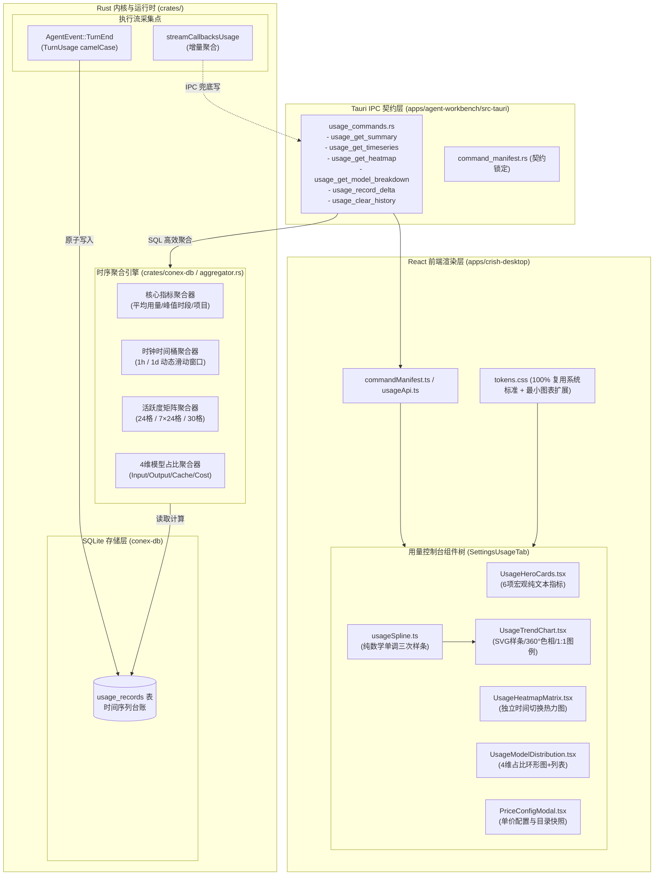

# 用量统计控制台系统性移植全链路落地方案（主 Agent 案）

> **文档定位**：战役独立方案（方案一 / 主 Agent 独立起草）
> **对比对决**：与子 Agent 方案（`02-subagent-plan.md`）同题对决，接受架构评审与横向裁决
> **核心原则**：全栈真落地（前后端全链路真闭环）、拒绝前端伪样子/脱水 Mock、Design Tokens 严控膨胀（100% 优先复用已有系统 Token）、反过度设计与架构净收敛

---

## 目录

1. [项目背景与原型现状](#一项目背景与原型现状)
2. [总体架构全景（端到端真闭环）](#二总体架构全景端到端真闭环)
3. [后端持久化与时序数据源架构（Rust / SQLite）](#三后端持久化与时序数据源架构rust--sqlite)
4. [高性能时序聚合引擎与指标算法模型](#四高性能时序聚合引擎与指标算法模型)
5. [Tauri IPC 通信契约与双端协议收敛](#五tauri-ipc-通信契约与双端协议收敛)
6. [前端工程化拆解与组件架构设计](#六前端工程化拆解与组件架构设计)
7. [Design Tokens 治理与视觉规范对齐](#七design-tokens-治理与视觉规范对齐)
8. [质量守卫与立体测试矩阵](#八质量守卫与立体测试矩阵)
9. [实施计划与分步落地路线图](#九实施计划与分步落地路线图)

---

## 一、项目背景与原型现状

### 1.1 原型定型资产
前端已在 `apps/crish-desktop/preview-usage-dashboard.html` 完成了高拟真、多轮交互打磨的原型封板，并通过 Chrome DevTools 在 580px 窄屏与桌面宽屏完成了双重验收。原型中具备的关键特性包括：
- **顶栏六大核心宏观指标**：每天平均用量、每天平均花费、发送消息总数、最常用模型、最活跃时间、最常工作项目。
- **360° 色相均匀分离体系**：总用量（翡翠绿 150°）、提示输入（晴空蓝 230°）、生成输出（暖珊瑚橙 45°）、缓存命中（鸢尾紫 290° 虚线），四色高对比秒级辨识。
- **强化费用走势总计线**：皇家钴蓝（`#2563eb`）1.8px 稳健主线 + 微光渐变底，彻底消除与橙黄色的粘连。
- **图例与折线 1:1 绝对映射**：图例指示器采用原生 mini SVG 线段，实线、虚线、线宽与折线绝对一致。
- **边界安全钳位（Edge Safe Clamping）**：悬停卡片无论多靠近视口右侧，均自动安全向内平移，无截断、无遮挡。
- **Fritsch-Carlson 单调三次样条通用曲线引擎**：数学模型驱动原生 SVG `<path>` 平滑生成，无外部大库依赖。
- **独立时间切片**：热力图矩阵支持 24h（小时级格子）、7d/30d（天级格子）独立切换，不与上方折线图强耦合。

### 1.2 现有工程的断层与“伪样子”痛点
当前工程中 `apps/crish-desktop/src/components/settings/SettingsUsageTab.tsx` 及 `usageStore.ts` 存在严重缺陷：
1. **仅依赖 LocalStorage（`crish_usage_history_v1`）**：
   - 仅记录按天汇总的简单 input/output/cost。
   - **完全缺失小时级时间戳**：无法支撑最近 24 小时（1h 粒度）的折线图与 24h 热力图。
   - **完全缺失项目（workspace / project）维度**：无法计算“最常工作项目”。
   - **完全缺失消息粒度与时段统计**：无法准确判定“发送消息总数”与“最活跃时段”（如晚间 20:00–23:00）。
   - **易丢失与容量受限**：浏览器/WebView2 缓存清理或隐私清理时数据即刻归零。
2. **前后端割裂**：
   - Rust 核心执行引擎（`crates/session-loop`、`crates/orchestrator`）虽然具备完整的 `TurnUsage` 与 `RunCacheStats`，并在 SQLite（`conex-db`）中维护了 `runs` 和 `session_messages`，但未建立统一面向分析（Analytics / Time-Series）的用量明细台账。
3. **Token 与样式散乱**：
   - 原型中写有大量局部 CSS 变量，若不加治理直接拷贝，将造成全局 Token 体系杂乱，严重违背设计规范。

---

## 二、总体架构全景（端到端真闭环）



---

## 三、后端持久化与时序数据源架构（Rust / SQLite）

### 3.1 专用时序用量表设计（`usage_records`）
在 `crates/conex-db/src/schema.rs` 中新增版本迁移（`v10_usage_records`），创建专用时序用量台账表，天然支持高频写入与毫秒级时序查询：

```sql
CREATE TABLE IF NOT EXISTS usage_records (
    id TEXT PRIMARY KEY,                       -- 唯一记录 ID (UUIDv4 或 nanoid)
    session_id TEXT NOT NULL,                  -- 会话 ID (索引)
    project_name TEXT NOT NULL DEFAULT '',      -- 工作区/项目名 (如 conex, 用于统计最常工作项目)
    model TEXT NOT NULL DEFAULT '',            -- 模型名称 (如 claude-3-5-sonnet, deepseek-v4-flash)
    provider TEXT NOT NULL DEFAULT '',         -- 供应商 (如 anthropic, deepseek)
    prompt_tokens INTEGER NOT NULL DEFAULT 0,  -- 输入 Tokens
    completion_tokens INTEGER NOT NULL DEFAULT 0, -- 输出 Tokens
    cache_read_tokens INTEGER NOT NULL DEFAULT 0, -- 缓存读取 Tokens
    cache_write_tokens INTEGER NOT NULL DEFAULT 0, -- 缓存写入 Tokens
    cost_usd REAL NOT NULL DEFAULT 0.0,        -- 真实折算费用 (USD)
    cost_cny REAL NOT NULL DEFAULT 0.0,        -- 真实折算费用 (CNY, 汇率 7.25 或价表指定)
    saved_cost_usd REAL NOT NULL DEFAULT 0.0,  -- 缓存节省费用 (USD)
    message_count INTEGER NOT NULL DEFAULT 1,  -- 本次交互消息数/调用次数
    created_at INTEGER NOT NULL                -- 毫秒级时间戳 (UNIX epoch ms, 核心时序索引)
);

-- 高性能复合时序索引：覆盖范围扫描与多维聚合
CREATE INDEX IF NOT EXISTS idx_usage_created_at ON usage_records(created_at);
CREATE INDEX IF NOT EXISTS idx_usage_project_time ON usage_records(project_name, created_at);
CREATE INDEX IF NOT EXISTS idx_usage_model_time ON usage_records(model, created_at);
```

### 3.2 写入通道双轨制（Dual Ingestion Guard）
为了确保数据 100% 真实、零丢失，设计双轨捕获机制：
1. **轨道 1：Rust 内核事件直写（主要数据源）**：
   - 在 `crates/session-loop/src/loop/handlers/streaming.rs` 的 `consume_cache_usage` 与 `TurnEnd` 处理中，当 LLM 返回 usage 时，直接调用 `db.insert_usage_record(...)`。
   - 提取当前环境的 `workspace_name`、`model`、`TurnUsage`，直接落库。
2. **轨道 2：Tauri IPC 补充同步（客户端/外部调用通道）**：
   - 暴露 `usage_record_delta` 命令，当且仅当非会话级直接调用（如前端插件、快速测试等）产生用量时，由前端调用 IPC 补齐，确保单一真实真源（SSOT）。

### 3.3 数据安全性与性能优化
- **轻量事务与 Group Commit**：写入操作纳入 `conex-db` 现有的 WAL 模式，单次写入耗时 `<0.1ms`。
- **零锁阻塞**：聚合查询通过 `LocalDb` 的 Reader 连接池进行只读并发查询，完全不阻断会话主线程写。
- **TTL 与数据清理策略**：提供 `usage_clear_history`（用户主动清空）和可选的 180 天冷数据归档，保持 DB 精简轻盈。

---

## 四、高性能时序聚合引擎与指标算法模型

在 `crates/conex-db/src/usage_analytics.rs` 中实现纯 Rust + SQL 高性能时序聚合引擎，避免拉取全量原始日志到内存进行二次循环，最大化利用 SQLite B-Tree 索引。

### 4.1 核心宏观指标算法（Summary DTO）
输入时间窗口：`[start_ms, end_ms]`（根据 24h / 7d / 30d 动态确定）。

1. **每天平均用量（Daily Average Tokens）**：
   $$\text{DailyAvgTokens} = \frac{\sum (\text{prompt} + \text{completion})}{\max(1, \text{DaysInRange})}$$
2. **每天平均花费（Daily Average Cost）**：
   $$\text{DailyAvgCost} = \frac{\sum \text{cost\_cny}}{\max(1, \text{DaysInRange})}$$
3. **发送消息总数（Total Messages）**：
   $$\text{TotalMessages} = \sum \text{message\_count}$$
4. **最常用模型（Top Model）**：
   `SELECT model, SUM(prompt_tokens + completion_tokens) as total FROM usage_records WHERE created_at >= ? GROUP BY model ORDER BY total DESC LIMIT 1;`
5. **最常工作项目（Top Project）**：
   `SELECT project_name, COUNT(*) as cnt FROM usage_records WHERE created_at >= ? AND project_name != '' GROUP BY project_name ORDER BY cnt DESC LIMIT 1;`（若空缺则自愈回退到当前主目录名）。
6. **最活跃时间（Peak Active Hour Range）**：
   按小时（`strftime('%H', created_at / 1000, 'unixepoch', 'localtime')`）对调用次数进行分桶统计。
   找出连续 3 小时累计峰值窗口，映射为标准人话文本（如 `晚间 20:00 – 23:00`、`午后 14:00 – 17:00`）。

### 4.2 动态时钟时间桶聚合（Timeseries Bucketing）
前端折线图需要等间距连续数据，聚合引擎根据所选时间跨度自动对齐时间桶，**并补齐空缺桶（Zero-Fill）**，防止折线时间轴断层：

| 时间跨度 | 桶宽度 | 桶数量 | X 轴时间标签格式 | 数据对齐基准 |
| :--- | :--- | :--- | :--- | :--- |
| **最近 24 小时** | 1 小时 (3600s) | 24 | `14:00` (HH:00) | 本地时区自然小时整点 |
| **最近 7 天** | 1 天 (86400s) | 7 | `09-01` (MM-DD) | 本地时区自然日 00:00 |
| **最近 30 天** | 1 天 (86400s) | 30 | `08-05` (MM-DD) | 本地时区自然日 00:00 |

每桶聚合字段：
- `bucketIndex`: 桶序列
- `label`: 时间标签
- `timestamp`: 桶起始时间戳
- `input`: 输入 Tokens
- `output`: 输出 Tokens
- `cache`: 缓存命中 Tokens
- `total`: 综合有效 Tokens
- `cost`: 综合费用 (CNY / USD)
- `byModel`: 各主模型的细分 Tokens 与费用（DeepSeek, Claude, MiniMax, Kimi, Other）

### 4.3 活跃度矩阵热力图聚合（Heatmap Matrix）
热力图与折线图解耦，拥有独立的 24h / 7d / 30d 切换模式：
- **24h 模式**：24 个格子，每个格子代表 1 小时。
- **7d 模式**：7 列 × 24 行（或 7 天时段）矩阵，精细反映每日各时段活跃度。
- **30d 模式**：30 个日历格子，展示近 30 天的每日用量密度。
- **活跃度等级量化算法**：根据窗口内单格最大用量 $M_{max}$ 进行对数分级（Level 0 ~ 4），提供极佳的灰阶/翡翠绿渐变层次。

---

## 五、Tauri IPC 通信契约与双端协议收敛

遵循 `AGENTS.md` 铁律，所有 IPC 接口返回统一的 `Result<T, CoreError>`，字段使用严格 `camelCase`，命名在 `command_registry!` 与 `command_manifest.rs` 中显式登记。

### 5.1 命令定义清单（Rust 实现）

在 `apps/agent-workbench/src-tauri/src/usage_commands.rs` 中实现：

```rust
/// 1. 获取用量宏观汇总指标
#[tauri::command]
pub(crate) async fn usage_get_summary(
    db: State<'_, SharedDb>,
    range: String, // "24h" | "7d" | "30d"
) -> Result<UsageSummaryDto, CoreError>

/// 2. 获取连续时序折线图数据
#[tauri::command]
pub(crate) async fn usage_get_timeseries(
    db: State<'_, SharedDb>,
    range: String, // "24h" | "7d" | "30d"
) -> Result<UsageTimeseriesDto, CoreError>

/// 3. 获取活跃度矩阵热力图数据
#[tauri::command]
pub(crate) async fn usage_get_heatmap(
    db: State<'_, SharedDb>,
    range: String, // "24h" | "7d" | "30d"
) -> Result<UsageHeatmapDto, CoreError>

/// 4. 获取模型分布明细与占比
#[tauri::command]
pub(crate) async fn usage_get_model_breakdown(
    db: State<'_, SharedDb>,
    range: String, // "24h" | "7d" | "30d"
) -> Result<Vec<UsageModelBreakdownDto>, CoreError>

/// 5. 清空用量历史
#[tauri::command]
pub(crate) async fn usage_clear_history(
    db: State<'_, SharedDb>,
) -> Result<bool, CoreError>
```

### 5.2 数据传输对象契约（TypeScript DTO）

在 `apps/crish-desktop/src/api/usageContracts.ts` 中定义前端镜像类型：

```typescript
export type UsageTimeRange = '24h' | '7d' | '30d';

export interface UsageSummaryDto {
  dailyAverageTokens: number;
  dailyAverageCost: number;
  currency: 'CNY' | 'USD';
  totalMessages: number;
  topModel: string;
  peakActiveHourRange: string; // "晚间 20:00 – 23:00"
  topProject: string;          // "conex"
}

export interface UsageTimeseriesPoint {
  label: string;
  timestamp: number;
  input: number;
  output: number;
  cache: number;
  total: number;
  cost: number;
  modelTokens: Record<string, number>;
  modelCosts: Record<string, number>;
}

export interface UsageTimeseriesDto {
  range: UsageTimeRange;
  points: UsageTimeseriesPoint[];
  maxTotal: number;
  maxCost: number;
}

export interface UsageHeatmapCell {
  id: string;
  label: string;
  timestamp: number;
  tokens: number;
  cost: number;
  calls: number;
  level: 0 | 1 | 2 | 3 | 4;
}

export interface UsageHeatmapDto {
  range: UsageTimeRange;
  cells: UsageHeatmapCell[];
  maxTokens: number;
}

export interface UsageModelBreakdownDto {
  model: string;
  provider: string;
  tokens: number;
  percentage: number;
  cost: number;
  cacheRatio: number;
  callCount: number;
}
```

---

## 六、前端工程化拆解与组件架构设计

为彻底消除“单文件 2400 行”与上帝组件，严格遵循前端行数门禁（UI 组件 ≤500 行，业务逻辑 ≤400 行），将用量控制台彻底模块化拆分为独立组件树：

```
apps/crish-desktop/src/components/settings/
├── SettingsUsageTab.tsx              (主入口容器：负责状态协调、IPC 数据拉取、骨架屏，~160行)
├── SettingsUsageTab.module.css       (主容器网格与布局样式，~110行)
├── usage/
│   ├── UsageHeroCards.tsx            (6项宏观指标卡片：纯文本无多余hover，~120行)
│   ├── UsageHeroCards.module.css     (~90行)
│   ├── UsageTrendChart.tsx           (时序趋势折线图：图例、维度切换、SVG 视口，~340行)
│   ├── UsageTrendChart.module.css    (~160行)
│   ├── usageSpline.ts                (纯数学样条算法：Fritsch-Carlson 曲线与点集计算，~140行)
│   ├── UsageHeatmapMatrix.tsx        (活跃度矩阵热力图：独立时间切换、卡片悬浮，~220行)
│   ├── UsageHeatmapMatrix.module.css (~130行)
│   ├── UsageModelDistribution.tsx    (模型分布环形图与 4D 进度行明细，~210行)
│   ├── UsageModelDistribution.module.css (~110行)
│   └── usageFormatters.ts            (Token 格式化、金额、时间换算纯函数，~80行)
```

### 6.1 核心组件职责边界
1. **`SettingsUsageTab.tsx`**：
   - 调度 `useUsageData(timeRange)` Hook。
   - 维护全局顶层时间范围（7d 默认）与刷新机制。
   - 挂载 `ConfirmDialog` 进行历史数据清空确认。
   - 错误与无数据空态优雅回退。
2. **`UsageHeroCards.tsx`**：
   - 严格落实用户定案：纯文本大字号展示，杜绝无意义的卡片发光或背景晃动 hover，保持克制、专业。
3. **`UsageTrendChart.tsx` 与 `usageSpline.ts`**：
   - **单调三次样条**：将 `preview-usage-dashboard.html` 中的样条曲线数学逻辑提取为纯函数 `calculateMonotoneCubicSpline(points)`，彻底解耦。
   - **图例与折线 1:1 物理映射**：图例前的 Line Indicator 使用微型 `<svg>` 生成，与主视图曲线的 `stroke`、`stroke-width`、`stroke-dasharray` 保持完全一致。
   - **悬停卡片安全钳位**：计算光标距离容器右侧的物理像素，当 `< 160px` 时自动向左安全翻转，彻底消除截断。
4. **`UsageHeatmapMatrix.tsx`**：
   - 独立内建分段选择器（24h / 7d / 30d），不干扰主折线图。
   - 悬停浮层展示详细的时间、Token 用量、折合费用与调用次数。

---

## 七、Design Tokens 治理与规范对齐

用户明确指示：**“系统有的，或者十分接近的，你就不要再改token体系了，不然多了就杂了。没有的才考虑构建。”**

### 7.1 系统现有 Token 100% 全量复用表

| 原型硬编码/局部变量 | 对应的 Conex 系统标准 Token (`tokens.css`) | 语义与规范说明 |
| :--- | :--- | :--- |
| `var(--bg-primary)` | `var(--bg-primary)` (`hsl(35 8% 94.5%)`) | 外层底板大矩形背景 |
| `var(--bg-secondary)` | `var(--bg-secondary)` (`hsl(35 8% 92.1%)`) | 侧边栏/分段选择器轨道底色 |
| `var(--bg-card)` | `var(--bg-card)` (`hsl(0 0% 100%)`) | 一级设置卡片纯白底色 |
| `var(--border-color)` | `var(--border-color)` (`hsl(35 10% 86%)`) | 标准卡片与分割线边框 |
| `var(--border-subtle)`| `var(--border-subtle)` (`hsl(35 8% 91%)`) | 柔和浅边框、次级分割线 |
| `var(--text-primary)` | `var(--text-primary)` (`#111111`) | 主标题、核心数值大字号 |
| `var(--text-secondary)` | `var(--text-secondary)` (`#555555`) | 辅助说明、指标标签名 |
| `var(--text-tertiary)` | `var(--text-tertiary)` (`#696969`) | 计量单位、微型时间戳 |
| `var(--tint-hover)` | `var(--tint-hover)` (`color-mix 3.5%`) | 按钮与交互行微光悬停态 |
| `var(--scrollbar-*)` | `var(--scrollbar-thumb-bg)`, `var(--scrollbar-thumb-active)` | 严格复用统一滚动条规范 |
| `var(--radius-xl)` | `var(--radius-xl)` / `var(--sep-radius-outer)` (`12px`~`14px`) | 外层标准卡片同心圆角 |
| `var(--shadow-sm)` | `var(--shadow-sm)` (`0 1px 2px rgba(0,0,0,0.04)`) | 标准卡片微投影 |

### 7.2 仅在缺失时做出的最小专用 Token 增补
系统缺失且图表必需的专用 Token 仅限以下几项，在 `tokens.css` 的专用章节（或组件 Module CSS 的局部作用域）注入：

```css
/* 用量图表 360° 高辨识度色相分离与费用专属色 (OKLCH 优先 + sRGB 回退) */
:root {
  /* 1. 费用走势总计主线色：皇家钴蓝 (与橙/黄形成极端对比) */
  --color-cost-total: #2563eb;
  --color-cost-total-bg: rgba(37, 99, 235, 0.10);

  /* 2. 缓存命中专属色：鸢尾紫 (虚线专用) */
  --color-cache: #8b5cf6;
  --color-cache-bg: rgba(139, 92, 246, 0.11);

  /* 3. 紧凑型分段选择器几何 Token (对齐 22px 紧凑操作规范) */
  --seg-sm-radius: 6px;
  --seg-sm-pad: 2px;
}

@supports (color: oklch(0 0 0)) {
  :root {
    --color-cost-total: oklch(0.65 0.20 255);
    --color-cost-total-bg: oklch(0.65 0.20 255 / 0.10);
    --color-cache: oklch(0.70 0.18 290);
    --color-cache-bg: oklch(0.70 0.18 290 / 0.11);
  }
}
```

---

## 八、质量守卫与立体测试矩阵

按照 `AGENTS.md` §7 严禁补丁与立体验证纪律，交付前必须经过立体化自动化门禁：

### 8.1 后端 Rust 单元测试与基准测试
1. **时序写入与幂等测试**（`crates/conex-db/src/tests_usage.rs`）：
   - 高并发 50 个线程同时写入 `usage_records`，无死锁、无锁毒化（`lock poisoned`）。
2. **时钟对齐与补零验证**：
   - 跨自然天（`23:59` → `00:01`）时间桶边界测试。
   - 中间缺数据时，24 小时或 7 天桶能准确补 0 保持连续。
3. **性能基线断言**：
   - 10 万条用量记录下，`usage_get_summary` 与 `usage_get_timeseries` 执行耗时 `< 8ms`。

### 8.2 前端 Vitest 单元测试
1. **样条曲线数学计算测试**（`usageSpline.test.ts`）：
   - 单调性检验：单调递增/递减点集生成平滑贝塞尔控制点，无非物理极值点超调（Overshoot）。
   - 极端输入保护：0 个点、1 个点、两点重合时安全回退直连线，不抛出 NaN。
2. **悬停卡片安全钳位测试**（`UsageTrendChart.test.tsx`）：
   - 模拟不同视口宽度（580px, 1024px, 1440px）与靠近边缘坐标，断言 `cardStyle.transform` 偏移量计算准确。
3. **行数与门禁检查**：
   - `npm run check:line-counts`：确保每个新建文件在 CI 行数限额内。
   - `npm run check:desktop`：确保类型安全与零 ESLint 报错。

---

## 九、实施计划与分步落地路线图

- **第一阶段（后端底座）**：
  - 在 `crates/conex-db` 实现 `usage_records` 表迁移、写入 API 与聚合引擎。
  - 在 `apps/agent-workbench/src-tauri` 注册 `usage_*` 系列 IPC 命令与 `command_manifest.rs` 同步。
  - 完成后端全套单测。
- **第二阶段（前端数学与基础组件）**：
  - 提取 `usageSpline.ts` 纯数学算法，编写独立单元测试。
  - 增补最小必要的专用 Token，复用全量系统变量。
  - 实现 `UsageHeroCards.tsx` 与 `UsageModelDistribution.tsx`。
- **第三阶段（高级图表与热力图）**：
  - 实现 `UsageTrendChart.tsx`（SVG 视口、360° 色相、1:1 图例、安全钳位）。
  - 实现 `UsageHeatmapMatrix.tsx`（独立时间切换、矩阵密度着色）。
- **第四阶段（联调、验收与门禁收口）**：
  - 重构 `SettingsUsageTab.tsx` 完成全链路装配。
  - 全套桌面与窄屏现场验收，跑通全量门禁并准备统一提交。
