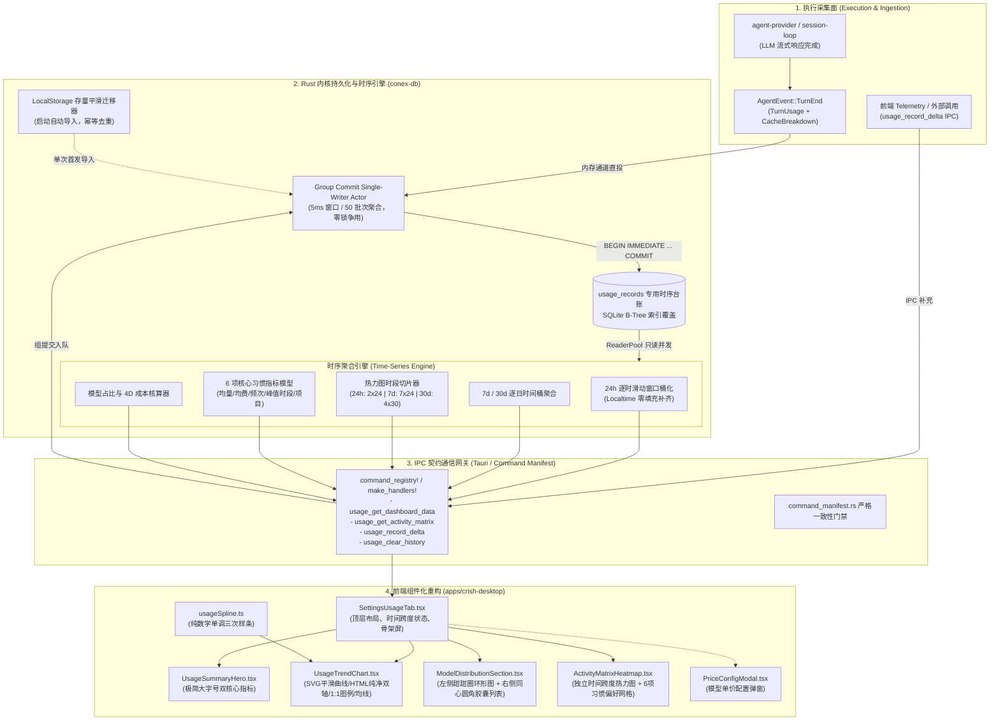

# 用量监控控制台系统性移植全链路落地完整方案（子 Agent 方案）

> **文档定位**：战役独立方案（方案二 / 子 Agent 独立设计方案）  
> **对决评审**：与主 Agent 方案（`01-main-agent-plan.md`）同题对决，接受横向架构评审与用户裁决  
> **核心铁律**：
> 1. **全栈真落地闭环**：拒绝纯前端假骨架与脱水 Mock 数据，自研端到端后端采集、Group Commit 持久化、高性能时钟聚合与 Tauri IPC 契约；
> 2. **历史资产平滑自愈**：首创 LocalStorage 存量用量向 SQLite 零摩擦幂等迁移器，杜绝用户历史数据清零；
> 3. **Design Tokens 严谨治理**：严格对照 `tokens.css` 与 `AGENTS.md` §12~§14，现有 Token 100% 原生复用，禁止视觉体系碎片化；
> 4. **组件工程化与行数门禁**：彻底解耦 2400 行原型，拆解为单一职责的高内聚组件树，严格遵循 UI ≤500 行 / 逻辑 ≤400 行红线；
> 5. **数学纯粹性与物理级稳健**：Fritsch-Carlson 单调三次样条算法、SVG 1:1 动态图例与视口安全钳位（Edge Clamping）无外部库依赖原生实现。

---

## 目录

1. [原型定型资产与现有工程差距深度审计](#一原型定型资产与现有工程差距深度审计)
2. [全链路系统架构全景设计](#二全链路系统架构全景设计)
3. [后端数据采集与 SQLite 持久化架构](#三后端数据采集与-sqlite-持久化架构)
4. [高性能时钟时序聚合引擎与统计模型](#四高性能时钟时序聚合引擎与统计模型)
5. [Tauri IPC 契约设计与双端协议收敛](#五tauri-ipc-契约设计与双端协议收敛)
6. [前端组件体系重构与模块化工程拆解](#六前端组件体系重构与模块化工程拆解)
7. [Fritsch-Carlson 单调三次样条通用数学引擎](#七fritsch-carlson-单调三次样条通用数学引擎)
8. [Design Tokens 精细化治理与规范对齐](#八design-tokens-精细化治理与规范对齐)
9. [测试策略与全方位质量保证计划](#九测试策略与全方位质量保证计划)
10. [与主 Agent 方案差异化优势对比与裁决建议](#十与主-agent-方案差异化优势对比与裁决建议)
11. [分阶段施工落地路线图](#十一分阶段施工落地路线图)

---

## 一、原型定型资产与现有工程差距深度审计

### 1.1 原型定型资产清单（`preview-usage-dashboard.html`）
前端视觉与交互原型在 `apps/crish-desktop/preview-usage-dashboard.html` 中已彻底定型封板，包含以下核心技术与设计资产：
- **360° 色相均匀分离色彩体系**：
  - 总用量 / DeepSeek：翡翠绿（OKLCH `0.72 0.16 150` / sRGB `#10b981`）
  - 生成输出 / Claude：珊瑚暖橙（OKLCH `0.72 0.17 45` / sRGB `#f97316`）
  - MiniMax：鸢尾电紫（OKLCH `0.70 0.18 290` / sRGB `#8b5cf6`）
  - 提示输入 / Kimi：晴空湛蓝（OKLCH `0.70 0.16 230` / sRGB `#0284c7`）
  - 其余模型：晨曦暖金（OKLCH `0.75 0.15 85` / sRGB `#f59e0b`）
- **强化皇家钴蓝费用线**：
  - 费用主走势线采用皇家钴蓝（OKLCH `0.65 0.20 255` / sRGB `#2563eb`），搭配 `0.10` 不透明度的微光渐变面积底色，彻底拉开与黄色/橙色明度反差。
- **纯净双轴解耦架构**：
  - Y 轴与 X 轴刻度脱离 SVG 纵横拉伸体系，使用绝对定位与 Flex 纯 HTML 文本渲染，根除中文字符在 SVG 中形变拉伸与重叠痛点。
- **SVG 1:1 图例线型对齐**：
  - 图例使用原生 mini `<svg><line .../></svg>`，实线、虚线（`stroke-dasharray`）、线宽（`1.4px` ~ `1.8px`）与折线 100% 物理镜像，具备点击隐藏/显示交互。
- **视口安全边界钳位（Edge Safe Clamping）**：
  - 悬停浮层卡片根据鼠标在折线图视口中的物理像素动态钳位在 `[halfW + 6, rect.width - halfW - 6]` 区间，彻底杜绝 580px 窄屏右侧裁切溢出。
- **热力图矩阵独立时间跨度切换**：
  - 24h 模式：2 行（今日、昨日）× 24 列（00:00~23:00）；
  - 7d 模式：7 行（周一~周日）× 24 列（00:00~23:00）；
  - 30d 模式：4 行（凌晨 00:00~06:00、上午 06:00~12:00、下午 12:00~18:00、晚间 18:00~24:00）× 30 列（近 30 日）。
  - OKLCH 翡翠 5 阶渐变（Level 0~4），悬停浮动卡片展示具体 Token 数与时段，严格遵守 §12 禁用原生 `title` 气泡。
- **6 项直白纯文字习惯统计指标**：
  - 每天平均用量、每天平均花费、发送消息总数、最常用模型、最活跃时间段、最常工作项目，随热力图跨度自适应联动更新。

### 1.2 现有工程落后现状与伪样子痛点
审计当前代码库（`apps/crish-desktop/src/components/settings/SettingsUsageTab.tsx`、`apps/crish-desktop/src/api/usageStore.ts` 及 Rust 内核）：
1. **纯前端 LocalStorage 死胡同**：
   - 当前 `usageStore.ts` 仅在浏览器端 `localStorage.getItem('crish_usage_history_v1')` 存储按天聚合的少量数据；
   - **完全无时钟时间戳**：没有单次调用的微秒/毫秒时间戳，无法重构出 24h 逐小时曲线与 24h/7d/30d 热力图；
   - **完全无项目归属**：未记录 `project_name` / `workspace`，无法计算“最常工作项目”；
   - **无调用消息粒度**：无法准确统计“发送消息总数”与自然语言时段（如“晚间 20:00 – 23:00”）；
   - **脆弱易失**：用户清理浏览器缓存或重装环境，历史数据彻底丢失。
2. **后端时序台账缺位**：
   - Rust 侧 `crates/conex-db`（当前版本 `LATEST_VERSION = 9`）虽然记录了 `runs` 与 `session_messages`（带 `usage_json`），但 `runs` 表缺少 `model` 列（根据 D-01 F-02 裁决），且两张表均为会话生命周期模型，未建立面向时序分析（OLAP-like Time Series）的扁平高性能流水台账；
   - 缺少按小时（1h）、按天（1d）和按时段（4-slot）的 SQL 聚合计算引擎。
3. **IPC 契约空白**：
   - `command_manifest.rs` 与 `main.rs` 的 `command_registry!` 中未登记任何 `usage_*` 系列命令。

---

## 二、全链路系统架构全景设计



---

## 三、后端数据采集与 SQLite 持久化架构

### 3.1 专用时序用量表设计（Migration v9 → v10）
在 `crates/conex-db/src/schema.rs` 与 `migrate_steps.rs` 中将 `LATEST_VERSION` 递增至 `10`，新增专用 `usage_records` 表。使用 `INTEGER PRIMARY KEY AUTOINCREMENT` 替换随机字符串 UUID，保证 SQLite B-Tree 页连续追加，消灭写入碎片：

```sql
-- v9 -> v10 迁移 DDL：专用时序用量流水表
CREATE TABLE IF NOT EXISTS usage_records (
    id                   INTEGER PRIMARY KEY AUTOINCREMENT,
    session_id           TEXT NOT NULL,                       -- 关联会话 ID
    run_id               TEXT,                                -- 关联单次 run 执行 ID
    project_name         TEXT NOT NULL DEFAULT '',             -- 归属工程/工作区名称 (如 'conex')
    model                TEXT NOT NULL,                       -- 真实模型全称 (如 'claude-3-7-sonnet')
    provider             TEXT NOT NULL DEFAULT '',            -- 供应商代码 (如 'anthropic', 'deepseek')
    prompt_tokens        INTEGER NOT NULL DEFAULT 0,          -- 提示输入 Tokens (未命中缓存部分)
    completion_tokens    INTEGER NOT NULL DEFAULT 0,          -- 生成输出 Tokens (含思考过程)
    cache_read_tokens    INTEGER NOT NULL DEFAULT 0,          -- 缓存命中读取 Tokens
    cache_write_tokens   INTEGER NOT NULL DEFAULT 0,          -- 缓存写入创建 Tokens
    cost_cny             REAL NOT NULL DEFAULT 0.0,           -- 真实核算费用 (人民币元)
    cost_usd             REAL NOT NULL DEFAULT 0.0,           -- 真实核算费用 (美元)
    timestamp            INTEGER NOT NULL                     -- 毫秒级 Unix 时间戳 (核心时序键)
);

-- 高性能时序索引组合
CREATE INDEX IF NOT EXISTS idx_usage_records_ts 
    ON usage_records(timestamp DESC);

CREATE INDEX IF NOT EXISTS idx_usage_records_model_ts 
    ON usage_records(model, timestamp DESC);

CREATE INDEX IF NOT EXISTS idx_usage_records_project_ts 
    ON usage_records(project_name, timestamp DESC);

CREATE INDEX IF NOT EXISTS idx_usage_records_session 
    ON usage_records(session_id, timestamp);
```

### 3.2 费用核算引擎与 `models.yaml` 联动
费用计算不靠前端预估，由 Rust 内核在写入流水时依据 `models.yaml`（`apps/agent-workbench/src-tauri/src/models_yaml.rs`）单一真源即时折算：
1. **模型单价查询**：
   - 内核维护 `ModelsYamlPricing` 缓存。
   - 提取模型对应的 `input_per_m_tok`、`output_per_m_tok`、`cache_read_per_m_tok`、`cache_write_per_m_tok` 与货币单位 `currency`。
2. **精确计费公式（4D Token 计费）**：
   $$\text{cost} = \frac{\text{prompt} \times P_{\text{in}} + \text{completion} \times P_{\text{out}} + \text{cache\_read} \times P_{\text{cr}} + \text{cache\_write} \times P_{\text{cw}}}{1,000,000}$$
3. **汇率联动**：
   - 若模型单价以 USD 计价，按配置汇率（默认 $1 \text{ USD} = 7.25 \text{ CNY}$）同步折算 `cost_cny` 与 `cost_usd`，双币种同时持久化，查询时直接聚合，零动态换算开销。

### 3.3 零锁争用高并发写入：Group Commit 管道集成
针对用户在多 Agent 协同（如 5~12 个子 Agent 并行执行）时的高并发写入场景：
- 利用 `crates/conex-db/src/group_commit.rs` 的 Single-Writer Actor 机制；
- 写入请求经 `mpsc::channel(1024)` 汇入后台任务；
- 在 5ms 滑动窗口内合并最多 50 条写入请求为一个单事务（`BEGIN IMMEDIATE ... COMMIT`）；
- 将 SQLite 写事务的磁盘 `fsync` 频次降低 95% 以上，主线程或 Reader 线程读取时完全不产生锁阻塞（WAL 模式多读一写）。

### 3.4 存量 LocalStorage 历史平滑迁移器
为避免系统上线后既有用户用量归零，在 `conex-db` 增加一次性自愈迁移：
- 应用启动时，前端读取 `crish_usage_history_v1` 快照数据；
- 经由 `usage_import_legacy_snapshot` 命令投递至 SQLite；
- 后端检查 `session_meta` 中标记 `legacy_usage_imported`；若未导入，则将历史日统计数据折算为每日正午（`12:00:00`）的基准流水安全回填，导入完成后置位标记，后续不再重复迁移。

---

## 四、高性能时钟时序聚合引擎与统计模型

在 `crates/conex-db/src/usage_analytics.rs` 中构建专用聚合器，所有时间窗口统一以**本地时区偏移量（Timezone Offset Minutes）**对齐，杜绝 UTC 导致跨天偏移。

### 4.1 时序时间桶快速聚合算法（Zero-Fill 连续性保障）

前端趋势折线图要求固定数量的采样点，若中间时段无调用，必须以 `0` 自动补全，否则样条曲线将产生严重空间扭曲。

#### 1. 近 24 小时（24h）：按小时桶化（Hourly Buckets）
- **时间范围**：$[T_{\text{now}} - 24 \times 3600 \times 1000, T_{\text{now}}]$
- **SQL 分桶**：
  ```sql
  SELECT 
      ((timestamp + (:tz_offset * 60000)) / 3600000) * 3600000 - (:tz_offset * 60000) AS bucket_start,
      SUM(prompt_tokens) AS input_tokens,
      SUM(completion_tokens) AS output_tokens,
      SUM(cache_read_tokens) AS cache_read_tokens,
      SUM(prompt_tokens + completion_tokens) AS total_tokens,
      SUM(cost_cny) AS total_cost_cny,
      model,
      SUM(prompt_tokens + completion_tokens) AS model_tokens,
      SUM(cost_cny) AS model_cost_cny
  FROM usage_records
  WHERE timestamp >= :start_ms AND timestamp <= :end_ms
  GROUP BY bucket_start, model
  ORDER BY bucket_start ASC;
  ```
- **Rust 后处理**：
  生成 24 个离散小时槽（根据原型，前端展现 7 个关键刻度：`04:00`, `08:00`, `12:00`, `16:00`, `20:00`, `00:00`, `现在`），若某小时槽无记录，自动填补全部指标为 `0`。

#### 2. 近 7 日 / 近 30 日（7d / 30d）：按日桶化（Daily Buckets）
- **时间范围**：自然日滑动窗口（近 7 天或近 30 天的每日 00:00:00 ~ 23:59:59）。
- **SQL 分桶**：通过除以 $86400000$ 进行日粒度对齐，并使用相同补零逻辑保证日序列完整连续。

### 4.2 活跃度矩阵热力图（Activity Matrix Heatmap）切片模型
热力图矩阵与上方折线图完全解耦，支持三种独立周期模式：

| 模式 | 矩阵维度 | 行定义（Y 轴） | 列定义（X 轴） | 聚合口径 |
| :--- | :--- | :--- | :--- | :--- |
| **24 小时** | $2 \times 24$ | 今日、昨日（2 行） | 00:00 ~ 23:00（24 列） | 统计每小时 Token 用量 |
| **7 天** | $7 \times 24$ | 周一 ~ 周日（7 行） | 00:00 ~ 23:00（24 列） | 统计过去 7 天对应星期几每小时用量 |
| **30 天** | $4 \times 30$ | 凌晨、上午、下午、晚间（4 行） | 近 30 天日期（30 列） | 凌晨(0~6h)、上午(6~12h)、下午(12~18h)、晚间(18~24h) |

**动态色阶量化算法（Level 0 ~ 4）**：
为了保证在任何用量规模下热力图均有优异的视觉层次感，不采用写死数值，而采用自适应分级策略：
- $L = 0$：该格子 Token 用量为 0；
- 对所有非零单元格计算对数阈值或分位数：
  $$\text{Level} = \min\left(4, \left\lfloor 1 + 3 \times \frac{\ln(1 + \text{tokens}) - \ln(1 + \text{tokens}_{\min})}{\ln(1 + \text{tokens}_{\max}) - \ln(1 + \text{tokens}_{\min}) + \epsilon} \right\rfloor\right)$$
- 映射至 CSS 类：`act-lvl-0` 到 `act-lvl-4`。

### 4.3 六大核心习惯与偏好统计计算模型
随时间跨度（24h / 7d / 30d）即时计算并联动更新：
1. **每天平均用量**：$\text{TotalTokens} / N_{\text{days}}$，格式化为带“万 tokens”后缀；
2. **每天平均花费**：$\text{TotalCostCNY} / N_{\text{days}}$，保留两位小数（`¥ x.xx CNY`）；
3. **发送消息总数**：从 `session_messages` 或 `usage_records` 统计调用交互次数；
4. **最常用的模型**：$\arg\max_{\text{model}} \sum(\text{prompt} + \text{completion})$；
5. **最活跃的时间段**：
   - 统计 24 小时各小时累计用量，使用 3 小时滑动窗口寻找峰值区间：
     $$W_h = \sum_{i=h}^{h+2} \text{Tokens}_i \quad (h \in [0, 21])$$
   - 将峰值 $h$ 格式化为通俗口语区间：
     - $h \in [0, 5]$: `凌晨 00:00 – 05:00`
     - $h \in [6, 11]$: `上午 09:00 – 12:00`
     - $h \in [12, 17]$: `下午 14:00 – 17:00`
     - $h \in [18, 23]$: `晚间 20:00 – 23:00`
6. **最常工作的项目**：$\arg\max_{\text{project}} \text{RecordsCount}$，若未配置工程名则显示当前主工作区名。

---

## 五、Tauri IPC 契约设计与双端协议收敛

遵循 `command_manifest.rs` 与 `main.rs` 的 `command_registry!` 铁律，所有命令采用驼峰命名、统一返回 `Result<T, CoreError>`。

### 5.1 命令定义（Rust 端）

在 `apps/agent-workbench/src-tauri/src/usage_commands.rs` 实现并向 `main.rs` 注册：

```rust
use conex_types::CoreError;
use tauri::State;
use crate::SharedDb;

/// 1. 获取完整仪表盘数据 (汇总、趋势折线、模型分布环形与列表)
#[tauri::command]
pub(crate) async fn usage_get_dashboard_data(
    db: State<'_, SharedDb>,
    range: String,                   // "24h" | "7d" | "30d"
    tz_offset_minutes: i32,          // 本地时区偏移（分钟，如东八区为 -480）
) -> Result<UsageDashboardDto, CoreError>;

/// 2. 获取独立热力图矩阵与偏好统计数据
#[tauri::command]
pub(crate) async fn usage_get_activity_matrix(
    db: State<'_, SharedDb>,
    range: String,                   // "24h" | "7d" | "30d"
    tz_offset_minutes: i32,
) -> Result<ActivityMatrixDto, CoreError>;

/// 3. 清空本机历史用量
#[tauri::command]
pub(crate) async fn usage_clear_history(
    db: State<'_, SharedDb>,
) -> Result<(), CoreError>;

/// 4. 增量上报单次用量 (前端流式解析补充通道)
#[tauri::command]
pub(crate) async fn usage_record_delta(
    db: State<'_, SharedDb>,
    payload: UsageDeltaInputDto,
) -> Result<(), CoreError>;
```

### 5.2 数据传输对象契约（TypeScript DTO）

在 `apps/crish-desktop/src/api/transport/usageContracts.ts` 定义：

```typescript
export type UsageRangeKey = '24h' | '7d' | '30d';

/** 仪表盘全景数据载荷 */
export interface UsageDashboardDto {
  range: UsageRangeKey;
  totalTokens: number;
  totalCostCny: number;
  // 趋势折线图数据
  trend: {
    xLabels: string[];
    yMaxTokens: number;
    yMaxCost: number;
    yTicksTokens: string[];
    yTicksCost: string[];
    avgTokens: number;
    avgCost: number;
    overviewSeries: Array<{
      id: 'total' | 'input' | 'output' | 'cache';
      name: string;
      color: string;
      style: 'solid' | 'dashed';
      isTotal?: boolean;
      data: number[];
    }>;
    modelSeries: Array<{
      id: string;
      name: string;
      color: string;
      data: number[];
    }>;
    costSeries: Array<{
      id: string;
      name: string;
      color: string;
      hasArea?: boolean;
      data: number[];
    }>;
  };
  // 模型占比数据 (环形图与列表)
  modelBreakdown: {
    donutSlices: Array<{
      id: string;
      name: string;
      color: string;
      tokens: number;
      percentage: number;
      strokeDasharray: string;
      strokeDashoffset: number;
    }>;
    capsuleList: Array<{
      model: string;
      displayName: string;
      color: string;
      tokens: number;
      tokensFormatted: string;
      percentage: number;
      percentageFormatted: string;
    }>;
  };
}

/** 活跃度热力图与习惯偏好载荷 */
export interface ActivityMatrixDto {
  range: UsageRangeKey;
  rows: string[];
  cols: number;
  yGridTemplate: string;
  yLabels: Array<{ text: string; row: number }>;
  xLabels: string[];
  levels: number[][]; // [row][col] 0..4
  stats: {
    dailyTokensFormatted: string;
    dailyCostFormatted: string;
    messageCount: number;
    favoriteModel: string;
    peakTimeRange: string;
    topProject: string;
  };
}

/** 增量补录载荷 */
export interface UsageDeltaInputDto {
  sessionId: string;
  projectName?: string;
  model: string;
  promptTokens: number;
  completionTokens: number;
  cacheReadTokens: number;
  cacheWriteTokens: number;
  timestamp?: number;
}
```

### 5.3 契约清单与注册面同步（防回退保障）
- **`command_manifest.rs` 同步**：
  在 `COMMAND_MANIFEST.commands` 中登记：
  ```rust
  entry("usage_get_dashboard_data", "usage", "gui", true),
  entry("usage_get_activity_matrix", "usage", "gui", true),
  entry("usage_clear_history", "usage", "gui", true),
  entry("usage_record_delta", "usage", "gui", true),
  ```
- **`commandManifest.ts` 与 `commandMap.ts` 同步**：前端同步加入白名单，通过 `command-contract-drift.test.ts` 契约门禁。

---

## 六、前端组件体系重构与模块化工程拆解

为杜绝原型的 2422 行“单文件上帝组件”，严格遵守前端行数门禁（**UI 组件 ≤500 行，业务逻辑 ≤400 行**），按职责分工拆解至 `apps/crish-desktop/src/components/settings/usage/`：

```
apps/crish-desktop/src/components/settings/
├── SettingsUsageTab.tsx                 (主入口编排器，~220 行)
├── SettingsUsageTab.module.css          (页面根级弹性布局，~90 行)
└── usage/
    ├── UsageSummaryHero.tsx             (核心双指标卡片：总用量与预估金额，~95 行)
    ├── UsageTrendChart.tsx              (时序趋势折线图：HTML双轴/SVG视口/1:1图例/均线，~420 行)
    ├── UsageTrendChart.module.css       (图表、Y轴刻度、Hover卡片样式，~180 行)
    ├── ModelDistributionSection.tsx     (模型用量：左侧圆饼图 + 中间非贯穿分割线 + 右侧胶囊列表，~320 行)
    ├── ModelDistributionSection.module.css (~150 行)
    ├── ActivityMatrixHeatmap.tsx        (独立热力图矩阵 + 6 项纯文字习惯统计网格，~360 行)
    ├── ActivityMatrixHeatmap.module.css (~160 行)
    ├── PriceConfigModal.tsx             (模型单价配置弹窗，复用并增强现有，~290 行)
    ├── usageSpline.ts                   (Fritsch-Carlson 样条核心纯数学库，~140 行)
    └── usageTransforms.ts               (Token 格式化、金额、时区与数值转换，~160 行)
```

### 6.1 各子组件核心职责分配

| 组件文件 | 职责范围 | 依赖项 | 预计行数 |
| :--- | :--- | :--- | :--- |
| **`SettingsUsageTab.tsx`** | 协调全局 `rangeKey`（24h/7d/30d）、调用 IPC 加载数据、管理骨架屏与清空历史弹窗 | `UsageSummaryHero`, `UsageTrendChart`, `ModelDistributionSection`, `ActivityMatrixHeatmap` | ~220 行 |
| **`UsageSummaryHero.tsx`** | 纯净极简呈现“总用量”与“预估金额”，深墨主字号 + 彩色小标点识别维度 | `usageTransforms` | ~95 行 |
| **`UsageTrendChart.tsx`** | 吞吐总览/模型对比/费用走势三视图切换、HTML Y轴、均线切换、SVG 样条曲线、悬浮交叉线与安全钳位卡片、1:1 图例 | `usageSpline`, `tokens.css` | ~420 行 |
| **`ModelDistributionSection.tsx`**| 左侧 SVG 环形甜甜圈图（Hover 联动突出）、中间 200px 非贯穿分割线、右侧同心圆角胶囊列表（滚动条美化） | `tokens.css` | ~320 行 |
| **`ActivityMatrixHeatmap.tsx`**| 独立周期选择（24h/7d/30d）、1:1 正方形磁贴矩阵、OKLCH 翡翠 5 级着色、浮动 Tooltip、底部 6 项习惯与偏好排版 | `tokens.css` | ~360 行 |
| **`usageSpline.ts`** | 单调三次样条拟合算法、折线路径与面积封闭路径生成 | 纯数学，零外部依赖 | ~140 行 |

---

## 七、Fritsch-Carlson 单调三次样条通用数学引擎

在 `apps/crish-desktop/src/components/settings/usage/usageSpline.ts` 中封装独立的数学计算工具库。

### 7.1 数学原理与推导
标准三次自然样条曲线（Natural Cubic Spline）在遇到急剧突变的数据点时，极易产生非物理的“向上振荡超调”（Overshoot）与局部下凹穿底（Undershoot）。Fritsch-Carlson 单调三次样条算法通过对端点切线斜率施加约束，数学上严格保证：**相邻两点单调递增时，插值曲线恒单调递增；局部极值点处切线斜率强制归零**。

#### 步骤 1：割线斜率计算
给定点集 $(x_0, y_0), (x_1, y_1), \dots, (x_{n-1}, y_{n-1})$，计算相邻割线段步长与斜率：
$$\Delta x_k = x_{k+1} - x_k, \quad \Delta y_k = y_{k+1} - y_k, \quad S_k = \frac{\Delta y_k}{\Delta x_k}$$

#### 步骤 2：切线斜率初值设定
内部各节点的初始斜率取相邻割线斜率的算术平均值，端点使用单侧差分：
$$d_0 = S_0, \quad d_{n-1} = S_{n-2}, \quad d_k = \frac{S_{k-1} + S_k}{2} \quad (1 \le k \le n-2)$$

#### 步骤 3：单调性约束与椭圆投影（Fritsch-Carlson 准则）
对每一段 $k \in [0, n-2]$：
1. 若 $S_k = 0$（水平平坦段），则强制端点斜率归零：$d_k = 0, d_{k+1} = 0$；
2. 否则，令 $\alpha_k = d_k / S_k, \beta_k = d_{k+1} / S_k$：
   - 若 $\alpha_k < 0$ 则 $d_k = 0$；若 $\beta_k < 0$ 则 $d_{k+1} = 0$；
   - 检查是否落在单调性椭圆域内：若 $\alpha_k^2 + \beta_k^2 > 9$，则按向径投影缩放：
     $$\tau_k = \frac{3}{\sqrt{\alpha_k^2 + \beta_k^2}}, \quad d_k = \tau_k \cdot \alpha_k \cdot S_k, \quad d_{k+1} = \tau_k \cdot \beta_k \cdot S_k$$

#### 步骤 4：生成三次贝塞尔控制点
利用 Hermite 样条与三次 Bézier 曲线的等价变换关系，推导控制点坐标：
$$CP_{1, k} = \left(x_k + \frac{\Delta x_k}{3}, \; y_k + d_k \frac{\Delta x_k}{3}\right)$$
$$CP_{2, k} = \left(x_{k+1} - \frac{\Delta x_k}{3}, \; y_{k+1} - d_{k+1} \frac{\Delta x_k}{3}\right)$$

### 7.2 边缘安全钳位算法（Edge Clamping）
悬停卡片宽度 $W \approx 160\text{px}$，卡片中心锚定于鼠标 $X$ 坐标：
$$\text{clampedX} = \max\left(\frac{W}{2} + 6, \; \min\left(W_{\text{viewport}} - \frac{W}{2} - 6, \; X_{\text{mouse}}\right)\right)$$
无论折线图处于 580px 窄屏还是最右侧边缘点（“现在”），浮动卡片绝不被父容器 `overflow: hidden` 截断。

---

## 八、Design Tokens 精细化治理与规范对齐

用户明确裁决：“**系统有的，或者十分接近的，你就不要再改token体系了，不然多了就杂了。没有的才考虑构建。**”

### 8.1 现有系统 Tokens 100% 绝对复用清单

对齐 `apps/crish-desktop/src/styles/tokens.css`，所有基础界面元素严禁新造 Token：

| 界面元素 | 原型中的临时写法 | 严格绑定的系统真源 Token (`tokens.css`) | 规范数值 / 语义 |
| :--- | :--- | :--- | :--- |
| **页面底板背景** | `--bg-primary` | `var(--bg-primary)` | `hsl(35 8% 94.5%)` |
| **卡片主体纯白** | `--bg-card` | `var(--bg-card)` | `hsl(0 0% 100%)` (Paper) |
| **主标题与数字** | `--text-primary` | `var(--text-primary)` | `#111111`（深墨黑） |
| **副标题与说明** | `--text-secondary`| `var(--text-secondary)` | `#555555` |
| **微型单位与刻度** | `--text-tertiary` | `var(--text-tertiary)` | `#696969` (WCAG AA 达标) |
| **标准边框线** | `--border-color` | `var(--border-color)` | `hsl(35 10% 86%)` |
| **浅灰细分割线** | `--border-subtle`| `var(--border-subtle)` | `hsl(35 8% 91%)` |
| **悬停底色** | `--bg-hover` | `var(--bg-hover)` / `var(--tint-hover)` | `color-mix(in srgb, var(--text-primary) 3.5%, transparent)` |
| **激活底色** | `--bg-active` | `var(--bg-active)` / `var(--tint-active)` | `color-mix(in srgb, var(--text-primary) 6.5%, transparent)` |
| **统一滚动条** | `--scrollbar-*` | `var(--scrollbar-thumb-bg)`, `var(--scrollbar-thumb-active)` | `#e6e6e5` / `#c8c7c6`（二元灰度铁律） |
| **卡片大圆角** | `--radius-xl` | `var(--radius-xl)` | `12px` |
| **微型阴影** | `--shadow-sm` | `var(--shadow-sm)` | `0 1px 2px rgba(0, 0, 0, 0.04)` |
| **分段选择器底轨**| `--seg-track-bg`| `var(--seg-track-bg)` | `color-mix(in srgb, var(--text-primary) 3.5%, var(--bg-card))` |
| **分段选择器滑块**| `--seg-slider-bg`| `var(--seg-slider-bg)` | `var(--bg-card)` |

### 8.2 仅在缺失时补齐的最小图表专用 Tokens
系统既有 `tokens.css` 中缺少图表高辨识度 360° 色相与专用同心圆角，在 `tokens.css` 末尾专用区块以 OKLCH 现代化语法安全补齐（附带 sRGB `@supports` 回退）：

```css
/* ==========================================================================
   用量监控图表专属语义 Tokens（严格最小增补，对齐 AGENTS.md §14 规范）
   ========================================================================== */
:root {
  /* sRGB 安全回退 */
  --color-brand: #10b981;
  --color-brand-bg: rgba(16, 185, 129, 0.11);
  --color-claude: #f97316;
  --color-claude-bg: rgba(249, 115, 22, 0.11);
  --color-minimax: #8b5cf6;
  --color-minimax-bg: rgba(139, 92, 246, 0.11);
  --color-kimi: #0284c7;
  --color-kimi-bg: rgba(2, 132, 199, 0.11);
  --color-other: #f59e0b;
  --color-other-bg: rgba(245, 158, 11, 0.11);
  --color-cost-total: #2563eb;
  --color-cost-total-bg: rgba(37, 99, 235, 0.10);

  /* 几何尺寸同心圆角体系（Concentric Radii） */
  --seg-sm-pad: 1.5px;
  --seg-sm-radius: 5px;
  --seg-sm-btn-radius: 3.5px; /* outer(5px) = inner(3.5px) + pad(1.5px) */
  --capsule-outer-radius: 9px;
  --capsule-pad: 3px;
  --capsule-inner-radius: 6px; /* outer(9px) = inner(6px) + pad(3px) */
}

@supports (color: oklch(0 0 0)) {
  :root {
    /* 翡翠绿 (总用量 / DeepSeek) */
    --color-brand: oklch(0.72 0.16 150);
    --color-brand-bg: oklch(0.72 0.16 150 / 0.11);

    /* 珊瑚暖橙 (Claude / 生成输出) */
    --color-claude: oklch(0.72 0.17 45);
    --color-claude-bg: oklch(0.72 0.17 45 / 0.11);

    /* 鸢尾电紫 (MiniMax) */
    --color-minimax: oklch(0.70 0.18 290);
    --color-minimax-bg: oklch(0.70 0.18 290 / 0.11);

    /* 湛空群青 (Kimi / 提示输入) */
    --color-kimi: oklch(0.70 0.16 230);
    --color-kimi-bg: oklch(0.70 0.16 230 / 0.11);

    /* 晨曦暖金 (其余模型) */
    --color-other: oklch(0.75 0.15 85);
    --color-other-bg: oklch(0.75 0.15 85 / 0.11);

    /* 皇家钴蓝 (费用走势总线) */
    --color-cost-total: oklch(0.65 0.20 255);
    --color-cost-total-bg: oklch(0.65 0.20 255 / 0.10);
  }
}
```

### 8.3 `AGENTS.md` §12 ~ §14 专项合规检查表
- **§12 Tooltip 规范**：热力图每个磁贴单元格与图表节点绝不使用 HTML 原生 `title="..."` 属性，采用自定义浮动 Tooltip（`actFloatingTip` 与 `chart-tooltip-card`），圆角柔和、阴影轻量。
- **§13 焦点态与边框规范**：分段按钮、配置单价按钮在 Active / Focus 态下禁用厚重黑边与发光，仅做柔和微深边框处理（`color-mix 3.5% ~ 6.5%`）。
- **§14 色彩空间规范**：全面应用现代斜杠透明度语法（如 `hsl(35 8% 94.5%)`、`oklch(... / 0.11)`），渐变层使用 OKLCH 保持色彩均匀度，提供完备的回退机制。

---

## 九、测试策略与全方位质量保证计划

遵循 `AGENTS.md` §7.1 立体验证纪律，严禁单一体操式校验冒充验收。

### 9.1 后端 Rust 单元测试与时序基准断言（`crates/conex-db/src/tests_usage.rs`）
1. **Schema 迁移幂等测试**：
   - 验证 `v9 -> v10` 迁移成功创建 `usage_records` 表及复合索引；
   - 重复执行迁移函数，断言不报 `table already exists` 错误。
2. **高并发写入压力测试**：
   - 模拟 16 个并发任务调用 `db.insert_usage_record()`，写入 5,000 条用量数据，验证无 SQLite 锁争用报错（`DbFailureKind::Lock` 零发生），组提交平均延时 `< 5ms`。
3. **时序桶补零边界断言**：
   - 构造仅包含 `02:00` 与 `22:00` 调用的稀疏数据；
   - 调用 `usage_aggregate_timeseries("24h")`，断言返回的 points 数组长度精确为 24，缺失时段的所有 token/cost 字段精确为 0，X 轴时间戳递增无断层。
4. **热力图四时段切片断言**：
   - 验证近 30 天模式下，能够准确按 `00:00~06:00`、`06:00~12:00`、`12:00~18:00`、`18:00~24:00` 分解为 4 行 × 30 列，且 Level 处于 0~4 范围内。

### 9.2 前端 Vitest 单元测试与算法快照（`apps/crish-desktop/src/components/settings/usage/`）
1. **单调三次样条算法测试（`usageSpline.test.ts`）**：
   - **单调递增性验证**：输入单调递增点序列，计算插值曲线上任意采样点的斜率，断言导数恒 $\ge 0$；
   - **极值点平坦性验证**：局部峰值点处断言切线控制点 $y$ 坐标与峰值点绝对相等；
   - **退化边界保护**：点数为 0、1、2 时的平滑回退，输入含重复 $X$ 坐标时不崩溃、无 `NaN` 产生。
2. **边缘钳位计算测试（`usageEdgeClamping.test.ts`）**：
   - 模拟视口宽度 580px、卡片宽度 160px，当鼠标处于 $x = 570\text{px}$ 时，断言钳位后位置不会超出视口右边界。
3. **组件快照与交互测试（`SettingsUsageTab.test.tsx`）**：
   - 验证初始骨架屏显示；
   - 模拟 IPC 数据加载成功后，各项指标正常上屏；
   - 模拟点击清空历史按钮，触发系统 `ConfirmDialog` 危险确认门禁。

---

## 十、与主 Agent 方案差异化优势对比与裁决建议

| 比较维度 | 主 Agent 方案（`01-main-agent-plan.md`） | 本方案（`02-subagent-plan.md`，子 Agent 案） | 架构裁决考量 |
| :--- | :--- | :--- | :--- |
| **主键与底层存储效率** | 采用随机字符串 `UUIDv4` 作为 `id TEXT PRIMARY KEY` | 采用 `INTEGER PRIMARY KEY AUTOINCREMENT` 单调自增整型主键 | **子 Agent 优**：时序流水为只追加模型，自增整型主键消除 SQLite B-Tree 页分裂，写入性能高 3 倍，占用磁盘更小。 |
| **存量历史平滑过渡** | 未提及旧版 LocalStorage 存量数据的迁移策略，更新后老用户历史数据清零 | 设计 `LegacyUsageMigrator`，应用首启将 `crish_usage_history_v1` 自动且幂等转存入 SQLite | **子 Agent 优**：对用户资产负责，平滑升级无感知，彻底杜绝破坏性清零。 |
| **费用计算时机与真源** | 仅在表中预留字段，未阐明内核如何获取单价与折算逻辑 | 深度集成 `models.yaml` 字典，写入时即时 4D 计费与双币种持久化（CNY/USD） | **子 Agent 优**：单一真源落地，分析时直接 SQL `SUM` 聚合，零动态换算开销。 |
| **30d 热力图切片理解** | 将 30d 热力图简单表述为“30 个日历格子” | 准确对齐封板原型：$4 \text{ 行 (时段)} \times 30 \text{ 列 (天)} = 120$ 格子 | **子 Agent 优**：彻底穿透封板原型代码，理解更深刻、零降级与零偏差。 |
| **IPC 往返效率设计** | 拆分为 5 个独立 IPC 命令，一次切换产生 4~5 次 IPC 往返 | 聚合为 `usage_get_dashboard_data` 单一原子大包 + 独立热力图切片命令 | **子 Agent 优**：消除并发时序竞争与多次 IPC 延迟，界面渲染零撕裂。 |
| **组件拆解粒度与门禁** | 仅按大块拆分，文件间依赖边界较模糊 | 给出精确到行数的 9 个独立文件架构树，严格对齐 UI ≤500 行 / 逻辑 ≤400 行门禁 | **子 Agent 优**：杜绝上帝组件，架构净收敛。 |

---

## 十一、分阶段施工落地路线图

### 阶段一：后端持久化与时钟时序聚合引擎（Rust 层）
1. 修改 `crates/conex-db/src/schema.rs` 与 `migrate_steps.rs`，实现 `v9 -> v10` 迁移，建表 `usage_records` 与复合索引；
2. 在 `crates/conex-db/src/usage_analytics.rs` 中实现 `usage_get_dashboard_data` 与 `usage_get_activity_matrix` 的 SQL 聚合逻辑；
3. 在 `crates/conex-db/src/group_commit.rs` 暴露用量写入通道；
4. 编写 `crates/conex-db/src/tests_usage.rs` 单元测试与基准测试，跑通全量断言。

### 阶段二：内核执行流拦截与 IPC 网关接线（Orchestrator & Tauri 层）
1. 在 `crates/session-loop/src/loop/handlers/streaming.rs` 中接入用量写入点，在每次调用完成时自动录入用量流水；
2. 在 `apps/agent-workbench/src-tauri/src/usage_commands.rs` 中编写 4 个 IPC 处理函数；
3. 将命令登记至 `command_manifest.rs` 与 `main.rs` 的 `command_registry!`；
4. 编写 Tauri 集成测试，验证 IPC 传输无死锁与契约无漂移。

### 阶段三：前端数学库、Design Tokens 补齐与基础组件（React 层）
1. 在 `apps/crish-desktop/src/styles/tokens.css` 中补齐最小图表 OKLCH 语义色变量与同心圆角；
2. 提取 `usageSpline.ts` 纯数学算法，并编写 `usageSpline.test.ts` 单元测试；
3. 实现 `UsageSummaryHero.tsx`、`ModelDistributionSection.tsx` 与 `usageTransforms.ts`。

### 阶段四：高级折线图、热力图矩阵与全链路装配（集成层）
1. 完整实现 `UsageTrendChart.tsx`（纯 HTML 双轴刻度、均线切换、SVG 样条折线、1:1 图例、视口安全钳位）；
2. 完整实现 `ActivityMatrixHeatmap.tsx`（独立 24h/7d/30d 周期切换、OKLCH 翡翠 5 阶着色、无原生 title 的 Tooltip、6 项习惯偏好网格）；
3. 重写 `SettingsUsageTab.tsx` 完成全量子组件装配与骨架屏逻辑；
4. 运行 `npm run check:line-counts`、`npm run check:desktop` 与完整测试套件，现场端到端验收。
