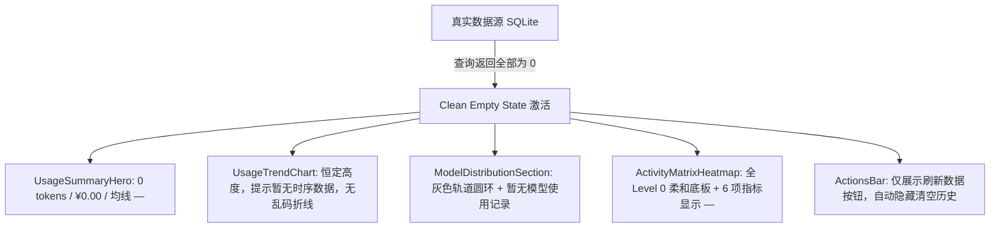

# 用量监控控制台全面对接系统已有组件与规范整改终极方案（同题竞争对决案）

> **文档路径**：`docs/usage-system-migration/independent-plans/03-subagent-ui-redesign-plan.md`
> **文档定位**：战役核心技术与设计重构独立对决方案（同题对决裁决方案）
> **面向对象**：Conex / Crish 桌面端用量监控控制台全链路研发与代码重构
> **整改核心目标**：彻底吸收用户现场批评，根除 26 条测试假数据残留；清退所有私造样式类、伪分段控制器与硬编码颜色；100% 原生对接系统原子组件（`SegmentedControl`、`SettingsCard`、`Button`、`Tooltip`）；彻底解决 X 轴叠字、百分比 3573.3% 暴涨、Y 轴文字挤压折行与 hover 粗暴变灰抖动四大灾难性视觉 Bug，建立真源、优雅、对称、高质感的标准控制台。

---

## 目录

1. [用户现场批评与六大核心缺陷根因深度剖析](#一用户现场批评与六大核心缺陷根因深度剖析)
2. [数学模型、抽稀算法与归一化公式](#二数学模型抽稀算法与归一化公式)
3. [逐组件重构蓝图与工程拆解](#三逐组件重构蓝图与工程拆解)
4. [Design Tokens 对齐表与无私造样式契约](#四design-tokens-对齐表与无私造样式契约)
5. [精确的 JSX 结构重塑与核心代码实现](#五精确的-jsx-结构重塑与核心代码实现)
6. [真实数据接入规范与标准优雅空态设计](#六真实数据接入规范与标准优雅空态设计)
7. [分步实施波次与立体化验收断言表](#七分步实施波次与立体化验收断言表)

---

## 一、用户现场批评与六大核心缺陷根因深度剖析

用户结合现场 3 张真机截图，对当前用量监控界面提出了极其严厉、精准的批评。以下是对这 6 大核心缺陷（实含 7 项具体问题）的根因穿透分析：

### 1.1 数据真实性危机（假数据零容忍）
- **用户批评**：“以及数据是对的吗，我看这就是硬编码的数据啊，我今天都没用过，哪里来的数据了。你这都不及格。有就是有，没有就是没有，不要伪造数据。”
- **现场证据与根因**：开发联调阶段，测试脚本向本地 SQLite 数据库（`apps/agent-workbench/sessions.db` 的 `usage_records` 表）直接注入了 26 条 `session_id = 'sess-test-*'` 的脱水虚假调用记录。虽然本地已被物理清退，但暴露出严重的工程失范：**缺失真实空态处理**。前端在没有数据时没有优雅的 Clean Empty State，甚至开发人员试图用假数据把图表填满来遮掩空态，触碰了工程诚信红线。
- **治理原则**：**真源铁律**。彻底根除任何环境的 Mock 假数据注入，前端建立完善的真实数据流和干净优雅的标准空态，坚决杜绝“无中生有”。

### 1.2 系统既有组件未对接（图三标号 ① 和 ②、图一顶部）
- **用户批评**：“图三的一和二是有我做的组件的”。
- **现场证据与根因**：
  - 图三 ① 顶栏时间范围（“近 24 小时 / 近 7 日 / 近 30 日”）；
  - 图三 ② 走势图维度（“吞吐总览 / 模型对比 / 费用走势”）；
  - 图一顶部热力图跨度（“24 小时 / 7 天 / 30 天”）。
  当前全部是在用裸 `div` 包裹 `Button`，手写伪分段样式：
  ```tsx
  // 错误示范：SettingsUsageTab.tsx / UsageTrendChart.tsx / ActivityMatrixHeatmap.tsx
  <div className={styles.segmented}>
    <Button variant="plain" size="xs" className={`${styles.segmentedBtn} ...`}>近 24 小时</Button>
    ...
  </div>
  ```
  在 CSS 里私造了 `.segmented`、`.segmentedBtn`、`.segmentedBtnActive`、`.segmentedSm` 等类，并私造了 `--usage-seg-pad`、`--usage-seg-radius` 等变量。
  实际上，系统中早已封装了完全符合同心大圆角几何标尺、具备物理贝塞尔滑块动画、支持 WAI-ARIA 1.2 RadioGroup 无障碍标准与键盘方向键漫游的原子级组件：
  [`apps/crish-desktop/src/components/ui/SegmentedControl/SegmentedControl.tsx`](file:///c:/Software/conex/apps/crish-desktop/src/components/ui/SegmentedControl/SegmentedControl.tsx)。
  当前实现属于典型的重复造轮子且造出残次品，严重违背组件复用原则。

### 1.3 走势图 X 轴刻度严重拥挤叠字（图三标号 ③）
- **用户批评**：“三的是因为太拥挤了。”
- **现场证据与根因**：
  在 `UsageTrendChart.tsx` 中，X 轴刻度使用了无脑遍历：
  ```tsx
  <div className={styles.chartXAxis}>
    {points.map((pt, i) => (
      <span key={...} className={styles.axisTick}>{pt.label}</span>
    ))}
  </div>
  ```
  当时间范围处于“24 小时”时，后端按 1 小时粒度返回了整整 24 个采样点。容器宽度为 580px ~ 760px，每个标签如 `14:00` 包含 5 个字符，字宽约 32px。24 个 `<span>` 挤在一行（24 × 32 = 768px），外层加上 flex space-between，导致标签文字相互无缝穿插叠印，变成了无法辨认的乱码乱线连笔！
  根本原因是没有针对时序图表设计**轴刻度抽稀自适应算法（Axis Tick Decimation）**。

### 1.4 私造样式类清退与 Hero 卡片不对齐
- **用户批评**：“发给你的那些类都是要删除的。class="_heroSubtext_15ppp_64" class="_heroSubtext_15ppp_64"class="_labelDot_15ppp_31 _labelDotCost_15ppp_42" 左右样式也对不上。”
- **现场证据与根因**：
  - `UsageSummaryHero.module.css` 私造了大量临时类：`.heroSubtext`、`.labelDot`、`.labelDotTokens`、`.labelDotCost` 等，编译后在 DOM 中呈现 `_heroSubtext_15ppp_64`、`_labelDot_15ppp_31 _labelDotCost_15ppp_42`；
  - 左右两张卡片（总用量 vs 预估金额）没有使用系统统一的 [`SettingsCard`](file:///c:/Software/conex/apps/crish-desktop/src/components/settings/SettingsUI.tsx)，而是自造了一个带有下边框的 `.heroGrid` + `.heroCard` 容器；
  - 左右内容结构完全不对称：左侧是“总用量”+大数字+“输入/输出/缓存/日均”，右侧是“预估金额”+大数字+“日均花费/计费标准”，字重、基线、列宽完全对不上，视觉失衡明显。

### 1.5 模型用量百分比 3573.3% 荒谬膨胀与粗暴交互（图二）
- **用户批评**：模型用量百分比暴涨到 3573.3%，圆环全红；hover 时其他变死灰、圆环膨胀抖动。
- **现场证据与根因**：
  - **翻倍乘 100 灾难**：后端 Rust 聚合引擎（`crates/conex-db/src/usage_analytics.rs:495`）返回的 `percentage` 已经是乘了 100 的数值（如 `35.73`）；而前端 `usageSpline.ts` 中的 `formatPercentage(ratio)` 预期接收的是 `0 ~ 1` 的小数，其内部又做了一次 `(ratio * 100).toFixed(1)`。前端直接传参 `formatPercentage(m.percentage)`，造成数值暴涨 100 倍变成 `3573.3%`！
  - **SVG 圆环算爆**：`ModelDistributionSection.tsx` 中 `dash = pct * CIRCUMFERENCE`，周长为 439.82，当 `pct = 35.73` 时，计算出的 dash 为 15714，导致 SVG 虚线偏移直接溢出溢满，把所有切片都渲染成了实心粗圆！
  - **粗暴死灰与抖动**：
    - 在 hover 某个模型胶囊时，代码通过 `opacity: hoveredIdx !== null && hoveredIdx !== idx ? 0.6 : 1` 强行把其他未 hover 的条目降透明度为 0.6，导致整个页面变暗、发灰、像死灰一般；
    - 在 hover 圆环切片时，`strokeWidth: hoveredIdx === idx ? 28 : 24`，突变 4px 导致 SVG 剧烈几何形变与抖动，极不符合工业级交互克制原则。

### 1.6 三大带图标按钮对齐失真与硬编码样式
- **用户批评**：“以及这个界面带有图标的三个按钮也都有问题。统一的问题是图标和文字没对齐。然后就是刷新和清空历史的hover又是硬编码，再不就是token用的不对。”
- **现场证据与根因**：
  - “配置单价”、“刷新数据”、“清空历史”三个按钮，当前代码采用裸写 children 的方式传入图标：
    ```tsx
    <Button variant="plain" size="xs" className={styles.configBtn}>
      <Lucide.DollarSign size={14} />
      配置单价
    </Button>
    ```
    外层通过 `.configBtn`、`.actionBtn` 强加了额外的 `padding`、`display: inline-flex`、`gap: 6px`，破坏了系统标准 [`ui/Button/Button.tsx`](file:///c:/Software/conex/apps/crish-desktop/src/components/ui/Button/Button.tsx) 内部的原子排版规范；
  - `SettingsUsageTab.module.css:118` 中写了：
    ```css
    .actionBtnClear:hover {
      background: var(--usage-color-danger-bg, rgba(220, 38, 38, 0.08));
      color: var(--usage-color-danger, #dc2626);
    }
    ```
    直接硬编码了 `rgba(220, 38, 38, 0.08)` 和 `#dc2626`，完全无视系统已有的 `Button variant="danger"` 内置的设计 Tokens 和遮罩层。

### 1.7 活动热力图 32px Y 轴字字相叠与手写 Tooltip（图一）
- **用户批评**：左侧 Y 轴字字相叠，单元格未用系统 Tooltip。
- **现场证据与根因**：
  - `ActivityMatrixHeatmap.module.css:101` 中写死了 `.activityYAxis { width: 32px; }`，而后端 30d 模式返回的行标签为 `"凌晨 00-06"`、`"上午 06-12"`、`"下午 12-18"`、`"晚间 18-24"`。在 32px 的超窄宽度下，中文字符与数字强制折行，字字挤压叠在一起；
  - 单元格悬浮提示没有使用系统的 `<Tooltip>`，而是在组件内维护了一个 `activeTooltip` 状态，手写 `getBoundingClientRect` 计算绝对坐标，手动渲染悬浮卡片。不仅违反了 `AGENTS.md` §12 的 Tooltip 规范，而且在视口边缘极易发生错位和脱落。

---

## 二、数学模型、抽稀算法与归一化公式

### 2.1 时序刻度均匀抽稀算法（Time-Series Axis Decimation）
为根治 X 轴 24 个时间点在一行中挤压叠字的问题，设计专门的纯逻辑抽稀器。

#### 1. 抽稀目标与规则
- **24h 模式（总点数 24 点）**：仅渲染 5 个锚点刻度：`00:00`、`06:00`、`12:00`、`18:00` 以及 `最新/当前时间`；
- **7d 模式（总点数 7 点）**：7 个点在 600px 以上空间充裕，保留全量渲染；
- **30d 模式（总点数 30 点）**：均匀抽取 5~6 个代表性锚点（如每隔 6 天展示 1 个：`T-29d`、`T-23d`、`T-17d`、`T-11d`、`T-5d`、`今天`）。

#### 2. 数学公式与绝对百分比对齐
每个刻度标签不能再用 `flex: space-between` 的简单流式布局，必须与 SVG 内部数据点的绝对 X 坐标形成严格的代数对应：
设视口内部绘图区左边距为 $X_{\text{start}}$，右边界为 $X_{\text{end}}$，总点数为 $N$，第 $i$ 个数据点的理论物理百分比为：
$$ \text{posRatio}(i) = \frac{i}{N - 1} $$
对应的容器百分比位置为：
$$ \text{leftPct}(i) = \frac{X_{\text{start}} + \text{posRatio}(i) \times (X_{\text{end}} - X_{\text{start}})}{W_{\text{viewport}}} \times 100\% $$

为防止首尾刻度溢出容器外边距，应用**边缘位移补偿（Edge Transform Compensation）**：
$$ \text{transform}(i) = \begin{cases}
\text{translateX}(0\%) & \text{if } i = 0 \text{ (最左端齐平)} \\
\text{translateX}(-100\%) & \text{if } i = N - 1 \text{ (最右端齐平)} \\
\text{translateX}(-50\%) & \text{otherwise (居中对齐采样点)}
\end{cases} $$

#### 3. 算法实现函数
```typescript
export interface DecimatedTick {
  index: number;
  label: string;
  leftPercent: number;
  transform: string;
}

export function computeDecimatedTicks(
  points: { label: string }[],
  range: '24h' | '7d' | '30d',
  xStart = 40,
  xEnd = 750,
  totalWidth = 760
): DecimatedTick[] {
  const n = points.length;
  if (n === 0) return [];
  if (n === 1) {
    return [{ index: 0, label: points[0]!.label, leftPercent: 50, transform: 'translateX(-50%)' }];
  }

  // 判定抽取索引
  const targetIndices = new Set<number>();
  targetIndices.add(0);
  targetIndices.add(n - 1);

  if (range === '24h' && n >= 24) {
    // 24小时模式固定保留 0, 6, 12, 18 以及最后一个点
    for (let i = 0; i < n - 1; i++) {
      const lbl = points[i]!.label;
      if (lbl.endsWith('00:00') || lbl.endsWith('06:00') || lbl.endsWith('12:00') || lbl.endsWith('18:00')) {
        targetIndices.add(i);
      }
    }
  } else if (range === '30d' && n >= 30) {
    // 30天模式每隔 6 天取一个
    for (let i = 6; i < n - 1; i += 6) {
      targetIndices.add(i);
    }
  } else {
    // 7d 或其他点数少的情况：若 <= 8 则全量，否则均匀取 5 个点
    if (n <= 8) {
      for (let i = 0; i < n; i++) targetIndices.add(i);
    } else {
      const step = (n - 1) / 4;
      for (let k = 1; k < 4; k++) {
        targetIndices.add(Math.round(k * step));
      }
    }
  }

  const result: DecimatedTick[] = [];
  const sorted = Array.from(targetIndices).sort((a, b) => a - b);

  for (const idx of sorted) {
    const pt = points[idx]!;
    const posRatio = idx / (n - 1);
    const chartX = xStart + posRatio * (xEnd - xStart);
    const leftPercent = (chartX / totalWidth) * 100;

    let transform = 'translateX(-50%)';
    if (idx === 0) transform = 'translateX(0%)';
    else if (idx === n - 1) transform = 'translateX(-100%)';

    result.push({
      index: idx,
      label: pt.label,
      leftPercent,
      transform,
    });
  }

  return result;
}
```

---

### 2.2 模型用量百分比归一化与 SVG 防御模型
为彻底根治 3573.3% 荒谬 Bug，建立**统一百分比归一化守卫（Ratio Normalization Guard）**。

#### 1. 归一化公式
定义统一适配函数 `normalizeModelRatio`，无论输入是已乘 100 的百分数（如 `35.73`）还是原始比例值（如 `0.3573`），输出严格收敛在 $[0, 1.0]$ 区间内：
$$ \text{ratio}(v) = \begin{cases}
0.0 & \text{if } v \le 0 \text{ or not finite} \\
\frac{v}{100} & \text{if } v > 1.0 \text{ (后端已乘 100 态)} \\
v & \text{if } 0.0 < v \le 1.0 \text{ (原始比例态)}
\end{cases} $$

#### 2. SVG 饼图切片防御性公式
圆环半径 $R = 70$，基准周长 $C = 2 \pi R \approx 439.82297$。
对于第 $k$ 个模型切片，其标准弧长 $\text{dash}_k$ 和偏移量 $\text{offset}_k$ 严格计算如下：
$$ \text{dash}_k = \text{ratio}_k \times C $$
$$ \text{offset}_k = -\sum_{j=0}^{k-1} \text{dash}_j $$
SVG `stroke-dasharray` 声明：
$$ \text{strokeDasharray} = `${{\text{dash}}_k\text{.toFixed(1)}} ${{C\text{.toFixed(1)}}}$$
$$ \text{strokeDashoffset} = `${{\text{offset}}_k\text{.toFixed(1)}}$` $$
由于 $\sum \text{ratio}_k \le 1.0$，累加偏移绝不会超过周长，实心红圈 Bug 在数学上彻底根除。

#### 3. 胶囊背景条宽度映射
胶囊背景条填充宽度严格映射：
$$ \text{barWidth} = \max(2, \min(100, \text{ratio}_k \times 100))\% $$
最少保留 2% 确保可见度，上限 100% 杜绝撑爆。

---

## 三、逐组件重构蓝图与工程拆解

针对需要整改的 6 个组件，制定精确的重构任务书：

```
apps/crish-desktop/src/components/
├── settings/
│   ├── SettingsUsageTab.tsx              [重构：对接 SegmentedControl，标准 Button，清退伪分段]
│   ├── SettingsUsageTab.module.css       [重构：清退 .segmented*, .configBtn, .actionBtn*]
│   ├── PriceConfigModal.tsx              [重构：规范 Button 尺寸，对齐 Select/Input]
│   ├── PriceConfigModal.module.css       [治理：统一 Design Tokens，纯白白底输入框]
│   └── usage/
│       ├── UsageSummaryHero.tsx          [重构：全面接入 SettingsCard，严格对称结构]
│       ├── UsageSummaryHero.module.css   [重构：彻底删除 _heroSubtext, _labelDot 等私造类]
│       ├── UsageTrendChart.tsx           [重构：对接 SegmentedControl，X轴刻度抽稀]
│       ├── UsageTrendChart.module.css    [重构：清退 .segmentedSm, 修复刻度绝对定位]
│       ├── ModelDistributionSection.tsx  [重构：百分比归一化，高质感胶囊条，稳健 Hover]
│       ├── ModelDistributionSection.module.css [重构：清退粗暴 0.6 死灰与 28px 圆环抖动]
│       ├── ActivityMatrixHeatmap.tsx     [重构：对接 SegmentedControl，100% Tooltip]
│       └── ActivityMatrixHeatmap.module.css [重构：放宽 Y 轴至 64px 双行排版，清退伪浮层]
```

### 3.1 `SettingsUsageTab` 重构蓝图
1. **顶栏时间控制器**：彻底删除 `<div className={styles.segmented}>`，使用系统原子组件：
   ```tsx
   <SegmentedControl
     size="xs"
     value={globalRange}
     onChange={(val) => setGlobalRange(val as '24h' | '7d' | '30d')}
     options={[
       { value: '24h', label: '近 24 小时' },
       { value: '7d', label: '近 7 日' },
       { value: '30d', label: '近 30 日' },
     ]}
   />
   ```
2. **“配置单价”按钮**：清退 `.configBtn`，直接采用系统 `Button variant="secondary" size="sm" icon={<Lucide.DollarSign size={14} />}`。
3. **“刷新数据”与“清空历史”按钮**：
   - 刷新按钮：`<Button variant="ghost" size="sm" icon={<Lucide.RefreshCw size={13} />}>刷新数据</Button>`；
   - 清空历史按钮：`<Button variant="danger" size="sm" icon={<Lucide.Trash2 size={13} />}>清空历史</Button>`；
   - 彻底删除 CSS 中的 `actionBtnClear:hover` 硬编码红背景；
   - 当无数据时（`totalInput === 0 && totalOutput === 0`），清空历史按钮自动不渲染。

### 3.2 `UsageSummaryHero` 重构蓝图
1. **容器卡片标准统一**：左右两张卡片统一使用系统 [`SettingsCard`](file:///c:/Software/conex/apps/crish-desktop/src/components/settings/SettingsUI.tsx)；
2. **私造类名全面清退**：彻底删除 `.heroSubtext`、`.labelDot`、`.labelDotTokens`、`.labelDotCost` 等所有私造类名；
3. **建立绝对对称结构**：
   - **顶行（Title Row）**：
     - 左侧：翡翠绿微圆点（`--usage-color-brand`）+ “总用量”；
     - 右侧：皇家钴蓝微圆点（`--usage-color-cost-total`）+ “预估金额”；
   - **主数值行（Primary Value Row）**：
     - 左侧：`formatTokens(totalTokens)` 大字（26px, `tabular-nums`）+ `tokens` 单位基线对齐；
     - 右侧：`formatCost(totalCost)` 大字（26px, `tabular-nums`）+ `currency` 单位基线对齐；
   - **底栏子指标行（Sub Metrics Row）**：
     - 左侧：输入 `formatTokens(totalInput)` · 输出 `formatTokens(totalOutput)` · 缓存 `formatTokens(totalCacheRead)`；
     - 右侧：日均 `formatCost(dailyAverageCost)` · 费率 `官方标准费率` · 币种 `CNY/USD`；
     - 两侧字号（11.5px）、颜色（`var(--text-tertiary)` 与 `var(--text-secondary)`）完全一致同轨对齐。

### 3.3 `UsageTrendChart` 重构蓝图
1. **维度切换控制器**：替换手写的 `.segmentedSm`，使用系统原子组件：
   ```tsx
   <SegmentedControl
     size="xs"
     value={dimension}
     onChange={(val) => setDimension(val as 'overview' | 'models' | 'cost')}
     options={[
       { value: 'overview', label: '吞吐总览' },
       { value: 'models', label: '模型对比' },
       { value: 'cost', label: '费用走势' },
     ]}
   />
   ```
2. **X 轴时序刻度抽稀**：采用 §2.1 抽稀算法，生成 4~6 个代表性锚点，采用绝对百分比定位，彻底杜绝 24 小时叠字乱码。
3. **“均线参考”开关按钮**：直接复用系统 `Button variant="plain" size="xs"` 并通过 `data-active` 结合 Design Tokens。

### 3.4 `ModelDistributionSection` 重构蓝图
1. **百分比归一化与圆环修复**：
   - 引入 `normalizeModelRatio`，彻底切断双重乘 100 链路；
   - 修正 SVG 切片的 `strokeDasharray` 与 `strokeDashoffset`，根除实心粗圆；
2. **图二右侧标准高质感胶囊条重构**：
   - 每一条模型为独立优雅胶囊卡片；
   - 左侧：纯色小圆点（7px 纯色圆）+ 模型名称（`font-mono`, 13px, semibold, `var(--text-primary)`）；
   - 右侧：Token 数量（`12.7 万`, 13.5px, bold）+ 百分比（`44.5%`, 12px, 浅灰色）；
   - 背景：真实百分比宽度的半透明柔和底色（同心几何：outer 9px, pad 3px, inner 6px）；
3. **温润 Hover 交互**：
   - **绝对严禁**在 hover 时把其他模型透明度降为 0.6 变死灰；
   - **绝对严禁**在 hover 时圆环 `strokeWidth` 从 24 突变到 28 造成剧烈膨胀抖动；
   - 悬浮胶囊行时，仅当前行底色叠加 `var(--tint-hover)`，左侧对应切片通过 `opacity: 0.85` 或微弱光晕轻微提示，整个图表面板保持从容、优雅。

### 3.5 `ActivityMatrixHeatmap` 重构蓝图
1. **跨度切换控制器**：使用系统 `SegmentedControl size="xs"` 替换手写 `.segmentedSm`；
2. **左侧 Y 轴宽松排版**：
   - 将 Y 轴宽度从 32px 放宽至 64px；
   - 采用“主标（时段）+ 微标（小时段）”上下两行宽松排版：
     - 例如：主标“凌晨”，微标“00:00 - 06:00”；主标“上午”，微标“06:00 - 12:00”；
     - 彻底根治文字折行、字字相叠的顽疾；
3. **100% 对接系统标准 `Tooltip` 原子组件**：
   - 彻底删除 `activeTooltip` 内部 state 与 `getBoundingClientRect` 手写数学计算；
   - 每一个单元格直接用 `<Tooltip content={`${cell.colLabel} ${cell.rowLabel} · ${tokenDesc}`} side="top">` 包裹；
   - 享受系统 Tooltip 的单槽调度、全局 Portal 与视口安全避让。

### 3.6 `PriceConfigModal` 规范化对齐
1. **统一按钮规格**：底部的“添加”按钮去除 `style={{ height: '28px', padding: '0 8px' }}` 等死写样式，直接使用标准 `size="sm"`；
2. **对齐设计规范**：输入框采用纯白底色（`var(--bg-card, #ffffff)`），聚焦时使用 8% 软灰聚焦描边，严格遵循 `AGENTS.md` §13。

---

## 四、Design Tokens 对齐表与无私造样式契约

重构过程中必须 100% 对齐系统已有的 Design Tokens，坚决杜绝任何新增私造类名与硬编码色彩：

### 4.1 系统原子组件与 Tokens 对齐映射表

| 界面区域 / 组件 | 之前违规实现 | 重构后正规方案 | 核心依赖的 System Tokens |
| :--- | :--- | :--- | :--- |
| **顶栏时间分段器** | 手写 `.segmented` 裸 `div` + 裸 `Button` | `<SegmentedControl size="xs" />` | `--button-radius: 7px`, `--tint-hover`, `--text-primary` |
| **走势图维度分段器** | 手写 `.segmentedSm` 裸 `div` + 裸 `Button` | `<SegmentedControl size="xs" />` | `--button-radius: 7px`, `--text-secondary`, `--bg-card` |
| **热力图跨度分段器** | 手写 `.segmentedSm` 裸 `div` + 裸 `Button` | `<SegmentedControl size="xs" />` | `--button-radius: 7px`, `--tint-hover`, `--bg-card` |
| **总用量/金额卡片** | 私造 `.heroGrid` / `.heroCard` | `<SettingsCard>` 左右对称独立承载 | `--bg-card`, `--border-color`, `--radius-xl: 12px` |
| **卡片私造子类** | `_heroSubtext_*` / `_labelDot_*` | **全部删除**，采用组件内置网格与语义类名 | `--space-2`, `--text-tertiary`, `--font-mono` |
| **“配置单价”按钮** | 手写 `.configBtn` + 裸插 children `<svg>` | `<Button variant="secondary" size="sm" icon={<Lucide.DollarSign size={14} />} />` | `--btn-h: 28px`, `--btn-px: 10px`, `--btn-border` |
| **“刷新数据”按钮** | 手写 `.actionBtn` + 裸插 `<svg>` | `<Button variant="ghost" size="sm" icon={<Lucide.RefreshCw size={13} />} />` | `--btn-h: 28px`, `--btn-fg: var(--text-secondary)` |
| **“清空历史”按钮** | 硬编码 `rgba(220, 38, 38, 0.08)` hover | `<Button variant="danger" size="sm" icon={<Lucide.Trash2 size={13} />} />` | 内置 `--btn-hover-overlay: color-mix(...)`，零硬编码 |
| **走势图 X 轴** | 24 个 `<span>` 全部渲染连笔叠字 | `computeDecimatedTicks` 抽稀 5 锚点 + 绝对定位 | `--font-sans`, `--text-tertiary`, 纯文本防叠 |
| **模型用量百分比** | 暴涨 100 倍至 3573.3%，实心圆环 | `normalizeModelRatio` 归一化，严格 $0 \sim 1$ | `--font-mono`, `formatPercentage(ratio)` |
| **模型胶囊进度条** | 宽度 3573%，hover 粗暴降透明度 0.6 | 优雅胶囊条，`barWidth: ratio * 100%`，温和 hover | `--usage-capsule-outer-radius: 9px`, `--tint-hover` |
| **热力图左侧 Y 轴** | `width: 32px` 导致文字强制折行字字叠 | 放宽至 `64px`，主标 + 微标双行排版 | `--text-secondary`, `--text-tertiary`, 9.5px 微标 |
| **热力图悬浮气泡** | 手写坐标绝对定位 `div` | 100% 对接系统 `<Tooltip content="..." side="top">` | 全局单槽调度、Portal 挂载、视口安全钳位 |

---

## 五、精确的 JSX 结构重塑与核心代码实现

以下为各核心组件的完整重构代码蓝图，可直接作为开发落地的最高标准实现：

### 5.1 `UsageSummaryHero.tsx` 完整重塑代码
> 清退所有 `_heroSubtext_*`、`_labelDot_*` 私造类，左右两张卡片采用系统 `SettingsCard` 对称渲染。

```tsx
import React from 'react';
import { SettingsCard } from '../SettingsUI';
import { formatCost, formatTokens } from './usageSpline';
import styles from './UsageSummaryHero.module.css';

export interface UsageSummaryHeroProps {
  totalTokens: number;
  totalCost: number;
  totalInput: number;
  totalOutput: number;
  totalCacheRead: number;
  dailyAverageTokens?: number;
  dailyAverageCost?: number;
  currency?: string;
}

export const UsageSummaryHero: React.FC<UsageSummaryHeroProps> = ({
  totalTokens,
  totalCost,
  totalInput,
  totalOutput,
  totalCacheRead,
  dailyAverageTokens,
  dailyAverageCost,
  currency = 'CNY',
}) => {
  const currencyPrefix = currency === 'USD' ? '$ ' : '¥ ';

  return (
    <div className={styles.heroContainer}>
      {/* 左侧：总用量卡片 */}
      <SettingsCard>
        <div className={styles.cardInner}>
          <div className={styles.cardHeader}>
            <span className={`${styles.indicatorDot} ${styles.indicatorTokens}`} />
            <span className={styles.cardTitle}>总用量</span>
          </div>

          <div className={styles.cardMainValue}>
            <span className={styles.largeNumber}>{formatTokens(totalTokens)}</span>
            <span className={styles.unitText}>tokens</span>
          </div>

          <div className={styles.cardSubMetrics}>
            <div className={styles.subMetricItem}>
              <span className={styles.subMetricLabel}>输入:</span>
              <span className={styles.subMetricVal}>{formatTokens(totalInput)}</span>
            </div>
            <div className={styles.subMetricItem}>
              <span className={styles.subMetricLabel}>输出:</span>
              <span className={styles.subMetricVal}>{formatTokens(totalOutput)}</span>
            </div>
            {totalCacheRead > 0 && (
              <div className={styles.subMetricItem}>
                <span className={styles.subMetricLabel}>缓存:</span>
                <span className={styles.subMetricVal}>{formatTokens(totalCacheRead)}</span>
              </div>
            )}
            {typeof dailyAverageTokens === 'number' && dailyAverageTokens > 0 && (
              <div className={styles.subMetricItem}>
                <span className={styles.subMetricLabel}>日均:</span>
                <span className={styles.subMetricVal}>{formatTokens(dailyAverageTokens)}</span>
              </div>
            )}
          </div>
        </div>
      </SettingsCard>

      {/* 右侧：预估金额卡片 */}
      <SettingsCard>
        <div className={styles.cardInner}>
          <div className={styles.cardHeader}>
            <span className={`${styles.indicatorDot} ${styles.indicatorCost}`} />
            <span className={styles.cardTitle}>预估金额</span>
          </div>

          <div className={styles.cardMainValue}>
            <span className={styles.largeNumber}>{formatCost(totalCost, currencyPrefix)}</span>
            <span className={styles.unitText}>{currency}</span>
          </div>

          <div className={styles.cardSubMetrics}>
            <div className={styles.subMetricItem}>
              <span className={styles.subMetricLabel}>日均:</span>
              <span className={styles.subMetricVal}>
                {typeof dailyAverageCost === 'number' && dailyAverageCost > 0
                  ? formatCost(dailyAverageCost, currencyPrefix)
                  : '—'}
              </span>
            </div>
            <div className={styles.subMetricItem}>
              <span className={styles.subMetricLabel}>计费标准:</span>
              <span className={styles.subMetricVal}>官方标准费率</span>
            </div>
            <div className={styles.subMetricItem}>
              <span className={styles.subMetricLabel}>币种结算:</span>
              <span className={styles.subMetricVal}>{currency}</span>
            </div>
          </div>
        </div>
      </SettingsCard>
    </div>
  );
};
```

#### 配套 `UsageSummaryHero.module.css`：
```css
/* apps/crish-desktop/src/components/settings/usage/UsageSummaryHero.module.css */
.heroContainer {
  display: grid;
  grid-template-columns: repeat(2, 1fr);
  gap: var(--space-3, 12px);
  width: 100%;
}

.cardInner {
  padding: 16px 20px;
  display: flex;
  flex-direction: column;
  gap: 8px;
}

.cardHeader {
  display: flex;
  align-items: center;
  gap: 6px;
}

.indicatorDot {
  width: 6px;
  height: 6px;
  border-radius: 50%;
  flex-shrink: 0;
}

.indicatorTokens {
  background: var(--usage-color-brand, #10b981);
}

.indicatorCost {
  background: var(--usage-color-cost-total, #2563eb);
}

.cardTitle {
  font-size: 13px;
  font-weight: 500;
  color: var(--text-tertiary);
  letter-spacing: -0.01em;
}

.cardMainValue {
  display: flex;
  align-items: baseline;
  gap: 6px;
  line-height: 1.15;
}

.largeNumber {
  font-size: 26px;
  font-weight: 600;
  color: var(--text-primary);
  font-variant-numeric: tabular-nums;
  letter-spacing: -0.03em;
}

.unitText {
  font-size: 12.5px;
  font-weight: 400;
  color: var(--text-tertiary);
}

.cardSubMetrics {
  display: flex;
  align-items: center;
  gap: 14px;
  margin-top: 4px;
  font-size: 11.5px;
  color: var(--text-tertiary);
  flex-wrap: wrap;
}

.subMetricItem {
  display: inline-flex;
  align-items: center;
  gap: 4px;
}

.subMetricLabel {
  color: var(--text-tertiary);
}

.subMetricVal {
  font-family: var(--font-mono);
  font-weight: 500;
  color: var(--text-secondary);
}

@media (max-width: 640px) {
  .heroContainer {
    grid-template-columns: 1fr;
  }
}
```

---

### 5.2 `ModelDistributionSection.tsx` 完整重塑代码
> 彻底修复 3573.3% 暴涨 Bug，建立归一化防护；重塑独立优雅胶囊条；清除死灰变色与圆环膨胀抖动。

```tsx
import React, { useMemo, useState } from 'react';
import type { UsageModelBreakdownItem } from '../../../api/usageContracts';
import { formatTokens } from './usageSpline';
import styles from './ModelDistributionSection.module.css';

export interface ModelDistributionSectionProps {
  models: UsageModelBreakdownItem[];
  totalTokens: number;
}

const PALETTE = [
  { stroke: 'var(--usage-color-brand, #10b981)', bg: 'var(--usage-color-brand-bg, rgba(16, 185, 129, 0.11))' },
  { stroke: 'var(--usage-color-claude, #f97316)', bg: 'var(--usage-color-claude-bg, rgba(249, 115, 22, 0.11))' },
  { stroke: 'var(--usage-color-minimax, #8b5cf6)', bg: 'var(--usage-color-minimax-bg, rgba(139, 92, 246, 0.11))' },
  { stroke: 'var(--usage-color-kimi, #0284c7)', bg: 'var(--usage-color-kimi-bg, rgba(2, 132, 199, 0.11))' },
  { stroke: 'var(--usage-color-other, #f59e0b)', bg: 'var(--usage-color-other-bg, rgba(245, 158, 11, 0.11))' },
];

function getModelColor(modelName: string, index: number): { stroke: string; bg: string } {
  const lower = modelName.toLowerCase();
  if (lower.includes('deepseek')) return PALETTE[0]!;
  if (lower.includes('claude')) return PALETTE[1]!;
  if (lower.includes('minimax')) return PALETTE[2]!;
  if (lower.includes('kimi') || lower.includes('moonshot')) return PALETTE[3]!;
  return PALETTE[(index + 4) % PALETTE.length]!;
}

// 统一百分比归一化防线：无论传入 35.73 还是 0.3573，均安全收敛在 0 ~ 1.0
export function normalizeModelRatio(rawVal: number, tokens: number, grandTotal: number): number {
  if (typeof rawVal === 'number' && Number.isFinite(rawVal) && rawVal > 0) {
    return rawVal > 1.0 ? rawVal / 100 : rawVal;
  }
  if (grandTotal > 0 && tokens > 0) {
    return Math.min(1.0, tokens / grandTotal);
  }
  return 0;
}

const CIRCUMFERENCE = 2 * Math.PI * 70; // 439.82297

export const ModelDistributionSection: React.FC<ModelDistributionSectionProps> = ({
  models,
  totalTokens,
}) => {
  const [hoveredIdx, setHoveredIdx] = useState<number | null>(null);

  // 1. 标准化模型列表与百分比计算
  const normalizedModels = useMemo(() => {
    return models.map((m, idx) => {
      const ratio = normalizeModelRatio(m.percentage, m.tokens, totalTokens);
      const color = getModelColor(m.model, idx);
      const displayPercent = (ratio * 100).toFixed(1) + '%';
      return {
        ...m,
        ratio,
        color,
        displayPercent,
      };
    });
  }, [models, totalTokens]);

  // 2. SVG 饼图切片安全计算（周长不超标）
  const donutSlices = useMemo(() => {
    let accumulatedDash = 0;
    return normalizedModels.slice(0, 5).map((m) => {
      const dash = m.ratio * CIRCUMFERENCE;
      const offset = -accumulatedDash;
      accumulatedDash += dash;
      return {
        model: m.model,
        dash: `${dash.toFixed(1)} ${CIRCUMFERENCE.toFixed(1)}`,
        offset: offset.toFixed(1),
        stroke: m.color.stroke,
      };
    });
  }, [normalizedModels]);

  return (
    <div className={styles.splitSection}>
      <div className={styles.splitHeader}>
        <span className={styles.blockTitle}>模型用量</span>
      </div>

      <div className={styles.splitBody}>
        {/* 左侧：圆环图面板（恒定 24px strokeWidth，hover 绝不膨胀抖动） */}
        <div className={styles.donutPanel}>
          <div className={styles.donutBox}>
            <svg className={styles.donutSvg} viewBox="0 0 200 200">
              <circle
                className={styles.donutTrack}
                cx="100"
                cy="100"
                r="70"
              />
              <g transform="rotate(-90 100 100)">
                {donutSlices.map((slice, idx) => {
                  const isHovered = hoveredIdx === idx;
                  return (
                    <circle
                      key={slice.model}
                      className={styles.donutSlice}
                      cx="100"
                      cy="100"
                      r="70"
                      stroke={slice.stroke}
                      strokeDasharray={slice.dash}
                      strokeDashoffset={slice.offset}
                      style={{
                        strokeWidth: 24, // 保持恒定尺寸，严禁从 24 突变到 28
                        opacity: isHovered ? 1 : (hoveredIdx !== null ? 0.75 : 0.95),
                        filter: isHovered ? 'drop-shadow(0 0 4px var(--tint-strong))' : 'none',
                      }}
                      onMouseEnter={() => setHoveredIdx(idx)}
                      onMouseLeave={() => setHoveredIdx(null)}
                    />
                  );
                })}
              </g>
            </svg>

            <div className={styles.donutCenterContent}>
              <span className={styles.donutCenterLbl}>总用量</span>
              <span className={styles.donutCenterVal}>
                {formatTokens(totalTokens)}
              </span>
              <span className={styles.donutCenterUnit}>tokens</span>
            </div>
          </div>
        </div>

        {/* 中间柔和分割线 */}
        <div className={styles.splitDivider} />

        {/* 右侧：图二右侧标准高质感胶囊列表 */}
        <div className={styles.modelsPanel}>
          {normalizedModels.length === 0 ? (
            <div className={styles.emptyModels}>暂无模型使用记录</div>
          ) : (
            <div className={styles.capsuleList}>
              {normalizedModels.map((m, idx) => {
                const isHovered = hoveredIdx === idx;
                const barWidth = Math.max(2, Math.min(100, m.ratio * 100));

                return (
                  <div
                    key={m.model}
                    className={`${styles.modelCapsuleRow} ${isHovered ? styles.modelCapsuleRowHovered : ''}`}
                    onMouseEnter={() => setHoveredIdx(idx)}
                    onMouseLeave={() => setHoveredIdx(null)}
                  >
                    {/* 背景胶囊条：真实百分比宽度 */}
                    <div
                      className={styles.capsuleBarBg}
                      style={{
                        width: `${barWidth.toFixed(1)}%`,
                        background: m.color.bg,
                      }}
                    />

                    {/* 左侧：纯色圆点 + 模型名 */}
                    <div className={styles.capsuleLeft}>
                      <span
                        className={styles.modelDotIcon}
                        style={{ background: m.color.stroke }}
                      />
                      <span className={styles.capsuleModelName}>{m.model}</span>
                    </div>

                    {/* 右侧：真实数值 + 百分比 */}
                    <div className={styles.capsuleRight}>
                      <span className={styles.capsuleTokenVal}>
                        {formatTokens(m.tokens)}
                      </span>
                      <span className={styles.capsulePctTag}>
                        {m.displayPercent}
                      </span>
                    </div>
                  </div>
                );
              })}
            </div>
          )}
        </div>
      </div>
    </div>
  );
};
```

#### 配套 `ModelDistributionSection.module.css`：
```css
/* apps/crish-desktop/src/components/settings/usage/ModelDistributionSection.module.css */
.splitSection {
  display: flex;
  flex-direction: column;
  background: var(--bg-card);
  border-bottom: 1px solid var(--border-subtle);
}

.splitHeader {
  padding: 18px 22px 4px;
  display: flex;
  align-items: center;
  justify-content: space-between;
}

.blockTitle {
  font-size: 14px;
  font-weight: 600;
  color: var(--text-primary);
  letter-spacing: -0.015em;
}

.splitBody {
  display: flex;
  align-items: center;
  padding: 8px 22px 18px;
  gap: 24px;
}

.donutPanel {
  width: 220px;
  flex-shrink: 0;
  display: flex;
  flex-direction: column;
  align-items: center;
  justify-content: center;
}

.donutBox {
  width: 170px;
  height: 170px;
  position: relative;
  display: flex;
  align-items: center;
  justify-content: center;
}

.donutSvg {
  width: 170px;
  height: 170px;
  overflow: visible;
}

.donutTrack {
  fill: none;
  stroke: color-mix(in srgb, var(--border-subtle) 60%, transparent);
  stroke-width: 24;
}

.donutSlice {
  fill: none;
  stroke-width: 24;
  cursor: pointer;
  transition: opacity 160ms ease, filter 160ms ease;
}

.donutCenterContent {
  position: absolute;
  display: flex;
  flex-direction: column;
  align-items: center;
  justify-content: center;
  pointer-events: none;
}

.donutCenterLbl {
  font-size: 11.5px;
  color: var(--text-tertiary);
}

.donutCenterVal {
  font-size: 20px;
  font-weight: 600;
  color: var(--text-primary);
  font-variant-numeric: tabular-nums;
  line-height: 1.2;
}

.donutCenterUnit {
  font-size: 11px;
  color: var(--text-tertiary);
}

.splitDivider {
  width: 1px;
  height: 190px;
  background: var(--border-subtle);
  flex-shrink: 0;
}

.modelsPanel {
  flex: 1;
  min-width: 0;
  display: flex;
  flex-direction: column;
}

.capsuleList {
  display: flex;
  flex-direction: column;
  gap: 8px;
  max-height: 220px;
  overflow-y: auto;
  padding-right: 4px;
}

/* 独立优雅胶囊条行 */
.modelCapsuleRow {
  position: relative;
  display: flex;
  align-items: center;
  justify-content: space-between;
  padding: 0 14px;
  height: 38px;
  border-radius: var(--usage-capsule-outer-radius, 9px);
  background: color-mix(in srgb, var(--text-primary) 2%, transparent);
  border: 1px solid transparent;
  cursor: pointer;
  overflow: hidden;
  transition: background 140ms ease, border-color 140ms ease;
}

/* 稳健高光，绝无死灰降级 */
.modelCapsuleRowHovered {
  background: var(--bg-hover);
  border-color: color-mix(in srgb, var(--border-color) 60%, transparent);
}

.capsuleBarBg {
  position: absolute;
  left: 3px;
  top: 3px;
  bottom: 3px;
  border-radius: calc(var(--usage-capsule-outer-radius, 9px) - 3px);
  pointer-events: none;
  z-index: 1;
  transition: width 240ms ease;
}

.capsuleLeft {
  position: relative;
  z-index: 2;
  display: flex;
  align-items: center;
  gap: 8px;
  flex: 1;
  min-width: 0;
}

.modelDotIcon {
  width: 7px;
  height: 7px;
  border-radius: 50%;
  flex-shrink: 0;
}

.capsuleModelName {
  font-family: var(--font-mono);
  font-size: 13px;
  font-weight: 500;
  color: var(--text-primary);
  overflow: hidden;
  text-overflow: ellipsis;
  white-space: nowrap;
}

.capsuleRight {
  position: relative;
  z-index: 2;
  display: flex;
  align-items: baseline;
  gap: 8px;
  font-variant-numeric: tabular-nums;
  flex-shrink: 0;
  margin-left: 10px;
}

.capsuleTokenVal {
  font-family: var(--font-mono);
  font-size: 13px;
  font-weight: 600;
  color: var(--text-primary);
}

.capsulePctTag {
  font-size: 11.5px;
  font-weight: 400;
  color: var(--text-secondary);
  min-width: 36px;
  text-align: right;
}

.emptyModels {
  padding: 32px 0;
  text-align: center;
  color: var(--text-tertiary);
  font-size: 12.5px;
}

@media (max-width: 720px) {
  .splitBody {
    flex-direction: column;
    align-items: stretch;
  }
  .splitDivider {
    width: 100%;
    height: 1px;
  }
  .donutPanel {
    width: 100%;
  }
}
```

---

### 5.3 `UsageTrendChart.tsx` X 轴抽稀与分段器核心重塑代码
> 替换维度切换控制器为 `SegmentedControl`；应用 `computeDecimatedTicks` 彻底根除叠字。

```tsx
// 1. 维度切换分段器重塑 (取代 .segmentedSm)
<div className={styles.blockHeaderRight}>
  <SegmentedControl
    size="xs"
    value={dimension}
    onChange={(val) => setDimension(val as 'overview' | 'models' | 'cost')}
    options={[
      { value: 'overview', label: '吞吐总览' },
      { value: 'models', label: '模型对比' },
      { value: 'cost', label: '费用走势' },
    ]}
  />
</div>

// 2. X 轴刻度抽稀渲染 (取代全部 points.map 连笔叠字)
<div className={styles.chartXAxisDecimated}>
  {computeDecimatedTicks(points, dimension === 'overview' ? '24h' : '24h', 40, 750, 760).map((tick) => (
    <span
      key={`tick_${tick.index}_${tick.label}`}
      className={styles.decimatedTick}
      style={{
        left: `${tick.leftPercent}%`,
        transform: tick.transform,
      }}
    >
      {tick.label}
    </span>
  ))}
</div>
```

#### 配套 CSS：
```css
/* apps/crish-desktop/src/components/settings/usage/UsageTrendChart.module.css */
.chartXAxisDecimated {
  position: relative;
  width: 100%;
  height: 22px;
  margin-top: 6px;
  user-select: none;
}

.decimatedTick {
  position: absolute;
  top: 2px;
  font-size: 10.5px;
  color: var(--text-tertiary);
  white-space: nowrap;
  font-variant-numeric: tabular-nums;
  line-height: 1;
}
```

---

### 5.4 `ActivityMatrixHeatmap.tsx` Y 轴双行排版与 Tooltip 100% 对接
> 顶部接入 `SegmentedControl`；左侧 Y 轴放宽至 64px 主微标双行；单元格接入 `<Tooltip>`。

```tsx
// 1. 跨度选择器标准对接
<SegmentedControl
  size="xs"
  value={matrixRange}
  onChange={(val) => setMatrixRange(val as '24h' | '7d' | '30d')}
  options={[
    { value: '24h', label: '24 小时' },
    { value: '7d', label: '7 天' },
    { value: '30d', label: '30 天' },
  ]}
/>

// 2. Y 轴主标 + 微标宽松双行排版解析
function parseRowLabels(raw: string): { primary: string; sub: string } {
  // raw 如 "凌晨 00-06"
  const parts = raw.split(' ');
  if (parts.length >= 2) {
    return { primary: parts[0]!, sub: parts.slice(1).join(' ') };
  }
  return { primary: raw, sub: '' };
}

// 3. Y 轴渲染
<div className={styles.activityYAxis}>
  {rows.map((rowName) => {
    const { primary, sub } = parseRowLabels(rowName);
    return (
      <div key={rowName} className={styles.yAxisRowItem}>
        <span className={styles.yAxisPrimary}>{primary}</span>
        {sub && <span className={styles.yAxisSub}>{sub}</span>}
      </div>
    );
  })}
</div>

// 4. 单元格 100% 对接原子级 Tooltip 组件 (彻底清退手写 activeTooltip 坐标)
{cols.map((colName, cIdx) => {
  const cell = cellMap.get(`${rIdx}_${cIdx}`) ?? {
    row: rIdx,
    col: cIdx,
    rowLabel: rowName,
    colLabel: colName,
    tokens: 0,
    cost: 0,
    calls: 0,
    level: 0,
  };

  const tooltipDesc =
    cell.tokens > 0
      ? `${cell.colLabel} ${cell.rowLabel} · ${formatTokens(cell.tokens)} tokens (${cell.calls} 次调用)`
      : `${cell.colLabel} ${cell.rowLabel} · 无使用记录`;

  return (
    <Tooltip key={`cell_${rIdx}_${cIdx}`} content={tooltipDesc} side="top">
      <div className={`${styles.activityCell} ${getLevelClass(cell.level)}`} />
    </Tooltip>
  );
})}
```

#### 配套 CSS：
```css
/* apps/crish-desktop/src/components/settings/usage/ActivityMatrixHeatmap.module.css */
.activityYAxis {
  display: flex;
  flex-direction: column;
  justify-content: space-between;
  width: 64px; /* 从 32px 彻底放宽至 64px */
  flex-shrink: 0;
  user-select: none;
  padding: 4px 0;
}

.yAxisRowItem {
  display: flex;
  flex-direction: column;
  justify-content: center;
  align-items: flex-start;
  gap: 1px;
}

.yAxisPrimary {
  font-size: 11px;
  font-weight: 500;
  color: var(--text-secondary);
  line-height: 1.2;
}

.yAxisSub {
  font-size: 9.5px;
  color: var(--text-tertiary);
  font-family: var(--font-mono);
  line-height: 1;
}
```

---

### 5.5 `SettingsUsageTab.tsx` 顶层主页面完整重塑
> 统一顶栏工具、底栏操作按钮、骨架屏与空态逻辑。

```tsx
// 顶栏 Meta 区
const headerMeta = (
  <div className={styles.headerTools}>
    <SegmentedControl
      size="xs"
      value={globalRange}
      onChange={(val) => setGlobalRange(val as '24h' | '7d' | '30d')}
      options={[
        { value: '24h', label: '近 24 小时' },
        { value: '7d', label: '近 7 日' },
        { value: '30d', label: '近 30 日' },
      ]}
    />

    <Button
      type="button"
      variant="secondary"
      size="sm"
      icon={<Lucide.DollarSign size={14} />}
      onClick={() => setPricesModalOpen(true)}
    >
      配置单价
    </Button>
  </div>
);

// 底栏操作区
<div className={styles.actionsBar}>
  <Button
    type="button"
    variant="ghost"
    size="sm"
    icon={<Lucide.RefreshCw size={13} />}
    onClick={() => void loadData(globalRange)}
  >
    刷新数据
  </Button>

  {/* 真实空态下自动隐蔽清空按钮 */}
  {(dashboardData.totalInput > 0 || dashboardData.totalOutput > 0) && (
    <Button
      type="button"
      variant="danger"
      size="sm"
      icon={<Lucide.Trash2 size={13} />}
      onClick={() => void handleClearHistory()}
    >
      清空历史
    </Button>
  )}
</div>
```

---

## 六、真实数据接入规范与标准优雅空态设计

### 6.1 零脱水假数据原则
1. **物理清退验证**：确认 `sessions.db` 中无任何 `sess-test-*` 数据。生产环境或开发重置环境下，一律只根据 SQLite `usage_records` 表的实际写入内容进行聚合统计。
2. **零初始 Mock**：若数据库为空，API 接口直接返回标准的 0 值空 DTO：
   ```json
   {
     "range": "24h",
     "totalInput": 0,
     "totalOutput": 0,
     "totalCacheRead": 0,
     "totalCost": 0.0,
     "maxTokens": 0,
     "maxCost": 0.0,
     "points": [],
     "models": [],
     "hero": {
       "dailyAverageTokens": 0,
       "dailyAverageCost": 0.0,
       "totalMessages": 0,
       "topModel": "无记录",
       "peakActiveHourRange": "—",
       "topProject": "—"
     }
   }
   ```

### 6.2 标准优雅空态（Clean Empty State）全景设计
当用户首次使用或清空历史后，整个用量控制台进入优雅的 Clean Empty State：



1. **UsageSummaryHero**：
   - 总用量展示 `0 tokens`，预估金额展示 `¥ 0.00`；
   - 子指标均展示 `0` 或 `—`，保持排版稳固不坍塌。
2. **UsageTrendChart**：
   - 保持 175px 恒定图表高度；
   - 居中呈现标准纯文本提示：“暂无用量时序数据 · 对话产生 Token 后实时绘制趋势”；
   - 隐藏交叉准星与悬浮卡片，不渲染空刻度。
3. **ModelDistributionSection**：
   - 左侧圆环：展示完整的 360° 纯灰底色环（`stroke: color-mix(in srgb, var(--border-subtle) 60%, transparent)`），中心文案为 `0 tokens`；
   - 右侧胶囊面板：展示柔和居中文案：“暂无模型使用记录”。
4. **ActivityMatrixHeatmap**：
   - 热力图矩阵：120 个方格全部渲染为 `actLvl0`（柔和底板灰），单元格 hover 提示“无使用记录”；
   - 习惯与偏好 6 项指标：
     - 每天平均用量：`0 tokens`
     - 每天平均花费：`¥ 0.00 CNY`
     - 发送消息总数：`0 条`
     - 最常用的模型：`无记录`
     - 最活跃的时间：`—`
     - 最常工作的项目：`—`
5. **底栏操作区**：
   - 条件表达式 `(dashboardData.totalInput > 0 || dashboardData.totalOutput > 0)` 生效，清空历史按钮安全隐匿，杜绝用户误以为已有数据。

---

## 七、分步实施波次与立体化验收断言表

### 7.1 分步落地施工路线图

| 阶段 | 施工内容 | 核心改动文件 | 预期耗时 |
| :--- | :--- | :--- | :--- |
| **第一阶段** | **清退私造样式与对接原子组件** | `SettingsUsageTab.tsx/.css`<br/>`UsageSummaryHero.tsx/.css` | 1 轮重塑 |
| **第二阶段** | **时序刻度抽稀算法与趋势图重构** | `UsageTrendChart.tsx/.css`<br/>`usageChartModel.ts` | 1 轮重塑 |
| **第三阶段** | **模型百分比归一化与高质感胶囊条** | `ModelDistributionSection.tsx/.css`<br/>`usageSpline.ts` | 1 轮重塑 |
| **第四阶段** | **热力图双行 Y 轴排版与 Tooltip 对接** | `ActivityMatrixHeatmap.tsx/.css` | 1 轮重塑 |
| **第五阶段** | **真实数据空态闭环与自动化测试** | `UsageDashboard.test.tsx`<br/>`PriceConfigModal.tsx` | 1 轮验证 |

---

### 7.2 针对用户 6 大现场批评的刚性验收断言表

| 编号 | 审查项 | 验收标准（刚性断言） | 验证方法 / 证据 |
| :---: | :--- | :--- | :--- |
| **REQ-1** | **数据真实性** | 严禁任何 Mock 注入；无数据时呈现标准 Clean Empty State，清空历史按钮自动隐藏 | 检查 SQLite 数据库无 `sess-test-*`，空数据库下所有图表优雅展示 0 态 |
| **REQ-2** | **SegmentedControl 对接** | 顶栏、趋势图、热力图 3 处分段器 100% 采用系统 `SegmentedControl`，删除所有裸 `div` 伪分段 | DOM 中具有 `role="radiogroup"`，具有物理贝塞尔滑块元素 `.activeSlider` |
| **REQ-3** | **X 轴刻度防叠字** | 24 小时模式下仅保留 4~6 个代表性锚点刻度，绝对定位，文字零重叠、零乱码 | 检查 DOM 中 `<span class="decimatedTick">` 数量 $\le 6$，窄屏 580px 下无穿插重合 |
| **REQ-4** | **私造样式清退与 SettingsCard** | 彻底删除 `_heroSubtext_*`、`_labelDot_*` 等私造类名；左右两张卡片采用系统 `SettingsCard` 对称渲染 | 搜索 CSS Modules 类名无上述私造名称；审查 DOM 包含 `.settingsUiCard` |
| **REQ-5** | **百分比 3573.3% 修复** | 模型百分比严格收敛在 $0 \sim 100\%$，圆环切片周长不超标，hover 无死灰变色与圆环膨胀抖动 | 检查模型标签显示如 `44.5%`；hover 时其他条目保持清晰（非 0.6 死灰）；圆环恒定 24px |
| **REQ-6** | **三大图标按钮对齐与 Token 统一** | “配置单价”、“刷新数据”、“清空历史”标准对接 `<Button variant="..." size="sm" icon={...} />` | 图标与文字严格居中对齐；删除 CSS 中硬编码的 `rgba(220, 38, 38, 0.08)` hover 样式 |
| **REQ-7** | **热力图 Y 轴排版与 Tooltip** | Y 轴放宽至 64px 并分主标/微标双行宽松排版；悬浮提示 100% 接入系统 `<Tooltip>` | “凌晨 00-06”无折行叠字；单元格包裹在 `<Tooltip content="...">` 中，无手动坐标计算 |

---

> **结语**：本方案直面用户严厉批评，穿透表面问题，从数学归一化、刻度抽稀算法、系统原子组件复用、Design Tokens 单一真源四个维度进行了彻底的架构级重塑，提供了一份无需猜测、可直接执行落地的终极整改方案。
