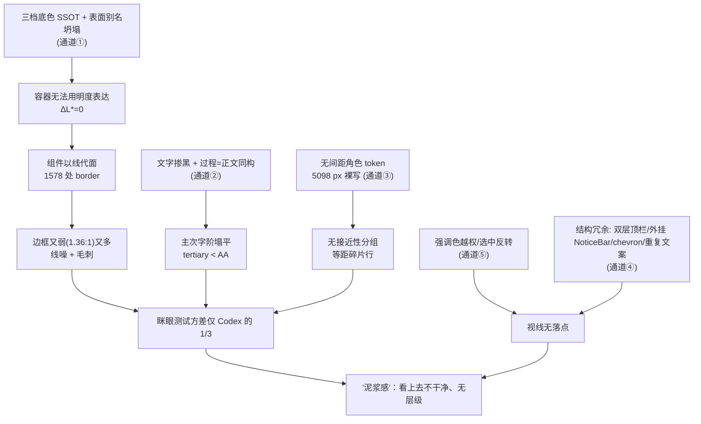
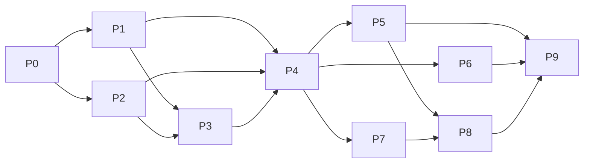

# 视觉层级与清晰度系统性重构 · 总方案

> 战役工作区：`docs/visual-hierarchy-clarity-analysis/`
> 输入：`analysis/01~09`（9 份 flash 分维分析）+ 主控源码交叉核对 + 用户 2026-10-26 四项裁决
> 性质：纯逻辑规划——只谈依赖、任务单元、文件域、验收断言；不谈工期与人员。
> 分阶段详案由子 Agent 另行产出（根目录 `P0~P9-*.md`），本文是它们的唯一上位契约。

---

## 0. 用户裁决与范围（效果锁，已确认）

2026-10-26 用户对四个冲突点的答复，构成本方案的授权边界：

| # | 冲突点（旧裁决） | 用户答复 | 本方案落点 |
|---|---|---|---|
| R1 | 2026-10-10「三档底色 SSOT」及其契约测试 | 以**当前代码缺陷为基准**改进；**鼓励升级为最好的方案** | §3 表面阶梯（推翻三档，契约测试改写） |
| R2 | 2026-09-11「过程行=正文 14px 同构」；2026-09-19「终态过程段默认展开直出」 | 按推荐：**保留默认展开直出**，过程行降一档字阶/明度，同类连续工具调用聚合为单行摘要 | §5 过程呈现、§4 排版角色 |
| R3 | 2026-10-21「暗色文字掺黑 20/40/60%」 | 按推荐：以**对比度下限**为约束重定阶梯，加门禁测试 | §4 文字阶梯 |
| R4 | 结构性改动（Inspector 看板、用户气泡、双层顶栏、NoticeBar） | **全部纳入，看着来，对项目有益即可改** | §6~§9、Phase P8 |

**必须同步清理的"旧裁决残留"**：所有注释 / 测试 / 文档中引用上述旧裁决的位置，要随实现一并改写或删除（否则下一位 Agent 会被陈旧注释误导）。已知载体：`ChatToolCallBlock.module.css:2-9`、`FoldableToolGroup.module.css:6`、`ReasoningRow.module.css:160-167`、`timelineSegmenter.ts:118-131`、`processClosureChain.test.ts:156`、`timelineSegmenter.test.ts:142`、`MessageContent.terminalConvergence.test.tsx`、`MessageContent.thinking.test.tsx`、`tokens.css:36-66,1045,1134`、`threeTierSurface.contract.test.ts`。

---

## 1. 一页结论：为什么别人干净、我们不干净

### 1.1 现象 → 机制

用户的直觉"别人干净且层级清晰、我们不是"，在源码里对应的是**同一个结构性缺失**：

> **我们没有一个「信息重要性 → 视觉属性」的单一语义映射层。**
> 每个组件各自挑选颜色、字号、边框、间距；全局 token 只提供"原材料"（652 个变量、10 档圆角、5098 处裸 px），不提供"这类信息该长什么样"的角色契约。结果是：谁也不对"层级"负责，层级靠偶然。

视觉层级由 5 个**正交通道**共同表达。别人的界面在 5 个通道上各自留出了足够的**反差**；我们每个通道都被压平，且通道之间互相补偿失败：

| 通道 | 别人（Codex 截图实测） | 我们（暗色实测） | 根因（源码证据） |
|---|---|---|---|
| ① 明度（表面） | 侧栏/主区/卡片/输入框有台阶，输入框相对主区 1.47:1 | card / elevated / paper 全别名到 `#141414`，ΔL\*=0；输入框仅 1.17:1；`sunken` 反比主区亮 | `tokens.css:1059-1061` 别名；`skinPaintPlan.ts:297-299` 把 5 级表面里的 2 级 `void` 丢弃；`threeTierSurface.contract.test.ts` 把"只许三档"冻结成门禁 |
| ② 字阶（颜色+字号） | 正文 17.5:1/14px，过程 6.9:1/12px，三层单调衰减 | 正文被掺黑到 10.56:1；过程行与正文同为 14px/400；`tertiary` 3.02:1、侧栏 2.73:1 | `tokens.css:1142-1148` 压灰；`ChatToolCallBlock.module.css:2-9` 同构裁决；Windows 雅黑无 500 字形，字重通道对中文失效 |
| ③ 间距（接近性） | 组内 5~8px，块间 20~21px，节 32px（比值 ≥3） | 聊天流行间距均质 13~19px（比值 1.10）；侧栏组间 8px < 项高 28px（比值 0.28） | `SidebarSessionList.module.css:55`；间距 token 存在但 padding 字面 px 510 处、line-height 字面量 283 处 |
| ④ 结构（容器/线） | 0 边框 0 chevron，单垂直轴 x=68 | 1578 处 border（329 处 1px），描边对比度仅 1.36:1；5 条对齐线；单轮 5~9 个 chevron | 通道①失效逼迫组件"以线代面"；`ToolCallHeader.tsx:199` 等常驻 chevron；`MessageVirtualizer.tsx:425-426` 与 `.listInner` 双重内衬 |
| ⑤ 强调（色彩/权重） | 蓝色实心发送钮是唯一重色；状态字为弱中性 | 常驻状态「完全访问」= 9.38:1 金黄（比正文还重）；侧栏未选中标题 9.56:1、选中胶囊 1.77:1；发送钮无文字时宽度归零 | `PermissionModeMenu` 绑 `--accent-orange`；`SidebarSessionList.module.css:411-413,436-440` 暗色强制提亮；`ChatComposer` send 归零 |

### 1.2 因果链（主线）



**主线判断**：通道① + ② + ③ 是**物理根因**（没有足够的反差可供使用）；通道④ + ⑤ 是**症状放大器**（在没有反差时，组件各自加线、加色、加元素去补救，使画面更噪）。**只修症状（删边框、改颜色）必然复发**；只补物理反差而不收敛结构，则新反差会被冗余元素吃掉。两者必须成体系地一起做。

### 1.3 对分析文档的主控复核结论

经源码抽查，下列结论**已核实**：`tokens.css:1059-1061` 别名、`:1142` 掺黑、`skinPaintPlan.ts:297-299` `void`、`timelineSegmenter.ts:118-131` 全分支 `defaultExpanded=true`、`MessageVirtualizer.tsx:425-426` 内联 `left/right`、`SidebarSessionList.module.css:411-413,436-440` 暗色强制提亮、`ToolCallHeader.tsx` 的 `showHumanLabel` 判定。

下列结论**需修正口径**（避免把子 Agent 的偏差带进实施）：

| 分析文档原话 | 修正 |
|---|---|
| "270+ 处 `font-weight: 500`" | 字面量 `font-weight: 500` 实测 **94** 处；其余经 token 消费，须在 P2 用 token 反查统计，不得沿用 270 |
| "`ToolCallHeader.tsx:70` 判定缺陷" | 缺陷真实存在，但实际位置是 `showHumanLabel = human && human !== actionText && human !== paramText`：当 `human = actionText + ' ' + paramText`（如「列出目录 crates」）时三者都不相等，于是意图与动作+参数**重复渲染**。修法是**统一展示模型**，不是改这行判断（见 §5.2） |
| 01 报告五级表面的具体 hex | 仅作**种子**参考，不作定稿；定稿值由 P1 在多主题×亮度矩阵下实测得出（见 §3.4） |
| 08 报告"三层表面" vs 01/03 报告"四/五级" | 三份建议互相冲突；本方案裁定为**六级语义阶梯**（§3.1），因为现有消费面（侧栏壳层、卡片、输入坞、浮层、下凹）确实占用 6 种语义 |
| "亮色无需处理" | 02 报告未验证亮色；本方案要求**所有已注册主题**（default/light/dark/各 preset）通过同一契约（§3.5） |

---

## 2. 设计原则（本方案所有决策的裁判标准）

1. **层级由角色表达，不由组件自选**。组件声明"我是什么信息"（角色），不声明"我是什么颜色/字号"。
2. **反差优先于装饰**。能用明度台阶 / 字阶 / 间距表达的，不用边框、背景块、图标。
3. **构造正确优于测试看守**。阶梯的单调性由 token 派生公式**构造保证**（步长为正），契约测试做矩阵兜底，而不是"手填 6 个字面值再测它们是否递增"。
4. **一个概念一处真理（SSOT）**。展示文案、表面阶梯、字阶、节奏、强调色各只有一个定义点；别名与双写一律删除。
5. **不打补丁**。不在组件里局部改色、不写 `!important`、不用魔术 px 补偿；缺口一律回到 token/基元层补。
6. **删除是一等任务**。每个阶段必须有"删除清单"与"删除后的断言"（grep 零命中 / 门禁变严），不接受"新旧并存"。
7. **为未来留抽象，不为未来写死**。主题（用户皮肤/亮度/高对比）、新工具类型、新状态通知都只通过现有扩展点接入（注册表 / 角色 / 槽位），不得再触碰组件样式。
8. **反过度设计**。遵守仓库 `ANTI_OVERENGINEERING_GUARDRAILS.md`；新增门禁脚本合并为一个，新增抽象每个都必须能指出"当前至少 3 处消费者"。

---

## 3. 通道①：表面阶梯（Surface Ladder）

### 3.1 语义阶梯（取代"三档底色"）

按"物理高程"建立**单调递增**的六级语义表面。名称是角色，不是颜色：

| 级 | token | 角色 | 现有消费面（核对到的） |
|---|---|---|---|
| e0 | `--surface-sunken` | 下凹：代码块底、输入轨道、内嵌列表槽 | 现被别名到 outer（反而更亮，倒挂） |
| e1 | `--surface-canvas` | 主阅读画布：聊天流 | 现 `--surface-main` |
| e2 | `--surface-shell` | 外壳：侧栏、标题栏、标签条（唯一透出云母的层） | 现 `--surface-outer` |
| e3 | `--surface-card` | 内容卡片：报告卡、diff 卡、工具展开体、设置项 | 现别名到 main（ΔL=0） |
| e4 | `--surface-raised` | 浮起交互：输入坞、选中项底、按钮次级 | 现 `--surface-input`（仅 1.17:1） |
| e5 | `--surface-overlay` | 弹层：菜单、对话框、tooltip | 现 `--surface-elevated`（同 main） |

> 外壳 e2 高于画布 e1 是**保留**自 2026-10-10 的有效设计意图（"主层沉底、外层浮起"），被推翻的只是"全局仅三档"这一限制。

### 3.2 派生公式（构造保证单调）

运行时与 CSS 的现有分工保持不变（`tokens.css` 头部已声明：A 类由 CSS 派生，运行时只写参数）。改动在**参数集与派生方式**：

- **运行时只写 3 个参数**：`--surface-base`（画布基色）、`--surface-tint`（可选色相偏移，供暖色/冷色皮肤）、`--elev-direction`（亮色 −1 / 暗色 +1 之类的方向符号，由主题注册表决定，不在组件中判断主题）。
- **CSS 用固定步长常量派生**：
  `--surface-card: color-mix(in oklab, var(--surface-base), var(--elev-target) calc(var(--elev-step-card) * 1%))`，其余各级同构。
  `--elev-step-*` 为一组正数常量（定义在 `tokens.css` 一处），e0 取负步（朝深）。
- 因为步长恒正，**任何基色下阶梯天然单调**；用户把亮度调到极端档（`themeBrightnessAdjust ±5`）时，唯一可能破坏阶梯的是**饱和截断**，由 §3.5 的矩阵测试覆盖，而不是由运行时补丁。
- 与现有 `--elevate-1..3`（hover/active 提亮）合并：hover/active/selected 是"在所在层上叠加的状态梯度"，统一为 `--state-hover / --state-active / --state-selected` 三个叠加量，**不再有独立的"第四种灰"**。同时收敛 `--elevate-step-3` 18.7% 导致的 `#464646` 过冲（01 报告）。选中态底**应当克制**：参考界面（Codex）选中行相对所在层仅约 1.22:1，选中的主要辨识来自**文字阶梯**（选中 `primary`、未选中 `secondary`）而不是底色块；故选中底相对所在层取 ΔL\* ≥ 2 且对比度 ≤ 1.5:1，不再是刺眼聚光灯（P1 实测候选：`--state-selected` 10% 叠加 → 1.26:1）。06 报告"选中胶囊 1.77:1 太弱"的诊断已**更正**：真正的倒挂是未选中标题被强提亮到 9.56:1，根因在文字而不在底色（见 §8.2）。

### 3.3 运行时管线收口

| 现状 | 动作 |
|---|---|
| `skinPaintPlan.ts:297-299` `void bgTertiary; void bgElevated; void shellChromeBg;` 把预设里本已规划的层级丢弃 | **删除 void 三连**，`deriveSkinPaintPlan` 的返回值契约改为输出 §3.2 的三个参数；`themePresets.ts:165-181` 的多级字面量（`bgPrimary/Secondary/Tertiary/Card/Elevated`）**整体退役**，预设只声明 `base/tint/direction` |
| `injectRootTokens.ts` 写入 `--user-surface-outer/main/input` | 改写为写入 §3.2 三参数；旧 `--user-surface-*` 三个名字**删除**（含所有读取方，grep 零命中） |
| `shiftWarmLayers.ts` 对每层字面值做暖色位移 | 改为只对 `--surface-tint` 位移，层级由 CSS 派生，位移不再破坏单调性 |
| `contrastGuard`（`skinPaintPlan.ts:285-293`） | **保留并上提**为运行时对比度保底，用于自定义皮肤；其目标值读取 §4 的文字对比度下限常量（单一来源），不再内嵌 38%/36% 魔数 |

### 3.4 阶梯参数的定值方法（不在总方案里写 hex）

不预先写死数值，规定**定值流程与判据**，由 P1 执行并留证：

1. 在 `dark-cozy` 与 `default` 两个基线主题下，用真实宿主（Tauri MCP 4000，§12）截取"空会话 / 长对话 / 带卡片 / 带弹层"4 种画面。
2. 候选步长以 01 报告的种子值起算，调整到满足下列**判据**（全部可计算）：
   - 相邻级 ΔL\* ≥ 2.0；`raised` 相对 `canvas` ΔL\* ≥ 8（对标 Codex 输入框 1.47:1，ΔL\*≈14）；
   - 无阴影时 `card` 与 `canvas` 仅靠明度即可辨认（ΔL\* ≥ 3）；
   - 选中态底相对所在层：ΔL\* ≥ 2 且对比度 ≤ 1.5:1（Codex 约 1.22:1）；选中态内部文字仍须满足 §4.1 的 4.5:1 下限；
3. 结果写入 `tokens.css` 一处，并把"判据"固化为契约测试（§3.5）。

### 3.5 契约测试改写（取代 `threeTierSurface.contract.test.ts`）

新测试 `surfaceLadder.contract.test.ts`，核心断言：

- **单调**：对"所有已注册主题 × `themeBrightnessAdjust ∈ [-5,+5]` × tint 组合"的矩阵，解析 6 级表面，断言严格单调且满足 §3.4 判据；
- **无字面表面**：`tokens.css` 之外（及 `themePresets` 之外）不得出现独立表面字面色（沿用 `check-color-ssot.mjs` 的思想，扩展词表）；
- **别名不坍塌**：任意两个 `--surface-*`（除明确声明的同义对）解析值不得相同；
- **hover/active/selected 叠加**必须落在所在层之上、不产生新的字面灰。

测试所需的 CSS `color-mix` 解析：P0 评估是否引入轻量色彩库（仓库当前无 culori 等依赖；`stylelint@16` 以 `npx` 方式存在于 `lint:all`）；若不引入，则在测试工具里实现 oklab mix 与 WCAG 对比度（约 60 行纯函数），并由其自己的单元测试守护（正逆向对称、边界）。

### 3.6 阴影 / 边缘光（取代失效的 1.5% 纯黑阴影）

- 暗色下投影物理不可见（`ChatComposer.module.css:1285` 实测位移 <0.3 RGB 阶）。引入**边缘光语义 token**：`--edge-rim`（1px 外圈，白 ~4~8% 叠加）与 `--shadow-lift-{card,raised,overlay}`（环境暗部遮罩）。
- 边缘光是 **"阶梯不足时的最后手段"**，不是边框的替身：只允许用于 `raised`/`overlay`，卡片靠明度台阶即可。
- 所有 `box-shadow: 0 0 0 1px …` 手写环收口到 `--edge-*`。

### 3.7 删除清单（P1）

- `--surface-paper`（12）、`--bg-canvas`（6）、`--bg-page`（7）、`--surface-card/elevated/sunken` 旧别名定义（5/4/4）；`--bg-primary`（64）、`--bg-secondary`（76）、`--bg-tertiary`（17）、`--bg-elevated`（54）、`--bg-card`（246）为**高消费别名**：用 codemod 迁移到 §3.1 的 6 个 token 后删除定义；迁移后 `grep -E "\-\-(bg-(primary|secondary|tertiary|card|elevated)|surface-(paper|outer|main|input))"` 在 `src/` 零命中。
- `threeTierSurface.contract.test.ts`、`tokens.css:36-66` 三档说明段、`:1045-1049` 三档注释；`--content-frame-border: #222121` 等"为分隔外层与主层而造的发丝线"（改由明度台阶承担）。
- `themePresets.ts` 的多层字面值字段与 `skinPaintPlan.ts` 的 `void` 段。

---

## 4. 通道②：文字阶梯与排版角色

### 4.1 文字阶梯（以对比度为约束，取代"向黑混合百分比"）

四级语义，含**硬下限**（对每一个可能落到的表面都必须成立）：

| token | 角色 | 对比度下限（落点：canvas/shell/card/raised/选中行） | 允许承载文字？ |
|---|---|---|---|
| `--text-primary` | 结论正文、标题、用户输入 | ≥ 12:1（AAA 余量） | ✔ |
| `--text-secondary` | 次要内容、文件路径、说明 | ≥ 7:1 | ✔ |
| `--text-tertiary` | 过程行、时间、元信息、占位符 | ≥ 4.5:1（AA） | ✔ |
| `--text-decor` | 分隔点、装饰、禁用图标 | ≥ 3:1（非文本 AA） | ✘（lint 拦截：不得用于 `color` 于文字节点） |

- 取代现有 `--text-faint` 的二义（既用于文字又用于装饰）：**更名为 `--text-decor` 并加 lint**；`--text-muted`（14）、`--text-quiet`（20）、`--text-faint`（11）全部迁移后删除。
- 派生方式：对 `--surface-base` 的 `color-mix` 比例常量，定义于 `tokens.css` 一处；`contrastGuard` 对自定义皮肤兜底。
- **废除** `tokens.css:1142-1148` 的 "掺黑 80/60/40/30%" 压灰链，以及 `--user-text-*` 这套"未压灰参数 vs 压灰可见值"的双轨（只保留一个参数 `--text-base`，其余由阶梯派生）。

### 4.2 字阶与排版角色（引入缺失的语义层）

**字阶**收敛为 6 档（步长拉开，至少 2px 级差）：

| token | 值 | 备注 |
|---|---|---|
| `--font-size-caption` | 11 | 辅助标签、徽标 |
| `--font-size-meta` | 12 | 过程行、元信息、代码行内 |
| `--font-size-body` | 14 | 结论正文、控件正文 |
| `--font-size-subhead` | 16 | 卡片标题、H3 |
| `--font-size-heading` | 18 | H2 |
| `--font-size-title` | 22 | H1 |

**13px 退役**（当前 `sm` 档）：现有 13/13.5 的消费点按"角色映射"落到 12 或 14，由 P2 逐点裁定，**不允许保留第 7 档**。`nano/micro/xs-plus/sm-plus` 别名（7/35/5/4）与半像素字面量一并清零。

**角色 token**（本方案新增的核心抽象，约 8 个）：

```css
/* 一个角色 = font 简写 + 颜色，组件只引用角色 */
--type-prose:    400 var(--font-size-body)/var(--lh-prose) var(--font-family-ui);
--type-process:  400 var(--font-size-meta)/var(--lh-row) var(--font-family-ui);
--type-label:    400 var(--font-size-body)/var(--lh-ui)   var(--font-family-ui);
--type-meta:     400 var(--font-size-caption)/var(--lh-ui) var(--font-family-ui);
--type-card-title: var(--fw-strong) var(--font-size-subhead)/var(--lh-ui) var(--font-family-ui);
--type-heading, --type-title, --type-code …
/* 与之成对的颜色角色 */
--ink-prose: var(--text-primary);   --ink-process: var(--text-tertiary); …
```

组件只写 `font: var(--type-process); color: var(--ink-process);`——消除"过程行该用 11/12/13/14 哪个"的逐点决策，**这正是层级无人负责的结构性解药**。

### 4.3 字重策略（对 Windows CJK 的现实约束）

Windows 雅黑仅有 400/700 物理字形，500/600 被降级。因此：

- **字重不再承担层级**。仅保留两档：`--fw-regular: 400` 与 `--fw-strong: 700`（仅标题类角色使用）。`font-weight: 500` 字面量 94 处与 `--font-weight-medium/content/semibold` 的 token 消费，统一迁移（按角色决定落 400 或 strong）后删除。
- 层级第一防线 = 字号 + 颜色 + 间距；字重只是辅助。
- 字体栈：把 `Segoe UI Variable Text` 提前以改善拉丁字形；是否内置带 500/600 字形的 CJK 可变字体，列为 P2 的**验证项**（体积/加载影响实测后再裁定），不在本方案预设结论。

### 4.4 Markdown 报告结构统治力

`--md-heading-color` 与正文共享被压暗的 primary，导致长报告标题无统治力（02/09 报告）。方案：标题类角色走 `--type-heading/title` + `--ink-heading`（= `--text-primary` 提亮一档或直接取阶梯顶，由 P2 定值，满足 ≥ 12:1 且高于正文）；H1/H2 的发丝分隔线是否恢复由 P2 在"报告式回答"实机截图下评估（不预设）。

### 4.5 门禁

扩展既有 stylelint 流程：覆盖目录（聊天流、工具调用、输入坞、侧栏、标题栏）内禁止 `font-size/line-height/font-weight` 字面量与 `font:` 字面简写，必须走 `--type-*`。存量按目录建立**只减不增的基线**（§11）。

---

## 5. 通道④⑤（对话流）：过程呈现与信息架构

### 5.1 目标形态

> 一次助手回合 = 若干**过程簇（Process Cluster）** 与**结论正文**交替；过程簇在视觉上是"安静的底噪"，结论正文是"主旋律"。

| 要素 | 现状 | 目标 |
|---|---|---|
| 过程行字阶 | 14px/400/`tertiary 3.02:1`，与正文同构 | `--type-process`（12px）+ `--ink-process`（≥4.5:1），行高 `--lh-row` |
| 过程簇间距 | 行间 13~19px 均质 | 簇内 `--gap-group`（6~8px），簇与正文 `--gap-block`（≥20px），比值 ≥ 2.5 |
| 终态默认 | 全分支 `defaultExpanded=true`（保留，R2） | **保留默认展开直出**；但同类连续调用先聚合（§5.3） |
| 常驻 chevron | 每行一个（`ToolCallHeader.tsx:199`、`FoldableProcessSection.tsx:310`、`FoldableToolGroup.tsx:237`） | 单一基元 `DisclosureAffordance`：静止态**不占视觉**，hover/focus/已展开时淡入；预留固定宽度槽位，避免布局跳动 |
| 文案 | 意图 + 动作 + 参数三元并列，重复 | 单一展示模型（§5.2） |
| 子智能体 | 灰色单色图标混在流里 | 确定性色彩身份（§5.4），空间分离见 §9 |
| 用户输入 | 右对齐气泡，对比 1.25:1，对齐线+1 | §5.5 |

### 5.2 工具展示 SSOT：`ToolPresentation`

在 `toolHeaderPresentation.ts` 建立**唯一**的展示模型，取代 JSX 里 `human / actionText / paramText` 三元拼接与 `showHumanLabel`：

```ts
interface ToolPresentation {
  /** 唯一首要标签：已去重、已消解动词冗余；"读取/搜索/写入…"的人类语义 */
  label: string;
  /** 可选目标：路径/模式/命令摘要；与 label 互斥地承载"对象" */
  target?: { text: string; kind: 'path' | 'pattern' | 'command' | 'text'; clickable: boolean };
  /** 右侧元信息：diff 统计、耗时；最多 2 项 */
  meta: readonly ToolMeta[];
  /** 状态：驱动图标与色（仅 error/running 使用语义色） */
  status: ToolStatus;
}
```

- 去重规则**在模型层一次完成**：当 AI 提供的意图说明（`human`）已包含动作词与目标时，取意图为 `label`，`target` 仅在意图**未包含**目标文本时出现。规则为可穷举的纯函数，**按工具类型建黄金用例表**（列目录/读取/搜索/写入/编辑/命令/浏览器/子 Agent/MCP……），断言"渲染文本中任一子串不重复出现"。
- 新工具类型只需向**工具展示注册表**增加一条记录（label 模板、icon、meta 提取器），组件零改动（对应 §2 原则 7）。
- `ToolCallHeader.tsx` 只消费 `ToolPresentation`，其 JSX 元素数从 7 降到 ≤ 4（状态图标、label、target、meta），chevron 由 `DisclosureAffordance` 提供。

### 5.3 聚合：过程簇与"同类连续调用"摘要

R2 的落点（视觉降权，不是折叠）：

- 在 `api/tool-presentation/` 的归一化链路（`timelineNormalizer` → `timelineSegmenter`）上，新增 **`clusterProcessItems` 纯函数**：把一个过程段内**相邻**的同类工具调用（如连续 N 次读取、连续 N 次搜索）聚合为一个簇行：「读取 5 个文件 · 耗时 …」，簇行可展开显示原始行。
- **不改动终态"默认展开直出"语义**：簇行默认展开（直出内部行）还是仅直出摘要，**是 P5 要用真实对话回放对比后再定的实现参数**——但无论哪种，都必须通过同一个 `DisclosureAffordance`。（R2 明确允许"同类连续工具调用聚合成单行摘要"，故默认以摘要行呈现、展开可见原始行，是与该裁决一致的最小解读；P5 须在文档里显式记录选择及理由。）
- **组级折叠门槛**（`FoldableToolGroup.tsx:73` 仅 `toolCount >= 2`）：交错流下每段只有 1 个工具使聚合失效。方案是把"聚合"从**"单段内计数"**改为**"过程簇内相邻同类"**，即使单段单工具也走统一的 `ToolPresentation → 簇行` 通路；不再有"≥2 才折叠"的特判分支。
- 虚拟滚动高度估算（`VirtualScrollManager.ts` 的 `MESSAGE_ESTIMATED_ROW_HEIGHT` 等）必须与 §7 的行高 token 联动更新（P3/P5 共同的验收项：快速滚动无跳变）。

### 5.4 子智能体色彩身份

- 在产品色板层（`tokens.css:1955` 起已允许扩充）加一个**确定性色环**：8 个 OKLCH 等亮度不同色相的 `--agent-hue-{1..8}`；`agentIdentity(id) → {hueIndex, glyph}` 为纯函数（稳定哈希，不可随机）。
- 色彩身份**只用在"实体识别"处**（头像/左缘标记），文字色仍走文字阶梯；该规则写入 §10 强调色预算，避免身份色泛滥。
- 对应对话流中的单色 `zap`：替换为身份头像。

### 5.5 用户输入块

- 把右对齐气泡改为**与主轴对齐的"提问块"**：占列宽、左对齐、底为 `--surface-card`（靠明度台阶，对比相对 canvas ≥ 3 ΔL\*），**无边框**；这同时消除 1.25:1 的"潜行气泡"与多出的一条对齐线（09 报告：5 条对齐线）。
- `--user-bubble-bg` 退役；气泡的圆角走 §8 的 `--radius-card`。
- 风险与取舍：这是对 IM 范式的改动（R4 授权）。P5 须在真实宿主下做**前后对照截图**留证；若用户在验收时否决，回退点仅限于该块的 CSS 与一个布局变量，不会外溢（因为其底色/圆角/对齐都来自基元）。

### 5.6 删除清单（P5）

- `ToolCallHeader.tsx` 内 `showHumanLabel` 及三元拼接；`FoldableToolGroup.tsx:73` 的 `toolCount >= 2` 特判；三处常驻 chevron 的手写 DOM（`&#8250;`）；`--user-bubble-bg`；`ChatToolCallBlock.module.css:2-9`、`FoldableToolGroup.module.css:6`、`ReasoningRow.module.css:160-167` 的旧同构裁决注释与相关样式。
- `timelineSegmenter.ts:118-131` 中已无区分意义的重复分支（四个分支赋值相同）：收敛为一次声明，并把"为何默认展开"的注释更新为 R2 的新口径。
- 测试同步：`processClosureChain.test.ts`、`timelineSegmenter.test.ts`、`MessageContent.*` 中引用旧裁决的描述改写，**断言保留**（展开行为未变），仅追加聚合与展示模型的新断言。

---

## 6. 通道③：节奏与对齐轴

### 6.1 节奏 token（取代组件自选 px）

在既有 4px 栅格 `--space-*` 之上增加**语义节奏层**（组件在容器布局里只用语义层）：

| token | 值 | 语义 |
|---|---|---|
| `--gap-inline` | 4 | 图标—文字、徽标内 |
| `--gap-group` | 8 | **组内**：同簇步骤、侧栏同组项间 |
| `--gap-block` | 20 | **块间**：过程簇↔正文、消息↔消息 |
| `--gap-section` | 32 | **节间**：侧栏大分组、主界面功能区 |

**接近性定律（契约）**：`--gap-block / --gap-group ≥ 2.5` 且 `--gap-section / --gap-block ≥ 1.5`。契约测试读取 tokens 断言该比值，防止未来有人"为了好看"把间距拉平。

### 6.2 行高阶梯

283 处裸写 `line-height`（占 67.5%）收口为 `--lh-dense (1.2) / --lh-ui (1.35) / --lh-prose (1.55~1.65，P3 以真实正文段落定值) / --lh-row`（固定行高，由 §8 的行高档位决定）。1.68 的"膨胀行高"退役（04 报告）。

### 6.3 单一对齐轴

- 聊天流定义**两列网格**：`lead`（固定宽的图标/身份列，如 20px）+ `content`。**所有**流内元素（正文、过程行、工具展开体、用户提问块、报告卡片）的左缘 ∈ {lead 左缘, content 左缘}，对齐线 ≤ 2（现状 5）。
- **根除双重内衬**：`MessageVirtualizer.tsx:425-426` 的内联 `left/right: CHAT_SCROLL_PAD_X`（出现 6 处引用）**整体删除**；水平留白只在 `ChatMessageList.module.css` 的 `.listInner` 一处，由 `--stream-pad-x` 单点控制。`CHAT_SCROLL_PAD_X` 常量（`chatScrollGeometry.ts:8`，值 20）与其引用一并清退。注意它目前是**TS/CSS 双源同值**（`styles/dual-source-values.test.ts:55` 专门断言 `CHAT_SCROLL_PAD_X === --chat-stream-pad-x`）——这本身就是 SSOT 违例：虚拟滚动若需要该值参与测高，应在运行时从已解析的 `--stream-pad-x` 读取（一次读取、随窗口/密度变化重算），而不是维护第二份常量；该双源测试随之删除或改为"TS 侧不再声明此类常量"的反向断言。
- 阅读列最大宽度走 `--chat-col-max`；1200px 以上的 `@media` 放宽规则并入同一个变量的响应式定义。

### 6.4 删除清单（P3）

`CHAT_SCROLL_PAD_X` 常量、内联样式与 `dual-source-values.test.ts` 中对应的双源断言；裸写 `padding/margin/gap` 中不在 4px 栅格上的值（3/5/7/11px 等）按覆盖目录清零；`line-height` 字面量按覆盖目录清零；侧栏 `.section` 的 8px 下边距（改走 `--gap-section`）。

---

## 7. 通道④：容器语言——基元、圆角、行高、描边预算

### 7.1 基元（解决"每个组件各造轮子"）

当前会话行/工具行/Agent 卡/内联 Agent 面板各手写 6 套行高、4 套徽标、各自的 hover 过渡。统一为**5 个基元**（每个均有 ≥3 个现存消费者，满足 §2 原则 8）：

| 基元 | 职责 | 消费者（现） |
|---|---|---|
| `Row` | 单行条目：leading / label / trailing 三槽；高度取自 `--row-h-*`；hover/active/selected 走 §3.2 状态叠加 | `SidebarSessionList`、工具行、思考行、`AgentCard`、`InlineAgentPanel`、设置项 |
| `Card` | 靠 `--surface-card` 台阶成形的内容容器；**默认无边框** | 报告卡、`DiffCard`、`FilesCard`、`PreviewCard`、`TerminalCard` |
| `Badge` | 单一徽标（语义色仅 error/warn/success/accent 四类） | 侧栏计数、状态点、模型标签、Agent 状态 |
| `IconButton` | 统一图标按钮尺寸/hover/focus | 顶栏动作簇、composer 控件、卡片右上动作 |
| `DisclosureAffordance` | 展开指示（§5.1） | 工具行、思考行、过程簇、分组标题 |

**以 CSS Modules `composes`（仓库已有 14 处使用）或共享 `.module.css` 实现**，不引入新的样式运行时。

### 7.2 行高档位（取代 6 套）

`--row-h-dense 24`（过程/思考行）/ `--row-h-list 28`（侧栏、列表项）/ `--row-h-control 32`（输入控件、设置行）/ `--row-h-chrome 36`（标题栏、标签条）。20/26 两个孤立值并入就近档位（P4 逐点裁定）。

### 7.3 圆角角色（保持 2026-10 同心圆战役成果）

10 档圆角（4/6/7/8/10/12/14/16/20/24）收敛为**角色**，保持"内圆角 = 外圆角 − 内边距"的同心规则（`concentric-radius-unification` 战役，`5f09021cd`）：

| 角色 | 值 | 用于 |
|---|---|---|
| `--radius-row` | 6 | Row、徽标容器 |
| `--radius-control` | 8 | 按钮、输入控件、菜单项 |
| `--radius-card` | 12 | Card、提问块 |
| `--radius-dock` | 20 | 输入坞、对话框（沿用 `tokens.css:520` 的"固定 20px，不随密度缩放"裁决） |
| `--radius-pill` | 9999 | 胶囊、圆点 |

`--radius-s/m/sm/md/l/lg/xl/2xl/3xl/xs/btn/input` 旧名（含 `--radius-s`：14 处、`--radius-m`：32 处、异值同名陷阱）迁移后删除。**不许**出现 7/10/14 字面圆角。

### 7.4 描边预算（Border Budget）

描边只在三种情形合法，其余一律走明度台阶/间距：

1. **表单控件的可交互边界**（输入框、下拉、复选框）——使用 `--edge-control`，对比度满足非文本 3:1 的**聚焦态**即可；
2. **焦点环**——`--edge-focus`（遵守 AGENTS §13：克制、非深黑、混入 ≤ 10%）；
3. **语义强调**（错误/待审批）——`--edge-semantic-*`。

展示型容器（Card、行、气泡、顶栏、侧栏分组）一律禁止 `border: 1px solid var(--border-*)`；需要极弱轮廓时用 `--edge-rim`（§3.6）。`--border-color/--border-subtle` 退化为**仅 §7.4 允许情形的内部实现细节**，通过门禁限制其使用面。

---

## 8. 通道⑤：强调色预算与状态语义

### 8.1 规则

强调色（accent / warning / success / danger / agent-identity）**只有三种合法用途**：

1. **主行动**：发送、确认等**每屏至多一个**重色锚点（对标 Codex 蓝色圆形发送钮）；
2. **选中与焦点**：选中项、焦点环；
3. **需要用户介入的状态**：错误、待审批、危险提权。

**稳态信息（当前权限模式、模型名、计划模式）一律中性**，走 `--text-secondary/tertiary`。`PermissionModeMenu` 对 `--accent-orange` 的绑定**整体删除**（`--accent-orange` 现有 75 处引用，P6 逐一裁定归类：属于上述三类的保留，其余迁移到中性阶梯）。仅当权限处于"待审批/危险拦截"时按需注入语义色。

### 8.2 选中项必须比未选中项更显眼（修复倒挂）

- 删除 `SidebarSessionList.module.css:411-413`（暗色强制提亮未选中标题）与 `:436-440`（暗色强制提亮时间戳）两段**主题特判**：主题差异只允许通过 token 解析体现，**组件内不得再出现 `html[data-theme='dark']` 选择器**（该规则同样适用于全仓，作为 P9 门禁）。
- 未选中：`--ink-label`（`secondary`）；选中：`primary` + 选中叠加底；时间戳：`--text-tertiary`，默认可见但低权，选中/hover 才升一档（仍满足 4.5:1）。

### 8.3 实施门禁

`check-color-ssot.mjs` 增加词表：`--accent-*`、`--color-warning` 等只能出现在 `semantic/status` 组件白名单内；其余使用方须经由 `Badge`/`Row` 基元的语义变体。

---

## 9. 输入坞与外壳（结构性重构）

### 9.1 输入坞（Composer Dock）

| 问题 | 方案 |
|---|---|
| `ComposerNoticeBar` 外挂胶囊（48px、360px 居中）骑在 720px 输入框上，两个同形 20px 容器堆叠 | **删除外挂胶囊**；`ComposerCard` 增加**嵌入顶槽（embedded header slot）**，通知渲染在同一卡片内部，共享同一外轮廓与底色（`--surface-raised`），无自带描边/圆角 |
| 通知是否应常驻 | 通知契约化：`ComposerNotice = {severity, message, action?}`；未配置密钥属 `severity: setup`，在**空会话落地页**以导流卡呈现，进入活跃会话后降为模型选择器上的一枚状态点 + 点击打开配置（P6 逐个梳理 `useComposerNotice.effectiveNotice` 的全部来源：断网、上下文超长等，并给每个来源指定 severity 与落点） |
| 发送钮/模型选择器消失（`width:0`、`showModelPicker=false`） | **永远占位**：发送钮 `disabled` 态固定 28×28；模型选择器未配置时显示占位项并可点击打开配置；删除"归零/卸载"逻辑 |
| 权限状态 | 位置固定在左侧辅助区，中性阶梯（§8.1） |
| `ChatComposer.module.css` 45KB/1971 行上帝文件 | 拆为与 TSX 1:1 解耦的 6 个模块（`ComposerCard`、`ComposerSendControls`、`ComposerFloatingLayers`、`ComposerAttachments`、`ComposerEmbeddedNotice`、`ChatComposer` 骨架，因 P6 实测浮层 511 行、附件 562 行，4 模块会超门禁），每个 < 400 有效行；清退 25 个死类名及 `.container/.containerDense` 等历史选择器 |
| 聚焦态 | 遵守 AGENTS §13（空态落地输入混入 ≤ 5%）；`:focus-within` 不再沿用 `var(--border-subtle)` |
| 垂直内边距 | 以 `--space-*` 扩到 10~12px（04 报告：当前 6px 局促），具体值 P6 实测定 |

### 9.2 外壳

**9.2.1 顶部单轨化**

- 现状：`AppTopBar`（36px）+ `PaneHeader` 标签条 + `UnitChromeActions` 面包屑（38px）纵向叠加 ≥ 74px，会话标题在侧栏选中项/标签/面包屑**重复 3 次**。
- 方案：**一个标题 = 一个来源**：会话标题由 `paneHeaderModel` 单点产出；单叶单会话时仅一条 36px 单轨（标题 + 动作簇）；多标签/多叶时标签与动作同轨。面包屑二层**删除**（其承载的"项目/路径"信息并入标题的二级文本，`--text-tertiary`）。
- **需先对账的既有战役**：`docs/dual-header-refactor`、`docs/leaf-owned-tabs`、`docs/pane-tab-system`、`docs/tab-management-and-launcher-redesign`——它们定义了当前两层标题栏的所有权与拖拽区（`-webkit-app-region`）。P7 的第一项任务是写出"现行所有权表"，再据此合并；未对账不得动结构。

**9.2.2 动作簇**

4 个并排 14px 图标（globe / folder-tree / more / dock）无分组。按职责切为两组（视图坞组 / 会话动作组），组间用 `--gap-block` 留白或 `Divider` 分隔；图标隐喻替换（globe→浏览器窗口、folder-tree→文件），统一经 `IconButton` 基元与 `check-icon-ssot.mjs`。

**9.2.3 侧栏**

- 分组节奏：组内 `--gap-inline/--row-h-list`，组间 `--gap-section`；分组标题"贴近下一组内容"（标题上方 `--gap-section`、下方 `--gap-group`）。
- 空态降噪：**删除「暂无项目」37px 居中文字块**（无项目则不渲染该区，或仅在分组标题旁提供 `+` 入口）；「查看全部 (78)」改为与会话行同轴、左对齐的 `Row` 变体（`展开更多`），不再居中。
- 选中/未选中语义见 §8.2；右侧日期不再形成"斑马栅栏"。
- 侧栏元信息总量：P7 复核实测为 61 vs 29（原 06 报告记 56），差距主要来自重复标题与低价值元数据；P7 以"元素清单 + 逐项保留理由"净降至 32 个（见 `P7-外壳与侧栏.md` §1.2）。
- 重命名入口：统合为「双击标题 + 右键菜单 + F2 键盘路径」三通道，清退常驻铅笔按钮，原有三处入口 100% 对账保留（`P7-外壳与侧栏.md` T-P7-09）。

**9.2.4 活动轨（Activity Rail）与宽侧栏的关系**

R4 授权将全局入口（新对话/定时任务/扩展/搜索/设置）提炼为 48px 窄图标轨，会话列表作为可收放抽屉。这是**壳层信息架构**变更，依赖 §9.2.1（单轨顶栏）与 §7 基元，列为 **P8**；P8 先产出"收起态/展开态/拖拽区/键盘路径"的状态表并经真实宿主验证，再动代码。

---

## 10. Agent 看板（Inspector Tray）

R4 允许对标 Codex 的"子智能体专属面板"。方案定位：

- **目的**：把长程/并行子 Agent 的状态从主对话流**空间分离**，主流只保留结论与"摘要行"（§5.3），对应 09 报告的"正交三栏"。
- **载体**：复用现有内置视图注册表 10 槽中的第 8 号槽位（`id: 'agent'`，见 `P8-活动轨与Agent看板.md`）并升级标题为「子智能体」，避免新增第 11 槽破坏扩展单测门禁，**不另起布局引擎**；对话流内废除 `InlineAgentPanel` 展开体（主流仅保留单行摘要，原有 12 项能力 F01~F12 全量落入看板 `AgentDetailView`，并强制复用 P5 的 `ToolPresentation` 渲染基元）。
- **内容**：按状态分组（"进行中 · N / 已完成 · M"，对标 Codex 分组标题），行基元为 `Row` + §5.4 身份头像 + 当前动作摘要 + 耗时；点击行定位到主流对应簇。
- **数据**：消费现有子 Agent 事件流；**不新增事件类型**（若发现必需，则走 `docs/rust-rewrite/33` 的 changelog 流程，P8 内裁定，不在本方案预设）。
- **响应式**：窄于阈值时自动降为浮动抽屉；阈值取自布局 token，不硬编码。

---

## 11. 门禁与度量（让层级可被验收，而不是被感觉）

### 11.1 一个脚本，三条规则：`scripts/check-hierarchy-ssot.mjs`

接入 `check:desktop` 与 CI lint job，遵守"反过度设计"：只此一个新脚本。

| 规则 | 内容 | 强度 |
|---|---|---|
| H1 字阶 | 覆盖目录内禁 `font-size/line-height/font-weight` 字面量与 `font:` 字面简写；禁用 §4.2 之外的字号 token | 存量**棘轮**（只减不增，基线文件入库），最终目标 0 |
| H2 描边 | 覆盖目录内展示型组件禁 `border: 1px solid` 等描边声明（§7.4 白名单除外） | 同上 |
| H3 强调与主题特判 | 组件 CSS 内禁 `html[data-theme=…]` 选择器；`--accent-*` 仅限白名单组件 | 立即生效（存量先修，再上门禁） |

**棘轮基线文件**：`docs/visual-hierarchy-clarity-analysis/baseline/hierarchy-ratchet.json`（按目录计数）。每个阶段结束必须把基线**降到实际值**，不得放宽（对标仓库既有 `frontend-line-counts-baseline` 的做法）。覆盖目录初始清单：`chat-message-row/`、`chat-message/`、`chat-message-list/`、`chat-tool-call/`、`chat-composer/`、`sidebar/`、`binary-tree/PaneHeader*`、`chat-card/UnitChromeActions*`、`top-bar/`。

### 11.2 契约测试（Vitest）

| 测试 | 断言 |
|---|---|
| `surfaceLadder.contract.test.ts` | §3.5：矩阵单调 / 无字面表面 / 别名不坍塌 / 状态叠加 |
| `textLadder.contract.test.ts` | §4.1：每级文字 × 其可达的所有表面（canvas/shell/card/raised/选中行）WCAG 下限；`text-decor` 不得用于文字节点 |
| `rhythm.contract.test.ts` | §6.1：`block/group ≥ 2.5`、`section/block ≥ 1.5` |
| `toolPresentation.golden.test.ts` | §5.2：每种工具类型一条黄金用例；"渲染文本无重复子串"；新工具类型缺注册表项时测试失败 |
| `clusterProcessItems.test.ts` | §5.3：相邻同类聚合、不同类不聚合、单工具段走同一路径、顺序稳定（正逆向对称） |
| `agentIdentity.test.ts` | §5.4：同 id 恒同色；8 色对 canvas 的对比度下限；任意两色可区分 |
| `composerNotice.contract.test.ts` | §9.1：每个通知来源都映射到合法 severity/落点；发送钮/模型位永不为零宽 |

对比度/色彩计算的测试工具（oklab mix + WCAG）自身带单元测试（§3.5）。

### 11.3 真实宿主视觉验收：`hierarchyAudit`

静态测试无法证明"屏幕上真的变清晰了"（AGENTS §7.1 立体验证纪律）。把 `analysis/09` 中人工做的量化手段**固化为可重复的运行时审计**：

- 位置：`apps/crish-desktop/src/dev/hierarchyAudit.ts`（dev-only，生产构建 tree-shake 掉；`src/dev/` 目录已存在）。
- 通过 Tauri MCP（4000）的 `execute_js` 在真实宿主执行，输出结构化 JSON：
  - 每个可见文本节点：解析后前景/有效背景/WCAG 比值，列出低于对应阶梯下限者；
  - 聊天流内**可见描边元素数**；
  - 聊天流内元素**左缘的去重数量**（目标 ≤ 2）；
  - 相邻兄弟块的垂直间距分布，用于验证簇内/块间比值；
  - 常驻 chevron 数量；
  - 重复文本检测（同一行内相同子串 ≥ 2 次）。
- **固定验收夹具**：以 09 报告的两张基线截图对应的会话状态为基准（"长程自检 5 步工作流" + "无 key 的落地态" + "含大型报告的回答"），每阶段结束前后各跑一次，结果入 `baseline/` 作为证据。
- **眯眼测试**（空间亮度方差/边缘密度）作为**参考指标**（非硬门禁，因其依赖截图与窗口尺寸）：基线 Crish 0.0033 vs Codex 0.0099；目标是显著高于 Crish 基线并向 Codex 靠拢，趋势进入验收记录。

### 11.4 全量检查

重大改动后按 `FULL_CHECK_COMMANDS.md` 执行全量命令清单；`reference/markdown-editor` 若受 §4 排版角色影响须跑 `npm test` 门禁；测试资产保护铁律（AGENTS §9）适用——不得删除既有 e2e 专项 spec。

---

## 12. 实施阶段与逻辑依赖

### 12.1 阶段表（逻辑依赖，不含工期）

| 阶段 | 名称 | 前置 | 主要文件域 | 核心交付 |
|---|---|---|---|---|
| **P0** | 基线与度量底座 | — | `src/dev/hierarchyAudit.ts`、`scripts/check-hierarchy-ssot.mjs`、测试色彩工具、`baseline/` | 度量工具、棘轮基线、夹具截图与 JSON 基线、色彩库取舍裁定 |
| **P1** | 表面阶梯 SSOT | P0 | `styles/tokens.css`、`services/token-runtime/*`、`themePresets.ts`、`shiftWarmLayers.ts`、旧三档测试 | 六级阶梯、三参数管线、边缘光 token、别名 codemod 与删除 |
| **P2** | 文字阶梯与排版角色 | P0（可与 P1 并行，文件域仅在 `tokens.css` 的不同段落——须串行落盘，见 §12.3） | `tokens.css` 字阶/文字段、`markdown-typography.css`、字体栈设置 | 文字阶梯、6 档字阶、`--type-*` 角色、字重策略、字面量棘轮 |
| **P3** | 节奏与对齐轴 | P1、P2（行高依赖字阶） | `tokens.css` 间距段、`chat-message-list/*`、`MessageVirtualizer.tsx`、`VirtualScrollManager.ts` | 节奏 token、行高阶梯、单一对齐轴、去双重内衬 |
| **P4** | 容器基元与圆角/描边语言 | P1、P2、P3 | 升级并扩充 `components/ui/*`（`ui/` 是仓库唯一通用原子层，见 `components/ui/README.md`；现有 `Badge`、`IconButton` 就地升级，不另建 `primitives/`）；`tokens.css` 圆角/行高段 | `Row/Card/Badge/IconButton/DisclosureAffordance`、圆角角色、行高档位、描边预算与展示型容器去边框 |
| **P5** | 对话流过程呈现 | P4 | `chat-tool-call/*`、`chat-message-row/*`、`chat-message/*`、`api/tool-presentation/*` | `ToolPresentation` SSOT、过程簇聚合、chevron 收敛、用户提问块、子 Agent 身份色、旧裁决清理 |
| **P6** | 输入坞一体化 | P4（需基元与阶梯） | `chat-composer/*`（含 CSS 拆分）、`PermissionModeMenu` | 单卡输入坞、嵌入通知槽、常驻操作位、强调色归位 |
| **P7** | 外壳与侧栏 | P4（P5/P6 并行亦可，文件域不重叠） | `binary-tree/PaneHeader*`、`chat-card/UnitChromeActions*`、`top-bar/*`、`sidebar/*` | 所有权对账表、单轨标题栏、动作簇分组、侧栏节奏/语义/空态 |
| **P8** | 活动轨与 Agent 看板 | P5（身份色）、P7（壳层） | 右侧坞 Tab 类型、`agent-card/*`、`RuntimePanel`、壳布局 | 状态表→实现；子智能体 Dock Tab；活动轨 |
| **P9** | 门禁收口与债务清算 | P1–P8 | `scripts/*`、CI、文档、全仓残留 | 门禁转硬（H1/H2/H3 目标归 0 或达基线上限）、旧裁决残留清零、`FULL_CHECK_COMMANDS.md` 更新、复测对照 |

### 12.2 依赖图



### 12.3 文件冲突纪律

- `tokens.css`（约 2339 行）是 P1/P2/P3/P4 的共同文件域：**同文件串行**（AGENTS §2）。为降低冲突，P1 的首个任务是把 `tokens.css` 按职责切成**多个同层文件**（surface / text / type / space / radius / state / components-legacy），由入口 `tokens.css` `@import` 聚合；切分本身为纯搬移、行为零变化、由现有 `check-css-encoding`/视觉回归兜底。此后各阶段改不同文件，可并行。
- P5/P6/P7 文件域互不重叠，可并行；共用基元只读。
- 每阶段的 PR 单元遵守"一个阶段 = 一批可独立回滚的提交"，提交由主 Agent 以 `git commit --only` 限定路径（AGENTS §3）。

---

## 13. 风险登记与对策（逻辑风险，不是工期风险）

| # | 风险 | 对策（设计验证，而非回避） |
|---|---|---|
| X1 | 六级阶梯在 Mica/Acrylic 开启时，外壳 e2 的感知明度随壁纸漂移 | P1 在真机开启云母下实测；若 e2 受壁纸影响，则 `--surface-shell` 的透明混合量作为独立参数并纳入矩阵测试 |
| X2 | 用户把亮度调到极端档，阶梯饱和截断导致相邻级合并 | 矩阵测试覆盖 ±5 档；若截断，派生公式改为"先压缩步长再截断"，而非在运行时补丁 |
| X3 | 字阶退役 13px 造成大量组件视觉位移 | 每个组件的 13→12/14 映射用**角色**裁定，不凭感觉；变更前后截图对照入证据 |
| X4 | 过程行从 14→12px 与虚拟滚动高度估算联动 | P3/P5 联合验收：滚动测试（快速拖动无跳变）；`VirtualScrollManager` 的估算改为读 `--row-h-*`/`--lh-*` |
| X5 | `composes` 与现有 CSS Modules 约束（行数门禁、`no-multi-comp`）冲突 | P4 先做一个基元的最小样板，跑通 `check:desktop` 全套后再批量迁移 |
| X6 | 单轨标题栏与现有拖拽区/标签所有权耦合 | P7 先产出"所有权表"；与 dual-header/leaf-owned-tabs 战役文档对账后再合并 |
| X7 | 用户提问块从 IM 气泡改为主轴块，可能与既有交互（编辑/重试/分支）的锚点冲突 | P5 盘点提问块上的全部交互入口，迁入同一 `Row` 的 trailing 槽，不丢功能（效果锁：不得砍功能） |
| X8 | 删除别名带来的海量机械改动（`--bg-card` 246 处等）引入回归 | 由脚本化 codemod 完成（可重放、可 dry-run），每个别名一个提交；codemod 脚本不入主干，仅留在阶段证据目录 |
| X9 | 对比度提升后，品牌/皮肤的"气质"改变 | 本方案以对比度下限为硬约束（R3 已授权）；"气质"通过 `--surface-tint` 与强调色选择表达，不通过压低文字对比度表达 |
| X10 | 高 DPI 下 1px 发丝线渲染为 1.25/1.5px 杂色带 | 描边预算（§7.4）减量本身缓解；P1 对 125%/150% DPI 抽样复核 `--edge-rim` 的外观 |

---

## 14. 验收总表（量化、可复核）

> 以下全部由 §11 的契约测试 + `hierarchyAudit` + 立体验证套件产出证据。基线值取自 `analysis/` 实测。

| 维度 | 指标 | 基线（Crish 暗色） | 目标 |
|---|---|---|---|
| 表面 | 相邻表面最小 ΔL\*（含 card↔canvas） | 0（card=canvas） | ≥ 2.0（card↔canvas ≥ 3，raised↔canvas ≥ 8） |
| 表面 | `sunken` 比 `canvas` 更亮的倒挂 | 存在（+4.94 L\*） | 0 |
| 表面 | 输入坞相对画布 | 1.17:1 | 接近 Codex 的 1.47:1 量级 |
| 文字 | `tertiary` 在 canvas / shell 的对比度 | 3.02 / 2.73 | ≥ 4.5 / ≥ 4.5 |
| 文字 | 选中行内日期 | 3.07 | ≥ 4.5 |
| 文字 | `primary` | 10.56 | ≥ 12 |
| 文字 | 用于文字节点的 `text-decor` | 不存在此概念 | 0 |
| 字阶 | 字号档位数（不含代码） | 11/12/13/14 步长 1px，含半像素 | 6 档，步长 ≥ 2px，半像素 0 |
| 字阶 | 覆盖目录的字号/行高/字重字面量 | 11px×55 等大量 | 0 |
| 间距 | 簇内:块间 比值 | 1.10 | ≥ 2.5 |
| 间距 | 侧栏组间:项高 | 0.28 | ≥ 1.0（`--gap-section ≥ 1.5×--gap-block`） |
| 对齐 | 聊天流左缘去重数 | 5 | ≤ 2 |
| 结构 | 聊天流可见描边元素数 | 多（线噪） | 0（表单焦点环除外） |
| 结构 | 一轮 5 步任务的常驻 chevron 数 | 5~9 | 静止态 0（簇行 ≤ 1） |
| 结构 | 单条工具行视觉元素数 | 7 | ≤ 4 |
| 结构 | 工具文案重复子串 | 存在 | 0（黄金表全覆盖） |
| 结构 | 顶部连续 chrome 层 | 2 层 / 74px | 1 层 / ≤ 38px |
| 结构 | 左上 100×300 区域会话标题重复 | 3 | 1 |
| 输入坞 | 同时可见的独立描边容器 | 2（胶囊 + 输入框） | 1 |
| 输入坞 | 发送钮/模型位零宽状态 | 存在 | 0 |
| 强调 | 常驻状态使用强调色 | 「完全访问」9.38:1 | 0（仅待审批/危险时） |
| 强调 | 选中项相对未选中的可辨度 | 倒挂（1.77 vs 9.56） | 选中 > 未选中 |
| 治理 | 组件内 `html[data-theme=…]` 选择器 | 存在（侧栏等） | 0 |
| 治理 | 旧别名在 `src/` 的引用 | 数百处 | 0 |
| 参考 | 眯眼空间方差 | 0.0033（Codex 0.0099） | 显著提升（趋势指标） |

---

## 15. 阶段详案产出约定（给子 Agent）

- 路径：`docs/visual-hierarchy-clarity-analysis/P{0..9}-<名称>.md`（根目录属于"分维详案"白名单；`analysis/`、`evidence/`、`baseline/` 为一级子目录，**禁止更深嵌套**）。
- 每份详案结构（固定）：**目标与范围 / 前置与解锁 / 现状盘点（附 `文件:行号` 与实测）/ 任务单元（编号、文件域、输入输出、依赖）/ 删除清单与删除后断言 / 契约与测试（用例名+断言）/ 真实宿主验收步骤（Tauri MCP）/ 与相邻阶段的接口 / 风险与未确认项**。
- **必须贴着源码写**：任务单元要落到具体文件与符号；凡本方案标注"P*n* 裁定"的参数，详案必须给出裁定方法与结论（或明确的测量步骤），不得留空。
- **不得改变本方案的契约**（名称、判据、阶段边界）；发现矛盾只能上报主 Agent，不得自行改目标（效果锁）。
- 不谈工期人天；问题同权；不用 P0/P1 业务优先级砍项。

---

## 16. 扩展点与抽象契约（为未来需求留接口，而不是留口子）

本方案的抽象都服务一个检验：**未来出现下表任一需求时，只需向指定扩展点"加一条记录"，不触碰组件样式/结构**。凡需要改组件才能接入的，视为抽象缺陷，应在对应阶段修正。

| 未来需求 | 唯一接入点 | 被保护的不变量 | 禁止的做法 |
|---|---|---|---|
| 新主题 / 高对比皮肤 / 用户自定义底色 | 主题注册表：声明 `base / tint / direction`（§3.2）+ 文字基色参数（§4.1） | 阶梯单调、文字对比度下限（矩阵测试自动覆盖新主题） | 在组件里写主题特判；为新主题手填 6 个表面字面值 |
| 新工具类型（MCP、浏览器、新内置工具） | 工具展示注册表：`label 模板 / icon / target 提取器 / meta 提取器`（§5.2） | 文案无重复、元素 ≤ 4、聚合规则同构 | 在 `ToolCallHeader` 里加 `if (tool === ...)`；新增专属行高/颜色 |
| 新通知来源（断网、配额、上下文超长、插件提示） | `ComposerNotice{severity, message, action?}` 契约（§9.1）；severity 决定落点 | 同一时刻输入坞仅 1 个描边容器；稳态信息中性 | 在输入框上方另挂浮层；为通知自带颜色 |
| 新状态/徽标（队列中、已暂停、同步中） | `Badge` 语义变体（仅 error/warn/success/accent 四类）（§7.1） | 强调色预算（§8） | 新增专属颜色变量；组件自绘圆点 |
| 新的 Dock Tab（任务、日志、预览、子智能体） | Dock Tab 注册表（现有 leaf tool tabs 机制） | 行基元、身份色、`--surface-*` 阶梯 | 新写一套布局/分栏 |
| 新子 Agent 种类 | `agentIdentity(id)`（§5.4）自动分配色相 | 同 id 恒同色；8 色可区分 | 手写颜色映射表 |
| 密度模式（紧凑/舒适）与字号缩放 | 已有 `--font-size-adjust` 与密度参数作用于 `--font-size-*`/`--space-*`/`--row-h-*` 的**源头 token**（§4、§6、§7.2） | 比例关系（`block/group ≥ 2.5`）在任何密度下成立 | 在组件中乘系数；密度下改写角色 token |
| 新阅读场景（报告、长文、代码评审视图） | 新增**排版角色**（`--type-*` + `--ink-*` 成对）而非新字号 | 6 档字阶不扩 | 局部新增 `font-size: 15px` |
| 新语言（长文本语言、RTL） | `Row` 的 leading/label/trailing 槽 + `lead/content` 双列轴（§6.3）使用逻辑属性（`inline-start/end`）；本方案新增代码一律使用逻辑属性 | 对齐轴数量 ≤ 2 | 物理 `left/right` 硬写 |

### 16.1 角色层与"层级 lint"的边界

- 角色层只表达**信息重要性**（prose / process / label / meta / card-title / heading…），**不**表达组件类型。同一角色可被不同组件使用（工具行、思考行、侧栏标签的"元信息"共用 `--type-meta`）；这是它能收敛的原因。
- 新增角色的准入：必须指出 ≥ 3 个现存消费点，且在 6 档字阶与 4 级文字阶梯内表达（否则只是在换名字）。
- H1/H2/H3 三条规则（§11.1）是**防回潮**手段；它们不承担"证明好看"的职责——后者由 `hierarchyAudit` 与真实截图承担。

---

## 17. 迁移与删除的统一流程（所有阶段共用）

"彻底、不打补丁"的最大风险是**新旧并存**。因此每一项 token/组件/模块的替换都按同一条五步流水线执行，且**一个概念的旧口径存活不得跨过它所属阶段的收口点**：

| 步 | 动作 | 证据 |
|---|---|---|
| ① 引入 | 在 SSOT 位置定义新 token / 基元 / 注册表项，附契约测试（先写会失败的断言再实现） | 新测试用例名 |
| ② 迁移 | 用**可重放的 codemod**把全部消费方迁到新口径（先 dry-run，输出命中清单与文件数；再执行）。组件内凡"适配旧值的补偿样式"一并删除 | dry-run 清单 + 前后 `git diff --stat` |
| ③ 上棘轮 | 把对应规则的基线降到实际值（§11.1），防止回潮 | `hierarchy-ratchet.json` 的 diff |
| ④ 删除 | 删除旧定义、旧别名、旧测试、旧注释（含 §0 所列"旧裁决残留"） | `grep` 零命中的命令与输出 |
| ⑤ 验收 | 契约测试 + `hierarchyAudit` 前后对比 + 真实宿主截图 | `baseline/` 下的 JSON 与截图 |

规则：

1. **codemod 不入主干**，留在阶段证据目录（`baseline/` 的阶段子文件名）；它是一次性工具，不是产品代码（避免新增维护面）。
2. **一个别名 / 一个概念 = 一个提交**，以便独立回滚；提交信息遵循仓库风格（`refactor(ui-hierarchy)` / `test(ui-hierarchy)` + 批次标记 `BATCH-HIER-Pn`），提交权归主 Agent（AGENTS §3）。
3. **禁止"先加兼容层，下阶段再删"**：确需过渡的（例如 `tokens.css` 拆文件前后），过渡物必须在**同一阶段**内删除；跨阶段存活的过渡物须由主 Agent 在 `00-` 台账里登记理由与删除条件。
4. **测试资产保护**：改写测试时保留断言语义（尤其 `reference/markdown-editor` 与 `tests/e2e` 的专项 spec，AGENTS §9）；只改与旧裁决耦合的**描述与夹具**，不删断言。
5. **视觉对照留证**：每个涉及可见变化的阶段，在 `evidence/` 放"前/后"截图对（命名 `Pn-<场景>-before|after.png`），场景取 §11.3 的固定夹具。截图经 **Tauri MCP（4000）** 获取；**禁止使用 9222/CDP 通道**（AGENTS §15.2）。
6. **主题覆盖**：凡涉及颜色的变更，至少在 `default`（亮）与 `dark-cozy`（暗）两个基线主题下各取一组夹具；亮色不得因暗色修复而退化（02 报告的"亮色未验证"在 P0 补测）。
7. **子 Agent 纪律**：实现阶段由子 Agent 在工作区留改动、**不提交、不回撤**；自测门禁自行跑通后再交主 Agent 验证。同文件串行（§12.3）。

### 17.1 台账（主控维护）

主控在 `00-总方案.md` 同级的 `01-实施状态台账.md`（纪律类文档，根目录白名单）里维护：阶段状态（逻辑状态，非工期）、跨阶段过渡物清单、已裁定参数表（§3.4 步长、§4.1 比例、§6.2 `--lh-prose`、§7.2 行高归并、§5.3 簇行默认形态、§9.1 各通知来源的 severity）、证据索引。**任何"P*n* 裁定"项一经裁定即登记，后续阶段只读引用。**

---

## 附录 A：现行"旧裁决"→ 新口径对照

| 旧裁决 | 载体 | 新口径 |
|---|---|---|
| 三档底色 SSOT（2026-10-10 heson 定稿） | `tokens.css:36-66,1045,2291`、`threeTierSurface.contract.test.ts` | 六级语义阶梯，契约改为矩阵单调（R1） |
| 过程行与思考行同构 24px/14px/400（2026-09-11） | `ChatToolCallBlock.module.css:2-9`、`FoldableToolGroup.module.css:6`、`ReasoningRow.module.css:160-167` | `--type-process`（12px）+ `--row-h-dense`（24px 保留行高同构），同构只保留"工具行与思考行彼此同构"，不再与正文同构（R2） |
| 工具区块下方不得携带发丝线（2026-09-11） | `ChatToolCallBlock.module.css:553` | **保留**（与 §7.4 一致） |
| 终态过程段默认展开直出（2026-09-19） | `timelineSegmenter.ts:118-131` 及 4 组测试 | **保留行为**；追加同类聚合；注释改写（R2） |
| 暗色文字掺黑灰度（2026-10-21） | `tokens.css:1134-1148` | 对比度下限阶梯（R3） |
| 描边降调、按钮尤其（2026-09-11） | `tokens.css:221` | **保留精神**并强化：展示型容器零描边（§7.4） |
| 输入圆角固定 20px（2026-09-11） | `tokens.css:520` | **保留**为 `--radius-dock` |
| 产品色板层允许扩充（2026-09-11） | `tokens.css:1955` | **利用**为 Agent 身份色环（§5.4） |

## 附录 B：分析文档索引

| 文件 | 维度 | 本方案采用情况 |
|---|---|---|
| `analysis/01-色彩明度分层.md` | 表面 | §3 主依据；hex 仅作种子；五级方案升级为六级 |
| `analysis/02-文字对比与字阶.md` | 文字 | §4 主依据；`font-weight:500` 计数已修正 |
| `analysis/03-边框分隔与视觉噪声.md` | 描边 | §7.4、§5.1 chevron、§9.1 |
| `analysis/04-间距密度与节奏.md` | 间距 | §6；composer 内边距、侧栏接近性、双内衬 |
| `analysis/05-对话流信息架构.md` | 对话流 | §5；"文案重复"根因按主控复核口径修正 |
| `analysis/06-外壳侧栏与导航.md` | 外壳 | §8.2、§9.2 |
| `analysis/07-输入区与状态条.md` | 输入坞 | §8.1、§9.1 |
| `analysis/08-设计系统一致性.md` | 体系 | §7 基元/圆角/行高；§11 门禁；三层方案被六级取代 |
| `analysis/09-截图逐区对照.md` | 对照 | §1 因果、§11.3 审计指标、§10 Agent 看板 |
